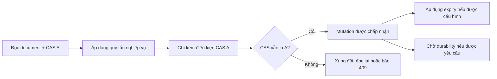

# Áp dụng CAS, thời gian hết hạn và yêu cầu độ bền

## Mục tiêu học tập

Kết thúc bài học, bạn có thể:

1. Giải thích **CAS (Compare-And-Swap)**, **TTL/expiry** và **durability** là ba chính sách khác nhau của thao tác key-value trong Couchbase.
2. Sử dụng `@Version` và `CouchbaseOperations.save(…)` để bảo vệ thao tác đọc–sửa–ghi trước xung đột đồng thời; nhận diện và xử lý `OptimisticLockingFailureException`.
3. Đặt hạn dùng trên entity bằng `@Document(expiry = …)` hoặc trên fluent operation bằng `withExpiry(Duration)`, đồng thời đánh giá tác động của việc ghi lại document đến expiry hiện có.
4. Chọn `DurabilityLevel` phù hợp và dùng `withDurability(…)` ở nhánh ghi để cân đối yêu cầu độ bền, tài nguyên cụm và thời gian đáp ứng.
5. Phối hợp CAS, TTL và durability trong cùng một kịch bản, phân biệt timeout không rõ kết quả với lỗi CAS hoặc document hết hạn.
6. Nhận biết khi nào cần dùng Couchbase Java SDK, transaction, API reactive hoặc thiết kế index và query consistency riêng.

**Ngữ cảnh module:** `SPRING_DATA_COUCHBASE` xây dựng tầng truy cập Couchbase với Spring Data thông qua document mapping, repository, `CouchbaseTemplate` và SQL++. Chương **Template** hướng tới những thao tác CRUD cụ thể trong bucket/scope/collection; bài này tập trung vào ba chính sách ảnh hưởng mạnh đến **đúng dữ liệu, vòng đời dữ liệu và khả năng chịu lỗi** của một document. Không có ghi chú bổ sung ngoài phạm vi module.

## 1. Ba câu hỏi độc lập trước mỗi thao tác ghi

Hãy xem xét ba câu hỏi của một hệ thống bán hàng:

- **CAS:** “Đơn hàng này còn đúng phiên bản mà người dùng đã đọc trước khi sửa hay không?”
- **TTL:** “Mã xác nhận thanh toán tạm này được phép tồn tại thêm bao lâu?”
- **Durability:** “Trước khi báo ghi thành công, cluster phải xác nhận mutation ở mức nào?”

| Cơ chế | Điều nó kiểm soát | Bài toán điển hình | Không tự bảo đảm |
| --- | --- | --- | --- |
| **CAS / optimistic locking** | Điều kiện phiên bản của **một document** | Hai worker cùng đổi trạng thái đơn hàng | Thời gian lưu giữ, replication hay giao dịch nhiều document |
| **TTL / expiry** | Thời điểm document hết hạn theo metadata | Session, token, cache, khóa tạm | Chống lost update, lưu trữ vĩnh viễn, bảo đảm xóa vật lý ngay đúng giây |
| **Durability** | Mức xác nhận replication/persistence của một mutation | Đơn hàng quan trọng, dấu vết giao dịch | CAS, tính duy nhất nghiệp vụ, query index đã cập nhật |
| **Transaction** | Phối hợp thay đổi qua nhiều document trong một ranh giới giao dịch | Cập nhật đơn hàng và tồn kho cùng lúc | Tự chọn TTL hoặc durability phù hợp cho mọi nghiệp vụ |
| **SQL++ scan consistency** | Mức đồng bộ của secondary index khi truy vấn | Vừa ghi KV rồi lọc theo `state` | Điều kiện CAS, transaction hay durability |

Một lời gọi `insertById` hoặc `upsertById` có thể đi kèm TTL và durability. Một luồng `findById → save` có thể dùng CAS. Nhưng việc thêm TTL hoặc durability **không làm cho ghi đè bằng upsert trở thành ghi có điều kiện phiên bản**.



Sơ đồ có tính khái niệm: CAS là điều kiện quyết định mutation có được chấp nhận; expiry là metadata vòng đời; durability quyết định mức xác nhận thành công. Các cơ chế được Couchbase xử lý trong thao tác tương ứng, không nhất thiết theo trình tự thực thi tuần tự như mũi tên hình vẽ.

## 2. Chuẩn bị entity và vị trí lưu document

Ví dụ dùng bucket `appdata`, scope `commerce`, hai collection `orders` và `checkout_tokens`:

```text
appdata
└── commerce
    ├── orders
    │   └── order::1001            (cần giữ, cần CAS + durability)
    └── checkout_tokens
        └── checkout::1001         (tạm thời, cần TTL)
```

Bucket do cấu hình Spring Boot chọn, ví dụ:

```yaml
spring:
  couchbase:
    connection-string: couchbase://localhost
    username: app_user
    password: CHANGE_VIA_ENVIRONMENT
  data:
    couchbase:
      bucket-name: appdata
```

Trong ứng dụng thật, mật khẩu phải được cấp từ biến môi trường hoặc trình quản lý secret; đoạn trên là placeholder để mô tả vị trí thuộc tính, **không** sử dụng làm mật khẩu thật. Scope và collection phải tồn tại, tài khoản kết nối phải có RBAC thích hợp.

### 2.1. Entity có CAS

```java
package com.example.commerce;

import org.springframework.data.annotation.Id;
import org.springframework.data.annotation.Version;
import org.springframework.data.couchbase.core.mapping.Collection;
import org.springframework.data.couchbase.core.mapping.Document;
import org.springframework.data.couchbase.core.mapping.Field;
import org.springframework.data.couchbase.core.mapping.Scope;

@Document
@Scope("commerce")
@Collection("orders")
public class OrderDocument {

    @Id
    private String id;

    @Field
    private String customerId;

    @Field
    private String status;

    @Field
    private long totalVnd;

    @Version
    private long version;

    public OrderDocument() {}

    public OrderDocument(String id, String customerId,
                         String status, long totalVnd) {
        this.id = id;
        this.customerId = customerId;
        this.status = status;
        this.totalVnd = totalVnd;
    }

    public String getId() { return id; }
    public void setId(String id) { this.id = id; }

    public String getCustomerId() { return customerId; }
    public void setCustomerId(String value) { customerId = value; }

    public String getStatus() { return status; }
    public void setStatus(String value) { status = value; }

    public long getTotalVnd() { return totalVnd; }
    public void setTotalVnd(long value) { totalVnd = value; }

    public long getVersion() { return version; }
    // Không tạo setter version cho mã nghiệp vụ.
}
```

`@Id` xác định document key và `@Field` định nghĩa các thuộc tính JSON. `@Version` ánh xạ **CAS** của Couchbase, thường được lấy khi đọc entity qua Spring Data; giá trị này **không phải trường version tự tăng** do ứng dụng quản lý. Trong ví dụ dùng `long` theo tài liệu Spring Data; có thể dùng kiểu hỗ trợ khác nếu đúng phiên bản dependency.

Không để controller tự đặt `version` bằng số từ request rồi lưu như một giá trị nghiệp vụ. Khi cần kiểm tra điều kiện phiên bản từ client HTTP, cần hợp đồng ETag/If-Match hoặc cơ chế xác thực rõ ràng, không tin CAS người dùng gửi tùy tiện.

### 2.2. Entity có hạn dùng

```java
package com.example.commerce;

import org.springframework.data.annotation.Id;
import org.springframework.data.couchbase.core.mapping.Collection;
import org.springframework.data.couchbase.core.mapping.Document;
import org.springframework.data.couchbase.core.mapping.Field;
import org.springframework.data.couchbase.core.mapping.Scope;

@Document(expiry = 900)  // 900 giây = 15 phút
@Scope("commerce")
@Collection("checkout_tokens")
public class CheckoutToken {

    @Id
    private String id;

    @Field
    private String orderId;

    @Field
    private String state;

    public CheckoutToken() {}

    public CheckoutToken(String id, String orderId, String state) {
        this.id = id;
        this.orderId = orderId;
        this.state = state;
    }

    public String getId() { return id; }
    public void setId(String id) { this.id = id; }

    public String getOrderId() { return orderId; }
    public void setOrderId(String value) { orderId = value; }

    public String getState() { return state; }
    public void setState(String value) { state = value; }
}
```

`@Document(expiry = 900)` mô tả chính sách hết hạn mặc định cho các mutation do Spring Data thực hiện trên entity này. Không nhầm annotation với một trường `expiresAt` trong JSON. Mặc định đơn vị của `expiry` là giây; với cấu hình có thể đổi đơn vị hoặc sử dụng `expiryExpression` nếu phiên bản thư viện hỗ trợ.

**Vì sao hai entity khác nhau?** Đơn hàng cần lưu giữ theo quy tắc kinh doanh, còn token xác nhận cần tự hết hạn. Áp dụng TTL cho toàn bộ đơn hàng chỉ vì token có hạn dùng là một lỗi thiết kế vòng đời dữ liệu.

## 3. CAS hoạt động như thế nào?

### 3.1. Từ đọc đến ghi có điều kiện

Mỗi Couchbase document có CAS, một giá trị metadata thay đổi sau mutation. Khi client đọc document, nó nhận nội dung và CAS hiện tại. Khi gửi mutation có điều kiện CAS, Couchbase chỉ chấp nhận nếu CAS được gửi vẫn phù hợp với CAS hiện hành.

```text
Document: order::1001, status=NEW, CAS=A

Worker A đọc → status=NEW, CAS=A
Worker B đọc → status=NEW, CAS=A

Worker A ghi status=PAID với CAS=A → THÀNH CÔNG, CAS=B
Worker B ghi status=CANCELLED với CAS=A → CAS MISMATCH

Worker B phải đọc lại status=PAID và áp dụng lại luật chuyển trạng thái.
```

Điều này giải quyết **lost update**: một worker dựa trên bản đọc cũ sẽ không âm thầm ghi đè mutation đã xảy ra sau đó, miễn là lệnh ghi thực sự dùng điều kiện CAS.

- CAS là token **opaque**: không diễn giải như timestamp hay số phiên bản tuần tự.
- CAS bảo vệ **một document** được ghi có điều kiện; nó không khóa toàn bộ collection.
- CAS có thể thay đổi khi metadata như expiry thay đổi, kể cả khi payload JSON không đổi.
- So sánh CAS trước ở ứng dụng bằng `if` rồi dùng `upsert` không đủ: sẽ có race giữa kiểm tra và ghi. Điều kiện phải được server kiểm tra tại chính mutation.

### 3.2. Optimistic locking bằng @Version và save

Spring Data Couchbase tự chuyển CAS của document sang field `@Version` khi đọc bằng Template hoặc repository. Khi ghi lại entity, cơ chế optimistic locking có thể từ chối CAS cũ với `OptimisticLockingFailureException`.

```java
package com.example.commerce;

import java.util.NoSuchElementException;

import org.springframework.dao.OptimisticLockingFailureException;
import org.springframework.data.couchbase.core.CouchbaseOperations;
import org.springframework.stereotype.Service;

@Service
public class OrderStateService {

    private final CouchbaseOperations operations;

    public OrderStateService(CouchbaseOperations operations) {
        this.operations = operations;
    }

    public OrderDocument markPaid(String id) {
        OrderDocument current = operations
                .findById(OrderDocument.class)
                .one(id);

        if (current == null) {
            throw new NoSuchElementException("Không thấy đơn " + id);
        }

        if (!"NEW".equals(current.getStatus())) {
            throw new IllegalStateException(
                    "Chỉ thanh toán đơn ở trạng thái NEW");
        }

        current.setStatus("PAID");
        return operations.save(current);
    }
}
```

Luồng trên yêu cầu một document hiện có: đọc → kiểm tra trạng thái → sửa → ghi. Vì entity có `@Version` được map từ CAS khi đọc, `save` dùng cơ chế optimistic locking của Spring Data cho thao tác ghi tiếp theo.

Nếu có cập nhật đồng thời, ngoại lệ là **một kết quả đúng của cơ chế phòng vệ**, không nhất thiết là lỗi Couchbase cần báo động. Cách ứng dụng xử lý tùy nghiệp vụ:

- Trả `409 Conflict` nếu client phải tải lại đơn và quyết định.
- Đọc lại trạng thái rồi chạy lại **toàn bộ quy tắc nghiệp vụ** với số lần retry giới hạn nếu thao tác cho phép.
- Nếu một tác vụ đã thanh toán, không tự ghi lại “PAID” hoặc tạo thêm lần thanh toán từ dữ liệu cũ: cần idempotency ở nghiệp vụ thanh toán.

### 3.3. Một retry an toàn phải tính lại trạng thái

Ví dụ minh họa retry có giới hạn; giả định chỉ cập nhật trường trạng thái và không phát sinh side effect như gọi cổng thanh toán bên trong vòng lặp:

```java
public OrderDocument markPaidWithRetry(String id) {
    for (int attempt = 1; attempt <= 3; attempt++) {
        OrderDocument current = operations
                .findById(OrderDocument.class).one(id);

        if (current == null) {
            throw new NoSuchElementException("Không thấy đơn " + id);
        }

        if ("PAID".equals(current.getStatus())) {
            return current; // Xử lý idempotent cho trạng thái này.
        }
        if (!"NEW".equals(current.getStatus())) {
            throw new IllegalStateException(
                    "Không thể chuyển sang PAID từ " + current.getStatus());
        }

        current.setStatus("PAID");
        try {
            return operations.save(current);
        } catch (OptimisticLockingFailureException conflict) {
            if (attempt == 3) {
                throw conflict;
            }
            // Lặp lại sẽ đọc CAS và trạng thái mới.
        }
    }
    throw new IllegalStateException("Không tới được nhánh này");
}
```

Tại môi trường production cần bổ sung backoff/jitter nếu conflict thường xuyên, giám sát số lần retry và bảo đảm các thao tác side effect (thanh toán, gửi email) được điều phối bằng cơ chế idempotency/giao dịch tương ứng. Không retry vô hạn với chính entity giữ CAS cũ.

### 3.4. insert, upsert, replace và save khác nhau

| Cách ghi | Điều kiện tồn tại | Điều kiện phiên bản |
| --- | --- | --- |
| `insertById(T.class).one(entity)` | Chỉ tạo khi ID chưa tồn tại | Việc ID chưa tồn tại là điều kiện server kiểm tra |
| `upsertById(T.class).one(entity)` | Tạo mới hoặc thay thế | Không được giả định tự kiểm tra CAS cũ |
| `replaceById(T.class).one(entity)` | Phải có ID để thay | Có thể kết hợp CAS theo API/mapping; bản thân điều kiện tồn tại chưa đủ |
| `save(entity)` với `@Version` đã đọc | Spring Data chọn đường ghi theo trạng thái/version | Có cơ chế optimistic locking được mô tả trong tài liệu Spring Data |

Với các trường hợp kiểm tra CAS phức tạp hoặc phối hợp `preserveExpiry`, có thể dùng `ReplaceOptions.cas(…)` của Couchbase Java SDK; xem phần 7. Khi chọn một thao tác, cần phân biệt **chỉ được tạo**, **phải tồn tại**, và **phải giữ đúng phiên bản**.

## 4. TTL/expiry: vòng đời của document

TTL xác định khi nào document được Couchbase coi là hết hạn. Nó phù hợp với session tạm, token, cache, giỏ hàng bỏ dở hoặc dữ liệu thử nghiệm. Khi hết hạn, document không còn được đọc như một document hợp lệ; việc xóa vật lý và dọn tài nguyên có thể được server thực hiện bất đồng bộ.

### 4.1. Đặt hạn dùng trên từng lần insert

```java
import java.time.Duration;

CheckoutToken token = new CheckoutToken(
        "checkout::1001", "order::1001", "PENDING");

CheckoutToken created = operations
        .insertById(CheckoutToken.class)
        .withExpiry(Duration.ofMinutes(15))
        .one(token);
```

`withExpiry(Duration)` là option của fluent operation có hỗ trợ expiry. Khi entity đã có `@Document(expiry = 900)`, việc chỉ định rõ 15 phút ở operation nhấn mạnh mong muốn của caller; không cần đặt lặp trong mọi lời gọi nếu policy mặc định đã đủ.

**Chú ý:** Điều kiện hết hạn được Couchbase quản lý qua metadata, không phải qua `createdAt + duration` trong JSON nếu không có logic tự viết. Muốn hiển thị thời gian chính xác cho user, lưu hoặc suy ra mốc business phù hợp theo hợp đồng ứng dụng và cân nhắc sai lệch thời gian.

### 4.2. Expiry trên annotation và cấu hình động

Các cách phổ biến:

```java
// Giá trị cố định tính bằng giây.
@Document(expiry = 900)
class TemporarySession { /* mapping fields */ }

// Có thể lấy số giây từ Spring property source.
@Document(expiryExpression = "${session.ttl.seconds}")
class ConfigurableSession { /* mapping fields */ }
```

Trong ứng dụng thật, hai class chỉ minh họa cách ghi annotation; cần bổ sung `@Id`, scope, collection và các trường mapping để trở thành entity hoàn chỉnh. `expiryExpression` lấy giá trị từ Spring property sources theo cơ chế được Spring Data hỗ trợ, **không phải biểu thức SpEL tùy ý**. Không đặt đồng thời `expiry` và `expiryExpression` trên cùng entity.

### 4.3. Quy tắc hết hạn theo cấp

Expiry thực tế còn chịu ảnh hưởng cấu hình của bucket và collection:

| Cấp | Thiết lập | Ý nghĩa |
| --- | --- | --- |
| Document | Expiry khi mutation hoặc từ annotation | Chính sách áp dụng cho một document |
| Collection | `maxExpiry` | Ràng buộc/chính sách mặc định cho các document thuộc collection |
| Bucket | `maxExpiry` | Chính sách cấp bucket nếu collection kế thừa |
| Operation | `withExpiry(Duration)` hoặc SDK expiry option | Chỉ định hạn dùng trên lệnh ghi nếu được hỗ trợ |

Chi tiết về `maxExpiry=0`, `maxExpiry=-1`, hành vi kế thừa và thứ tự ưu tiên phụ thuộc phiên bản Couchbase Server/SDK. Đặc biệt, không suy luận rằng `0` ở mọi cấp luôn có nghĩa “vĩnh viễn”; hãy kiểm tra cấu hình thực tế của bucket/collection.

### 4.4. Ghi lại document có thể thay đổi TTL

Điểm thường gây lỗi: **một mutation mới có thể làm thay đổi hoặc xóa expiry trước đó**, tùy API và option. Nếu token được tạo với hạn dùng 15 phút, sau 10 phút người dùng refresh token, cần chọn một trong hai chính sách:

1. **Hạn dùng cố định từ lúc tạo:** vẫn hết hạn theo mốc ban đầu, không vì refresh mà kéo dài.
2. **Sliding expiration:** mỗi lần người dùng hoạt động sẽ gia hạn thành 15 phút tiếp theo.

Hai policy khác nhau về bảo mật và trải nghiệm. Không dựa vào hành vi mặc định của một câu `upsert` hoặc `replace` để quyết định ngầm.

Ở Couchbase Java SDK, có thể dùng `preserveExpiry(true)` khi mutation cần **giữ nguyên thời điểm hết hạn** hiện có. Muốn gia hạn thì cần đặt expiry mới một cách chủ động, ví dụ dùng `touch` hoặc mutation có option expiry tương ứng.

### 4.5. Expiry không thay thế trạng thái nghiệp vụ

Document tự hết hạn phù hợp cho cache/session, nhưng đơn hàng đã thanh toán thường phải có chính sách retention riêng. Nếu yêu cầu xóa chỉ sau khi `status=PROCESSED`, tenant hợp lệ và hết 30 ngày, TTL đơn giản có thể chưa đủ để biểu diễn mọi điều kiện; khi đó cần job cleanup có kiểm soát hoặc mô hình state machine.

Expiry có thể khiến một entity vừa được đọc bị biến mất trước khi ghi tiếp. Lệnh `replace` sau đó thất bại vì ID không còn tồn tại. **Không tự chuyển sang `upsert`** để khắc phục, vì như vậy có thể vô tình hồi sinh dữ liệu đã chủ động cho hết hạn.

## 5. Durability: mức xác nhận trước khi coi ghi thành công

Thông thường, ghi KV được gửi tới active Data Service node; cluster tiếp tục replication/persistence theo cơ chế Couchbase. Nếu yêu cầu durability mạnh hơn, client chờ Couchbase xác nhận mutation đã đạt một mức bền vững nhất định trước khi báo thành công.

### 5.1. Các mức DurabilityLevel

| Mức | Điều kiện xác nhận chính | Đánh đổi |
| --- | --- | --- |
| `NONE` | Không yêu cầu durable write bổ sung ngoài xác nhận ghi thông thường | Độ trễ thấp hơn; không đợi replication/persistence theo mức nâng cao |
| `MAJORITY` | Mutation được giữ trong bộ nhớ của **đa số bản sao liên quan**, theo quy tắc majority của cluster | Chờ xác nhận từ cụm, thường lâu hơn `NONE` |
| `MAJORITY_AND_PERSIST_TO_ACTIVE` | Đạt majority trong bộ nhớ **và** được ghi bền xuống đĩa ở active vBucket | Có thêm chi phí I/O trên node active |
| `PERSIST_TO_MAJORITY` | Đạt mức persist xuống đĩa ở đa số bản sao liên quan | Thường có chi phí cao nhất và yêu cầu topology/disk phù hợp |

Không mặc định cho rằng `MAJORITY` luôn là “2 node”: đa số phụ thuộc số replica/topology của bucket. Với ephemeral bucket, các mức đòi ghi ra đĩa không phù hợp. Cluster và Couchbase Server phải hỗ trợ loại durable write được yêu cầu.

### 5.2. Fluent option trên một thao tác ghi

```java
import com.couchbase.client.core.msg.kv.DurabilityLevel;

OrderDocument order = new OrderDocument(
        "order::1001", "customer::42", "NEW", 350_000L);

OrderDocument written = operations
        .insertById(OrderDocument.class)
        .withDurability(DurabilityLevel.MAJORITY)
        .one(order);
```

Sử dụng `insertById` để tránh âm thầm ghi đè đơn hàng cùng ID. `withDurability` bổ sung yêu cầu replication trước khi coi thao tác thành công; nó không làm thay đổi quy tắc trùng key của `insert`.

Spring Data cũng có thể đọc durability mặc định từ `@Document(durabilityLevel = DurabilityLevel.MAJORITY)` hoặc annotation tương ứng. Tùy chọn trực tiếp ở thao tác hữu ích khi một số mutation cần mức cao hơn chuẩn chung; trước khi triển khai cần kiểm tra cấu hình durability ở phía server/bucket và behavior của phiên bản dùng.

### 5.3. Durability không phải “ghi nhanh hơn” hay “một transaction”

Bật `PERSIST_TO_MAJORITY` có thể làm tăng độ trễ và timeout ở cụm dưới tải lớn. Nhưng durability không tự giải quyết:

- **Lost update** khi hai worker dùng `upsert` không có CAS.
- **Query chưa thấy document vừa ghi**, do secondary index còn cập nhật bất đồng bộ.
- **Tính nguyên tử của hai mutation ở hai document**.
- **Đảm bảo không xử lý lặp nghiệp vụ** khi client retry sau timeout.

Vì vậy, đừng dùng mức durability cao làm biện pháp thay thế CAS, transaction hoặc idempotency.

## 6. Kết hợp expiry và durability trên cùng fluent operation

Một mã xác nhận tạm có thể vừa cần TTL 15 phút, vừa cần Couchbase xác nhận ghi qua majority trước khi trả kết quả. Fluent API cho phép truyền nhiều option trong một lệnh.

```java
import java.time.Duration;
import com.couchbase.client.core.msg.kv.DurabilityLevel;

CheckoutToken token = new CheckoutToken(
        "checkout::1002", "order::1002", "PENDING");

CheckoutToken stored = operations
        .insertById(CheckoutToken.class)
        .withExpiry(Duration.ofMinutes(15))
        .withDurability(DurabilityLevel.MAJORITY)
        .inScope("commerce")
        .inCollection("checkout_tokens")
        .one(token);
```

**Thứ tự builder cần chú ý.** Với các interface fluent của Spring Data Couchbase hiện đại, `withExpiry` trả một builder còn hỗ trợ `withDurability`; `withDurability` trả builder còn hỗ trợ `inScope`; tiếp đó `inCollection` dẫn đến terminal. Vì vậy, thứ tự trong ví dụ có ý nghĩa đối với Java type system: không phải mọi method đều gọi được sau mọi method khác. Khi đã cấu hình `@Scope`/`@Collection` ở entity, có thể bỏ hai bước override cuối.

Đánh đổi của lệnh trên:

- Nếu ID `checkout::1002` đã tồn tại, `insert` báo xung đột dù TTL hay durability có được chọn.
- Nếu cluster không thể thỏa majority theo thời gian chờ, có thể phát sinh timeout hoặc lỗi durability.
- Nếu đã ghi thành công nhưng phản hồi bị mất, retry có thể gặp ID trùng; phải đối soát theo idempotency key.
- TTL 15 phút không có nghĩa token được phép sử dụng bất kể trạng thái nghiệp vụ: service vẫn phải xác thực token, trạng thái đơn và thời điểm sử dụng.

### 6.1. Cần TTL, CAS và durability đồng thời?

Tình huống khó hơn: một session có expiry cố định từ lần tạo; sau đó worker sửa state, muốn bảo toàn expiry, kiểm tra CAS và yêu cầu majority. Cách đặt option có thể vượt khỏi contract đơn giản của fluent builder. Lúc này, dùng SDK cho một thao tác chuyên biệt hoặc kiểm tra `withOptions(…)` trên nhánh Template tương ứng.

Không tách thành “đọc CAS → upsert không CAS → touch expiry” rồi giả định tương đương một mutation bảo vệ tất cả điều kiện. Cách tách đó tạo thêm cửa sổ race, thay đổi số lần truy cập mạng và có thể làm rơi expiry khi ghi lại.

## 7. Thao tác SDK có CAS + preserveExpiry + durability

Couchbase Java SDK cung cấp `GetResult.cas()` và `ReplaceOptions` để điều chỉnh một mutation với nhiều điều kiện. Đây là ví dụ cho một document session hoặc token đã tồn tại, khi cần:

- Đọc trạng thái mới nhất và CAS.
- Kiểm tra trạng thái nghiệp vụ.
- Thay JSON bằng điều kiện CAS hiện hành.
- Giữ **mốc expiry đang có**.
- Chờ durability ở mức majority.

```java
package com.example.commerce;

import com.couchbase.client.core.msg.kv.DurabilityLevel;
import com.couchbase.client.java.Cluster;
import com.couchbase.client.java.Collection;
import com.couchbase.client.java.json.JsonObject;
import com.couchbase.client.java.kv.GetResult;

import static com.couchbase.client.java.kv.ReplaceOptions.replaceOptions;

public class CheckoutTokenUpdater {

    private final Collection tokenCollection;

    public CheckoutTokenUpdater(Cluster cluster) {
        this.tokenCollection = cluster.bucket("appdata")
                .scope("commerce")
                .collection("checkout_tokens");
    }

    public void markUsed(String id) {
        GetResult loaded = tokenCollection.get(id);
        JsonObject body = loaded.contentAsObject();

        if (!"PENDING".equals(body.getString("state"))) {
            throw new IllegalStateException(
                    "Token không còn ở trạng thái PENDING");
        }

        body.put("state", "USED");

        tokenCollection.replace(
                id,
                body,
                replaceOptions()
                        .cas(loaded.cas())
                        .preserveExpiry(true)
                        .durability(DurabilityLevel.MAJORITY));
    }
}
```

**Ý nghĩa từng option:**

- `cas(loaded.cas())`: nếu document đã được worker khác cập nhật, mutation thất bại do CAS mismatch.
- `preserveExpiry(true)`: thay thế nội dung nhưng giữ nguyên expiry hiện có (không âm thầm kéo dài hoặc bỏ thời hạn token).
- `durability(MAJORITY)`: xác nhận mutation theo mức majority của cụm trước khi hoàn thành.
- `replace(…)`: yêu cầu ID đã tồn tại; nếu token đã hết hạn thì không được tạo mới.

Dùng SDK trực tiếp đồng nghĩa đoạn code trên làm việc với `JsonObject` và **không tự chạy Spring Data converter, entity mapping hoặc các callback của Template**. Đừng trộn logic SDK và Template mà chưa xác định ai quản lý metadata `@Version` và expiry.

### 7.1. Nếu một mutation thất bại thì sao?

| Tình huống | Biểu hiện có thể gặp | Hành động đúng |
| --- | --- | --- |
| CAS không còn khớp | `CasMismatchException` ở SDK hoặc lỗi optimistic locking ở Spring Data | Đọc lại, kiểm tra state và quyết định retry có giới hạn |
| Document đã hết hạn hoặc bị xóa | `DocumentNotFoundException`/lỗi not found tương ứng | Coi token không còn hợp lệ; không hồi sinh bằng upsert |
| Không đạt durability đúng thời hạn | Lỗi durability hoặc timeout, có thể không chắc kết quả | Đối soát trạng thái trước khi retry; kiểm tra topology |
| Tài khoản thiếu quyền vào collection | Lỗi quyền truy cập | Sửa RBAC ở môi trường hoặc quyền ứng dụng, không retry vô hạn |
| Lỗi JSON/mapping | Lỗi giải mã hoặc dữ liệu không đúng schema | Kiểm tra payload/schema và chính sách migration |

Tên exception cụ thể ở tầng Spring Data có thể khác sau khi dịch lỗi từ SDK. Phân biệt lỗi nghiệp vụ thông thường với lỗi hạ tầng, đồng thời ghi log vừa đủ để điều tra mà không làm lộ nội dung token.

## 8. TTL, CAS và durability trong kịch bản thực tế

### 8.1. Tạo đơn hàng mới

**Yêu cầu:** ID duy nhất, không tự hết hạn, cần xác nhận ghi theo majority.

Hướng triển khai:

```java
OrderDocument created = operations
        .insertById(OrderDocument.class)
        .withDurability(DurabilityLevel.MAJORITY)
        .one(new OrderDocument(
                "order::1003", "customer::43", "NEW", 890_000L));
```

Không gán TTL cho entity `OrderDocument` nếu quy trình lưu trữ đơn hàng cần giữ dài hạn. Sau khi tạo, `@Version` giúp lần cập nhật tiếp theo phát hiện xung đột CAS.

### 8.2. Cập nhật đơn hàng khi có hai nguồn ghi

**Yêu cầu:** Nhân viên không được ghi đè kết quả thanh toán vừa được worker khác cập nhật.

Hướng triển khai: `findById → kiểm tra state → save(entity có @Version)`. Nếu CAS conflict, đọc lại. Không thay `save` bằng `upsertById` khi chưa có chiến lược kiểm soát phiên bản.

### 8.3. Token thanh toán tạm

**Yêu cầu:** Hết hạn sau 15 phút; khi được dùng, giữ nguyên expiry và chống hai worker đồng thời xác nhận token.

Hướng triển khai: tạo token bằng `insertById + withExpiry`; khi cập nhật dùng SDK `replace` có `cas` và `preserveExpiry(true)`; cân nhắc majority nếu chính sách yêu cầu. Mặc dù CAS giúp tránh hai update thành công từ cùng bản đọc cũ, **thanh toán ngoài Couchbase vẫn cần idempotency** để tránh gọi cổng thanh toán hai lần.

### 8.4. Session kéo dài khi người dùng hoạt động

**Yêu cầu:** Sau mỗi tương tác hợp lệ, gia hạn thêm 15 phút.

Hướng triển khai: dùng chính sách sliding expiry tường minh thông qua mutation có expiry mới, `touch` hoặc `getAndTouch` khi phù hợp. Nếu đồng thời cần kiểm tra trạng thái và CAS, phải lựa chọn API có điều kiện đồng thời rõ ràng; không dùng `touch` như công cụ thay thế xác thực phiên.

### 8.5. Snapshot dữ liệu từ hệ thống nguồn

**Yêu cầu:** Có thể tạo hoặc thay toàn bộ document, miễn là hệ thống nguồn nắm thẩm quyền.

Hướng triển khai: `upsertById` là lựa chọn có thể phù hợp, nhưng nếu có nguồn cập nhật khác cùng document, phải thiết kế conflict resolution hoặc CAS. Durability chỉ thay đổi mức xác nhận, không quyết định nguồn nào được quyền ghi đè.

## 9. TTL không phải scan consistency và CAS không phải transaction

Một bộ lọc SQL++ như `WHERE state = "USED"` có thể đi qua Query Service và secondary index, trong khi `findById` truy cập KV theo ID. Sau khi mutation KV thành công, query SQL++ có thể chưa thấy document do index cập nhật bất đồng bộ. Khi cần mức nhìn thấy dữ liệu mới hơn, dùng scan consistency như `REQUEST_PLUS` theo API truy vấn có hỗ trợ.

Tuy nhiên:

- `REQUEST_PLUS` không ngăn một worker khác sửa document sau khi query hoàn tất.
- CAS không bảo vệ điều kiện duy nhất trên toàn collection hay cập nhật nhiều document.
- Durability không làm cho query SQL++ đồng bộ tức thì.
- TTL không xóa các side effect đã gửi ra dịch vụ thanh toán hoặc hàng đợi.
- Hai lệnh Template riêng lẻ không mặc nhiên có atomicity như một transaction nhiều document.

Khi quy trình “thanh toán đơn và giảm tồn kho” cần giữ bất biến xuyên nhiều document, cân nhắc Couchbase Transactions với retry và commit outcome phù hợp; CAS có thể vẫn hữu ích ở từng thao tác nhưng không thay thế transaction đó.

## 10. Reactive API và các quyết định tương tự

`ReactiveCouchbaseOperations` có các fluent operation tương ứng nhưng terminal phát publisher của Reactor:

```java
import java.time.Duration;
import com.couchbase.client.core.msg.kv.DurabilityLevel;
import org.springframework.data.couchbase.core.ReactiveCouchbaseOperations;
import reactor.core.publisher.Mono;

public class ReactiveCheckoutTokenWriter {

    private final ReactiveCouchbaseOperations operations;

    public ReactiveCheckoutTokenWriter(
            ReactiveCouchbaseOperations operations) {
        this.operations = operations;
    }

    public Mono<CheckoutToken> create(CheckoutToken token) {
        return operations.insertById(CheckoutToken.class)
                .withExpiry(Duration.ofMinutes(15))
                .withDurability(DurabilityLevel.MAJORITY)
                .one(token);
    }
}
```

`Mono<CheckoutToken>` không phải `CheckoutToken` trực tiếp. Thao tác xảy ra khi publisher được subscribe; nếu một publisher ghi được subscribe lặp mà không kiểm soát, lệnh insert có thể bị thực hiện nhiều lần với cùng ID. Không gọi `block()` trong event loop WebFlux để nhận giá trị đồng bộ.

Khi dùng `Mono.timeout(…)`, chỉ giới hạn thời gian phía pipeline; đừng mặc định mutation ở Couchbase Server bị rollback. Retry reactive cũng cần giới hạn, idempotency và phân biệt CAS conflict, document hết hạn và timeout không chắc chắn như imperative API.

## 11. Timeout và trạng thái kết quả không chắc chắn

Khi ghi durable, thao tác có thể phải chờ replication hoặc persistence. Client có thể timeout trong khi server đã nhận hoặc hoàn tất mutation. Một chuỗi sự kiện dễ gặp:

```text
Client -> INSERT token::01 với MAJORITY -> Data Service
                                           |
                                           | mutation đã được chấp nhận
                                           | đang xác nhận durable write
Client <- timeout (không có xác nhận cuối cùng)

Client retry INSERT token::01 -> có thể gặp ID đã tồn tại
```

Lúc này không thể kết luận ngay “lần đầu thất bại” chỉ từ timeout; cũng không thể kết luận thành công nghiệp vụ chỉ từ ID trùng ở retry. Đọc lại trạng thái, đối chiếu idempotency key hoặc nguồn sự thật của nghiệp vụ rồi quyết định retry. Cần phân biệt timeout ambiguous và unambiguous theo loại exception mà SDK/Template cung cấp.

Với CAS conflict, retry với **chính CAS cũ** thường vô ích; cần đọc lại và áp dụng logic mới. Với token đã hết hạn, việc tạo lại bằng upsert có thể vi phạm chính sách an toàn, nên phải báo không hợp lệ thay vì tự động hồi sinh.

Durability mạnh hơn thường cần timeout phù hợp với workload và topology. Không tăng timeout vô hạn để che giấu cụm thiếu replica, disk chậm hoặc quá tải.

## 12. Bảng quyết định và lỗi thường gặp

| Nhu cầu hoặc lỗi | Cơ chế/API nên xem | Điểm cần kiểm chứng |
| --- | --- | --- |
| Hai worker cùng sửa một đơn | `@Version` + `save` hoặc SDK CAS | Có lỗi khi CAS cũ; retry phải đọc lại |
| Tạo mới nhưng trùng ID | `insertById` | Chặn ghi đè ngay tại server |
| Cần thay document đang tồn tại và giữ expiry | `replace` với `preserveExpiry` | Có thể cần SDK/withOptions phù hợp |
| Session tự biến mất | `@Document(expiry)`, `withExpiry`, bucket/collection `maxExpiry` | Quy tắc expiry thực tế, có mutation gia hạn hay không |
| Token không được sống lại sau TTL | `replace`/CAS thay vì `upsert` tùy tiện | Nếu not found thì báo token không hợp lệ |
| Ghi cần bảo vệ khi node lỗi | `withDurability` | Số replica, cấu hình cluster, mức ghi đĩa, latency |
| Query không thấy thay đổi vừa ghi | SQL++ index/scan consistency | Thử KV theo ID hoặc `REQUEST_PLUS` |
| Hai document phải cùng commit hoặc cùng rollback | Couchbase Transactions | Không dựa vào hai lời gọi KV độc lập |
| Ghi timeout sau khi đã gửi request | Idempotency, audit, đối soát | Không mặc định server đã rollback |
| Cập nhật nhiều lần không đúng TTL mong muốn | `preserveExpiry` hoặc đặt expiry mới rõ ràng | Chọn fixed-expiry hay sliding-expiry |
| Dùng CAS như số version tăng dần | Sửa domain model | CAS là opaque token metadata |
| Mức durability cao khiến p99 tăng | Theo dõi replication/disk/timeout | Chọn SLA và mức xác nhận tương thích |

**Quan sát vận hành:** ghi metric theo loại mutation (insert, upsert, replace), latency p50/p95/p99, lỗi CAS, lỗi document not found, số timeout không rõ kết quả, mức durability, số mutation có TTL và tỉ lệ retry. Kết nối trace nên gắn document ID đã được xử lý an toàn, scope/collection và operation type; tránh log token, dữ liệu thanh toán hoặc thông tin nhạy cảm.

## 13. Bài thực hành có kiểm chứng

Chuẩn bị Couchbase Server với bucket `appdata`, scope `commerce` và hai collection `orders`, `checkout_tokens`. Chỉ dùng dữ liệu thử nghiệm.

1. **Entity:** Tạo `OrderDocument` có `@Version` và `CheckoutToken` có `@Document(expiry = 900)`. Kiểm tra Spring Data mapping đúng collection.
2. **CAS cơ bản:** Insert `order::lab-01`, đọc từ hai luồng cùng lúc; mỗi luồng sửa trạng thái và gọi `save`. Ghi nhận chỉ một mutation dùng CAS cũ có thể thành công.
3. **Retry:** Thiết kế `markPaidWithRetry` đọc lại entity sau xung đột. Chứng minh retry không ghi đè trạng thái đã chuyển sang một giá trị không hợp lệ.
4. **TTL:** Insert `checkout::lab-01` với `withExpiry(Duration.ofSeconds(30))` và quan sát sau khi hết hạn. Không dùng document sản xuất để thử expiry ngắn.
5. **Preserve expiry:** Với SDK, đọc token, cập nhật trường `state` bằng `ReplaceOptions.cas(…).preserveExpiry(true)` và xác minh hạn dùng không bị gia hạn.
6. **Sliding expiry:** Thử `touch`/`getAndTouch` trên token thử nghiệm và ghi lại thời điểm expiry mới; so sánh với fixed expiry.
7. **Durability:** So sánh latency của `NONE` và `MAJORITY` khi cấu hình cluster đủ replica; nếu có disk-backed bucket, quan sát thêm `MAJORITY_AND_PERSIST_TO_ACTIVE` theo khả năng môi trường.
8. **Kết hợp:** Insert token dùng `withExpiry(…).withDurability(…).one(token)`; kiểm tra thứ tự fluent theo IDE/Javadoc và đọc lại document.
9. **Timeout:** Mô phỏng delay hoặc sự cố mạng trên môi trường kiểm thử; phân biệt timeout với CAS mismatch và document not found. Đề xuất cách đối soát kết quả.
10. **Kiến trúc:** Mô tả vì sao các cơ chế trên không thay thế Couchbase Transactions khi cập nhật đồng thời đơn hàng và tồn kho.

### Câu hỏi tự kiểm tra

- CAS là gì, lấy từ đâu, và tại sao không nên tự gán một số version?
- Một lần `upsertById` có thể ghi đè thay đổi của worker khác dù đã bật `MAJORITY` không? Vì sao?
- TTL được lưu ở JSON hay metadata? Vì sao document có thể hết hạn sau khi được đọc nhưng trước khi replace?
- Fixed expiry khác sliding expiry như thế nào?
- `preserveExpiry(true)` giải quyết vấn đề gì khi replace document?
- `MAJORITY`, `MAJORITY_AND_PERSIST_TO_ACTIVE` và `PERSIST_TO_MAJORITY` khác nhau ở điều kiện xác nhận nào?
- Vì sao timeout của durable write có thể cần đối soát thay vì retry mù?
- CAS, durability và `REQUEST_PLUS` có thể thay thế transaction cập nhật hai document không?
- Khi dùng `ReactiveCouchbaseOperations`, tại sao cần kiểm soát số lần subscribe của một publisher ghi?

## Tài liệu tham khảo chính thức

- [Spring Data Couchbase — Template & direct operations](https://docs.spring.io/spring-data/couchbase/reference/couchbase/template.html).
- [Spring Data Couchbase — Modeling entities, expiry và optimistic locking](https://docs.spring.io/spring-data/couchbase/reference/couchbase/entity.html).
- [Spring Data Couchbase Javadoc — ExecutableInsertByIdOperation](https://docs.spring.io/spring-data/couchbase/docs/current/api/org/springframework/data/couchbase/core/ExecutableInsertByIdOperation.html).
- [Spring Data Couchbase Javadoc — ExecutableReplaceByIdOperation](https://docs.spring.io/spring-data/couchbase/docs/current/api/org/springframework/data/couchbase/core/ExecutableReplaceByIdOperation.html).
- [Spring Data Couchbase Javadoc — WithExpiry và WithDurability](https://docs.spring.io/spring-data/couchbase/docs/current/api/org/springframework/data/couchbase/core/support/package-summary.html).
- [Couchbase Java SDK — KV operations, CAS, TTL, durability](https://docs.couchbase.com/java-sdk/current/howtos/kv-operations.html).
- [Couchbase Java SDK — Durability và expiry](https://docs.couchbase.com/java-sdk/current/concept-docs/data-durability-acid-transactions.html).
- [Couchbase Server — Durability](https://docs.couchbase.com/server/current/learn/data/durability.html).

> **Ranh giới phiên bản:** Các ví dụ diễn đạt API phổ biến của Spring Data Couchbase/Couchbase Java SDK hiện đại. Trước khi tích hợp, cần đối chiếu Javadoc của phiên bản dependency đang khóa, cấu hình `maxExpiry` và durability của cluster, đồng thời kiểm thử tích hợp điều kiện CAS/expiry/timeout trên môi trường đại diện. Bài được hoàn thành ở bước viết Markdown (STEP 4); quy trình QA học thuật chuyên sâu diễn ra ở STEP 6.
