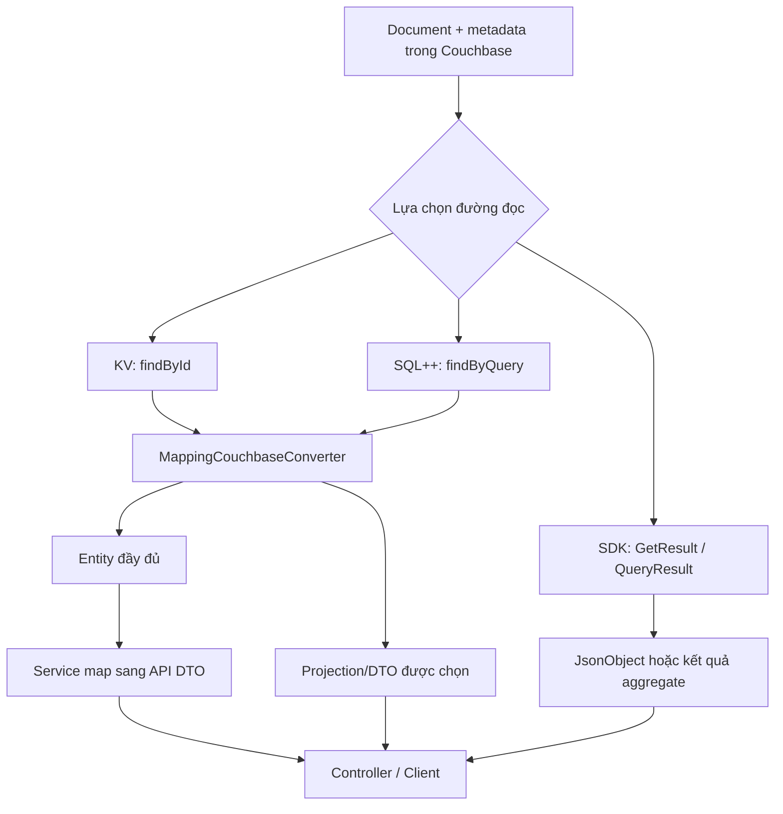

# Ánh xạ kết quả về entity hoặc biểu diễn cần dùng

## Mục tiêu học tập

Sau bài học, bạn có thể:

1. Giải thích quá trình Spring Data Couchbase chuyển JSON document, document ID và metadata CAS thành Java entity qua `CouchbaseTemplate`/`CouchbaseOperations`.
2. Chọn **entity đầy đủ**, **projection chỉ chứa trường cần thiết**, **DTO phục vụ API** hoặc **kết quả JSON/aggregate từ Couchbase SDK** theo nhu cầu xử lý.
3. Sử dụng `findById(…).one(id)`, `findByQuery(…).all()` và khả năng `project(String[])`/`as(Class)` của fluent API.
4. Phân biệt projection của Template với projection qua repository và với bước `map(entity → dto)` trong application service.
5. Xử lý các vấn đề thường gặp: tên trường `@Field` khác tên property, document ID không nằm trong JSON, CAS, trường thiếu/null, nested object, kiểu số, ngày giờ và schema thay đổi.
6. Giải thích ảnh hưởng của chỉ mục, SQL++, TTL, truy vấn reactive và quyền truy cập đến tính đúng và hiệu năng của dữ liệu trả về.

**Bối cảnh:** Module `SPRING_DATA_COUCHBASE` hướng đến việc xây dựng tầng truy cập Couchbase với document mapping, repository, `CouchbaseTemplate` và truy vấn SQL++. Chương **Template** cho phép kiểm soát thao tác theo bucket/scope/collection, kết quả, TTL, CAS và lựa chọn API reactive. Bài học này tập trung vào **hình dạng dữ liệu sau khi đọc**, từ document lưu trữ đến đối tượng phù hợp cho nghiệp vụ hoặc giao diện.

## 1. Vì sao “lấy được dữ liệu” chưa đủ?

Hãy tưởng tượng hệ thống thương mại điện tử lưu document đơn hàng gồm ID, khách hàng, trạng thái, số tiền và địa chỉ giao hàng. Ba caller cần ba cách biểu diễn:

- **Worker cập nhật đơn** cần **entity đầy đủ**, gồm những trường cần dùng trong quy tắc nghiệp vụ và giá trị CAS để tránh ghi đè thay đổi của worker khác.
- **Trang danh sách đơn hàng** chỉ cần mã đơn, trạng thái và tổng tiền; tải toàn bộ địa chỉ và những field nội bộ có thể lãng phí băng thông và tạo rủi ro lộ dữ liệu.
- **Dashboard thống kê** chỉ cần số đơn theo trạng thái; không cần ánh xạ từng document về entity rồi tự đếm ở Java.

Một truy vấn đúng điều kiện vẫn có thể dẫn đến tầng truy cập dữ liệu kém hiệu quả nếu trả về biểu diễn sai.

| Nhu cầu | Biểu diễn nên cân nhắc | Cách thực hiện |
| --- | --- | --- |
| Đọc một đơn theo ID để cập nhật | Entity đầy đủ, có `@Id` và `@Version` | `CouchbaseOperations.findById(OrderDocument.class).one(id)` |
| Lấy nhiều đơn theo điều kiện để xử lý nghiệp vụ | `List<OrderDocument>` | `findByQuery(OrderDocument.class).matching(query).all()` |
| Hiển thị danh sách chỉ có vài trường | DTO/record hoặc projection interface | `project(…).as(…)` trong Template hoặc repository projection |
| Trả chi tiết đơn qua REST | DTO do service ánh xạ từ entity | `new OrderDetail(…)` hoặc mapper có kiểm soát |
| Đếm số đơn theo trạng thái | Scalar/aggregate result | `count()` hoặc SQL++ `GROUP BY` qua SDK |
| Thao tác JSON không theo domain mapping | `JsonObject`, `QueryResult` | Couchbase Java SDK và mapping rõ ràng |
| Pipeline WebFlux | `Mono<T>`, `Flux<T>` rồi `map(…)` | `ReactiveCouchbaseOperations` |



**Nguyên tắc:** Entity lưu trữ, projection đọc và DTO phản hồi có thể cùng trường nhưng phục vụ **ba hợp đồng khác nhau**. Không nhất thiết dùng một Java class cho cả ghi, đọc, gửi ra REST và thống kê.

## 2. Mô hình dữ liệu xuyên suốt bài học

Ứng dụng dùng bucket `appdata`, scope `commerce`, collection `orders`. Document ID có dạng `order::1001`, nằm trong metadata của Couchbase, không nhất thiết xuất hiện thành field `id` của JSON.

Một document minh họa:

```json
{
  "_class": "com.example.orders.OrderDocument",
  "customerId": "customer::42",
  "state": "PAID",
  "amountCents": 129900,
  "delivery_address": {
    "city": "Hà Nội",
    "street": "Đường Ví Dụ"
  }
}
```

Dữ liệu này có thể được lưu với document ID `order::1001` và CAS do Couchbase quản lý. Trường `_class` là metadata kiểu được Spring Data thêm trong cấu hình mapping thông dụng; giá trị cụ thể phụ thuộc package/class và cấu hình converter. Document JSON cũng có thể có những field khác nếu schema phát triển qua các phiên bản.

### 2.1. Java entity với ID, CAS và tên trường tùy chỉnh

```java
package com.example.orders;

import org.springframework.data.annotation.Id;
import org.springframework.data.annotation.Transient;
import org.springframework.data.annotation.Version;
import org.springframework.data.couchbase.core.mapping.Collection;
import org.springframework.data.couchbase.core.mapping.Document;
import org.springframework.data.couchbase.core.mapping.Field;
import org.springframework.data.couchbase.core.mapping.Scope;

@Document
@Scope("commerce")
@Collection("orders")
public class OrderDocument {

    @Id
    private String id;

    @Field
    private String customerId;

    @Field
    private String state;

    @Field
    private long amountCents;

    @Field("delivery_address")
    private ShippingAddress deliveryAddress;

    @Version
    private long version;

    @Transient
    private String presentationLabel;

    public OrderDocument() {}

    public OrderDocument(
            String id,
            String customerId,
            String state,
            long amountCents,
            ShippingAddress deliveryAddress) {
        this.id = id;
        this.customerId = customerId;
        this.state = state;
        this.amountCents = amountCents;
        this.deliveryAddress = deliveryAddress;
    }

    public String getId() { return id; }
    public void setId(String id) { this.id = id; }

    public String getCustomerId() { return customerId; }
    public void setCustomerId(String value) { this.customerId = value; }

    public String getState() { return state; }
    public void setState(String value) { this.state = value; }

    public long getAmountCents() { return amountCents; }
    public void setAmountCents(long value) { this.amountCents = value; }

    public ShippingAddress getDeliveryAddress() {
        return deliveryAddress;
    }
    public void setDeliveryAddress(ShippingAddress value) {
        this.deliveryAddress = value;
    }

    public long getVersion() { return version; }

    public String getPresentationLabel() {
        return presentationLabel;
    }

    public static class ShippingAddress {
        private String city;
        private String street;

        public ShippingAddress() {}

        public ShippingAddress(String city, String street) {
            this.city = city;
            this.street = street;
        }

        public String getCity() { return city; }
        public void setCity(String city) { this.city = city; }

        public String getStreet() { return street; }
        public void setStreet(String street) { this.street = street; }
    }
}
```

Ý nghĩa mapping:

- `@Document` đánh dấu domain type; Spring Data dựa trên metadata entity để chuyển Java object sang JSON và ngược lại.
- `@Scope("commerce")` và `@Collection("orders")` chọn vị trí mặc định **trong bucket đang cấu hình**.
- `@Id` đại diện document key. Lệnh đọc KV có thể khôi phục `id` từ metadata; không cần JSON chứa thêm field `id`.
- `@Version` giữ giá trị CAS đọc từ Couchbase. Không sửa nó như bộ đếm tự tăng; khi ghi entity có version, Spring Data dùng cơ chế optimistic locking phù hợp.
- `@Field("delivery_address")` ánh xạ property Java `deliveryAddress` sang field JSON `delivery_address`. Khi truy vấn/chiếu trường, cần kiểm tra quy tắc ánh xạ của Spring Data theo phiên bản dùng.
- `@Transient` loại property `presentationLabel` khỏi dữ liệu lưu trữ; nếu cần giá trị này để hiển thị, service phải tạo từ các trường liên quan.
- `ShippingAddress` là **nested object**: ánh xạ từ object JSON, không phải một document Couchbase độc lập có ID riêng.

Trong ứng dụng thật, thiết kế loại tiền tệ và đơn vị thống nhất. Bài dùng `amountCents` kiểu `long` để tránh so sánh số thực khi tính tiền; nếu xử lý nhiều tiền tệ, cần thêm `currency` và quy tắc đổi đơn vị.

### 2.2. Spring Data tạo và điền đối tượng như thế nào?

Đối với entity được mapping, quá trình đọc thường gồm:

1. Xác định class đích và metadata mapping.
2. Tạo instance bằng constructor/factory phù hợp. Nếu có nhiều constructor, Spring Data ưu tiên theo những quy tắc như `@PersistenceCreator` hoặc constructor không tham số.
3. Ánh xạ trường JSON vào property Java, dùng accessor/field và các converter đã đăng ký.
4. Ánh xạ document key và CAS từ metadata vào `@Id` và `@Version` khi API cung cấp đầy đủ metadata.
5. Trả instance cho tầng service.

Không nên xem Spring Data là lệnh gọi `ObjectMapper.readValue(json, Entity.class)` đơn giản. Metadata Couchbase và các quy tắc mapping của Spring Data cũng tham gia quá trình này.

Với immutable class hoặc Java record, constructor parameters cần khớp property và có metadata tên tham số thích hợp. Trường bắt buộc mà JSON không có có thể làm tạo instance thất bại; với entity mutable, nó có thể nhận giá trị mặc định/null theo kiểu Java. Hãy kiểm thử schema cũ và mới, không giả định mapping tự phát hiện ý nghĩa nghiệp vụ của field thiếu.

## 3. Đọc entity đầy đủ theo ID bằng KV

Khi đã biết document key, thao tác đúng thường là `findById`:

```java
import org.springframework.data.couchbase.core.CouchbaseOperations;

public class OrderLookup {
    private final CouchbaseOperations operations;

    public OrderLookup(CouchbaseOperations operations) {
        this.operations = operations;
    }

    public OrderDocument load(String id) {
        return operations.findById(OrderDocument.class).one(id);
    }
}
```

Ví dụ:

```java
OrderDocument order = orderLookup.load("order::1001");

if (order == null) {
    // Chuyển thành lỗi "không tìm thấy" ở ranh giới ứng dụng.
} else {
    System.out.println(order.getCustomerId());
    System.out.println(order.getVersion()); // CAS, không tự sửa.
}
```

**Lợi ích:** Truy cập trực tiếp key trong đúng bucket/scope/collection, không cần secondary index SQL++. Kết quả được chuyển thành `OrderDocument` với field và metadata phù hợp để service tiếp tục xử lý.

**Giới hạn:** Entity có thể chứa field nội bộ, địa chỉ hoặc dữ liệu nhạy cảm. Không trả thẳng entity từ REST controller nếu hợp đồng API chỉ cần tập trường giới hạn. Ngoài ra, nếu chỉ muốn hiển thị một nhãn ngắn, việc đọc toàn bộ JSON có thể không hiệu quả bằng projection được thiết kế đúng.

## 4. Đọc entity đầy đủ theo điều kiện bằng findByQuery

Khi bộ lọc dựa trên `customerId` hoặc `state`, dùng SQL++ thông qua Template:

```java
import java.util.List;
import org.springframework.data.couchbase.core.CouchbaseOperations;
import org.springframework.data.couchbase.core.query.Query;
import org.springframework.data.couchbase.core.query.QueryCriteria;

public List<OrderDocument> findPaidOrders(
        CouchbaseOperations operations,
        String customerId) {

    Query query = Query.query(
            QueryCriteria.where("customerId").is(customerId)
                    .and("state").is("PAID"))
            .limit(50);

    return operations.findByQuery(OrderDocument.class)
            .matching(query)
            .all();
}
```

- `findByQuery(OrderDocument.class)` xác định domain type dùng cho mapping và truy vấn.
- `matching(query)` cung cấp bộ lọc và giới hạn.
- `all()` trả `List<OrderDocument>`; không có match thì danh sách rỗng.

Truy vấn do Spring Data sinh có thể tự lấy document key/CAS và thêm điều kiện type metadata. Nó khác câu SQL++ `SELECT o.*` thủ công trong vài chi tiết. Muốn biết dữ liệu thực sự được chọn và query plan, hãy xem truy vấn thực tế và dùng `EXPLAIN`.

Một chỉ mục ví dụ:

```sql
CREATE INDEX `idx_orders_customer_state`
ON `appdata`.`commerce`.`orders`(customerId, state);
```

Index cần tồn tại trên đúng collection. KV theo ID không cần secondary index, nhưng SQL++ có thể cần. Sau một mutation KV, secondary index có thể cập nhật bất đồng bộ, khiến query theo thuộc tính chưa nhìn thấy thay đổi ngay. Cân nhắc scan consistency như `REQUEST_PLUS` nếu nghiệp vụ yêu cầu; điều này có thể tăng latency và không tạo một snapshot nhất quán xuyên nhiều query.

## 5. Projection ở Template: chọn trường và loại kết quả

Hai bước có tác dụng khác nhau trong fluent API của `findByQuery`:

- **`project(String[])`**: xác định những field cần đưa vào projection, nhằm tránh mang về tất cả thuộc tính khi chỉ cần một vài trường.
- **`as(Class<R>)`**: yêu cầu chuyển kết quả sang một kiểu trả về khác domain type ban đầu.

Javadoc Spring Data Couchbase mô tả cả hai trên `ExecutableFindByQueryOperation`. `project` nhận **mảng String** trên API query hiện đại; khác với một số operation khác có khai báo varargs.

### 5.1. Tạo kiểu chỉ chứa dữ liệu danh sách

Ví dụ trang danh sách chỉ cần khách hàng, trạng thái và tổng tiền:

```java
package com.example.orders;

public record OrderListItem(
        String customerId,
        String state,
        long amountCents) {
}
```

Java record cung cấp một constructor canonical để mapping từng property. Đây là kiểu *read model* chỉ dùng cho danh sách, không cần đặt `@Document` hoặc dùng nó như entity để lưu lại nguyên document.

### 5.2. Dùng project(…).as(…) trong fluent chain

```java
import java.util.List;
import org.springframework.data.couchbase.core.query.Query;
import org.springframework.data.couchbase.core.query.QueryCriteria;

Query query = Query.query(
        QueryCriteria.where("customerId").is("customer::42"))
        .limit(20);

List<OrderListItem> items = operations
        .findByQuery(OrderDocument.class)
        .project(new String[] {
                "customerId", "state", "amountCents"
        })
        .as(OrderListItem.class)
        .matching(query)
        .all();
```

Cách đọc:

1. `OrderDocument.class` cho Spring biết domain type dùng để xây query và xác định mapping ban đầu.
2. `project(new String[]{…})` liệt kê field cần cho result.
3. `as(OrderListItem.class)` đặt kiểu đích; lớp này có constructor nhận đúng các property được chọn.
4. `matching(query).all()` thực thi và trả danh sách `OrderListItem`.

**Vì sao không viết `.project("customerId", "state")`?** Chữ ký `project(String[])` của nhánh query trong một số phiên bản không phải varargs, nên dùng rõ `new String[] { … }` giúp mã thống nhất với Javadoc.

Các lưu ý quan trọng:

- Thuộc tính trong projection phải phù hợp với **kết quả query** và cơ chế mapping của bản Spring Data đang dùng. Nếu entity dùng `@Field("delivery_address")`, kiểm tra projection tên property hay field lưu trữ có được ánh xạ theo kỳ vọng; tránh đoán theo tên Java.
- `OrderListItem` không có `id` hoặc `version` vì danh sách này không cần sửa document. Nếu UI cần ID để mở chi tiết, cần bổ sung chiến lược lấy document key từ metadata và kiểm thử projection tương ứng.
- Projection chỉ tải một phần trường; nếu ép nó về `OrderDocument` rồi gọi `save`, có nguy cơ ghi đè thiếu field. **Đọc để hiển thị** và **đọc để cập nhật** phải dùng hợp đồng khác nhau.
- Có `project` không đồng nghĩa mọi truy vấn đều trở thành *covering index query*. Query Service vẫn có thể phải fetch document hoặc đọc index theo kế hoạch thực tế. Kiểm tra `EXPLAIN` và latency.
- Nếu Java record hoặc immutable DTO có parameter name không khớp dữ liệu trả về, việc ánh xạ có thể thất bại. Có thể cần `@PersistenceCreator` với class có nhiều constructor, hoặc chọn cách mapping DTO tại service.

### 5.3. Chỉ project, vẫn giữ domain type?

```java
List<OrderDocument> partialOrders = operations
        .findByQuery(OrderDocument.class)
        .project(new String[] {"customerId", "state"})
        .matching(query)
        .all();
```

Kiểu Java vẫn là `OrderDocument`, nhưng instance có thể **khuyết `amountCents`, `deliveryAddress`, document ID/CAS hoặc các field khác** tùy projection và metadata được trả về. Primitive `long amountCents` có thể giữ `0L` khiến caller nhầm đó là giá trị thật. Vì thế, dạng này chỉ nên dùng khi hiểu rõ dữ liệu khuyết và **không ghi lại** instance như entity đầy đủ.

## 6. DTO ở tầng service: cách tách hợp đồng API rõ ràng

Ngay cả khi đọc toàn bộ entity, tầng API thường nên đưa ra biểu diễn riêng. Đây là cách trực tiếp, dễ kiểm soát và ít phụ thuộc vào chi tiết projection của datastore.

Ví dụ DTO chi tiết:

```java
package com.example.orders;

public record OrderDetail(
        String id,
        String customerId,
        String state,
        long amountCents,
        String deliveryCity) {
}
```

Hàm chuyển đổi:

```java
public OrderDetail toDetail(OrderDocument entity) {
    String city = entity.getDeliveryAddress() == null
            ? null
            : entity.getDeliveryAddress().getCity();

    return new OrderDetail(
            entity.getId(),
            entity.getCustomerId(),
            entity.getState(),
            entity.getAmountCents(),
            city);
}
```

Hàm này không trả `version`, `_class`, địa chỉ đường phố hoặc các field nội bộ. Nếu API cần ETag để hỗ trợ cập nhật có điều kiện, thiết kế ETag/If-Match và quyền truy cập rõ ràng thay vì tự động serialize CAS vào JSON công khai.

### 6.1. Tại sao không chỉ dùng entity cho mọi endpoint?

Nếu một entity có thêm `internalRiskScore`, `paymentToken` hoặc thông tin vận hành khác, controller trả entity trực tiếp có thể vô tình làm lộ trường mới khi DTO không được quản lý. Ngoài ra:

- Thay đổi schema database không nhất thiết phải làm thay đổi hợp đồng REST.
- DTO có thể ghép trường, ẩn dữ liệu nhạy cảm, đổi đơn vị tiền hoặc định dạng ngày.
- Có thể kiểm soát null/optional và tương thích phiên bản API.
- Service chủ động giới hạn dữ liệu theo quyền của caller (ví dụ nhân viên hỗ trợ được xem trạng thái nhưng không xem địa chỉ đầy đủ).

Đổi lại, mapping ở service sau khi tải entity **không giảm kích thước payload từ Couchbase về ứng dụng**. Nếu tập đọc lớn và chỉ cần một số field, cân nhắc projection trong query để giảm tải.

### 6.2. Projection server và mapping service có thể kết hợp

Một kiến trúc hợp lý là dùng Template lấy `OrderListItem` chỉ có trường cần thiết, rồi ở tầng API chuyển thành DTO với định dạng tương ứng. Ví dụ muốn hiển thị số tiền theo VND, service có thể chuyển đơn vị theo quy tắc tiền tệ thay vì yêu cầu database lưu một trường presentation riêng.

Nên tách logic business/formatting khỏi converter lưu trữ, để thay đổi UI không làm thay đổi cách serialize document Couchbase.

## 7. Projection ở Repository: giao diện và kiểu DTO

Repository có thể sử dụng Spring Data projection trực tiếp làm kiểu trả về của phương thức query. Đây là **cơ chế khác** với việc gọi `project(…).as(…)` trên Template, dù mục đích là lấy biểu diễn gọn hơn.

### 7.1. Interface-based projection

```java
package com.example.orders;

import java.util.List;
import org.springframework.data.couchbase.repository.CouchbaseRepository;

public interface OrderCard {
    String getCustomerId();
    String getState();
    long getAmountCents();
}

public interface OrderRepository
        extends CouchbaseRepository<OrderDocument, String> {

    List<OrderCard> findByCustomerId(String customerId);
}
```

*Đoạn trên mô tả hai kiểu interface; trong dự án Java, mỗi public top-level type cần nằm trong file tương ứng.*

Spring Data tạo projection implementation/proxy dựa trên accessor của interface. Với **closed projection** (getter tương ứng thuộc tính entity), hạ tầng có thể tối ưu số field cần lấy; nhưng mức tối ưu thực tế còn phụ thuộc datastore và query. Projection interface không phải entity ghi dữ liệu và không nên được dùng làm nguồn cập nhật không kiểm soát.

Nếu interface dùng `@Value` với SpEL để tính thuộc tính phức tạp, đó là **open projection**. Hạ tầng không thể luôn xác định tập field tối thiểu để tối ưu truy vấn vì expression có thể dùng toàn bộ entity.

### 7.2. Class-based DTO và dynamic projection

Một record như `OrderListItem` cũng có thể được dùng làm projection trả về từ query method khi constructor phù hợp. Spring Data hỗ trợ **dynamic projection**: chọn kiểu ở thời điểm gọi.

```java
import java.util.List;
import org.springframework.data.couchbase.repository.CouchbaseRepository;

public interface OrderRepository
        extends CouchbaseRepository<OrderDocument, String> {

    <T> List<T> findByState(String state, Class<T> projectionType);
}
```

Ví dụ gọi:

```java
List<OrderDocument> full =
        orderRepository.findByState("PAID", OrderDocument.class);

List<OrderListItem> compact =
        orderRepository.findByState("PAID", OrderListItem.class);
```

Cách này hữu ích khi có nhiều caller cần biểu diễn khác nhau mà vẫn chung điều kiện lọc. Tuy nhiên, không nên biến một repository method thành API tùy ý cho client bên ngoài chọn class. Server phải kiểm soát danh sách kiểu projection được phép và luôn kiểm tra quyền truy cập theo tenant.

**Đối với DTO nhiều constructor**, dùng `@PersistenceCreator` để chỉ constructor được ánh xạ, hoặc thiết kế Java record có canonical constructor rõ ràng. Các tên tham số phải tương ứng với trường cần đọc.

## 8. Khi kết quả không phải một entity: SQL++ aggregate và JSON từ SDK

Có những truy vấn không tạo ra một `OrderDocument` đúng nghĩa. Ví dụ tính **số đơn theo trạng thái**:

```sql
SELECT o.state AS state, COUNT(*) AS quantity
FROM `appdata`.`commerce`.`orders` AS o
WHERE o.customerId = $customerId
GROUP BY o.state;
```

Mỗi hàng trả về có dạng:

```json
{ "state": "PAID", "quantity": 12 }
```

Không có `customerId`, `amountCents`, nested `deliveryAddress`, document ID hoặc CAS trong mỗi hàng. Đây là **aggregate result**, không phải document đơn hàng đầy đủ. Ép kết quả này thành `OrderDocument` có thể tạo instance khuyết field và làm hiểu sai dữ liệu.

### 8.1. Nhận JsonObject qua Java SDK

```java
import java.util.List;
import com.couchbase.client.java.Cluster;
import com.couchbase.client.java.json.JsonObject;
import com.couchbase.client.java.query.QueryOptions;
import com.couchbase.client.java.query.QueryResult;

public List<StateCount> countByState(
        Cluster cluster, String customerId) {

    String sql = """
        SELECT o.state AS state, COUNT(*) AS quantity
        FROM `appdata`.`commerce`.`orders` AS o
        WHERE o.customerId = $customerId
        GROUP BY o.state
        """;

    QueryResult result = cluster.query(
            sql,
            QueryOptions.queryOptions()
                    .parameters(JsonObject.create()
                            .put("customerId", customerId)));

    return result.rowsAsObject().stream()
            .map(row -> new StateCount(
                    row.getString("state"),
                    row.getLong("quantity")))
            .toList();
}

public record StateCount(String state, long quantity) {}
```

*Phần trên minh họa một method và record; cần đặt chúng trong class Java thích hợp. Với JDK 17+, `Stream.toList()` có thể dùng trực tiếp.*

- `rowsAsObject()` trả `List<JsonObject>` của SQL++, không phải `List<OrderDocument>`.
- `JsonObject.getString/getLong` đọc đúng alias và kiểu kết quả ở các cột đã SELECT.
- `StateCount` là biểu diễn dành riêng cho dashboard, không phải entity để ghi lại vào Couchbase.
- Tham số `$customerId` được truyền bằng `QueryOptions.parameters` để tránh nội suy chuỗi người dùng vào câu SQL++.
- Query cần index và quyền phù hợp trên collection. Kết quả query có thể bị ảnh hưởng scan consistency như các SQL++ khác.

### 8.2. Khi đọc raw document theo ID

```java
import com.couchbase.client.java.Cluster;
import com.couchbase.client.java.json.JsonObject;
import com.couchbase.client.java.kv.GetResult;

public JsonObject loadRawOrder(Cluster cluster, String id) {
    GetResult result = cluster.bucket("appdata")
            .scope("commerce")
            .collection("orders")
            .get(id);

    long cas = result.cas(); // Metadata, không phải JSON field.
    return result.contentAsObject();
}
```

Raw SDK phù hợp khi cần kiểm tra JSON đặc biệt, tạo pipeline dữ liệu không theo entity hoặc sử dụng option SDK chưa được Template hỗ trợ. **Nhưng:** SDK trực tiếp không tự áp dụng `MappingCouchbaseConverter` của Spring Data, annotation `@Field`/`@Version` hoặc các callback entity của Template. Khi phải chuyển raw JSON về domain object, hãy đặt rõ tầng mapping và contract metadata.

### 8.3. Tránh sai lệch giữa SQL++ projection và mapping

Khi tự viết `SELECT`, hãy cho trường một alias nhất quán với DTO:

```sql
SELECT META(o).id AS id,
       o.customerId AS customerId,
       o.state AS state,
       o.amountCents AS amountCents
FROM `appdata`.`commerce`.`orders` AS o
WHERE o.customerId = $customerId
LIMIT 20;
```

Ở đây `id` được tạo từ `META(o).id`; nếu chỉ dùng `SELECT o.*` và phía mapping kỳ vọng một trường JSON `id`, kết quả có thể không có key metadata như mong đợi. Với Spring Data Template, kết quả entity có đường mapping riêng; không suy diễn chính xác SQL++ mà Template phát ra từ câu SQL++ tự viết.

## 9. Custom conversion: khi JSON và Java không có kiểu tương ứng trực tiếp

JSON có kiểu cơ bản: string, number, boolean, null, array và object. Java có nhiều kiểu hơn: value object, enum, số tiền, mã định danh và kiểu ngày. Spring Data cung cấp converter mặc định cho nhiều trường hợp, nhưng có thể cần **custom converter** nếu schema lưu trữ khác chuẩn ứng dụng.

Ví dụ bạn muốn trong Java dùng value object `PaymentChannel`, còn JSON lưu dạng string:

```java
public record PaymentChannel(String code) {
    public PaymentChannel {
        if (code == null || code.isBlank()) {
            throw new IllegalArgumentException("code rỗng");
        }
    }
}
```

Converter đọc và ghi:

```java
import org.springframework.core.convert.converter.Converter;
import org.springframework.data.convert.ReadingConverter;
import org.springframework.data.convert.WritingConverter;

@ReadingConverter
class StringToPaymentChannel
        implements Converter<String, PaymentChannel> {

    @Override
    public PaymentChannel convert(String source) {
        return new PaymentChannel(source);
    }
}

@WritingConverter
class PaymentChannelToString
        implements Converter<PaymentChannel, String> {

    @Override
    public String convert(PaymentChannel source) {
        return source.code();
    }
}
```

Để Spring Data sử dụng chúng, phải **đăng ký converter** với cơ chế `CouchbaseCustomConversions`/cấu hình tương ứng, không chỉ đặt annotation rồi trông chờ component scan. Với cấu hình mở rộng `AbstractCouchbaseConfiguration` của Spring Data hiện đại, có thể thêm converter bằng hook `additionalConverters(…)`:

```java
@Override
protected void additionalConverters(java.util.List<Object> converters) {
    converters.add(new StringToPaymentChannel());
    converters.add(new PaymentChannelToString());
}
```

Đây là **một override đặt bên trong class cấu hình đã extends `AbstractCouchbaseConfiguration`**, không phải một file cấu hình độc lập. Khi ứng dụng dựa trên Spring Boot auto-configuration, kiểm tra cách tùy biến converter thích hợp để không vô tình thay thế các bean mặc định đang hoạt động.

**Những lưu ý về custom conversion:**

- Dùng `@ReadingConverter` và `@WritingConverter` để phân biệt chiều chuyển đổi, nhất là cặp kiểu phổ biến `String ↔ value object`.
- Converter rộng có thể tác động nhiều property cùng kiểu. Nếu chỉ một property cần chuyển đổi đặc biệt, nghiên cứu **property-specific value converter** hoặc cách mapping riêng phù hợp.
- Khi dữ liệu cũ dùng số còn dữ liệu mới dùng string, converter đọc phải xử lý được cả hai nếu hỗ trợ migration; thiếu case có thể gây lỗi runtime.
- Khi xử lý ngày hoặc timestamp, thống nhất đơn vị (giây/mili giây) và timezone. Không mặc định mọi giá trị JSON number biểu diễn cùng một thời gian.
- Converter quyết định kiểu dữ liệu lưu trữ, còn DTO serializer quyết định kiểu API; tách riêng hai trách nhiệm để tránh vô tình đổi schema khi sửa giao diện.

## 10. Xử lý document thiếu trường, null và thay đổi schema

Couchbase lưu JSON linh hoạt. Sau một thời gian, có thể đồng thời tồn tại nhiều dạng document.

Ví dụ phiên bản cũ:

```json
{ "customerId": "customer::42", "state": "NEW" }
```

Phiên bản mới:

```json
{
  "customerId": "customer::42",
  "state": "PAID",
  "amountCents": 129900,
  "delivery_address": { "city": "Hà Nội" }
}
```

Khi `amountCents` là primitive `long`, document cũ không có field này có thể tạo entity với `0L`. Nếu service coi 0 là dữ liệu tài chính thật, đó là lỗi ngữ nghĩa dù mapping không ném exception.

**Các cách xử lý nên cân nhắc:**

1. Với trường không bắt buộc, dùng kiểu nullable phù hợp như `Long` hoặc value object biểu diễn rõ trạng thái “chưa có”.
2. Với trường bắt buộc, validate tại ranh giới đọc/ghi và có kế hoạch migration/backfill document cũ.
3. Với tên field đổi (ví dụ `amount` → `amountCents`), định nghĩa quy tắc chuyển đổi/schema version, tránh chỉ thêm `@Field` rồi giả định hai dạng dữ liệu tự tương thích.
4. Với nested object, xử lý `deliveryAddress == null` trước khi lấy `city`.
5. Với metadata, đừng giả định một projection không bao gồm ID/CAS có thể dùng để ghi entity an toàn.
6. Với `_class`, hiểu cách Spring Data chọn loại entity khi có đa hình; tránh tự xóa/sửa metadata kiểu nếu chưa biết tác động lên query và mapping.

### Mapping không thay thế validation

Converter có thể tạo thành công một entity có `state="PAIDD"` hoặc `amountCents=-500`; thư viện không tự hiểu luật trạng thái hay số tiền hợp lệ của nghiệp vụ. Kiểm tra đầu vào, ràng buộc domain và quyền truy cập ở service/validation layer.

Ngoài ra, dữ liệu sai kiểu như `amountCents="không xác định"` có thể làm converter thất bại. Cần phân loại lỗi mapping khác với truy vấn không có match, lỗi thiếu index hoặc lỗi quyền. Không bắt mọi `Exception` rồi trả danh sách rỗng.

## 11. Reactive mapping: Mono/Flux và bước chuyển đổi kết quả

Với `ReactiveCouchbaseOperations`, domain mapping vẫn được sử dụng, nhưng kết quả là publisher:

| Thao tác | Imperative | Reactive |
| --- | --- | --- |
| Đọc theo ID | `OrderDocument` hoặc `null` | `Mono<OrderDocument>` |
| Query nhiều entity | `List<OrderDocument>` | `Flux<OrderDocument>` |
| Projection query nhiều item | `List<OrderListItem>` | `Flux<OrderListItem>` |
| Map entity sang DTO | `stream().map(…).toList()` | `Flux.map(…)` hoặc `Mono.map(…)` |

Ví dụ chuyển entity thành DTO trong pipeline:

```java
import org.springframework.data.couchbase.core.ReactiveCouchbaseOperations;
import reactor.core.publisher.Flux;
import reactor.core.publisher.Mono;

public class ReactiveOrderQuery {
    private final ReactiveCouchbaseOperations operations;

    public ReactiveOrderQuery(ReactiveCouchbaseOperations operations) {
        this.operations = operations;
    }

    public Mono<OrderDetail> findDetail(String id) {
        return operations.findById(OrderDocument.class)
                .one(id)
                .map(this::toDetail);
    }

    public Flux<OrderListItem> findForCustomer(String customerId) {
        Query query = Query.query(
                QueryCriteria.where("customerId").is(customerId))
                .limit(20);

        return operations.findByQuery(OrderDocument.class)
                .project(new String[]{
                        "customerId", "state", "amountCents"
                })
                .as(OrderListItem.class)
                .matching(query)
                .all();
    }

    private OrderDetail toDetail(OrderDocument entity) {
        String city = entity.getDeliveryAddress() == null
                ? null
                : entity.getDeliveryAddress().getCity();

        return new OrderDetail(
                entity.getId(),
                entity.getCustomerId(),
                entity.getState(),
                entity.getAmountCents(),
                city);
    }
}
```

*Thêm các import của `Query` và `QueryCriteria` như ví dụ ở phần 4 khi dùng class trên.*

`Mono.empty()` biểu thị đọc theo ID không có kết quả; `Flux` có thể hoàn tất mà không phát item nếu query rỗng. Đừng ép thành `null` hay gọi `block()` trong event-loop WebFlux. Việc subscribe lặp có thể tạo các lần truy vấn mới; khi xử lý kết quả phải phân biệt dữ liệu snapshot và thay đổi thực tế ở Couchbase.

## 12. Hiệu năng, index, CAS và TTL ảnh hưởng đến mapping thế nào?

Một số quyết định liên quan kết quả có tác động đến truy cập dữ liệu:

| Cơ chế | Ảnh hưởng đến kiểu dữ liệu trả về | Điều cần lưu ý |
| --- | --- | --- |
| **KV theo ID** | Tạo entity từ một document và metadata | Không cần secondary index; phù hợp khi biết key |
| **SQL++** | Có thể trả entity, DTO hoặc aggregate | Thường cần secondary index và query plan phù hợp |
| **Projection chọn field** | Tạo đối tượng chỉ chứa field được chọn | Tiết kiệm payload có thể có lợi; không bảo đảm covering index |
| **CAS / @Version** | Metadata phiên bản có thể vào entity | Cần entity đầy đủ/đúng CAS khi cập nhật có optimistic locking |
| **TTL** | Document có thể hết hạn giữa hai lần đọc | Không nhầm “không có dữ liệu” với lỗi mapping |
| **REQUEST_PLUS** | Tăng cơ hội query thấy các mutation đã được lập chỉ mục theo yêu cầu | Có thể tăng độ trễ, không bảo đảm cùng snapshot cho nhiều query |
| **Reactive API** | `Mono<T>`/`Flux<T>` thay cho giá trị tức thời | Quản lý subscription, lỗi và pipeline |
| **Transaction** | Ranh giới nhất quán cho nhiều thao tác phù hợp | Không tự giải quyết alias field hoặc DTO sai |

### 12.1. Projection và covering index

Giả sử giao diện chỉ cần `customerId, state, amountCents`. Nếu index được thiết kế phù hợp với filter và các field cần đọc, Query Service có thể trả dữ liệu hiệu quả hơn so với lấy toàn bộ document. Nhưng có những trường hợp vẫn cần fetch body vì thiếu field trong index hoặc vì query thực tế còn cần metadata `_class`, ID/CAS hoặc các điều kiện khác.

Đừng mặc định giảm Java DTO từ 20 field xuống 3 field sẽ giảm truy cập disk/SQL++ tương ứng. Xem `EXPLAIN` của câu query thực tế, thời gian index scan, fetch, dữ liệu truyền và p95/p99 của response.

### 12.2. Rủi ro bảo mật của projection

Projection có thể giảm số field ra ngoài, nhưng **không thay thế authorization**. Nếu service quên điều kiện `tenantId`, dù chỉ trả `customerId`/`state` cũng có thể lộ dữ liệu của khách hàng khác.

Luôn lấy tenant/scope từ context đã xác thực; validate quyền trước khi query. Khi dùng `.inScope(…).inCollection(…)` hoặc SQL++ raw, không tin tên scope/collection do client gửi trực tiếp nếu chưa có allowlist/tenant mapping.

## 13. Service mẫu: ba kiểu kết quả trong cùng một tầng truy cập

Sau khi định nghĩa `OrderDocument`, `OrderListItem` và `OrderDetail` như trên, có thể xây service rõ ba hợp đồng:

```java
package com.example.orders;

import java.util.List;
import java.util.NoSuchElementException;

import org.springframework.data.couchbase.core.CouchbaseOperations;
import org.springframework.data.couchbase.core.query.Query;
import org.springframework.data.couchbase.core.query.QueryCriteria;
import org.springframework.stereotype.Service;

@Service
public class OrderReadService {

    private final CouchbaseOperations operations;

    public OrderReadService(CouchbaseOperations operations) {
        this.operations = operations;
    }

    // Dùng cho luồng nghiệp vụ có thể cần CAS khi ghi tiếp.
    public OrderDocument loadEntityForBusiness(String orderId) {
        OrderDocument entity = operations
                .findById(OrderDocument.class)
                .one(orderId);

        if (entity == null) {
            throw new NoSuchElementException(
                    "Không tìm thấy đơn " + orderId);
        }

        return entity;
    }

    // Dùng cho REST chi tiết: không phơi bày version/nội bộ.
    public OrderDetail getDetail(String orderId) {
        OrderDocument entity = loadEntityForBusiness(orderId);

        String city = entity.getDeliveryAddress() == null
                ? null
                : entity.getDeliveryAddress().getCity();

        return new OrderDetail(
                entity.getId(),
                entity.getCustomerId(),
                entity.getState(),
                entity.getAmountCents(),
                city);
    }

    // Dùng cho danh sách: chọn field và kiểu kết quả gọn hơn.
    public List<OrderListItem> listForCustomer(String customerId) {
        Query query = Query.query(
                QueryCriteria.where("customerId").is(customerId))
                .limit(50);

        return operations
                .findByQuery(OrderDocument.class)
                .project(new String[] {
                        "customerId", "state", "amountCents"
                })
                .as(OrderListItem.class)
                .matching(query)
                .all();
    }

    public long countPaidForCustomer(String customerId) {
        return operations.findByQuery(OrderDocument.class)
                .matching(Query.query(
                        QueryCriteria.where("customerId").is(customerId)
                                .and("state").is("PAID")))
                .count();
    }
}
```

Mục tiêu của thiết kế là caller hiểu rõ **kiểu nào đại diện dữ liệu đầy đủ**, **kiểu nào chỉ để hiển thị** và **khi nào trả aggregate**. Phải kiểm tra quyền truy cập trước những method đọc theo ID hoặc customer; ví dụ không triển khai authentication/authorization để tập trung vào mapping.

Không xem `OrderListItem` là entity có thể gọi `save`. Khi người dùng nhấn nút “cập nhật đơn”, service nên tải entity đầy đủ theo key, kiểm tra rule và CAS rồi mới ghi.

## 14. Các lỗi phổ biến và cách chẩn đoán

| Hiện tượng | Nguyên nhân có thể | Cách xử lý |
| --- | --- | --- |
| Entity đọc được nhưng `id == null` | Query raw thiếu metadata ID; projection không chọn ID | Kiểm tra đường đọc và `META().id`/mapping của Template |
| `version == 0` sau projection | CAS không được cung cấp trong result hoặc bị bỏ | Không ghi lại partial entity; đọc entity đầy đủ để cập nhật |
| Property `deliveryAddress == null` | JSON thiếu `delivery_address` hoặc tên field không khớp | Kiểm tra `@Field` và sample JSON thực tế |
| Field số tiền bị `0` dù JSON cũ không có | Dùng primitive `long` khi trường thiếu | Dùng nullable type/migration và validation |
| DTO record không tạo được | Constructor parameter name/type không khớp, thiếu field cần | Dùng canonical constructor, xác minh projection, cân nhắc mapper tường minh |
| Query chạy nhưng không có index | Thiếu index trên đúng scope/collection | Tạo index và xem query plan |
| Đọc KV thấy cập nhật nhưng query không thấy | Index SQL++ chưa theo kịp mutation | Cân nhắc `REQUEST_PLUS` hoặc dùng KV theo ID |
| Raw SDK trả JSON nhưng `@Field` không có tác dụng | SDK không dùng Spring Data converter | Map thủ công hoặc dùng Template |
| Lỗi chuyển số/string | Schema dữ liệu không đồng nhất hoặc converter chưa đăng ký | Chuẩn hóa schema, custom converter đọc tương thích |
| REST vô tình trả field nhạy cảm | Controller serialize entity trực tiếp | Dùng DTO và kiểm tra authorization |
| Dùng `first()` rồi nghĩ chỉ có một match | First lấy phần tử đầu, không kiểm tra uniqueness | Dùng `one()` khi yêu cầu tối đa một |
| Query projection chậm dù ít field | Query vẫn fetch document/index không phù hợp | Đo plan thực tế, xem covering index |
| Dùng projected entity để `save` | Field không được chọn bị ghi lại như null/0 | Tách read model với write model, đọc đầy đủ trước ghi |

**Gợi ý quan sát:** log có kiểm soát loại truy vấn và class kết quả (entity/DTO/aggregate), số item trả về, scope/collection, latency KV/SQL++ và lỗi chuyển đổi. Không log toàn bộ JSON chứa dữ liệu khách hàng hoặc token thanh toán.

## 15. Bài thực hành có tiêu chí kiểm chứng

Chuẩn bị Couchbase Server với bucket `appdata`, scope `commerce`, collection `orders` và secondary index phù hợp điều kiện `customerId`, `state`. Chỉ dùng dữ liệu thử nghiệm.

1. **Mapping cơ bản:** Insert document `order::lab-01` có nested `delivery_address`. Đọc bằng `findById(OrderDocument.class).one(id)`; đối chiếu JSON, `@Field` và `@Id`.
2. **CAS:** Đọc entity đã có, kiểm tra `@Version` nhận CAS. Trình bày vì sao không đưa partial projection vào một luồng `save` cần CAS.
3. **Query đầy đủ:** Chèn ít nhất 10 đơn ở ba trạng thái và hai customer. Dùng `findByQuery(...).matching(...).all()`, kiểm tra `List<OrderDocument>`.
4. **Projection Template:** Tạo `OrderListItem` record, gọi `project(new String[]{…}).as(OrderListItem.class)`; so sánh số trường và kích thước payload khi đọc dữ liệu.
5. **DTO service:** Tạo `OrderDetail` từ entity. Kiểm tra response không có `version`, `_class` hoặc đường phố nếu API không cho phép.
6. **Repository projection:** Tạo interface `OrderCard` và truy vấn theo customer. So sánh với dynamic projection và mapper thủ công.
7. **Aggregate:** Dùng SQL++ `GROUP BY state` qua SDK, nhận `rowsAsObject()` rồi map thành `StateCount`. Xác nhận không trả `OrderDocument` cho aggregate.
8. **Schema cũ:** Insert một document thiếu `amountCents`, một document có `amountCents` kiểu string. Quan sát null/default hoặc lỗi chuyển kiểu; đề xuất migration hoặc converter.
9. **Tên field:** Thử thay `@Field("delivery_address")` thành mapping khác trong môi trường thử nghiệm và xem sự khác biệt. Xác minh cách query projection chọn nested field.
10. **Hiệu năng:** Chạy `EXPLAIN` với query entity đầy đủ và query projection; xác định có fetch document hay sử dụng index bao phủ.
11. **Reactive:** Chuyển một query danh sách sang `ReactiveCouchbaseOperations`; so sánh `Flux<OrderDocument>` và `Flux<OrderListItem>`.
12. **Bảo mật:** Bổ sung điều kiện tenant từ security context và xác nhận DTO không làm lộ field ngoài quyền của caller.

### Câu hỏi tự kiểm tra

- Vì sao `@Id` và `@Version` có thể được điền dù JSON document không chứa `id` và `version` như trường thông thường?
- `project(String[])` khác `as(Class)` về mục đích gì?
- Vì sao DTO projection không nên được dùng trực tiếp để `save` như một entity đầy đủ?
- Kết quả `COUNT(*) GROUP BY state` có phải một `OrderDocument` không?
- Khi nào cần giảm field ngay ở truy vấn, khi nào chỉ cần map entity sang DTO tại service?
- Tại sao `@Field("delivery_address")` có thể làm Java property khác tên JSON?
- Vì sao không nên phụ thuộc chỉ vào `@Transient` hoặc projection để bảo đảm authorization?
- Nếu cùng tập dữ liệu SQL++ trả entity khác thời điểm so với KV, vấn đề có thể nằm ở mapping hay scan consistency?

## Tài liệu chính thức

- [Spring Data Couchbase — Template & direct operations](https://docs.spring.io/spring-data/couchbase/reference/couchbase/template.html).
- [Spring Data Couchbase — Modeling Entities](https://docs.spring.io/spring-data/couchbase/reference/couchbase/entity.html).
- [Spring Data Couchbase — Projections](https://docs.spring.io/spring-data/couchbase/reference/repositories/projections.html).
- [Javadoc — ExecutableFindByQueryOperation: project/as/matching/all](https://docs.spring.io/spring-data/couchbase/reference/api/java/org/springframework/data/couchbase/core/ExecutableFindByQueryOperation.html).
- [Javadoc — FindByQueryWithProjecting.project(String[])](https://docs.spring.io/spring-data/couchbase/reference/api/java/org/springframework/data/couchbase/core/ExecutableFindByQueryOperation.FindByQueryWithProjecting.html).
- [Javadoc — FindByQueryWithProjection.as(Class)](https://docs.spring.io/spring-data/couchbase/reference/api/java/org/springframework/data/couchbase/core/ExecutableFindByQueryOperation.FindByQueryWithProjection.html).
- [Spring Data Couchbase — Custom Conversions](https://docs.spring.io/spring-data/couchbase/reference/data-commons/custom-conversions.html).
- [Couchbase Java SDK — KV operations](https://docs.couchbase.com/java-sdk/current/howtos/kv-operations.html).
- [Couchbase Java SDK — SQL++ Query](https://docs.couchbase.com/java-sdk/current/howtos/n1ql-queries-with-sdk.html).

> **Lưu ý phiên bản:** Tên method `project(String[])`, `as(Class)`, cơ chế constructor mapping và option query cần được đối chiếu với Javadoc đúng phiên bản Spring Data Couchbase đang khóa. Ví dụ về projection mang tính hướng dẫn; kiểm thử tích hợp trên bucket/scope/collection, index và schema dữ liệu thật là cần thiết trước khi đưa vào production. Bài được hoàn thành ở bước viết STEP 4, chưa qua Content QA học thuật STEP 6.
