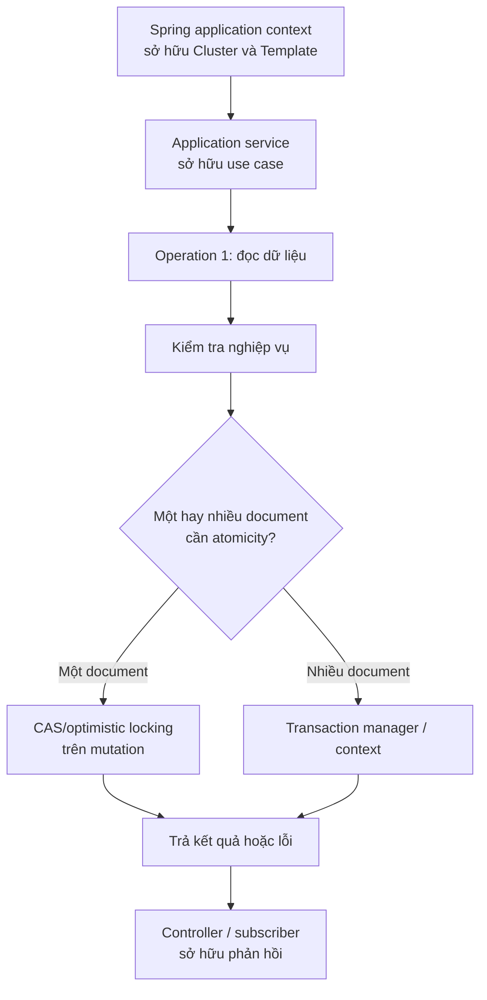
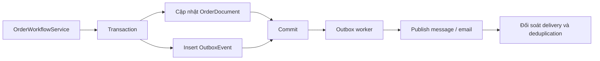

# Kết hợp nhiều thao tác mà vẫn giữ quyền sở hữu vòng đời rõ ràng

## Mục tiêu học tập

Kết thúc bài học, bạn có thể:

1. Phân biệt **vòng đời tài nguyên** (Cluster, connection, Template), **vòng đời một thao tác** (query, mutation), **vòng đời transaction**, **vòng đời reactive publisher** và **vòng đời document** (TTL).
2. Ghép nhiều thao tác của `CouchbaseOperations` hoặc repository thành một use case có trách nhiệm rõ ràng về đọc, ghi, xác thực, lỗi, retry và phản hồi.
3. Nhận biết khi nào chuỗi *đọc → kiểm tra → ghi* là đủ với optimistic locking, và khi nào **nhiều document phải cùng commit** bằng Couchbase Transactions.
4. Tránh tạo/đóng kết nối trong mỗi request, tự subscribe publisher trong service, hoặc thực hiện side effect ngoài database trong transaction callback có thể chạy lại.
5. Phối hợp bucket/scope/collection, SQL++, secondary index, TTL, CAS, durability, timeout và scan consistency mà không lẫn lộn phạm vi bảo đảm.
6. Thiết kế bài kiểm thử và chỉ số vận hành để chứng minh quyền sở hữu vòng đời và hợp đồng dữ liệu đã được thực thi đúng.

**Ngữ cảnh module:** `SPRING_DATA_COUCHBASE` hướng đến xây dựng tầng truy cập Couchbase qua Spring Data document mapping, repository, `CouchbaseTemplate` và truy vấn SQL++. Trong chương **Template**, việc kết hợp nhiều thao tác không chỉ là ghép câu lệnh Java; cần biết ai quản lý bucket/scope/collection, chỉ mục, TTL, CAS, giao dịch và API reactive để giữ hệ thống hiệu quả, nhất quán, dễ vận hành.

## 1. “Quyền sở hữu vòng đời” có nghĩa gì?

Trong một use case, có thể có nhiều đối tượng và hoạt động cùng tồn tại:

- Một `Cluster` duy trì kết nối và tài nguyên mạng cho **toàn ứng dụng**.
- Một `CouchbaseTemplate`/`CouchbaseOperations` thường được tạo và quản lý như **Spring bean dùng lại**.
- Một `Query` và entity đang sửa được tạo cho **một lời gọi nghiệp vụ**.
- Một `@Transactional` hoặc `TransactionAttemptContext` xác định ranh giới **giao dịch** khi cần atomicity.
- Một `Mono`/`Flux` mô tả **pipeline** có thời điểm thực thi và hủy do subscriber điều phối.
- Một document có **CAS** để phát hiện cạnh tranh và có thể có **expiry** được Couchbase quản lý.

Quyền sở hữu vòng đời trả lời: **Ai tạo? Ai được phép sử dụng? Khi nào bắt đầu và kết thúc? Ai chịu trách nhiệm khi thất bại? Ai được phép retry hoặc đóng tài nguyên?**

| Đối tượng/phạm vi | Chủ sở hữu nên là | Khi nào kết thúc? | Lỗi nếu đặt sai chủ sở hữu |
| --- | --- | --- | --- |
| `ClusterEnvironment`, `Cluster`, `Bucket`, `Scope`, `Collection` | Spring/SDK ở cấp ứng dụng | Khi ứng dụng shutdown | Kết nối bị tạo liên tục hoặc bị đóng khi request khác đang dùng |
| `CouchbaseOperations` / repository | Spring container | Khi context ứng dụng dừng | Service tự `new`/đóng hoặc phụ thuộc vào cấu hình không thống nhất |
| `Query`, criteria, entity mutable | Một lần gọi use case | Sau khi thao tác hoàn tất | Chia sẻ query/entity giữa request, vô tình rò trạng thái |
| Luồng kiểm tra nghiệp vụ và điều phối nhiều operation | Application service | Khi hoàn tất use case | Controller ôm logic consistency, các đường ghi có quy tắc khác nhau |
| Transaction | Transaction manager hoặc transaction context | Commit/rollback, kể cả retry nội bộ | Tưởng hai lời gọi ghi riêng đã nguyên tử; side effect bị chạy lại |
| `Stream<T>` nếu dùng terminal stream | Caller dùng Stream | Sau xử lý, nên đóng bằng try-with-resources | Giữ tài nguyên lâu hoặc không đóng |
| `Mono<T>`/`Flux<T>` | Subscriber ở ranh giới hệ thống (ví dụ WebFlux) | Complete/error/cancel | Fire-and-forget, thực thi lặp do subscribe nhiều lần |
| TTL của document | Chính sách dữ liệu + Couchbase | Khi document hết hạn | Document cần lưu lâu bị xóa hoặc token hết hạn bị hồi sinh |

Một thao tác *kết thúc về mặt Java* không nhất thiết là *cả use case đã thành công*: ví dụ `insertById` trả thành công nhưng lời gọi ghi audit kế tiếp thất bại. Tương tự, HTTP request bị timeout chưa đủ để biết mutation phía Couchbase đã được commit hay chưa.



## 2. Vòng đời kết nối thuộc về ứng dụng, không thuộc một request

Couchbase Java SDK khuyến nghị **chia sẻ và tái sử dụng** các đối tượng `ClusterEnvironment`, `Cluster`, `Bucket`, `Scope`, `Collection` vì chúng được thiết kế để nhiều luồng sử dụng đồng thời. Tạo một `Cluster` mới cho từng HTTP request là tốn tài nguyên, tăng latency và làm quản lý shutdown phức tạp.

### 2.1. Spring Boot quản lý hạ tầng

Cấu hình minh họa:

```yaml
spring:
  couchbase:
    connection-string: couchbase://localhost
    username: app_user
    password: REPLACE_WITH_SECRET_FROM_ENV
  data:
    couchbase:
      bucket-name: appdata
```

Trong production, không hardcode mật khẩu. Nạp qua biến môi trường hoặc secret manager theo cách tích hợp của Spring Boot. Bucket `appdata` cần tồn tại, tài khoản phải có quyền thích hợp.

Một service dùng dependency injection:

```java
import org.springframework.data.couchbase.core.CouchbaseOperations;
import org.springframework.stereotype.Service;

@Service
public class OrderLookupService {

    private final CouchbaseOperations operations;

    public OrderLookupService(CouchbaseOperations operations) {
        this.operations = operations;
    }

    public OrderDocument find(String id) {
        return operations
                .findById(OrderDocument.class)
                .one(id);
    }
}
```

Service **không** gọi `Cluster.connect()`, không tạo `new CouchbaseTemplate(…)` và không đóng client ở cuối `find`. Vòng đời kết nối do Spring container và Couchbase SDK quản lý theo cấu hình; service chỉ mượn giao diện để thực hiện thao tác.

### 2.2. Nếu dùng SDK trực tiếp, trách nhiệm đóng kết nối phụ thuộc ai tạo

Ứng dụng tự khởi tạo `Cluster` ngoài Spring cần chủ động `cluster.disconnect()` khi **toàn ứng dụng dừng**, không phải sau mỗi thao tác. Nếu tự tạo và chia sẻ `ClusterEnvironment`, cần shutdown environment sau khi tất cả cluster sử dụng nó đã disconnect.

Quy tắc:

- **Tài nguyên do Spring tạo:** ứng dụng sử dụng qua injection, không tùy tiện gọi `disconnect()` từ service.
- **Tài nguyên do ứng dụng tự tạo:** chủ sở hữu ở cấp bootstrap chịu trách nhiệm đóng lúc shutdown.
- **Collection handle do SDK lấy từ Cluster:** có thể tái sử dụng; không phải connection riêng cần đóng mỗi request.
- **Query result hoặc dữ liệu JSON:** không đồng nghĩa một kết nối riêng phải tự đóng, trừ API thực sự trả một resource có contract đóng.

> Không bọc mỗi lời gọi `operations.findById(...)` trong `try/finally { cluster.disconnect(); }`. Hành động đó có thể phá những request khác cùng dùng client.

## 3. Phân lớp trách nhiệm khi ghép nhiều thao tác

Một kiến trúc thực tế tách ba nhóm trách nhiệm:

| Tầng | Trách nhiệm chính | Không nên đảm nhận |
| --- | --- | --- |
| Controller / message consumer | Xác thực, nhận dữ liệu, tạo context request, trả HTTP response/ack | Trực tiếp chọn CAS, quản lý kết nối, gọi nhiều mutation tùy tiện |
| Application service | Điều phối use case, quy tắc nghiệp vụ, ranh giới transaction, idempotency | Mở/đóng `Cluster` theo request; giấu mọi lỗi bằng `null` |
| Repository / Template adapter | Đọc/ghi document, mapping, query, định vị scope/collection | Quyết định side effect kinh doanh, retry vô hạn, gọi API thanh toán |
| Spring container / SDK | Quản lý client, connection pool, timeout mặc định, shutdown | Tự hiểu unique key kinh doanh hoặc trạng thái đơn hàng hợp lệ |

Repository và Template có thể **cùng tồn tại**: repository phù hợp CRUD và truy vấn cố định, còn `CouchbaseOperations` hữu ích với fluent API, query động hoặc tùy chọn như `withExpiry`/`withDurability`/`withConsistency`.

Ví dụ phối hợp hợp lý:

```java
@Service
public class OrderReadFacade {

    private final OrderRepository repository;
    private final CouchbaseOperations operations;

    public OrderReadFacade(OrderRepository repository,
                           CouchbaseOperations operations) {
        this.repository = repository;
        this.operations = operations;
    }

    public OrderSummary getSummary(String orderId) {
        OrderDocument order = repository.findById(orderId)
                .orElseThrow(() -> new java.util.NoSuchElementException(
                        "Không thấy đơn " + orderId));

        Query query = Query.query(
                QueryCriteria.where("orderId").is(orderId))
                .limit(20);

        List<OrderEventDocument> events = operations
                .findByQuery(OrderEventDocument.class)
                .matching(query)
                .all();

        return new OrderSummary(
                order.getId(), order.getStatus(), events.size());
    }
}
```

*Ví dụ này giả định `OrderRepository` là repository của `OrderDocument`, `OrderEventDocument` là entity sự kiện có trường `orderId` và `OrderSummary` là DTO trả về. Các import tương ứng gồm `List`, `Query` và `QueryCriteria`.*

Hai thao tác đọc **không tự động cùng một snapshot**. Nếu có sự kiện được thêm giữa lần đọc đơn hàng và lần query sự kiện, `events.size()` có thể phản ánh thời điểm khác `order.status`. Chỉ đưa cả hai vào transaction khi sự nhất quán đó thực sự là yêu cầu nghiệp vụ và phiên bản framework hỗ trợ thao tác tương ứng.

## 4. Entity, ID và collection: một mẫu dữ liệu thống nhất

Ví dụ tiếp theo dùng hai collection trong bucket `appdata` và scope `commerce`:

```text
appdata.commerce.orders
    order::1001        -> trạng thái đơn hàng

appdata.commerce.order_events
    order-event::cmd-9 -> dấu vết nghiệp vụ đã thay đổi đơn
```

### 4.1. Entity đơn hàng

```java
package com.example.commerce;

import org.springframework.data.annotation.Id;
import org.springframework.data.annotation.Version;
import org.springframework.data.couchbase.core.mapping.Collection;
import org.springframework.data.couchbase.core.mapping.Document;
import org.springframework.data.couchbase.core.mapping.Field;
import org.springframework.data.couchbase.core.mapping.Scope;

@Document
@Scope("commerce")
@Collection("orders")
public class OrderDocument {

    @Id
    private String id;

    @Field
    private String tenantId;

    @Field
    private String status;

    @Field
    private String lastCommandId;

    @Version
    private Long version;

    public OrderDocument() {}

    public OrderDocument(String id, String tenantId, String status) {
        this.id = id;
        this.tenantId = tenantId;
        this.status = status;
    }

    public String getId() { return id; }
    public void setId(String value) { id = value; }

    public String getTenantId() { return tenantId; }
    public void setTenantId(String value) { tenantId = value; }

    public String getStatus() { return status; }
    public void setStatus(String value) { status = value; }

    public String getLastCommandId() { return lastCommandId; }
    public void setLastCommandId(String value) {
        lastCommandId = value;
    }

    public Long getVersion() { return version; }
    // CAS do Spring Data đọc từ metadata; không tự tăng hoặc sửa.
}
```

### 4.2. Entity audit/event

```java
package com.example.commerce;

import org.springframework.data.annotation.Id;
import org.springframework.data.annotation.Version;
import org.springframework.data.couchbase.core.mapping.Collection;
import org.springframework.data.couchbase.core.mapping.Document;
import org.springframework.data.couchbase.core.mapping.Field;
import org.springframework.data.couchbase.core.mapping.Scope;

@Document
@Scope("commerce")
@Collection("order_events")
public class OrderEventDocument {

    @Id
    private String id;

    @Field
    private String orderId;

    @Field
    private String eventType;

    @Field
    private String commandId;

    @Version
    private Long version;

    public OrderEventDocument() {}

    public OrderEventDocument(String id, String orderId,
                              String eventType, String commandId) {
        this.id = id;
        this.orderId = orderId;
        this.eventType = eventType;
        this.commandId = commandId;
    }

    public String getId() { return id; }
    public void setId(String value) { id = value; }

    public String getOrderId() { return orderId; }
    public void setOrderId(String value) { orderId = value; }

    public String getEventType() { return eventType; }
    public void setEventType(String value) { eventType = value; }

    public String getCommandId() { return commandId; }
    public void setCommandId(String value) { commandId = value; }

    public Long getVersion() { return version; }
}
```

`@Id` là key trong đúng collection, `@Scope`/`@Collection` xác định vị trí mặc định và `@Version Long` chứa CAS cho optimistic locking. Với Spring Data Couchbase Transactions, tài liệu yêu cầu entity có property `@Version Long`. Không đổi kiểu hoặc tự đặt CAS nếu chưa xác nhận contract của phiên bản framework đang dùng.

**ID sự kiện:** `order-event::cmd-9` chứa command ID đã được hệ thống tạo/xác thực trước khi chạy giao dịch. Một key ổn định giúp xử lý lại cùng yêu cầu; nhưng việc kiểm tra có trùng nghiệp vụ hay không vẫn thuộc application service.

## 5. Ghép nhiều thao tác đọc: khi nào không cần transaction?

Ví dụ giao diện cần vừa hiển thị đơn hàng theo ID, vừa lấy những sự kiện của đơn. Có thể chạy:

1. `findById(OrderDocument.class).one(orderId)` — KV theo key.
2. `findByQuery(OrderEventDocument.class).matching(query).all()` — SQL++ theo `orderId`.
3. Ánh xạ về DTO tổng hợp.

Ưu điểm: dễ hiểu, dễ kiểm soát số item, không giữ transaction nếu chỉ cần thông tin *best-effort*. Để truy vấn sự kiện hiệu quả, tạo index phù hợp:

```sql
CREATE INDEX `idx_order_events_order_id`
ON `appdata`.`commerce`.`order_events`(orderId);
```

**Điểm cần nói rõ với caller:** hai kết quả có thể không cùng thời điểm vì mutation đang xảy ra hoặc vì secondary index cập nhật bất đồng bộ. Với mục tiêu chỉ hiển thị tiến độ gần đúng, đó có thể là hợp đồng chấp nhận được.

Nếu cần query nhìn thấy mutation vừa ghi, cân nhắc `withConsistency(QueryScanConsistency.REQUEST_PLUS)` trên nhánh `findByQuery`. Tùy chọn này chờ index phù hợp đạt mức quét yêu cầu, có thể tăng latency; nó không tự tạo snapshot nguyên tử cho hai lệnh khác nhau.

### Không dùng SQL++ để tìm một key đã biết

Nếu có ID `order::1001`, đọc bằng `findById` thường hiệu quả hơn query:

```java
OrderDocument order = operations
        .findById(OrderDocument.class)
        .one("order::1001");
```

Truy vấn theo field dùng SQL++ cần index, trong khi KV theo ID đi thẳng tới collection. Chọn đúng đường truy cập trước khi tối ưu transaction và timeout.

## 6. Đọc–sửa–ghi một document: CAS là chủ sở hữu cạnh tranh

Đối với một đơn hàng có nhiều người cùng cập nhật, chuỗi đơn giản là:

1. Đọc document và CAS đang có.
2. Kiểm tra điều kiện nghiệp vụ.
3. Thay đổi entity.
4. Ghi với điều kiện phiên bản (optimistic locking).
5. Khi CAS xung đột, đọc lại và tính lại điều kiện.

```java
import java.util.NoSuchElementException;

import org.springframework.data.couchbase.core.CouchbaseOperations;

public OrderDocument confirmSingleOrder(String id) {
    OrderDocument current = operations
            .findById(OrderDocument.class)
            .one(id);

    if (current == null) {
        throw new NoSuchElementException("Không tồn tại đơn " + id);
    }
    if (!"NEW".equals(current.getStatus())) {
        throw new IllegalStateException(
                "Chỉ được xác nhận đơn ở trạng thái NEW");
    }

    current.setStatus("CONFIRMED");
    return operations.save(current);
}
```

*Method minh họa thuộc một service đã có field `CouchbaseOperations operations` được injection.*

Khi `@Version` được đọc từ Couchbase, `save` sử dụng optimistic locking theo contract của Spring Data. Nếu document bị worker khác thay đổi, có thể nhận `OptimisticLockingFailureException`. Đây là **xung đột dữ liệu hợp lệ cần phân loại**, không phải lý do tự chuyển sang `upsertById` để ghi đè.

### Vì sao CAS chưa giải quyết “đơn hàng + audit event”?

Một mutation theo CAS bảo vệ **document đơn hàng đó**. Nếu sau khi cập nhật đơn, service `insertById` một sự kiện audit khác mà lệnh thứ hai thất bại, hệ thống có thể ở trạng thái:

```text
Đơn hàng: CONFIRMED   (đã ghi thành công)
Audit:    chưa có     (ghi thất bại)
```

Đó là **partial success giữa hai document**. Hai lệnh thuộc một Java method không tự tạo giao dịch. Nếu yêu cầu “đổi trạng thái và ghi sự kiện phải cùng thành công hoặc cùng thất bại”, cần transaction.

## 7. Vòng đời transaction: ai mở, commit, rollback và retry?

Couchbase hỗ trợ transaction nhiều document. Spring Data Couchbase có thể tham gia transaction qua `@Transactional` hoặc transactional operator trên các phiên bản hỗ trợ; Couchbase Java SDK cũng có `cluster.transactions().run(ctx -> …)`.

Tư duy đúng:

- **Application service** quyết định ranh giới transaction ở một use case.
- **Transaction manager/context** thực hiện cơ chế commit/rollback.
- **Các thao tác trong transaction** phải tham gia đúng context đó.
- **Transaction callback có thể chạy lại** do xung đột/retry của thư viện; code bên trong phải được thiết kế có thể thực thi lại an toàn.
- **Email, gọi cổng thanh toán, message broker trực tiếp** không được Couchbase tự rollback khi transaction thất bại.

### 7.1. Spring Data: @Transactional ở ranh giới public service

Ví dụ nghiệp vụ xác nhận đơn và tạo dấu vết audit trong cùng transaction:

```java
package com.example.commerce;

import java.util.NoSuchElementException;

import org.springframework.data.couchbase.core.CouchbaseOperations;
import org.springframework.stereotype.Service;
import org.springframework.transaction.annotation.Transactional;

@Service
public class OrderWorkflowService {

    private final CouchbaseOperations operations;

    public OrderWorkflowService(CouchbaseOperations operations) {
        this.operations = operations;
    }

    @Transactional
    public void confirm(String tenantId,
                        String orderId,
                        String commandId) {

        OrderDocument order = operations
                .findById(OrderDocument.class)
                .one(orderId);

        if (order == null) {
            throw new NoSuchElementException(
                    "Không tìm thấy đơn hàng " + orderId);
        }
        if (!tenantId.equals(order.getTenantId())) {
            throw new SecurityException(
                    "Không có quyền thao tác trên đơn hàng");
        }

        // Lặp cùng commandId có thể được xem là đã xử lý.
        if ("CONFIRMED".equals(order.getStatus())
                && commandId.equals(order.getLastCommandId())) {
            return;
        }
        if (!"NEW".equals(order.getStatus())) {
            throw new IllegalStateException(
                    "Trạng thái không cho phép xác nhận");
        }

        order.setStatus("CONFIRMED");
        order.setLastCommandId(commandId);

        operations.save(order);

        operations.insertById(OrderEventDocument.class)
                .one(new OrderEventDocument(
                        "order-event::" + commandId,
                        orderId,
                        "ORDER_CONFIRMED",
                        commandId));
    }
}
```

Với **Spring Data Couchbase transaction manager đã cấu hình và kích hoạt**, hai thao tác Template nêu trên có thể tham gia cùng transaction. Tài liệu Spring Data Couchbase yêu cầu entity trong giao dịch có `@Version Long` để lưu CAS.

Các điều kiện phải kiểm tra trước khi dùng ví dụ thật:

1. Ứng dụng đã bật transaction management và có `CouchbaseTransactionManager` phù hợp; nếu có nhiều transaction manager, chọn chính xác manager Couchbase.
2. Method `@Transactional` được gọi qua **Spring proxy** từ bean khác, không self-invocation (ví dụ `this.confirm(...)`) khiến advice bị bỏ qua ở chế độ proxy thông thường.
3. Các operation của Template/repository dùng trong method thực sự được phiên bản Spring Data hỗ trợ tham gia transaction; không tùy tiện xen một lệnh SDK thường với transaction.
4. Mỗi entity có `@Version Long` và mapping đúng collection.
5. `commandId` do server xác thực, bất biến cho một yêu cầu. Chỉ chứa dữ liệu công việc thuần trong body vì framework có thể thực thi lại transaction.
6. Idempotency thực tế còn phải xử lý request đồng thời, timeout/commit ambiguous và khả năng command ID bị dùng nhầm cho đơn khác.

**Lưu ý:** `@Transactional` không làm tất cả thao tác bất kỳ trở thành transactional. Những query/operation nằm ngoài tập được hỗ trợ, hoặc thực hiện trên client không tham gia context, cần được đánh giá riêng; không suy luận từ cú pháp annotation.

### 7.2. Không tự commit khi Spring là chủ sở hữu transaction

Trong method `@Transactional` ở trên, code **không** tự gọi `commit()` hoặc `rollback()`. Nó trả về hoặc ném exception; transaction manager xử lý vòng đời theo contract. Đừng tạo transaction SDK thứ hai lồng tùy tiện chỉ vì một helper muốn được “an toàn hơn”.

Một phương thức helper được gọi cùng luồng, cùng context Spring chỉ nên làm thao tác dữ liệu phù hợp. Các ranh giới phức tạp như propagation, isolation hay kết hợp với JDBC phải được thiết kế và xác minh theo đúng transaction manager; không mặc nhiên có một transaction phân tán tự động giữa Couchbase và database khác.

### 7.3. SDK: transaction callback sở hữu nhóm thao tác qua ctx

Ví dụ thuần Couchbase Java SDK, không dùng converter Spring Data trong cùng đoạn:

```java
import com.couchbase.client.java.Cluster;
import com.couchbase.client.java.Collection;
import com.couchbase.client.java.json.JsonObject;
import com.couchbase.client.java.transactions.TransactionGetResult;

public class DirectOrderTransaction {

    private final Cluster cluster;
    private final Collection orders;
    private final Collection events;

    public DirectOrderTransaction(Cluster cluster) {
        this.cluster = cluster;
        this.orders = cluster.bucket("appdata")
                .scope("commerce")
                .collection("orders");
        this.events = cluster.bucket("appdata")
                .scope("commerce")
                .collection("order_events");
    }

    public void confirm(String orderId, String commandId) {
        cluster.transactions().run(ctx -> {
            TransactionGetResult existing =
                    ctx.get(orders, orderId);

            JsonObject content =
                    existing.contentAs(JsonObject.class);

            if (!"NEW".equals(content.getString("status"))) {
                throw new IllegalStateException(
                        "Đơn không còn ở trạng thái NEW");
            }

            content.put("status", "CONFIRMED");
            content.put("lastCommandId", commandId);

            ctx.replace(existing, content);
            ctx.insert(
                    events,
                    "order-event::" + commandId,
                    JsonObject.create()
                            .put("orderId", orderId)
                            .put("eventType", "ORDER_CONFIRMED")
                            .put("commandId", commandId));
        });
    }
}
```

`ctx.get`, `ctx.replace` và `ctx.insert` là API transactional của SDK. **Không dùng `orders.upsert(…)` hoặc `events.insert(…)` (lệnh SDK thường) bên trong callback rồi tưởng chúng thuộc transaction.** Callback có thể được chạy lại, nên không gọi thanh toán, gửi email hoặc sinh UUID mới trong đó.

Đường SDK thuần này trả/nhận `JsonObject`. Nó không tự áp dụng `@Document`, `@Field`, `@Version` hay Spring Data entity callbacks. Spring Data có hỗ trợ transaction qua Template trong một số cơ chế tích hợp, nhưng cần chọn **một đường giao dịch chủ đạo cho use case** và kiểm chứng mọi thao tác có tham gia đúng context.

## 8. Bên ngoài transaction: side effect và transactional outbox

Giả sử sau khi xác nhận đơn, ứng dụng phải gửi email và publish sự kiện cho hệ thống vận chuyển. Một cách viết dễ gây lỗi:

```java
@Transactional
public void confirmAndNotify(...) {
    // Đọc và ghi đơn...
    // Gửi email ngay ở đây: SAI nếu transaction retry/rollback.
    // Publish message ra broker ngay ở đây: SAI nếu chưa commit.
}
```

Nếu callback bị chạy lại, có thể gửi hai email. Nếu email thành công nhưng database rollback, khách hàng nhận thông báo cho đơn chưa được xác nhận.

**Chiến lược outbox:** trong transaction chỉ thay đổi đơn và ghi một **outbox event document** có ID ổn định. Một worker khác đọc outbox sau commit rồi publish/gửi thông báo; đánh dấu trạng thái gửi thành công hoặc retry với idempotency của consumer.



Outbox không tự tạo exactly-once delivery. Worker có thể publish thành công rồi timeout khi đánh dấu trạng thái, dẫn đến publish lại. Thiết kế downstream idempotency key và retry/observability là bắt buộc khi tác vụ quan trọng. TTL của outbox cũng phải dựa trên retention/audit policy, không xóa quá sớm trước khi delivery được xác nhận.

## 9. Vòng đời reactive: trả publisher, không sở hữu subscription trong service

Ở WebFlux, `ReactiveCouchbaseOperations` trả `Mono<T>`/`Flux<T>`. Application service **xây pipeline**, còn framework/subscriber ở ranh giới hệ thống chịu trách nhiệm kích hoạt và hủy khi phù hợp.

Ví dụ chỉ cập nhật **một** document:

```java
import java.util.NoSuchElementException;

import org.springframework.data.couchbase.core.ReactiveCouchbaseOperations;
import reactor.core.publisher.Mono;

public class ReactiveOrderWorkflow {

    private final ReactiveCouchbaseOperations operations;

    public ReactiveOrderWorkflow(
            ReactiveCouchbaseOperations operations) {
        this.operations = operations;
    }

    public Mono<OrderDocument> confirmSingle(String id) {
        return operations.findById(OrderDocument.class)
                .one(id)
                .switchIfEmpty(Mono.error(
                        new NoSuchElementException(
                                "Không tìm thấy đơn " + id)))
                .flatMap(current -> {
                    if (!"NEW".equals(current.getStatus())) {
                        return Mono.error(
                                new IllegalStateException(
                                        "Trạng thái không hợp lệ"));
                    }

                    current.setStatus("CONFIRMED");
                    return operations.save(current);
                });
    }
}
```

Trong method này:

- `findById(...).one(id)` phát entity khi có document; không có document thì `Mono.empty()`.
- `switchIfEmpty` biến tình trạng không có document thành lỗi nghiệp vụ rõ ràng.
- `flatMap` chỉ ghi sau khi có entity hợp lệ; kết quả `save` được nối thành một pipeline.
- Method **không** gọi `subscribe()`, `block()` hoặc bắt đầu một luồng độc lập rồi trả về trước khi ghi xong.

Một controller WebFlux có thể trả publisher cho framework:

```java
@PostMapping("/orders/{id}/confirm")
public Mono<OrderResponse> confirm(@PathVariable String id) {
    return workflow.confirmSingle(id)
            .map(order -> new OrderResponse(
                    order.getId(), order.getStatus()));
}
```

*Mẫu controller trên giả định `workflow` là bean `ReactiveOrderWorkflow` đã inject, `OrderResponse` là DTO và các annotation/import Spring WebFlux đã có trong dự án.*

### 9.1. Ghép hai mutation reactive chưa phải một transaction

```java
public Mono<OrderDocument> confirmAndAudit(String id,
                                            String commandId) {
    return confirmSingle(id)
            .flatMap(saved -> operations
                    .insertById(OrderEventDocument.class)
                    .one(new OrderEventDocument(
                            "order-event::" + commandId,
                            id,
                            "ORDER_CONFIRMED",
                            commandId))
                    .thenReturn(saved));
}
```

Đoạn trên bảo đảm **thứ tự thực thi trong pipeline**: ghi đơn thành công rồi mới tạo event. Nhưng nếu ghi event thất bại, đơn đã được cập nhật; đây không phải atomicity. Nếu bắt buộc cùng commit, dùng **reactive Couchbase transaction** hoặc phương thức `@Transactional` được hỗ trợ cho reactive với cấu hình transaction manager/operator đúng phiên bản.

**Phân biệt:** `thenReturn(saved)` chỉ chờ publisher mutation hoàn tất rồi trả `saved`, không hề tạo transaction hay rollback thao tác trước đó. Cũng không được dùng `flatMap` sau một `Mono<Void>` rồi chờ lambda chạy: publisher rỗng chỉ phát complete, cần `then(...)`.

### 9.2. Một publisher có thể được thực thi nhiều lần

Một `Mono` thường là lazy. Nếu được subscribe hai lần, pipeline có thể thực hiện hai lần đọc/ghi. Với thao tác insert, lần thứ hai có thể báo trùng ID; với update, CAS cũ có thể dẫn đến conflict; với gửi sự kiện, có thể tạo side effect lặp.

Không gọi `subscribe()` bên trong service như sau:

```java
// MẪU SAI: fire-and-forget, caller không biết lúc nào hoàn thành.
public Mono<OrderDocument> unsafe(String id) {
    Mono<OrderDocument> work = confirmSingle(id);
    work.subscribe();
    return work; // Subscriber của caller có thể chạy lại work.
}
```

**Cách đúng:** trả chính publisher, để caller/controller/worker điều phối subscription, timeout, retry và lỗi. Đối với background job đã có orchestrator riêng, subscription nằm ở ranh giới job với quy tắc lifecycle rõ ràng, không bị rải trong helper.

### 9.3. flatMap, concatMap và thứ tự khi xử lý nhiều ID

`flatMap` có thể xử lý nhiều item đồng thời và không bảo đảm thứ tự kết quả theo nguồn. `concatMap` tuần tự hóa việc xử lý và giữ thứ tự trong pipeline:

```java
public Flux<OrderDocument> confirmSequentially(
        Flux<String> orderIds) {
    return orderIds
            .concatMap(this::confirmSingle);
}
```

Dùng `concatMap` khi thứ tự hoặc việc tránh quá nhiều mutation đồng thời quan trọng. Dùng `flatMap` với giới hạn concurrency khi các ID độc lập và không cần thứ tự; nếu nhiều item cùng trỏ đến **cùng document**, CAS conflict vẫn có thể xảy ra. Dù xử lý tuần tự trong `Flux`, nhiều document vẫn không thuộc một transaction nếu chưa có transaction context.

### 9.4. Cancellation và timeout không đồng nghĩa rollback

Reactor `timeout(Duration)` giới hạn thời gian chờ tín hiệu của publisher. Nó không tự bảo đảm một mutation server đã tiếp nhận bị hoàn tác. Một HTTP client đóng kết nối có thể hủy subscriber, nhưng việc ghi đã gửi sang Couchbase có thể hoàn tất hoặc có trạng thái chưa chắc chắn.

Vì vậy cần idempotency, deadline thống nhất và quy tắc đối soát kết quả khi caller retry. Tránh gọi `block()` trên event loop WebFlux.

## 10. Vòng đời query, stream và bộ nhớ

### 10.1. Tạo Query theo mỗi lời gọi

`Query` và các builder điều kiện được tạo cho thao tác hiện tại. Đừng chia sẻ một đối tượng Query có thể bị sửa cấu hình skip/limit/sort giữa nhiều request.

```java
public List<OrderEventDocument> recentEvents(String orderId) {
    Query query = Query.query(
            QueryCriteria.where("orderId").is(orderId))
            .limit(50);

    return operations
            .findByQuery(OrderEventDocument.class)
            .matching(query)
            .all();
}
```

Không chạy query không giới hạn rồi gọi `list.subList(0, 50)` tại Java: như vậy dữ liệu đã được tải về trước khi cắt. Nếu cần paging, truyền `Pageable`/limit/sort vào `Query` và thiết kế index phù hợp.

### 10.2. Stream có phạm vi sử dụng riêng

Với terminal `stream()`, caller sở hữu `Stream<T>` và nên đóng theo Java resource contract:

```java
try (java.util.stream.Stream<OrderEventDocument> stream =
        operations.findByQuery(OrderEventDocument.class)
                .matching(Query.query(
                        QueryCriteria.where("orderId").is(orderId))
                        .limit(100))
                .stream()) {

    long count = stream
            .filter(e -> "ORDER_CONFIRMED".equals(e.getEventType()))
            .count();
}
```

*Đoạn trên giả định có biến `orderId` và `operations` hợp lệ.*

Không giữ Stream bên trong field singleton hoặc trả nó ra controller khi scope tài nguyên không còn kiểm soát được. `stream()` không phải lối tắt để bỏ qua chi phí query, index hoặc bộ nhớ cho một tập dữ liệu khổng lồ.

### 10.3. Scope/collection phải nhất quán trong use case

Các entity đã có `@Scope("commerce")` và `@Collection` tương ứng. Nếu một lời gọi ghi bị override sang `archive.orders`, còn lời gọi đọc sau đó quay về default `commerce.orders`, cùng ID sẽ dẫn tới **hai document độc lập**.

Nên có quy ước rõ:

- Metadata entity phù hợp nơi lưu mặc định.
- Override `inScope`/`inCollection` chỉ tại use case yêu cầu rõ ràng và cùng sử dụng resolver đã xác thực.
- Với multi-tenant, tenant lấy từ security context; không chấp nhận tên collection raw tùy ý từ HTTP client.
- Các thao tác trong transaction phải tác động **đúng collection**. Transaction không tự phát hiện sai tenant hoặc sai không gian tên.

## 11. TTL và CAS: vòng đời document thuộc chính sách dữ liệu

Vòng đời một document khác hoàn toàn vòng đời một request. Document có thể còn tồn tại nhiều năm, vài giờ hoặc tự hết hạn sau phút.

### 11.1. TTL định nghĩa retention, không phải timeout request

Ví dụ token xác nhận chỉ tồn tại 10 phút:

```java
import java.time.Duration;

CheckoutToken token = new CheckoutToken(
        "checkout::1001", "order::1001", "PENDING");

operations.insertById(CheckoutToken.class)
        .withExpiry(Duration.ofMinutes(10))
        .one(token);
```

*`CheckoutToken` ở ví dụ là entity riêng của collection token có `@Id`; cần khai báo mapping tương ứng trong dự án.*

- `withExpiry` đặt expiry metadata của document, không phải timeout của lệnh insert.
- Không gán TTL ngắn cho document đơn hàng cần lưu giữ theo retention policy.
- Mutation về sau có thể đặt lại hoặc bảo toàn TTL tùy option/API; fixed expiry và sliding expiry là hai chính sách khác nhau.
- Nếu document đã hết hạn, một `replace` có thể thất bại; không tự `upsert` để hồi sinh token đã bị loại bỏ theo chính sách.

### 11.2. CAS là điều kiện của một mutation, không phải khóa toàn use case

`@Version` chứa CAS của entity. CAS cũ có thể không còn khớp khi worker khác thay đổi document, kể cả lúc hai worker cùng thao tác một trạng thái nghiệp vụ.

Khi có conflict, quyết định retry thuộc use case. Ví dụ xử lý “đơn mới → đã xác nhận” có thể đọc lại và chỉ cho phép chuyển trạng thái nếu vẫn `NEW`. Không retry vô hạn bằng entity giữ CAS cũ.

### 11.3. Durability và transaction có phạm vi khác nhau

Một thao tác `insertById(OrderDocument.class).withDurability(DurabilityLevel.MAJORITY).one(order)` yêu cầu mức xác nhận ghi của cluster cho mutation đó. Nhưng durability **không** biến hai document ghi liên tiếp thành một transaction và không tạo điều kiện CAS. Với transaction, để transaction manager/SDK quản lý cấu hình durability/timeout tương ứng theo phiên bản; không tự tách mutation ra khỏi context vì muốn truyền một option đặc biệt.

## 12. Deadline, lỗi và retry: trách nhiệm của use case

Một API có thể thực hiện hai lệnh Couchbase và một bước xử lý nghiệp vụ. Nếu mỗi lệnh có timeout năm giây, tổng request có thể vượt mốc năm giây; retry còn cộng thêm thời gian. Cần phân rã latency budget và tránh duplicate work.

| Tình huống | Ý nghĩa | Trách nhiệm |
| --- | --- | --- |
| Không tìm thấy document khi đọc KV | Có thể key sai, sai collection hoặc đã TTL | Service phân biệt 404 nghiệp vụ với lỗi hạ tầng |
| `OptimisticLockingFailureException` | CAS đã đổi so với bản đọc | Application service đọc lại, tính lại luật, retry có giới hạn hoặc trả 409 |
| Transaction failed | Nhóm thao tác không commit theo kết quả đã xác nhận | Transaction manager/context xử lý rollback/retry; service phân loại lỗi |
| Commit ambiguous | Không thể khẳng định giao dịch đã commit hay chưa | Đối soát bằng command ID/state trước khi chạy lại |
| Query SQL++ không thấy mutation mới | Secondary index có thể cập nhật bất đồng bộ | Chọn KV theo ID hoặc REQUEST_PLUS khi phù hợp |
| Timeout ghi | Có thể server đã nhận hoặc hoàn tất ghi | Không kết luận chắc chắn thất bại; idempotency và đối soát |
| Client reactive cancel | Subscriber dừng chờ kết quả | Không giả định server rollback mutation |
| Gửi email trong transaction callback | Side effect có thể bị lặp hoặc xảy ra trước commit | Đưa ra ngoài transaction, thường qua outbox |

### Mẫu quyết định retry

1. Xác định thao tác thất bại hay kết quả **chưa rõ**.
2. Kiểm tra có khả năng phục hồi bằng retry hay không (lỗi quyền, sai index không thể sửa bằng retry mù).
3. Xác định thao tác đã có **idempotency key** hoặc điều kiện CAS/transaction thích hợp chưa.
4. Với CAS conflict, **đọc lại document** và kiểm tra lại toàn bộ quy tắc nghiệp vụ.
5. Với transaction commit ambiguous, **đối soát trạng thái** theo command ID trước khi tạo giao dịch mới.
6. Giới hạn số lần retry, backoff/jitter và tổng deadline.

Không bắt mọi `Exception` rồi trả `null` hoặc `Collections.emptyList()`. Làm vậy khiến caller không biết use case đã thực sự hoàn thành, thất bại hay chỉ không có dữ liệu.

## 13. Không trộn các cam kết nhất quán

Các tình huống sau rất dễ bị đồng nhất sai:

| Muốn bảo đảm | Cơ chế thích hợp | Không dùng để thay thế |
| --- | --- | --- |
| Một document không bị ghi đè từ bản đọc cũ | CAS/optimistic locking | Durability cao |
| Hai document cùng commit hoặc cùng rollback | Couchbase Transactions | Hai lệnh trong một Java method |
| Query theo field nhận biết index mới được cập nhật | Query scan consistency `REQUEST_PLUS` khi phù hợp | CAS |
| Mutation đạt mức xác nhận replication/persistence | Durability | Transaction hoặc uniqueness |
| Document tự hết hạn sau thời gian | TTL/expiry | Timeout request |
| Khách không xử lý trùng khi client retry | Idempotency key + đối soát nghiệp vụ | Chỉ dựa vào HTTP timeout hoặc subscribe một lần |
| Truy vấn theo field đủ nhanh | Secondary index + query plan | Tăng timeout vô hạn |
| Nhiều request cùng dùng tài nguyên kết nối an toàn | Reuse client do Spring/SDK quản lý | Mở/đóng Cluster theo từng request |

Khi một use case cần **nhiều** bảo đảm cùng lúc, phải kết hợp chúng đúng phạm vi. Ví dụ “cập nhật hai document, có audit và giao hàng ngoài hệ thống” thường cần transaction cho hai document, outbox cho message và idempotency cho downstream. Tăng durability riêng không thay các cơ chế còn lại.

## 14. Kiểm thử vòng đời và kiểm thử dữ liệu

Một test chỉ xác minh kết quả cuối với đường đi thuận lợi sẽ không bắt được lỗi ranh giới. Nên có các kịch bản:

| Test | Cách thực hiện | Điều cần xác nhận |
| --- | --- | --- |
| Reuse connection | Gọi nhiều request song song qua service Spring | Không tạo Cluster mới mỗi request; client không bị đóng giữa chừng |
| Một doc, hai worker | Cùng đọc CAS rồi ghi trạng thái khác nhau | Một mutation CAS cũ bị từ chối; không có lost update |
| Hai doc, không transaction | Gây lỗi khi insert audit sau save order | Thấy được partial success để hiểu rủi ro |
| Hai doc, có transaction | Cố tình gây lỗi khi insert audit | Không có trạng thái commit một phần nếu giao dịch rollback |
| Transaction callback retry | Gây conflict trong môi trường test | Không gửi email hay message trùng từ callback |
| Self invocation | Gọi `this.confirm(...)` trong cùng bean | Xác minh advice transaction không bị vô tình bypass |
| Reactive subscribe hai lần | Subscribe cùng publisher ghi ở môi trường thử | Quan sát khả năng chạy lại mutation và cách idempotency bảo vệ |
| Reactive cancel/timeout | Mô phỏng request chậm, cancel | Không mặc định server không ghi; có cơ chế đối soát |
| TTL document | Tạo token thử nghiệm có expiry ngắn | Hết hạn đúng chính sách mà không xóa đơn hàng |
| Sai scope/collection | Cùng ID ở active/archive | Không truy cập nhầm collection hoặc tenant |
| SQL++ index lag | Ghi KV rồi query theo field | Biết tác động của REQUEST_PLUS đến dữ liệu và latency |
| Stream resource scope | Mở stream, xử lý trong try-with-resources | Không rò tài nguyên ở luồng xử lý kéo dài |

Không cố tình làm hỏng dữ liệu production để kiểm chứng rollback hoặc timeout. Sử dụng môi trường tích hợp có cluster/collection riêng, có khả năng cô lập và reset dữ liệu.

## 15. Bài thực hành tổng hợp

Chuẩn bị bucket `appdata`, scope `commerce`, collection `orders` và `order_events`. Cấu hình Spring Data Couchbase và transaction manager phù hợp với phiên bản thư viện, cùng account có quyền cần thiết.

1. **Ownership map:** Vẽ sơ đồ xác định ai tạo/đóng Cluster, ai tạo Template, ai sở hữu từng Query, transaction và reactive subscription.
2. **Mapping:** Tạo entity `OrderDocument` và `OrderEventDocument` có `@Version Long`; kiểm tra ID metadata, CAS và collection mapping.
3. **Đọc kết hợp:** Gọi `findById` cho đơn, rồi `findByQuery` cho các event. Tạo index `(orderId)` và quan sát query plan.
4. **CAS:** Cho hai luồng đọc và sửa cùng đơn. Xác minh conflict và viết chính sách retry không ghi đè trái phép.
5. **Không transaction:** Thử ghi đơn rồi cố tình để insert event thất bại. Giải thích partial success.
6. **Có transaction:** Đặt hai mutation trong method `@Transactional` được gọi qua Spring proxy; tạo lỗi để xác minh rollback.
7. **Idempotency:** Gửi lại cùng `commandId` và kiểm tra không tạo thêm event nghiệp vụ. Thử `commandId` mới với trạng thái không hợp lệ để thấy service từ chối.
8. **SDK transaction:** Viết lại use case bằng `cluster.transactions().run(ctx -> …)`; kiểm tra mọi mutation trong callback đi qua `ctx`.
9. **Side effect:** Thay lời gọi publish trực tiếp bằng outbox event; thiết kế worker đối soát delivery và xử lý publish lại.
10. **Reactive:** Trả `Mono<OrderDocument>` từ method đọc–sửa–ghi, không gọi `subscribe()` nội bộ. Thử `thenReturn` sau insert event và xác nhận đó chưa phải transaction.
11. **TTL:** Tạo document token tạm với expiry; giải thích vì sao token hết hạn không được tự upsert lại sau một lỗi replace.
12. **Vận hành:** Thiết kế latency budget, log operation/collection, số lần retry, tỉ lệ CAS conflict, transaction failed/ambiguous và timeout; đề xuất cảnh báo.

### Câu hỏi tự kiểm tra

- Nếu `OrderLookupService` được Spring inject `CouchbaseOperations`, ai có trách nhiệm đóng Cluster?
- Hai câu `operations.save(order)` và `operations.insertById(event).one(event)` trong cùng method có mặc nhiên atomic không?
- `@Transactional` ở public method có hiệu lực khi gọi từ `this.confirm(...)` không, trong cơ chế Spring proxy thường dùng?
- Vì sao transaction callback không được gửi email hoặc tự sinh command ID mới mỗi lần chạy?
- CAS có bảo vệ hai document khác collection trong cùng use case không?
- `REQUEST_PLUS` có tạo snapshot đồng nhất cho `findById` và `findByQuery` chạy riêng lẻ không?
- Tại sao `Mono.thenReturn(…)` chỉ diễn đạt thứ tự, chứ không cung cấp rollback?
- Khi subscribe hai lần vào publisher ghi, những hành vi nào có thể phát sinh?
- Khi HTTP request timeout sau một durable write, vì sao cần đối soát bằng idempotency key?
- Resource scope của `Stream<T>` khác gì vòng đời của Spring bean `CouchbaseTemplate`?

## Tài liệu tham khảo chính thức

- [Spring Data Couchbase — Template & direct operations](https://docs.spring.io/spring-data/couchbase/reference/couchbase/template.html).
- [Spring Data Couchbase — Transactions](https://docs.spring.io/spring-data/couchbase/reference/couchbase/transactions.html).
- [Spring Data Couchbase — Entity Mapping](https://docs.spring.io/spring-data/couchbase/reference/couchbase/entity.html).
- [Spring Data Couchbase — Repository Support](https://docs.spring.io/spring-data/couchbase/reference/couchbase/repository.html).
- [Couchbase Java SDK — Managing Connections](https://docs.couchbase.com/java-sdk/current/howtos/managing-connections.html).
- [Couchbase Java SDK — Using Transactions](https://docs.couchbase.com/java-sdk/current/howtos/distributed-acid-transactions-from-the-sdk.html).
- [Couchbase Java SDK — KV Operations](https://docs.couchbase.com/java-sdk/current/howtos/kv-operations.html).
- [Project Reactor — Reference Guide](https://projectreactor.io/docs/core/release/reference/).

> **Giới hạn triển khai:** Ví dụ minh họa cách phân định ownership và phối hợp thao tác. Hãy đối chiếu Javadoc/transaction support của đúng phiên bản Spring Data Couchbase, Couchbase Java SDK và Spring Boot mà dự án đang dùng, đặc biệt `@Transactional`, entity `@Version Long`, manager bean, lệnh hỗ trợ transaction và retry. Nội dung thuộc bước viết Knowledge (STEP 4), chưa thay thế kiểm thử tích hợp hoặc vòng Content QA ở STEP 6.
