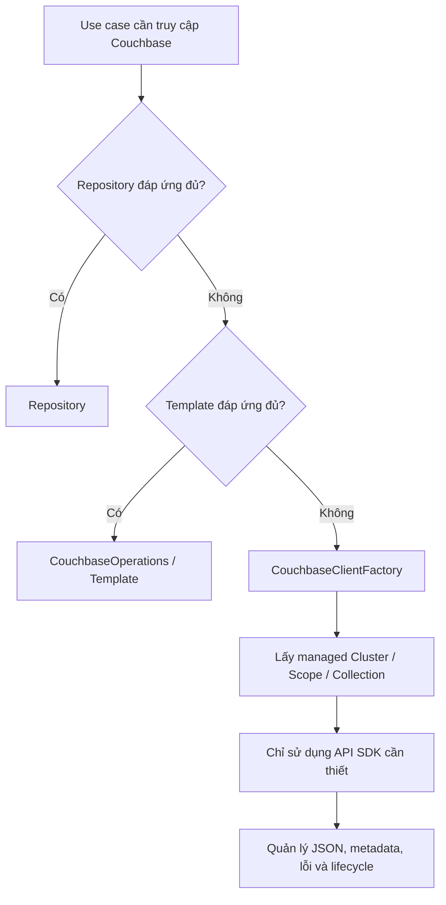

# Truy cập Java SDK qua client factory khi cần tính năng cấp thấp

## Mục tiêu học tập

Sau bài học, bạn có thể:

1. Phân biệt trách nhiệm của `CouchbaseRepository`, `CouchbaseOperations`/`CouchbaseTemplate` và **Couchbase Java SDK**.
2. Lấy `Cluster`, `Bucket`, `Scope` và `Collection` do Spring Data quản lý thông qua `CouchbaseClientFactory`, không khởi tạo kết nối thứ hai cho từng yêu cầu.
3. Chọn đúng bucket/scope/collection khi gọi API thấp hơn, nhận biết ranh giới mà `CouchbaseClientFactory.withScope(…)` và `getCollection(…)` tác động.
4. Sử dụng API SDK khi có nhu cầu rõ ràng: đọc/ghi sub-document, CAS, giữ TTL, durability, timeout riêng, SQL++ raw có tham số hoặc truy cập bất đồng bộ/reactive.
5. Hiểu hệ quả khi đi vòng qua entity converter: tên field JSON, metadata ID/CAS, `@Version`, lifecycle callbacks, kiểm soát kiểu dữ liệu và dịch exception.
6. Xác định ranh giới transaction, idempotency, quyền truy cập và trách nhiệm giải phóng tài nguyên khi pha trộn API cấp cao với SDK.

**Phạm vi:** Module `SPRING_DATA_COUCHBASE` tập trung xây dựng tầng truy cập Couchbase bằng document mapping, repository, `CouchbaseTemplate` và truy vấn SQL++; bao gồm thiết kế bucket/scope/collection, chỉ mục, TTL, CAS, giao dịch và lựa chọn API reactive để đảm bảo hiệu năng, nhất quán và khả năng vận hành. Bài thuộc chương **Template**, làm rõ cách đi xuống SDK **có chủ đích** mà vẫn giữ hạ tầng Spring Data là nguồn quản lý kết nối và mapping chính.

> **Thông điệp trung tâm:** Truy cập SDK qua client factory là mở rộng công cụ, **không** phải lối tắt thay toàn bộ Spring Data. Trước mỗi lần dùng SDK, phải trả lời được: “Tính năng nào Template/repository chưa đáp ứng?”, “Ai giữ kết nối?”, “Ai ánh xạ JSON và metadata?”, “Lệnh này có tham gia transaction mong muốn không?”.

## 1. Ba lớp truy cập và tiêu chí chọn API

Trong ứng dụng Spring Data Couchbase, ta thường gặp ba lớp:

| Lớp | Đối tượng thường dùng | Phù hợp nhất khi | Điều cần tự quản lý |
| --- | --- | --- | --- |
| Repository | `CouchbaseRepository<T, ID>`, repository reactive | CRUD/query ổn định, phân trang, projection | Quy tắc nghiệp vụ và transaction boundary |
| Template | `CouchbaseOperations`, `CouchbaseTemplate` | Fluent CRUD, query động, tùy chọn mutation/query, ánh xạ entity | Query, scope/collection override, xử lý lỗi |
| Couchbase Java SDK | `Cluster`, `Collection`, `GetOptions`, `MutateInOptions`, `QueryOptions` | Chức năng KV/sub-document hoặc option cấp thấp chuyên biệt | JSON/metadata, lỗi SDK, CAS, TTL, timeout, transaction context |

Ví dụ những tác vụ tương ứng:

```java
// Repository: tìm entity khi đã biết ID.
OrderDocument order = repository.findById(id).orElseThrow();

// Template: điều khiển rõ thao tác KV và entity mapping.
OrderDocument mapped = operations.findById(OrderDocument.class)
        .one(id);

// SDK: chỉ lấy một đường dẫn bên trong JSON và metadata CAS.
LookupInResult partial = sdkCollection.lookupIn(
        id, java.util.List.of(LookupInSpec.get("status")));
String state = partial.contentAs(0, String.class);
long cas = partial.cas();
```

Các biến `repository`, `operations` và `sdkCollection` chỉ minh họa ba tầng khác nhau; mã hoàn chỉnh lấy SDK collection từ factory sẽ có ở phần tiếp theo.

**Nguyên tắc chọn:** Nếu cần đọc/sửa toàn bộ entity với `@Field`, `@Version` và callbacks, bắt đầu bằng Repository/Template. Nếu chỉ cần thay một trường JSON với `MutateInOptions.preserveExpiry(true)` hoặc đặt `GetOptions.timeout(…)` khác mặc định, SDK có thể giúp diễn đạt trực tiếp hơn.



## 2. CouchbaseClientFactory là gì và quản lý điều gì?

`CouchbaseClientFactory` nằm trong package `org.springframework.data.couchbase`. Nó là đường truy cập đến **SDK instance và tài nguyên đã được framework quản lý**; không cần gọi `Cluster.connect(…)` mỗi khi cần thao tác cấp thấp.

### 2.1. API chính của factory

Theo Javadoc của Spring Data Couchbase, interface cung cấp:

| API | Kết quả | Ý nghĩa |
| --- | --- | --- |
| `getCluster()` | `com.couchbase.client.java.Cluster` | Client SDK cấp cluster |
| `getBucket()` | `Bucket` | Bucket gắn với factory |
| `getScope()` | `Scope` | Scope gắn với factory |
| `getCollection(String name)` | `Collection` | Collection tên `name` trong **scope của factory** |
| `getDefaultCollection()` | `Collection` | Collection mặc định trong phạm vi factory |
| `withScope(String scopeName)` | `CouchbaseClientFactory` | Factory view đặt sang scope khác, **vẫn cùng bucket** |
| `getExceptionTranslator()` | `PersistenceExceptionTranslator` | Công cụ hỗ trợ dịch exception của tầng persistence |
| `close()` | `void` | Đóng tài nguyên do factory sở hữu: **không gọi từ service dùng chung** |

**Điểm phải nhớ:** Một `CouchbaseClientFactory` gắn với **một bucket**. `withScope` không đổi bucket, và `getCollection("orders")` chỉ chọn collection trong scope của factory đang dùng. Nếu ứng dụng thực sự dùng nhiều bucket, phải có cấu hình client factory/template phù hợp cho từng bucket; không tự thêm `.withBucket(…)` vì interface không cung cấp phương thức đó.

### 2.2. Lấy factory từ CouchbaseOperations

Cách này giúp SDK access đi theo cùng nguồn cấu hình với Template hiện có:

```java
import org.springframework.data.couchbase.CouchbaseClientFactory;
import org.springframework.data.couchbase.core.CouchbaseOperations;
import org.springframework.stereotype.Component;

@Component
public class CouchbaseSdkAccess {

    private final CouchbaseClientFactory factory;

    public CouchbaseSdkAccess(CouchbaseOperations operations) {
        this.factory = operations.getCouchbaseClientFactory();
    }

    public com.couchbase.client.java.Cluster cluster() {
        return factory.getCluster();
    }

    public com.couchbase.client.java.Collection orders() {
        return factory.withScope("commerce")
                .getCollection("orders");
    }
}
```

`CouchbaseOperations.getCouchbaseClientFactory()` trả factory nền của Template. Khi ứng dụng dùng nhiều Template/bucket, phải inject **đúng** `CouchbaseOperations` của ngữ cảnh nghiệp vụ. Không dựa vào sự trùng tên bean hoặc bucket mặc định một cách ngầm định trong hệ thống đa nguồn dữ liệu.

### 2.3. Hai con đường tương đương để chọn collection

```java
CouchbaseClientFactory factory =
        operations.getCouchbaseClientFactory();

// Dùng scope-bound factory.
com.couchbase.client.java.Collection a =
        factory.withScope("commerce").getCollection("orders");

// Đi từ Bucket SDK đã được quản lý.
com.couchbase.client.java.Collection b =
        factory.getBucket().scope("commerce").collection("orders");
```

Cả hai biểu thị đường đến `appdata.commerce.orders` nếu factory đang gắn bucket `appdata`. Không được giả định `factory.getCollection("orders")` sẽ luôn chọn `commerce.orders`: điều đó chỉ đúng nếu **scope hiện tại của factory** là `commerce`.

### 2.4. Vòng đời: nhận handle, đừng tự đóng

Factory và SDK client thường thuộc lifecycle của Spring container. Service hoặc adapter chỉ **dùng lại**:

- **Không** tạo một `Cluster.connect(…)` mới trong mỗi request, trừ khi có kiến trúc client độc lập được quản lý rõ.
- **Không** gọi `factory.close()`, `factory.getCluster().disconnect()` hoặc shutdown environment từ method xử lý request; việc đó có thể làm hỏng các request khác dùng chung client.
- `withScope("commerce")` trả một factory view; không nên tự đóng view ấy khi nó chia sẻ SDK instance do framework quản lý. Để Spring quản lý việc đóng tài nguyên.
- Có thể giữ `Collection` handle dùng chung trong adapter khi scope/collection cố định; handle không phải một TCP connection riêng cần đóng sau mỗi lệnh.

Nếu tự bootstrap client bên ngoài Spring, **chính** code tạo nó phải quản lý shutdown ở cấp ứng dụng; hai mô hình sở hữu này không được trộn tùy tiện.

## 3. Entity mapping và dữ liệu mẫu

Giả sử hệ thống quản lý tồn kho trong bucket `appdata`, scope `commerce`, collection `inventory`. Document ID: `sku::P1001`.

Document JSON minh họa:

```json
{
  "_class": "com.example.stock.InventoryDocument",
  "tenantId": "tenant-42",
  "sku": "P1001",
  "available_qty": 18,
  "state": "ACTIVE",
  "updatedBy": "inventory-sync"
}
```

`_class` là ví dụ metadata kiểu mà Spring Data có thể thêm, tùy converter và cấu hình. Document ID `sku::P1001` và CAS nằm trong metadata Couchbase; chúng không nhất thiết là field JSON. 

Entity:

```java
package com.example.stock;

import org.springframework.data.annotation.Id;
import org.springframework.data.annotation.Version;
import org.springframework.data.couchbase.core.mapping.Collection;
import org.springframework.data.couchbase.core.mapping.Document;
import org.springframework.data.couchbase.core.mapping.Field;
import org.springframework.data.couchbase.core.mapping.Scope;

@Document
@Scope("commerce")
@Collection("inventory")
public class InventoryDocument {

    @Id
    private String id;

    @Field
    private String tenantId;

    @Field
    private String sku;

    @Field("available_qty")
    private long availableQty;

    @Field
    private String state;

    @Field
    private String updatedBy;

    @Version
    private Long version;

    public InventoryDocument() {}

    public String getId() { return id; }
    public void setId(String value) { id = value; }

    public String getTenantId() { return tenantId; }
    public void setTenantId(String value) { tenantId = value; }

    public String getSku() { return sku; }
    public void setSku(String value) { sku = value; }

    public long getAvailableQty() { return availableQty; }
    public void setAvailableQty(long value) { availableQty = value; }

    public String getState() { return state; }
    public void setState(String value) { state = value; }

    public String getUpdatedBy() { return updatedBy; }
    public void setUpdatedBy(String value) { updatedBy = value; }

    public Long getVersion() { return version; }
}
```

Dùng Template, Spring Data ánh xạ `available_qty` trong JSON về `availableQty` của Java. Khi dùng SDK `lookupIn` hay `mutateIn`, phải truyền tên đường dẫn **thực sự trong JSON**, tức `"available_qty"`, không phải `"availableQty"`.

`@Version` map CAS để bảo vệ optimistic locking khi dùng thao tác Spring Data hỗ trợ. SDK raw **không** tự gọi converter Spring Data để điền hoặc cập nhật field `version` trong entity. Nếu adapter đã sửa document bằng SDK, mọi entity đọc trước đó có CAS cũ sẽ trở thành stale; cần đọc lại trước lần ghi tiếp theo.

## 4. Bắt đầu bằng Template: không đi xuống SDK khi không cần

Giả sử chỉ cần xem số lượng tồn kho theo ID và cập nhật toàn bộ entity có CAS:

```java
import java.util.NoSuchElementException;

import org.springframework.data.couchbase.core.CouchbaseOperations;

public InventoryDocument changeStateWithTemplate(
        CouchbaseOperations operations,
        String id,
        String newState) {

    InventoryDocument current = operations
            .findById(InventoryDocument.class)
            .one(id);

    if (current == null) {
        throw new NoSuchElementException("Không tồn tại SKU " + id);
    }

    current.setState(newState);
    return operations.save(current);
}
```

Ưu điểm: Spring Data quản lý mapping `@Field`, metadata `@Id`/`@Version` và cơ chế optimistic locking của `save`. Không cần raw `JsonObject` chỉ để đổi một trạng thái đơn giản khi toàn bộ entity và quy tắc domain đều đã sẵn.

Tuy nhiên, khi document lớn và cần thay **chỉ một đường dẫn**, hoặc muốn kết hợp option `preserveExpiry`, per-operation timeout và CAS ở cấp KV, SDK sub-document là lựa chọn thích hợp để cân nhắc.

## 5. Đọc một phần JSON bằng lookupIn

Sub-document API cho phép chỉ lấy các đường dẫn JSON cần thiết thay vì yêu cầu toàn bộ document. Nó là thao tác key-value theo ID, **không đòi secondary index**.

### 5.1. Ví dụ lấy số lượng và trạng thái

```java
package com.example.stock;

import java.util.List;

import com.couchbase.client.java.Collection;
import com.couchbase.client.java.kv.LookupInResult;
import com.couchbase.client.java.kv.LookupInSpec;
import org.springframework.data.couchbase.CouchbaseClientFactory;
import org.springframework.data.couchbase.core.CouchbaseOperations;
import org.springframework.stereotype.Repository;

@Repository
public class InventorySubdocReader {

    private final Collection inventory;

    public InventorySubdocReader(CouchbaseOperations operations) {
        CouchbaseClientFactory factory =
                operations.getCouchbaseClientFactory();

        this.inventory = factory
                .withScope("commerce")
                .getCollection("inventory");
    }

    public InventorySnapshot load(String documentId) {
        LookupInResult result = inventory.lookupIn(
                documentId,
                List.of(
                        LookupInSpec.get("available_qty"),
                        LookupInSpec.get("state")));

        Number quantity = result.contentAs(0, Number.class);
        String state = result.contentAs(1, String.class);

        return new InventorySnapshot(
                documentId,
                quantity.longValue(),
                state,
                result.cas());
    }

    public record InventorySnapshot(
            String id, long availableQty,
            String state, long cas) {}
}
```

Cần lưu ý:

- Các path `available_qty` và `state` là **tên field JSON**. Chúng không được converter từ `@Field` tự đổi tên khi dùng SDK.
- `result.contentAs(0, Number.class)` lấy giá trị của spec vị trí 0; spec vị trí 1 tương ứng `state`.
- `result.cas()` là CAS của document ở thời điểm đọc; đây là metadata, không phải một property JSON.
- Nếu thiếu document hoặc path, SDK có thể ném các exception tương ứng; không biến chúng thành số lượng `0` vì `0` là giá trị tồn kho hợp lệ.
- `InventorySnapshot` là read model của adapter, không phải entity dùng `operations.save(snapshot)`.

### 5.2. Nếu chỉ cần biết field tồn tại

```java
import com.couchbase.client.java.kv.LookupInSpec;

boolean hasInventoryField = inventory.lookupIn(
        "sku::P1001",
        java.util.List.of(LookupInSpec.exists("available_qty")))
        .exists(0);
```

`LookupInSpec.exists("available_qty")` chỉ kiểm tra sự tồn tại của path; nó không đọc giá trị số. Điều đó khác `existsById` của Template, vốn kiểm tra **toàn bộ document ID**. Với `LookupInSpec.get` trên path không tồn tại, cần xử lý lỗi path-not-found phù hợp.

## 6. Chỉ sửa một phần document bằng mutateIn + CAS

Xét một thao tác đặt trước tồn kho: đọc `available_qty` và `state`, kiểm tra đơn còn hoạt động và còn đủ hàng, sau đó giảm số lượng còn lại.

### 6.1. Một mutation sub-document có điều kiện

```java
package com.example.stock;

import java.time.Duration;
import java.util.List;

import com.couchbase.client.core.msg.kv.DurabilityLevel;
import com.couchbase.client.java.Collection;
import com.couchbase.client.java.kv.LookupInResult;
import com.couchbase.client.java.kv.LookupInSpec;
import com.couchbase.client.java.kv.MutateInOptions;
import com.couchbase.client.java.kv.MutateInResult;
import com.couchbase.client.java.kv.MutateInSpec;

public class InventoryReservationAdapter {

    private final Collection inventory;

    public InventoryReservationAdapter(Collection inventory) {
        this.inventory = inventory;
    }

    // Một lần thử; xung đột CAS để tầng use case quyết định.
    public long reserveOnce(String documentId, long requested) {
        if (requested <= 0) {
            throw new IllegalArgumentException(
                    "requested phải lớn hơn 0");
        }

        LookupInResult snapshot = inventory.lookupIn(
                documentId,
                List.of(
                        LookupInSpec.get("available_qty"),
                        LookupInSpec.get("state")));

        long available =
                snapshot.contentAs(0, Number.class).longValue();
        String state = snapshot.contentAs(1, String.class);

        if (!"ACTIVE".equals(state)) {
            throw new IllegalStateException(
                    "SKU chưa sẵn sàng để đặt hàng");
        }
        if (available < requested) {
            throw new IllegalStateException("Không đủ tồn kho");
        }

        long remaining = available - requested;

        MutateInResult result = inventory.mutateIn(
                documentId,
                List.of(MutateInSpec.replace(
                        "available_qty", remaining)),
                MutateInOptions.mutateInOptions()
                        .cas(snapshot.cas())
                        .preserveExpiry(true)
                        .durability(DurabilityLevel.MAJORITY)
                        .timeout(Duration.ofSeconds(3)));

        long newCas = result.cas();
        // Ghi metric CAS mới nếu cần; không coi là số tuần tự.
        return remaining;
    }
}
```

Ví dụ gộp ba yêu cầu cấp thấp vào cùng mutation:

1. `cas(snapshot.cas())`: nếu worker khác đã cập nhật document sau bước đọc, lệnh bị từ chối; tránh ghi dựa trên tồn kho cũ.
2. `preserveExpiry(true)`: giữ mốc hết hạn đang có thay vì vô tình xóa/gia hạn expiry.
3. `durability(MAJORITY)`: chờ cluster xác nhận mutation theo mức majority phù hợp.
4. `timeout(Duration.ofSeconds(3))`: timeout riêng cho mutation này theo SDK, không phải deadline toàn bộ use case.
5. `MutateInSpec.replace("available_qty", remaining)`: chỉ sửa đường dẫn đã tồn tại, **không thay toàn bộ JSON**, giữ các trường `_class`, tenant và trường mới chưa biết.

**Ranh giới của ví dụ:** Phép tính `available - requested` và quyết định trạng thái được bảo vệ bằng CAS cho một document. Nó **chưa** bảo đảm mỗi yêu cầu đặt hàng chỉ trừ tồn kho đúng một lần khi client retry sau timeout hoặc đã có side effect ngoài Couchbase. Production cần command/reservation ID ổn định, idempotency và có thể cần transaction với document đơn hàng.

### 6.2. Xử lý CAS conflict khác timeout

```java
import com.couchbase.client.core.error.CasMismatchException;

public long reserveWithLimitedCasRetry(
        InventoryReservationAdapter adapter,
        String id,
        long qty) {

    for (int attempt = 1; attempt <= 3; attempt++) {
        try {
            return adapter.reserveOnce(id, qty);
        } catch (CasMismatchException conflict) {
            if (attempt == 3) {
                throw conflict;
            }
            // Vòng sau phải ĐỌC LẠI trạng thái và CAS.
        }
    }
    throw new IllegalStateException("Unreachable");
}
```

Chỉ bắt `CasMismatchException` cho retry CAS trong ví dụ. **Không** bắt mọi exception và retry: timeout ghi có thể xảy ra khi mutation đã được server áp dụng, rồi việc retry làm trừ hàng lần thứ hai. Nếu nghiệp vụ không cho phép kết quả chưa chắc chắn, phải thiết kế cơ chế idempotency và đối soát bằng reservation ID.

### 6.3. Điều gì xảy ra với optimistic locking của Spring Data?

Giả sử service A dùng `operations.findById(InventoryDocument.class).one(id)` và nhận entity có CAS A. Service B dùng SDK `mutateIn` đổi `available_qty`, làm CAS thành B. Nếu A tiếp tục `operations.save(entityA)` với `@Version` A, optimistic locking phải phát hiện CAS cũ và từ chối (trên đường ghi hỗ trợ CAS).

Đây là **hành vi đúng**. Không copy số CAS B một cách tùy tiện vào entity A để vượt kiểm tra: A vẫn chưa đọc lại field tồn kho và chưa áp dụng lại quy tắc nghiệp vụ.

## 7. TTL, expiry và option cấp thấp

Một số vấn đề metadata không thể suy ra chỉ từ body JSON. SDK cho phép lấy expiry khi đọc:

```java
import java.time.Instant;
import java.util.Optional;

import com.couchbase.client.java.kv.GetResult;
import com.couchbase.client.java.kv.GetOptions;

GetResult loaded = inventory.get(
        "sku::P1001",
        GetOptions.getOptions().withExpiry(true));

Optional<Instant> expiry = loaded.expiryTime();
long cas = loaded.cas();
```

- `withExpiry(true)` yêu cầu SDK lấy metadata expiry nếu có.
- `expiryTime()` trả `Optional<Instant>` cho thời điểm hết hạn; không có expiry thì có thể rỗng.
- `cas()` cho biết CAS hiện hành của document.
- Không trộn TTL với timeout: expiry là **vòng đời document**, còn `GetOptions.timeout` là khoảng client chờ câu lệnh.

Khi thay nội dung một document có TTL cố định, `preserveExpiry(true)` phù hợp nếu nghiệp vụ muốn **không gia hạn**. Nếu cần sliding expiration, hãy đặt expiry mới rõ ràng bằng option tương ứng hoặc tác vụ `touch`; hai chính sách khác nhau đáng kể.

Ví dụ tạo token tạm bằng SDK:

```java
import java.time.Duration;

import com.couchbase.client.java.json.JsonObject;
import com.couchbase.client.java.kv.InsertOptions;

com.couchbase.client.java.Collection tokens =
        factory.withScope("commerce").getCollection("checkout_tokens");

tokens.insert(
        "checkout::request-77",
        JsonObject.create()
                .put("state", "PENDING")
                .put("orderId", "order::1001"),
        InsertOptions.insertOptions()
                .expiry(Duration.ofMinutes(15)));
```

`tokens` ở ví dụ được lấy từ factory hiện có, không tự mở cluster khác. Dùng `insert` để không ghi đè token trùng ID. Nếu bị timeout sau khi gửi, kết quả có thể không chắc chắn; dùng request ID để đối soát chứ không tự thay ID và tạo token mới.

Nếu cùng document được Template quản lý bởi `@Document(expiry=...)` hoặc Couchbase bucket/collection có `maxExpiry`, cần đối chiếu ưu tiên cấu hình và hành vi update. SDK raw không tự áp dụng annotation của Spring Data khi ghi.

## 8. SQL++ raw và QueryOptions khi Fluent Query chưa đủ

Template `findByQuery` thường phù hợp khi muốn trả entity và dùng `QueryCriteria`. Đôi khi cần truy vấn aggregate đặc biệt, hint, profiling hoặc timeout riêng chưa được biểu đạt tiện lợi ở fluent builder. Khi đó `factory.getCluster().query(…)` là đường SDK.

### 8.1. Ví dụ aggregate số lượng tồn kho theo tenant

```java
package com.example.stock;

import java.time.Duration;
import java.util.List;

import com.couchbase.client.java.Cluster;
import com.couchbase.client.java.json.JsonObject;
import com.couchbase.client.java.query.QueryOptions;
import com.couchbase.client.java.query.QueryResult;
import com.couchbase.client.java.query.QueryScanConsistency;
import org.springframework.data.couchbase.CouchbaseClientFactory;

public class InventoryReportGateway {

    private final Cluster cluster;

    public InventoryReportGateway(CouchbaseClientFactory factory) {
        this.cluster = factory.getCluster();
    }

    public List<InventoryGroup> summarizeByState(String tenantId) {
        String statement = """
            SELECT i.state AS state,
                   SUM(i.available_qty) AS totalQty
            FROM `appdata`.`commerce`.`inventory` AS i
            WHERE i.tenantId = $tenantId
            GROUP BY i.state
            """;

        QueryResult result = cluster.query(
                statement,
                QueryOptions.queryOptions()
                        .parameters(JsonObject.create()
                                .put("tenantId", tenantId))
                        .scanConsistency(
                                QueryScanConsistency.REQUEST_PLUS)
                        .timeout(Duration.ofSeconds(5)));

        return result.rowsAsObject().stream()
                .map(row -> new InventoryGroup(
                        row.getString("state"),
                        row.getLong("totalQty")))
                .toList();
    }

    public record InventoryGroup(
            String state, long totalQty) {}
}
```

Đây là code minh họa Java 17+ với text block và `Stream.toList()`. Câu SQL++ dùng tên **bucket.scope.collection đầy đủ**, nên không phụ thuộc vào scope hiện tại của factory. Named parameter `$tenantId` được truyền bằng `QueryOptions.parameters(…)`; không nối trực tiếp giá trị người dùng vào SQL++.

Cần xác thực `tenantId` từ security context, không tin input tùy ý. Index cho filter và GROUP BY phụ thuộc workload; ví dụ ban đầu:

```sql
CREATE INDEX `idx_inventory_tenant_state_qty`
ON `appdata`.`commerce`.`inventory`
    (tenantId, state, available_qty);
```

Khi tối ưu, dùng `EXPLAIN` với chính câu query thực tế và đo chi phí index scan, sort/aggregate và dữ liệu trả về. `REQUEST_PLUS` giúp query chờ index bắt kịp mutation theo mức yêu cầu, nhưng có thể tăng latency; **không** thay CAS hoặc transaction.

### 8.2. Khác biệt giữa kết quả SDK và Spring Data

`QueryResult.rowsAsObject()` trả `List<JsonObject>`. Nó **không** tự ánh xạ thành `InventoryDocument`, không tự điền `@Id` hay `@Version`, và không gọi Spring Data lifecycle callbacks.

Thêm nữa, kết quả aggregate như `SUM(available_qty)` **không** đại diện một document hoàn chỉnh. Mapping đúng thường là DTO `InventoryGroup`, không phải entity dùng để `save`.

Nếu vẫn cần một entity Spring Data từ raw JSON, phải quản lý đúng mapping metadata và converter, không chỉ cast `JsonObject` sang Java object. Trong đa số trường hợp, dùng Template để đọc entity đầy đủ hoặc đưa raw aggregate về DTO riêng sẽ rõ nghĩa hơn.

## 9. Thao tác cấp thấp có thể dùng async hoặc reactive

Từ `com.couchbase.client.java.Collection`, Couchbase Java SDK cho phép dùng API đồng bộ, bất đồng bộ hoặc reactive trên **cùng managed collection handle**:

```java
import java.util.List;
import java.util.concurrent.CompletableFuture;

import com.couchbase.client.java.kv.LookupInResult;
import com.couchbase.client.java.kv.LookupInSpec;
import reactor.core.publisher.Mono;

// Đồng bộ: kết quả trực tiếp.
LookupInResult blockingResult = inventory.lookupIn(
        "sku::P1001",
        List.of(LookupInSpec.get("available_qty")));

// Async: CompletableFuture từ SDK.
CompletableFuture<LookupInResult> future = inventory.async()
        .lookupIn("sku::P1001",
                List.of(LookupInSpec.get("available_qty")));

// Reactive: publisher Reactor từ SDK.
Mono<LookupInResult> publisher = inventory.reactive()
        .lookupIn("sku::P1001",
                List.of(LookupInSpec.get("available_qty")));
```

`inventory` trong snippet là SDK collection được lấy từ factory. Với Spring WebFlux, ưu tiên **trả publisher** từ service, tránh gọi `.block()` trên event loop. Một publisher có thể thực thi lại nếu subscribe nhiều lần; đối với mutation cần idempotency, đặc biệt khi caller retry.

Nếu dữ liệu là entity Spring Data và không có nhu cầu SDK đặc biệt, `ReactiveCouchbaseOperations` vẫn là lựa chọn thuận tiện vì giữ converter, repository integration và các quy ước mapping. Không chuyển toàn bộ ứng dụng sang raw SDK chỉ vì có một lệnh `lookupIn`.

### 9.1. Không trộn ownership của reactive và async

- `CompletableFuture`: caller nhận completion/error của operation SDK; cần quản lý timeout và callback, tránh fire-and-forget không quan sát.
- `Mono`: caller/subscriber quản lý subscription, cancellation và lỗi trong Reactor pipeline.
- `Flux`: trả nhiều kết quả, cần giới hạn concurrency và tránh unbounded buffering.
- Timeout/hủy ở tầng client không bảo đảm mutation đã gửi được **rollback** trên Couchbase Server.

Trong một adapter nên chọn một mô hình chủ đạo (imperative/async/reactive) phù hợp với tầng gọi, và giữ quy tắc xử lý lỗi nhất quán.

## 10. Spring Data mapping, callback và exception không tự theo raw SDK

Đây là khác biệt có thể làm phát sinh bug nghiêm trọng:

| Vấn đề | Template / Repository | Java SDK trực tiếp |
| --- | --- | --- |
| Mapping `@Document` / `@Field` | Có converter của Spring Data | SDK đọc/ghi JSON theo path/body mà code cung cấp |
| ID từ document key | Có quy tắc map `@Id` | Caller biết ID hoặc lấy metadata/query alias |
| CAS vào `@Version` | Được Spring Data mapping khi đọc | Lấy `GetResult.cas()`/`LookupInResult.cas()` và tự truyền vào option |
| Entity callbacks/auditing | Theo Spring Data entity lifecycle tương ứng | Không tự chạy callbacks |
| Custom conversions | Theo converter đã đăng ký trong Spring Data | Serializer/transcoder SDK có cơ chế riêng |
| Exception translation | Qua Spring Data/Spring DAO khi áp dụng | Exception từ Couchbase SDK, ví dụ `CasMismatchException` |
| Transaction Spring | Tham gia khi operation/framework hỗ trợ | Không mặc nhiên tham gia Spring transaction context |
| TTL annotation | Có thể được Spring Data áp dụng | Phải đặt expiry/preserveExpiry trực tiếp hoặc dựa policy server |

### 10.1. Sai field name vì nhầm Java property với JSON

Entity có:

```java
@Field("available_qty")
private long availableQty;
```

Đường path SDK đúng là `"available_qty"`. Nếu code gọi `MutateInSpec.upsert("availableQty", 9)` thì có thể tạo thêm field **khác** trong JSON. Sau này Spring Data vẫn đọc `available_qty`, khiến bên SDK và bên Template nhìn ra hai số lượng khác nhau.

**Hướng bảo vệ:** tập trung tên field JSON và keyspace ở một adapter đã kiểm thử, không rải raw string trong nhiều service. Khi đổi schema, cần cùng lúc cập nhật converter, SDK path và migration dữ liệu.

### 10.2. Bypass callback/auditing

Ví dụ ứng dụng có callback Spring Data tự điền `updatedAt` hoặc validate trước khi lưu. Lệnh SDK `mutateIn` chỉ thay `available_qty` sẽ không tự gọi callback đó. Nếu audit yêu cầu trường cập nhật mới nhất, đưa việc cập nhật `updatedAt` vào cùng thao tác sub-document hoặc định nghĩa cơ chế giám sát khác.

Đừng nghĩ rằng SDK cấp thấp ít code đồng nghĩa mọi invariant đã được Spring Data bảo vệ.

### 10.3. Exception translation

Factory có `getExceptionTranslator()` để hỗ trợ chuyển exception persistence thành kiểu `DataAccessException`. Khi viết adapter raw SDK, có thể chủ động dịch lỗi qua Spring nếu cần thống nhất hợp đồng, nhưng phải dùng theo contract của translator cụ thể và giữ nguyên ý nghĩa lỗi:

- CAS mismatch khác document not found.
- Path not found khác document tồn tại nhưng giá trị bằng 0.
- Timeout khác duplicate key hoặc lỗi quyền.
- Ambiguous mutation/commit outcome không thể mặc định thành thất bại chắc chắn.

Không bắt tất cả `Exception` rồi trả `null`/danh sách rỗng. Điều đó làm mất khả năng đối soát dữ liệu và quan sát vận hành.

## 11. Transaction: ranh giới đặc biệt khi pha trộn Template và SDK

Một điểm dễ sai là gọi SDK raw **bên trong** Spring `@Transactional`, rồi giả định nó tự tham gia mọi transaction đang mở:

```java
@Transactional
public void updateTwoDocuments() {
    // Operation của Template có thể tham gia Spring transaction.
    operations.save(order);

    // Lệnh raw SDK sau KHÔNG mặc nhiên theo cùng context:
    factory.withScope("commerce").getCollection("inventory")
            .upsert("sku::P1001", rawInventoryJson);
}
```

**Không dùng mẫu trên** để bảo đảm atomicity xuyên đơn hàng và tồn kho. Việc Spring transaction manager đã mở không có nghĩa mọi lời gọi `Collection.upsert` trên cùng cluster được đưa vào transaction.

Nếu một use case cần transaction qua nhiều document, có hai hướng:

1. **Spring Data Couchbase transaction:** dùng `@Transactional`/transaction manager đã cấu hình, và chỉ gọi các operation được framework hỗ trợ tham gia context. Kiểm thử rollback/xung đột với đúng phiên bản.
2. **SDK transaction:** gọi `factory.getCluster().transactions().run(ctx -> …)` và sử dụng ***ctx.get/ctx.insert/ctx.replace/ctx.remove*** trong callback; không chen các thao tác SDK thường ngoài `ctx`.

Ví dụ SDK transaction tối giản trên JSON raw:

```java
import com.couchbase.client.java.Cluster;
import com.couchbase.client.java.Collection;
import com.couchbase.client.java.json.JsonObject;
import com.couchbase.client.java.transactions.TransactionGetResult;

public void confirmOrderAndAudit(
        Cluster cluster,
        Collection orders,
        Collection events,
        String id,
        String commandId) {

    cluster.transactions().run(ctx -> {
        TransactionGetResult order = ctx.get(orders, id);
        JsonObject body = order.contentAs(JsonObject.class);

        if (!"NEW".equals(body.getString("status"))) {
            throw new IllegalStateException(
                    "Trạng thái đơn hàng không hợp lệ");
        }

        body.put("status", "CONFIRMED");
        ctx.replace(order, body);

        ctx.insert(
                events,
                "event::" + commandId,
                JsonObject.create()
                        .put("orderId", id)
                        .put("type", "CONFIRMED")
                        .put("commandId", commandId));
    });
}
```

`orders` và `events` phải là collection handle đúng bucket/scope đã được lấy qua factory; ví dụ không tự `Cluster.connect(…)`. Transaction callback có thể bị chạy lại do retry; **không** gửi email, gọi thanh toán hoặc sinh ID mới bên trong callback.

Transaction quản lý atomicity của dữ liệu Couchbase được tham gia đúng cách, **không** tự giao dịch luôn với email service, message broker hay database ngoài. Với side effect cần đảm bảo sau commit, cân nhắc transactional outbox và idempotency.

## 12. Bảo mật, multi-tenant và giới hạn quyền

Client factory cung cấp truy cập SDK đến cluster/bucket mà account ứng dụng được cấp quyền. Vì vậy, dùng nó trực tiếp đòi hỏi kiểm soát phạm vi nghiêm ngặt hơn ở adapter:

- Không nhận nguyên chuỗi scope/collection từ HTTP request rồi gọi `factory.withScope(input).getCollection(input)` nếu chưa xác thực.
- Lấy tenant từ security context và ánh xạ qua allowlist các keyspace được phép; áp dụng RBAC tối thiểu ở Couchbase.
- Với SQL++ raw, dùng named parameters cho **giá trị**. Tên bucket/scope/collection là identifier, không thể coi raw user input là parameter giá trị thông thường; chọn từ cấu hình/allowlist.
- Không log body raw chứa địa chỉ, token, dữ liệu thanh toán, connection string có password hoặc thông tin truy cập.
- Giới hạn kích thước truy vấn/đối tượng trả về; báo cáo SQL++ raw có thể làm lộ dữ liệu ngoài tenant nếu thiếu filter.
- Phân tách SDK adapter có quyền quản trị hoặc thao tác nhạy cảm khỏi API thông thường; không cấp role cluster admin chỉ để thực hiện KV read/write.

**Multi-bucket:** Vì `CouchbaseClientFactory` gắn với một bucket, cấu hình client factory/template của từng bucket khi thật sự cần; việc dùng `getCluster()` để query keyspace khác vẫn cần quyền độc lập và phải có ranh giới ứng dụng kiểm soát. Không tự chuyển tenant sang bucket ngoài phạm vi hợp đồng.

## 13. Hiệu năng và quan sát khi dùng SDK cấp thấp

Chỉ đi xuống SDK khi có lợi ích đo được hoặc API tính năng cần thiết:

| Tác vụ | Hướng mặc định | Khi nên cân nhắc SDK |
| --- | --- | --- |
| CRUD entity đầy đủ | Repository / Template | Cần KV option đặc biệt |
| Đọc một vài field theo ID | Template projection hoặc sub-document | `lookupIn` giúp chỉ đọc path cần thiết |
| Đổi một field JSON lớn | Đọc + save với CAS khi nghiệp vụ phức tạp | `mutateIn` với CAS khi logic hẹp, cần giữ nguyên field khác |
| Query lọc thuộc tính | `findByQuery` và index | SQL++ raw, option query hoặc aggregate chuyên biệt |
| TTL | `@Document(expiry)`/`withExpiry` | Cần preserveExpiry/touch và metadata rõ ràng |
| Durable write | `withDurability` khi hỗ trợ | Cần option mutation cấp thấp |
| Transaction nhiều document | Spring Data transaction nếu được hỗ trợ | SDK transaction nếu toàn bộ luồng dùng `ctx` |
| WebFlux | `ReactiveCouchbaseOperations` | SDK `collection.reactive()` cho chức năng chưa được bọc |

Metric nên theo dõi: loại operation (KV get/lookupIn/mutateIn/query), scope/collection, latency p50/p95/p99, timeout, CAS mismatch, retry, số document/field được đọc, query plan/index backlog và mức durability. Với query SQL++ raw, chạy `EXPLAIN` và theo dõi index thật sự được chọn.

Timeout mỗi operation không thay thế deadline toàn request. Một `get` 2 giây, một `mutateIn` 3 giây và một lượt retry có thể khiến API vượt SLA. Khi gặp latency cao, kiểm tra query plan, node load và network trước khi tăng timeout bừa bãi.

## 14. Lỗi thường gặp khi dùng client factory

| Sai lầm | Hậu quả | Cách sửa |
| --- | --- | --- |
| Tạo `Cluster.connect` cho từng request | Tốn tài nguyên và kết nối | Lấy managed SDK từ `CouchbaseClientFactory` |
| Đóng `factory`/`Cluster` trong service | Làm hỏng những request khác | Để Spring quản lý shutdown |
| Nghĩ `withScope` đổi bucket | Truy cập sai keyspace | Factory gắn một bucket; đổi scope trong bucket đó |
| Gọi `getCollection("inventory")` khi scope hiện tại không phải `commerce` | Đọc/ghi sai collection hoặc not found | `factory.withScope("commerce").getCollection("inventory")` |
| Dùng tên Java `availableQty` làm SDK JSON path | Tạo/read field sai schema | Dùng tên lưu trữ `available_qty` |
| Trả raw `JsonObject` trực tiếp ra API | Rò metadata/nội dung nhạy cảm | Map vào DTO và kiểm tra authorization |
| Dùng `mutateIn` không CAS trên dữ liệu cạnh tranh | Có thể mất cập nhật | Đọc CAS và mutation có điều kiện, hoặc transaction phù hợp |
| Retry mutation sau timeout như thể chưa ghi | Có thể trừ tồn kho hai lần | Idempotency key, đối soát trạng thái |
| Dùng SDK thường trong Spring `@Transactional` | Mutation không chắc tham gia transaction | Chọn Spring transaction operations hoặc SDK `ctx` nhất quán |
| Tưởng raw SDK chạy entity callbacks | Trường audit/schema bị thiếu | Tự bảo đảm invariants hoặc dùng Template |
| Dùng `REQUEST_PLUS` để chống lost update | CAS conflict vẫn có thể xảy ra | Dùng CAS cho điều kiện phiên bản |
| Không index cho SQL++ report | Query chậm hoặc không khả thi | Tạo secondary index và xem `EXPLAIN` |
| Dùng `.block()` trong WebFlux | Có thể nghẽn event loop | Trả `Mono`/`Flux` từ SDK reactive |
| Multi-tenant dựa vào raw input keyspace | Có nguy cơ vượt phạm vi tenant | Resolver + allowlist + RBAC |

## 15. Bài thực hành có kiểm chứng

Chuẩn bị môi trường Couchbase thử nghiệm với bucket `appdata`, scope `commerce`, collection `inventory`, `checkout_tokens`, `orders` và `order_events`; cấp quyền tối thiểu cho account ứng dụng. Không dùng dữ liệu production.

1. **Factory:** Inject `CouchbaseOperations`, lấy `getCouchbaseClientFactory()`; ghi lại bucket/scope hiện hành. Chứng minh `getCluster()`/`getBucket()` dùng tài nguyên managed.
2. **Collection:** Lấy `inventory` bằng `factory.withScope("commerce").getCollection("inventory")` và bằng `factory.getBucket().scope("commerce").collection("inventory")`; xác minh đọc cùng key.
3. **Mapping:** Tạo entity `InventoryDocument` có `@Field("available_qty")` và `@Version`, lưu bằng Template. Đọc JSON qua SDK, so sánh tên field thực và metadata CAS.
4. **lookupIn:** Chỉ lấy `available_qty`/`state` qua sub-document, trả `InventorySnapshot` DTO. So sánh payload với full `get`/Spring Data entity.
5. **CAS:** Dùng hai worker đọc một CAS rồi mutate cùng trường. Xác nhận một mutation dựa trên CAS cũ bị từ chối, và retry đọc lại trạng thái.
6. **Expiry:** Tạo document token thử với TTL ngắn; ghi sub-document có `preserveExpiry(true)` và kiểm tra không tự kéo dài hạn dùng.
7. **Durability/timeout:** Áp dụng `durability(MAJORITY)` và timeout riêng trên một mutation thử nghiệm. Ghi nhận latency và xử lý outcome không chắc chắn khi timeout.
8. **SQL++:** Tạo index trên `tenantId, state, available_qty`. Chạy aggregate có named parameter và `QueryOptions.timeout/scanConsistency`; đọc kết quả `rowsAsObject()`.
9. **Reactive:** Dùng `inventory.reactive().lookupIn(…)` trả `Mono<LookupInResult>`. Không `block()` trong event loop, kiểm tra lỗi và subscription.
10. **Transaction:** Thử một `@Transactional` dùng Template và gọi SDK raw ngoài context để thấy rủi ro thiết kế; sau đó xây luồng SDK transaction chỉ dùng `ctx.get/replace/insert` và kiểm tra rollback. Chỉ chạy thử trong môi trường cô lập.
11. **Bảo mật:** Giả lập hai tenant; xác minh adapter không nhận tên collection/scope không qua resolver hoặc lọc sai tenant.
12. **Vận hành:** Ghi log operation, collection, latency, error class và request/command ID an toàn; giải thích vì sao không log raw token/payload.

### Câu hỏi tự kiểm tra

- `CouchbaseClientFactory` lấy từ đâu khi một service đã inject `CouchbaseOperations`?
- `factory.withScope("archive")` có đổi bucket không? `getCollection("orders")` dùng scope nào?
- Vì sao không nên gọi `cluster.disconnect()` trong mỗi HTTP request?
- `lookupIn` khác `findByQuery` ở kiểu truy cập và nhu cầu secondary index thế nào?
- Khi entity có `@Field("available_qty")`, SDK path cần dùng tên nào?
- `mutateIn` chỉ sửa một field có tự kiểm tra CAS không nếu không truyền option?
- `preserveExpiry(true)` khác `expiry(Duration)` về chính sách retention ra sao?
- Vì sao một timeout sau SDK mutation có thể khiến retry trừ tồn kho hai lần?
- Khi dùng `@Transactional` của Spring, lệnh raw SDK `Collection.upsert` có tự nằm trong transaction đó không?
- Khi nào nên dùng `ReactiveCouchbaseOperations` thay vì `Collection.reactive()`?
- Vì sao SQL++ raw cần named parameters và query plan/index, còn KV theo ID không cần secondary index?
- Ai chịu trách nhiệm chuyển `JsonObject` thành DTO và kiểm tra quyền truy cập?

## Tài liệu tham khảo chính thức

- [Spring Data Couchbase — Template and direct operations](https://docs.spring.io/spring-data/couchbase/reference/couchbase/template.html).
- [Spring Data Couchbase Javadoc — CouchbaseClientFactory](https://docs.spring.io/spring-data/couchbase/reference/api/java/org/springframework/data/couchbase/CouchbaseClientFactory.html).
- [Spring Data Couchbase Javadoc — CouchbaseOperations.getCouchbaseClientFactory](https://docs.spring.io/spring-data/couchbase/reference/api/java/org/springframework/data/couchbase/core/CouchbaseOperations.html).
- [Spring Data Couchbase — Entity Mapping](https://docs.spring.io/spring-data/couchbase/reference/couchbase/entity.html).
- [Spring Data Couchbase — Transactions](https://docs.spring.io/spring-data/couchbase/reference/couchbase/transactions.html).
- [Couchbase Java SDK — Key/Value operations](https://docs.couchbase.com/java-sdk/current/howtos/kv-operations.html).
- [Couchbase Java SDK — Sub-Document operations](https://docs.couchbase.com/java-sdk/current/howtos/subdocument-operations.html).
- [Couchbase Java SDK — SQL++ queries](https://docs.couchbase.com/java-sdk/current/howtos/n1ql-queries-with-sdk.html).
- [Couchbase Java SDK — Managing connections](https://docs.couchbase.com/java-sdk/current/howtos/managing-connections.html).
- [Couchbase Java SDK — Transactions](https://docs.couchbase.com/java-sdk/current/howtos/distributed-acid-transactions-from-the-sdk.html).
- [Couchbase Java SDK — Client settings / timeouts](https://docs.couchbase.com/java-sdk/current/ref/client-settings.html).

> **Giới hạn phiên bản:** Ví dụ dựa trên API Spring Data Couchbase và Couchbase Java SDK hiện đại; cần đối chiếu Javadoc của phiên bản dependency thực tế trước khi tích hợp. Đặc biệt, các option sub-document, preserveExpiry, transaction participation, exception translation và cách cấu hình nhiều bucket có thể khác theo phiên bản. Bài được viết ở STEP 4; không thay thế kiểm thử tích hợp và Content QA học thuật ở STEP 6.
