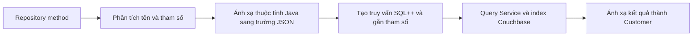

# Tạo truy vấn từ tên phương thức repository

Trong **SPRING_DATA_COUCHBASE**, *derived query* (truy vấn dẫn xuất) là cách khai báo điều kiện truy vấn ngay trong **tên phương thức** của Spring Data repository. Spring Data phân tích tên đó, nhận diện các thuộc tính của document, dựng câu truy vấn tương ứng và ánh xạ kết quả về đối tượng Java. Cách làm này đặc biệt phù hợp với các thao tác tìm kiếm, đếm và kiểm tra sự tồn tại có điều kiện tương đối đơn giản.

Bài học thuộc chương **Truy vấn dẫn xuất**, tập trung vào việc **tạo truy vấn từ tên phương thức repository**. Đây là một phần của tầng truy cập Couchbase bằng Spring Data: document mapping xác định dữ liệu được lưu ra sao; bucket, scope và collection xác định nơi truy vấn; index quyết định phần lớn hiệu năng của truy vấn SQL++; còn TTL, CAS, giao dịch và API reactive là các mối quan tâm khác cần phối hợp khi thiết kế tầng dữ liệu.

## 1. Mục tiêu học tập

Sau bài này, bạn có thể:

1. Đọc và đặt tên phương thức repository để biểu diễn bộ lọc, phép so sánh, phép kết hợp điều kiện và sắp xếp.
2. Phân biệt truy cập document theo ID với truy vấn dẫn xuất cần thực thi qua dịch vụ truy vấn SQL++ của Couchbase.
3. Dùng `Optional`, `List`, `Page`, `Pageable` và `Sort` phù hợp với số lượng kết quả mong đợi.
4. Thiết kế index dựa trên điều kiện lọc và sắp xếp thực tế, đồng thời xử lý vấn đề nhất quán của chỉ mục sau khi ghi.
5. Nhận biết khi nào tên phương thức đã quá phức tạp và nên chuyển sang `@Query` hoặc `CouchbaseTemplate`.

## 2. Truy vấn dẫn xuất hoạt động như thế nào?

Giả sử ứng dụng cần tìm khách hàng đang hoạt động có điểm tích lũy lớn hơn 100. Thay vì viết SQL++ trong từng lời gọi, ta khai báo:

```java
List<Customer> findByStatusAndLoyaltyPointsGreaterThan(
    String status, Integer minPoints
);
```

Tên phương thức truyền tải ba thông tin:

| Thành phần | Vai trò |
| --- | --- |
| `find...By` | Yêu cầu truy xuất các entity thỏa điều kiện. |
| `StatusAndLoyaltyPoints` | Hai thuộc tính Java trên entity, kết hợp bằng `AND`. |
| `GreaterThan` | So sánh thuộc tính `loyaltyPoints` với tham số bằng toán tử `>`. |

Quy trình tư duy:



Một cách hình dung truy vấn SQL++ được tạo ra là:

```sql
-- Minh họa ý nghĩa, KHÔNG phải SQL++ chính xác mà mọi phiên bản sinh ra.
SELECT c.*
FROM `app`.`crm`.`customers` AS c
WHERE c.`status` = $status
  AND c.`loyalty_points` > $minPoints;
```

Trong thực tế, Spring Data Couchbase có thể thêm phần chọn metadata của document và điều kiện phân biệt loại entity, đồng thời dùng cách đặt tên tham số khác. Không nên viết logic dựa trên giả định rằng SQL++ sinh ra luôn giống minh họa trên. Các giá trị đầu vào được binding qua cơ chế tham số của framework, không cần nối trực tiếp chuỗi người dùng vào câu SQL++.

**Điểm phân biệt quan trọng:** `repository.findById(id)` thường đi theo đường **key-value** để lấy document bằng khóa. Trái lại, `repository.findByEmail(email)` là truy vấn theo một trường nội dung, thông thường dùng **SQL++ và index**. Hai phương thức có hình thức Java giống nhau nhưng đặc điểm vận hành khác nhau.

## 3. Chuẩn bị entity và repository

Ví dụ dùng bucket `app`, scope `crm`, collection `customers`. Giả sử ứng dụng đã cấu hình kết nối Couchbase và tạo các tài nguyên này. Entity ánh xạ tên thuộc tính Java sang tên trường JSON:

```java
package example.customer;

import java.time.Instant;
import org.springframework.data.annotation.Id;
import org.springframework.data.couchbase.core.mapping.Collection;
import org.springframework.data.couchbase.core.mapping.Document;
import org.springframework.data.couchbase.core.mapping.Field;
import org.springframework.data.couchbase.core.mapping.Scope;

@Document
@Scope("crm")
@Collection("customers")
public class Customer {
    @Id
    private String id;

    @Field
    private String email;

    @Field
    private String status;

    @Field("loyalty_points")
    private Integer loyaltyPoints;

    @Field("joined_at")
    private Instant joinedAt;

    protected Customer() {
        // Dành cho cơ chế mapping.
    }

    // Constructor nghiệp vụ và getters/setters được lược bỏ cho ngắn gọn.
}
```

Repository có thể khai báo các phương thức từ tên:

```java
package example.customer;

import java.util.List;
import java.util.Optional;
import org.springframework.data.couchbase.repository.CouchbaseRepository;
import org.springframework.data.domain.Page;
import org.springframework.data.domain.Pageable;

public interface CustomerRepository
        extends CouchbaseRepository<Customer, String> {

    Optional<Customer> findByEmail(String email);

    List<Customer> findByStatusAndLoyaltyPointsGreaterThan(
        String status, Integer minPoints
    );

    List<Customer> findByStatusOrderByJoinedAtDesc(String status);

    Page<Customer> findByStatus(String status, Pageable pageable);

    long countByStatus(String status);

    boolean existsByEmail(String email);
}
```

Lưu ý về đặt tên: phương thức dùng **tên thuộc tính Java** `loyaltyPoints` và `joinedAt`, dù tên trường vật lý trong JSON lần lượt là `loyalty_points` và `joined_at`. Phần mapping giải quyết việc chuyển tên. Vì vậy `findByLoyalty_points...` không phải cách đặt tên đúng cho thuộc tính `loyaltyPoints` ở ví dụ này.

Khi tạo entity mới, cần giữ thống nhất cấu hình bucket/scope/collection giữa ứng dụng, entity và các index được tạo ở Couchbase. Repository không thể tìm được dữ liệu đúng nếu truy vấn đang nhắm tới collection khác với nơi document được ghi.

## 4. Ngữ pháp cơ bản của tên phương thức

Phần lớn phương thức có dạng:

```text
<động-từ-truy-vấn>[phần-bổ-nghĩa]By<thuộc-tính><toán-tử>...
```

Ví dụ:

```java
findByEmail(String email)
findByStatusAndLoyaltyPointsGreaterThan(String status, Integer minPoints)
findByStatusOrderByJoinedAtDesc(String status)
```

Nhóm động từ thường gặp gồm `find...By`/`read...By`/`get...By` để lấy dữ liệu, `count...By` để đếm và `exists...By` để kiểm tra có kết quả hay không. Các phương thức được khai báo trong interface repository; Spring Data thực hiện phần triển khai khi ứng dụng khởi chạy.

### 4.1. Điều kiện bằng và kết hợp điều kiện

| Khai báo | Ý nghĩa |
| --- | --- |
| `findByEmail(email)` | `email = ?` |
| `findByStatusAndEmail(status, email)` | `status = ? AND email = ?` |
| `findByStatusOrEmail(status, email)` | `status = ? OR email = ?` |
| `findByStatusAndLoyaltyPointsGreaterThan(status, p)` | `status = ? AND loyaltyPoints > ?` |

Thứ tự tham số Java phải khớp với thứ tự các điều kiện được phân tích từ tên phương thức. Các phép `And` và `Or` có thể tạo ra biểu thức dễ hiểu sai khi trộn nhiều nhánh; nếu cần nhiều mức ngoặc hoặc quy tắc nghiệp vụ phức tạp, một truy vấn SQL++ tường minh sẽ dễ đọc và kiểm soát hơn.

### 4.2. Phép so sánh, tập giá trị và giá trị khuyết

Các từ khóa thường thấy trong cơ chế truy vấn dẫn xuất của Spring Data gồm:

| Từ khóa | Ví dụ với entity `Customer` | Ý định truy vấn |
| --- | --- | --- |
| `GreaterThan` | `findByLoyaltyPointsGreaterThan(p)` | Lớn hơn `p` (`>`). |
| `GreaterThanEqual` | `findByLoyaltyPointsGreaterThanEqual(p)` | Lớn hơn hoặc bằng `p` (`>=`). |
| `LessThan` | `findByLoyaltyPointsLessThan(p)` | Nhỏ hơn `p` (`<`). |
| `Between` | `findByLoyaltyPointsBetween(a, b)` | Giá trị trong khoảng giới hạn. |
| `In` | `findByStatusIn(statuses)` | Thuộc tập các trạng thái đầu vào. |
| `IsNull` | `findByEmailIsNull()` | Kiểm tra giá trị `NULL` theo cách backend hỗ trợ. |
| `IsNotNull` | `findByEmailIsNotNull()` | Kiểm tra giá trị khác `NULL`. |

Ví dụ chữ ký bổ sung:

```java
List<Customer> findByLoyaltyPointsBetween(Integer min, Integer max);

List<Customer> findByStatusIn(java.util.Collection<String> statuses);
```

**Không suy diễn rằng mọi từ khóa trong Spring Data JPA đều có cùng ngữ nghĩa hoặc đều được hỗ trợ y hệt ở Couchbase.** Bộ từ khóa được hỗ trợ có thể phụ thuộc phiên bản Spring Data Couchbase đang chạy. Khi dùng từ khóa ít phổ biến như các biến thể tìm chuỗi, phủ định hay xử lý chữ hoa/chữ thường, hãy kiểm tra phiên bản thực tế và chạy thử trên dữ liệu đại diện.

Đặc biệt, JSON và SQL++ phân biệt **trường tồn tại với giá trị `NULL`** và **trường không tồn tại (`MISSING`)**. Không mặc định rằng `IsNull` bao phủ cả hai trường hợp. Nếu nghiệp vụ cần phân biệt rõ hai trạng thái, hãy viết SQL++ tường minh và kiểm thử kết quả.

### 4.3. Sắp xếp và giới hạn kết quả

Đặt `OrderBy` ở cuối tên phương thức để có sắp xếp cố định:

```java
List<Customer> findByStatusOrderByJoinedAtDesc(String status);
```

Đọc là: tìm các `Customer` có `status` phù hợp, sắp xếp `joinedAt` giảm dần. Có thể dùng `Asc` cho tăng dần. Với một màn hình tìm kiếm thay đổi thứ tự sắp xếp theo yêu cầu người dùng, dùng tham số `Sort` hoặc `Pageable` sẽ linh hoạt hơn so với khai báo quá nhiều phương thức `OrderBy...`.

Một số phiên bản và kiểu repository hỗ trợ các phần bổ nghĩa như `Top`/`First` để giới hạn số kết quả, ví dụ ý tưởng `findTop5ByStatusOrderByJoinedAtDesc`. Cần xác minh khả năng hỗ trợ của phiên bản Spring Data Couchbase đang sử dụng trước khi dựa vào chúng, đặc biệt khi kết hợp phân trang.

## 5. Kiểu trả về quyết định ý nghĩa của phương thức

| Kiểu trả về | Khi nào dùng | Hành vi cần lưu ý |
| --- | --- | --- |
| `Optional<Customer>` | Mong đợi 0 hoặc 1 kết quả. | Không có kết quả → `Optional.empty()`; nhiều kết quả có thể gây lỗi vì vi phạm kỳ vọng đơn trị. |
| `List<Customer>` | Lấy nhiều kết quả. | Không có kết quả → danh sách rỗng; không tự giới hạn số lượng document. |
| `Page<Customer>` | UI cần trang dữ liệu và tổng số phần tử. | Có thể cần thêm truy vấn `COUNT` để tính tổng số. |
| `long` cho `countBy...` | Chỉ cần số lượng kết quả. | Tránh tải nguyên các entity chỉ để đếm. |
| `boolean` cho `existsBy...` | Chỉ cần biết có tồn tại. | Không cần lấy danh sách document về ứng dụng. |

Ví dụ sử dụng:

```java
Optional<Customer> maybeCustomer = repository.findByEmail("lan@example.test");

List<Customer> customers = repository
    .findByStatusAndLoyaltyPointsGreaterThan("ACTIVE", 100);

long activeCount = repository.countByStatus("ACTIVE");
boolean emailAlreadyUsed = repository.existsByEmail("lan@example.test");
```

`Optional<Customer>` chỉ hợp lý nếu email được nghiệp vụ bảo đảm là duy nhất. Một secondary index thông thường **không tự bảo đảm uniqueness** của giá trị `email`. Nếu dữ liệu có hai document cùng email, lỗi trả về đơn trị là tín hiệu thiết kế dữ liệu hoặc validation chưa phù hợp. Với khóa document duy nhất, ưu tiên dùng ID làm định danh chính.

### 5.1. Phân trang an toàn

```java
import org.springframework.data.domain.Page;
import org.springframework.data.domain.PageRequest;
import org.springframework.data.domain.Sort;

Page<Customer> page = repository.findByStatus(
    "ACTIVE",
    PageRequest.of(
        0,                       // Trang đầu tiên, đếm từ 0.
        20,                      // Kích thước trang.
        Sort.by(Sort.Direction.DESC, "joinedAt")
    )
);

List<Customer> rows = page.getContent();
long total = page.getTotalElements();
```

`PageRequest.of(0, 20)` yêu cầu trang đầu tiên với tối đa 20 bản ghi. Không nên chạy `findByStatus(...)` trả về một `List` không giới hạn rồi tự cắt danh sách trong Java nếu collection có thể lớn.

Khi nhiều bản ghi có cùng `joinedAt`, thứ tự giữa các bản ghi đó có thể không ổn định. Đối với phân trang mà người dùng di chuyển giữa nhiều trang, nên có thêm khóa sắp xếp xác định và kiểm tra số lượng/chi phí truy vấn `COUNT`. Phân trang dựa trên offset quá sâu cũng có thể tốn chi phí; với luồng dữ liệu lớn, cân nhắc cách phân trang dựa trên con trỏ hoặc điều kiện tiếp nối phù hợp với SQL++.

## 6. Index: yếu tố quyết định khả năng chạy và tốc độ truy vấn

Trong Couchbase, các truy vấn dẫn xuất lọc theo trường JSON thường được chuyển thành SQL++. Một truy vấn như `findByStatusAndLoyaltyPointsGreaterThan` cần được **hỗ trợ bởi index phù hợp**. Không có index phù hợp, truy vấn có thể thất bại với lỗi lập kế hoạch truy vấn hoặc buộc phải dùng đường quét kém hiệu quả nếu có index tổng quát.

Ví dụ DDL dành cho bucket/scope/collection giả định trong bài:

```sql
CREATE INDEX ix_customers_email
ON `app`.`crm`.`customers`(`_class`, `email`);

CREATE INDEX ix_customers_status_points
ON `app`.`crm`.`customers`(`_class`, `status`, `loyalty_points`);

CREATE INDEX ix_customers_status_joined
ON `app`.`crm`.`customers`(`_class`, `status`, `joined_at` DESC);
```

Các index trên **chỉ là điểm khởi đầu minh họa**. Một truy vấn entity do Spring Data sinh ra có thể thêm điều kiện về loại document, thường qua trường phân biệt kiểu như `_class`; ứng dụng có thể tùy biến tên trường này. Phải kiểm tra SQL++ thực tế, đường dẫn collection, dữ liệu, độ chọn lọc và kế hoạch thực thi trước khi chốt cấu trúc index.

Cách đánh giá:

1. Xác định bộ lọc thường gặp từ tên phương thức (`status`, `loyaltyPoints`, `email`).
2. Đối chiếu với tên **trường JSON thật** (`loyalty_points`, `joined_at`) và điều kiện về loại entity nếu framework sinh ra.
3. Tạo index có thứ tự trường phù hợp với bộ lọc và `ORDER BY` thường gặp; tránh tạo một index mới cho mọi phương thức một cách máy móc.
4. Chạy `EXPLAIN` trên SQL++ tương đương, theo dõi index được chọn, số document quét và độ trễ với dữ liệu thực tế.

Ví dụ phân tích kế hoạch theo SQL++ minh họa:

```sql
EXPLAIN
SELECT c.*
FROM `app`.`crm`.`customers` AS c
WHERE c.`status` = "ACTIVE"
  AND c.`loyalty_points` > 100;
```

Trong môi trường thật, bổ sung các điều kiện mà Spring Data đang sinh ra rồi mới so sánh kế hoạch. Index chính (`PRIMARY INDEX`) có thể hỗ trợ một số truy vấn nhưng không thay thế việc thiết kế secondary index cho các đường truy cập thường xuyên.

### 6.1. Vì sao vừa `save` xong mà `findBy...` chưa thấy?

Couchbase tách hoạt động key-value và hệ thống index/truy vấn. Sau khi ghi document, việc cập nhật index có thể chưa kịp phản ánh ngay trong một truy vấn SQL++ ở mức nhất quán không đợi chỉ mục. Do đó có thể xảy ra:

```text
save(customer)         → ghi document thành công
findById(customer.id)  → có thể đọc bằng key-value
findByEmail(email)     → có thể chưa thấy qua index ngay tức thì
```

Nếu luồng nghiệp vụ bắt buộc đọc ngay bản ghi vừa ghi bằng điều kiện khác ID, cần chọn mức nhất quán truy vấn thích hợp (ví dụ khả năng chờ cập nhật index như `REQUEST_PLUS`) qua tùy chọn mà phiên bản thư viện đang hỗ trợ, hoặc thiết kế lại luồng để đọc theo ID. Mức nhất quán cao hơn có chi phí thời gian chờ; tránh áp dụng tràn lan khi không cần.

## 7. Khi nào không nên tiếp tục kéo dài tên phương thức?

Truy vấn dẫn xuất phù hợp khi ý định được diễn đạt rõ bằng vài thuộc tính. Nhưng một phương thức kiểu:

```text
findByStatusAndLoyaltyPointsGreaterThanOrEmailAndJoinedAtBetween...
```

khó đọc, khó kiểm soát nhóm điều kiện, dễ trở nên mong manh khi entity đổi thuộc tính. Nên chuyển sang SQL++ khai báo rõ khi cần:

- Nhóm `AND`/`OR` có ngoặc phức tạp, biểu thức tính toán hoặc lọc theo cấu trúc mảng/JSON đặc thù.
- `JOIN`, `UNNEST`, tổng hợp (`GROUP BY`), truy vấn toàn văn hoặc các hàm SQL++ chuyên dụng.
- Điều khiển rõ projection, tối ưu index, hints hay tùy chọn truy vấn đặc biệt.
- Truy vấn linh hoạt có nhiều bộ lọc tùy chọn khiến tên phương thức tăng theo số tổ hợp.

Hướng xử lý tương ứng là `@Query` để khai báo SQL++ rõ ràng, hoặc `CouchbaseTemplate` khi cần dựng truy vấn theo điều kiện động. Trong `@Query`, phải dùng cú pháp và cơ chế binding tham số do **Spring Data Couchbase** hỗ trợ; không thể sao chép nguyên một câu `@Query` dùng JPQL của Spring Data JPA sang đây.

Để chọn API đúng, có thể đối chiếu:

| Yêu cầu | API nên cân nhắc | Lý do |
| --- | --- | --- |
| Lấy document biết ID | `findById` | Tận dụng đường truy cập key-value. |
| Lọc theo 1–3 trường, điều kiện rõ | Derived query | Ngắn gọn, gắn chặt với thuộc tính entity. |
| SQL++ nhiều cấu trúc đặc thù | `@Query` | Chủ động định nghĩa truy vấn. |
| Tổ hợp điều kiện động | `CouchbaseTemplate` | Xây dựng truy vấn linh hoạt hơn. |
| Luồng bất đồng bộ, non-blocking | `ReactiveCouchbaseRepository` | Sử dụng kiểu trả về reactive khi toàn bộ chuỗi xử lý tương thích. |

## 8. Cùng cú pháp, nhưng khác biệt trong mô hình dữ liệu Couchbase

### 8.1. Phân vùng bucket, scope, collection

Tên phương thức thể hiện **điều kiện lọc**, còn cấu hình và annotation mapping xác định collection được truy cập. `findByEmail` không tự biết phải tìm trong scope nào nếu mapping/configuration sai. Khi tách dữ liệu khách hàng, đơn hàng và phiên làm việc sang các collection khác nhau, cần khai báo entity/repository và index tương ứng; không nên kỳ vọng một derived query tự tìm xuyên nhiều collection.

### 8.2. TTL và dữ liệu hết hạn

Document có TTL có thể tự hết hạn. Truy vấn `findByStatus` không bảo đảm trả lại document đã hết hạn dù document từng tồn tại. TTL được quản lý trong cách ghi/cấu hình vòng đời document, **không phải một toán tử tự động nằm trong tên phương thức derived query**. Với dữ liệu phiên làm việc hoặc cache, phải thiết kế kiểm thử cả trường hợp document biến mất do hết hạn.

### 8.3. CAS và cập nhật đồng thời

Derived query giúp **tìm** document; nó không tự bảo vệ thao tác sửa cùng một document trước xung đột ghi. Với bài toán cập nhật điểm thưởng hay trạng thái cần tránh ghi đè, sử dụng cơ chế optimistic locking/CAS phù hợp ở bước cập nhật (chẳng hạn mapping version khi được cấu hình và hỗ trợ), xử lý xung đột và thử lại theo nghiệp vụ. Cần phân biệt tính chính xác của truy vấn lọc với tính đúng đắn của thao tác cập nhật.

### 8.4. Giao dịch và nhất quán

Không suy luận rằng mọi chuỗi `findBy...` rồi `save(...)` là một giao dịch nguyên tử. Nếu nghiệp vụ cần nhiều thao tác nhất quán, phải kiểm tra mô hình giao dịch, phạm vi hỗ trợ và giới hạn của SDK/Spring Data Couchbase đang dùng. Đồng thời tách bạch **transaction** với **query scan consistency**: chúng giải quyết các câu hỏi khác nhau.

### 8.5. Phiên bản reactive

Với ứng dụng dùng reactive end-to-end, repository có thể định nghĩa cùng ý tưởng tên phương thức nhưng dùng `Mono`/`Flux`:

```java
import org.springframework.data.couchbase.repository.ReactiveCouchbaseRepository;
import reactor.core.publisher.Flux;
import reactor.core.publisher.Mono;

public interface ReactiveCustomerRepository
        extends ReactiveCouchbaseRepository<Customer, String> {

    Mono<Customer> findByEmail(String email);

    Flux<Customer> findByStatus(String status);
}
```

`Mono<Customer>` diễn tả tối đa một entity, `Flux<Customer>` diễn tả nhiều entity. Reactive không tự xóa bỏ nhu cầu về index hoặc tính nhất quán của SQL++; cũng không nên gọi `.block()` giữa luồng reactive của web request vì có thể làm mất lợi ích non-blocking.

## 9. Lỗi thường gặp và cách chẩn đoán

| Triệu chứng | Nguyên nhân thường gặp | Hướng kiểm tra |
| --- | --- | --- |
| Khởi động lỗi vì không tìm được property | Sai chính tả tên thuộc tính Java trong tên phương thức. | So khớp với property của entity và mapping; `joinedAt` khác `joined_at`. |
| Query báo không có index phù hợp | Chưa tạo index hoặc index không dùng được cho bộ lọc thực tế. | Kiểm tra collection, index, điều kiện phân biệt loại, `EXPLAIN`. |
| `findByEmail` kỳ vọng một nhưng có nhiều kết quả | Dữ liệu không bảo đảm email duy nhất. | Kiểm tra dữ liệu trùng, ràng buộc nghiệp vụ và cách định danh document. |
| Vừa lưu xong nhưng tìm theo trường chưa thấy | Chỉ mục truy vấn chưa phản ánh bản ghi mới ở mức nhất quán đang dùng. | So sánh với `findById`, kiểm tra query consistency và độ trễ index. |
| Kết quả khác dự kiến khi trường không có trong JSON | Nhầm `MISSING`, `NULL`, chuỗi rỗng hoặc dữ liệu có kiểu không đồng nhất. | Xem document thực, SQL++ của điều kiện và phép so sánh tương ứng. |
| Phân trang chậm khi chuyển tới trang sâu | Offset cao, sắp xếp/index chưa phù hợp hoặc đếm toàn tập lớn. | Xem truy vấn `COUNT`, index, kế hoạch và chiến lược phân trang. |
| Tên phương thức dài và khó thay đổi | Cố diễn đạt nghiệp vụ phức tạp bằng keyword ghép nối. | Chuyển sang `@Query` hoặc `CouchbaseTemplate`. |

Khi debug, nên bật log truy vấn ở mức phù hợp trong môi trường thử nghiệm, đối chiếu SQL++ sinh ra với tên thuộc tính và index. Tránh ghi ra log dữ liệu nhạy cảm hay toàn bộ tham số khách hàng trong môi trường sản xuất.

## 10. Bài tập áp dụng

Xét entity `Customer` ở trên và yêu cầu của trang quản trị: chỉ hiển thị khách hàng `ACTIVE` có trên 500 điểm tích lũy, mới tham gia trước thì xếp sau.

**Bước 1 — Đặt tên phương thức:**

```java
List<Customer> findByStatusAndLoyaltyPointsGreaterThanOrderByJoinedAtDesc(
    String status, Integer minPoints
);
```

**Bước 2 — Gọi và giải thích điều kiện:**

```java
List<Customer> results = repository
    .findByStatusAndLoyaltyPointsGreaterThanOrderByJoinedAtDesc(
        "ACTIVE", 500
    );
```

Diễn giải: `status = "ACTIVE" AND loyalty_points > 500`, sắp xếp theo `joined_at` giảm dần. Khách hàng **đúng 500 điểm** không thỏa `GreaterThan`; nếu nghiệp vụ muốn từ 500 điểm trở lên, cần thay bằng `GreaterThanEqual` và xác minh keyword đó trên phiên bản sử dụng.

**Bước 3 — Xác minh môi trường:** bảo đảm collection `app.crm.customers` tồn tại, có index hỗ trợ lọc `status`, `loyalty_points` và sắp xếp `joined_at`; kiểm tra bộ lọc loại entity do Spring Data sinh ra. Thử với ít nhất các bản ghi có điểm `499`, `500`, `501`, hai trạng thái khác nhau và hai thời điểm `joinedAt` khác nhau.

**Bước 4 — Xem xét tải lớn:** phương thức trả về `List` có thể tải nhiều document. Nếu đây là màn hình phân trang, bổ sung biến thể nhận `Pageable`/trả `Page` như phần 5 và đo chi phí của truy vấn lẫn count query.

### Câu hỏi tự kiểm tra

1. Vì sao `findById("customer::42")` có đặc điểm vận hành khác `findByEmail("a@example.test")`? — Vì truy cập theo ID có thể dùng key-value, còn lọc theo trường nội dung thường đi qua SQL++ và index.
2. Entity có `@Field("loyalty_points") private Integer loyaltyPoints;` thì tên phương thức dùng `LoyaltyPoints` hay `loyalty_points`? — Dùng `LoyaltyPoints`, tức tên property Java.
3. Khi `findByStatus` trả về ít bản ghi hơn dự kiến ngay sau khi `save`, nên kiểm tra gì? — Kiểm tra key-value theo ID, trạng thái index và mức nhất quán truy vấn trước khi kết luận mất dữ liệu.

## 11. Ghi nhớ để áp dụng

Derived query biến các điều kiện tìm kiếm phổ biến thành chữ ký phương thức dễ đọc, tận dụng document mapping và API repository của Spring Data Couchbase. Cách dùng hiệu quả là đặt tên theo **property Java**, chọn **kiểu trả về đúng**, tạo **index theo truy vấn thực tế** và hiểu sự khác biệt giữa **key-value** với **SQL++**. Với biểu thức phức tạp hoặc yêu cầu vận hành đặc biệt, chuyển sang `@Query`/`CouchbaseTemplate`; với API reactive, giữ nguyên tư duy về index và consistency dù kiểu trả về đổi sang `Mono`/`Flux`.
