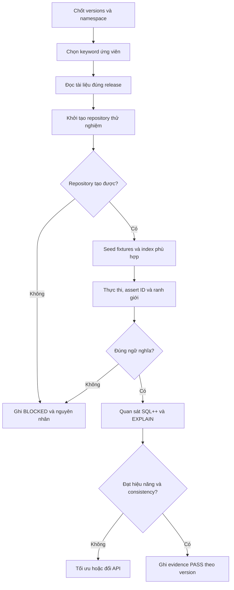

# Kiểm tra từ khóa thực sự được hỗ trợ trong phiên bản sử dụng

Trong **SPRING_DATA_COUCHBASE**, tên phương thức repository có thể mô tả điều kiện truy vấn, sắp xếp, giới hạn kết quả hoặc một số thao tác thống kê mà không cần tự viết SQL++. Tuy nhiên, việc nhìn thấy một từ khóa trong tài liệu **Spring Data Commons** hoặc một ví dụ **Spring Data JPA** **không đủ để kết luận** Spring Data Couchbase ở phiên bản đang dùng hỗ trợ từ khóa đó. Có trường hợp parser nhận diện tên phương thức nhưng query creator của Couchbase không diễn dịch được; cũng có trường hợp câu SQL++ được sinh ra hợp lệ nhưng không trả đúng tập document vì mapping, `NULL`/`MISSING`, kiểu JSON, index hoặc consistency.

Bài thuộc chương **Truy vấn dẫn xuất**, tập trung vào một kỹ năng vận hành quan trọng: **kiểm tra và chứng minh từ khóa thật sự được hỗ trợ trong phiên bản sử dụng**. Đây là phần không thể tách rời của việc xây dựng tầng truy cập Couchbase với document mapping, repository, `CouchbaseTemplate` và SQL++; lựa chọn bucket/scope/collection, chỉ mục, TTL, CAS, giao dịch và API reactive cũng ảnh hưởng đến kết quả kiểm thử và giới hạn bảo đảm.

> **Nguyên tắc:** Đừng dùng “Java biên dịch được” hay “trên internet có ví dụ tương tự” làm bằng chứng hỗ trợ. Một từ khóa chỉ nên được xem là **đã xác nhận** khi nó hoạt động đúng ở **tổ hợp phiên bản thư viện, mapping, Couchbase Server và kiểu repository của ứng dụng**, cùng dữ liệu biên có kiểm chứng.

## 1. Mục tiêu học tập

Sau bài này, bạn có thể:

1. Xác định đúng phiên bản **Spring Data Couchbase**, **Spring Data Commons**, **Spring Boot/BOM**, Couchbase SDK và Couchbase Server đang chạy.
2. Phân biệt các lớp kiểm tra: **ngữ pháp parser**, **query creator của Couchbase**, **SQL++ được thực thi**, **mapping**, **ngữ nghĩa kết quả** và **chi phí index**.
3. Lập ma trận kiểm thử cho các nhóm keyword: điều kiện cơ bản, so sánh, chuỗi, null, nested path, sắp xếp, giới hạn, count, exists và delete.
4. Hiểu vì sao một method có thể khởi tạo được nhưng kết quả vẫn khác mong đợi khi gặp `NULL`, `MISSING`, mảng hoặc dữ liệu sai kiểu.
5. Dùng integration test trên môi trường Couchbase kiểm soát được để xác nhận các từ khóa thực sự cần cho ứng dụng.
6. Quan sát SQL++ sinh ra, thử câu truy vấn với tham số thật và sử dụng `EXPLAIN` trước khi kết luận hiệu năng.
7. Kiểm tra riêng repository **imperative** và **reactive** nếu hệ thống sử dụng cả hai.
8. Nhận biết khi nào phải chuyển từ derived query sang `@Query`, `CouchbaseTemplate` hoặc API SDK phù hợp.
9. Lưu chứng cứ theo phiên bản và chạy lại kiểm thử sau khi nâng cấp dependency hoặc Couchbase Server.

## 2. Một từ khóa có thể “được hỗ trợ” ở nhiều mức khác nhau

Lấy ví dụ phương thức:

```java
List<Customer> findByStatusAndLoyaltyPointsGreaterThan(
    String status, Integer threshold
);
```

Nhìn tên có vẻ hợp lệ: `status` bằng một giá trị và `loyaltyPoints` lớn hơn ngưỡng. Nhưng cần phân biệt các tầng kiểm tra sau.

| Tầng | Câu hỏi cần trả lời | Kiểu lỗi có thể xảy ra |
| --- | --- | --- |
| **1. Biên dịch Java** | Interface, kiểu tham số và kiểu trả về có hợp lệ về mặt Java không? | Lỗi biên dịch; trùng chữ ký method. |
| **2. Phân tích tên** | Spring Data nhận diện `GreaterThan` và các property đúng không? | `PropertyReferenceException` hoặc lỗi xây repository. |
| **3. Tạo query Couchbase** | Spring Data Couchbase chuyển điều kiện thành SQL++ phù hợp không? | Không hỗ trợ keyword/tổ hợp; lỗi khi tạo query. |
| **4. Mapping và binding** | `loyaltyPoints` có ánh xạ đúng `loyalty_points`, tham số đúng kiểu không? | Câu SQL++ chạy nhưng tìm sai field hoặc lỗi mapping. |
| **5. Thực thi trên Server** | SQL++ hợp lệ, có index thích hợp và namespace đúng không? | Query Service trả lỗi cú pháp, index hoặc quyền. |
| **6. Ngữ nghĩa kết quả** | Với ngưỡng, null, missing và dữ liệu biên, kết quả có đúng không? | Sai ranh giới, sai tập ID, thiếu bản ghi. |
| **7. Vận hành** | Query có đủ nhanh, ổn định, đúng consistency và không tải quá nhiều không? | Scan lớn, timeout, kết quả chưa thấy ghi mới. |

Chỉ qua tầng 1 hoặc 2 **chưa thể gọi là đã hỗ trợ đầy đủ**. Cần xác minh ít nhất từ tên method đến kết quả truy vấn có dữ liệu đại diện.

### 2.1. Spring Data Commons không đồng nghĩa Spring Data Couchbase

**Spring Data Commons** cung cấp nhiều thành phần chung, trong đó có cơ chế phân tích tên phương thức và mô hình `PartTree`/property path. **Spring Data Couchbase** quyết định cách dùng kết quả phân tích để tạo truy vấn và thao tác trên Couchbase.

Vì vậy:

- Một hậu tố được parser nhận diện **không chứng minh** module Couchbase chuyển được nó thành SQL++.
- Một keyword được tài liệu JPA minh họa **không phải** cam kết rằng Couchbase có cùng hành vi.
- Một phương thức trên `CouchbaseRepository` hoạt động **không tự chứng minh** biến thể tương ứng trên `ReactiveCouchbaseRepository` có kiểu trả về và hành vi giống hệt.
- Một câu SQL++ chạy trực tiếp trên Query Workbench **không chứng minh** repository tự sinh đúng câu đó, gồm type discriminator và metadata mapping.

Ngược lại, không nên tuyên bố một keyword “không hỗ trợ” chỉ vì nó không xuất hiện trong một ví dụ tài liệu: cần đối chiếu chính xác phiên bản và thử trên môi trường phù hợp.

## 3. Bước đầu tiên: chốt phiên bản thật sự đang chạy

Một ứng dụng Spring Boot thường dùng dependency management/BOM nên phiên bản trong file khai báo dependency có thể **khác** phiên bản artifact thực sự trên runtime classpath. Cần lưu cả **phiên bản được resolve** chứ không chỉ một số phiên bản trong hướng dẫn.

Mẫu phiếu ghi nhận:

| Thành phần | Giá trị cần chốt | Vì sao cần biết |
| --- | --- | --- |
| Spring Boot | Phiên bản ứng dụng | Có thể quản lý bộ Spring Data thông qua BOM. |
| Spring Data Couchbase | Artifact `spring-data-couchbase` và phiên bản được resolve | Quyết định query creator và repository implementation. |
| Spring Data Commons | Artifact `spring-data-commons` và phiên bản được resolve | Ảnh hưởng parser, keyword chung và property path. |
| Couchbase Java SDK | Artifact/phiên bản thực tế | Query options, diagnostics, DML, KV API. |
| Couchbase Server | Phiên bản và cấu hình cluster thử nghiệm | SQL++, index và features phải được Server hỗ trợ. |
| Kiểu repository | `CouchbaseRepository` hay `ReactiveCouchbaseRepository` | Có thể khác API, adapter và cách thực thi. |
| Cấu hình mapping | Bucket, scope, collection, `@Field`, discriminator và converters | Quyết định SQL++/JSON thực tế. |

### 3.1. Cách đọc dependency tree

Nếu dự án dùng Maven, một cách khảo sát là xem cây dependency của ứng dụng. Ví dụ lệnh dành cho **người triển khai chạy trên dự án của họ**:

```bash
./mvnw dependency:tree
```

Sau đó tìm các artifact `spring-data-couchbase`, `spring-data-commons`, `spring-boot`, `java-client`. Nếu muốn lọc, dùng cách lọc được plugin Maven và môi trường shell của dự án hỗ trợ; không mặc định một cú pháp filter áp dụng mọi phiên bản.

Nếu dự án dùng Gradle:

```bash
./gradlew dependencies --configuration runtimeClasspath
./gradlew dependencyInsight \
  --configuration runtimeClasspath \
  --dependency spring-data-couchbase
./gradlew dependencyInsight \
  --configuration runtimeClasspath \
  --dependency spring-data-commons
```

Đây là **ví dụ thao tác khảo sát**, không phải yêu cầu chạy các lệnh khi chỉ đang đọc bài. Các lệnh thực tế có thể khác trên Windows, theo tên configuration hoặc cấu hình multi-module.

**Nên ghi lại:** commit ứng dụng, phiên bản artifact sau resolve, phiên bản Server và ngày kiểm thử. Nếu sau này dùng kết quả PASS cho một nhánh khác, phải kiểm tra rằng môi trường vẫn có cùng các thành phần quan trọng.

### 3.2. Không tự ghép phiên bản từ tài liệu không cùng release

Một bài viết cho Spring Data Couchbase cũ có thể dùng những API không còn giống phiên bản mới. Ngay cả khi tên method không đổi, cách chuyển property path, binding tham số, projection hoặc hỗ trợ reactive có thể thay đổi.

Quy trình đọc tài liệu hợp lý:

1. Mở **reference documentation của đúng release** Spring Data Couchbase được resolve.
2. Đối chiếu phần query derivation/repositories với tài liệu chung của Spring Data cùng release train.
3. Xem release notes/changelog khi keyword hoặc kiểu trả về là điểm then chốt.
4. Nếu tài liệu không khẳng định rõ một tính năng, **đánh dấu chưa xác minh**, không suy ra từ các module khác.
5. Dùng integration test để làm bằng chứng thực tế cho chính ứng dụng.

## 4. Lập ma trận từ khóa **cần kiểm chứng**, không phải danh sách được bảo đảm

Bảng dưới đây là **danh sách ứng viên kiểm thử** theo các nhu cầu phổ biến. Cột “mức rủi ro” nhắc nơi cần kiểm tra kỹ; **không có hàng nào tự khẳng định được Spring Data Couchbase ở mọi phiên bản hỗ trợ**.

| Nhóm | Ví dụ tên method ứng viên | Điều cần chứng minh |
| --- | --- | --- |
| Bằng nhau | `findByStatus`, `findByEmail` | Tên Java → JSON, kiểu tham số, query scope. |
| Ghép điều kiện | `findByStatusAndCity`, `findByStatusOrCity` | Nhóm `And`/`Or` và thứ tự tham số. |
| So sánh | `findByLoyaltyPointsGreaterThan`, `...LessThanEqual` | Ranh giới `>`/`>=`/`<`/`<=`. |
| Khoảng | `findByLoyaltyPointsBetween` | Hai cận, kiểu số, giá trị biên. |
| Tập giá trị | `findByCityIn`, `findByStatusNotIn` | Mảng tham số, tập rỗng, null. |
| Chuỗi | `findByDisplayNameStartingWith`, `...Containing`, `...Like` | Wildcard, escape ký tự, đúng field. |
| Hoa/thường | `findByDisplayNameContainingIgnoreCase` | Parser, chuyển đổi SQL++, Unicode. |
| Null | `findByPhoneIsNull`, `...IsNotNull` | `NULL` khác `MISSING`; kiểu dữ liệu. |
| Object lồng nhau | `findByAddress_City` | Property path, `@Field` ở từng tầng. |
| Sắp xếp cố định | `findByStatusOrderByCreatedAtDesc` | `ORDER BY` đúng field/hướng. |
| Sắp xếp động | `findByStatus(String, Sort)` | Tham số `Sort` có được chấp nhận và áp dụng? |
| Giới hạn | `findTop3ByStatusOrderByCreatedAtDesc` | `LIMIT` được áp dụng phía Server? |
| Phân trang | `findByStatus(String, Pageable)` | `LIMIT`/`OFFSET`/sort và metadata trang. |
| Đếm | `countByStatus` | Đếm đúng document, không tải entity. |
| Tồn tại | `existsByEmail` | Trả Boolean đúng khi 0/1/nhiều document. |
| Xóa theo predicate | `deleteByStatus`, `removeByStatus` | Có hỗ trợ thực thi? Có xóa qua DML hay từng entity? |
| Hình thức phức tạp | `Distinct`, `Regex`, `Near`, keyword theo mảng | Chỉ dùng nếu tài liệu đúng release và test chứng minh. |

**Đặc biệt lưu ý:** `deleteBy...` là thao tác **ghi có tác động**, không thể kiểm tra một cách tùy tiện trên môi trường dùng chung. `Regex`, `Near` hoặc keyword của một Spring Data module khác cũng không được đưa vào code chỉ vì parser chung nhận tên. Hãy phân loại theo tính năng **thực tế cần dùng**, thay vì thử mọi từ khóa có thể tưởng tượng ra.

### 4.1. Phiếu trạng thái ứng viên

Có thể quản lý kết quả kiểm tra như sau:

| Trạng thái | Ý nghĩa |
| --- | --- |
| `NOT_CHECKED` | Chỉ mới thấy trong tài liệu hoặc có nhu cầu. |
| `PARSE_ONLY` | Parser/khởi tạo repository nhận tên, chưa chứng minh truy vấn chạy đúng. |
| `QUERY_OK` | Câu SQL++ thực thi thành công trên tập dữ liệu mẫu. |
| `BEHAVIOR_PASS` | Bộ test ranh giới, mapping, null/missing cho kết quả mong đợi. |
| `PERFORMANCE_PASS` | Đã kiểm tra `EXPLAIN`, giới hạn và tải phù hợp quy mô ứng dụng. |
| `BLOCKED` | Không hỗ trợ, behavior khác yêu cầu hoặc chưa thể chứng minh. |

Đừng nâng trạng thái từ `NOT_CHECKED` lên `BEHAVIOR_PASS` chỉ dựa vào việc project start thành công. Với tác vụ xóa, phải thêm kiểm tra **phạm vi xóa**, kết quả mutation, an toàn dữ liệu và rollback.

## 5. Entity ví dụ để kiểm thử query derivation

Giả sử CRM lưu customer trong bucket `app`, scope `crm` và collection `customers`. Một document:

```json
{
  "customer_code": "C002",
  "status": "ACTIVE",
  "loyalty_points": 10,
  "display_name": "Lan Anh",
  "email": "lan@example.test",
  "address_info": {"city_name": "HANOI"}
}
```

Entity tương ứng:

```java
package example.crm;

import org.springframework.data.annotation.Id;
import org.springframework.data.couchbase.core.mapping.Collection;
import org.springframework.data.couchbase.core.mapping.Document;
import org.springframework.data.couchbase.core.mapping.Field;
import org.springframework.data.couchbase.core.mapping.Scope;

@Document
@Scope("crm")
@Collection("customers")
public class Customer {

    @Id
    private String id;

    @Field("customer_code")
    private String customerCode;

    @Field
    private String status;

    @Field("loyalty_points")
    private Integer loyaltyPoints;

    @Field("display_name")
    private String displayName;

    @Field
    private String email;

    @Field("address_info")
    private Address address;

    protected Customer() {
        // Dành cho Spring Data mapping.
    }

    public String getId() {
        return id;
    }

    // Constructor nghiệp vụ, getters/setters khác được lược bỏ.
}

class Address {

    @Field("city_name")
    private String city;

    protected Address() {}
}
```

Mọi method name dùng **property Java** như `loyaltyPoints`, `displayName` và `address.city`. SQL++/index lại tham chiếu các trường JSON `loyalty_points`, `display_name` và `address_info.city_name`.

Phải kiểm tra chính xác document JSON được lưu: converter tùy chỉnh và quy tắc lưu null có thể ảnh hưởng dữ liệu. Repository mapping có thể thêm metadata/type discriminator, vì vậy document chèn trực tiếp bằng SDK cho test cần tương thích với điều kiện type mà query creator sinh ra.

## 6. Tách các keyword ứng viên thành các repository kiểm thử nhỏ

Một repository ứng viên cho truy vấn so sánh:

```java
import java.util.List;
import org.springframework.data.couchbase.repository.CouchbaseRepository;

public interface CustomerComparisonCandidateRepository
        extends CouchbaseRepository<Customer, String> {

    List<Customer> findByStatusAndLoyaltyPointsGreaterThan(
        String status, Integer points
    );

    List<Customer> findByStatusAndLoyaltyPointsBetween(
        String status, Integer lower, Integer upper
    );

    List<Customer> findByStatusAndAddress_City(
        String status, String city
    );
}
```

Một repository ứng viên cho chuỗi/giới hạn:

```java
import java.util.List;

public interface CustomerTextCandidateRepository
        extends org.springframework.data.couchbase.repository.CouchbaseRepository<Customer, String> {

    List<Customer> findByDisplayNameContainingIgnoreCase(
        String text
    );

    List<Customer> findTop2ByStatusOrderByLoyaltyPointsDescCustomerCodeAsc(
        String status
    );
}
```

**Những chữ ký trên là đối tượng cần kiểm chứng, không phải tuyên bố mọi keyword đều được Couchbase hỗ trợ.** Nếu một method không được query creator hỗ trợ, việc Spring khởi tạo repository có thể lỗi và khiến toàn application context không start. Đó là lý do nên đặt từng nhóm ứng viên trong **test context riêng** hoặc module thử nghiệm có thể bật/tắt để một keyword lỗi không làm hỏng tất cả phép kiểm tra khác.

Không thêm mọi từ khóa “đang thử” vào repository production rồi chờ runtime mới phát hiện lỗi. Tính năng chỉ được đưa vào code sản xuất khi đã được chứng minh trên đúng tổ hợp phiên bản.

## 7. Kiểm thử theo từng tầng: từ parser đến kết quả

### 7.1. Kiểm tra cú pháp tên và property path

Ví dụ `findByStatusAndAddress_City` phải đi từ property `Customer.address` đến `Address.city`. Nếu viết `findByStatusAndAddressInfoCityName` vì nhìn thấy JSON `address_info.city_name`, parser có thể tìm sai property.

Ở tầng Spring Data Commons, `PartTree` giúp hiểu việc phân tách tên method. Một thử nghiệm cú pháp (nếu API tương ứng có trong release) có thể có dạng:

```java
import org.springframework.data.repository.query.parser.PartTree;

PartTree parsed = new PartTree(
    "findByStatusAndLoyaltyPointsGreaterThan",
    Customer.class
);
```

**Chỉ kiểm tra parser không đủ.** Một đối tượng `PartTree` được tạo thành công không xác nhận được Couchbase query creator xử lý `GreaterThan` đúng, SQL++ có index hoặc kết quả có ranh giới chính xác.

Với nested path, thử cả tên `AddressCity` và `Address_City` nếu entity vừa có property phẳng `addressCity` vừa có `address.city`. Cần chứng minh phương thức trỏ đúng field JSON, không chỉ parse được.

### 7.2. Kiểm tra repository khởi tạo

Bật **một nhóm nhỏ các phương thức ứng viên** trong một Spring application context thử nghiệm. Xác nhận repository bean được tạo thành công. Ghi nhận lỗi nguyên văn khi không khởi tạo được, bao gồm tên property hoặc keyword.

Đây là mức **PARSE_ONLY hoặc khởi tạo thành công**, không phải xác nhận truy vấn đã chạy. Một số lỗi chỉ xuất hiện khi method được gọi, tùy cơ chế tạo query của phiên bản.

### 7.3. Thực thi trên dữ liệu cố định

Tạo bộ dữ liệu thử với ID xác định và gọi từng phương thức. Kiểm tra bằng **tập ID hoặc danh sách ID có thứ tự** khi truy vấn có `OrderBy`. Không chỉ assert “không ném exception” hoặc “result không null”.

Ví dụ dữ liệu:

| ID | `status` | `loyalty_points` | `display_name` | `address_info.city_name` |
| --- | --- | ---: | --- | --- |
| `candidate::c01` | ACTIVE | 9 | An | HANOI |
| `candidate::c02` | ACTIVE | 10 | Lan Anh | HANOI |
| `candidate::c03` | ACTIVE | 11 | LAN BINH | DANANG |
| `candidate::c04` | ARCHIVED | 12 | Lan Chau | HANOI |
| `candidate::c05` | ACTIVE | `MISSING` | Lan Duong | HCM |
| `candidate::c06` | ACTIVE | `NULL` | Lân Giang | HANOI |

Chú ý trường `MISSING` trong bảng nghĩa là field không tồn tại trong JSON, không phải chuỗi `"MISSING"`. Nếu seed qua entity mapper làm mất phân biệt null/missing, có thể cần ghi riêng fixture bằng SDK với cấu trúc JSON kiểm soát được và metadata phù hợp query của Spring Data.

| Kiểm thử | Kết quả mong đợi |
| --- | --- |
| `findByStatusAndLoyaltyPointsGreaterThan("ACTIVE", 10)` | `{candidate::c03}` |
| `findByStatusAndLoyaltyPointsBetween("ACTIVE", 9, 11)` | `{candidate::c01, candidate::c02, candidate::c03}` |
| `findByStatusAndAddress_City("ACTIVE", "HANOI")` | `{candidate::c01, candidate::c02, candidate::c06}` |
| `findByDisplayNameContainingIgnoreCase("lan")`, nếu modifier hỗ trợ | `{candidate::c02, candidate::c03, candidate::c04, candidate::c05}`; không tự bao gồm `Lân`. |
| `findTop2ByStatusOrderByLoyaltyPointsDescCustomerCodeAsc("ACTIVE")`, với sort hợp lệ | `candidate::c03` rồi `candidate::c02`, nếu các giá trị thiếu/null không bị đưa lên trước bởi thứ tự backend và index. |

Dòng `Top2` cần kiểm tra thêm cách xử lý `NULL`/`MISSING`; thay vì mặc nhiên giả định thứ tự của chúng, nên tạo **một tập fixture riêng chỉ có số hợp lệ** để khẳng định `TopN`/`OrderBy`, rồi **một tập khác có null/missing** để đánh giá policy. Phân tách như vậy giúp xác định keyword hỏng hay dữ liệu/sort đang gây khác biệt.

### 7.4. Ví dụ integration test kiểm tra ranh giới

Ví dụ khung JUnit 5 dưới đây giả định test context đã kết nối **một Couchbase dùng riêng cho test**, có repository ứng viên và đã seed `candidate::c01`–`candidate::c06` phù hợp metadata. Cần bổ sung phần setup/teardown theo cấu hình dự án, không dùng trực tiếp trên collection production.

```java
import static org.assertj.core.api.Assertions.assertThat;

import java.util.Set;
import java.util.stream.Collectors;
import org.junit.jupiter.api.Test;
import org.springframework.beans.factory.annotation.Autowired;
import org.springframework.boot.test.context.SpringBootTest;

@SpringBootTest
class DerivedKeywordContractTest {

    @Autowired
    CustomerComparisonCandidateRepository repository;

    @Test
    void greaterThanExcludesBoundaryAndWrongStatus() {
        Set<String> ids = repository
            .findByStatusAndLoyaltyPointsGreaterThan("ACTIVE", 10)
            .stream()
            .map(Customer::getId)
            .collect(Collectors.toSet());

        assertThat(ids).containsExactlyInAnyOrder("candidate::c03");
    }

    @Test
    void betweenIncludesBothBounds() {
        Set<String> ids = repository
            .findByStatusAndLoyaltyPointsBetween("ACTIVE", 9, 11)
            .stream()
            .map(Customer::getId)
            .collect(Collectors.toSet());

        assertThat(ids).containsExactlyInAnyOrder(
            "candidate::c01",
            "candidate::c02",
            "candidate::c03"
        );
    }
}
```

Đây là **khung kiểm thử có chủ đích**, không phải dự án hoàn chỉnh. Nó đòi hỏi dependency test thích hợp, Couchbase Server/SDK, index, mapping và fixtures được cấu hình trong môi trường thử. Đặt bài test ở nơi truy vấn có đủ consistency để thấy fixtures; không dùng `Thread.sleep(...)` tùy tiện rồi coi đó là bảo đảm index đã sẵn sàng.

### 7.5. Chứng minh query chạy ở phía Server

Một test chỉ kiểm tra kết quả có thể vẫn bỏ qua vấn đề tải lớn. Với `Top3` hay `Pageable`, cần kiểm tra `LIMIT`/`OFFSET` đã được áp dụng ở SQL++ thay vì lấy toàn bộ rồi cắt ở Java.

Có thể bật logging/tracing theo **cấu hình chính xác của Spring Data Couchbase và Couchbase SDK phiên bản dự án** hoặc công cụ quan sát query của cluster. Log nên cho phép đối chiếu method, câu SQL++, query options và timing khi cần.

Không giả định mọi phiên bản tự log câu SQL++ chỉ vì đặt một logger ở DEBUG. Tránh log giá trị nhạy cảm như email, token hay thông tin định danh người dùng trên môi trường thật.

## 8. Đối chiếu SQL++ với mapping thật

Giả sử Java có:

```java
@Field("loyalty_points")
private Integer loyaltyPoints;

@Field("address_info")
private Address address;
```

và `Address.city` dùng:

```java
@Field("city_name")
private String city;
```

Một câu SQL++ minh họa đúng ý định là:

```sql
SELECT c.*
FROM `app`.`crm`.`customers` AS c
WHERE c.`status` = "ACTIVE"
  AND c.`loyalty_points` > $minPoints
  AND c.`address_info`.`city_name` = $city;
```

Nhưng câu do Spring Data sinh có thể thêm **discriminator**, metadata để map ID/CAS, alias khác và cách binding khác. Khi kiểm tra keyword, phải quan sát câu **thực tế** để biết:

- Query có đến đúng `app.crm.customers` không?
- `loyaltyPoints` có trở thành `loyalty_points` không?
- Nested property có thành `address_info.city_name` không?
- Có điều kiện type discriminator khiến fixtures tự chèn bị loại không?
- Projection có đủ metadata cho mapping entity không?
- Tham số có giữ đúng thứ tự và kiểu JSON không?

Nếu kết quả rỗng dù dữ liệu nhìn đúng, đừng vội kết luận keyword không hỗ trợ. Có thể query sai collection, index chưa cập nhật, thiếu discriminator, converter khác hoặc cận so sánh truyền sai.

## 9. Kiểm tra ngữ nghĩa biên: `NULL`, `MISSING` và kiểu JSON

Couchbase JSON phân biệt:

```json
{"loyalty_points": 0}
```

```json
{"loyalty_points": null}
```

```json
{}
```

```json
{"loyalty_points": "10"}
```

Chỉ document đầu có số 0; document thứ hai có JSON null; thứ ba không có field; thứ tư có **chuỗi**, không phải số. Kết quả của so sánh `loyalty_points > 5` phải được kiểm tra theo ngữ nghĩa SQL++ trên dữ liệu JSON, không suy ra từ property Java `Integer`.

### 9.1. `IsNull` không tự có nghĩa “field thiếu”

Một ứng viên:

```java
List<Customer> findByPhoneIsNull();
```

cần được kiểm chứng xem SQL++ sinh tương ứng với `IS NULL` hay logic khác. Trong Couchbase:

- `IS NULL`: chỉ field có giá trị null rõ ràng.
- `IS MISSING`: field không tồn tại.
- `IS NOT VALUED`: gộp hai trạng thái null hoặc missing theo ngữ nghĩa SQL++.

Nếu nghiệp vụ là “chưa có phone”, cần quyết định **có bao gồm cả `MISSING` hay không**. Một keyword có tên gần nghĩa không thay được việc xác định tập document chính xác.

### 9.2. `IgnoreCase` khác bỏ dấu tiếng Việt

Nếu ứng viên `ContainingIgnoreCase` được hỗ trợ, cần thử `Lan`, `LAN` và `lan`. Nhưng **case-insensitive** không có nghĩa **accent-insensitive**: `Lan` và `Lân` vẫn khác nếu không có quy tắc chuẩn hóa dấu riêng.

Kiểm tra câu SQL++ hoặc trường tìm kiếm đã chuẩn hóa; đừng mặc định Spring Data Couchbase tự áp dụng `LOWER` hoặc Unicode collation theo cách JPA hay một hệ tìm kiếm khác.

### 9.3. Mảng object không đồng nghĩa nested object đơn

Một property `address.city` thuộc object lồng nhau khác với `contacts[].value` trong mảng object. Parser nhận diện một path không chứng minh query creator tự tạo điều kiện “tồn tại **một phần tử** của mảng thỏa tất cả predicate”.

Khi cần truy vấn trên phần tử mảng, SQL++ có các biểu thức như `ANY ... SATISFIES ... END`. Đây thường là lý do tốt để chuyển sang `@Query`/`CouchbaseTemplate` thay vì tin rằng một tên method ghép property có thể truyền tải đúng ý định.

## 10. Kiểm tra riêng keyword sắp xếp, giới hạn và kiểu trả về

Nhiều lỗi không xuất hiện trong `WHERE` mà nằm ở cách method xử lý `ORDER BY`, `LIMIT`, `OFFSET` hoặc mapping một kết quả đơn thành collection.

### 10.1. `OrderBy` và `Sort`

Các ứng viên:

```java
List<Customer> findByStatusOrderByLoyaltyPointsDesc(String status);

List<Customer> findByStatus(
    String status,
    org.springframework.data.domain.Sort sort
);
```

Cần kiểm tra:

1. `OrderByLoyaltyPointsDesc` có tạo `ORDER BY loyalty_points DESC` không?
2. `Sort.by("loyaltyPoints")` có được đổi thành tên field JSON không?
3. Khi nhiều document có cùng điểm, kết quả có cần khóa phụ để ổn định không?
4. Nếu vừa có `OrderBy` trong tên vừa có tham số `Sort`, cách kết hợp/ưu tiên có đúng yêu cầu không? **Không mặc định hành vi** trên mọi phiên bản.
5. SQL++ có xử lý `NULL`/`MISSING` khác thứ tự người dùng mong muốn không?

### 10.2. `First`/`Top`

Các ứng viên:

```java
List<Customer> findTop3ByStatusOrderByLoyaltyPointsDesc(
    String status
);

java.util.Optional<Customer>
findFirstByStatusOrderByLoyaltyPointsDesc(String status);
```

Một bài test cần chứng minh cả hai điều:

- Trả **tối đa N document**.
- `LIMIT` được áp dụng **ở phía Query Service** hoặc phương án thực thi tương đương có chi phí chấp nhận được.

`First` không có `OrderBy` chỉ có nghĩa “một kết quả được chọn”, **không** có nghĩa “cũ nhất” hoặc “mới nhất”. `Top1` cũng không thể thay ràng buộc duy nhất của email hoặc mã khách hàng.

### 10.3. `Page`, `Slice`, `List` và `Optional`

Kiểu trả về được chọn dựa trên hợp đồng nghiệp vụ:

| Kiểu | Điều cần thử |
| --- | --- |
| `Optional<Customer>` | Trường hợp 0, 1 và nhiều kết quả; nhiều kết quả không được âm thầm che giấu. |
| `List<Customer>` | Khi không có `Top`/`Pageable`, có thực sự giới hạn dữ liệu hay không? |
| `Page<Customer>` | Nội dung trang, tổng số, count query, sort và chỉ số trang. |
| `Slice<Customer>` | Phiên bản Couchbase có hỗ trợ kiểu này không, có cần truy vấn count không? |
| `long countBy...` | Đếm đúng document, không nhầm với số field có giá trị. |
| `boolean existsBy...` | 0 document → false, nhiều document → true; không thay uniqueness. |

Không khai báo hai phương thức cùng tên và cùng tham số chỉ khác `List<Customer>` và `Page<Customer>` trong cùng interface: Java không overload theo kiểu trả về.

## 11. Thao tác `deleteBy...` phải có quy trình kiểm thử riêng

`deleteBy...` và `removeBy...` thuộc họ tên phương thức derived query của Spring Data nói chung, nhưng **khả năng Spring Data Couchbase hỗ trợ và cách thực thi cần kiểm chứng trên phiên bản cụ thể**.

Một ứng viên:

```java
// Chỉ đặt trong repository thử nghiệm được cô lập.
long deleteByTenantIdAndStatus(
    String tenantId,
    String status
);
```

Với thao tác xóa, một test “gọi không lỗi” **không đủ**. Cần biết:

- Parser nhận tên và query creator có thực sự tạo thao tác xóa không?
- Nó chạy một SQL++ `DELETE` hay tìm rồi xóa từng document?
- Điều kiện `tenantId` có thực sự giới hạn tenant không?
- Kiểu trả về `long` (nếu được hỗ trợ) có phản ánh **số document bị xóa thành công** không?
- Có dùng CAS/optimistic locking hoặc callback như đường `delete(entity)` không?
- Khi document bị cập nhật giữa tìm và xóa, thao tác xử lý thế nào?
- Nếu một phần thao tác thất bại, kết quả, retry và transaction có đúng thiết kế không?

### 11.1. Cách tổ chức test xóa an toàn

1. Sử dụng **bucket/scope/collection chỉ dành cho test**, dữ liệu có thể xóa và tạo lại.
2. Tạo ít nhất hai tenant, hai trạng thái và document có cờ bảo vệ.
3. Thực hiện **dry-run count/SELECT ID** với đúng predicate dự định xóa.
4. Chạy thao tác xóa chỉ trên tập fixture có phạm vi được kiểm soát.
5. Kiểm tra từng ID còn/tồn tại sau xóa bằng key-value, đối chiếu số mutation báo về.
6. Thử trường hợp không có kết quả, nhiều kết quả, `NULL`/`MISSING` và xung đột ghi.
7. Không dùng kết quả test đó để suy ra hành vi trên một phiên bản SDK/Server khác.

**Tuyệt đối không thử derived delete trực tiếp trên dữ liệu khách hàng thật chỉ để “xem keyword có hỗ trợ không”.**

Nếu phiên bản không cung cấp cách xóa dẫn xuất rõ ràng, dùng API xóa có bảo đảm đã biết, SQL++ DML tường minh hoặc xóa từng ID qua key-value với kiểm soát CAS khi cần. Đừng cố ép repository tự suy diễn một thao tác có rủi ro từ tên method.

## 12. Kiểm tra index và hiệu năng sau khi keyword chạy đúng

Một query có thể trả kết quả chính xác trên sáu fixture nhưng quét rất nhiều document khi chạy production. Đặc biệt với `Containing`, `Sort`, `Pageable`, `TopN` và `countBy`, cần xem kế hoạch truy vấn.

Ví dụ index minh họa nếu ứng dụng thực tế có type discriminator `_class`:

```sql
CREATE INDEX ix_customer_type_status_points
ON `app`.`crm`.`customers`(
    `_class`,
    `status`,
    `loyalty_points`
);
```

Một truy vấn logic cần kiểm tra:

```sql
EXPLAIN
SELECT c.*
FROM `app`.`crm`.`customers` AS c
WHERE c.`status` = "ACTIVE"
  AND c.`loyalty_points` > 10
ORDER BY c.`loyalty_points` DESC
LIMIT 3;
```

Những câu trên **chỉ là ví dụ**; Spring Data có thể dùng discriminator khác hoặc không sinh `_class` như giả định. Khi đo thực tế:

1. Lấy SQL++ **nguyên nghĩa** đang được thực thi, gồm namespace, discriminator, projection, `ORDER BY` và `LIMIT`.
2. Chạy `EXPLAIN` trên phiên bản Couchbase Server tương ứng.
3. Xem index được chọn, scan, fetch, sort và số document có thể phải xử lý.
4. So sánh kế hoạch cho input phổ biến và input có tính chọn lọc thấp.
5. Kiểm tra index có bỏ qua giá trị `MISSING` theo cấu hình không, nếu cần truy vấn trường thiếu.
6. Đánh giá chi phí khi trang có offset lớn hoặc khi `LIKE` bắt đầu bằng wildcard.
7. Không tạo một index mới cho mọi keyword nếu chúng có thể dùng chung đường truy cập.

`EXPLAIN` không tự chứng minh query đúng về nghiệp vụ; cần kết hợp với các assertion kết quả và dữ liệu biên.

## 13. Consistency: đừng báo “keyword lỗi” khi index chưa thấy fixture

Couchbase có đường key-value và SQL++/secondary-index với đặc điểm cập nhật khác nhau:

```text
save(customer)                        -> ghi document thành công
findById(customer.id)                 -> đọc trực tiếp theo ID
findByStatusAndLoyaltyPoints...(...)  -> truy vấn qua Query Service/index
```

Ngay sau khi seed fixture, truy vấn derived query có thể chưa thấy document mới ở mức scan consistency thông thường. Nếu một test kỳ vọng dữ liệu vừa ghi đã được truy vấn thấy ngay, cần cấu hình **query scan consistency** phù hợp, ví dụ mức tương đương `REQUEST_PLUS` khi API/phiên bản hỗ trợ, hoặc dùng bước chờ index theo điều kiện xác nhận được.

Không giải quyết bằng cách thêm `Thread.sleep(1000)` cố định rồi coi test đáng tin cậy: thời gian cập nhật index có thể thay đổi theo tải. Một bước chờ có **timeout và điều kiện kiểm chứng rõ ràng** tốt hơn một khoảng sleep tùy ý, nhưng vẫn phải phân biệt timeout index với lỗi keyword.

### 13.1. TTL và CAS khi chạy test

- **TTL:** Fixture có expiration có thể biến mất trước khi chạy tất cả assertion; đừng đổ lỗi ngay cho `existsBy` hoặc `countBy`.
- **CAS:** Nếu test cập nhật/xóa cùng document ở nhiều luồng, xung đột CAS có thể ảnh hưởng outcome; cần kiểm soát song song và dữ liệu test riêng.
- **Giao dịch:** Những lần gọi repository đơn lẻ không tự tạo một snapshot nguyên tử. Nếu nghiệp vụ đòi hỏi transaction, phải test riêng cơ chế transaction phù hợp SDK/Spring Data Couchbase.
- **Collection:** Khi test query trả rỗng, kiểm tra entity thật sự trỏ tới đúng bucket/scope/collection và index được tạo tại đó.

## 14. Kiểm thử repository imperative và reactive riêng

Một query derivation có thể được khai báo trong repository imperative:

```java
import org.springframework.data.couchbase.repository.CouchbaseRepository;

public interface CustomerRepository
        extends CouchbaseRepository<Customer, String> {

    java.util.List<Customer> findByStatusAndLoyaltyPointsGreaterThan(
        String status,
        Integer min
    );
}
```

Và ứng viên reactive:

```java
import org.springframework.data.couchbase.repository.ReactiveCouchbaseRepository;
import reactor.core.publisher.Flux;

public interface ReactiveCustomerRepository
        extends ReactiveCouchbaseRepository<Customer, String> {

    Flux<Customer> findByStatusAndLoyaltyPointsGreaterThan(
        String status,
        Integer min
    );
}
```

Phải kiểm tra riêng:

- Có khởi tạo repository reactive thành công không?
- SQL++/predicate có giống về ý nghĩa không?
- Publisher phát ra **đủ** kết quả và xử lý lỗi đúng không?
- Hành vi của giới hạn, phân trang và kiểu trả về có được module hỗ trợ không?
- Việc `Flux.take(3)` chỉ giới hạn dữ liệu **được tiêu thụ** hay SQL++ thực sự có `LIMIT 3`?

Reactive không tự biến một keyword chưa được hỗ trợ thành được hỗ trợ; cũng không bảo đảm tính mới của index. Khi viết test, dùng công cụ kiểm thử Reactor hoặc block có kiểm soát trong code test nếu phù hợp, **không** đưa `block()` vào đường xử lý yêu cầu reactive production.

## 15. Từ lỗi quan sát được đến cách chẩn đoán

| Triệu chứng | Khả năng cần kiểm tra | Hướng xử lý |
| --- | --- | --- |
| Startup lỗi “No property ...” | Tên property Java sai, nested path mơ hồ | Kiểm tra entity và `@Field`, dùng `_` tách đường dẫn khi cần. |
| Repository không khởi tạo do keyword | Query creator không hỗ trợ tổ hợp | Tách candidate và kiểm tra đúng release; dùng `@Query` nếu cần. |
| Java compile nhưng method gọi lỗi runtime | Binder, mapping, SQL++ hoặc server không hỗ trợ | Ghi lại exception, SQL++ và phiên bản thực tế. |
| Query trả rỗng dù document tồn tại | Sai collection, discriminator, index consistency, kiểu JSON | Kiểm tra `findById` và JSON thật, query thực tế và index. |
| `GreaterThan` lấy sai giá trị biên | Predicate khác dự kiến hoặc kiểu dữ liệu lẫn lộn | Test `9/10/11` với ngưỡng 10, đối chiếu `>` và `>=`. |
| `IgnoreCase` không tìm được dữ liệu chữ hoa | Modifier không hỗ trợ, SQL++ không chuẩn hóa hoặc Unicode khác | Test nhiều cách viết; fallback `LOWER` hoặc field chuẩn hóa. |
| `Top3` trả đúng 3 nhưng chậm | Limit không được đẩy xuống Query Service hoặc index kém | Quan sát SQL++/`EXPLAIN`, tối ưu `WHERE + ORDER BY + LIMIT`. |
| `countBy` khác tổng UI | Filter khác nhau, index mới cập nhật, TTL hoặc count semantics | So sánh SQL++ và cùng bộ dữ liệu/consistency. |
| `deleteBy` xóa nhiều hơn dự kiến | Thiếu tenant/hold, semantics thao tác khác mong đợi | Dừng thử nghiệm; kiểm tra predicate, API, audit và khôi phục. |
| Test khi chạy đơn pass, chạy cả suite fail | Fixture dùng chung, query index trễ, teardown hoặc cạnh tranh | Cô lập test, cố định ID, kiểm soát consistency và cleanup. |

### 15.1. Không nhầm ba kiểu “không hỗ trợ”

1. **Không parse được**: framework không tạo query do tên method sai hoặc không được chấp nhận.
2. **Không thể tạo SQL++ hợp lệ**: parser hiểu tên nhưng Couchbase query creator/backend không triển khai.
3. **Không đáp ứng hành vi ứng dụng**: query chạy nhưng sai semantics, kiểu dữ liệu, consistency hoặc hiệu năng.

Cả ba đều có thể dẫn đến quyết định **không dùng keyword đó trong production**, nhưng cách sửa khác nhau. Một bản ghi kiểm thử tốt cần ghi rõ **thất bại tại tầng nào**.

## 16. Khi nào chuyển sang `@Query` hoặc `CouchbaseTemplate`?

Một từ khóa không được hỗ trợ không có nghĩa yêu cầu nghiệp vụ không thể thực hiện trên Couchbase. SQL++ có khả năng biểu đạt phong phú hơn nhiều tên method.

Ví dụ yêu cầu: “Tìm khách hàng ACTIVE có điểm từ 10 đến dưới 20, nhưng cũng có thể lọc thành phố tùy chọn”. SQL++ tường minh:

```sql
SELECT c.*
FROM `app`.`crm`.`customers` AS c
WHERE c.`status` = $status
  AND c.`loyalty_points` >= $minInclusive
  AND c.`loyalty_points` < $maxExclusive
  AND ($city IS NULL OR c.`address_info`.`city_name` = $city)
ORDER BY c.`loyalty_points` DESC
LIMIT $limit;
```

Câu SQL++ này minh họa **ý định** và cách binding các giá trị, không phải chuỗi `@Query` hoàn chỉnh có thể chép nguyên vào mọi phiên bản Spring Data Couchbase: projection entity, metadata, discriminator và cú pháp binding phải theo quy ước thư viện/cấu hình thực tế.

Lựa chọn:

- **Derived query:** cho điều kiện phổ biến, keyword đã xác nhận, một vài property rõ ràng.
- **`@Query`:** khi điều kiện cố định nhưng cần viết SQL++ minh bạch, như `IS MISSING`, biểu thức `CASE`, nhóm ngoặc phức tạp.
- **`CouchbaseTemplate`:** khi cần xây điều kiện linh hoạt từ nhiều input, điều khiển query options/mapping trong phạm vi API đang dùng.
- **Couchbase SDK Query/KV API:** khi cần truy vấn/DML hoặc thao tác có tính chất cụ thể mà repository không diễn đạt đủ; luôn kiểm tra binding, quyền và mutation outcome.
- **FTS:** khi bài toán là tìm kiếm văn bản nhiều token, ranking hoặc fuzzy search, thay vì lạm dụng derived `Containing`/`Like`.

Khi chuyển công cụ, vẫn phải có test kết quả, index và consistency; tránh biến một vấn đề “keyword chưa hỗ trợ” thành vấn đề “SQL++ viết tay sai”.

## 17. Quy trình kiểm chứng trước và sau nâng cấp

Quy trình có thể áp dụng trong CI của dự án:



Nếu thay đổi một trong các thành phần sau, cần chạy lại các phép kiểm tra có liên quan:

- Nâng phiên bản Spring Data Couchbase hoặc Spring Data Commons.
- Nâng Spring Boot/BOM khiến dependency được resolve khác trước.
- Nâng Couchbase Java SDK hoặc Couchbase Server.
- Đổi converter, field alias `@Field`, type discriminator, bucket/scope/collection.
- Đổi index hoặc quy tắc lưu `NULL`/`MISSING`.
- Chuyển repository imperative sang reactive, hoặc thay kiểu trả về.
- Đổi logic sắp xếp, giới hạn, count, exists hoặc delete.

### 17.1. Mẫu hồ sơ chứng cứ

```text
Feature: findByStatusAndLoyaltyPointsGreaterThan
Application commit: <commit>
Spring Data Couchbase: <resolved-version>
Spring Data Commons: <resolved-version>
Couchbase SDK: <resolved-version>
Couchbase Server: <version>
Repository type: imperative
Entity/collection: Customer / app.crm.customers
Fixture IDs: candidate::c01...candidate::c06
Expected IDs: candidate::c03
Actual IDs: <result>
SQL++ / query options evidence: <location>
EXPLAIN / index evidence: <location>
Status: BEHAVIOR_PASS / PERFORMANCE_PASS / BLOCKED
Notes: <failure category or limitations>
```

Các dấu `<...>` trong mẫu là chỗ trống điền theo project, không phải giá trị đã được đo. Nên lưu kết quả ở hệ thống tài liệu hoặc báo cáo CI của đội phát triển, gắn với version và commit cụ thể.

## 18. Bài tập tự kiểm tra

### Bài A — Parser hay backend?

`PartTree` phân tích thành công `findByDisplayNameContainingIgnoreCase`. Có thể kết luận Spring Data Couchbase đang dùng hỗ trợ case-insensitive không?

**Đáp án:** Chưa. `PartTree` xác nhận bước phân tích tên, không xác nhận Couchbase query creator tạo được SQL++/behavior đúng. Phải khởi tạo repository, thực thi và test `lan`, `Lan`, `LAN` với dữ liệu đại diện.

### Bài B — Đúng kết quả nhưng hiệu năng kém

`findTop3ByStatusOrderByLoyaltyPointsDesc` trả đúng ba customer ở test nhỏ nhưng chạy chậm trên một triệu document. Có thể kết luận keyword `Top3` hoạt động tốt không?

**Đáp án:** Chưa ở mức vận hành. Cần xem SQL++ có `LIMIT 3` ở Query Service, kiểm tra `EXPLAIN`, index cho điều kiện và thứ tự, số document scan/sort, dữ liệu null/missing và độ trễ theo tải.

### Bài C — Null và missing

Một method tên `findByPhoneIsNull` trả các document có JSON `"phone": null` nhưng không trả document thiếu field `phone`. Đó chắc chắn là lỗi của Spring Data Couchbase?

**Đáp án:** Không nhất thiết. SQL++ phân biệt `NULL` và `MISSING`. Phải xác định hợp đồng nghiệp vụ; nếu muốn cả hai, dùng biểu thức tường minh như `IS NOT VALUED` và test riêng.

### Bài D — Xóa theo điều kiện

Một nhóm định dùng `deleteByStatus("ARCHIVED")` trên collection chung nhiều tenant. Chỉ cần test method khởi tạo được là đủ?

**Đáp án:** Không. Cần xác nhận derived delete được hỗ trợ, phạm vi tenant và hold/cutoff, cách thực thi, kết quả mutation, concurrency và transaction. Nên dùng môi trường riêng, có dry-run và không thử trên production.

### Bài E — Nâng cấp dependency

Tại sao nâng Spring Boot/BOM có thể khiến một test keyword đã PASS cần chạy lại dù code repository không thay đổi?

**Đáp án:** Bộ dependency được resolve, gồm Spring Data Commons/Couchbase và có thể SDK, có thể thay đổi. Parser, query creator, binder hoặc default behavior có thể khác; PASS phải gắn với bộ version, không chỉ tên method.

### Bài F — Truy vấn reactive

`Flux<Customer> findByStatus(...)` và lời gọi `take(3)` có bảo đảm câu SQL++ chỉ lấy ba dòng không?

**Đáp án:** Không. `take(3)` là thao tác trên publisher; cần kiểm tra query Server thực tế nếu muốn `LIMIT 3` để giảm tải. Nếu phiên bản hỗ trợ `Top3` hoặc query API có limit, nên test cơ chế đó ở phía Server.

### Bảng kiểm trước khi đánh dấu keyword “đã hỗ trợ”

| Câu hỏi | Bằng chứng cần có |
| --- | --- |
| Dependency thực tế đã được chốt chưa? | Dependency tree và phiên bản Server. |
| Tài liệu đúng release có nói về keyword không? | Link/ghi chú release cụ thể; không lấy tài liệu JPA làm thay thế. |
| Repository bean đã khởi tạo và method được gọi chưa? | Integration test chạy được. |
| SQL++ có trỏ đúng JSON field và collection không? | Câu query thực tế hoặc trace được kiểm chứng. |
| Có thử 0/1/nhiều kết quả, giá trị biên? | Assertions với tập ID kỳ vọng. |
| Có thử `NULL`, `MISSING`, mảng/Unicode nếu liên quan? | Fixtures riêng và kết quả đối chiếu. |
| `Top`/`Pageable` có giới hạn ở Server không? | SQL++/plan, không chỉ `List.size()`. |
| Count/exists có đúng semantics và tải hợp lý không? | Test, `EXPLAIN` và quan sát query. |
| Delete có kiểm soát tenant, quyền và mutation outcome không? | Test môi trường riêng, dry-run và audit. |
| Reactive có được test độc lập nếu sử dụng không? | Publisher assertions và query evidence. |
| Index và consistency có phù hợp thực tế không? | `EXPLAIN`, query options, benchmark có kiểm soát. |
| Kết quả có gắn version và chạy lại sau nâng cấp không? | Báo cáo CI/evidence và lịch sử thay đổi. |

## 19. Ghi nhớ

**Không có một bảng từ khóa Spring Data chung nào tự động bảo đảm hành vi của mọi phiên bản Spring Data Couchbase.** Mức hỗ trợ thực tế cần được xác minh qua chuỗi: **dependency được resolve → parser tên method → Couchbase query creator → SQL++ và binding → mapping JSON → kết quả trên dữ liệu biên → index/consistency/hiệu năng**.

Chỉ chọn derived query khi keyword đáp ứng đúng nghiệp vụ trong phiên bản triển khai. Với `IgnoreCase`, `IsNull`, `First`/`Top`, `Slice`, `deleteBy`, nested array và các tổ hợp phức tạp, kiểm thử cụ thể quan trọng hơn việc đoán theo tên. Khi tính năng không được hỗ trợ hoặc semantics không rõ, sử dụng `@Query`, `CouchbaseTemplate` hoặc Couchbase SDK API đúng mục đích, đồng thời giữ nguyên chuẩn xác thực, giới hạn dữ liệu, quản trị index, TTL, CAS, giao dịch và reactive. Báo cáo PASS phải gắn với **phiên bản, cấu hình, fixtures và chứng cứ** để việc nâng cấp được kiểm soát thay vì dựa vào may mắn.
