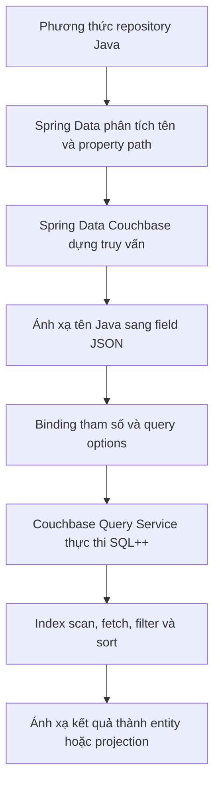
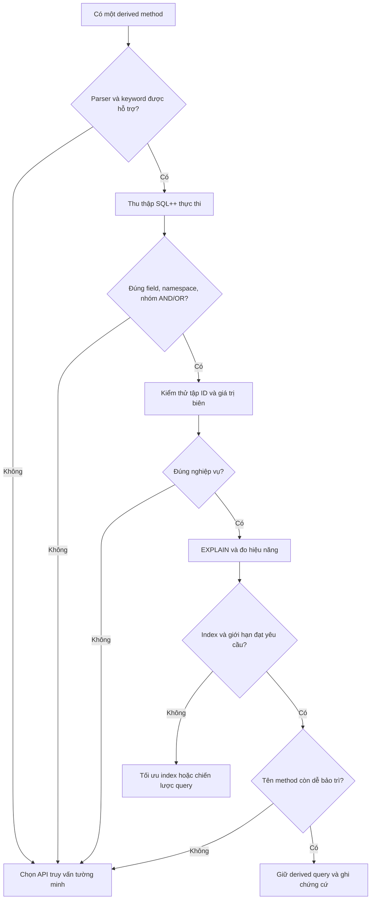

# Đọc truy vấn được tạo và nhận diện tên phương thức quá phức tạp

Trong **SPRING_DATA_COUCHBASE**, truy vấn dẫn xuất (*derived query*) giúp khai báo điều kiện tìm dữ liệu ngay trong tên phương thức repository. Chẳng hạn, `findByStatusAndCity` thường dễ hiểu hơn việc tự viết một câu SQL++ chỉ để lọc hai trường. Tuy nhiên, khi tên phương thức dài dần, một câu hỏi quan trọng xuất hiện: **Spring Data Couchbase thực sự gửi truy vấn gì tới Couchbase?** Tên phương thức có thể trông hợp lý nhưng truy vấn được tạo lại khác ý định về nhóm `AND`/`OR`, field JSON, sắp xếp, phân trang hoặc xử lý `NULL`/`MISSING`.

Bài thuộc chương **Truy vấn dẫn xuất**, tập trung vào hai năng lực liên quan: **đọc truy vấn được tạo** và **nhận diện thời điểm tên phương thức quá phức tạp**. Thay vì đoán SQL++ từ tên Java, ta xây một quy trình từ model, repository, câu truy vấn thực thi, binding tham số đến kế hoạch `EXPLAIN` và kết quả trên bộ dữ liệu thử. Sau đó dùng các dấu hiệu có thể kiểm tra để quyết định giữ derived query, tách phương thức, chuyển sang `@Query` hoặc `CouchbaseTemplate`.

Đây là kỹ năng nền tảng để vận hành tầng truy cập Couchbase: document mapping xác định field; repository biểu diễn nhu cầu thông dụng; SQL++ và chỉ mục quyết định truy vấn thực thi; bucket/scope/collection giới hạn không gian dữ liệu; TTL, CAS, giao dịch và lựa chọn API reactive ảnh hưởng đến tính nhất quán và kết quả khi dữ liệu thay đổi.

> **Nguyên tắc chính:** Tên method là **mô tả ý định ở tầng Java**, còn SQL++ thực thi và kết quả kiểm thử mới là **bằng chứng về hành vi thực tế**. Một method càng dài, càng cần đọc truy vấn thật thay vì tin rằng parser đã nhóm điều kiện như người viết hình dung.

## 1. Mục tiêu học tập

Sau bài này, bạn có thể:

1. Mô tả hành trình từ tên phương thức repository đến truy vấn SQL++ trên Couchbase.
2. Phân biệt **query dạng ý tưởng**, **SQL++ thực sự gửi đi**, **query plan** và **tập kết quả**.
3. Đọc các phần `SELECT`, `FROM`, `WHERE`, `ORDER BY`, `LIMIT`, `OFFSET` cùng tham số binding và metadata document.
4. Giải thích vì sao `And`/`Or` trong tên method có thể tạo nhóm điều kiện khác ý định.
5. Phát hiện trường hợp `@Field`, property path hoặc discriminator làm truy vấn chọn sai field hay sai collection.
6. Nhận biết giới hạn của derived query với null/missing, array, điều kiện động, hàm SQL++, phân trang và thao tác xóa.
7. Sử dụng test fixture để xác minh cả **tập ID**, **thứ tự trả về** và **giá trị biên**.
8. Dùng `EXPLAIN` để xem index, scan, fetch, sort và chi phí của truy vấn đã xác minh đúng ngữ nghĩa.
9. Áp dụng tiêu chí thực tế để quyết định giữ tên method hay chuyển sang `@Query`, `CouchbaseTemplate` hoặc API truy vấn khác.
10. Ghi nhận chứng cứ theo phiên bản Spring Data Couchbase, Couchbase Server và kiểu repository imperative/reactive.

## 2. Bối cảnh: màn hình lọc khách hàng

Giả sử ứng dụng CRM lưu khách hàng trong bucket `app`, scope `crm`, collection `customers`. Một document mẫu:

```json
{
  "tenant_id": "tenant-a",
  "customer_code": "C001",
  "status": "ACTIVE",
  "city": "HANOI",
  "loyalty_points": 50,
  "created_at_epoch": 1795584000,
  "display_name": "Lan Anh",
  "address_info": {
    "district_name": "CAU_GIAY"
  }
}
```

`created_at_epoch` là giá trị thời gian số nguyên tính theo một quy ước thống nhất của ứng dụng; số trong ví dụ chỉ để minh họa cấu trúc. Nếu triển khai thật, cần chọn rõ đơn vị giây/mili giây và chuẩn múi giờ. Mã khách hàng `customer_code` được giả định có tính duy nhất **trong tenant** để dùng làm khóa sắp xếp phụ.

Entity Java:

```java
package example.crm;

import org.springframework.data.annotation.Id;
import org.springframework.data.couchbase.core.mapping.Collection;
import org.springframework.data.couchbase.core.mapping.Document;
import org.springframework.data.couchbase.core.mapping.Field;
import org.springframework.data.couchbase.core.mapping.Scope;

@Document
@Scope("crm")
@Collection("customers")
public class Customer {

    @Id
    private String id;

    @Field("tenant_id")
    private String tenantId;

    @Field("customer_code")
    private String customerCode;

    @Field
    private String status;

    @Field
    private String city;

    @Field("loyalty_points")
    private Integer loyaltyPoints;

    @Field("created_at_epoch")
    private Long createdAtEpoch;

    @Field("display_name")
    private String displayName;

    @Field("address_info")
    private Address address;

    protected Customer() {
        // Constructor phục vụ document mapper.
    }

    public String getId() {
        return id;
    }

    // Constructor nghiệp vụ và getters/setters còn lại được lược bỏ.
}

class Address {

    @Field("district_name")
    private String district;

    protected Address() {}

    // Getters/setters được lược bỏ.
}
```

Document ID, ví dụ `customer::tenant-a::C001`, được Couchbase quản lý như khóa riêng; `@Id` không có nghĩa trong JSON luôn có field `id`. Đường field JSON `address_info.district_name` tương ứng với property Java `address.district`.

Các ví dụ giả định ứng dụng đã cấu hình bucket `app` và ánh xạ đúng scope/collection. Tùy phiên bản Spring Data Couchbase, mapper có thể ghi thêm metadata phân biệt loại entity hoặc các trường nội bộ khác; khi kiểm tra SQL++, cần dựa vào document **thực sự được lưu**.

## 3. Hành trình từ method name đến truy vấn thực thi

Giả sử repository định nghĩa:

```java
package example.crm;

import java.util.List;
import org.springframework.data.couchbase.repository.CouchbaseRepository;

public interface CustomerRepository
        extends CouchbaseRepository<Customer, String> {

    List<Customer> findByTenantIdAndStatusAndCity(
        String tenantId,
        String status,
        String city
    );
}
```

Một cách hình dung luồng xử lý:



Các thành phần trên có thể được triển khai bằng những lớp nội bộ khác nhau tùy phiên bản. Sơ đồ diễn đạt **luồng trách nhiệm**, không khẳng định một thứ tự gọi phương thức nội bộ cố định.

### 3.1. Đọc query logic trước, nhưng đừng dừng tại đó

Từ method, ta **suy luận ý định**:

```sql
SELECT c.*
FROM `app`.`crm`.`customers` AS c
WHERE c.`tenant_id` = $tenantId
  AND c.`status` = $status
  AND c.`city` = $city;
```

Đây là SQL++ **minh họa**, không phải bằng chứng Spring Data Couchbase ở phiên bản cụ thể đã gửi nguyên câu này. Query thật có thể có:

- Projection khác để phục hồi document ID, CAS, metadata và loại entity.
- Predicate phân biệt loại document, ví dụ một trường discriminator khi mapping sử dụng.
- Tên alias khác `c`, placeholders khác và cách binding khác.
- Query context/scope, collection được xác định bằng cấu hình thay vì đường keyspace viết tường minh.
- Điều kiện sắp xếp, giới hạn hoặc query options từ tham số `Sort`/`Pageable`.
- Cách chuẩn hóa hoặc ghi tên field khác do converter tùy chỉnh.

Vì vậy, một phần quan trọng của bài là **tìm và đọc câu truy vấn thực sự được gửi đi**, rồi kiểm tra nó trên Couchbase.

## 4. Bốn loại bằng chứng phải phân biệt

| Bằng chứng | Nó cho biết điều gì? | Chưa chứng minh được gì? |
| --- | --- | --- |
| **Tên method** | Ý định tác giả và cấu trúc keyword. | SQL++ thực thi và độ đúng của mapping. |
| **SQL++ thực thi** | Điều kiện, field, keyspace, sort, limit, binding ở phía server. | Query có dùng index tốt và kết quả đúng dữ liệu biên không. |
| **`EXPLAIN`/query plan** | Index và các toán tử thực thi dự kiến, bước scan/fetch/sort. | Toàn bộ ngữ nghĩa nghiệp vụ và độ trễ dưới tải thật. |
| **Integration test và số liệu** | Kết quả thực tế, giá trị biên, độ trễ quan sát được. | Hành vi của phiên bản khác hoặc dữ liệu phân bố hoàn toàn khác. |

Ví dụ, method `findTop3ByStatus...` có thể trả ba entity trong test nhỏ, nhưng vẫn cần xem `LIMIT 3` có được áp dụng ở phía Query Service hay không. Ngược lại, một query có `LIMIT 3` nhưng thiếu `ORDER BY` có thể trả **ba document tùy ý**, không phải ba khách hàng mới nhất.

Một kết luận đáng tin cậy thường có cả **SQL++ + dữ liệu kiểm thử + `EXPLAIN`**, gắn với phiên bản cụ thể.

## 5. Cách thu thập SQL++ được tạo

Không nên dựa duy nhất vào việc đọc tài liệu Spring Data Commons hay nhìn tên phương thức trong IDE. Các hướng thu thập phổ biến gồm:

1. **Logging/tracing ở tầng Spring Data Couchbase** với cấu hình logger đúng phiên bản, ưu tiên môi trường development hoặc test.
2. **Quan sát truy vấn từ Couchbase SDK/Query Service**, nơi có thể có request ID, thời gian thực thi và metadata truy vấn.
3. **Công cụ quản trị/quan sát query của Couchbase**, tùy quyền truy cập và tính năng server, để xem các statement thực thi hoặc lịch sử truy vấn.
4. **Integration test** gọi chính method cần xem và ghi lại statement/query options bằng cơ chế quan sát được phiên bản hỗ trợ.
5. **Kiểm chứng độc lập trong Query Workbench** bằng SQL++ và tham số tương ứng, sau khi đã bảo đảm truy vấn đúng keyspace.

### 5.1. Logging phải bám đúng phiên bản

Có thể bật log mức phù hợp trong ứng dụng thử nghiệm để quan sát query, nhưng **tên logger, độ chi tiết, cách hiện tham số và timing phụ thuộc phiên bản Spring Data Couchbase, Spring Data và SDK**. Không nên khẳng định mọi phiên bản sẽ in toàn bộ SQL++ chỉ bằng một dòng cấu hình DEBUG chung.

Cách làm chắc chắn hơn:

- Ghi lại phiên bản được resolve của `spring-data-couchbase`, `spring-data-commons` và Couchbase Java SDK.
- Kiểm tra hướng dẫn logging/diagnostics của đúng release.
- Bật mức chi tiết vừa đủ và gọi **một method cụ thể** để đối chiếu.
- Thu nhận statement, bind parameters hoặc ít nhất **kiểu tham số**, query options, thời điểm và request ID nếu sẵn có.
- Hạ mức logging sau khi kiểm tra và tránh để debug query chạy lâu dài trên production.

**Bảo mật dữ liệu:** Tham số có thể chứa email, mã khách hàng, ID hoặc dữ liệu nhạy cảm. Không đổ nguyên bind values hoặc toàn bộ document vào log chung; hãy redaction, thay bằng test fixtures và giới hạn quyền đọc log.

### 5.2. Query đã tạo không đồng nghĩa query đã chạy

Một số SDK/framework có thể chuẩn bị truy vấn, cache prepared statement hoặc trì hoãn thực thi đến khi có subscription (reactive). Vì vậy cần tách:

- **Statement được dựng:** kết quả của quá trình tạo query.
- **Statement đã gửi tới Query Service:** yêu cầu thực thi thật.
- **Statement thực sự có kết quả:** có response và rows/metrics.
- **Statement trong `EXPLAIN`:** mô phỏng kế hoạch, không thay thế gọi query bình thường.

Với reactive, việc tạo một `Flux<Customer>` **không đủ** để khẳng định query đã chạy; cần subscription và chờ publisher hoàn tất trong integration test.

### 5.3. Ghi nhận dữ liệu đối chiếu

Một phiếu quan sát ngắn:

```text
Method:
  findByTenantIdAndStatusAndCity

Inputs (redacted):
  tenantId = tenant-a
  status   = ACTIVE
  city     = HANOI

Repository:
  imperative / CouchbaseRepository

Spring Data Couchbase:
  <resolved-version>

Couchbase Server:
  <server-version>

SQL++ statement:
  <captured-or-redacted-statement>

Binding and options:
  <types, scan consistency, limit, timeout>

Result:
  <ordered IDs or ID set>

EXPLAIN:
  <index, scan, sort, fetch, notes>
```

Mẫu có dấu `<...>` là chỗ điền, không phải kết quả đã đo. Việc ghi version và ID của test giúp lần sau so sánh sau nâng cấp.

## 6. Đọc cấu trúc SQL++ theo từng phần

Giả sử đã quan sát một statement **minh họa** sau (không cam kết đúng projection/binding framework thực tế):

```sql
SELECT META(c).id AS documentId, c.*
FROM `app`.`crm`.`customers` AS c
WHERE c.`tenant_id` = $tenantId
  AND c.`status` = $status
  AND c.`city` IN $cities
ORDER BY c.`created_at_epoch` DESC,
         c.`customer_code` ASC
LIMIT $limit
OFFSET $offset;
```

Các điểm cần đọc theo thứ tự:

| Phần SQL++ | Câu hỏi kiểm tra |
| --- | --- |
| `SELECT META(c).id, c.*` | Có trả đủ field/metadata mà mapper hoặc DTO cần không? |
| `FROM app.crm.customers` | Có đúng bucket, scope và collection không? |
| `AS c` | Các đường field có dùng đúng alias không? |
| `WHERE tenant_id = ...` | Điều kiện tenant có được áp dụng cho **mọi nhánh logic** không? |
| `status = ...` | Trạng thái là phép bằng hay tập giá trị? |
| `city IN $cities` | `cities` được binding thành mảng đúng kiểu không? |
| `ORDER BY ...` | Hướng tăng/giảm và thứ tự tie-breaker có đúng không? |
| `LIMIT`, `OFFSET` | Có đẩy giới hạn xuống server không? Offset có quá lớn không? |

Ngoài các mệnh đề trên, kiểm tra predicate phân biệt loại entity khi Spring Data sử dụng, ví dụ `_class` hoặc một discriminator tùy chỉnh. Một câu query không trả fixture có thể do **document thiếu metadata mapping** chứ không hẳn do keyword bị lỗi.

### 6.1. Phân biệt property Java và field JSON

Entity có:

```java
@Field("created_at_epoch")
private Long createdAtEpoch;
```

thì method và `Sort` dựa vào property Java `createdAtEpoch`, nhưng SQL++/index phải tham chiếu trường JSON `created_at_epoch` khi mapping như ví dụ.

Ví dụ lỗi cần nhận diện:

```sql
-- Sai nếu trong JSON chỉ có created_at_epoch:
ORDER BY c.`createdAtEpoch` DESC
```

Một câu query dùng field không tồn tại có thể không ném lỗi cú pháp, mà cho kết quả sắp xếp bất ngờ do biểu thức trả `MISSING`. Vì vậy kiểm tra query phải đối chiếu **schema JSON thật**, không chỉ kiểm tra cú pháp.

### 6.2. Tham số binding không phải phép nối SQL++

Method:

```java
findByTenantIdAndStatusAndCity(
    "tenant-a",
    "ACTIVE",
    "HANOI"
);
```

có thể dẫn đến bind placeholders có tên hoặc vị trí khác ví dụ `$tenantId`/`$status`/`$city`. Điều cần xác minh là **giá trị và kiểu được bind đúng với từng predicate**.

Không tự kết luận từ một chuỗi log có `$1`, `$2`, `$3` rằng bind sai chỉ vì tên placeholder không giống Java. Quan trọng là giá trị gắn đúng thứ tự và điều kiện.

Khi viết SQL++ tường minh, cũng cần binding tham số an toàn, thay vì nối thẳng input người dùng vào statement.

## 7. Ví dụ đọc query từ tên phương thức thông dụng

Các ví dụ dưới đây là **cách suy luận để kiểm tra**, không phải lời cam kết từng keyword được mọi phiên bản Spring Data Couchbase hỗ trợ. Sau khi suy luận, phải so với SQL++ do ứng dụng tạo và kết quả integration test.

| Tên method | Điều kiện SQL++ kỳ vọng |
| --- | --- |
| `findByStatus` | `status = $status` |
| `findByStatusAndCity` | `status = $status AND city = $city` |
| `findByLoyaltyPointsGreaterThan` | `loyalty_points > $points` |
| `findByLoyaltyPointsBetween` | `loyalty_points BETWEEN $lower AND $upper` |
| `findByCityIn` | `city IN $cities` |
| `findByDisplayNameStartingWith` | So khớp tiền tố trên `display_name` |
| `findByAddress_District` | Truy cập JSON `address_info.district_name` |
| `findTop3ByStatusOrderByCreatedAtEpochDesc` | Lọc status, sort giảm theo thời gian và giới hạn 3 |
| `countByStatus` | Đếm số document thỏa status |
| `existsByStatus` | Kiểm tra có document thỏa status |
| `deleteByStatus` | Ý định xóa theo predicate; phải xác minh API/semantics trên phiên bản |

Đặc biệt với `Containing`, `IgnoreCase`, `IsNull`, `Top`, `Slice` và `deleteBy`, không nên suy đoán backend từ keyword của Spring Data JPA. Bộ phân tích tên dùng chung không đồng nghĩa mọi module triển khai giống nhau.

### 7.1. Lệnh đọc theo ID không nhất thiết sinh SQL++

`findById(id)` thường là key-value lookup theo document ID, chứ không phải SQL++ `SELECT ... WHERE ...` trên trường nội dung. Nếu đang tìm nguyên nhân `findById` đọc được document ngay nhưng `findByStatus` chưa thấy, phải xem **index consistency** thay vì khẳng định derived query sai.

## 8. Một lỗi logic quan trọng: `And`/`Or` không phải dấu ngoặc tùy ý

Giả sử nghiệp vụ yêu cầu:

> Trong **tenant-a**, chỉ lấy khách hàng **ACTIVE** mà **ở HANOI/HCM hoặc có từ 100 điểm trở lên**.

Biểu thức cần đúng là:

```text
tenantId = "tenant-a"
AND status = "ACTIVE"
AND (
  city IN ["HANOI", "HCM"]
  OR loyaltyPoints >= 100
)
```

Người viết có thể thử tên:

```java
List<Customer> findByTenantIdAndStatusAndCityInOrLoyaltyPointsGreaterThanEqual(
    String tenantId,
    String status,
    java.util.Collection<String> cities,
    Integer minPoints
);
```

Nhưng theo cách nhóm điều kiện `And`/`Or` trong ngữ pháp truy vấn dẫn xuất Spring Data nói chung, tên này có thể biểu đạt:

```text
(tenantId = ? AND status = ? AND city IN ?)
OR
(loyaltyPoints >= ?)
```

Đó **không** phải biểu thức nghiệp vụ mong muốn. Nhánh điểm cao ở phía phải `OR` không còn bị ràng buộc bởi tenant và trạng thái. Với hệ thống đa tenant, đây không chỉ là lỗi chọn sai dữ liệu mà còn có thể dẫn tới **rò rỉ dữ liệu giữa tenant** nếu tầng phân quyền cũng phụ thuộc vào predicate đó.

### 8.1. Đọc SQL++ dự kiến

Câu query có nguy cơ:

```sql
-- Không phải logic nghiệp vụ mong muốn.
WHERE (
    c.`tenant_id` = $tenantId
    AND c.`status` = "ACTIVE"
    AND c.`city` IN $cities
)
OR c.`loyalty_points` >= $minPoints
```

Câu SQL++ đúng ý định:

```sql
WHERE c.`tenant_id` = $tenantId
  AND c.`status` = "ACTIVE"
  AND (
       c.`city` IN $cities
       OR c.`loyalty_points` >= $minPoints
  )
```

Tên method không cung cấp cú pháp ngoặc tùy ý giống SQL++. Khi chính sách tenant, quyền, retention hoặc trạng thái phải bao phủ **tất cả** nhánh, nên chuyển sang `@Query`/`CouchbaseTemplate` để biểu đạt dấu ngoặc rõ ràng.

### 8.2. Bộ dữ liệu cho thấy khác biệt

| ID | Tenant | Status | City | Points | Kết quả mong muốn |
| --- | --- | --- | --- | ---: | :---: |
| `c01` | tenant-a | ACTIVE | HANOI | 50 | ✓ |
| `c02` | tenant-a | ACTIVE | DANANG | 120 | ✓ |
| `c03` | tenant-a | SUSPENDED | HANOI | 140 | ✗ |
| `c04` | tenant-b | ACTIVE | HANOI | 160 | ✗ |
| `c05` | tenant-b | SUSPENDED | HCM | 20 | ✗ |
| `c06` | tenant-a | ACTIVE | HCM | 200 | ✓ |
| `c07` | tenant-a | ACTIVE | DANANG | 0 | ✗ |

Với `cities = ["HANOI", "HCM"]` và `minPoints = 100`:

- **Đúng yêu cầu:** `{c01, c02, c06}`.
- **Nhóm sai:** có thể lấy thêm `c03` (status SUSPENDED) và `c04` (tenant-b), vì điểm của chúng >= 100.

Không sửa lỗi này bằng việc chỉ thêm `Sort`, `Top` hoặc một phép lọc ở controller. Predicate nền tảng phải đúng trước khi tính giới hạn, sắp xếp và phân trang.

## 9. Phát hiện tên method quá phức tạp qua dấu hiệu thực tế

Không có một giới hạn số ký tự chính thức áp dụng cho mọi dự án. Tuy nhiên, có những dấu hiệu cho thấy tên derived query đang làm giảm khả năng đọc, kiểm thử và thay đổi.

| Dấu hiệu | Vì sao đáng lưu ý | Hướng xử lý |
| --- | --- | --- |
| Có **nhiều hơn vài điều kiện** nối `And` liên tục | Khó nhìn thứ tự tham số, dễ nhầm property. | Đánh giá tách method hoặc API lọc có cấu trúc. |
| Trộn `And` và `Or`, cần dấu ngoặc rõ | Parser không biểu đạt nhóm tùy ý. | Viết `@Query` hoặc query builder tường minh. |
| Lặp cùng property để diễn đạt hai cận | Tên dài, dễ nhầm tham số min/max. | Nếu ngữ nghĩa đơn giản giữ `Between`; nếu khoảng nửa mở có thể dùng query rõ. |
| Có hơn một tổ hợp `In`, khoảng và text matching | Tăng số trường hợp biên. | Kiểm thử hoặc chuyển sang SQL++. |
| Tên chứa `IgnoreCase`/`IsNull`/`NotIn` và logic ngoại lệ | Ngữ nghĩa có thể khác giữa module/phiên bản, `NULL`/`MISSING` khó đoán. | Xem query thực tế; dùng điều kiện tường minh khi cần. |
| `OrderBy` có nhiều khóa và biến thể | Nhiều method gần như giống nhau. | Dùng `Sort`/`Pageable` được kiểm chứng. |
| Bộ lọc tùy chọn theo request | Phải tạo nhiều overload cho các tổ hợp. | `CouchbaseTemplate`/query builder. |
| Cần `CASE`, `LOWER`, `ANY`, `UNNEST`, `JOIN`, aggregate | Không còn chỉ là thuộc tính đơn. | SQL++ tường minh hoặc công cụ tìm kiếm phù hợp. |
| Cần phân trang keyset với cặp khóa và nhánh `OR` | Tên method rất khó làm rõ logic tiếp nối. | `@Query`/query API. |
| Tên method dùng cho thao tác xóa nguy hiểm | Dễ bỏ sót tenant, hold, cutoff hoặc semantics ghi. | DML/KV API có kiểm soát và test an toàn. |

### 9.1. Một ví dụ tên vẫn có thể chấp nhận

```java
List<Customer> findByTenantIdAndStatusOrderByCreatedAtEpochDesc(
    String tenantId,
    String status
);
```

Nó có một tập điều kiện dễ đọc, một thứ tự cố định rõ ràng. Nếu đây là một nhu cầu sử dụng ổn định và keyword thực sự được phiên bản hỗ trợ, derived query vẫn hợp lý.

### 9.2. Một ví dụ tên đang “báo động”

```java
List<Customer>
findByTenantIdAndStatusAndLoyaltyPointsGreaterThanEqualAndLoyaltyPointsLessThanAndCityInOrderByCreatedAtEpochDescCustomerCodeAsc(
    String tenantId,
    String status,
    Integer minInclusive,
    Integer maxExclusive,
    java.util.Collection<String> cities
);
```

Tên này diễn đạt được một điều kiện tương đối xác định:

```text
tenant = ?
AND status = ?
AND points >= ?
AND points < ?
AND city IN ?
ORDER BY createdAtEpoch DESC, customerCode ASC
```

Không nhất thiết **sai**, nhưng dễ phát sinh các vấn đề:

1. Thứ tự `minInclusive`/`maxExclusive` dễ bị truyền ngược.
2. Phải thay tên khi thêm/bớt filter.
3. Độ dài làm giảm khả năng xem logic trong call site.
4. Khi thêm một nhánh `OR`, nguy cơ sai nhóm tăng mạnh.
5. Nếu cần phân trang hay sort theo lựa chọn người dùng, tiếp tục nối tên không phù hợp.

Nếu truy vấn này chỉ dùng ở một nơi và ổn định, có thể giữ với test mạnh. Nếu đã là API tìm kiếm chung có nhiều tuỳ chọn, nên chuyển sang một cấu trúc truy vấn dễ đọc.

### 9.3. Khó đọc khác với không hiệu năng

Tên method ngắn không đồng nghĩa query nhanh: `findByDisplayNameContaining("a")` có thể tạo điều kiện substring có wildcard đầu và quét rất nhiều document. Ngược lại, một tên dài với equality + range có index phù hợp vẫn có thể chạy tốt.

Vì vậy cần hai quyết định tách biệt:

- **Thiết kế API có dễ hiểu và đúng logic không?**
- **SQL++ và index có đáp ứng tải không?**

Không đổi sang `@Query` chỉ để “trông chuyên nghiệp”, và không giữ derived query chỉ vì nó ngắn.

## 10. Khi nào nên giữ derived query?

Giữ tên phương thức khi các điều kiện sau đồng thời đúng:

- Có ít property, ít nhánh và không cần ngoặc tùy ý.
- Tên property Java và alias `@Field` được mapping chính xác.
- Keyword đã được xác minh trên phiên bản Spring Data Couchbase của ứng dụng.
- Các trường hợp `NULL`/`MISSING`, dữ liệu biên và kiểu JSON đã được kiểm thử.
- `Sort`/`Pageable` hoặc `OrderBy` diễn đạt chính xác thứ tự mà nghiệp vụ yêu cầu.
- SQL++ tạo ra dễ quan sát, index phù hợp và độ trễ đạt yêu cầu.
- Thay đổi logic không khiến repository sinh thêm hàng loạt biến thể gần giống nhau.

Ví dụ tương đối gọn:

```java
List<Customer> findByTenantIdAndStatus(
    String tenantId,
    String status
);

long countByTenantIdAndStatus(
    String tenantId,
    String status
);

boolean existsByTenantIdAndCustomerCode(
    String tenantId,
    String customerCode
);
```

Đừng thay thế các method đơn giản này bằng SQL++ tùy chỉnh nếu không có nhu cầu thực tế. Mục tiêu là **tăng tính đúng đắn và dễ bảo trì**, không phải loại bỏ derived query hoàn toàn.

## 11. Chuyển sang `@Query` khi điều kiện cố định nhưng nhóm phức tạp

Quay lại yêu cầu của mục 8:

```sql
SELECT c.*
FROM `app`.`crm`.`customers` AS c
WHERE c.`tenant_id` = $tenantId
  AND c.`status` = "ACTIVE"
  AND (
      c.`city` IN $cities
      OR c.`loyalty_points` >= $minPoints
  )
ORDER BY c.`created_at_epoch` DESC,
         c.`customer_code` ASC;
```

Đây là SQL++ **minh họa logic mong muốn**, chưa phải chuỗi annotation `@Query` có thể dán vào mọi phiên bản Spring Data Couchbase. Khi triển khai thật cần:

1. Dùng cú pháp binding và placeholder tương thích với phiên bản Spring Data Couchbase.
2. Đảm bảo projection, ID/CAS metadata và discriminator đủ để mapper trả đúng entity.
3. Dùng đúng keyspace/cấu hình bucket, scope, collection.
4. Đảm bảo mọi nhánh `OR` đều nằm trong ràng buộc tenant/status.
5. Xác định cách phân trang và sort nếu UI yêu cầu.
6. Chạy integration test so sánh tập ID và `EXPLAIN`.

Ưu điểm của `@Query` là nhóm logic **hiển thị trực tiếp**, dễ review hơn việc người đọc phải nhớ quy tắc phân tích `And`/`Or` từ tên method.

### 11.1. Đừng tự ghép SQL++ từ input

Nếu người dùng chọn danh sách thành phố hoặc ngưỡng điểm, dùng binding tham số. Không tạo một chuỗi query bằng cách nối giá trị thô từ request:

```java
// Không nên: ví dụ anti-pattern, không chạy.
String statement =
    "SELECT * FROM customers WHERE city = '" + userCity + "'";
```

Ngoài nguy cơ injection, cách nối này làm logic xử lý dấu nháy, Unicode, NULL và cache query khó kiểm soát. `@Query` hoặc API SDK có binding an toàn phù hợp phiên bản cần được ưu tiên.

## 12. `CouchbaseTemplate` cho bộ lọc thay đổi theo runtime

Một yêu cầu tìm kiếm động có thể có các bộ lọc:

```json
{
  "tenantId": "tenant-a",
  "status": "ACTIVE",
  "cities": ["HANOI", "HCM"],
  "minPoints": 100,
  "maxPoints": null,
  "nameFragment": null,
  "sort": "newest"
}
```

Ở đây, `null` trong request có thể mang nghĩa **không áp dụng bộ lọc**, nhưng `NULL` trong document JSON lại có ngữ nghĩa khác. Tầng service phải phân biệt hai khái niệm, không đưa `null` thẳng vào mọi predicate rồi mong Spring Data tự hiểu.

Với bộ lọc động, có thể chọn `CouchbaseTemplate`, query builder thích hợp hoặc API Query của Couchbase SDK để dựng điều kiện từ dữ liệu đã được validate:

```text
base:
  tenant_id = authenticatedTenant

if status is provided:
  AND status = :status

if cities is nonempty:
  AND city IN :cities

if minPoints is provided:
  AND loyalty_points >= :min

if maxPoints is provided:
  AND loyalty_points < :max

sort:
  one of whitelisted sort profiles

page:
  bounded LIMIT / OFFSET or cursor
```

Đây là **thuật toán xây query**, không phải mã API `CouchbaseTemplate` copy-paste. API và cách truyền projection/params phụ thuộc phiên bản; không dùng một tên phương thức template giả định chỉ vì có trong ví dụ của thư viện khác.

Một thiết kế tốt có **bộ lọc cơ sở bắt buộc** (tenant/phân quyền) và các predicate tùy chọn chỉ được nối bằng toán tử theo cấu trúc đã được kiểm tra, không đưa input vào cú pháp SQL++ tùy tiện.

### 12.1. Tách lớp chính sách khỏi lớp dựng query

Ví dụ:

- **Chính sách:** “Người dùng chỉ được đọc tenant trong token xác thực”.
- **Bộ lọc nghiệp vụ:** status, city, điểm, thời gian.
- **Truy vấn:** SQL++ với bind parameters.
- **Phân trang:** sort có khóa phụ, size giới hạn.
- **Quan sát:** trace/query metrics và test.

Đừng để một tên method dài trở thành nơi duy nhất “ẩn” cả chính sách bảo mật, quy tắc chọn dữ liệu và thứ tự trả về.

## 13. `EXPLAIN`: đọc kế hoạch sau khi đọc đúng điều kiện

Khi SQL++ đã được xác minh đúng ngữ nghĩa, dùng `EXPLAIN` để biết query có tận dụng index phù hợp không:

```sql
EXPLAIN
SELECT c.*
FROM `app`.`crm`.`customers` AS c
WHERE c.`tenant_id` = "tenant-a"
  AND c.`status` = "ACTIVE"
  AND c.`city` IN ["HANOI", "HCM"]
ORDER BY c.`created_at_epoch` DESC,
         c.`customer_code` ASC
LIMIT 20;
```

Cần quan sát các đặc điểm:

| Dấu hiệu trong plan | Ý nghĩa khi phân tích |
| --- | --- |
| Index được chọn | Có khớp collection và các predicate không? |
| Các bước scan | Truy vấn quét theo equality/range hay scan quá rộng? |
| Fetch document | Có cần lấy document ngoài index để đọc projection/điều kiện? |
| Filter | Predicate nào được áp dụng sau index scan? |
| Sort | Có phải sort lại tập lớn tại Query Service không? |
| Limit/offset | Giới hạn được áp dụng ở bước nào? Có thể giảm tải được không? |
| Cardinality/chi phí ước tính | Có phù hợp phân bố dữ liệu và workload thực tế không? |

Một index minh họa cho nhánh lọc tenant + status + city:

```sql
CREATE INDEX ix_customer_tenant_status_city_created
ON `app`.`crm`.`customers`(
    `tenant_id`,
    `status`,
    `city`,
    `created_at_epoch` DESC,
    `customer_code` ASC
);
```

Không có index duy nhất tối ưu cho mọi bộ lọc, đặc biệt khi câu `WHERE` có nhánh `OR` giữa city và điểm tích lũy. Có thể cần cân nhắc các đường index khác nhau, cách Query Service kết hợp scan hoặc điều chỉnh query; **không** suy ra chỉ từ thứ tự field của index rằng `ORDER BY` chắc chắn được tối ưu.

Nếu Spring Data thêm type discriminator, index phải được thiết kế dựa trên SQL++ thực tế. Nếu field đầu index có thể `MISSING`, cần đánh giá cấu trúc index/phiên bản Server để đảm bảo tập kết quả phù hợp.

### 13.1. Tên ngắn vẫn có thể tạo truy vấn tốn kém

```java
List<Customer> findByDisplayNameContaining(String fragment);
```

Tìm chuỗi con có thể dẫn đến điều kiện tương tự `LIKE "%fragment%"`. Wildcard ở đầu thường làm giảm khả năng khoanh vùng bằng thứ tự index B-tree; khi dữ liệu lớn, cần đánh giá Couchbase Full Text Search (FTS) nếu yêu cầu là tìm nhiều từ, xếp hạng hay fuzzy matching.

Vì vậy đánh giá index phải dựa trên SQL++ thực thi và dữ liệu thật, **không** dựa vào số lượng từ trong tên repository method.

## 14. Đọc `ORDER BY`, `LIMIT` và kiểu trả về để tránh lỗi ngầm

Các tên method có giới hạn và sắp xếp thường dễ đọc:

```java
List<Customer> findTop3ByTenantIdAndStatusOrderByCreatedAtEpochDesc(
    String tenantId,
    String status
);
```

Nhưng cần kiểm tra:

- Có `ORDER BY created_at_epoch DESC` không?
- Khi ba document có cùng `createdAtEpoch`, có cần khóa phụ để chọn đúng ba không?
- Có `LIMIT 3` thực sự ở Query Service không?
- Nếu dùng `Pageable`, `LIMIT`/`OFFSET` và query count có đúng không?
- Nếu trả `Optional<Customer>` nhưng có nhiều document khớp, API có báo lỗi hoặc giới hạn có chủ đích không?
- `Slice`, `First`, `Top` có được phiên bản Spring Data Couchbase hiện hành hỗ trợ đúng không?

### 14.1. Một `Sort` phải dùng tên property Java

```java
import org.springframework.data.domain.Sort;

Sort sort = Sort.by(
    Sort.Order.desc("createdAtEpoch"),
    Sort.Order.asc("customerCode")
);
```

Trong SQL++ minh họa, hai property phải được ánh xạ thành `created_at_epoch` và `customer_code`. Nếu người gọi truyền string field JSON trực tiếp vào `Sort`, query creator có thể không tìm được property hoặc tạo truy vấn không như ý định.

### 14.2. Kiểm tra các bản ghi trùng giá trị sort

Nếu nhiều khách hàng có cùng thời gian, `ORDER BY created_at_epoch DESC` không tạo thứ tự xác định bên trong nhóm trùng. Với phân trang bằng offset, điều này có thể gây trùng/thiếu document khi cắt trang. Sử dụng khóa phụ có tính duy nhất và không bị thiếu; đồng thời cần nhận thức rằng dữ liệu có thể thay đổi giữa các request.

### 14.3. Không cắt danh sách sau khi đã tải

```java
// Anti-pattern: có thể tải toàn bộ khách hàng trước khi cắt.
List<Customer> firstTen = repository
    .findByTenantIdAndStatus("tenant-a", "ACTIVE")
    .stream()
    .limit(10)
    .toList();
```

Muốn giảm tải, cần giới hạn ở query với một API đã được phiên bản hỗ trợ. Trong reactive, `Flux.take(10)` cũng **không tự chứng minh SQL++ có `LIMIT 10`**.

## 15. `NULL`, `MISSING`, dữ liệu lồng nhau và mảng

Khi đọc SQL++, phải chú ý điều kiện trên JSON khác với trực giác về property Java.

### 15.1. `NULL` không phải `MISSING`

```json
{"loyalty_points": null}
```

```json
{}
```

Document thứ nhất có field với JSON `NULL`; document thứ hai không có field nên biểu thức tương ứng có thể trả `MISSING`. Một method `findByLoyaltyPointsIsNull` (nếu phiên bản hỗ trợ) không tự định nghĩa rằng nó phải lấy cả hai trường hợp.

SQL++ phân biệt:

```sql
WHERE c.`loyalty_points` IS NULL
```

```sql
WHERE c.`loyalty_points` IS MISSING
```

```sql
WHERE c.`loyalty_points` IS NOT VALUED
```

Tùy yêu cầu nghiệp vụ, ba điều kiện này có tập kết quả khác nhau. Đây là dấu hiệu nên viết truy vấn tường minh nếu tên `IsNull`/`IsNotNull` không diễn đạt đủ chính sách.

### 15.2. Property lồng nhau phải đi đúng JSON path

Method ứng viên:

```java
List<Customer> findByAddress_District(String district);
```

Ý định là `Customer.address.district`, ánh xạ JSON `address_info.district_name`.

Nếu entity còn có property phẳng `addressDistrict` thì tên `findByAddressDistrict` có thể ưu tiên property phẳng. Dấu `_` ở `Address_District` dùng để chỉ ranh giới đường dẫn property, **không** phải dấu gạch dưới của JSON.

### 15.3. Mảng object cần kiểm tra cùng một phần tử

Một document có:

```json
{
  "contacts": [
    {"type": "PHONE", "value": "0900000001"},
    {"type": "EMAIL", "value": "lan@example.test"}
  ]
}
```

Yêu cầu “một contact có `type = PHONE` và `value = 0900000001`” phải kiểm tra **cùng một phần tử**. Không nên suy luận một tên `findByContacts_TypeAndContacts_Value` sẽ tự tạo được biểu thức đúng.

SQL++ có thể viết rõ:

```sql
WHERE ANY contact IN c.`contacts`
      SATISFIES contact.`type` = "PHONE"
            AND contact.`value` = "0900000001"
      END
```

Với dữ liệu array, `UNNEST` và `ANY` có thể cần index mảng thích hợp; đây thường là tình huống dùng `@Query`/query API thay vì kéo dài tên method.

## 16. Tình huống debug: query trả rỗng dù document tồn tại

Giả sử `findByTenantIdAndStatus("tenant-a", "ACTIVE")` trả rỗng, nhưng `findById` với ID cụ thể đọc được document ACTIVE.

**Quy trình kiểm tra theo thứ tự:**

1. **Đọc document bằng ID:** xác nhận `tenant_id` và `status` có mặt, đúng kiểu chuỗi và giá trị.
2. **Xem namespace:** repository có trỏ đúng bucket/scope/collection không?
3. **Quan sát SQL++ thật:** có thêm discriminator mà fixture thiếu không?
4. **Đối chiếu mapping:** `tenantId` có được chuyển thành `tenant_id` không?
5. **Đối chiếu binding:** tham số tenant/status có đúng vị trí và đúng giá trị không?
6. **Kiểm tra index:** Query Service có index phù hợp và quyền đọc không?
7. **Kiểm tra consistency:** index có nhìn thấy ghi mới chưa?
8. **Dùng test ID cố định:** thử truy vấn trên fixture ổn định, tránh nhầm với document TTL vừa hết hạn.

Không chuyển ngay sang `@Query` chỉ vì query rỗng: nếu nguyên nhân là sai collection hoặc index chưa cập nhật, viết SQL++ bằng tay vẫn có thể gặp cùng lỗi.

### 16.1. Đừng biến query logging thành rò rỉ dữ liệu

Khi cần xem binding, ưu tiên fixtures, ẩn email/ID thật và giới hạn môi trường chẩn đoán. Không dùng cách log toàn bộ JSON của khách hàng để giải quyết một lỗi tên method đơn giản. Chỉ giữ thông tin đủ đối chiếu statement, field, type và request ID.

## 17. Integration test kiểm chứng cả kết quả và nhóm điều kiện

Dùng bộ dữ liệu `c01`–`c07` ở mục 8, được seed vào collection thử nghiệm với mapping/metadata phù hợp.

Một interface dành cho **ứng viên kiểm chứng**, không nhất thiết được phép dùng thẳng trong production:

```java
import java.util.Collection;
import java.util.List;
import org.springframework.data.couchbase.repository.CouchbaseRepository;

public interface CandidateCustomerRepository
        extends CouchbaseRepository<Customer, String> {

    List<Customer>
    findByTenantIdAndStatusAndCityInOrLoyaltyPointsGreaterThanEqual(
        String tenantId,
        String status,
        Collection<String> cities,
        Integer minimumPoints
    );

    List<Customer> findByTenantIdAndStatus(
        String tenantId,
        String status
    );
}
```

Nếu Spring Data Couchbase hỗ trợ tổ hợp keyword trên và query creator tuân theo cách nhóm `And`/`Or` nói ở mục 8, method đầu **có thể trả nhiều document hơn ý định**. Đây là điều cần minh họa bằng test; không nên dùng nó làm API nghiệp vụ đúng.

### 17.1. Test cho biểu thức nghiệp vụ đúng

Ví dụ JUnit 5 dùng repository/query implementation **đã viết đúng điều kiện có ngoặc**:

```java
import static org.assertj.core.api.Assertions.assertThat;

import java.util.Set;
import java.util.stream.Collectors;
import org.junit.jupiter.api.Test;

// Khung ví dụ: expected method là API truy vấn đúng,
// cần được triển khai và seed fixture ở môi trường test.
class CustomerFilterContractTest {

    private final CustomerSearchPort searchPort;

    CustomerFilterContractTest(CustomerSearchPort searchPort) {
        this.searchPort = searchPort;
    }

    @Test
    void tenantAndStatusApplyToBothBranches() {
        Set<String> ids = searchPort.findEligibleCustomerIds(
                "tenant-a",
                "ACTIVE",
                Set.of("HANOI", "HCM"),
                100
            )
            .stream()
            .collect(Collectors.toSet());

        assertThat(ids).containsExactlyInAnyOrder(
            "c01",
            "c02",
            "c06"
        );
    }
}
```

Trong khung này, `CustomerSearchPort` là một **port nghiệp vụ minh họa**, chưa phải class có sẵn trong Spring Data Couchbase. Đội triển khai cần cung cấp implementation dùng `@Query`/`CouchbaseTemplate` (hoặc API đã được xác minh), cùng test context, constructor injection và fixtures. Không thể dán nguyên đoạn này vào dự án rồi coi là đã có test chạy thành công.

Test cần thêm trường hợp tenant-b có điểm cao (`c04`) và SUSPENDED có điểm cao (`c03`), vì đây là hai trường hợp làm lộ lỗi nhóm ngoặc.

### 17.2. Test cho method ứng viên nhằm chứng minh sự khác biệt

Nếu quyết định kiểm tra method tên dài có `Or`, chạy trên chính fixture đó và ghi lại **tập ID thực tế**, bao gồm c03/c04 hay không. Không chỉ assert method trả ít nhất một kết quả.

Nên cô lập thử nghiệm vì một số keyword/tổ hợp không được Spring Data Couchbase phiên bản hiện tại hỗ trợ và có thể khiến repository bean không khởi tạo. Khi đó báo **unsupported/blocked**, không sửa test thành PASS bằng cách bỏ qua method lỗi.

### 17.3. Các ca test tối thiểu cho derived query

| Ca | Cần kiểm tra |
| --- | --- |
| Không có document | Trả danh sách rỗng/`Optional.empty` theo hợp đồng. |
| Một document | Đúng ID và mapping. |
| Nhiều document | Không mất/nhân bản kết quả; kiểu trả về phù hợp. |
| Giá trị biên | `>` khác `>=`, `Between` có đúng cận. |
| `NULL`/`MISSING` | Không đồng nhất với 0, false hoặc chuỗi rỗng. |
| Cùng giá trị sort | Khóa phụ bảo đảm thứ tự. |
| Hai tenant | Điều kiện phân quyền áp dụng cho mọi nhánh. |
| Index vừa cập nhật | Query consistency đáp ứng yêu cầu fixture/test. |
| Document TTL | Không vô tình coi hết hạn là lỗi parser. |
| Keyword chưa hỗ trợ | Lỗi được phân loại, có phương án thay thế. |

## 18. Bảng lỗi khi đọc query và hướng chẩn đoán

| Triệu chứng | Nguyên nhân có thể | Cách kiểm chứng |
| --- | --- | --- |
| Repository không khởi tạo | Tên property sai hoặc keyword không hỗ trợ | Kiểm tra stack trace và version, tách test candidate. |
| Query chạy nhưng rỗng | Sai field JSON, keyspace, discriminator, binding, consistency | Soi SQL++/JSON thật, thử fixture cố định. |
| Kết quả có tenant khác | `OR` không được bọc bởi điều kiện tenant | Đọc `WHERE` và thử fixture đối nghịch. |
| `Top3` chọn bản ghi bất kỳ | Không có `ORDER BY` hoặc tie-breaker | Kiểm tra SQL++ và sort keys. |
| Kết quả có cận sai | `GreaterThan` khác `GreaterThanEqual` | Test điểm ngay sát ranh giới. |
| `Containing` chậm | Pattern wildcard đầu và index không tối ưu | `EXPLAIN`, dữ liệu lớn, cân nhắc FTS. |
| Truy vấn lồng nhau không khớp | Dùng tên JSON thay property Java hoặc mapping sai | Soi `@Field`, query path và fixture nested. |
| `IsNull` thiếu bản ghi | SQL++ phân biệt `NULL` và `MISSING` | Test hai loại document riêng. |
| `Page` có tổng khác danh sách | Count query, consistency, TTL hoặc dữ liệu đổi | Đối chiếu SQL++/timing/count. |
| Query có `LIMIT` mà vẫn chậm | Scan/sort lớn trước limit, index kém | `EXPLAIN` và truy vấn đại diện. |
| Xóa theo điều kiện khác dự kiến | Derived delete không hỗ trợ/semantics DML khác | Test trên collection cách ly, kiểm tra mutation outcome. |

## 19. Khi gặp count, exists, delete phải đọc gì thêm?

Các phương thức có thể dùng họ từ khóa:

```java
long countByTenantIdAndStatus(String tenantId, String status);

boolean existsByTenantIdAndCustomerCode(
    String tenantId,
    String customerCode
);

// Chỉ là ứng viên; phải xác minh hỗ trợ derived delete theo phiên bản.
long deleteByTenantIdAndStatus(String tenantId, String status);
```

**`countBy`:** tìm SQL++ có thao tác đếm document, không tải toàn bộ entity rồi gọi `List.size()` nếu mục tiêu chỉ là thống kê. Phân biệt `COUNT(1)` với đếm một field có thể null/missing.

**`existsBy`:** kiểm tra hành vi có/không và query plan. Nó không chứng minh giá trị là duy nhất; chuỗi `exists → insert` không là thao tác nguyên tử và có thể gặp race condition.

**`deleteBy`:** mức rủi ro cao hơn nhiều. Cần xác minh parser/backend có hỗ trợ derived delete không, xóa qua SQL++ DML hay xóa từng document, số lượng trả về có ý nghĩa gì, có CAS/callback/transaction không, và điều kiện tenant/retention có bao phủ đủ không. Tuyệt đối không thử xóa trên collection production chỉ để khám phá keyword.

Khi thao tác sửa/xóa cần kiểm soát nhất quán chặt, nên chọn API được xác nhận rõ, kiểm thử cả mutation outcome và xử lý lỗi từng trường hợp.

## 20. Reactive: query chưa chắc chạy khi chưa subscribe

Ví dụ repository reactive:

```java
import org.springframework.data.couchbase.repository.ReactiveCouchbaseRepository;
import reactor.core.publisher.Flux;

public interface ReactiveCustomerRepository
        extends ReactiveCouchbaseRepository<Customer, String> {

    Flux<Customer> findByTenantIdAndStatus(
        String tenantId,
        String status
    );
}
```

Lời gọi tạo publisher:

```java
Flux<Customer> customers =
    reactiveRepository.findByTenantIdAndStatus(
        "tenant-a",
        "ACTIVE"
    );
```

không đồng nghĩa query đã thực thi ngay tại thời điểm dòng code đó được đánh giá. Reactive thường thực hiện khi có subscription. Khi quan sát SQL++ và debug, cần kiểm tra đường tiêu thụ kết quả, luồng lỗi và việc query đã thực sự được gửi tới Query Service hay chưa.

Đặc biệt:

```java
Flux<Customer> preview = customers.take(10);
```

`take(10)` chỉ mô tả cách publisher phát tối đa 10 phần tử cho subscriber; **không chứng minh statement SQL++ đã có `LIMIT 10`**. Để giảm tải server, cần cơ chế giới hạn ở truy vấn được phiên bản hỗ trợ.

Reactive không thay đổi logic `AND`/`OR`, mapping hay index. Đừng cố sửa lỗi query rỗng bằng `block()` trong request thread; hãy kiểm tra SQL++, metadata và consistency trước.

## 21. TTL, CAS, giao dịch và query consistency

### 21.1. Vì sao cùng tên method nhưng hai lần gọi trả khác nhau?

Document có thể bị thêm, sửa hoặc xóa giữa hai lần truy vấn. TTL có thể khiến document hết hạn; thao tác ghi qua key-value có thể chưa phản ánh ngay trong index dùng bởi SQL++.

Ví dụ:

```text
save(customer)                -> ghi key-value thành công
findById(customer.id)         -> đọc trực tiếp theo khóa
findByTenantIdAndStatus(...)  -> SQL++ qua Query Service và index
```

Khi business yêu cầu read-your-own-write, cần xem query scan consistency phù hợp (chẳng hạn dạng tương đương `REQUEST_PLUS` nếu API phiên bản hỗ trợ) hoặc dùng đọc theo ID. Tăng consistency có thể tăng latency; không xem nó là cách sửa lỗi nhóm `OR` hay mapping sai.

### 21.2. CAS và transaction không tự xuất hiện nhờ tên method

Một method `findBy...` chỉ đọc dữ liệu theo điều kiện; nó không khóa document để tránh người khác cập nhật. Nếu tiếp theo là `save` hoặc `delete`, cần cơ chế CAS/optimistic locking và transaction theo yêu cầu nghiệp vụ. Chuỗi hai hay nhiều repository calls **không mặc nhiên là giao dịch nguyên tử**.

Khi kiểm tra derived delete hoặc thao tác ghi có điều kiện, cần đọc thêm outcome và lỗi cạnh tranh, không chỉ nhìn SQL++ từ truy vấn đọc.

### 21.3. Scope và collection là một phần của ngữ nghĩa

Một method với điều kiện đúng nhưng trỏ nhầm `scope`/`collection` sẽ không đáp ứng nghiệp vụ. Khi chuyển từ derived query sang `@Query`, đừng làm mất namespace, discriminator hoặc ràng buộc tenant đã có trong cấu hình trước đó.

## 22. Quy trình ra quyết định từ method tới SQL++



Khi chuyển sang API khác, phải **kiểm thử lại** logic, không coi SQL++ viết tay tự động đúng. Quy trình cũng cần chạy lại sau khi nâng phiên bản Spring Data Couchbase, Spring Data Commons, SDK, Couchbase Server hoặc thay converter, mapping, index.

### 22.1. Checklist review một derived method

| Câu hỏi | Bằng chứng tối thiểu |
| --- | --- |
| Tên method có đúng property Java không? | Entity + `@Field` và path JSON thực tế. |
| Query có chạy đúng collection không? | `FROM`/query context và mapping. |
| Các nhánh `OR` có lọt khỏi điều kiện tenant không? | `WHERE` có ngoặc và test chéo tenant. |
| Keyword đã hỗ trợ ở phiên bản hiện tại chưa? | Integration test + version được resolve. |
| Binding tham số đúng loại/thứ tự không? | Statement/options/fixtures có kiểm chứng. |
| `NULL`/`MISSING` xử lý như yêu cầu không? | Tập fixture riêng cho hai trạng thái. |
| `OrderBy`/`Sort` có đúng field và hướng không? | `ORDER BY` thực tế và test thứ tự ID. |
| `Top`/`Pageable` có giới hạn ở server chưa? | `LIMIT`/`OFFSET` trong SQL++/query evidence. |
| Có index phù hợp và plan chấp nhận được không? | `EXPLAIN`, dữ liệu/tải đại diện. |
| Tên method có quá nhiều điều kiện hoặc biến thể không? | Review API, mức thay đổi theo nghiệp vụ. |
| Reactive có thực sự subscribe và xử lý lỗi không? | Publisher integration test. |
| TTL/CAS/transaction/consistency có tác động không? | Test hoặc tài liệu quyết định vận hành. |

## 23. Bài tập áp dụng

Dùng dữ liệu `c01`–`c07` ở mục 8.

**Bài A — Phân tích biểu thức.** Với tên:

```java
findByTenantIdAndStatusAndCityInOrLoyaltyPointsGreaterThanEqual(
    tenantId, status, cities, minPoints
);
```

Hãy viết các nhóm `AND`/`OR` mà parser thông thường có thể tạo và chỉ ra vì sao kết quả có thể chứa `c03`, `c04`. **Đáp án:** nhánh bên phải `OR loyaltyPoints >= minPoints` không bị giới hạn bởi tenant/status.

**Bài B — Viết SQL++ đúng.** Yêu cầu vẫn là tenant-a, ACTIVE và (thành phố thuộc HANOI/HCM hoặc điểm >= 100). Hãy dùng dấu ngoặc của mục 8.1; tập ID đúng là `{c01, c02, c06}`.

**Bài C — Đọc alias JSON.** Entity có `@Field("loyalty_points") private Integer loyaltyPoints;`. Nếu SQL++ log ra `WHERE c.loyaltyPoints > 10` nhưng document chỉ có `loyalty_points`, cần kiểm tra điều gì? **Đáp án:** mapping, tên field thực tế và câu query do framework sinh; không chỉ đổi tên tham số Java.

**Bài D — Giới hạn kết quả.** Một method `findTop3ByStatus...` trả đúng ba entity nhưng query log không có `LIMIT`. Có thể kết luận query tối ưu không? **Không:** cần xác định có cơ chế giới hạn tương đương ở Query Service không; tránh tải toàn bộ rồi cắt tại Java.

**Bài E — Tìm lỗi consistency.** `findById` thấy document vừa tạo còn `findByStatus` chưa thấy. Nêu hai kiểm tra trước khi quy lỗi cho keyword. **Đáp án:** xem index/query scan consistency và type discriminator/namespace của SQL++; có thể cần đợi index cập nhật hoặc cấu hình consistency.

**Bài F — Quyết định refactor.** Màn hình có 12 tổ hợp bộ lọc tùy chọn và hai kiểu sắp xếp. Nên tạo 12 tên method hoặc xây truy vấn động? **Đáp án:** cân nhắc `CouchbaseTemplate`/query builder, nhưng vẫn ràng buộc tenant, bind params và whitelist sort. Với vài truy vấn phổ biến cố định, giữ derived query là hợp lý.

**Bài G — Truy vấn có array.** Muốn chọn document có một phần tử `contacts` vừa `type=PHONE` vừa `value=0900000001`. Vì sao không nên chỉ ghép tên property? **Đáp án:** điều kiện phải áp dụng trên cùng một phần tử mảng, có thể cần SQL++ `ANY ... SATISFIES`.

## 24. Ghi nhớ

**Đọc truy vấn được tạo** nghĩa là quan sát **SQL++ thực sự được thực thi**, hiểu cách Spring Data Couchbase ánh xạ property Java sang JSON, kiểm tra binding, namespace, discriminator, nhóm `WHERE`, thứ tự, giới hạn và kết quả. Sau đó dùng `EXPLAIN` để kiểm tra index và chi phí, thay vì dùng sự ngắn gọn của tên method để suy luận hiệu năng.

**Tên phương thức quá phức tạp** thường xuất hiện khi có nhiều điều kiện, `And`/`Or` cần ngoặc, filter tùy chọn, biểu thức SQL++, mảng, null/missing hoặc chính sách tenant/retention quan trọng. Khi đó, dùng `@Query` hoặc `CouchbaseTemplate` để diễn đạt logic minh bạch và kiểm thử được. Với method đơn giản đã được xác minh hỗ trợ ở phiên bản hiện tại, derived query vẫn là lựa chọn tốt. Mục tiêu không phải viết tên ngắn nhất hay SQL++ dài nhất, mà là **truy vấn đúng nghiệp vụ, có index phù hợp, dễ review và vận hành an toàn**.
