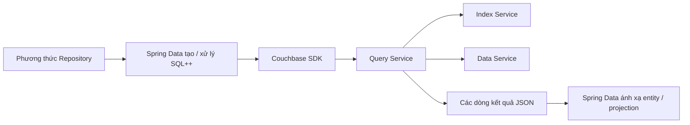

# SQL++ và tên gọi N1QL trong API Spring Data Couchbase

> **Mục tiêu:** Phân biệt đúng tên ngôn ngữ truy vấn **SQL++** với tên cũ **N1QL**, nhận diện những API còn mang chữ `n1ql` trong Spring Data Couchbase và viết được truy vấn `@Query` an toàn, có khả năng ánh xạ về document.

Trong một ứng dụng Spring Boot dùng Spring Data Couchbase, ta thường lưu đối tượng Java dưới dạng JSON document, tìm theo ID bằng Key/Value API và tìm theo điều kiện bằng Query Service. Ngôn ngữ mà Query Service hiểu hiện được Couchbase gọi là **SQL++**; trước đây, cách triển khai SQL++ của Couchbase mang tên **N1QL** (đọc gần như “nickel”). Vì lý do tương thích, nhiều ví dụ, lớp nội bộ và biểu thức hỗ trợ trong Spring Data Couchbase vẫn giữ tên `N1QL` hoặc `n1ql`.

Điểm cần nắm ngay: **không có hai ngôn ngữ truy vấn khác nhau để chọn giữa SQL++ và N1QL trong ngữ cảnh này**. Khi gặp `@Query("#{#n1ql.selectEntity} ...")`, ta vẫn đang yêu cầu Couchbase thực thi một truy vấn SQL++.

## 1. Vì sao Spring Data Couchbase cần ngôn ngữ truy vấn?

Giả sử ứng dụng bán hàng lưu những document như sau trong collection `products`:

```json
{
  "sku": "KB-100",
  "category": "keyboard",
  "name": "Bàn phím cơ",
  "price": 1250000,
  "specs": {
    "layout": "TKL",
    "switch": "brown"
  }
}
```

Nếu biết khóa document là `product::KB-100`, ta có thể đọc trực tiếp theo ID qua Key/Value API. Nhưng câu hỏi “tìm tất cả sản phẩm thuộc nhóm `keyboard`, giá dưới 2 triệu” cần lọc nhiều document dựa trên nội dung JSON. Đó là vai trò của SQL++.

Ví dụ truy vấn trực tiếp trong Couchbase Query Workbench:

```sql
SELECT p.sku, p.name, p.price, p.specs.layout AS layout
FROM `catalog`.`commerce`.`products` AS p
WHERE p.category = "keyboard"
  AND p.price < 2000000
ORDER BY p.price ASC;
```

Trong ví dụ, `catalog` là **bucket**, `commerce` là **scope**, `products` là **collection**. Ba thành phần hợp lại thành đường dẫn tới tập document cần truy vấn. Dấu backtick quanh từng tên là cú pháp trích dẫn định danh của SQL++. Các tên này chỉ có tính minh họa; ứng dụng phải dùng đường dẫn đã cấu hình.

SQL++ quen thuộc với người biết SQL nhờ các mệnh đề `SELECT`, `FROM`, `WHERE`, `ORDER BY`, `GROUP BY`, đồng thời truy cập được cấu trúc JSON lồng nhau như `p.specs.layout`. Không cần chuyển document sang bảng quan hệ trước khi lọc.

| Cách truy cập | Phù hợp khi | Đặc điểm đáng chú ý |
| --- | --- | --- |
| Key/Value | Biết chính xác ID của một document | Thường nhanh và ít tốn tài nguyên hơn truy vấn tìm kiếm |
| SQL++ qua Query Service | Cần lọc, sắp xếp, tổng hợp hoặc kết hợp nhiều document | Phụ thuộc chỉ mục và có thiết lập scan consistency |
| Repository/`@Query` của Spring Data | Muốn gọi truy vấn qua phương thức Java và ánh xạ kết quả thành entity | Spring Data tạo hoặc xử lý câu SQL++, rồi chuyển cho Couchbase thực thi |

**Lưu ý:** SQL++ dùng **Query Service**; không đồng nghĩa với truy vấn của Analytics Service hay tìm kiếm toàn văn của Search Service. Chọn dịch vụ theo nhu cầu của bài toán.

## 2. SQL++ và N1QL: một ngôn ngữ, hai thế hệ tên gọi

| Tên xuất hiện | Ý nghĩa | Đọc như thế nào khi xem code |
| --- | --- | --- |
| **SQL++** | Tên hiện dùng trong tài liệu Couchbase cho ngôn ngữ truy vấn JSON | Đây là tên nên dùng khi mô tả chức năng mới |
| **N1QL** | Tên trước đây của cách triển khai SQL++ của Couchbase | Thường xuất hiện trong bài viết, API hoặc ví dụ cũ |
| `@Query` | Annotation của Spring Data Couchbase để khai báo truy vấn dạng chuỗi | Phần chuỗi là SQL++, dù JavaDoc còn gọi N1QL |
| `#n1ql.selectEntity`, `#n1ql.filter` | Các biến SpEL do Spring Data Couchbase cung cấp | **Giữ nguyên chính tả `n1ql`**; không tự đổi thành `#sqlpp` |
| Các tên như `StringBasedN1qlQueryParser` | Tên lớp nội bộ trong thư viện Spring Data Couchbase | Dấu vết lịch sử của API, không báo hiệu ngôn ngữ khác |

Ta có thể gặp đường dẫn tài liệu chứa `/n1ql/` nhưng tiêu đề trang ghi “SQL++ for Query”. Tương tự, JavaDoc của `org.springframework.data.couchbase.repository.Query` còn dùng từ “N1QL queries”. Đây là dấu vết đổi tên và tương thích API.

**Quy tắc thực hành:** trong tài liệu và trao đổi kỹ thuật mới, gọi câu truy vấn là **SQL++**; trong mã nguồn, cấu hình hoặc biểu thức SpEL, **giữ đúng tên API `n1ql` mà phiên bản Spring Data Couchbase cung cấp**. Không đổi tên annotation, thuộc tính hay namespace chỉ vì Couchbase đã đổi cách gọi ngôn ngữ.

## 3. Đường đi của một truy vấn từ Repository đến Couchbase



Spring Data có hai cách thường gặp để tạo câu truy vấn:

1. **Derived query:** khai báo tên phương thức như `findByCategory(String category)`, thư viện phân tích tên và dựng điều kiện.
2. **String-based query:** khai báo trực tiếp câu SQL++ qua `@Query`; Spring Data hỗ trợ thêm các biểu thức SpEL, tham số ràng buộc và cơ chế ánh xạ kết quả.

Nếu truy vấn chỉ lấy document theo khóa ID, Spring Data Couchbase thường dùng đường Key/Value. Nếu lọc theo thuộc tính hoặc tìm nhiều document, thư viện thường tạo truy vấn qua Query Service. Tên phương thức Java không quyết định một cơ chế “N1QL riêng”; cuối cùng, câu SQL++ vẫn được thực thi bởi Couchbase.

### Ví dụ entity và repository

Giả sử cấu hình kết nối chọn bucket `catalog`. Entity được lưu trong scope `commerce`, collection `products`:

```java
import org.springframework.data.annotation.Id;
import org.springframework.data.couchbase.core.mapping.Document;
import org.springframework.data.couchbase.core.mapping.Field;
import org.springframework.data.couchbase.repository.Collection;
import org.springframework.data.couchbase.repository.Scope;

@Document
@Scope("commerce")
@Collection("products")
public class Product {
    @Id
    private String id;

    @Field
    private String sku;

    @Field
    private String category;

    public Product() { }

    public Product(String id, String sku, String category) {
        this.id = id;
        this.sku = sku;
        this.category = category;
    }

    public String getId() { return id; }
    public void setId(String id) { this.id = id; }
    public String getSku() { return sku; }
    public void setSku(String sku) { this.sku = sku; }
    public String getCategory() { return category; }
    public void setCategory(String category) { this.category = category; }
}
```

Repository dưới đây thể hiện **cùng một mục đích nghiệp vụ** theo hai kiểu khai báo:

```java
import java.util.List;
import org.springframework.data.repository.query.Param;
import org.springframework.data.couchbase.repository.CouchbaseRepository;
import org.springframework.data.couchbase.repository.Query;

public interface ProductRepository extends CouchbaseRepository<Product, String> {

    // Spring Data suy ra điều kiện từ tên phương thức.
    List<Product> findByCategory(String category);

    // Câu truy vấn do lập trình viên khai báo, với SpEL và tham số có tên.
    @Query("#{#n1ql.selectEntity} WHERE #{#n1ql.filter} AND category = $category")
    List<Product> findByCategorySqlpp(@Param("category") String category);
}
```

Ví dụ gọi:

```java
List<Product> items = productRepository.findByCategorySqlpp("keyboard");
```

Điều kiện `category = $category` không gắn trực tiếp chuỗi `keyboard` vào câu SQL++; Spring Data ràng buộc giá trị tương ứng với `@Param("category")`. Đây là cách phù hợp để truyền dữ liệu người dùng và xử lý giá trị có dấu nháy hay ký tự đặc biệt.

Lưu ý sự phân cấp: tên bucket do cấu hình kết nối quyết định; `@Scope` và `@Collection` chỉ rõ scope/collection của entity. Khi cần chọn collection động hoặc dùng nhiều bucket, phải xem xét quy tắc cấu hình/ghi đè của phiên bản Spring Data đang dùng.

## 4. Giải mã `#{#n1ql...}` trong `@Query`

Ví dụ trọng tâm:

```java
@Query("#{#n1ql.selectEntity} WHERE #{#n1ql.filter} AND category = $1")
List<Product> searchByCategory(String category);
```

Ở đây có **ba lớp cú pháp khác nhau**:

| Thành phần | Được xử lý ở đâu | Vai trò |
| --- | --- | --- |
| `@Query("...")` | Spring Data Couchbase | Khai báo nội dung truy vấn trên phương thức Repository |
| `#{#n1ql.selectEntity}`, `#{#n1ql.filter}` | Spring Expression Language trong Spring Data | Thay thế bằng phần SQL++ dựa trên thông tin entity và cấu hình |
| `$1` | Cơ chế tham số của truy vấn SQL++ | Nhận giá trị tham số thứ nhất của phương thức Java |

Những biến `n1ql` thường gặp:

| Biểu thức | Công dụng |
| --- | --- |
| `#{#n1ql.selectEntity}` | Sinh phần `SELECT ... FROM ...` cần thiết để Spring Data ánh xạ **đầy đủ entity**, bao gồm thông tin document ID và CAS |
| `#{#n1ql.filter}` | Sinh điều kiện phân biệt kiểu entity theo thông tin type discriminator mà Spring Data quản lý |
| `#{#n1ql.fields}` | Danh sách trường/metadata cần cho ánh xạ entity |
| `#{#n1ql.bucket}` | Tên bucket tương ứng với entity, đã được trích dẫn phù hợp |
| `#{#n1ql.scope}`, `#{#n1ql.collection}` | Tên scope và collection được phân giải theo cấu hình/ánh xạ |

Đây là **biểu thức hỗ trợ của Spring Data**: không nên dán nguyên `#{#n1ql.selectEntity}` vào Couchbase Query Workbench rồi mong máy chủ hiểu được. Spring Data phải thay thế nó trước khi gửi truy vấn cho Couchbase.

### Vì sao nên giữ `selectEntity` và `filter`?

Khi phương thức trả về `Product`, Spring Data cần đủ dữ liệu để dựng lại document Java: không chỉ các thuộc tính JSON mà còn metadata như ID/CAS. `#{#n1ql.selectEntity}` giúp tạo phần chọn phù hợp với bộ ánh xạ.

Ngoài ra, nhiều kiểu entity có thể dùng chung một collection. Spring Data thường gắn thông tin kiểu vào document, ví dụ trường phân biệt kiểu `_class`. `#{#n1ql.filter}` đưa điều kiện lọc kiểu tương ứng vào `WHERE` để tránh lấy lẫn document của entity khác.

Vì thế, mẫu phổ biến cho truy vấn trả về **toàn bộ entity** là:

```java
@Query("#{#n1ql.selectEntity} WHERE #{#n1ql.filter} AND category = $1")
List<Product> findProductsInCategory(String category);
```

Không nên tự thay bằng `SELECT *` hoặc `SELECT sku, category` rồi mặc nhiên cho rằng Spring Data sẽ dựng được entity đầy đủ, đúng ID/CAS. Truy vấn lấy ít cột phù hợp hơn với **projection/DTO** hoặc giá trị tổng hợp, nếu ánh xạ và kiểu trả về được định nghĩa phù hợp.

### Tham số vị trí và tham số tên

Hai cách sau có mục đích tương đương:

```java
@Query("#{#n1ql.selectEntity} WHERE #{#n1ql.filter} AND category = $1")
List<Product> byPosition(String category);

@Query("#{#n1ql.selectEntity} WHERE #{#n1ql.filter} AND category = $category")
List<Product> byName(@Param("category") String category);
```

`$1` là tham số **thứ nhất** trong cú pháp SQL++/Spring Data; `$category` là tên tham số do `@Param` cung cấp. Không trộn tham số vị trí `$1` với tham số tên `$category` trong **cùng một** câu `@Query`. Không nối dữ liệu người dùng thành chuỗi SQL++ bằng phép cộng chuỗi.

Tham số dùng cho **giá trị** (ví dụ tên danh mục), không dùng để thay thế tùy ý tên trường, tên bucket hay đoạn cú pháp SQL++. Nếu phải lựa chọn trường sắp xếp động, hãy kiểm tra tên trường theo danh sách cho phép hoặc dùng cơ chế Sort được thư viện hỗ trợ.

## 5. Phân biệt truy vấn SQL++ thuần với truy vấn có trợ giúp từ Spring Data

Truy vấn dưới đây được viết bằng **SQL++ thuần** cho Query Workbench, SDK hoặc những API gửi chuỗi SQL++ trực tiếp:

```sql
SELECT META(p).id AS documentId, p.sku, p.category
FROM `catalog`.`commerce`.`products` AS p
WHERE p.category = "keyboard";
```

`META(p).id` là ID document do Couchbase quản lý, khác với việc yêu cầu JSON body phải có một trường tên `id`. Kết quả câu truy vấn này là các dòng có `documentId`, `sku` và `category`, chưa chắc khớp cấu trúc một `Product` đầy đủ.

Ngược lại, dạng Repository:

```java
@Query("#{#n1ql.selectEntity} WHERE #{#n1ql.filter} AND category = $1")
List<Product> findByCategory(String category);
```

để Spring Data lựa chọn phần `SELECT/FROM` và điều kiện type discriminator. Cả hai đều tạo câu SQL++ gửi cho Query Service, nhưng **đầu ra mong đợi và trách nhiệm ánh xạ khác nhau**.

Điều này quan trọng khi chuyển câu truy vấn từ Query Workbench vào `@Query`: câu lệnh chạy được trên máy chủ chưa chắc trả về entity Java đúng nếu thiếu metadata hoặc dùng sai cấu trúc kết quả.

## 6. Chỉ mục: yêu cầu vận hành của truy vấn SQL++

Tên gọi “N1QL” trong API không thay đổi yêu cầu chỉ mục. Với truy vấn có `WHERE category = ...`, nên tạo **secondary index** phù hợp trên collection thực tế:

```sql
CREATE INDEX idx_products_category
ON `catalog`.`commerce`.`products`(category);
```

Đối với dữ liệu lớn, thứ tự trường của chỉ mục tổ hợp, điều kiện lọc, thứ tự sắp xếp và độ chọn lọc quyết định khả năng sử dụng chỉ mục. Hãy xem kế hoạch thực thi trước khi tối ưu:

```sql
EXPLAIN
SELECT p.sku, p.category
FROM `catalog`.`commerce`.`products` AS p
WHERE p.category = "keyboard";
```

Truy vấn có thể thất bại hoặc có chi phí rất cao nếu thiếu chỉ mục phù hợp. **Primary index** thuận tiện cho khám phá dữ liệu trong môi trường học tập, nhưng không nên là chiến lược mặc định cho đường truy vấn sản phẩm ở production. Đối với ví dụ `@Query` có `#{#n1ql.filter}`, khi thiết kế chỉ mục thực tế cũng cần xét trường phân biệt kiểu (thường là `_class`) cùng các điều kiện tìm kiếm khác.

Thứ tự kiểm tra khi truy vấn chậm: xác minh đúng bucket/scope/collection; kiểm tra chỉ mục tồn tại và sẵn sàng; chạy `EXPLAIN`; quan sát các bước quét chỉ mục, fetch document và sắp xếp; cuối cùng cân nhắc điều chỉnh chỉ mục và câu truy vấn theo lưu lượng thực tế.

## 7. Nhất quán truy vấn: đọc ngay sau khi ghi có thể chưa thấy dữ liệu

Couchbase tách Key/Value và Query/Index thành các đường truy cập khác nhau. Một document vừa ghi thành công bằng Key/Value API có thể chưa được chỉ mục SQL++ cập nhật ngay. Bởi vậy:

- `findById(id)` có thể đọc document theo khóa, trong khi truy vấn `findByCategory(...)` chưa nhìn thấy document đó tại cùng thời điểm.
- Chế độ scan consistency thường dùng mặc định cho truy vấn là `NOT_BOUNDED`: ưu tiên tốc độ và chấp nhận chỉ mục có thể chưa bắt kịp ghi mới.
- `REQUEST_PLUS` yêu cầu truy vấn đợi chỉ mục cập nhật các thay đổi đã có trước yêu cầu; đổi lại độ trễ có thể tăng.

Với phương thức cần dữ liệu vừa ghi xuất hiện ngay trong kết quả SQL++, Spring Data Couchbase hỗ trợ cấu hình scan consistency, chẳng hạn:

```java
import com.couchbase.client.java.query.QueryScanConsistency;
import org.springframework.data.couchbase.repository.ScanConsistency;

@ScanConsistency(query = QueryScanConsistency.REQUEST_PLUS)
@Query("#{#n1ql.selectEntity} WHERE #{#n1ql.filter} AND category = $1")
List<Product> findFreshByCategory(String category);
```

Đây là ví dụ **phần khai báo phương thức** đặt trong một Repository. Cần dùng lựa chọn consistency theo yêu cầu nghiệp vụ và đo độ trễ; `REQUEST_PLUS` không biến một truy vấn bất kỳ thành giao dịch với mức cô lập tuyệt đối.

## 8. Đặt SQL++ đúng chỗ trong kiến trúc Spring Data Couchbase

| Nhu cầu ứng dụng | Hướng tiếp cận thường phù hợp |
| --- | --- |
| Lấy/cập nhật một sản phẩm bằng ID đã biết | Repository `findById` hoặc thao tác Key/Value qua `CouchbaseTemplate` / SDK |
| Tìm sản phẩm theo điều kiện nghiệp vụ đơn giản | Derived query của Repository, kèm chỉ mục phù hợp |
| Điều kiện SQL++ đặc thù, cần chủ động phần `WHERE` | Repository `@Query` với `#n1ql.selectEntity` và `#n1ql.filter` nếu trả về entity |
| Truy vấn linh hoạt bằng API fluent | `CouchbaseTemplate`, ví dụ đường `findByQuery` |
| Thực thi SQL++ trực tiếp, cần quyền kiểm soát thấp hơn | API query của Couchbase Java SDK |
| Luồng dữ liệu bất đồng bộ, không chặn luồng | API reactive của Spring Data Couchbase khi toàn bộ ngăn xếp phù hợp |

SQL++ giải quyết việc **tìm và thao tác dữ liệu theo truy vấn**; nó không thay thế các cơ chế khác của Couchbase. **TTL** chi phối thời hạn sống của document; **CAS** hỗ trợ kiểm soát cập nhật đồng thời/optimistic locking; **transactions** đặt ra ranh giới nguyên tử cho một chuỗi thao tác. Khi dùng SQL++ `UPDATE`/`DELETE` trực tiếp qua API thấp hơn, phải cân nhắc riêng quy tắc mapping, version, TTL và giao dịch của ứng dụng thay vì giả định mọi hành vi Repository đều tự động được áp dụng.

Tương tự, chuyển từ repository đồng bộ sang **reactive repository** không đổi SQL++ thành ngôn ngữ mới và không xóa bỏ nhu cầu chỉ mục hay vấn đề độ trễ đồng bộ chỉ mục.

## 9. Lỗi dễ gặp khi đọc tài liệu và chuyển ví dụ

| Hiện tượng | Nguyên nhân thường gặp | Cách xử lý |
| --- | --- | --- |
| “Tài liệu mới nói SQL++ nhưng ví dụ Java dùng `n1ql`” | Spring Data giữ tên API lịch sử | Giữ nguyên `#n1ql.*` trong code; dùng tên SQL++ khi giải thích |
| Dán `#{#n1ql.selectEntity}` vào Query Workbench thì lỗi | Đây là SpEL do Spring Data xử lý | Chạy SQL++ thuần trong Workbench; để Spring Data phân giải SpEL trong `@Query` |
| Query Workbench có kết quả nhưng Repository trả về rỗng | `#n1ql.filter` yêu cầu metadata kiểu entity phù hợp, hoặc truy vấn đến sai collection | Kiểm tra document discriminator, mapping, bucket/scope/collection và dữ liệu mẫu |
| Truy vấn chạy nhưng ánh xạ entity sai/thiếu ID | `SELECT` tự viết thiếu phần metadata/phép chiếu cần thiết | Dùng `#n1ql.selectEntity` cho full entity; thiết kế projection rõ ràng nếu chỉ lấy vài trường |
| `No index available` hoặc truy vấn chậm | Thiếu chỉ mục, chọn chỉ mục kém hoặc truy vấn sai collection | Tạo secondary index đúng điều kiện; kiểm tra `EXPLAIN` |
| Vừa lưu document nhưng truy vấn theo thuộc tính chưa thấy | Chỉ mục cập nhật bất đồng bộ dưới `NOT_BOUNDED` | Đánh giá `REQUEST_PLUS` hoặc đọc KV theo ID tùy yêu cầu |
| Truy vấn bị lỗi khi thay giá trị người dùng chứa dấu nháy | Nối chuỗi truy vấn thủ công | Dùng `$1`/`$name` và ràng buộc tham số |

## 10. Bài thực hành nhỏ

Xét bài toán thêm API “liệt kê sản phẩm có `category = "mouse"`”:

1. Khai báo entity `Product` và kiểm tra annotation chỉ đúng collection `catalog.commerce.products`.
2. Dùng `List<Product> findByCategory(String category)`; xác định đây là **derived query** và sẽ cần chỉ mục phù hợp.
3. Viết lại bằng `@Query("#{#n1ql.selectEntity} WHERE #{#n1ql.filter} AND category = $1")`; giải thích vai trò của hai biến SpEL và `$1`.
4. Tạo secondary index cho `category`; dùng `EXPLAIN` trong Query Workbench với câu **SQL++ thuần** để kiểm tra đường truy cập.
5. Ghi một document mới, lần lượt thử đọc theo ID và truy vấn theo `category`; quan sát và giải thích sự khác biệt có thể xảy ra dưới `NOT_BOUNDED`.

**Tự kiểm tra kiến thức:**

- Vì sao `#n1ql.selectEntity` vẫn đúng dù tên hiện đại của ngôn ngữ là SQL++? **Vì `n1ql` là tên biến của Spring Data để tương thích API, còn truy vấn gửi đến Couchbase vẫn dùng SQL++.**
- Vì sao không dùng `SELECT sku, category` cho phương thức trả về `List<Product>` mà không cân nhắc thêm? **Vì phép chiếu này có thể thiếu metadata và các trường mà bộ ánh xạ full entity cần.**
- Khi nào chỉ mục và scan consistency đáng quan tâm? **Khi truy vấn tìm nhiều document theo điều kiện và khi nghiệp vụ cần quan sát các thay đổi vừa ghi.**

## Tài liệu tham khảo chính thức

- [Couchbase — Query Data with SQL++](https://docs.couchbase.com/server/current/n1ql/query.html): tên ngôn ngữ hiện dùng, nguồn gốc tên N1QL và vai trò Query Service.
- [Couchbase — SQL++ for Query Reference](https://docs.couchbase.com/server/current/n1ql/n1ql-language-reference/index.html): cú pháp truy vấn JSON và các loại câu lệnh.
- [Spring Data Couchbase — Couchbase repositories](https://docs.spring.io/spring-data/couchbase/reference/couchbase/repository.html): `@Query`, SpEL `#n1ql.*`, tham số và scan consistency.
- [Spring Data Couchbase — Collection Support](https://docs.spring.io/spring-data/couchbase/reference/couchbase/collections.html): ánh xạ bucket/scope/collection.

**Ghi nhớ:** SQL++ là tên ngôn ngữ truy vấn hiện tại của Couchbase Query Service; N1QL là tên cũ còn hiện diện trong nhiều API Spring Data Couchbase. Hiểu đúng ranh giới giữa **câu SQL++**, **biểu thức SpEL `#n1ql.*`**, **tham số `$...`** và **entity mapping** sẽ giúp viết `@Query` đúng, an toàn và dễ bảo trì.
