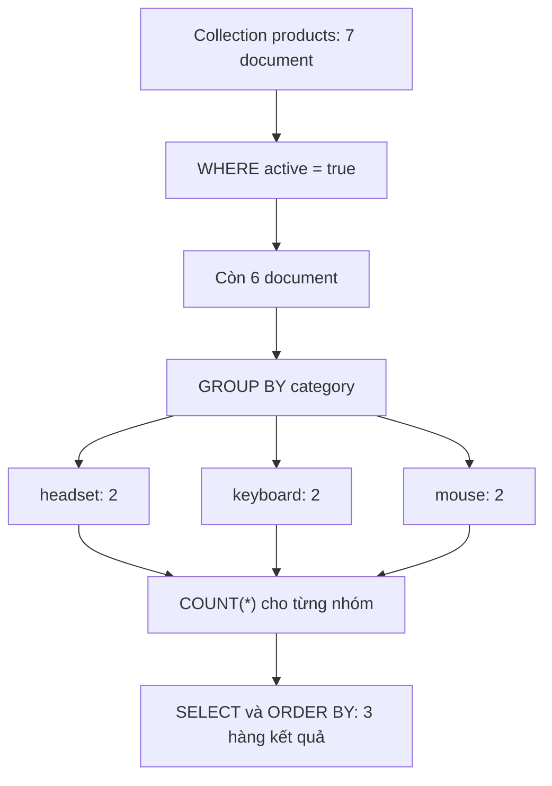

# GROUP BY, HAVING và các phép tổng hợp trong Couchbase SQL++

> **Mục tiêu bài học:** Phân biệt lọc document bằng `WHERE` với lọc nhóm bằng `HAVING`; sử dụng `GROUP BY` cùng `COUNT`, `SUM`, `AVG`, `MIN`, `MAX` và `ARRAY_AGG`; xử lý đúng `NULL`/`MISSING`; biết cách đưa kết quả tổng hợp vào tầng truy cập dữ liệu của **Spring Data Couchbase**.

Trong module **SPRING_DATA_COUCHBASE**, entity Java được lưu dưới dạng JSON document trong bucket, scope và collection của Couchbase. Các phương thức Repository hoặc `CouchbaseTemplate` có thể đọc document để xử lý nghiệp vụ; tuy nhiên, với yêu cầu báo cáo như “mỗi danh mục có bao nhiêu sản phẩm?”, “tổng giá trị tồn kho theo danh mục là bao nhiêu?” hay “chỉ hiển thị nhóm có ít nhất hai sản phẩm”, việc tải tất cả document lên Java rồi tự đếm thường không cần thiết. **SQL++** có thể nhóm và tổng hợp ngay tại Query Service.

SQL++ là tên hiện dùng của ngôn ngữ truy vấn Couchbase, trước đây được gọi là **N1QL**. Vì lý do tương thích, Spring Data Couchbase vẫn có những biểu thức mang tên `#n1ql`. Dù dùng Repository, `@Query`, `CouchbaseTemplate` hay API thấp hơn của SDK, ta vẫn cần hiểu cách SQL++ tạo ra **một dòng kết quả cho mỗi nhóm**.

| Thành phần | Tác dụng | Được áp dụng ở mức |
| --- | --- | --- |
| `WHERE` | Chọn document được tham gia tổng hợp | **Từng document** trước khi nhóm |
| `GROUP BY` | Gom document có cùng khóa nhóm | **Tập document** |
| `COUNT/SUM/AVG/MIN/MAX` | Tính một giá trị từ các document trong nhóm | **Mỗi nhóm**, hoặc toàn bộ tập nếu không có `GROUP BY` |
| `HAVING` | Giữ hoặc bỏ nhóm sau khi tính điều kiện tổng hợp | **Từng nhóm** |
| `ORDER BY/LIMIT` | Sắp xếp và giới hạn kết quả cuối cùng | **Các dòng kết quả** |

## 1. Dữ liệu mẫu và yêu cầu báo cáo

Giả sử cửa hàng có collection `products` thuộc scope `commerce` và bucket `catalog`. Các document dưới đây là JSON body; ID của mỗi document do Couchbase quản lý riêng.

**Document ID `product::KB-101`**

```json
{
  "sku": "KB-101",
  "category": "keyboard",
  "name": "Bàn phím TKL",
  "active": true,
  "price": 1500000,
  "stock": 10,
  "supplier": { "region": "north" }
}
```

**Document ID `product::KB-102`**

```json
{
  "sku": "KB-102",
  "category": "keyboard",
  "name": "Bàn phím văn phòng",
  "active": true,
  "price": 900000,
  "stock": 0,
  "supplier": { "region": "south" }
}
```

**Document ID `product::KB-103`**

```json
{
  "sku": "KB-103",
  "category": "keyboard",
  "name": "Bàn phím mẫu cũ",
  "active": false,
  "price": 2100000,
  "stock": 5,
  "supplier": { "region": "north" }
}
```

**Document ID `product::MS-201`**

```json
{
  "sku": "MS-201",
  "category": "mouse",
  "name": "Chuột văn phòng",
  "active": true,
  "price": 450000,
  "stock": 7,
  "supplier": { "region": "south" }
}
```

**Document ID `product::MS-202`**

```json
{
  "sku": "MS-202",
  "category": "mouse",
  "name": "Chuột không dây",
  "active": true,
  "price": 800000,
  "stock": null,
  "supplier": { "region": "south" }
}
```

**Document ID `product::HS-301`**

```json
{
  "sku": "HS-301",
  "category": "headset",
  "name": "Tai nghe gaming",
  "active": true,
  "price": 1250000,
  "stock": 5,
  "supplier": { "region": "north" }
}
```

**Document ID `product::HS-302`**

```json
{
  "sku": "HS-302",
  "category": "headset",
  "name": "Tai nghe trưng bày",
  "active": true,
  "price": null,
  "stock": 3,
  "supplier": {}
}
```

Có **7 document**, trong đó **6 document hoạt động** (`active = true`). KB-103 bị vô hiệu hóa. HS-302 có `price: null` và không có `supplier.region`. MS-202 có `stock: null`. Những trạng thái này rất quan trọng khi tính `COUNT`, `AVG` và các phép tổng hợp khác.

Các ví dụ sử dụng đường dẫn keyspace đầy đủ:

```sql
FROM `catalog`.`commerce`.`products` AS p
```

Trong đó `catalog` là bucket, `commerce` là scope, `products` là collection và `p` là alias (bí danh) document. Cần có quyền truy vấn và chỉ mục phù hợp để thực thi trong môi trường thật.

## 2. `GROUP BY`: chuyển nhiều document thành một hàng cho mỗi nhóm

Không có `GROUP BY`, câu truy vấn sau trả về **một hàng cho mỗi document** hoạt động:

```sql
SELECT p.sku, p.category
FROM `catalog`.`commerce`.`products` AS p
WHERE p.active = true
ORDER BY p.category, p.sku;
```

Kết quả gồm 6 hàng: HS-301, HS-302, KB-101, KB-102, MS-201 và MS-202.

Khi muốn **đếm số document ở từng danh mục**, dùng `GROUP BY`:

```sql
SELECT p.category AS category,
       COUNT(*) AS productCount
FROM `catalog`.`commerce`.`products` AS p
WHERE p.active = true
GROUP BY p.category
ORDER BY category;
```

Kết quả mong đợi:

```json
[
  { "category": "headset", "productCount": 2 },
  { "category": "keyboard", "productCount": 2 },
  { "category": "mouse", "productCount": 2 }
]
```

Để hiểu câu truy vấn, hãy đi theo dòng dữ liệu:



`WHERE` đã loại KB-103 **trước** bước nhóm. Vì vậy keyboard chỉ có 2 document hoạt động, dù toàn collection có 3 bàn phím.

### `GROUP BY` không tự tổng hợp số liệu

`GROUP BY` xác định **khóa nhóm**; muốn đếm, cộng hay lấy trung bình phải khai báo hàm tổng hợp trong `SELECT` hoặc `HAVING`. Có thể nhóm theo nhiều khóa:

```sql
SELECT p.category AS category,
       p.active AS active,
       COUNT(*) AS total
FROM `catalog`.`commerce`.`products` AS p
GROUP BY p.category, p.active
ORDER BY category, active;
```

Lúc này mỗi cặp (`category`, `active`) là một nhóm. Với keyboard, sẽ có một nhóm `active = false` gồm KB-103 và một nhóm `active = true` gồm KB-101, KB-102.

Ta cũng có thể nhóm theo **đường dẫn JSON lồng nhau**, không chỉ trường cấp gốc:

```sql
SELECT p.supplier.region AS supplierRegion,
       COUNT(*) AS total
FROM `catalog`.`commerce`.`products` AS p
WHERE p.supplier.region IS VALUED
GROUP BY p.supplier.region
ORDER BY supplierRegion;
```

Điều kiện `IS VALUED` loại HS-302 vì không có trường `supplier.region`. Các nhóm còn lại phản ánh giá trị `north` hoặc `south` của từng document.

### Chọn trường trong kết quả sau khi nhóm

Sau `GROUP BY p.category`, một hàng kết quả biểu diễn **cả nhóm**, không còn là một document bất kỳ. Trong `SELECT`, hãy chọn khóa nhóm, các biểu thức phù hợp với khóa nhóm hoặc giá trị tổng hợp:

```sql
-- Hợp lý: khóa nhóm + giá trị tổng hợp.
SELECT p.category AS category, COUNT(*) AS total
FROM `catalog`.`commerce`.`products` AS p
GROUP BY p.category;
```

Tránh chọn bừa `p.sku` của từng document bên cạnh `COUNT(*)` nếu không xác định cách gom `sku`: một nhóm có thể chứa nhiều SKU. Nếu cần danh sách SKU của mỗi nhóm, dùng `ARRAY_AGG(p.sku)`; nếu cần một số đo đại diện, dùng `MIN` hoặc `MAX` theo nghiệp vụ.

## 3. Các hàm tổng hợp thường dùng

| Hàm | Mục đích | Ví dụ |
| --- | --- | --- |
| `COUNT(*)` hoặc `COUNT(1)` | Đếm hàng đầu vào của nhóm | Số sản phẩm trong danh mục |
| `COUNT(expr)` | Đếm các giá trị của `expr` không phải `NULL/MISSING` | Số sản phẩm đã có giá |
| `COUNT(DISTINCT expr)` | Đếm các giá trị phân biệt | Số danh mục khác nhau |
| `SUM(expr)` | Tính tổng giá trị số | Tổng giá niêm yết hoặc tổng số lượng |
| `AVG(expr)` | Giá trị trung bình của dữ liệu số hợp lệ | Giá niêm yết trung bình |
| `MIN(expr)`, `MAX(expr)` | Giá trị nhỏ nhất/lớn nhất | Giá thấp nhất và cao nhất |
| `ARRAY_AGG(expr)` | Gom các giá trị thành một mảng | Danh sách SKU trong từng danh mục |

Ví dụ nhiều phép tính trong cùng truy vấn:

```sql
SELECT p.category AS category,
       COUNT(*) AS totalProducts,
       COUNT(p.price) AS pricedProducts,
       SUM(p.price) AS sumPrice,
       AVG(p.price) AS avgPrice,
       MIN(p.price) AS minPrice,
       MAX(p.price) AS maxPrice
FROM `catalog`.`commerce`.`products` AS p
WHERE p.active = true
GROUP BY p.category
ORDER BY category;
```

Kết quả dự kiến cho dữ liệu mẫu:

| Danh mục | `totalProducts` | `pricedProducts` | `sumPrice` | `avgPrice` | `minPrice` | `maxPrice` |
| --- | ---: | ---: | ---: | ---: | ---: | ---: |
| headset | 2 | 1 | 1.250.000 | 1.250.000 | 1.250.000 | 1.250.000 |
| keyboard | 2 | 2 | 2.400.000 | 1.200.000 | 900.000 | 1.500.000 |
| mouse | 2 | 2 | 1.250.000 | 625.000 | 450.000 | 800.000 |

**Giải thích quan trọng:** HS-302 có `price: null`, nên `COUNT(*)` của nhóm headset là **2**, còn `COUNT(p.price)` chỉ là **1**. `AVG(p.price)` là **1.250.000**, không phải 625.000: các giá trị `NULL/MISSING` không đóng góp vào phép lấy trung bình của các giá trị số.

### `COUNT(*)`, `COUNT(1)` và `COUNT(field)`

Ví dụ minh họa ở mức toàn collection:

```sql
SELECT COUNT(*) AS allDocuments,
       COUNT(1) AS allRows,
       COUNT(p.price) AS documentsWithPrice
FROM `catalog`.`commerce`.`products` AS p;
```

Với bộ dữ liệu mẫu, `allDocuments = 7`, `allRows = 7`, `documentsWithPrice = 6`. `COUNT(1)` đếm vì biểu thức hằng `1` luôn có giá trị ở mỗi hàng; `COUNT(p.price)` loại HS-302 có giá `NULL`.

Nếu document thiếu hẳn `price`, `COUNT(p.price)` cũng sẽ không đếm document đó. Vì vậy, khi báo cáo cần hai chỉ số **tổng sản phẩm** và **sản phẩm đã khai báo giá**, nên sử dụng hai phép đếm riêng.

### `COUNT(DISTINCT ...)`: loại giá trị trùng lặp

```sql
SELECT COUNT(DISTINCT p.category) AS distinctCategories
FROM `catalog`.`commerce`.`products` AS p
WHERE p.active = true;
```

Kết quả là **3**: `headset`, `keyboard` và `mouse`. `DISTINCT` tính trên giá trị của biểu thức, không phải trên document ID.

Trong báo cáo thực tế, dùng `DISTINCT` có thể làm tăng chi phí tài nguyên so với đếm thường; hãy kiểm tra chỉ mục và quy mô dữ liệu khi tập giá trị lớn.

### `SUM` và `AVG` không phải lúc nào cũng là giá trị nghiệp vụ muốn tính

`SUM(p.price)` cộng **giá của mỗi document**. Nó không phải tổng giá trị hàng tồn kho. Nếu mục tiêu là “giá niêm yết nhân với số lượng trong kho”, biểu thức phải thay đổi:

```sql
SELECT p.category AS category,
       SUM(p.price * p.stock) AS stockValue
FROM `catalog`.`commerce`.`products` AS p
WHERE p.active = true
  AND ISNUMBER(p.price)
  AND ISNUMBER(p.stock)
GROUP BY p.category
ORDER BY category;
```

Truy vấn trên **loại document thiếu giá hoặc tồn kho số hợp lệ** khỏi phép tính: MS-202 có `stock: null` và HS-302 có `price: null` không đóng góp. Đây là một chính sách nghiệp vụ có thể chấp nhận nếu báo cáo chỉ dùng dữ liệu đầy đủ; nếu muốn giữ số lượng document lỗi dữ liệu, hãy lập chỉ số chất lượng dữ liệu riêng.

Kết quả dự kiến: headset = **6.250.000** (1.250.000 × 5), keyboard = **15.000.000** (1.500.000 × 10 + 900.000 × 0), mouse = **3.150.000** (450.000 × 7). Không tự động xem `stock: null` là `0` nếu “chưa kiểm kê” khác “hết hàng”.

## 4. `HAVING`: lọc nhóm sau khi tính tổng hợp

Yêu cầu: **chỉ lấy danh mục có tổng giá niêm yết của sản phẩm đang hoạt động từ 2 triệu trở lên**. Điều kiện dựa vào `SUM`, nên phải đặt trong `HAVING`:

```sql
SELECT p.category AS category,
       SUM(p.price) AS sumPrice,
       COUNT(*) AS productCount
FROM `catalog`.`commerce`.`products` AS p
WHERE p.active = true
GROUP BY p.category
HAVING SUM(p.price) >= 2000000
ORDER BY sumPrice DESC;
```

Với dữ liệu mẫu, chỉ nhóm **keyboard** có `sumPrice = 2.400.000`, nên kết quả là một hàng.

### `WHERE` và `HAVING` không thể thay thế trực tiếp cho nhau

| Nhu cầu | Điều kiện nên đặt ở đâu? | Lý do |
| --- | --- | --- |
| Chỉ tính sản phẩm đang hoạt động | `WHERE p.active = true` | Loại document không cần thiết trước khi nhóm |
| Chỉ tính sản phẩm giá trên 500.000 | `WHERE p.price > 500000` | Lọc từng document đầu vào |
| Chỉ giữ danh mục có ít nhất 2 sản phẩm | `HAVING COUNT(*) >= 2` | Chỉ số đếm có ý nghĩa sau khi nhóm |
| Chỉ giữ danh mục có giá trung bình trên 1 triệu | `HAVING AVG(p.price) > 1000000` | Trung bình được tính trên từng nhóm |
| Chỉ giữ danh mục có tổng giá trên 2 triệu | `HAVING SUM(p.price) > 2000000` | Tổng là thuộc tính của cả nhóm |

Ví dụ kết hợp cả hai:

```sql
SELECT p.category AS category,
       COUNT(*) AS total,
       AVG(p.price) AS averagePrice
FROM `catalog`.`commerce`.`products` AS p
WHERE p.active = true
GROUP BY p.category
HAVING COUNT(*) >= 2
   AND AVG(p.price) >= 1200000
ORDER BY averagePrice DESC, category ASC;
```

Kết quả gồm **headset** (1.250.000) và **keyboard** (1.200.000). Nhóm mouse có hai sản phẩm nhưng giá trung bình chỉ 625.000.

### Tránh đặt aggregate vào `WHERE`

```sql
-- Sai về thứ tự đánh giá logic: WHERE không phải nơi lọc kết quả COUNT.
SELECT p.category, COUNT(*) AS total
FROM `catalog`.`commerce`.`products` AS p
WHERE COUNT(*) >= 2
GROUP BY p.category;
```

Chuyển điều kiện đếm xuống `HAVING`:

```sql
SELECT p.category AS category, COUNT(*) AS total
FROM `catalog`.`commerce`.`products` AS p
GROUP BY p.category
HAVING COUNT(*) >= 2;
```

Nếu chỉ cần xét một tập con, vẫn đặt điều kiện chọn tập con trong `WHERE`. Cách bố trí này vừa đúng nghĩa vừa giúp giảm lượng dữ liệu phải tổng hợp.

### Đếm sau khi đã lọc khác với đếm tất cả rồi lọc nhóm

Hai truy vấn dưới đây có ý nghĩa khác:

```sql
-- Mỗi nhóm đếm các document active=true.
SELECT p.category, COUNT(*) AS activeCount
FROM `catalog`.`commerce`.`products` AS p
WHERE p.active = true
GROUP BY p.category;
```

```sql
-- Mỗi nhóm đếm tất cả document, rồi chỉ giữ nhóm có ít nhất
-- một document active=true.
SELECT p.category, COUNT(*) AS totalCount
FROM `catalog`.`commerce`.`products` AS p
GROUP BY p.category
HAVING SUM(CASE WHEN p.active = true THEN 1 ELSE 0 END) > 0;
```

Trong dữ liệu mẫu, nhóm keyboard ở truy vấn thứ nhất có `activeCount = 2`, còn ở truy vấn thứ hai có `totalCount = 3`. Cùng xuất hiện danh mục keyboard nhưng **đại lượng được đo khác nhau**.

## 5. Tổng hợp có điều kiện: `CASE` bên trong hàm aggregate

Trong báo cáo nhiều chỉ số, đôi khi cần **đếm toàn bộ sản phẩm** và **đếm sản phẩm đang hoạt động** trong cùng một hàng. Thay vì loại document từ `WHERE`, hãy dùng `CASE`:

```sql
SELECT p.category AS category,
       COUNT(*) AS totalProducts,
       SUM(CASE
             WHEN p.active = true THEN 1
             ELSE 0
           END) AS activeProducts,
       SUM(CASE
             WHEN p.stock = 0 THEN 1
             ELSE 0
           END) AS outOfStockProducts
FROM `catalog`.`commerce`.`products` AS p
GROUP BY p.category
ORDER BY category;
```

Kết quả:

| Danh mục | Tổng sản phẩm | Đang hoạt động | Hết hàng (`stock = 0`) |
| --- | ---: | ---: | ---: |
| headset | 2 | 2 | 0 |
| keyboard | 3 | 2 | 1 |
| mouse | 2 | 2 | 0 |

Với MS-202, `stock: null` không đồng nghĩa với hết hàng, nên không được tính vào `outOfStockProducts`. Nếu yêu cầu báo cáo cả các sản phẩm **chưa xác định tồn kho**, hãy tạo một chỉ số khác:

```sql
SELECT p.category AS category,
       SUM(CASE
             WHEN p.stock IS NOT VALUED THEN 1
             ELSE 0
           END) AS unknownStockProducts
FROM `catalog`.`commerce`.`products` AS p
GROUP BY p.category;
```

Nhóm mouse có `unknownStockProducts = 1`, các nhóm còn lại bằng 0. Cách này giữ thông tin chất lượng dữ liệu, thay vì trộn `NULL/MISSING` vào số lượng hết hàng.

## 6. `NULL`, `MISSING` và giá trị không hợp lệ trong aggregate

JSON trong Couchbase là bán cấu trúc: document có thể có giá trị `null` hoặc thiếu một trường. Để hiểu đúng số đo:

| Trường hợp | `COUNT(*)` | `COUNT(p.price)` | `SUM/AVG(p.price)` |
| --- | --- | --- | --- |
| Document có `price = 100` | Đếm 1 | Đếm 1 | Đóng góp giá trị 100 |
| Document có `price = null` | Đếm 1 | Không đếm giá | Không đóng góp giá trị số |
| Document không có `price` | Đếm 1 | Không đếm giá | Không đóng góp giá trị số |
| Document có `price = 0` | Đếm 1 | Đếm 1 | Đóng góp giá trị 0 |

Trong bộ dữ liệu mẫu, `AVG(p.price)` của headset **không** là trung bình của `1.250.000` và `0`, bởi HS-302 có giá `NULL`. Nếu quy ước nghiệp vụ **thực sự** coi giá `NULL/MISSING` là `0`, cần viết rõ:

```sql
SELECT p.category,
       AVG(COALESCE(p.price, 0)) AS averageWithZeroDefault
FROM `catalog`.`commerce`.`products` AS p
WHERE p.active = true
GROUP BY p.category;
```

Khi đó, nhóm headset có `averageWithZeroDefault = 625000`. Đây là **một đại lượng khác** so với `AVG(p.price)` và phải được đặt tên rõ ràng trong báo cáo. Trong hệ thống giá bán, “chưa khai báo giá” thường không nên được hiểu là “bán với giá bằng 0”.

### Kiểm tra kiểu số trước khi cộng/trung bình

Một document sai định dạng có thể chứa `"price": "800000"` (chuỗi) thay vì một số. Đừng mặc nhiên cho phép aggregate áp dụng như dữ liệu số hợp lệ. Có thể dùng điều kiện:

```sql
SELECT p.category,
       COUNT(*) AS pricedDocuments,
       AVG(p.price) AS averagePrice
FROM `catalog`.`commerce`.`products` AS p
WHERE ISNUMBER(p.price)
GROUP BY p.category;
```

Nếu cần biết số document lỗi giá, không loại chúng khỏi `WHERE`; thay vào đó dùng aggregate có điều kiện:

```sql
SELECT p.category AS category,
       COUNT(*) AS total,
       SUM(CASE
             WHEN p.price IS NOT VALUED THEN 1
             ELSE 0
           END) AS missingOrNullPrice,
       SUM(CASE
             WHEN p.price IS VALUED
                  AND NOT ISNUMBER(p.price)
             THEN 1
             ELSE 0
           END) AS invalidPriceType
FROM `catalog`.`commerce`.`products` AS p
GROUP BY p.category;
```

Với dữ liệu mẫu, `headset` có `missingOrNullPrice = 1` và `invalidPriceType = 0`. Đây là kiểu tổng hợp hữu ích để giám sát dữ liệu trước khi lập báo cáo doanh thu hoặc tồn kho.

### Khóa nhóm cũng có thể thiếu

HS-302 không có `supplier.region`. Nếu nhóm trực tiếp theo trường này, ta cần dự tính trường hợp không có giá trị nhóm, thay vì nghĩ mọi document đều có `region`:

```sql
SELECT COALESCE(p.supplier.region, "unknown") AS region,
       COUNT(*) AS products
FROM `catalog`.`commerce`.`products` AS p
GROUP BY COALESCE(p.supplier.region, "unknown")
ORDER BY region;
```

Kết quả được phân loại: `north = 3`, `south = 3`, `unknown = 1`. `COALESCE` ở đây gom cả `NULL` và `MISSING` vào cùng nhãn `unknown` **do nghiệp vụ chủ động chọn**.

Nếu `NULL` và `MISSING` có nghĩa khác nhau, không nên dùng chung `COALESCE`. Hãy sử dụng `CASE WHEN p.supplier.region IS MISSING ... WHEN ... IS NULL ...` trong biểu thức khóa nhóm để giữ các trạng thái tách biệt.

### Kết quả khi không có document phù hợp

Hai dạng truy vấn không giống nhau:

```sql
-- Aggregate không có GROUP BY: vẫn tạo hàng tổng hợp.
SELECT COUNT(*) AS total
FROM `catalog`.`commerce`.`products` AS p
WHERE p.category = "nonexistent";
```

```sql
-- Có GROUP BY: không có document thì không sinh nhóm.
SELECT p.category AS category, COUNT(*) AS total
FROM `catalog`.`commerce`.`products` AS p
WHERE p.category = "nonexistent"
GROUP BY p.category;
```

Câu thứ nhất cho giá trị `total = 0` ở hàng tổng hợp. Câu thứ hai trả **0 hàng**, vì không có nhóm nào được tạo. Khi viết API, đừng mặc định một truy vấn `GROUP BY` luôn có một hàng chứa số 0.

## 7. `ARRAY_AGG`: trả danh sách giá trị theo nhóm

Không phải báo cáo nào cũng chỉ cần một con số. `ARRAY_AGG` gom giá trị thành mảng:

```sql
SELECT p.category AS category,
       COUNT(*) AS total,
       ARRAY_AGG(p.sku) AS skuList
FROM `catalog`.`commerce`.`products` AS p
WHERE p.active = true
GROUP BY p.category
ORDER BY category;
```

Kết quả có thể có dạng:

```json
[
  {
    "category": "headset",
    "total": 2,
    "skuList": ["HS-301", "HS-302"]
  },
  {
    "category": "keyboard",
    "total": 2,
    "skuList": ["KB-101", "KB-102"]
  },
  {
    "category": "mouse",
    "total": 2,
    "skuList": ["MS-201", "MS-202"]
  }
]
```

**Thứ tự phần tử trong `skuList` ở ví dụ chỉ để minh họa.** `ORDER BY category` sắp xếp **các hàng nhóm**, không bảo đảm sắp xếp những phần tử trong mảng do `ARRAY_AGG` tạo. Nếu người dùng cần thứ tự SKU xác định, hãy sắp xếp mảng ở bước phù hợp theo API/hàm có hỗ trợ, hoặc xây dựng phương án truy vấn đảm bảo thứ tự trước khi trả kết quả.

`ARRAY_AGG(DISTINCT p.sku)` dùng khi chỉ muốn các giá trị không trùng trong từng nhóm. Đối với document mẫu có SKU duy nhất, `DISTINCT` không thay đổi kết quả nhưng có thể tăng chi phí xử lý trên dữ liệu lớn.

## 8. `ORDER BY`, `LIMIT` và phân trang sau tổng hợp

Để hiển thị **hai danh mục có tổng giá niêm yết cao nhất**:

```sql
SELECT p.category AS category,
       SUM(p.price) AS sumPrice
FROM `catalog`.`commerce`.`products` AS p
WHERE p.active = true
GROUP BY p.category
ORDER BY sumPrice DESC, category ASC
LIMIT 2;
```

Với dữ liệu mẫu, `keyboard` đứng đầu (2.400.000), sau đó `headset` và `mouse` cùng 1.250.000; điều kiện phụ `category ASC` quyết định chọn `headset` cho vị trí thứ hai.

Nếu không có điều kiện phụ xác định khi nhiều nhóm bằng nhau, kết quả `LIMIT` có thể thiếu ổn định. Khi phân trang, có thể dùng `LIMIT` và `OFFSET` sau `ORDER BY`, nhưng với lượng nhóm lớn cần cân nhắc chi phí sắp xếp và chiến lược phân trang của API.

Không đưa `LIMIT` vào suy luận số document của một nhóm khi chưa hiểu thứ tự xử lý: trong dạng truy vấn trên, `LIMIT 2` giới hạn **số hàng nhóm trả về**, không giới hạn còn hai document trước `GROUP BY`.

## 9. Dùng phép tổng hợp với Spring Data Couchbase

### Trước hết: kết quả aggregate không giống một entity

Trong Spring Data Couchbase, một document `Product` thường có các trường như `id`, `sku`, `category`, `price`, `stock`. Kết quả của:

```sql
SELECT p.category AS category,
       COUNT(*) AS totalProducts,
       AVG(p.price) AS averagePrice
FROM `catalog`.`commerce`.`products` AS p
WHERE p.active = true
GROUP BY p.category;
```

là các **hàng báo cáo** có `category`, `totalProducts` và `averagePrice`. Chúng không phải document sản phẩm, không có document ID/CAS của một sản phẩm cụ thể. Vì vậy, không nên cố ánh xạ một hàng tổng hợp về `Product` bằng cách áp dụng khuôn `#{#n1ql.selectEntity}` vốn phục vụ **full entity**.

Thông thường, Repository có thể khai báo truy vấn tùy chỉnh và dùng **projection/DTO** phù hợp với hình dạng hàng kết quả. Tuy nhiên, khả năng ánh xạ projection cụ thể của `@Query` còn phụ thuộc phiên bản Spring Data Couchbase và cấu hình converter; khi tích hợp phải chạy thử với chính phiên bản dự án.

### Ví dụ `@Query` trả về projection báo cáo

Entity tối thiểu:

```java
import java.math.BigDecimal;
import org.springframework.data.annotation.Id;
import org.springframework.data.couchbase.core.mapping.Document;
import org.springframework.data.couchbase.repository.Collection;
import org.springframework.data.couchbase.repository.Scope;

@Document
@Scope("commerce")
@Collection("products")
public class Product {
    @Id
    private String id;
    private String sku;
    private String category;
    private Boolean active;
    private BigDecimal price;
    private Integer stock;

    public Product() {}

    // Bổ sung getter/setter hoặc constructor theo thiết kế ứng dụng.
}
```

Projection cho kết quả tổng hợp:

```java
public interface CategorySummary {
    String getCategory();
    Long getTotalProducts();
    Double getAveragePrice();
}
```

Repository khai báo phần `SELECT` tổng hợp và tham số cho `WHERE`/`HAVING`:

```java
import java.util.List;
import org.springframework.data.couchbase.repository.CouchbaseRepository;
import org.springframework.data.couchbase.repository.Query;
import org.springframework.data.repository.query.Param;

public interface ProductRepository
        extends CouchbaseRepository<Product, String> {

    @Query("SELECT p.category AS category, "
         + "COUNT(*) AS totalProducts, "
         + "AVG(p.price) AS averagePrice "
         + "FROM `catalog`.`commerce`.`products` AS p "
         + "WHERE p.active = $enabled "
         + "GROUP BY p.category "
         + "HAVING COUNT(*) >= $minCount")
    List<CategorySummary> summarizeByCategory(
        @Param("enabled") boolean enabled,
        @Param("minCount") long minCount
    );
}
```

Ví dụ gọi:

```java
List<CategorySummary> summaries =
    productRepository.summarizeByCategory(true, 2);
```

**Những điểm cần kiểm tra khi đưa đoạn mã vào dự án:**

1. Collection `products` được sử dụng riêng cho loại dữ liệu cần tổng hợp; nếu nhiều kiểu entity chia sẻ collection, cần bổ sung điều kiện kiểu document tương thích mapping của Spring Data.
2. Các alias `category`, `totalProducts` và `averagePrice` phải khớp tên thuộc tính trong projection.
3. Đối chiếu kiểu số do Query Service trả về và converter của phiên bản Spring Data (chẳng hạn `COUNT` là số nguyên lớn, `AVG` thường cho kết quả số thực).
4. Thử mapping thực tế bằng một phép tổng hợp có kết quả đã biết; nếu cơ chế projection không thích hợp, chọn DTO mapping qua SDK hoặc truy vấn tùy chỉnh.

**Quan trọng:** `@Query` này sử dụng SQL++ thuần với đường dẫn collection cụ thể và phép chiếu báo cáo. `#{#n1ql.selectEntity}` không nên được ghép vào `SELECT COUNT(*) ...` vì nó sinh phần truy vấn dành cho ánh xạ **một entity document**, trong khi mỗi hàng báo cáo đại diện cả nhóm.

### Khi cần kiểm soát chính xác kết quả: Couchbase Java SDK

Nếu truy vấn tổng hợp phức tạp, phép chiếu không phù hợp cơ chế Repository hoặc cần kiểm soát kiểu trả về, có thể thực thi SQL++ qua SDK rồi tự ánh xạ DTO. Ví dụ service dùng `Cluster` đã được cấu hình:

```java
import java.util.ArrayList;
import java.util.List;
import com.couchbase.client.java.Cluster;
import com.couchbase.client.java.json.JsonObject;
import com.couchbase.client.java.query.QueryResult;

import static com.couchbase.client.java.query.QueryOptions.queryOptions;

public class CategoryReportService {
    private final Cluster cluster;

    public CategoryReportService(Cluster cluster) {
        this.cluster = cluster;
    }

    public record CategoryCount(String category, long total) {}

    public List<CategoryCount> countActiveByCategory(long minCount) {
        String sql = """
            SELECT p.category AS category, COUNT(*) AS total
            FROM `catalog`.`commerce`.`products` AS p
            WHERE p.active = $enabled
            GROUP BY p.category
            HAVING COUNT(*) >= $minCount
            ORDER BY category
            """;

        JsonObject params = JsonObject.create()
                .put("enabled", true)
                .put("minCount", minCount);

        QueryResult result = cluster.query(
            sql,
            queryOptions().parameters(params)
        );

        List<CategoryCount> output = new ArrayList<>();
        for (JsonObject row : result.rowsAsObject()) {
            output.add(new CategoryCount(
                row.getString("category"),
                row.getLong("total")
            ));
        }
        return output;
    }
}
```

Ví dụ dùng **Java 17+** do có text block và `record`. Trong Spring Boot, `Cluster` phải được tạo/quản lý bởi cấu hình SDK phù hợp. Không nên mở một kết nối Cluster mới cho mỗi request. Ở đây `$enabled` và `$minCount` là **tham số SQL++** được SDK ràng buộc. Chúng thay thế **giá trị**, không phải tên bucket, scope, collection hay đoạn cú pháp.

Nếu cần API bất đồng bộ, chọn phương án reactive đã được dự án hỗ trợ (Spring Data `ReactiveCouchbaseRepository`, reactive template hoặc API reactive của SDK). Đổi từ đồng bộ sang reactive không thay đổi nghĩa của `GROUP BY`, `HAVING` hoặc cách xử lý `NULL/MISSING`.

### `CouchbaseTemplate` nên xuất hiện ở đâu?

`CouchbaseTemplate` thuận tiện cho các thao tác mapping và truy vấn document theo entity, đặc biệt khi xây dựng bộ lọc động. Kết quả `COUNT/SUM/AVG` theo nhóm là **projection báo cáo**, nên cần xác minh cách API Template của phiên bản dự án ánh xạ loại kết quả đó. Khi không có đường phù hợp và dễ kiểm chứng, dùng truy vấn SQL++ trực tiếp qua SDK cùng DTO dành riêng cho báo cáo là lựa chọn rõ ràng.

## 10. Chỉ mục và hiệu năng của truy vấn `GROUP BY`

Truy vấn tổng hợp thường phải xử lý nhiều document, vì vậy hiệu năng phụ thuộc chỉ mục, số lượng nhóm và điều kiện lọc. Với báo cáo thường xuyên lọc `active`, nhóm `category` và đọc `price`, có thể bắt đầu bằng secondary index:

```sql
CREATE INDEX idx_products_active_category_price
ON `catalog`.`commerce`.`products`(
    active, category, price
);
```

Chỉ mục này là **ví dụ để đánh giá**, không bảo đảm tối ưu cho mọi trường hợp. Query Service có thể chọn kế hoạch quét chỉ mục, lấy document, gom nhóm và sắp xếp khác nhau tùy dữ liệu và các điều kiện. Luôn quan sát kế hoạch:

```sql
EXPLAIN
SELECT p.category AS category,
       COUNT(*) AS total,
       AVG(p.price) AS avgPrice
FROM `catalog`.`commerce`.`products` AS p
WHERE p.active = true
GROUP BY p.category
HAVING COUNT(*) >= 2
ORDER BY avgPrice DESC;
```

Đánh giá ba nhóm chi phí:

- **Đọc dữ liệu:** `WHERE` có lọc đủ sớm bằng khóa chỉ mục hay vẫn phải đọc nhiều document không liên quan?
- **Tổng hợp:** có bao nhiêu document đi vào nhóm, bao nhiêu nhóm được tạo, biểu thức `COUNT(DISTINCT ...)` hoặc `ARRAY_AGG` có tạo áp lực bộ nhớ không?
- **Sắp xếp và trả kết quả:** `ORDER BY` trên chỉ số aggregate có phải sắp xếp nhiều nhóm và `LIMIT` có làm giảm kích thước kết quả mạng không?

### Sai lầm khi đo hiệu năng

Không kết luận “truy vấn nhanh” chỉ từ bộ dữ liệu 7 document. Trên vài triệu document, cùng truy vấn có thể tốn nhiều I/O và bộ nhớ hơn. Thường cần đo với bộ dữ liệu gần với production, phân tích `EXPLAIN`, theo dõi Query Service và thử chỉ mục phản ánh workload thực tế.

Nếu chỉ cần **tổng số document có một ID cụ thể**, đừng chạy `GROUP BY`: thao tác Key/Value theo ID phù hợp hơn. Nếu cần bảng tổng hợp theo nhiều chiều và làm mới liên tục, cần đánh giá tần suất truy vấn so với việc tiền tính/materialize chỉ số, cũng như chi phí đồng bộ dữ liệu tổng hợp.

### Scan consistency ảnh hưởng đến tổng hợp

Chỉ mục Couchbase cập nhật bất đồng bộ so với đường ghi Key/Value. Một document vừa lưu có thể chưa được `COUNT(*)` hay `SUM(...)` tính tới nếu truy vấn dùng scan consistency `NOT_BOUNDED`. `REQUEST_PLUS` có thể đợi chỉ mục bắt kịp các thay đổi trước yêu cầu, nhưng tăng độ trễ.

Khi hiển thị số đếm hoặc tồn kho, hãy xác định rõ **mức độ mới của dữ liệu** mà nghiệp vụ cần. Dashboard gần thời gian thực có thể chấp nhận độ trễ cập nhật nhỏ; một quyết định cấp phát tồn kho không nên chỉ dựa vào một báo cáo tổng hợp có thể chậm so với ghi mới.

**CAS** hỗ trợ phát hiện xung đột cập nhật document, **TTL** quyết định thời hạn sống document và **transactions** xử lý nhóm thay đổi cần tính nguyên tử. Chúng không tự biến kết quả báo cáo SQL++ thành một snapshot tức thời theo mọi thao tác; cần lựa chọn consistency và quy trình nghiệp vụ phù hợp.

## 11. Những lỗi thường gặp khi lập báo cáo

| Hiện tượng | Nguyên nhân | Hướng xử lý |
| --- | --- | --- |
| `COUNT(p.price)` nhỏ hơn `COUNT(*)` | Có document có `price: null` hoặc thiếu `price` | Dùng `COUNT(*)` cho tổng document; dùng `COUNT(price)` cho số giá trị hiện diện |
| `AVG(price)` cao hơn kỳ vọng khi tính cả trường null như 0 | `AVG` bỏ qua giá trị thiếu/null | Xác định rõ cách xử lý giá thiếu; chỉ dùng `COALESCE` khi nghiệp vụ cho phép |
| `WHERE COUNT(*) > 1` gây lỗi | `WHERE` lọc từng document, không có nhóm để đếm | Chuyển điều kiện tổng hợp sang `HAVING` |
| Tổng bàn phím hoạt động là 2, không phải 3 | `WHERE active = true` loại document trước khi nhóm | Kiểm tra phạm vi dữ liệu đầu vào, không nhầm với tổng document |
| Dùng `SUM(price)` để suy ra giá trị tồn kho | Bỏ qua yếu tố `stock` | Tính `SUM(price * stock)` trên các document có dữ liệu số hợp lệ |
| `HAVING` trả nhóm ít hơn dự kiến | Điều kiện sau tổng hợp loại nhóm | Đo riêng kết quả `GROUP BY` trước khi thêm `HAVING` |
| `GROUP BY` không có kết quả khi lọc danh mục không tồn tại | Không có document nào để tạo nhóm | Phân biệt 0 hàng nhóm với 1 hàng `COUNT(*) = 0` của aggregate không nhóm |
| `ARRAY_AGG` tạo mảng SKU sai thứ tự mong muốn | `ORDER BY` ngoài cùng chỉ sắp xếp hàng nhóm | Thiết kế bước sắp xếp phần tử mảng riêng |
| Repository trả projection không đúng hoặc báo lỗi mapping | Hàng tổng hợp thiếu metadata của full entity; converter/DTO không khớp | Dùng projection tương ứng và kiểm tra version, hoặc map rõ bằng SDK |
| Workbench trả dữ liệu nhưng Repository có kết quả khác | Khác scope/collection, tham số, filter discriminator hoặc scan consistency | So sánh SQL++ thực tế và dữ liệu được Spring Data lưu |
| Truy vấn tổng hợp chậm khi số document tăng | Quét quá nhiều document, nhóm nhiều khóa hoặc sắp xếp nhiều nhóm | Kiểm tra chỉ mục, `EXPLAIN` và số lượng hàng đầu vào |
| Số liệu tổng hợp vừa ghi chưa cập nhật | Query index bất đồng bộ dưới `NOT_BOUNDED` | Cân nhắc `REQUEST_PLUS` hoặc thiết kế giải pháp nhất quán theo nghiệp vụ |

## 12. Bài thực hành có đáp án

Các bài sau sử dụng **bảy document** ở phần 1. Khi chạy ví dụ, hãy tạo collection tương ứng, chèn đúng JSON document và chuẩn bị secondary index thích hợp.

### Bài 1 — Đếm tổng sản phẩm theo danh mục

**Yêu cầu:** Bao gồm cả sản phẩm bị vô hiệu hóa. Trả về danh mục và tổng số document.

```sql
SELECT p.category AS category,
       COUNT(*) AS total
FROM `catalog`.`commerce`.`products` AS p
GROUP BY p.category
ORDER BY category;
```

**Đáp án:** headset = 2, keyboard = 3, mouse = 2. Không dùng `WHERE active = true` vì yêu cầu bao gồm mọi trạng thái.

### Bài 2 — Danh mục có ít nhất hai sản phẩm hoạt động

**Yêu cầu:** Lọc sản phẩm theo `active = true` và chỉ giữ nhóm có ít nhất hai document.

```sql
SELECT p.category AS category,
       COUNT(*) AS activeProducts
FROM `catalog`.`commerce`.`products` AS p
WHERE p.active = true
GROUP BY p.category
HAVING COUNT(*) >= 2
ORDER BY category;
```

**Đáp án:** headset = 2, keyboard = 2, mouse = 2. `WHERE` lọc document trước, `HAVING` lọc nhóm sau.

### Bài 3 — Nhóm có giá trung bình từ 1 triệu trở lên

**Yêu cầu:** Chỉ lấy sản phẩm đang hoạt động, chỉ tính giá số hợp lệ.

```sql
SELECT p.category AS category,
       COUNT(*) AS pricedProducts,
       AVG(p.price) AS averagePrice
FROM `catalog`.`commerce`.`products` AS p
WHERE p.active = true
  AND ISNUMBER(p.price)
GROUP BY p.category
HAVING AVG(p.price) >= 1000000
ORDER BY averagePrice DESC;
```

**Đáp án:** headset (1 sản phẩm có giá, trung bình 1.250.000) và keyboard (2 sản phẩm có giá, trung bình 1.200.000). `pricedProducts` của headset là **1**, dù headset có **2 sản phẩm hoạt động**; đó là hệ quả của điều kiện `ISNUMBER(p.price)` trong `WHERE`.

### Bài 4 — Tìm nhóm có document chưa khai báo giá

**Yêu cầu:** Mỗi danh mục trả số document có `price` bằng `NULL` hoặc `MISSING`; chỉ giữ nhóm có ít nhất một document như vậy.

```sql
SELECT p.category AS category,
       SUM(CASE
             WHEN p.price IS NOT VALUED THEN 1
             ELSE 0
           END) AS unknownPriceCount
FROM `catalog`.`commerce`.`products` AS p
GROUP BY p.category
HAVING SUM(CASE
             WHEN p.price IS NOT VALUED THEN 1
             ELSE 0
           END) >= 1;
```

**Đáp án:** nhóm headset có `unknownPriceCount = 1` vì HS-302 có `price: null`. Bài này minh họa vì sao báo cáo chất lượng dữ liệu nên có chỉ số riêng, không quy tất cả giá thiếu thành `0`.

### Bài 5 — Danh mục tồn kho có tổng giá trị cao nhất

**Yêu cầu:** Chỉ dùng sản phẩm hoạt động, giá và tồn kho phải là số hợp lệ.

```sql
SELECT p.category AS category,
       SUM(p.price * p.stock) AS stockValue
FROM `catalog`.`commerce`.`products` AS p
WHERE p.active = true
  AND ISNUMBER(p.price)
  AND ISNUMBER(p.stock)
GROUP BY p.category
ORDER BY stockValue DESC, category ASC
LIMIT 1;
```

**Đáp án:** keyboard với `stockValue = 15.000.000`. Kết quả này không tính KB-103 vì sản phẩm không hoạt động.

### Bài 6 — Giải thích sự khác nhau giữa hai truy vấn

**Truy vấn A:**

```sql
SELECT p.category, COUNT(*) AS total
FROM `catalog`.`commerce`.`products` AS p
WHERE p.price > 1000000
GROUP BY p.category;
```

**Truy vấn B:**

```sql
SELECT p.category, COUNT(*) AS total
FROM `catalog`.`commerce`.`products` AS p
GROUP BY p.category
HAVING AVG(p.price) > 1000000;
```

**Đáp án:** A đếm **document có giá trên 1 triệu** trong từng danh mục. B đếm **mọi document trong danh mục**, rồi giữ những danh mục có **giá trung bình** trên 1 triệu. Vì B không có `WHERE active = true`, KB-103 vẫn thuộc nhóm keyboard khi tính trung bình và tổng số document; vì HS-302 có `price: null`, nó không đóng góp vào trung bình nhưng vẫn nằm trong `COUNT(*)` của nhóm headset.

## 13. Tự kiểm tra kiến thức

1. `WHERE` và `HAVING` khác nhau ở điểm cốt lõi nào? **`WHERE` lọc document trước khi nhóm; `HAVING` lọc nhóm sau khi các phép tổng hợp được đánh giá.**
2. Vì sao `COUNT(*)` khác `COUNT(p.price)`? **`COUNT(*)` đếm hàng; `COUNT(p.price)` chỉ đếm những hàng mà biểu thức `price` có giá trị khác `NULL/MISSING`.**
3. `AVG(p.price)` có mặc định coi giá null là 0 không? **Không.** Chỉ dùng `COALESCE(p.price, 0)` nếu đó là quy tắc nghiệp vụ.
4. Khi nào dùng `COUNT(DISTINCT p.category)`? **Khi cần đếm số giá trị danh mục phân biệt**, thay vì số sản phẩm.
5. Vì sao `ARRAY_AGG(p.sku)` và `COUNT(*)` nên có kiểu trả về khác nhau ở Java? **Một kết quả là mảng giá trị, kết quả còn lại là số đếm.** Cần DTO/projection tương thích.
6. Vì sao truy vấn `GROUP BY` có thể trả 0 hàng? **Không có document sau `WHERE` nên không tạo nhóm nào.**
7. Kết quả aggregate có phải một `Product` document đầy đủ không? **Không.** Nó biểu diễn thống kê của nhóm và không có ID/CAS riêng của một sản phẩm.
8. Lý do cần xem `EXPLAIN` là gì? **Để kiểm tra cách Query Service quét chỉ mục, nhóm và sắp xếp trên dữ liệu thật.**

## Tài liệu tham khảo chính thức

- [Couchbase SQL++ — GROUP BY](https://docs.couchbase.com/server/current/n1ql/n1ql-language-reference/groupby.html): cú pháp nhóm và ngữ nghĩa khóa nhóm.
- [Couchbase SQL++ — HAVING](https://docs.couchbase.com/server/current/n1ql/n1ql-language-reference/having.html): điều kiện lọc nhóm.
- [Couchbase SQL++ — Aggregate Functions](https://docs.couchbase.com/server/current/n1ql/n1ql-language-reference/aggregatefun.html): `COUNT`, `SUM`, `AVG`, `MIN`, `MAX`, `ARRAY_AGG`.
- [Couchbase SQL++ — SELECT](https://docs.couchbase.com/server/current/n1ql/n1ql-language-reference/selectintro.html): mệnh đề truy vấn và cấu trúc kết quả.
- [Couchbase SQL++ — Indexing](https://docs.couchbase.com/server/current/n1ql/n1ql-language-reference/indexing.html): chiến lược chỉ mục hỗ trợ truy vấn.
- [Spring Data Couchbase — Repositories](https://docs.spring.io/spring-data/couchbase/reference/couchbase/repository.html): `@Query`, ánh xạ kết quả, projection và tham số.
- [Couchbase Java SDK — Query](https://docs.couchbase.com/java-sdk/current/howtos/n1ql-queries-with-sdk.html): thực thi truy vấn và đọc kết quả bằng SDK Java.

**Ghi nhớ:** `WHERE` xác định **document tham gia**, `GROUP BY` xác định **nhóm**, các hàm `COUNT/SUM/AVG` tạo **số đo**, `HAVING` xác định **nhóm đạt ngưỡng**, còn `ORDER BY/LIMIT` điều khiển phần kết quả hiển thị. Trong Spring Data Couchbase, kết quả tổng hợp nên được ánh xạ vào **projection/DTO báo cáo** thích hợp và được kiểm chứng cùng chỉ mục, độ mới dữ liệu và yêu cầu nhất quán của ứng dụng.
