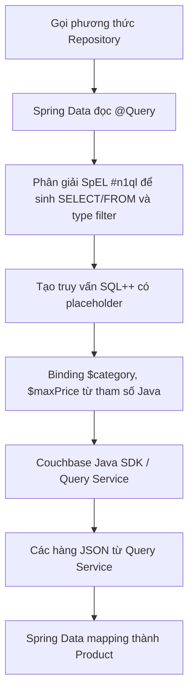

# Tham số vị trí, tham số có tên và @Param trong Spring Data Couchbase

> **Mục tiêu:** Viết truy vấn SQL++ bằng `@Query` với tham số vị trí `$1`, `$2` hoặc tham số có tên `$category`, `$maxPrice`; dùng đúng annotation `@Param`; truyền các kiểu chuỗi, số, Boolean, danh sách và giá trị tùy chọn; phân biệt **binding giá trị** với **SpEL** và nhận diện các sai sót có thể gây lỗi truy vấn hoặc SQL++ injection.

Trong module **SPRING_DATA_COUCHBASE**, Spring Data ánh xạ entity Java vào JSON document của Couchbase. Repository, `CouchbaseTemplate` và API reactive đều có thể làm việc với dữ liệu theo bucket, scope và collection. Với thao tác đọc document theo khóa đã biết, Key/Value API thường phù hợp; với yêu cầu tìm theo thuộc tính JSON, Spring Data dùng **SQL++** qua Query Service. SQL++ trước đây thường được gọi là **N1QL**, nên một số tên API Spring Data vẫn mang chữ `n1ql`.

Khi khai báo truy vấn trên Repository bằng `@Query`, điều kiện nghiệp vụ thường thay đổi theo từng lần gọi. Ví dụ khách hàng chọn danh mục `keyboard`, mức giá tối đa 2 triệu, trạng thái còn bán. Những giá trị này không nên được ghép trực tiếp vào câu SQL++. **Tham số ràng buộc** (*query parameters*) giữ nguyên cấu trúc truy vấn và truyền giá trị vào đúng vị trí.

| Cơ chế | Ví dụ SQL++ trong `@Query` | Giá trị Java lấy từ đâu? |
| --- | --- | --- |
| **Tham số vị trí** | `category = $1 AND price <= $2` | Tham số Java thứ nhất, thứ hai |
| **Tham số có tên** | `category = $category AND price <= $maxPrice` | Tham số Java khai báo `@Param("category")`, `@Param("maxPrice")` |
| **Biểu thức SpEL** | `#{#n1ql.selectEntity}` | Spring Data phân giải metadata của entity để sinh cú pháp truy vấn |

**Quy tắc cốt lõi:** `$1` và `$category` là placeholder **giá trị** gửi tới Query Service. `#{#n1ql.selectEntity}` là biểu thức **Spring Data thay thế bằng một đoạn SQL++ trước khi thực thi**. Hai lớp cú pháp có nhiệm vụ khác nhau.

## 1. Bối cảnh dữ liệu và entity dùng trong bài

Giả sử ứng dụng quản lý sản phẩm có bucket `catalog`, scope `commerce`, collection `products`. Dữ liệu minh họa:

**Document ID `product::KB-100`**

```json
{
  "sku": "KB-100",
  "name": "Bàn phím cơ",
  "category": "keyboard",
  "price": 1500000,
  "active": true,
  "specs": { "connection": "wired" },
  "tags": ["mechanical", "gaming"]
}
```

**Document ID `product::KB-200`**

```json
{
  "sku": "KB-200",
  "name": "Bàn phím không dây",
  "category": "keyboard",
  "price": 1900000,
  "active": true,
  "specs": { "connection": "wireless" },
  "tags": ["office", "wireless"]
}
```

**Document ID `product::MS-100`**

```json
{
  "sku": "MS-100",
  "name": "Chuột văn phòng",
  "category": "mouse",
  "price": 450000,
  "active": false,
  "specs": { "connection": "wireless" },
  "tags": ["office", "wireless"]
}
```

**Document ID `product::HS-100`**

```json
{
  "sku": "HS-100",
  "name": "Tai nghe",
  "category": "headset",
  "price": 800000,
  "active": true,
  "specs": {},
  "tags": []
}
```

Lưu ý: các JSON trên chỉ mô tả thuộc tính nghiệp vụ; document do Spring Data ghi còn có thể chứa trường phân biệt kiểu như `_class`. Nếu tự chèn JSON bằng Query Workbench mà không có discriminator tương thích, `#{#n1ql.filter}` của Spring Data có thể không nhận diện những document này. Để kiểm thử Repository, nên lưu document bằng cùng cơ chế mapping đang sử dụng.

Entity minh họa:

```java
import java.util.List;
import org.springframework.data.annotation.Id;
import org.springframework.data.couchbase.core.mapping.Document;
import org.springframework.data.couchbase.repository.Collection;
import org.springframework.data.couchbase.repository.Scope;

@Document
@Scope("commerce")
@Collection("products")
public class Product {
    @Id
    private String id;
    private String sku;
    private String name;
    private String category;
    private Long price;
    private Boolean active;
    private Specs specs;
    private List<String> tags;

    public Product() {}

    public static class Specs {
        private String connection;
        public Specs() {}
    }

    // Bổ sung getter/setter hoặc constructor theo quy ước dự án.
}
```

`@Id` ánh xạ document ID, khác với một trường JSON `id` bắt buộc nằm trong body. `@Scope`/`@Collection` xác định collection của entity; bucket `catalog` phải được cấu hình trong ứng dụng. Ví dụ dùng kiểu số nguyên `Long` cho giá tính bằng đồng; với tiền tệ có phần thập phân, hãy lựa chọn kiểu và quy tắc làm tròn nhất quán.

## 2. Tham số vị trí: `$1`, `$2`, `$3`

Ví dụ Repository đơn giản:

```java
import java.util.List;
import org.springframework.data.couchbase.repository.CouchbaseRepository;
import org.springframework.data.couchbase.repository.Query;

public interface ProductRepository
        extends CouchbaseRepository<Product, String> {

    @Query("#{#n1ql.selectEntity} WHERE #{#n1ql.filter} "
         + "AND category = $1 AND price <= $2")
    List<Product> findByCategoryBelowPrice(
        String category, long maxPrice
    );
}
```

Lời gọi:

```java
List<Product> result =
    repository.findByCategoryBelowPrice("keyboard", 1600000);
```

Ở đây `$1` nhận chuỗi `"keyboard"` và `$2` nhận số `1600000`. Kết quả nghiệp vụ trên dữ liệu mẫu chỉ có `KB-100`; `KB-200` vượt giá tối đa.

**Đếm vị trí từ 1**: `$1` là tham số đầu tiên, `$2` là tham số thứ hai. Đây là placeholder của SQL++ dùng với `@Query` trong Spring Data Couchbase, không phải chỉ số Java bắt đầu từ 0. Đừng tự đổi thành `$0` theo thói quen của một số API khác.

Thêm điều kiện thứ ba:

```java
@Query("#{#n1ql.selectEntity} WHERE #{#n1ql.filter} "
     + "AND category = $1 "
     + "AND price <= $2 "
     + "AND active = $3")
List<Product> findByThreeCriteria(
    String category, long maxPrice, boolean enabled
);
```

| Vị trí Java | Tham số | Giá trị từ lời gọi | Placeholder SQL++ |
| --- | --- | --- | --- |
| 1 | `category` | `"keyboard"` | `$1` |
| 2 | `maxPrice` | `2000000` | `$2` |
| 3 | `enabled` | `true` | `$3` |

`@Query` trên là ví dụ **khai báo phương thức bên trong Repository**, không phải một method Java đứng độc lập ngoài interface.

### Ưu và nhược điểm của tham số vị trí

Với một hoặc hai giá trị, `$1`/`$2` ngắn và dễ hiểu. Khi tăng lên năm, sáu điều kiện, mã trở nên khó đọc. Ví dụ:

```java
@Query("#{#n1ql.selectEntity} WHERE #{#n1ql.filter} "
     + "AND category = $1 AND active = $2 "
     + "AND price >= $3 AND price <= $4")
List<Product> findFiltered(
    String category, boolean enabled, long minPrice, long maxPrice
);
```

Nếu người bảo trì đổi thứ tự `minPrice` và `maxPrice` ở chữ ký Java mà quên cập nhật `$3`/`$4` trong SQL++, câu truy vấn vẫn có thể chạy nhưng lọc sai. Với nhiều tham số cùng kiểu, rủi ro này càng lớn; đó là lúc tham số **có tên** trở nên hữu ích.

## 3. Tham số có tên và annotation `@Param`

Khi dùng tham số có tên, placeholder SQL++ mang tên mô tả nghiệp vụ như `$category`, `$minPrice` hoặc `$enabled`. Trong Spring Data Repository, khai báo **`org.springframework.data.repository.query.Param`** để chỉ rõ tham số Java tương ứng:

```java
import java.util.List;
import org.springframework.data.couchbase.repository.Query;
import org.springframework.data.repository.query.Param;

@Query("#{#n1ql.selectEntity} WHERE #{#n1ql.filter} "
     + "AND category = $category "
     + "AND price BETWEEN $minPrice AND $maxPrice "
     + "AND active = $enabled")
List<Product> findByNamedFilters(
    @Param("category") String category,
    @Param("minPrice") long fromPrice,
    @Param("maxPrice") long toPrice,
    @Param("enabled") boolean active
);
```

Đoạn mã trên là **một phương thức đặt bên trong `ProductRepository`**. Các tên biến Java (`fromPrice`, `toPrice`, `active`) không phải trùng với chuỗi trong `@Param`, vì `@Param` xác định tên mà Spring Data dùng để binding.

Ví dụ lời gọi:

```java
List<Product> products = repository.findByNamedFilters(
    "keyboard", 1000000, 2000000, true
);
```

Kết quả gồm `KB-100` và `KB-200`. Điều kiện `BETWEEN ... AND ...` bao gồm hai đầu mút.

### Hiểu chính xác mối liên hệ giữa ba tên

| Thành phần | Ví dụ | Vai trò |
| --- | --- | --- |
| Tên trường JSON | `price` | Được Couchbase Query Service đọc từ document |
| Tên placeholder SQL++ | `$minPrice` | Giá trị sẽ được ràng buộc vào vị trí điều kiện |
| Tên trong `@Param` | `@Param("minPrice")` | Spring Data kết nối tham số Java với placeholder |
| Tên biến Java | `fromPrice` | Tên do lập trình viên đặt trong chữ ký phương thức |

Điểm cần giữ nhất quán là **`$minPrice` ↔ `@Param("minPrice")`**. Nếu sửa `@Param("minPrice")` thành `@Param("minimum")` thì phải sửa placeholder thành `$minimum`, nếu không binding sẽ thất bại.

### Nhiều tham số cùng kiểu: lợi ích về khả năng bảo trì

Nếu phương thức dùng:

```java
@Query("#{#n1ql.selectEntity} WHERE #{#n1ql.filter} "
     + "AND price >= $from AND price <= $to")
List<Product> findBetweenPrices(
    @Param("to") long upperBound,
    @Param("from") long lowerBound
);
```

thì dù chữ ký Java đặt `upperBound` trước `lowerBound`, placeholder `$from` vẫn lấy giá trị của tham số gắn `@Param("from")`. Cách đặt tên giúp ý định dễ hiểu, nhưng **không làm mất trách nhiệm truyền các đối số đúng thứ tự khi gọi phương thức Java**. Với nhiều tham số liên quan, có thể cân nhắc một đối tượng điều kiện ở tầng service để giảm nhầm lẫn.

### Có bắt buộc phải dùng `@Param` không?

Một số cơ chế Spring Data có thể khám phá tên tham số Java khi project biên dịch với thông tin tên tham số, ví dụ flag `-parameters`, nhưng khả năng hoạt động phụ thuộc cách framework phân giải tham số và cấu hình build. Với truy vấn `@Query` dùng placeholder có tên, **khai báo `@Param` tường minh là lựa chọn dễ đọc và ít phụ thuộc build hơn**.

Import đúng:

```java
import org.springframework.data.repository.query.Param;
```

Không dùng annotation của thư viện persistence khác chỉ vì chúng cũng có tên `@Param`. Tương tự, `@Query` trong bài thuộc package `org.springframework.data.couchbase.repository.Query`; `@Query` của JPA hoặc thư viện khác không tương đương.

### Có thể lặp lại một tham số trong điều kiện

Khi cùng một giá trị xuất hiện ở nhiều vị trí, ta có thể dùng lại cùng placeholder:

```java
@Query("#{#n1ql.selectEntity} WHERE #{#n1ql.filter} "
     + "AND (category = $term OR name = $term)")
List<Product> findByCategoryOrExactName(
    @Param("term") String term
);
```

Hai vị trí `$term` đều tham chiếu một giá trị được binding. Không cần khai báo hai tham số Java chỉ vì SQL++ dùng giá trị đó hai lần.

## 4. Nên chọn tham số vị trí hay tham số có tên?

Hai cách tương đương khi chỉ khác kỹ thuật gắn giá trị:

```java
// Vị trí: đọc điều kiện phải đối chiếu thứ tự chữ ký.
@Query("#{#n1ql.selectEntity} WHERE #{#n1ql.filter} "
     + "AND category = $1 AND price <= $2")
List<Product> byPosition(String category, long maximumPrice);

// Có tên: mỗi điều kiện thể hiện ngay ý nghĩa tham số.
@Query("#{#n1ql.selectEntity} WHERE #{#n1ql.filter} "
     + "AND category = $category AND price <= $maxPrice")
List<Product> byName(
    @Param("category") String category,
    @Param("maxPrice") long maximumPrice
);
```

| Tiêu chí | `$1`, `$2` | `$category`, `$maxPrice` |
| --- | --- | --- |
| Cách nhận diện tham số | Dựa trên vị trí trong chữ ký Java | Dựa vào tên khai báo `@Param` |
| Độ ngắn gọn | Rất ngắn | Dài hơn nhưng rõ nghĩa |
| Dễ đọc khi nhiều tham số | Giảm dần | Thường tốt hơn |
| Khi đổi thứ tự tham số Java | Cần kiểm tra lại các placeholder vị trí | Mapping tên không đổi nếu annotation giữ nguyên |
| Rủi ro phổ biến | Nhầm `$2` với `$3` | Sai chính tả tên trong `@Param` |

**Khuyến nghị cho nhóm phát triển:** chọn một kiểu binding nhất quán trong **cùng một câu `@Query`**, đặc biệt khi có nhiều điều kiện. Việc xen kẽ `$1` và `$category` khiến truy vấn khó rà soát và một số cách phân giải tham số có thể không hỗ trợ hỗn hợp như mong đợi.

Ở các tầng khác của ứng dụng, không cần áp đặt một kiểu cho mọi tình huống: truy vấn ngắn một giá trị có thể dùng `$1`, còn truy vấn dài thường có lợi khi dùng tên.

## 5. Spring Data xử lý `@Query` như thế nào?

Ví dụ:

```java
@Query("#{#n1ql.selectEntity} WHERE #{#n1ql.filter} "
     + "AND category = $category AND price <= $maxPrice")
List<Product> search(
    @Param("category") String category,
    @Param("maxPrice") long maxPrice
);
```

Khi Repository được gọi, có hai loại thay thế tách biệt:



- **SpEL `#{#n1ql.selectEntity}`** tạo phần SQL++ dùng để trả về entity, kể cả metadata cần cho ID/CAS.
- **SpEL `#{#n1ql.filter}`** tạo điều kiện phân biệt loại document nếu Spring Data mapping cần.
- **Placeholder `$category` và `$maxPrice`** tồn tại như những chỗ nhận giá trị; chúng không biến thành tên trường hay đoạn SQL++ mới.
- **Query Service** đánh giá `WHERE` trên các document, rồi Spring Data chuyển kết quả thành các đối tượng Java theo kiểu trả về.

Ví dụ SQL++ **thuần** để kiểm tra cùng một điều kiện trong Query Workbench:

```sql
SELECT p.sku, p.category, p.price
FROM `catalog`.`commerce`.`products` AS p
WHERE p.category = "keyboard"
  AND p.price <= 2000000;
```

Câu ở Workbench đã dùng giá trị literal, còn mã Spring Data dùng placeholder. Không dán nguyên `#{#n1ql.selectEntity}` vào Query Workbench: máy chủ không có trình phân giải SpEL của Spring.

**Lưu ý về entity:** câu thử ở Workbench chỉ chọn ba trường nên không tương đương hoàn toàn với phép chiếu cho full entity do `#n1ql.selectEntity` sinh. Khi trả về `List<Product>`, nên giữ phép chiếu metadata thích hợp; một `SELECT sku, price` thủ công có thể thiếu ID/CAS, field mapping và điều kiện phân biệt kiểu.

## 6. Truyền đúng kiểu giá trị Java vào SQL++

Binding cho phép truyền giá trị có kiểu, thay vì ghép chúng thành chuỗi SQL++ theo cách thủ công. Cách mỗi kiểu Java được chuyển sang JSON/SQL++ còn phụ thuộc converter của Spring Data và Couchbase SDK đang dùng, nên các kiểu phức tạp cần được kiểm chứng trong tích hợp thực tế.

| Tham số Java | Ví dụ giá trị | Ý nghĩa khi binding |
| --- | --- | --- |
| `String` | `"keyboard"` | Giá trị chuỗi SQL++ |
| `long` / `Long` | `2000000L` | Giá trị số |
| `boolean` / `Boolean` | `true` | Giá trị Boolean |
| `List<String>` | `List.of("keyboard", "mouse")` | Danh sách thường được biểu diễn thành JSON array |
| `null` từ kiểu tham chiếu | `null` | Có thể đại diện JSON `NULL`; cần kiểm tra hợp đồng repository/binder |
| Kiểu ngày giờ | `Instant` hoặc chuỗi ISO 8601 | Cần quy ước chuyển đổi và truy vấn nhất quán |

### Chuỗi: ký tự nháy được xử lý như dữ liệu

```java
@Query("#{#n1ql.selectEntity} WHERE #{#n1ql.filter} "
     + "AND name = $name")
List<Product> findByExactName(@Param("name") String name);
```

Nếu tên sản phẩm là `"Bàn phím 'Pro'"`, hãy truyền nguyên giá trị Java vào `findByExactName(...)`. Framework/SDK binding đúng kiểu chuỗi; ta không tự thêm dấu nháy quanh placeholder hoặc tự thoát ký tự bằng cách nối chuỗi.

**Sai:**

```java
// Dấu nháy sẽ làm $name thành phần của literal SQL++ chứ không còn
// là placeholder được binding đúng cách.
@Query("#{#n1ql.selectEntity} WHERE #{#n1ql.filter} "
     + "AND name = '$name'")
List<Product> wrongNamedParameter(@Param("name") String name);
```

**Đúng:** `AND name = $name`. Dấu nháy nằm trong **giá trị** mà Java truyền, không bọc `$name` trong query string.

### Số và Boolean: tránh đưa tất cả thành `String`

```java
@Query("#{#n1ql.selectEntity} WHERE #{#n1ql.filter} "
     + "AND active = $enabled "
     + "AND price >= $minPrice AND price <= $maxPrice")
List<Product> findByRange(
    @Param("enabled") boolean enabled,
    @Param("minPrice") long minPrice,
    @Param("maxPrice") long maxPrice
);
```

Giá trị số `2000000` và chuỗi `"2000000"` không có cùng kiểu trong JSON. SQL++ có quy tắc so sánh kiểu của nó, nhưng nghiệp vụ tìm giá nên dùng số đúng kiểu và kiểm soát `minPrice <= maxPrice` trước khi gọi Repository.

Với giá tiền có phần thập phân, cân nhắc biểu diễn bằng số nguyên đơn vị nhỏ nhất hoặc kiểu Java như `BigDecimal` theo quy ước miền nghiệp vụ. Không dùng `double` một cách tùy tiện để biểu diễn tiền nếu cần số học thập phân chính xác.

### Truyền danh sách cho `IN`

Yêu cầu “chọn sản phẩm thuộc một trong nhiều danh mục”:

```java
import java.util.List;

@Query("#{#n1ql.selectEntity} WHERE #{#n1ql.filter} "
     + "AND category IN $categories "
     + "AND active = true")
List<Product> findActiveInCategories(
    @Param("categories") List<String> categories
);
```

```java
List<Product> items = repository.findActiveInCategories(
    List.of("keyboard", "headset")
);
```

Trên dữ liệu mẫu, kết quả nghiệp vụ có KB-100, KB-200 và HS-100. Khi danh sách được ràng buộc thành JSON array, điều kiện SQL++ tương đương về ngữ nghĩa với:

```sql
WHERE p.category IN ["keyboard", "headset"]
```

**Cần kiểm tra contract đầu vào:**

- Danh sách rỗng có nghĩa “không chọn danh mục nào” hay “không áp dụng bộ lọc”? `category IN []` không khớp sản phẩm nào; nó không tự có nghĩa “chọn tất cả”.
- Danh sách `null` cần được xử lý rõ. Không mặc định binder hoặc điều kiện `IN` sẽ tự bỏ qua bộ lọc.
- Với danh sách quá lớn, cân nhắc giới hạn kích thước và hiệu năng thay vì truyền hàng chục nghìn giá trị qua một tham số.

Không tự chắp `"'" + String.join(...) + "'"` để tạo `IN (...)` từ dữ liệu người dùng. Binding giữ các phần tử danh sách ở vai trò **giá trị**.

### Tham số trong điều kiện trên JSON lồng nhau

```java
@Query("#{#n1ql.selectEntity} WHERE #{#n1ql.filter} "
     + "AND specs.connection = $connection")
List<Product> findByConnection(
    @Param("connection") String connection
);
```

Khi gọi `findByConnection("wireless")`, Query Service so sánh tham số với giá trị của `specs.connection` ở từng JSON document. KB-200 và MS-100 thỏa ví dụ này. Placeholder thay **giá trị muốn so sánh**, không thay cả đường dẫn `specs.connection`.

### Tham số trong biểu thức `ANY` trên mảng

```java
@Query("#{#n1ql.selectEntity} WHERE #{#n1ql.filter} "
     + "AND ANY tag IN tags "
     + "    SATISFIES tag = $requestedTag "
     + "    END")
List<Product> findByTag(
    @Param("requestedTag") String tag
);
```

Gọi `findByTag("wireless")` trả KB-200 và MS-100. **`tag`** bên trái là biến cục bộ của SQL++ dùng duyệt mảng, còn **`$requestedTag`** là tham số được binding từ Java. Hai loại tên này không liên quan đến nhau dù có thể viết giống nhau.

Nếu mảng gồm object, vẫn có thể binding nhiều giá trị trong cùng một `SATISFIES`:

```java
@Query("#{#n1ql.selectEntity} WHERE #{#n1ql.filter} "
     + "AND ANY v IN variants "
     + "    SATISFIES v.color = $color AND v.stock >= $minStock "
     + "    END")
List<Product> findVariantByColorAndStock(
    @Param("color") String color,
    @Param("minStock") int minStock
);
```

Đoạn này giả định collection có trường JSON `variants` là mảng object với `color` và `stock`; nếu cần mapping về `Product`, entity phải khai báo kiểu dữ liệu tương ứng. Hai điều kiện nằm trong cùng `SATISFIES` để bảo đảm **đúng màu và còn hàng trên cùng một biến thể**.

### Trường hợp `null` và `MISSING`

Couchbase phân biệt JSON `null` (trường tồn tại và có giá trị null) với `MISSING` (không có trường tại đường dẫn). Truyền Java `null` vào placeholder **không có nghĩa** bảo Query Service tìm các document thiếu trường.

Giả sử muốn kiểm tra một field `discount`:

```sql
-- Tìm trường tồn tại với giá trị JSON null.
WHERE discount IS NULL

-- Tìm trường không tồn tại trong document.
WHERE discount IS MISSING

-- Tìm trường có giá trị khác NULL và MISSING.
WHERE discount IS VALUED
```

Không dùng `discount = $value` với `value = null` rồi mong nó hoạt động như `IS NULL` hay `IS MISSING`. Với các thao tác tìm trạng thái tồn tại/thiếu, hãy chọn query rõ ý nghĩa; nếu cần cho phép điều kiện tùy chọn, cân nhắc xây truy vấn động ở `CouchbaseTemplate` thay vì đưa một quy tắc null mơ hồ vào mọi phương thức.

### Thời gian: đồng nhất cách lưu trước khi lọc

Khi document lưu `createdAt` dưới dạng chuỗi ISO 8601 chuẩn hóa về UTC, một kiểu Repository minh họa có thể nhận chuỗi ranh giới cùng định dạng:

```java
@Query("#{#n1ql.selectEntity} WHERE #{#n1ql.filter} "
     + "AND createdAt >= $fromIso AND createdAt < $toIso")
List<Product> findCreatedBetween(
    @Param("fromIso") String fromIso,
    @Param("toIso") String toIso
);
```

Ví dụ `"2026-11-01T00:00:00Z"` và `"2026-12-01T00:00:00Z"`. Đây là truy vấn minh họa cho document **có trường `createdAt`**, không nằm trong JSON mẫu ở đầu bài. So sánh chuỗi chỉ có ý nghĩa thời gian đáng tin cậy khi toàn bộ giá trị dùng một biểu diễn ISO thống nhất (múi giờ, độ chính xác và định dạng). Nếu ứng dụng lưu epoch milliseconds hoặc dạng khác, hãy dùng tham số và biểu thức phù hợp với cách lưu đó.

## 7. `LIKE` và các ký tự đặc biệt: binding không thay đổi nghĩa của mẫu

Tham số hóa ngăn dữ liệu người dùng bị hiểu thành một đoạn cú pháp SQL++ tùy ý, nhưng **không vô hiệu hóa ý nghĩa của các ký tự đại diện trong `LIKE`**:

```java
@Query("#{#n1ql.selectEntity} WHERE #{#n1ql.filter} "
     + "AND sku LIKE $pattern")
List<Product> findSkuLike(@Param("pattern") String pattern);
```

Lời gọi `findSkuLike("KB-%")` tìm KB-100 và KB-200 vì `%` là ký tự đại diện cho một chuỗi bất kỳ. `_` thường đại diện một ký tự. Nếu người dùng nhập một mã có `%` hoặc `_` nhưng muốn tìm ký tự đó **theo nghĩa đen**, tầng ứng dụng phải xây mẫu và quy tắc escape phù hợp với SQL++ đang sử dụng. Không nên lẫn “tìm chuỗi khớp mẫu” với “tìm chuỗi chứa những ký tự này”.

`LIKE` cũng khác với tìm kiếm toàn văn. Với nhu cầu gợi ý tên sản phẩm, sửa lỗi chính tả hoặc xếp hạng theo mức liên quan, hãy đánh giá Couchbase Search Service thay vì giả định `LIKE "%term%"` sẽ có hiệu năng tốt trên dữ liệu lớn.

## 8. Những thứ không thể truyền qua placeholder giá trị

Các placeholder `$1`, `$category` được thiết kế để binding **giá trị**. Chúng không được dùng như macro thay tên bucket, tên collection, tên trường, toán tử hoặc từ khóa của SQL++.

### Ví dụ đúng: tham số thay một giá trị

```sql
SELECT p.sku, p.price
FROM `catalog`.`commerce`.`products` AS p
WHERE p.category = $category
ORDER BY p.price DESC;
```

### Ví dụ sai về ý nghĩa: tham số thay định danh

```sql
-- Không dùng các placeholder làm tên collection hoặc tên field.
SELECT p.sku
FROM $collection AS p
WHERE $fieldName = "keyboard";
```

Ở đây `$collection` không thể được hiểu như đường dẫn `catalog.commerce.products`. `$fieldName` cũng không phải “thay bằng tên thuộc tính JSON”; nó chỉ là **giá trị**. Nếu Query Service vẫn chấp nhận một cú pháp nào đó thì ngữ nghĩa sẽ không phải điều truy vấn động mong muốn.

### Sắp xếp động cần whitelist

Giả sử người dùng có quyền chọn sắp xếp theo `sku` hoặc `price`. Không ghép trực tiếp nội dung bất kỳ của query parameter HTTP vào SQL++ như:

```java
// Sai: sortField có thể chứa cú pháp không tin cậy.
String unsafeQuery =
    "SELECT p.* FROM `catalog`.`commerce`.`products` AS p "
    + "ORDER BY " + sortField;
```

Tầng ứng dụng phải kiểm tra `sortField` theo danh sách cho phép, ví dụ `"sku"` và `"price"`, và hướng sắp xếp phải thuộc tập `ASC`/`DESC`. Sau đó có thể dùng cơ chế `Sort`/`Pageable` mà phiên bản Spring Data hỗ trợ hoặc xây một tập hữu hạn mẫu truy vấn đã kiểm soát. Giá trị tìm kiếm vẫn binding bình thường.

**Không trộn lẫn hai loại xử lý:** whitelist dùng cho **định danh/cú pháp**; parameter binding dùng cho **giá trị**. Đây là ranh giới quan trọng để giảm rủi ro SQL++ injection.

### Phân trang với `LIMIT` và `OFFSET`

Trong câu SQL++ hỗ trợ các biểu thức giới hạn, có thể binding giới hạn và độ lệch bằng các tham số số nguyên:

```java
@Query("#{#n1ql.selectEntity} WHERE #{#n1ql.filter} "
     + "AND category = $category "
     + "ORDER BY sku ASC "
     + "LIMIT $limit OFFSET $offset")
List<Product> findPageByCategory(
    @Param("category") String category,
    @Param("limit") long limit,
    @Param("offset") long offset
);
```

Ví dụ `findPageByCategory("keyboard", 10, 0)` lấy tối đa mười bàn phím đầu tiên theo `sku`. Tầng service cần giới hạn `limit` ở mức hợp lý, yêu cầu `offset >= 0` và bảo đảm thứ tự ổn định. Nếu có nhiều document trùng `sku`, thêm trường phân biệt trong `ORDER BY`.

Đây là **phân trang thủ công**. Phương thức không tự trả `Page<Product>` hoặc truy vấn `count`. Khi dùng tham số đặc biệt `Pageable`/`Sort` của Spring Data, hãy kiểm tra hành vi của phiên bản Couchbase đang sử dụng và tránh kết hợp cơ chế bổ sung `LIMIT/OFFSET` tự động với một query đã viết chúng sẵn.

Với nhiều trang sâu, offset lớn có thể khiến Query Service phải duyệt/bỏ qua nhiều hàng; khi đó hãy cân nhắc phân trang theo khóa (`keyset`). Các document có thể thay đổi giữa hai lần gọi, nên không có bảo đảm snapshot chỉ nhờ `LIMIT/OFFSET`.

## 9. Giá trị tùy chọn và cách thiết kế bộ lọc

Một API tìm kiếm có thể cho phép bỏ trống `category`, `minPrice` hoặc `active`. Có hai hướng triển khai khác nhau:

### Hướng A — Chọn một truy vấn phù hợp theo điều kiện đã nhập

Định nghĩa một số phương thức Repository rõ ràng, ví dụ:

```java
List<Product> findByCategory(String category);

@Query("#{#n1ql.selectEntity} WHERE #{#n1ql.filter} "
     + "AND category = $category AND price <= $maxPrice")
List<Product> findByCategoryAndPriceLimit(
    @Param("category") String category,
    @Param("maxPrice") long maxPrice
);
```

Tầng service quyết định gọi phương thức nào dựa trên những trường đã nhập. Cách này hữu ích khi số tổ hợp điều kiện không lớn và mỗi truy vấn có thể được tối ưu bằng chỉ mục riêng.

### Hướng B — Tạo điều kiện động qua API truy vấn phù hợp

Với rất nhiều trường tùy chọn, có thể dùng `CouchbaseTemplate` hoặc cơ chế truy vấn động để **chỉ đưa những điều kiện đang hoạt động** vào `WHERE`. Tên trường, toán tử và cấu trúc được xây từ mã đã kiểm soát; giá trị vẫn được binding. Hãy xem API cụ thể của phiên bản Spring Data đang dùng.

Một mẫu SQL++ thường thấy là:

```sql
WHERE ($category IS NULL OR p.category = $category)
  AND ($maxPrice IS NULL OR p.price <= $maxPrice)
```

Đây là **mẫu lý thuyết** để nói rằng `null` của tham số nghĩa là “bỏ qua điều kiện”, chứ không phải một hợp đồng mặc định của Spring Data. Nếu dùng mẫu này, phải xác nhận repository/binder nhận đúng giá trị `null`, đánh giá hành vi `NULL`/`MISSING` và xem `EXPLAIN`: các nhánh `OR` trên tham số tùy chọn có thể làm index khó được chọn tối ưu. Với nhu cầu nhiều bộ lọc và hiệu năng cao, phương án xây điều kiện động thường dễ kiểm soát hơn.

**Điểm phân biệt:** Java `null` được binding (nếu được hỗ trợ) là **giá trị NULL**, không phải tình trạng document **MISSING**. Vì vậy, muốn tìm document thiếu thuộc tính `category` phải dùng `p.category IS MISSING`, không lấy `null` từ UI để suy ra phép kiểm tra đó.

## 10. Liên quan tới chỉ mục, consistency, TTL/CAS và reactive

Đổi `$1` sang `$category` chỉ thay cách **đặt tên và binding giá trị**. Chúng không làm SQL++ tự dùng một index tốt hơn. Điều kiện thực tế mới quyết định yêu cầu chỉ mục.

Ví dụ truy vấn:

```sql
SELECT p.sku, p.category, p.price
FROM `catalog`.`commerce`.`products` AS p
WHERE p.category = "keyboard"
  AND p.price <= 1600000;
```

Có thể cân nhắc secondary index:

```sql
CREATE INDEX idx_products_category_price
ON `catalog`.`commerce`.`products`(category, price);
```

Sau đó dùng:

```sql
EXPLAIN
SELECT p.sku, p.category, p.price
FROM `catalog`.`commerce`.`products` AS p
WHERE p.category = "keyboard"
  AND p.price <= 1600000;
```

Tìm index theo điều kiện thực tế, kiểm tra cách optimizer quét chỉ mục và số document phải đọc. Khi chuyển từ Query Workbench sang Repository, nhớ rằng `#{#n1ql.filter}` có thể sinh thêm điều kiện discriminator và `#{#n1ql.selectEntity}` sinh phép chiếu phục vụ entity. Truy vấn thử nên phản ánh đủ các yếu tố này trước khi kết luận về hiệu năng.

### Độ mới của kết quả

Couchbase Query/Index Service có thể cập nhật chỉ mục sau khi document đã được ghi thành công qua Key/Value. Nếu vừa gọi `repository.save(product)` rồi lập tức tìm qua `@Query` với scan consistency `NOT_BOUNDED`, kết quả có thể chưa thấy ghi mới. `REQUEST_PLUS` có thể đợi index bắt kịp các thay đổi trước yêu cầu nhưng đổi lại độ trễ có thể tăng.

Thay đổi tên placeholder không ảnh hưởng scan consistency. Nếu đã biết document ID và cần đọc ngay, `findById` thường là con đường phù hợp. Với dữ liệu báo cáo hoặc tìm kiếm, hãy chọn consistency theo yêu cầu nghiệp vụ và tải hệ thống.

**TTL** quy định thời hạn sống của document; **CAS** hỗ trợ kiểm soát cập nhật đồng thời; **transaction** chi phối một nhóm thao tác cần tính nguyên tử. `@Param` không thay thế hay tự kích hoạt các cơ chế đó. Chúng phải được cấu hình theo mô hình lưu trữ và quy trình giao dịch của ứng dụng.

### Reactive Repository cũng dùng cùng quy tắc binding

Ví dụ:

```java
import reactor.core.publisher.Flux;
import org.springframework.data.couchbase.repository.Query;
import org.springframework.data.couchbase.repository.ReactiveCouchbaseRepository;
import org.springframework.data.repository.query.Param;

public interface ReactiveProductRepository
        extends ReactiveCouchbaseRepository<Product, String> {

    @Query("#{#n1ql.selectEntity} WHERE #{#n1ql.filter} "
         + "AND category = $category AND active = $enabled")
    Flux<Product> findActiveInCategory(
        @Param("category") String category,
        @Param("enabled") boolean enabled
    );
}
```

`Flux<Product>` thay cách tiêu thụ kết quả theo mô hình Reactor, nhưng SQL++ vẫn dùng placeholder `$category`/`$enabled` và Spring Data vẫn xử lý `@Param`. API reactive không loại bỏ nhu cầu index, không tự đảm bảo read-your-own-write qua index và không thay đổi ý nghĩa `NULL`/`MISSING`.

## 11. Lỗi thường gặp và cách tìm nguyên nhân

| Triệu chứng | Nguyên nhân có thể | Cách xử lý |
| --- | --- | --- |
| Binding không tìm thấy tham số `$category` | `@Param("category")` bị thiếu hoặc tên không trùng | Đối chiếu nguyên văn tên placeholder và annotation |
| Kết quả giá sai nhưng truy vấn vẫn chạy | Đổi vị trí `minPrice`/`maxPrice` nhưng không sửa `$1`, `$2` | Dùng tham số có tên hoặc kiểm tra thứ tự bằng kiểm thử tích hợp |
| `WHERE name = '$name'` không tìm đúng tên | Placeholder bị đặt trong literal chuỗi | Viết `name = $name`, để binder xử lý dấu nháy |
| Giá trị Boolean được truyền như chuỗi `"true"` | Sai kiểu dữ liệu đầu vào | Dùng kiểu `boolean/Boolean` cho điều kiện Boolean |
| `IN` không trả kết quả với danh sách rỗng | `category IN []` không khớp giá trị nào | Định nghĩa rõ contract với danh sách rỗng |
| Điều kiện `LIKE` khớp quá nhiều sản phẩm | `%`, `_` có nghĩa là ký tự đại diện | Escape mẫu hoặc chọn cơ chế tìm kiếm khác |
| Dùng `$fieldName` để sắp xếp động nhưng không đúng | Placeholder là giá trị, không phải định danh | Whitelist field và dùng cơ chế Sort/query được kiểm soát |
| SQL++ injection hoặc lỗi dấu nháy | Nối chuỗi dữ liệu người dùng vào câu lệnh | Binding `$1`/`$name`, tránh kết hợp chuỗi nguy hiểm |
| Query Workbench hiểu SQL++ nhưng không hiểu `#{#n1ql.filter}` | SpEL là cú pháp phía Spring Data | Kiểm tra Workbench với SQL++ thuần; dùng SpEL trong Repository |
| Workbench trả document nhưng Repository `@Query` trả rỗng | Discriminator kiểu, scope/collection hoặc giá trị tham số không khớp | Kiểm tra dữ liệu được lưu qua Spring Data và SQL++ thực tế |
| Repository trả entity thiếu ID/CAS | `SELECT` tự viết không tạo phép chiếu metadata tương ứng | Dùng `#n1ql.selectEntity` cho full entity; projection cho DTO |
| Truy vấn dùng `$limit` nhưng phân trang bất thường | Giới hạn/offset không hợp lệ hoặc thiếu thứ tự ổn định | Validate `limit/offset` và thêm `ORDER BY` xác định |
| Truy vấn theo thuộc tính không thấy document vừa ghi | Chỉ mục cập nhật bất đồng bộ | Cân nhắc scan consistency hoặc đọc KV theo ID |
| Truy vấn chậm dù tham số đã binding đúng | Thiếu chỉ mục hoặc điều kiện khó dùng index | Kiểm tra `EXPLAIN` trên query và dữ liệu tương ứng |

### Quy trình chẩn đoán nhanh

1. **Kiểm tra đúng annotation:** dùng `org.springframework.data.couchbase.repository.Query` và `org.springframework.data.repository.query.Param`.
2. **Đối chiếu placeholder:** `$1` bắt đầu từ tham số Java thứ nhất; `$name` phải khớp `@Param("name")`.
3. **Kiểm tra kiểu giá trị:** chuỗi, số, Boolean, danh sách hay null; các kiểu này không tự hoán đổi tùy ý.
4. **Xác minh cấu trúc SQL++:** phần SpEL phải được Spring Data phân giải; Query Service chỉ hiểu SQL++ cuối cùng.
5. **Kiểm tra mapping:** bucket/scope/collection, entity discriminator, document ID/CAS và kiểu kết quả.
6. **Kiểm tra vận hành:** chỉ mục, `EXPLAIN`, scan consistency và độ trễ dữ liệu.

Khi gỡ lỗi, cần tuân thủ chính sách logging của hệ thống. Không ghi các tham số chứa dữ liệu nhạy cảm, thông tin xác thực hoặc chuỗi kết nối nguyên văn chỉ để xác nhận binding hoạt động.

## 12. Bài thực hành có đáp án

Các bài sau dựa trên bốn document ở phần 1. Với các phương thức trả về `Product`, hãy lưu dữ liệu theo cùng mapping Spring Data và tạo chỉ mục thứ cấp phù hợp trước khi chạy.

### Bài 1 — Viết lại tham số vị trí thành tham số có tên

**Đầu bài:**

```java
@Query("#{#n1ql.selectEntity} WHERE #{#n1ql.filter} "
     + "AND category = $1 AND price <= $2")
List<Product> searchA(String category, long maxPrice);
```

**Đáp án:**

```java
@Query("#{#n1ql.selectEntity} WHERE #{#n1ql.filter} "
     + "AND category = $category AND price <= $maxPrice")
List<Product> searchB(
    @Param("category") String category,
    @Param("maxPrice") long maxPrice
);
```

Hai câu khai báo có mục tiêu như nhau. Khi gọi `searchB("keyboard", 1600000)`, kết quả là KB-100.

### Bài 2 — Sửa lỗi thứ tự

Một phương thức nhận `(String category, long minPrice, long maxPrice)` nhưng query lại dùng:

```java
@Query("#{#n1ql.selectEntity} WHERE #{#n1ql.filter} "
     + "AND category = $1 AND price >= $3 AND price <= $2")
List<Product> wrongRange(
    String category, long minPrice, long maxPrice
);
```

Vấn đề: `$2` là `minPrice` và `$3` là `maxPrice`, nên điều kiện bị đảo. **Đáp án sửa:**

```java
@Query("#{#n1ql.selectEntity} WHERE #{#n1ql.filter} "
     + "AND category = $1 AND price >= $2 AND price <= $3")
List<Product> correctRange(
    String category, long minPrice, long maxPrice
);
```

Lỗi kiểu này có thể không gây exception, vì SQL++ vẫn hợp lệ. Nó chỉ làm kết quả sai; kiểm thử với dữ liệu nằm đúng giữa đoạn giá là cách xác minh có ý nghĩa.

### Bài 3 — Ràng buộc một danh sách danh mục

**Yêu cầu:** Trả sản phẩm hoạt động thuộc danh sách danh mục, không nối chuỗi tạo `IN`.

```java
@Query("#{#n1ql.selectEntity} WHERE #{#n1ql.filter} "
     + "AND active = true AND category IN $categories")
List<Product> findActiveByCategories(
    @Param("categories") List<String> categories
);
```

**Đáp án khi gọi `findActiveByCategories(List.of("keyboard", "headset"))`:** KB-100, KB-200 và HS-100. Việc kiểm tra danh sách rỗng nên đặt ở tầng service dựa trên contract API đã chọn.

### Bài 4 — Tìm sản phẩm theo một nhãn từ người dùng

**Yêu cầu:** Duyệt array `tags`, tham số tên `$tag`, không giới hạn vào `tags[0]`.

```java
@Query("#{#n1ql.selectEntity} WHERE #{#n1ql.filter} "
     + "AND ANY t IN tags SATISFIES t = $tag END")
List<Product> findByTagName(@Param("tag") String tag);
```

**Đáp án khi gọi `findByTagName("wireless")`:** KB-200 và MS-100. Nếu cần chỉ sản phẩm hoạt động, thêm `AND active = true` vào điều kiện `WHERE`.

### Bài 5 — Phân biệt SQL++ injection và ký tự đặc biệt

**Tình huống:** Tên sản phẩm có ký tự `'`. Một lập trình viên ghép trực tiếp tên vào câu SQL++ bằng dấu nháy, một người khác dùng `name = $name`.

**Đáp án:** Hãy dùng `name = $name` với tham số Java `@Param("name")`. Dữ liệu người dùng được truyền dưới dạng giá trị, không được phép thay cấu trúc điều kiện. Với `LIKE`, cần xử lý thêm các ký tự đại diện nếu muốn so sánh theo nghĩa đen: binding không tự làm `%` mất ý nghĩa wildcard.

### Bài 6 — Thiết kế truy vấn tìm kiếm có trường tùy chọn

**Tình huống:** API có `category`, `active`, `minPrice`, `maxPrice`, tất cả có thể để trống. Nên chọn một `@Query` chứa nhiều biểu thức `OR $param IS NULL` hay tạo điều kiện động?

**Đáp án tham khảo:** Với ít tổ hợp và biểu thức ổn định, có thể dùng những phương thức Repository riêng. Với nhiều bộ lọc có thể thiếu và yêu cầu chỉ mục nghiêm ngặt, cân nhắc `CouchbaseTemplate` hoặc API truy vấn động được thư viện hỗ trợ. Không xem Java null như `MISSING` của JSON; hãy định nghĩa rõ từng trường tùy chọn. Đối chiếu `EXPLAIN` trước khi quyết định mẫu tối ưu.

### Bài 7 — Kiểm tra sự khác nhau giữa truy vấn theo ID và theo thuộc tính

**Thực hiện:** Lưu một `Product` mới bằng Repository rồi gọi `findById(id)` và một `@Query` lọc theo `category`.

**Đáp án phân tích:** Đọc theo ID thường dùng Key/Value, còn truy vấn theo `category` dùng Query Service và index. Dưới scan consistency không yêu cầu index bắt kịp ngay, `@Query` có thể tạm thời chưa thấy ghi mới dù `findById` đã thấy. Đây là vấn đề consistency, không phải lỗi `@Param`.

## 13. Câu hỏi tự kiểm tra

1. **Placeholder `$1` trỏ tới tham số Java nào?** Tham số vị trí thứ nhất, không phải tham số thứ hai.
2. **`$maxPrice` lấy tên từ đâu?** Từ khai báo tên tham số của Spring Data, nên dùng `@Param("maxPrice")`.
3. **Có cần tên biến Java `priceLimit` trùng với `@Param("maxPrice")`?** Không. Chuỗi trong `@Param` xác định tên SQL++.
4. **Có nên đặt dấu nháy quanh `$category`?** Không. Binder sẽ truyền giá trị chuỗi đúng cách.
5. **Có thể dùng `$collection` để chọn một collection theo yêu cầu HTTP không?** Không. Collection là định danh/cú pháp, không phải giá trị query.
6. **Một tham số có thể dùng hai lần trong query không?** Có, cùng placeholder có tên có thể được lặp ở nhiều vị trí.
7. **Vì sao `IN $categories` cần một contract với danh sách rỗng?** Vì mảng rỗng thường không khớp bất kỳ phần tử nào, không tự có nghĩa bỏ qua điều kiện.
8. **Dùng Java `null` có đồng nghĩa tìm `MISSING` không?** Không. `MISSING` là trạng thái thiếu trường trong JSON document.
9. **Thay `$1` thành `$category` có làm query nhanh hơn không?** Không. Hiệu năng phụ thuộc điều kiện, chỉ mục, lượng dữ liệu, sắp xếp và consistency.
10. **`#n1ql.selectEntity` và `$category` giống nhau không?** Không. Biểu thức đầu sinh phần SQL++ thông qua Spring Data; biểu thức sau nhận giá trị qua binding.

## Tài liệu tham khảo chính thức

- [Spring Data Couchbase — Couchbase Repositories](https://docs.spring.io/spring-data/couchbase/reference/couchbase/repository.html): `@Query`, tham số vị trí, tham số có tên, SpEL và phương thức Repository.
- [Spring Data Couchbase — Collections](https://docs.spring.io/spring-data/couchbase/reference/couchbase/collections.html): ánh xạ bucket, scope và collection.
- [Spring Data Couchbase — Template Query Operations](https://docs.spring.io/spring-data/couchbase/reference/couchbase/template-query-operations.html): API truy vấn và điều kiện động.
- [Couchbase Java SDK — SQL++ Queries](https://docs.couchbase.com/java-sdk/current/howtos/n1ql-queries-with-sdk.html): cách thực thi SQL++ và ràng buộc tham số ở SDK.
- [Couchbase SQL++ — SELECT](https://docs.couchbase.com/server/current/n1ql/n1ql-language-reference/selectintro.html): `WHERE`, `ORDER BY`, `LIMIT/OFFSET` và hình dạng kết quả.
- [Couchbase SQL++ — Collection Operators](https://docs.couchbase.com/server/current/n1ql/n1ql-language-reference/collectionops.html): dùng `ANY` trên mảng JSON.
- [Couchbase SQL++ — Indexing](https://docs.couchbase.com/server/current/n1ql/n1ql-language-reference/indexing.html): thiết kế chỉ mục và phân tích kế hoạch truy vấn.

**Ghi nhớ:** trong Spring Data Couchbase `@Query`, **`$1/$2`** biểu thị tham số theo **vị trí**, còn **`$name` + `@Param("name")`** biểu thị tham số **có tên**. Cả hai đều binding **giá trị**, không thay thế định danh hay đoạn SQL++. Dùng đúng kiểu Java, giữ rõ ranh giới với SpEL `#{#n1ql...}`, bảo đảm entity mapping phù hợp và kiểm tra chỉ mục/consistency để có tầng truy cập Couchbase an toàn, dễ bảo trì.
