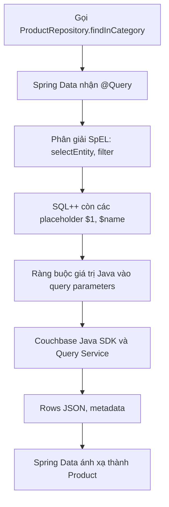

# Biểu thức SpEL và phân biệt với tham số truy vấn trong Spring Data Couchbase

> **Mục tiêu bài học:** Nhận diện ba lớp khác nhau trong một `@Query`: chuỗi truy vấn Java, biểu thức **Spring Expression Language (SpEL)** viết dạng `#{...}` và **tham số giá trị SQL++** viết dạng `$1` hoặc `$name`. Sử dụng đúng `#n1ql.selectEntity`, `#n1ql.filter`, các biến hỗ trợ keyspace, tránh đưa dữ liệu người dùng vào cấu trúc câu lệnh và giải thích được vì sao `#{[0]}` không tương đương với `$1`.

Trong module **SPRING_DATA_COUCHBASE**, Spring Data ánh xạ đối tượng Java vào document JSON trong **bucket/scope/collection** và cung cấp Repository, `CouchbaseTemplate`, API reactive cùng các cơ chế truy cập Key/Value. Khi tìm kiếm theo thuộc tính, Query Service của Couchbase thực thi **SQL++** (trước đây gọi là **N1QL**).

Trong một phương thức Repository gắn `@Query`, ta có thể thấy:

```java
@Query("#{#n1ql.selectEntity} WHERE #{#n1ql.filter} "
     + "AND category = $category "
     + "AND price <= $maxPrice")
List<Product> findByCriteria(
    @Param("category") String category,
    @Param("maxPrice") long maxPrice
);
```

Hai nhóm ký hiệu có bề ngoài gần giống nhưng có vai trò hoàn toàn khác:

| Ký hiệu | Hệ thống xử lý | Kết quả |
| --- | --- | --- |
| `#{#n1ql.selectEntity}` | Spring Data đánh giá **SpEL** | Sinh phần `SELECT ... FROM ...` cho ánh xạ entity |
| `#{#n1ql.filter}` | Spring Data đánh giá **SpEL** | Sinh điều kiện lọc kiểu document của entity |
| `$category`, `$maxPrice` | Spring Data/SDK ràng buộc **giá trị truy vấn SQL++** | Truyền chuỗi, số... mà không thay cấu trúc SQL++ |
| `@Param("category")` | Spring Data đọc annotation tham số phương thức | Liên kết tên Java với `$category` |

**Ghi nhớ ngay từ đầu:** **SpEL tạo hoặc thay thế nội dung câu truy vấn**, còn **binding SQL++ truyền giá trị cho câu truy vấn đã xác định cấu trúc**. Dùng nhầm hai kỹ thuật này có thể gây lỗi ánh xạ, logic sai hoặc mở đường cho injection.

## 1. Dữ liệu mẫu và entity để theo dõi ví dụ

Giả sử ứng dụng thương mại điện tử dùng:

| Thành phần | Giá trị |
| --- | --- |
| Bucket | `catalog` |
| Scope | `commerce` |
| Collection | `products` |
| Entity Java | `Product` |
| Repository | `ProductRepository` |

Ba document minh họa, mỗi document có ID bên ngoài JSON body.

**Document ID: `product::KB-100`**

```json
{
  "sku": "KB-100",
  "name": "Bàn phím cơ TKL",
  "category": "keyboard",
  "price": 1500000,
  "active": true,
  "specs": { "connection": "wired" },
  "tags": ["mechanical", "gaming"]
}
```

**Document ID: `product::KB-200`**

```json
{
  "sku": "KB-200",
  "name": "Bàn phím không dây",
  "category": "keyboard",
  "price": 1900000,
  "active": true,
  "specs": { "connection": "wireless" },
  "tags": ["wireless", "office"]
}
```

**Document ID: `product::MS-100`**

```json
{
  "sku": "MS-100",
  "name": "Chuột không dây",
  "category": "mouse",
  "price": 450000,
  "active": false,
  "specs": { "connection": "wireless" },
  "tags": ["wireless", "office"]
}
```

Các JSON trên chỉ minh họa **trường nghiệp vụ**. Với Spring Data Couchbase, cơ chế mapping có thể ghi thêm discriminator phân biệt kiểu, thường là trường `_class`. Nếu tự chèn các JSON thuần bằng Workbench/SDK mà không có discriminator phù hợp, truy vấn có `#{#n1ql.filter}` có thể không tìm thấy document dù `SELECT` SQL++ thuần tìm được.

Định nghĩa entity:

```java
import java.util.List;
import org.springframework.data.annotation.Id;
import org.springframework.data.couchbase.core.mapping.Document;
import org.springframework.data.couchbase.repository.Collection;
import org.springframework.data.couchbase.repository.Scope;

@Document
@Scope("commerce")
@Collection("products")
public class Product {
    @Id
    private String id;
    private String sku;
    private String name;
    private String category;
    private Long price;
    private Boolean active;
    private Specs specs;
    private List<String> tags;

    public Product() {}

    public static class Specs {
        private String connection;
        public Specs() {}
    }

    // Bổ sung constructor, getter/setter theo convention của dự án.
}
```

`@Id` ánh xạ ID của document do Couchbase quản lý, không bắt buộc có một trường `id` trong JSON body. `@Scope` và `@Collection` quy định nơi lưu tài liệu; bucket `catalog` được chọn qua cấu hình Spring Data. Chọn đúng keyspace và metadata entity là điều kiện tiên quyết cho các câu `@Query` sau.

## 2. SpEL là gì và được đánh giá ở đâu?

**Spring Expression Language** là ngôn ngữ biểu thức của hệ sinh thái Spring. Trong chuỗi `@Query`, đoạn được bọc bởi `#{...}` là phần **SpEL** mà Spring Data xử lý để thay thành nội dung của truy vấn SQL++ trước khi chuyển tới Couchbase SDK/Query Service.

Ví dụ:

```java
import java.util.List;
import org.springframework.data.couchbase.repository.CouchbaseRepository;
import org.springframework.data.couchbase.repository.Query;

public interface ProductRepository
        extends CouchbaseRepository<Product, String> {

    @Query("#{#n1ql.selectEntity} WHERE #{#n1ql.filter} "
         + "AND category = $1")
    List<Product> findInCategory(String category);
}
```

Ở đây có **hai biểu thức SpEL**: `#{#n1ql.selectEntity}` và `#{#n1ql.filter}`. Dấu `$1` trong cùng chuỗi **không thuộc SpEL**; nó là placeholder giá trị SQL++. Người gọi có thể truyền `"keyboard"` mà không sửa cấu trúc truy vấn.

### Luồng xử lý: từ Java đến Query Service



Query Service chỉ biết câu SQL++ cuối cùng và tham số đã ràng buộc; nó **không biết gì về Java annotation `@Query` hay cú pháp SpEL `#{...}`**. Vì vậy, không thể dán nguyên chuỗi `#{#n1ql.selectEntity} WHERE ...` vào Couchbase Query Workbench để chạy.

### Phân biệt ba thời điểm xử lý

1. **Thời điểm Spring Data chuẩn bị truy vấn:** phân tích chuỗi annotation, metadata entity và biểu thức SpEL.
2. **Thời điểm binding tham số:** gắn giá trị method arguments với placeholder `$1`/`$name` bằng cơ chế phù hợp.
3. **Thời điểm máy chủ thực thi:** Query Service đánh giá SQL++ trên JSON document, dùng index và trả hàng kết quả.

Đây là mô hình logic cần nắm, không phải một cam kết về từng lời gọi hàm hoặc thời điểm cache/parse nội bộ trong mọi phiên bản Spring Data.

## 3. Các biến SpEL `#n1ql` thường gặp

Spring Data Couchbase cung cấp một số giá trị đặc biệt dưới tên biến `#n1ql` trong `@Query`:

| Biểu thức | Ý nghĩa | Khi nên dùng |
| --- | --- | --- |
| `#{#n1ql.selectEntity}` | Sinh phần `SELECT ... FROM ...` đủ thông tin dựng entity (bao gồm ID và CAS) | Truy vấn trả **full entity** |
| `#{#n1ql.filter}` | Tạo điều kiện lọc discriminator của loại entity | Phần `WHERE` của truy vấn entity |
| `#{#n1ql.fields}` | Sinh danh sách trường cần thiết cho entity trong `SELECT` | Khi tự bố trí câu `SELECT/FROM` có kiểm soát |
| `#{#n1ql.bucket}` | Tên bucket tương ứng mapping, được quote làm định danh | Khi viết keyspace tường minh phù hợp API/version |
| `#{#n1ql.scope}` | Tên scope tương ứng mapping, được quote | Truy vấn cần dùng scope |
| `#{#n1ql.collection}` | Tên collection tương ứng mapping, được quote | Truy vấn cần dùng collection |

Một số phiên bản còn có biến cho truy vấn xóa/trả kết quả (chẳng hạn `#n1ql.delete`, `#n1ql.returning`); **bài này tập trung vào truy vấn đọc**. Không suy đoán rằng mọi biến SpEL của mọi phiên bản đều có cùng cách sử dụng; đối chiếu Spring Data Couchbase và Couchbase SDK đang chạy.

### Vì sao tên vẫn là `#n1ql`?

N1QL là tên cũ của ngôn ngữ truy vấn Couchbase. SQL++ là tên hiện dùng nhưng **đổi tên ngôn ngữ không có nghĩa đổi tên toàn bộ API**. Vì vậy:

```java
@Query("#{#n1ql.selectEntity} WHERE #{#n1ql.filter} "
     + "AND active = true")
List<Product> findActiveProducts();
```

là cú pháp hợp lý. Không tự thay `#n1ql` bằng `#sqlpp` trừ khi tài liệu của phiên bản đang dùng cung cấp một biến như vậy.

## 4. Dùng `selectEntity` và `filter` đúng với full entity

Để lấy các sản phẩm thuộc một danh mục và không vượt giá tối đa:

```java
import java.util.List;
import org.springframework.data.couchbase.repository.Query;
import org.springframework.data.repository.query.Param;

// Phương thức này nằm trong ProductRepository.
@Query("#{#n1ql.selectEntity} WHERE #{#n1ql.filter} "
     + "AND category = $category "
     + "AND price <= $maxPrice")
List<Product> findByCategoryAndPrice(
    @Param("category") String category,
    @Param("maxPrice") long maxPrice
);
```

Gọi:

```java
List<Product> items = repository.findByCategoryAndPrice(
    "keyboard", 1600000L
);
```

Với document mẫu, kết quả nghiệp vụ là KB-100. `$category` và `$maxPrice` được binding từ Java; Spring Data sinh phần truy vấn phù hợp với `Product` và chọn đúng collection `catalog.commerce.products` theo cấu hình.

### `selectEntity` không tương đương `SELECT *`

Trong Couchbase SQL++, `SELECT *` với alias `p` có thể trả về một object được bọc dưới khóa `p`. Một câu `SELECT p.sku, p.price` chỉ có hai field. **Cả hai đều không mặc nhiên chứa metadata mà Spring Data cần để dựng entity đầy đủ.**

```sql
-- Phép chiếu thuần: phù hợp cho kết quả tùy chỉnh hơn là full entity.
SELECT p.sku, p.price
FROM `catalog`.`commerce`.`products` AS p
WHERE p.category = "keyboard";
```

Ngược lại, `#{#n1ql.selectEntity}` tạo phép chiếu có thể bao gồm document ID, CAS và các trường mà mapper cần. Trong một ứng dụng dùng Spring Data entity, nên ưu tiên biểu thức này khi phương thức trả `List<Product>`, `Product` hoặc `Optional<Product>`.

**Không tự giả lập chính xác chuỗi SQL++ mà `selectEntity` sinh ra** nếu chưa kiểm tra version, tên trường mapping và keyspace thực tế. Alias, đường dẫn và metadata có thể khác giữa các phiên bản hoặc cấu hình scope/collection.

### `filter` không phải phép thay thế cho điều kiện nghiệp vụ

`#{#n1ql.filter}` phục vụ **type discriminator**, chẳng hạn xác định document nào thuộc loại entity `Product` trong collection dùng chung. Nó không tự lọc `category`, `price`, `active` hay quyền truy cập của người dùng.

Đây là lý do mẫu phổ biến có cấu trúc:

```java
@Query("#{#n1ql.selectEntity} WHERE #{#n1ql.filter} "
     + "AND active = true")
List<Product> findAvailable();
```

`WHERE` được viết **một lần**, sau đó kết hợp điều kiện loại entity và điều kiện nghiệp vụ bằng `AND`. Nếu bỏ `WHERE`, đặt `AND` sai vị trí hoặc dùng `#{#n1ql.filter}` bên ngoài `WHERE`, câu SQL++ cuối cùng có thể sai cú pháp.

Đặc biệt, nếu Spring Data dùng `_class` để nhận diện loại document thì việc một JSON không có `_class` có thể khiến truy vấn `filter` không tìm thấy document, ngay cả khi tất cả trường nghiệp vụ đều khớp.

### `#n1ql.bucket`, `scope`, `collection` dùng để làm gì?

Với một câu SQL++ tự viết, đường dẫn collection có dạng:

```sql
SELECT p.sku
FROM `catalog`.`commerce`.`products` AS p
WHERE p.active = true;
```

Các biến SpEL về bucket/scope/collection lấy **định danh từ metadata Spring Data**, thay vì cố định trực tiếp tên trong mã. Tuy nhiên, cách ghép thành đường dẫn `FROM` còn phụ thuộc query context và quy tắc keyspace của phiên bản; không nên tự giả định `#n1ql.bucket` luôn là tên đầy đủ của collection. Khi trả về full entity, **`#n1ql.selectEntity` là lựa chọn đơn giản và an toàn hơn** so với tự ghép `fields`, `bucket`, `scope`, `collection`.

Nếu tự định nghĩa câu `SELECT/FROM` vì projection đặc biệt, cần kiểm tra:

- Định danh bucket/scope/collection được resolve đúng với entity và cấu hình.
- Các định danh được quote đúng; backtick của SQL++ không giống dấu nháy dùng cho chuỗi giá trị.
- Phép chiếu phù hợp với kiểu Java trả về và có metadata khi cần full entity.
- Discriminator được áp dụng khi collection chứa nhiều loại document.

## 5. Binding giá trị: `$1` và `$name` không phải SpEL

Với cùng một mục tiêu nghiệp vụ, có thể dùng một trong hai kiểu binding:

```java
// Vị trí: $1 là tham số đầu tiên, $2 là tham số thứ hai.
@Query("#{#n1ql.selectEntity} WHERE #{#n1ql.filter} "
     + "AND category = $1 AND price <= $2")
List<Product> findByPosition(String category, long maxPrice);

// Có tên: placeholder được nối với @Param.
@Query("#{#n1ql.selectEntity} WHERE #{#n1ql.filter} "
     + "AND category = $category AND price <= $maxPrice")
List<Product> findByName(
    @Param("category") String category,
    @Param("maxPrice") long maxPrice
);
```

| Đặc điểm | SpEL `#{...}` | Parameter `$1` hoặc `$name` |
| --- | --- | --- |
| Thực chất | Biểu thức Spring được đánh giá để sinh/chèn nội dung truy vấn | Placeholder giá trị của SQL++ |
| Phạm vi sử dụng | Metadata entity, các biểu thức Spring được hỗ trợ | Giá trị chuỗi, số, Boolean, array, giá trị tham số khác |
| Thời điểm xử lý | Spring Data chuẩn bị câu lệnh | Spring Data/SDK gắn giá trị để thực thi |
| Có thể làm thay đổi cấu trúc SQL++? | **Có thể**, do chèn nội dung biểu thức | **Không**, nếu dùng đúng binding |
| Khi truyền dữ liệu người dùng | Không nên dùng để chèn trực tiếp vào cú pháp | **Nên dùng** cho các giá trị |
| Tên biến từ lịch sử API | `#n1ql` | `$1`/`$name` là cú pháp placeholder SQL++ |

**Không đặt placeholder trong dấu nháy:**

```java
// Sai: "$category" trở thành một literal, không còn là placeholder giá trị.
@Query("#{#n1ql.selectEntity} WHERE #{#n1ql.filter} "
     + "AND category = '$category'")
List<Product> wrongQuotedParameter(@Param("category") String category);

// Đúng: binder tự xử lý chuỗi "keyboard", ký tự nháy và loại dữ liệu.
@Query("#{#n1ql.selectEntity} WHERE #{#n1ql.filter} "
     + "AND category = $category")
List<Product> correctParameter(@Param("category") String category);
```

### Nhiều tham số

```java
@Query("#{#n1ql.selectEntity} WHERE #{#n1ql.filter} "
     + "AND category = $category "
     + "AND active = $enabled "
     + "AND price >= $minimum "
     + "AND price <= $maximum")
List<Product> findWithRange(
    @Param("category") String category,
    @Param("enabled") boolean enabled,
    @Param("minimum") long minPrice,
    @Param("maximum") long maxPrice
);
```

Trong trường hợp này, đặt tên giúp đọc điều kiện dễ hơn là sử dụng `$1`, `$2`, `$3`, `$4`. Tên trong `@Param("minimum")` phải khớp `$minimum` trong chuỗi SQL++; tên biến Java `minPrice` không bắt buộc phải trùng với tên đó.

Tài liệu Spring Data Couchbase khuyến cáo không **pha trộn placeholder vị trí và placeholder có tên trong cùng một câu query**. Việc có SpEL và một kiểu placeholder SQL++ trong cùng một câu query là bình thường; đó **không phải** sự pha trộn hai kiểu parameter binding.

### Truyền array vào `IN`

```java
@Query("#{#n1ql.selectEntity} WHERE #{#n1ql.filter} "
     + "AND category IN $categories")
List<Product> findInCategories(
    @Param("categories") List<String> categories
);
```

```java
List<Product> result = repository.findInCategories(
    List.of("keyboard", "mouse")
);
```

Danh sách được truyền như một **giá trị dạng array**, không cần tạo chuỗi `'keyboard','mouse'` bằng phép nối. Bộ lọc trả về KB-100, KB-200, MS-100 trong dữ liệu mẫu. Với danh sách rỗng, `IN []` không khớp bản ghi; ứng dụng phải xác định rõ liệu rỗng nghĩa là “không chọn gì” hay “không áp dụng bộ lọc”.

## 6. Trường hợp nâng cao: SpEL `#{[0]}` và placeholder `$2`

Trong một số phiên bản tài liệu Spring Data Couchbase, ta gặp ví dụ:

```java
@Query("#{#n1ql.selectEntity} WHERE #{#n1ql.filter} "
     + "AND #{[0]} = $2")
List<Product> findByTrustedField(String fieldName, Object expectedValue);
```

Biểu thức này **không tương đương** với:

```java
@Query("#{#n1ql.selectEntity} WHERE #{#n1ql.filter} "
     + "AND $1 = $2")
List<Product> findByTwoValues(String firstValue, Object secondValue);
```

Hai dòng khác nhau về bản chất:

- **`#{[0]}`**: biểu thức SpEL lấy đối số phương thức Java ở **chỉ số 0** (tức `fieldName`) để chèn vào **văn bản truy vấn** khi Spring Data đánh giá SpEL.
- **`$2`**: placeholder giá trị SQL++ nhận đối số Java **thứ hai** (tức `expectedValue`).
- **`$1`**: placeholder nhận **giá trị** của đối số đầu tiên; nó **không được hiểu là tên trường JSON**.

Đó là một khác biệt quan trọng giữa **chỉ số đối số SpEL** và **số thứ tự placeholder SQL++**:

| Tham chiếu | Chỉ số/đếm từ đâu? | Giá trị trong ví dụ |
| --- | --- | --- |
| `#{[0]}` | SpEL truy cập danh sách đối số **bắt đầu từ 0** | `fieldName` |
| `#{[1]}` | SpEL truy cập đối số thứ hai | `expectedValue` |
| `$1` | Tham số SQL++ theo vị trí **bắt đầu từ 1** | Giá trị Java thứ nhất |
| `$2` | Tham số SQL++ theo vị trí **bắt đầu từ 1** | Giá trị Java thứ hai |

### Tại sao mẫu `#{[0]} = $2` cần đặc biệt thận trọng?

Nếu truyền `fieldName = "category"`, kết quả sau khi đánh giá SpEL có thể trở thành điều kiện `category = $2`. Nhưng nếu `fieldName` lấy trực tiếp từ HTTP query parameter hoặc đầu vào không đáng tin cậy, người dùng có thể tác động vào **cú pháp SQL++**, vì `#{[0]}` không phải cơ chế binding giá trị an toàn.

Do đó, không đưa trực tiếp một chuỗi do người dùng nhập vào vị trí dùng để sinh trường, toán tử, `ORDER BY`, đường dẫn collection hoặc biểu thức `WHERE`. Dù vẫn binding đúng `$2`, toàn bộ câu truy vấn có thể không an toàn nếu phần `#{[0]}` không được kiểm soát.

### Ví dụ giới hạn tập trường trước khi dùng SpEL động

Ở tầng service, chỉ chấp nhận một tập trường định trước:

```java
public enum ProductSearchField {
    CATEGORY,
    SKU
}

public final class ProductQueryFields {
    private ProductQueryFields() {}

    public static String toSqlppField(ProductSearchField field) {
        return switch (field) {
            case CATEGORY -> "category";
            case SKU -> "sku";
        };
    }
}
```

Sau đó:

```java
String field = ProductQueryFields.toSqlppField(
    ProductSearchField.CATEGORY
);

// field chỉ có thể là một trong các hằng định danh đã kiểm soát.
List<Product> matches = repository.findByTrustedField(
    field, "keyboard"
);
```

Mẫu trên dùng `switch` của Java hiện đại để ánh xạ **enum tin cậy → định danh cố định**. Ngay cả khi API của người dùng nhận một tên trường dạng chuỗi, cần chuyển nó qua tập cho phép trước khi đưa vào biểu thức sinh cú pháp. Không có nhánh “trường nào cũng được” và không nối phần SQL++ tùy ý từ request.

**Với số lượng trường tìm kiếm cố định và ít**, một lựa chọn đơn giản hơn là định nghĩa hai phương thức tĩnh như `findByCategory(...)` và `findBySku(...)`, mỗi phương thức có `@Query` riêng hoặc dùng derived query. Không cần SpEL động chỉ để tiết kiệm một vài dòng mã.

### Phân biệt `#{[0]}` với `@Param` và tham số có tên

Giả sử phương thức:

```java
@Query("#{#n1ql.selectEntity} WHERE #{#n1ql.filter} "
     + "AND category = $category")
List<Product> byCategory(@Param("category") String category);
```

Đây là **binding giá trị**; chuỗi `"keyboard"` dù chứa dấu nháy hoặc các ký tự đặc biệt vẫn là một giá trị chuỗi SQL++. Trong khi đó, `#{[0]}` là **nội suy kết quả biểu thức SpEL vào văn bản SQL++**. Với tên trường do người dùng quyết định, kỹ thuật thứ hai đòi hỏi biện pháp kiểm soát độc lập.

## 7. Khi nào kết hợp SpEL và parameter binding trong cùng `@Query`?

Đây là mẫu **nên dùng** và rất phổ biến:

```java
@Query("#{#n1ql.selectEntity} WHERE #{#n1ql.filter} "
     + "AND active = $enabled "
     + "AND specs.connection = $connection")
List<Product> findActiveByConnection(
    @Param("enabled") boolean enabled,
    @Param("connection") String connection
);
```

Gọi `findActiveByConnection(true, "wireless")` lấy KB-200; MS-100 bị loại vì `active = false`.

Trong cùng câu query:

1. SpEL `selectEntity` sinh phép chiếu/keyspace theo entity.
2. SpEL `filter` sinh điều kiện phân biệt kiểu document.
3. `$enabled` nhận giá trị Boolean.
4. `$connection` nhận giá trị chuỗi.
5. SQL++ xử lý đường dẫn object lồng nhau `specs.connection`.

**Lưu ý:** dùng SpEL cùng placeholder có tên hoặc vị trí **được phép**; hạn chế là **không trộn placeholder có tên và placeholder vị trí** trong cùng một `@Query` ở các phiên bản được tài liệu hóa.

### Mảng JSON: SpEL không thay cho `ANY`

`ANY` là cú pháp SQL++ để kiểm tra một phần tử mảng thỏa điều kiện. Biểu thức SpEL không cần thiết để duyệt mảng:

```java
@Query("#{#n1ql.selectEntity} WHERE #{#n1ql.filter} "
     + "AND active = true "
     + "AND ANY t IN tags SATISFIES t = $tag END")
List<Product> findActiveWithTag(@Param("tag") String tag);
```

Gọi `findActiveWithTag("wireless")` trả KB-200. Trong biểu thức `ANY t IN tags ...`, `t` là biến cục bộ **của SQL++**, không phải biến SpEL; `$tag` là tham số giá trị được binding từ Java.

Không viết một đoạn SpEL để tự thay thế tên mảng hoặc toàn bộ điều kiện `SATISFIES` chỉ vì bộ lọc nhận dữ liệu từ người dùng. Khi cấu trúc SQL++ đã cố định, hãy giữ toàn bộ điều kiện trong query và chỉ binding những giá trị cần tìm.

### `NULL` và `MISSING` cũng không được giải quyết bằng SpEL

Ví dụ điều kiện tìm document chưa có trường `discount`:

```java
@Query("#{#n1ql.selectEntity} WHERE #{#n1ql.filter} "
     + "AND discount IS MISSING")
List<Product> findMissingDiscount();
```

`MISSING` là trạng thái JSON **không có trường**; Java `null` khi binding (trong những API chấp nhận null) biểu diễn `NULL`, **không biến thành điều kiện `IS MISSING`**. Nếu muốn phân biệt:

```sql
-- Document có trường discount chứa giá trị null:
WHERE discount IS NULL

-- Document hoàn toàn không có trường discount:
WHERE discount IS MISSING

-- Có trường discount và giá trị khác cả NULL và MISSING:
WHERE discount IS VALUED
```

Những điều kiện này thuộc về **SQL++**, không phải SpEL. Nếu một bộ lọc có thể áp dụng hoặc bỏ qua tùy lựa chọn người dùng, cân nhắc các phương thức Repository riêng hoặc cách xây điều kiện động ở `CouchbaseTemplate` phù hợp với phiên bản, thay vì dùng SpEL để nối cú pháp không kiểm soát.

## 8. Vì sao SpEL không được dùng để “binding an toàn” giá trị người dùng?

Một cách viết nguy hiểm về mặt ý tưởng là nội suy trực tiếp giá trị do người dùng gửi:

```java
// KHÔNG khuyến nghị: đưa giá trị bên ngoài thành văn bản câu SQL++.
@Query("#{#n1ql.selectEntity} WHERE #{#n1ql.filter} "
     + "AND category = '#{[0]}'")
List<Product> unsafeCategory(String userSuppliedCategory);
```

Câu truy vấn trên có thể tạo văn bản SQL++ phụ thuộc nội dung của đối số. Nó không tương đương binding một chuỗi đã được SDK xử lý đúng kiểu; các dấu nháy hay ký tự có ý nghĩa đặc biệt có thể tác động cú pháp hoặc khiến query lỗi.

**Cách viết đúng khi giá trị thay đổi theo request:**

```java
@Query("#{#n1ql.selectEntity} WHERE #{#n1ql.filter} "
     + "AND category = $1")
List<Product> safeCategory(String category);
```

Nếu category được truyền là một chuỗi chứa dấu nháy, dấu chấm phẩy hoặc ký tự lạ, nó vẫn là một **giá trị chuỗi** thay vì một đoạn cú pháp. Parameter binding là biện pháp nền tảng giảm rủi ro SQL++ injection.

**Nhưng binding không tự giải quyết mọi loại tấn công logic:** ví dụ tham số `LIKE` nhận mẫu `"%"` thì `%` vẫn là wildcard SQL++ có thể khớp rất rộng. Với yêu cầu tìm theo tiền tố đúng nghĩa, cần xử lý/escape wildcard, giới hạn độ dài tìm kiếm và lựa chọn chỉ mục phù hợp.

### Đối chiếu với `@Query` của JPA

Các ví dụ trong bài dùng:

```java
import org.springframework.data.couchbase.repository.Query;
import org.springframework.data.repository.query.Param;
```

Không dùng `org.springframework.data.jpa.repository.Query` chỉ vì annotation có cùng tên. Một số ví dụ JPA dùng ký pháp `:name` hoặc `?1`; cú pháp placeholder SQL++ của Spring Data Couchbase trong bài là **`$name` và `$1`**. Hãy theo đúng tài liệu của module và phiên bản, tránh sao chép nguyên một truy vấn JPA sang Couchbase.

## 9. SpEL, entity mapping và các loại kết quả truy vấn

Một phương thức có kiểu trả về `List<Product>` thường cần khôi phục một **entity document đầy đủ**, bao gồm metadata để theo dõi document ID và CAS. Vì thế `#{#n1ql.selectEntity}` phù hợp với:

```java
@Query("#{#n1ql.selectEntity} WHERE #{#n1ql.filter} "
     + "AND category = $1")
List<Product> findFullEntities(String category);
```

Ngược lại, một báo cáo:

```sql
SELECT p.category AS category,
       COUNT(*) AS productCount
FROM `catalog`.`commerce`.`products` AS p
GROUP BY p.category;
```

trả về **một hàng thống kê cho mỗi danh mục**, không phải một document `Product`. Ghép `#{#n1ql.selectEntity}` vào phần `SELECT COUNT(*)` sẽ làm sai mục đích và có thể tạo câu SQL++ không hợp lệ.

| Loại kết quả | Phép chiếu thích hợp | Kiểu Java phù hợp |
| --- | --- | --- |
| Toàn bộ document sản phẩm | `#{#n1ql.selectEntity}` và `WHERE #{#n1ql.filter}` | `Product`, `List<Product>`, `Optional<Product>` |
| Một vài thuộc tính | `SELECT p.sku, p.name` với alias đúng | Projection/DTO được hỗ trợ bởi version, hoặc map thủ công |
| Tổng hợp nhiều nhóm | `SELECT p.category, COUNT(*) ... GROUP BY ...` | Projection/DTO báo cáo hoặc JSON row từ SDK |
| Một giá trị aggregate | `SELECT RAW COUNT(*) ...` hoặc phép chiếu phù hợp API | Kiểu số đơn giản, sau khi xác minh mapping |

Với Spring Data Couchbase, khả năng tự ánh xạ DTO/projection từ `@Query` có thể khác theo version. Hãy thử trực tiếp với converter hiện dùng; nếu không khớp hình dạng kết quả, dùng API SDK để đọc JSON row và map DTO rõ ràng. **SpEL không tự chuyển một phép chiếu thiếu field thành entity đầy đủ.**

### Mối liên hệ với TTL, CAS và optimistic locking

Document ID, CAS và expiry (TTL) do Couchbase quản lý ngoài một số trường nghiệp vụ JSON. `#n1ql.selectEntity` cung cấp phép chiếu phù hợp với metadata mà entity mapping cần. Tuy nhiên, **nhận CAS trong kết quả không đồng nghĩa truy vấn `@Query` tự cung cấp cập nhật có kiểm soát xung đột**.

- **CAS** phục vụ phát hiện version cũ trong cập nhật đồng thời; hành vi lưu cần đúng cơ chế optimistic locking.
- **TTL** quy định thời hạn sống document, ảnh hưởng tài liệu nào còn tồn tại và xuất hiện trong kết quả.
- **Transactions** quy định ranh giới nhóm thao tác; một `@Query` tìm kiếm không tự tạo giao dịch nhiều bước.

SpEL là kỹ thuật dựng truy vấn; nó **không thay thế** các cơ chế nhất quán hay đồng thời của Couchbase. Đối với một document đã biết ID, API Key/Value như `findById(id)` vẫn thường phù hợp hơn truy vấn SQL++ để tìm lại đúng document đó.

## 10. Sắp xếp, phân trang và các biểu thức động

Trong câu SQL++ cố định, truyền `LIMIT` và `OFFSET` bằng placeholder giá trị là cách tiếp cận hợp lý:

```java
@Query("#{#n1ql.selectEntity} WHERE #{#n1ql.filter} "
     + "AND category = $category "
     + "ORDER BY sku ASC "
     + "LIMIT $pageSize OFFSET $startAt")
List<Product> findPageByCategory(
    @Param("category") String category,
    @Param("pageSize") long pageSize,
    @Param("startAt") long startAt
);
```

Ở đây `$pageSize` và `$startAt` là **giá trị số**, nên có thể binding. Tầng service phải bảo đảm giới hạn hợp lệ (`pageSize > 0`, giới hạn tối đa và `startAt >= 0`). `ORDER BY sku ASC` tạo thứ tự có ý nghĩa; nếu `sku` không duy nhất thì cần khóa sắp xếp phụ.

Trái lại, không thể binding hướng sắp xếp thành `ORDER BY sku $direction` rồi chờ `$direction = "DESC"` trở thành từ khóa `DESC`. Đây là vấn đề **cú pháp**, không phải giá trị:

```sql
-- Không đúng ý nghĩa dynamic ORDER BY.
ORDER BY sku $direction
```

Nếu chỉ cho phép `price` hoặc `sku` và `ASC`/`DESC`, lập danh sách lựa chọn cố định tại tầng ứng dụng, sau đó chọn một truy vấn tĩnh phù hợp hoặc dùng API `Sort/Pageable` đúng phiên bản Spring Data. Không dùng SpEL để chèn nguyên chuỗi `ORDER BY` do người dùng cung cấp.

**Chú ý về `Pageable`:** phương thức `@Query` có `LIMIT/OFFSET` tự khai báo là phân trang thủ công. Khi kết hợp tham số đặc biệt `Pageable`/`Sort`, cần xác minh cách Spring Data tự áp dụng phân trang/sắp xếp trong phiên bản dự án; tránh cộng hai cơ chế làm sai vị trí các hàng.

## 11. Chỉ mục và độ mới dữ liệu: SpEL không quyết định hiệu năng

SpEL `selectEntity`/`filter` giúp sinh câu query đúng mapping, còn việc **lọc nhanh hay chậm** vẫn phụ thuộc index và điều kiện SQL++ sau khi các biểu thức được thay thế.

Với truy vấn `category = $category AND price <= $maxPrice`, có thể đánh giá một chỉ mục thứ cấp:

```sql
CREATE INDEX idx_products_category_price
ON `catalog`.`commerce`.`products`(category, price);
```

Kiểm tra kế hoạch:

```sql
EXPLAIN
SELECT p.sku, p.category, p.price
FROM `catalog`.`commerce`.`products` AS p
WHERE p.category = "keyboard"
  AND p.price <= 1600000;
```

**Chỉ mục trên là ví dụ**, không phải cấu hình tối ưu cho mọi workload. Khi đo query thật của Repository, cần tính đến các điều kiện do `#n1ql.filter` thêm vào, phép chiếu từ `#n1ql.selectEntity`, `ORDER BY`, độ chọn lọc dữ liệu và truy vấn mảng cần array index. Câu `EXPLAIN` dùng phép chiếu thuần ở trên có thể cho kế hoạch khác truy vấn được Spring Data sinh ra đầy đủ.

### `NOT_BOUNDED` và `REQUEST_PLUS`

Sau khi ứng dụng lưu một document bằng Key/Value, chỉ mục phục vụ SQL++ có thể chưa phản ánh ghi mới ngay lập tức:

```java
repository.save(product);
repository.findById(productId);          // Thường đọc qua KV.
repository.findInCategory("keyboard");  // Query/Index Service.
```

Với scan consistency `NOT_BOUNDED`, `@Query` có thể tạm thời chưa nhìn thấy document vừa lưu. `REQUEST_PLUS` yêu cầu đợi index bắt kịp các ghi trước thời điểm truy vấn, đổi lại có thể tăng độ trễ. Các lựa chọn này thuộc cơ chế scan consistency của SDK/Spring Data; **không phải tác dụng của SpEL hay placeholder binding**.

Nếu luồng nghiệp vụ cần read-after-write theo ID, ưu tiên API KV phù hợp. Nếu cần tìm mới theo thuộc tính, lựa chọn scan consistency theo SLA của ứng dụng. Bảng báo cáo có thể chấp nhận độ trễ nhỏ; quy trình kiểm soát tồn kho hoặc quyền truy cập có thể đòi hỏi cách xử lý nhất quán khác.

### Reactive API vẫn giữ nguyên ranh giới

`ReactiveCouchbaseRepository` dùng `Flux`/`Mono` cho kết quả reactive:

```java
import reactor.core.publisher.Flux;
import org.springframework.data.couchbase.repository.Query;
import org.springframework.data.couchbase.repository.ReactiveCouchbaseRepository;
import org.springframework.data.repository.query.Param;

public interface ReactiveProductRepository
        extends ReactiveCouchbaseRepository<Product, String> {

    @Query("#{#n1ql.selectEntity} WHERE #{#n1ql.filter} "
         + "AND category = $category AND active = $enabled")
    Flux<Product> findMatching(
        @Param("category") String category,
        @Param("enabled") boolean enabled
    );
}
```

SpEL và placeholder SQL++ mang **cùng ý nghĩa** trong reactive repository. Sự khác biệt nằm ở cách lập trình luồng, không phải cách sinh `SELECT` hoặc binding giá trị. Reactive cũng không tự tạo index hay đảm bảo rằng các ghi trước đó đã xuất hiện trong Query Service.

## 12. Lỗi thường gặp và cách chẩn đoán

| Hiện tượng | Nguyên nhân thường gặp | Cách khắc phục |
| --- | --- | --- |
| Workbench báo lỗi khi dán `#{#n1ql.selectEntity}` | Workbench hiểu SQL++, không hiểu SpEL | Chạy câu SQL++ thuần; để Spring Data phân giải SpEL trong `@Query` |
| `@Query` khai báo nhưng không được nhận | Import annotation của JPA hoặc thư viện khác | Dùng `org.springframework.data.couchbase.repository.Query` |
| Không tìm thấy tham số `$category` | Thiếu hoặc sai tên trong `@Param` | Đối chiếu `$category` với `@Param("category")` |
| `WHERE name = '$name'` trả kết quả bất ngờ | Placeholder nằm trong dấu nháy | Viết `name = $name` để binder gắn giá trị |
| Nhầm `#{[0]}` với `$1` | SpEL đánh chỉ số từ 0, placeholder vị trí từ 1 | Kiểm tra vai trò sinh cú pháp và vai trò binding giá trị |
| Truyền thẳng tên trường từ HTTP vào `#{[0]}` | Nội suy vào văn bản SQL++ có thể không an toàn | Whitelist trường, toán tử và cấu trúc; ưu tiên query tĩnh |
| Trộn `$1` với `$category` trong một query | Hai kiểu placeholder không nên pha trộn | Chọn một kiểu binding theo vị trí hoặc tên |
| Entity bị thiếu ID hoặc CAS | Dùng `SELECT *` hay phép chiếu thiếu metadata | Dùng `#n1ql.selectEntity` khi trả về full entity |
| Workbench tìm được document nhưng Repository không tìm thấy | `#n1ql.filter` lọc theo discriminator, hoặc sai keyspace | Kiểm tra dữ liệu được Spring Data lưu và mapping collection |
| Dùng `#n1ql.bucket` nhưng truy vấn không đúng collection | Bucket không đồng nghĩa với đường dẫn scope/collection đầy đủ | Kiểm tra query context và đường dẫn; ưu tiên `selectEntity` |
| Một truy vấn báo cáo `COUNT` không ánh xạ được `Product` | Hàng aggregate không phải entity document | Dùng kiểu số/projection/DTO hoặc SDK JSON row phù hợp |
| `LIKE` có tham số nhưng vẫn khớp quá nhiều | `%` và `_` vẫn là wildcard trong giá trị mẫu | Escape mẫu khi cần tìm literal; cân nhắc Search Service |
| Truy vấn có điều kiện đúng nhưng chậm | Chỉ mục chưa phù hợp hoặc thiếu index mảng | Dùng `EXPLAIN` trên câu SQL++ thực tế |
| Vừa lưu mà `@Query` chưa tìm thấy | Chỉ mục Query Service cập nhật bất đồng bộ | Đọc KV theo ID hoặc cân nhắc `REQUEST_PLUS` |
| `#n1ql.filter` được xem như kiểm tra quyền | Type discriminator không phải cơ chế authorization | Kiểm soát quyền theo tenant/người dùng ở thiết kế truy vấn và hệ thống |

### Quy trình rà soát từng lớp

Khi một phương thức `@Query` không trả kết quả mong đợi, hãy phân tách vấn đề:

1. **Metadata và keyspace:** xác minh bucket, scope, collection, entity mapping, ID và type discriminator.
2. **SpEL:** kiểm tra `#{#n1ql.selectEntity}` có ở đầu truy vấn entity, `WHERE #{#n1ql.filter}` có đúng vị trí không và có đoạn `#{...}` nào chèn cú pháp từ đối số người dùng không.
3. **Parameter binding:** kiểm tra `$1`/`$2`, `@Param`, tên placeholder, thứ tự đối số và kiểu dữ liệu.
4. **SQL++ sau khi dựng:** xem câu query được sinh ra bằng logging/tracing có kiểm soát, hoặc thử một câu SQL++ thuần tương đương với dữ liệu mẫu trong Workbench.
5. **Mapping kết quả:** liệu phương thức trả entity, projection, hàng aggregate hay một kiểu số đơn giản?
6. **Vận hành:** chỉ mục, `EXPLAIN`, scan consistency, độ trễ và kích thước kết quả.

Không bật logging nhạy cảm một cách tùy tiện; các tham số giá trị có thể chứa dữ liệu người dùng hoặc thông tin riêng tư. Chỉ ghi thông tin được phép và ẩn các giá trị nhạy cảm khi chẩn đoán.

## 13. Bài thực hành và đáp án

Giả sử các document mẫu ở phần 1 đã được lưu bằng Spring Data và một secondary index phù hợp đã được tạo.

### Bài 1 — Xác định đâu là SpEL, đâu là tham số SQL++

Cho phương thức:

```java
@Query("#{#n1ql.selectEntity} WHERE #{#n1ql.filter} "
     + "AND category = $category AND price <= $maxPrice")
List<Product> search(
    @Param("category") String category,
    @Param("maxPrice") long maxPrice
);
```

**Yêu cầu:** Phân loại bốn thành phần.

**Đáp án:** `#{#n1ql.selectEntity}` và `#{#n1ql.filter}` là SpEL để sinh cú pháp truy vấn và điều kiện kiểu entity. `$category` và `$maxPrice` là tham số giá trị SQL++; chúng được binding theo hai annotation `@Param`.

### Bài 2 — Chuyển tham số vị trí thành tham số có tên

Ban đầu:

```java
@Query("#{#n1ql.selectEntity} WHERE #{#n1ql.filter} "
     + "AND category = $1 AND price <= $2")
List<Product> original(String category, long limitPrice);
```

**Đáp án tham khảo:**

```java
@Query("#{#n1ql.selectEntity} WHERE #{#n1ql.filter} "
     + "AND category = $category AND price <= $maxPrice")
List<Product> converted(
    @Param("category") String category,
    @Param("maxPrice") long limitPrice
);
```

Khi gọi `converted("keyboard", 1600000)`, kết quả nghiệp vụ là KB-100. `limitPrice` là tên biến Java; `maxPrice` là tên binding xác định bởi `@Param`.

### Bài 3 — Vì sao `#{[0]}` và `$1` không hoán đổi được?

Cho:

```java
@Query("#{#n1ql.selectEntity} WHERE #{#n1ql.filter} "
     + "AND #{[0]} = $2")
List<Product> dynamicField(String field, Object expected);
```

Nếu `field = "category"` và `expected = "keyboard"`:

- `#{[0]}` là SpEL, chèn **định danh trường** vào văn bản truy vấn.
- `$2` là tham số SQL++, binding **giá trị** `"keyboard"`.
- `$1` nếu dùng sẽ binding chuỗi `"category"` như một **giá trị**, không biến nó thành tên field.

**Đáp án an toàn:** không nhận trực tiếp `field` chưa kiểm soát từ request; chuyển lựa chọn trường qua enum/whitelist, hoặc tạo riêng các phương thức cho từng trường được phép.

### Bài 4 — Sửa một `@Query` có nguy cơ injection

Đoạn cần sửa:

```java
@Query("#{#n1ql.selectEntity} WHERE #{#n1ql.filter} "
     + "AND category = '#{[0]}'")
List<Product> unsafeByCategory(String category);
```

**Đáp án:**

```java
@Query("#{#n1ql.selectEntity} WHERE #{#n1ql.filter} "
     + "AND category = $1")
List<Product> safeByCategory(String category);
```

Giá trị đầu vào phải được binding, không phải nội suy thành nội dung một literal SQL++ bằng SpEL.

### Bài 5 — Dự đoán kết quả truy vấn mảng

```java
@Query("#{#n1ql.selectEntity} WHERE #{#n1ql.filter} "
     + "AND active = true "
     + "AND ANY tag IN tags SATISFIES tag = $tag END")
List<Product> activeWithTag(@Param("tag") String tag);
```

Gọi `activeWithTag("wireless")`.

**Đáp án:** KB-200. MS-100 cũng chứa tag `wireless` nhưng không thỏa điều kiện `active = true`. `ANY` là cú pháp SQL++ xử lý mảng, không phải SpEL.

### Bài 6 — Chọn cách xây dynamic sorting

API HTTP cho phép `sortBy = "price"` hoặc `sortBy = "sku"`. Có nên ghép trực tiếp chuỗi `sortBy` vào `#{[0]}` hoặc `ORDER BY`?

**Đáp án:** Không. Dùng enum hoặc danh sách cho phép để biến giá trị request thành một trong hai định danh đã kiểm soát, rồi dùng query tĩnh hoặc API `Sort`/`Pageable` đã được Spring Data hỗ trợ. Với `category`, `priceLimit` và những dữ liệu cần so sánh, vẫn sử dụng binding `$name` hay `$1`.

### Bài 7 — Truy vấn theo ID hay theo thuộc tính sau khi ghi?

Vừa lưu sản phẩm vào Couchbase. Ứng dụng cần đọc lại **đúng ID vừa lưu** và sau đó cập nhật một dashboard tìm theo category.

**Đáp án:** Với ID đã biết, đọc theo Key/Value, ví dụ `findById(id)`. Dashboard dùng SQL++/Query Service và chỉ mục, nên cân nhắc scan consistency nếu cần thấy ghi mới ngay. SpEL và tham số ràng buộc không làm index tự đồng bộ tức thời.

### Bài 8 — Phân biệt phép chiếu entity với báo cáo

Truy vấn:

```sql
SELECT p.category AS category,
       COUNT(*) AS total
FROM `catalog`.`commerce`.`products` AS p
GROUP BY p.category;
```

Nên trả về `List<Product>` và dùng `#{#n1ql.selectEntity}` hay một kiểu dữ liệu báo cáo?

**Đáp án:** Dùng projection/DTO báo cáo hoặc đọc JSON row bằng SDK. Mỗi hàng không còn là một document `Product`, không có metadata ID/CAS riêng của sản phẩm; `selectEntity` không làm một hàng tổng hợp trở thành full entity.

## 14. Câu hỏi tự kiểm tra

1. **SpEL trong `@Query` được nhận diện thế nào?** Bằng dấu `#{...}` và được Spring Data đánh giá trước khi SQL++ thực thi.
2. **`$category` có phải một biểu thức SpEL không?** Không, đó là placeholder giá trị SQL++.
3. **Vì sao dùng `#{#n1ql.selectEntity}` khi trả về `Product`?** Để có phần `SELECT/FROM` và metadata thích hợp cho việc dựng full entity.
4. **`#{#n1ql.filter}` có thay kiểm tra quyền truy cập người dùng không?** Không; nó lọc kiểu entity/discriminator, không tự kiểm soát authorization.
5. **Vì sao `#{[0]}` có thể nguy hiểm?** Kết quả SpEL được chèn vào văn bản truy vấn, nên đối số không tin cậy có thể làm thay đổi cấu trúc SQL++.
6. **`#{[0]}` tương ứng tham số Java nào?** Tham số đầu tiên (SpEL đánh số từ 0).
7. **`$2` tương ứng tham số Java nào?** Tham số thứ hai (placeholder vị trí SQL++ đánh số từ 1).
8. **Có thể kết hợp SpEL và `$name` trong một câu `@Query` không?** Có; đây là hai lớp xử lý khác nhau.
9. **Có nên trộn `$1` và `$name` trong một câu query?** Không; chọn một cơ chế binding tham số SQL++ nhất quán.
10. **SpEL có giúp query tự dùng index và thấy ngay ghi mới không?** Không. Đó là các mối quan tâm về index và scan consistency của Couchbase.

## Tài liệu tham khảo chính thức

- [Spring Data Couchbase — Repositories (5.5)](https://docs.spring.io/spring-data/couchbase/reference/5.5/couchbase/repository.html): `@Query`, SpEL `#n1ql`, placeholder vị trí/có tên và ví dụ kết hợp `#{[0]}` với `$2`.
- [Spring Data Couchbase — API StringBasedN1qlQueryParser](https://docs.spring.io/spring-data/couchbase/reference/api/java/org/springframework/data/couchbase/repository/query/StringBasedN1qlQueryParser.html): ý nghĩa các biến SpEL dành cho entity, keyspace và điều kiện.
- [Spring Data Couchbase — Query Annotation API](https://docs.spring.io/spring-data/couchbase/docs/current/api/org/springframework/data/couchbase/repository/Query.html): annotation `@Query` và các thuộc tính liên quan.
- [Couchbase Java SDK — SQL++ Queries](https://docs.couchbase.com/java-sdk/current/howtos/n1ql-queries-with-sdk.html): truyền tham số và thực thi SQL++ từ Java.
- [Couchbase SQL++ — SELECT](https://docs.couchbase.com/server/current/n1ql/n1ql-language-reference/selectintro.html): truy vấn JSON, `WHERE`, `ORDER BY` và `LIMIT`.
- [Couchbase SQL++ — Collection Operators](https://docs.couchbase.com/server/current/n1ql/n1ql-language-reference/collectionops.html): `ANY` và biểu thức trên mảng.
- [Couchbase SQL++ — Indexing](https://docs.couchbase.com/server/current/n1ql/n1ql-language-reference/indexing.html): thiết kế chỉ mục và phân tích `EXPLAIN`.

**Ghi nhớ:** **`#{...}` là SpEL** để Spring Data sinh/chèn văn bản truy vấn; **`$1` và `$name` là placeholder giá trị SQL++** dùng cho parameter binding. Đối với full entity, ưu tiên `#{#n1ql.selectEntity} WHERE #{#n1ql.filter}` và bổ sung điều kiện nghiệp vụ bằng placeholder. Nếu cần định danh động, chỉ dùng giá trị do ứng dụng kiểm soát qua whitelist; không nội suy chuỗi người dùng vào cú pháp SQL++. Sự an toàn và hiệu năng cuối cùng còn phụ thuộc entity mapping, index, consistency và cách chọn Repository, Template hay API reactive.
