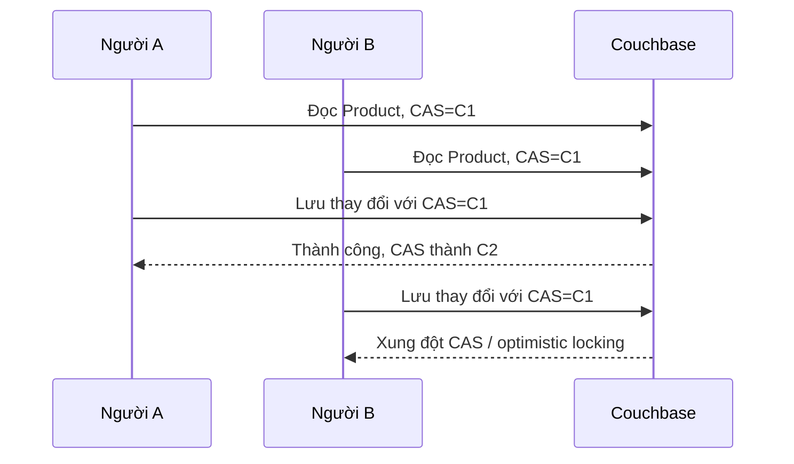

# #n1ql.selectEntity, #n1ql.fields và metadata cần cho ánh xạ

> **Mục tiêu học tập:** Phân biệt `#{#n1ql.selectEntity}` và `#{#n1ql.fields}` trong `@Query`; lý giải vì sao ánh xạ một **Spring Data Couchbase entity** cần document body, ID, CAS và thông tin loại document; nhận diện các lỗi khi tự thay `SELECT` bằng phép chiếu thiếu metadata; chọn đúng truy vấn cho entity, projection và báo cáo.

Trong module **SPRING_DATA_COUCHBASE**, Spring Data hỗ trợ xây dựng tầng truy cập Couchbase bằng document mapping, Repository, `CouchbaseTemplate` và truy vấn **SQL++**. Mỗi document thuộc một bucket/scope/collection, có **body JSON** và **metadata** được Couchbase quản lý. Khi đã biết ID, ứng dụng thường đọc qua Key/Value; khi tìm theo thuộc tính, Repository có thể dùng SQL++ qua Query Service.

SQL++ từng được gọi là **N1QL**. Tên `n1ql` vẫn xuất hiện trong các biểu thức **Spring Expression Language (SpEL)** của Spring Data, chẳng hạn `#{#n1ql.selectEntity}`. Tên lịch sử này không có nghĩa đang dùng một ngôn ngữ khác.

**Vấn đề trung tâm:** Truy vấn SQL++ có thể hợp lệ và trả về JSON, nhưng JSON ấy **chưa chắc có hình dạng phù hợp để Spring Data dựng lại entity**. Spring Data cần biết document ID để ánh xạ `@Id`, CAS để hỗ trợ `@Version`/optimistic locking, dữ liệu body cho các field Java và đôi khi cần discriminator để chỉ chọn đúng loại entity.

| Thành phần | Vai trò chính | Được dùng ở đâu? |
| --- | --- | --- |
| `#{#n1ql.selectEntity}` | Sinh phần **`SELECT ... FROM ...`** tương thích với ánh xạ entity | Đầu câu `@Query` trả về full entity |
| `#{#n1ql.fields}` | Sinh **danh sách biểu thức `SELECT`** cần để dựng entity | Sau từ khóa `SELECT` khi tự viết `FROM` |
| `#{#n1ql.filter}` | Sinh điều kiện lọc theo loại entity | Bên trong `WHERE` |
| `META(p).id` | Đọc ID document do Couchbase quản lý | SQL++ thuần |
| `META(p).cas` | Đọc CAS của document | SQL++ thuần |
| `$1`, `$category` | Placeholder **giá trị** được binding từ Java | Điều kiện nghiệp vụ `WHERE` |

## 1. Mô hình document: body khác metadata

Giả sử ứng dụng quản lý sản phẩm dùng bucket `catalog`, scope `commerce` và collection `products`. Có ba document mẫu:

**Document ID: `product::KB-100`**

```json
{
  "sku": "KB-100",
  "name": "Bàn phím cơ TKL",
  "category": "keyboard",
  "price": 1500000,
  "active": true,
  "specs": {
    "connection": "wired",
    "layout": "TKL"
  }
}
```

**Document ID: `product::KB-200`**

```json
{
  "sku": "KB-200",
  "name": "Bàn phím không dây",
  "category": "keyboard",
  "price": 1900000,
  "active": true,
  "specs": {
    "connection": "wireless",
    "layout": "75%"
  }
}
```

**Document ID: `product::MS-100`**

```json
{
  "sku": "MS-100",
  "name": "Chuột văn phòng",
  "category": "mouse",
  "price": 450000,
  "active": false,
  "specs": {
    "connection": "wireless"
  }
}
```

Đây là **body nghiệp vụ** của các document. ID `product::KB-100` không bắt buộc nằm dưới một khóa JSON tên `id`. CAS cũng không bắt buộc nằm trong JSON body. Ngoài ra, khi lưu entity bằng Spring Data, converter có thể ghi thêm **trường phân biệt kiểu** (thường là `_class`) vào JSON; các body rút gọn trên chưa mô tả trường đó.

| Dữ liệu | Nguồn | Ví dụ | Vai trò khi đọc vào Java |
| --- | --- | --- | --- |
| Document ID | Metadata của Couchbase | `product::KB-100` | Ánh xạ tới trường có `@Id` |
| CAS | Metadata của Couchbase | Một giá trị phiên bản opaque | Có thể ánh xạ vào trường `@Version` |
| Document body | JSON được lưu | `sku`, `price`, `specs` | Ánh xạ các thuộc tính của entity |
| Type discriminator | Trường do Spring Data mapping quản lý | Thường là `_class` | Phân biệt các loại entity |
| Expiration/TTL | Metadata quản lý vòng đời document | Thời điểm hết hạn | Quyết định document còn tồn tại hay không |

**Không đồng nhất “metadata Couchbase” và trường `_class`.** `META(...)` là hàm SQL++ để đọc metadata document của Couchbase. Discriminator `_class` thường là **trường JSON body được Spring Data dùng cho type mapping**, không phải `META().id` hay `META().cas`.

### Entity ví dụ có `@Id` và `@Version`

```java
import org.springframework.data.annotation.Id;
import org.springframework.data.annotation.Version;
import org.springframework.data.couchbase.core.mapping.Document;
import org.springframework.data.couchbase.repository.Scope;
import org.springframework.data.couchbase.repository.Collection;

@Document
@Scope("commerce")
@Collection("products")
public class Product {
    @Id
    private String id;

    @Version
    private long version;

    private String sku;
    private String name;
    private String category;
    private Long price;
    private Boolean active;
    private Specs specs;

    public Product() {}

    public static class Specs {
        private String connection;
        private String layout;
        public Specs() {}
    }

    // Thêm constructor, getter/setter theo convention của dự án.
}
```

Với cấu hình chọn bucket `catalog`, annotation `@Scope("commerce")` và `@Collection("products")` đưa entity đến đúng collection. Khi một document được đọc bằng mapping phù hợp:

- `Product.id` đại diện cho **document key**, không phải một trường JSON `id` bắt buộc.
- `Product.version` gắn với **CAS** khi dùng cơ chế optimistic locking của Spring Data; không nên tự sửa trường phiên bản trong mã nghiệp vụ.
- `sku`, `price`, `active`, `specs` đến từ JSON body.

Chính vì thế, **có đủ JSON field nghiệp vụ vẫn chưa bảo đảm đủ thông tin để dựng một entity có khả năng ghi lại an toàn**.

## 2. SQL++ thuần: quan sát `META().id` và `META().cas`

Để truy vấn trực tiếp từ Couchbase Query Workbench:

```sql
SELECT META(p).id AS documentId,
       META(p).cas AS documentCas,
       p.sku,
       p.name,
       p.price
FROM `catalog`.`commerce`.`products` AS p
WHERE p.category = "keyboard"
ORDER BY p.sku;
```

Truy vấn trả hai document KB-100 và KB-200. Mỗi hàng có trường `documentId`, `documentCas` và các thuộc tính được chỉ định trong phép chiếu. **Giá trị CAS thật phụ thuộc trạng thái hiện tại của document**, nên không nên hardcode số CAS minh họa rồi coi là giá trị cố định.

### `META(p).id` khác `p.id`

`META(p).id` lấy ID document từ metadata Couchbase. Trong khi đó, `p.id` đọc một **trường tên `id` trong JSON body** nếu body có trường đó. Với các document mẫu, body không có `id`, nhưng `META(p).id` vẫn có giá trị.

```sql
SELECT META(p).id AS documentId,
       p.id AS bodyId
FROM `catalog`.`commerce`.`products` AS p
WHERE p.sku = "KB-100";
```

`bodyId` ở ví dụ này là `MISSING`, nên khóa `bodyId` có thể không xuất hiện trong kết quả JSON. `documentId` vẫn là `product::KB-100`.

### `META(p).cas` khác một trường `version` trong body

`META(p).cas` là giá trị **Compare-And-Swap (CAS)**, phản ánh phiên bản hiện tại của document ở Couchbase. Nó không đồng nghĩa với một trường JSON tùy ý như `"version": 12`.

```sql
SELECT META(p).id AS documentId,
       META(p).cas AS currentCas
FROM `catalog`.`commerce`.`products` AS p
WHERE p.sku = "KB-100";
```

CAS thay đổi khi document được sửa đổi và là một giá trị **opaque**: không nên lấy CAS trừ đi CAS cũ để tính số lượt cập nhật, hoặc xem nó như timestamp dành cho giao diện. Vai trò chính của CAS là giúp phát hiện thao tác ghi dựa trên phiên bản đã cũ.

### Metadata về expiration

Couchbase còn có metadata liên quan đến **TTL/expiration**:

```sql
SELECT META(p).id AS documentId,
       META(p).expiration AS expiration
FROM `catalog`.`commerce`.`products` AS p
WHERE p.sku = "KB-100";
```

Expiration giúp phân tích thời gian sống document, nhưng **không đồng nghĩa dữ liệu hết hạn sẽ được ánh xạ tự động vào một trường Java `@Version`**. CAS và TTL giải quyết hai mối quan tâm khác nhau: kiểm soát cập nhật đồng thời và vòng đời document.

## 3. Vì sao `SELECT *` không đủ cho entity mapping?

Người mới học SQL++ thường thử:

```sql
SELECT *
FROM `catalog`.`commerce`.`products` AS p
WHERE p.category = "keyboard";
```

Với alias `p`, một hàng có thể mang dạng object được bọc theo keyspace:

```json
{
  "p": {
    "sku": "KB-100",
    "name": "Bàn phím cơ TKL",
    "category": "keyboard",
    "price": 1500000,
    "active": true
  }
}
```

Ví dụ JSON trên rút gọn, bỏ bớt `specs` và các trường khác để làm rõ **cấu trúc bọc**. `SELECT *` không mặc định trả metadata ID/CAS dưới dạng field mà Spring Data mapper đang chờ.

Nếu đổi thành:

```sql
SELECT p.*
FROM `catalog`.`commerce`.`products` AS p
WHERE p.category = "keyboard";
```

thì các field của `p` được trải ra cấp cao nhất của mỗi hàng. Đây là cách chiếu body rõ hơn nhưng **vẫn không tự tạo các alias metadata cho ID/CAS theo hợp đồng của Spring Data**.

| Cách chiếu | Hình dạng đầu ra | Có đủ để dựng full entity Spring Data? |
| --- | --- | --- |
| `SELECT *` | Thường bọc document dưới khóa alias `p` | **Không bảo đảm** |
| `SELECT p.*` | Trải các trường JSON body ra cấp cao nhất | **Không bảo đảm** có ID/CAS |
| `SELECT p.sku, p.price` | Chỉ hai trường nghiệp vụ | Không đủ full entity |
| `SELECT META(p).id AS documentId, p.sku` | ID đặt tên tùy chọn và `sku` | Không mặc nhiên khớp alias mapper |
| `#{#n1ql.selectEntity}` | Phép chiếu và keyspace do Spring Data tạo | **Mẫu phù hợp** cho full entity |

Nguyên tắc quan trọng: **SQL++ hợp lệ** không đồng nghĩa **kết quả ánh xạ đúng**. Với phương thức Repository trả `Product`, `List<Product>` hoặc `Optional<Product>`, hãy ưu tiên mẫu được Spring Data cung cấp.

## 4. `#{#n1ql.selectEntity}`: tạo cả phần `SELECT` và `FROM`

Theo tài liệu Spring Data Couchbase, `#n1ql.selectEntity` cung cấp phần `SELECT ... FROM ...` cần thiết để truy vấn trả về entity của Repository, bao gồm các trường và metadata phục vụ việc dựng entity (đặc biệt **document ID** và **CAS**).

Repository minh họa:

```java
import java.util.List;
import org.springframework.data.couchbase.repository.CouchbaseRepository;
import org.springframework.data.couchbase.repository.Query;
import org.springframework.data.repository.query.Param;

public interface ProductRepository
        extends CouchbaseRepository<Product, String> {

    @Query("#{#n1ql.selectEntity} WHERE #{#n1ql.filter} "
         + "AND category = $category AND price <= $maxPrice")
    List<Product> findByCategoryAndPriceLimit(
        @Param("category") String category,
        @Param("maxPrice") long maxPrice
    );
}
```

Gọi:

```java
List<Product> result =
    repository.findByCategoryAndPriceLimit("keyboard", 1600000L);
```

Nếu các document được lưu với discriminator Spring Data phù hợp, kết quả nghiệp vụ chỉ có KB-100. KB-200 vượt giới hạn, còn MS-100 không thuộc danh mục keyboard.

### Chia cấu trúc câu truy vấn thành từng phần

```text
#{#n1ql.selectEntity}  WHERE  #{#n1ql.filter}  AND  category = $category
|___________________|         |____________|       |__________________|
    SELECT + FROM           type discriminator      điều kiện nghiệp vụ
                                                    (giá trị binding)
```

- `#{#n1ql.selectEntity}` là **SpEL**, Spring Data thay bằng cú pháp SQL++ thích hợp cho entity mapping và keyspace.
- `WHERE` là từ khóa SQL++ người viết khai báo một lần.
- `#{#n1ql.filter}` là **SpEL**, Spring Data thay bằng điều kiện phân biệt kiểu entity.
- `category = $category` là điều kiện trên trường JSON và một **placeholder SQL++**; `@Param` truyền giá trị.

**Không đặt thêm `SELECT` trước `#{#n1ql.selectEntity}`**, vì biểu thức này đã tạo phần `SELECT/FROM`. Tương tự, không đặt thêm `FROM` ngay sau biểu thức rồi mong có hai nguồn độc lập. Đây là nguyên nhân phổ biến của câu SQL++ không hợp lệ.

### Khi nào `selectEntity` là lựa chọn mặc định?

Khi phương thức cần **full entity**:

```java
@Query("#{#n1ql.selectEntity} WHERE #{#n1ql.filter} "
     + "AND active = true")
List<Product> findActive();
```

Trong trường hợp này, Spring Data có cơ sở để khôi phục `@Id`, `@Version` và các field JSON, thay vì nhận một phép chiếu hai trường có cấu trúc tùy tiện.

Đừng tự dự đoán chính xác tên alias metadata trong SQL++ mà `selectEntity` sinh ra: tên alias, cách quote định danh, cách resolve keyspace và chi tiết mapping có thể phụ thuộc phiên bản Spring Data và cấu hình entity. **Hãy dùng macro đúng mục đích thay vì hardcode một phiên bản chuỗi SQL++ do thư viện từng sinh ra.**

## 5. `#{#n1ql.fields}`: danh sách trường cho `SELECT`, không có `FROM`

`#n1ql.fields` có phạm vi **hẹp hơn** `#n1ql.selectEntity`. Theo tài liệu Spring Data Couchbase, `fields` tạo danh sách biểu thức cần thiết để dựng entity trong **mệnh đề `SELECT`**; chính người viết truy vấn phải cung cấp `SELECT`, `FROM` và các phần khác.

So sánh:

```java
// Cách 1: sinh trọn phần SELECT/FROM cho entity.
@Query("#{#n1ql.selectEntity} WHERE #{#n1ql.filter} "
     + "AND category = $1")
List<Product> findWithSelectEntity(String category);
```

```java
// Cách 2: tự viết SELECT/FROM; fields chỉ tạo danh sách phép chiếu.
@Query("SELECT #{#n1ql.fields} "
     + "FROM #{#n1ql.collection} "
     + "WHERE #{#n1ql.filter} AND category = $1")
List<Product> findWithFields(String category);
```

**Tài liệu Spring Data Couchbase mô tả hai dạng trên là tương đương trong ngữ cảnh Repository và keyspace tương ứng.** Với phiên bản và cấu hình sử dụng bucket/scope/collection cụ thể, tên collection rút gọn có thể phụ thuộc **query context**; cách đơn giản nhất để tránh sai keyspace là dùng `selectEntity`.

### Ba cách viết dễ bị nhầm

| Cách viết | Ý nghĩa | Đánh giá |
| --- | --- | --- |
| `#{#n1ql.selectEntity} WHERE ...` | Sinh đầy đủ `SELECT/FROM` | **Đúng** cho entity |
| `SELECT #{#n1ql.fields} FROM ... WHERE ...` | `fields` chỉ sinh danh sách phép chiếu | **Đúng** nếu `FROM`/keyspace hợp lệ |
| `SELECT #{#n1ql.selectEntity} FROM ...` | Chồng thêm `SELECT/FROM` lên macro đã tạo chúng | **Sai cấu trúc** |
| `#{#n1ql.fields} WHERE ...` | Thiếu từ khóa `SELECT` và nguồn `FROM` | **Sai cấu trúc** |
| `SELECT * FROM ... WHERE ...` | Cú pháp SQL++ có thể hợp lệ, nhưng shape không bảo đảm mapping | **Không nên dùng** cho full entity |

Một cách nhớ nhanh:

```text
selectEntity = [SELECT + fields + FROM + keyspace]
fields       = [các biểu thức được chọn, gồm dữ liệu cần cho mapping]

SELECT #{#n1ql.fields} FROM ... WHERE ...
        └───────────┘
          chỉ chiếu
```

Đây là **sơ đồ khái niệm**, không phải định nghĩa nội bộ hay một cam kết về chuỗi SQL++ chính xác của mọi phiên bản. Spring Data có thể tạo alias và biểu thức khác nhau để ánh xạ entity, ID/CAS hoặc projection.

### `#n1ql.bucket`, `scope` và `collection`

Ngoài hai biểu thức trên, Spring Data còn cung cấp các giá trị SpEL về keyspace:

| Biến | Dữ liệu thu được | Ghi chú |
| --- | --- | --- |
| `#{#n1ql.bucket}` | Tên bucket được escape bằng backtick | Bucket không nhất thiết đủ để chỉ ra collection đích |
| `#{#n1ql.scope}` | Tên scope được escape | Dùng trong ngữ cảnh bucket tương ứng |
| `#{#n1ql.collection}` | Tên collection được escape | Có thể được phân giải theo query context |

SQL++ thuần với đường dẫn đầy đủ:

```sql
SELECT p.sku, p.price
FROM `catalog`.`commerce`.`products` AS p
WHERE p.category = "keyboard";
```

Khi viết lại bằng SpEL, cần bảo đảm cách phân giải bucket/scope/collection của **phiên bản ứng dụng** thực sự nhắm tới cùng keyspace. **Không mặc định `#n1ql.bucket` tự đại diện cho đường dẫn ba cấp** và không dùng tên người dùng nhập vào để thay thế định danh mà không kiểm soát.

### Có nên dùng `fields` thay vì `selectEntity` mọi lúc?

Không. Với một câu `@Query` đơn giản trả entity, `selectEntity` ngắn hơn và ít rủi ro quên `FROM`. `fields` chỉ có lợi khi **cần tự bố trí một phần câu `SELECT/FROM` có kiểm soát**, chẳng hạn tích hợp vào một truy vấn tùy chỉnh mà vẫn giữ phép chiếu cần cho entity.

Nếu kết quả dự kiến là **DTO chỉ có `sku` và `price`**, không tự động chọn `fields` chỉ vì nó có tên “fields”: biểu thức này phục vụ **khôi phục entity** chứ không phải chỉ hai trường của DTO. Hãy thiết kế phép chiếu riêng phù hợp kiểu trả về và kiểm chứng khả năng mapping của phiên bản Spring Data đang dùng.

## 6. `#{#n1ql.filter}` và discriminator: metadata loại entity

Khi Spring Data lưu nhiều kiểu entity vào cùng một collection, converter có thể ghi thông tin kiểu đối tượng trong JSON, thường với khóa `_class`. Ví dụ đây là cấu trúc **minh họa**, không phải cam kết giá trị discriminator thực của một project:

```json
{
  "sku": "KB-100",
  "category": "keyboard",
  "price": 1500000,
  "_class": "com.example.catalog.Product"
}
```

Khi áp dụng `#{#n1ql.filter}`, Spring Data thêm điều kiện dựa trên thông tin loại entity mà mapping biết. Điều này giúp tránh đọc nhầm các document thuộc kiểu Java khác trong cùng collection.

```java
@Query("#{#n1ql.selectEntity} WHERE #{#n1ql.filter} "
     + "AND category = $1")
List<Product> findByCategory(String category);
```

Điều kiện được chia thành:

- **Discriminator:** `#{#n1ql.filter}` — xác nhận document thuộc loại entity mà Repository quản lý theo quy tắc mapping.
- **Nghiệp vụ:** `category = $1` — chọn danh mục sản phẩm do caller cung cấp.

**Không coi `#n1ql.filter` là cơ chế phân quyền người dùng.** Nó không tự kiểm tra tenant, role hay quyền truy cập bản ghi. Nếu hệ thống nhiều tenant dùng chung collection, phải bổ sung điều kiện tenant tin cậy và kiểm soát quyền ở tầng thích hợp.

### Workbench thấy document nhưng Repository không thấy

Giả sử tự chèn ba JSON mẫu bằng SDK hoặc Workbench mà **không** có discriminator. Câu SQL++:

```sql
SELECT p.sku
FROM `catalog`.`commerce`.`products` AS p
WHERE p.category = "keyboard";
```

có thể thấy hai keyboard. Nhưng Repository có `#{#n1ql.filter}` có thể trả rỗng vì dữ liệu không phù hợp với thông tin kiểu mà Spring Data mong đợi.

Để thử nghiệm đúng, hãy lưu qua **cùng Spring Data converter** hoặc dùng dữ liệu test có discriminator tương thích với cấu hình; không tự đoán tên class, alias hay trường type trong môi trường thực tế.

### Khi nào có thể không dùng `filter`?

Một số truy vấn **không trả entity**, ví dụ phép đếm/thống kê trên toàn collection, có thể tự viết câu SQL++ không dùng `#n1ql.filter` nếu nghiệp vụ cố ý tính tất cả document. Tuy nhiên, với Repository trả `Product`, nên giữ điều kiện discriminator để tránh ánh xạ nhầm. Việc bỏ filter phải có lý do dữ liệu rõ ràng và được kiểm chứng bằng test.

## 7. CAS và `@Version`: metadata đi vào optimistic locking

Spring Data Couchbase có thể dùng **CAS** của Couchbase cho optimistic locking thông qua `@Version`:

```java
@Document
@Scope("commerce")
@Collection("products")
public class Product {
    @Id
    private String id;

    @Version
    private long version;

    private String name;
    private Long price;

    public Product() {}
    // getters/setters...
}
```

Khi đọc document bằng Repository/Template với phép chiếu phù hợp, Spring Data có thể nạp giá trị CAS hiện tại vào `version`. Sau đó khi lưu lại, cơ chế optimistic locking so sánh CAS để tránh ghi đè thay đổi của người khác.

### Mô phỏng hai người sửa cùng document



Đây là mô hình khái niệm: `C1` và `C2` chỉ là ký hiệu của hai giá trị CAS khác nhau. Không dùng phép so sánh số lớn/nhỏ của CAS làm logic nghiệp vụ.

Một service có thể thao tác:

```java
Product product = repository.findById("product::KB-100")
    .orElseThrow();

// Cập nhật thuộc tính thông qua phương thức domain/getter-setter.
product.setPrice(1600000L);
repository.save(product);
```

Đoạn minh họa giả định entity có phương thức `setPrice`. Nếu document bị thay đổi bởi luồng khác kể từ khi được đọc, lưu có thể báo `OptimisticLockingFailureException` theo cơ chế Spring Data. Khi đó, tùy nghiệp vụ, cần nạp lại dữ liệu và thử lại **toàn bộ** thao tác đọc-sửa-ghi hoặc trả lỗi xung đột cho caller. Không tự chỉnh `version` hay bỏ điều kiện CAS để “cho qua” xung đột.

**Giới hạn:** `#n1ql.selectEntity` giúp phép chiếu có metadata phục vụ mapping, nhưng **bản thân một truy vấn `SELECT` không khóa document**. Concurrency control thực sự diễn ra ở thao tác ghi có kiểm tra phiên bản/CAS.

## 8. Ánh xạ tên trường JSON và nested object

Document body không nhất thiết dùng đúng tên thuộc tính Java. Spring Data Couchbase hỗ trợ ánh xạ tên trường thông qua annotation `@Field`, vì vậy câu SQL++ tự viết phải quan tâm **tên field lưu thực tế trong JSON**, không chỉ tên Java.

Giả sử document có dữ liệu:

```json
{
  "sku": "KB-100",
  "unit_price": 1500000,
  "specs": {
    "connection_type": "wired"
  }
}
```

Entity Java tương ứng:

```java
import org.springframework.data.couchbase.core.mapping.Document;
import org.springframework.data.couchbase.core.mapping.Field;

@Document
public class ProductWithMappedFields {
    private String sku;

    @Field("unit_price")
    private Long unitPrice;

    private Specs specs;

    public static class Specs {
        @Field("connection_type")
        private String connectionType;
    }

    // constructors/getters/setters...
}
```

Đây là entity minh họa về **đổi tên field**; khi dùng trong ứng dụng thật cần bổ sung ID/mapping keyspace như các ví dụ `Product` trước đó.

Trong SQL++ thuần:

```sql
SELECT p.sku, p.unit_price
FROM `catalog`.`commerce`.`products` AS p
WHERE p.unit_price <= 1600000
  AND p.specs.connection_type = "wired";
```

`p.unit_price` và `p.specs.connection_type` là **đường dẫn JSON lưu trên server**. Nếu người viết `@Query` tự khai báo điều kiện, đừng giả định tên Java `unitPrice`/`connectionType` tự được thay thành tên field lưu dưới mọi cơ chế parser.

Mẫu phép chiếu entity:

```java
@Query("#{#n1ql.selectEntity} WHERE #{#n1ql.filter} "
     + "AND unit_price <= $1")
List<ProductWithMappedFields> findWithMappedPrice(long maximum);
```

Ở ví dụ này, để method thực sự hoạt động cần Repository quản lý `ProductWithMappedFields` và mapping scope/collection tương ứng. **`#n1ql.selectEntity` hỗ trợ phép chiếu entity, còn điều kiện `unit_price <= $1` do người viết khai báo theo field JSON**.

### Những sai sót liên quan đến tên field

- **Field JSON không tồn tại:** SQL++ có thể trả về `MISSING`, khiến `WHERE` không chọn document mà không báo “cột không tồn tại” như SQL quan hệ.
- **Tên có ký tự đặc biệt:** cần quote định danh bằng backtick; ví dụ đường dẫn tới trường JSON `width-mm` phải trích dẫn riêng tên trường trong câu SQL++. Không được nhầm tên chứa dấu chấm với đường dẫn nested.
- **Trường Java bị đổi tên:** code Java có thể compile, nhưng `@Query` viết chuỗi tĩnh cần được cập nhật nếu field lưu trong JSON thay đổi.
- **Tên alias kết quả:** `SELECT p.unit_price AS price` tạo trường kết quả `price`, không làm đổi tên field trong document gốc.

Khi cần các phép chiếu đặc thù, nên kiểm tra JSON result thực tế cùng converter của phiên bản Spring Data đang chạy để tránh các lỗi mapping im lặng.

## 9. Full entity khác projection, scalar và aggregate

`#n1ql.fields` có chữ “fields” nhưng **không có nghĩa nó là cách chọn tùy ý hai trường cho một DTO**. Nó sinh danh sách biểu thức cần thiết để **dựng entity** mà Repository quản lý. Nếu chỉ cần vài trường, nên thiết kế loại kết quả và phép chiếu có chủ đích.

### Trả về full entity

```java
@Query("#{#n1ql.selectEntity} WHERE #{#n1ql.filter} "
     + "AND category = $1")
List<Product> findAllProductsOfCategory(String category);
```

Hàng kết quả có mục tiêu chứa dữ liệu để dựng `Product`, bao gồm ID/CAS; phù hợp khi caller cần thao tác tiếp với entity.

### Trả về một số field để hiển thị

SQL++ thuần cho trang danh sách:

```sql
SELECT p.sku AS sku,
       p.name AS name,
       p.price AS price
FROM `catalog`.`commerce`.`products` AS p
WHERE p.active = true
ORDER BY p.sku;
```

Mỗi hàng có ba trường nghiệp vụ. Có thể khai báo DTO riêng:

```java
public record ProductListItem(String sku, String name, Long price) {}
```

Tuy nhiên, **không giả định mọi phiên bản `@Query` tự động ánh xạ mọi câu `SELECT` tùy chỉnh vào record/DTO**. Tài liệu Repository nhấn mạnh hỗ trợ phép chiếu một giá trị đơn (ví dụ `COUNT`) trong các truy vấn chuỗi; ánh xạ một DTO nhiều trường phụ thuộc API/converter cụ thể. Khi cần chắc chắn, dùng Couchbase Java SDK đọc `JsonObject` rồi xây DTO, hoặc chọn projection API đã được phiên bản dự án hỗ trợ và kiểm thử tích hợp.

Một ví dụ thực thi qua SDK:

```java
import java.util.ArrayList;
import java.util.List;
import com.couchbase.client.java.Cluster;
import com.couchbase.client.java.json.JsonObject;
import com.couchbase.client.java.query.QueryResult;
import static com.couchbase.client.java.query.QueryOptions.queryOptions;

public class ProductListService {
    private final Cluster cluster;

    public ProductListService(Cluster cluster) {
        this.cluster = cluster;
    }

    public record ProductListItem(String sku, String name, Long price) {}

    public List<ProductListItem> listActive() {
        String statement = """
            SELECT p.sku, p.name, p.price
            FROM `catalog`.`commerce`.`products` AS p
            WHERE p.active = $enabled
            ORDER BY p.sku
            """;

        JsonObject params = JsonObject.create().put("enabled", true);
        QueryResult result = cluster.query(
            statement,
            queryOptions().parameters(params)
        );

        List<ProductListItem> items = new ArrayList<>();
        for (JsonObject row : result.rowsAsObject()) {
            items.add(new ProductListItem(
                row.getString("sku"),
                row.getString("name"),
                row.getLong("price")
            ));
        }
        return items;
    }
}
```

Đây là ví dụ Java 17+ vì dùng text block và `record`; `Cluster` cần được cấu hình/quản lý và tái sử dụng trong ứng dụng. Truy vấn trực tiếp SDK **không tự dùng SpEL `#n1ql`**, do đó phải khai báo keyspace, tham số và phép chiếu đúng ý nghĩa.

### Phép tổng hợp không có document ID riêng của một sản phẩm

```sql
SELECT p.category AS category,
       COUNT(*) AS totalProducts,
       AVG(p.price) AS averagePrice
FROM `catalog`.`commerce`.`products` AS p
GROUP BY p.category;
```

Mỗi hàng là **thống kê cả nhóm**, không phải một document `Product`. Không thể mong `#n1ql.selectEntity` tự gắn document ID/CAS của “nhóm keyboard”: nhóm không có document key/CAS của một sản phẩm duy nhất.

Với một phép đếm đơn giản, Repository có thể trả kiểu scalar phù hợp nếu API/phiên bản hỗ trợ:

```java
@Query("SELECT RAW COUNT(*) "
     + "FROM #{#n1ql.collection} "
     + "WHERE category = $1")
long countByCategoryRaw(String category);
```

**Lưu ý:** Đây là ví dụ minh họa về ý tưởng scalar `COUNT`. Cần kiểm tra dạng `SELECT`/`RAW` được phiên bản Spring Data hỗ trợ và cách keyspace được resolve trong ứng dụng. Trong thực tế, phương thức derived `countByCategory(...)` thường ngắn và ít rủi ro hơn nếu chỉ cần đếm theo một field.

### Lựa chọn API theo hình dạng kết quả

| Mục tiêu | Kết quả mong muốn | Gợi ý |
| --- | --- | --- |
| Đọc document đầy đủ, có ID/CAS | `Product` | Repository + `#n1ql.selectEntity` |
| Chỉ đọc document đã biết ID | `Optional<Product>` | `findById(id)` qua Key/Value |
| Hiển thị vài field | DTO/projection | Chọn API projection đã kiểm chứng hoặc SDK map JSON row |
| Đếm bản ghi | Một số | Derived `countBy...`, scalar query phù hợp |
| Tổng hợp theo nhóm | Nhiều hàng báo cáo | SQL++ chuyên biệt + DTO/SDK |
| Cần điều kiện động phức tạp | Entity hoặc DTO | Cân nhắc `CouchbaseTemplate` hay SDK với tham số hóa |

Không cố gắng ép mọi truy vấn chạy qua một kiểu trả về `Product`; **shape của kết quả là một phần của hợp đồng dữ liệu**.

## 10. Metadata và chỉ mục: phép chiếu đủ không đồng nghĩa truy vấn nhanh

Spring Data giúp sinh phép chiếu đúng cho entity, nhưng **Query Service vẫn cần index phù hợp để xác định document cần trả**. Ví dụ phương thức:

```java
@Query("#{#n1ql.selectEntity} WHERE #{#n1ql.filter} "
     + "AND category = $1 AND price <= $2")
List<Product> findByCriteria(String category, long maxPrice);
```

có thể cân nhắc secondary index dựa trên hai trường JSON:

```sql
CREATE INDEX idx_products_category_price
ON `catalog`.`commerce`.`products`(category, price);
```

Để khảo sát, chạy `EXPLAIN` cho câu SQL++ thuần tương đương về điều kiện:

```sql
EXPLAIN
SELECT p.sku, p.category, p.price
FROM `catalog`.`commerce`.`products` AS p
WHERE p.category = "keyboard"
  AND p.price <= 1600000;
```

Đây chỉ là bước khảo sát sơ bộ. Truy vấn Spring Data thực tế có thể khác vì:

- `#n1ql.filter` thêm điều kiện discriminator theo loại entity.
- `#n1ql.selectEntity` có phép chiếu rộng hơn, gồm metadata ID/CAS và body.
- `@Field` có thể khiến đường dẫn JSON thực tế khác tên thuộc tính Java.
- `ORDER BY`, `LIMIT`, các biểu thức `ANY` và trạng thái index cũng làm thay đổi kế hoạch thực thi.

**Một index có thể đủ cho điều kiện `WHERE` nhưng chưa đủ covering cho phép chiếu toàn entity.** Nếu `SELECT` cần toàn bộ JSON body, Query Service có thể phải Fetch document. Vì vậy không nên đánh giá query entity chỉ bằng `EXPLAIN SELECT p.sku` rồi kỳ vọng hiệu năng giống hệt khi chiếu cả body/metadata.

### Chỉ mục trên metadata

Couchbase cho phép truy vấn và trong những trường hợp được hỗ trợ, lập chỉ mục trên biểu thức metadata như `META().id` hoặc `META().cas`. Tuy nhiên, **không có nghĩa mọi Repository entity query cần tạo index trên ID và CAS**.

Nếu đã biết ID của một document, truy cập Key/Value thường trực tiếp và phù hợp hơn. Nếu tìm theo `category`, `price` hay thuộc tính mảng, hãy thiết kế secondary index theo **bộ lọc** thay vì tạo index trên `META().cas` chỉ vì entity chứa `@Version`.

### Giá trị CAS và dữ liệu nhạy cảm

CAS không phải bí mật xác thực, nhưng vẫn nên tránh đưa metadata nội bộ không cần thiết ra API công khai. ID document có thể chứa quy ước nội bộ, mã khách hàng hay khóa nghiệp vụ. Dùng DTO để xác định rõ field nào được đưa ra response, thay vì trả nguyên object entity có metadata mà giao diện không cần.

## 11. Độ nhất quán: metadata đúng nhưng truy vấn chưa thấy ghi mới

Couchbase có **Key/Value Service** và **Query/Index Service** với đặc tính cập nhật chỉ mục riêng. Sau khi `repository.save(product)` thành công, dữ liệu có thể đã đọc được theo ID, nhưng một truy vấn SQL++ tìm theo thuộc tính chưa chắc lập tức thấy ghi mới nếu chỉ mục vẫn đang cập nhật.

```java
Product saved = repository.save(product);

// Thường sử dụng KV khi có ID.
repository.findById(saved.getId());

// Sử dụng Query/Index Service để tìm theo category.
repository.findByCategoryAndPriceLimit("keyboard", 2000000L);
```

Đoạn này giả định entity có `getId()`. Với Query Service:

| Scan consistency | Ý nghĩa khái quát | Đánh đổi |
| --- | --- | --- |
| `NOT_BOUNDED` | Có thể đọc theo index hiện có mà không đợi toàn bộ ghi mới | Thường giảm độ trễ nhưng có thể chưa thấy thay đổi gần nhất |
| `REQUEST_PLUS` | Chờ index bắt kịp các thay đổi trước thời điểm bắt đầu query | Có thể tăng thời gian đáp ứng |

**Không nhầm hai loại “đúng”:**

1. **Ánh xạ đúng:** hàng kết quả có những trường và metadata mà Spring Data cần; `selectEntity` giúp giải quyết bài toán này.
2. **Độ mới đúng:** chỉ mục đã cập nhật tới mức nghiệp vụ yêu cầu; cần lựa chọn scan consistency, không do `selectEntity` tự bảo đảm.

Nếu ứng dụng cần đọc ngay chính document vừa lưu và đã biết ID, hãy dùng Key/Value. Nếu ứng dụng cần tìm bằng điều kiện SQL++ với yêu cầu độ mới chặt chẽ, cấu hình consistency phù hợp và kiểm tra latency trong thực tế.

### TTL, transaction và reactive API không thay vai trò metadata

- **TTL:** thời hạn sống của document. Tài liệu hết hạn có thể không còn xuất hiện trong Query Service sau khi thay đổi được phản ánh.
- **CAS:** hỗ trợ phát hiện ghi đồng thời dựa trên phiên bản; liên quan trực tiếp tới `@Version`.
- **Transaction:** quản lý nhóm thao tác cần tính nguyên tử/nhất quán; không được tạo ra chỉ bằng một `SELECT`.
- **Reactive API:** thay cách phát/tiêu thụ kết quả (ví dụ `Flux<Product>`), nhưng ánh xạ entity và SQL++ metadata vẫn phải đúng.

Ví dụ Repository reactive:

```java
import reactor.core.publisher.Flux;
import org.springframework.data.couchbase.repository.Query;
import org.springframework.data.couchbase.repository.ReactiveCouchbaseRepository;

public interface ReactiveProductRepository
        extends ReactiveCouchbaseRepository<Product, String> {

    @Query("#{#n1ql.selectEntity} WHERE #{#n1ql.filter} "
         + "AND category = $1")
    Flux<Product> findProductsByCategory(String category);
}
```

`Flux<Product>` không làm phép chiếu `SELECT *` trở nên đủ ID/CAS. Khi trả về full entity trong reactive repository, vẫn dùng cách sinh phép chiếu phù hợp và đánh giá chỉ mục/scan consistency như API đồng bộ.

## 12. Chẩn đoán lỗi từ triệu chứng

| Hiện tượng | Nguyên nhân có thể | Cách xử lý |
| --- | --- | --- |
| `SELECT *` chạy trong Workbench nhưng Repository không map được `Product` | Dạng hàng được bọc theo alias hoặc thiếu metadata ID/CAS | Dùng `#n1ql.selectEntity` |
| `SELECT p.*` có đủ body nhưng `id` rỗng | Document ID không nằm trong body | Đọc `META(p).id` khi truy vấn thuần; dùng macro entity khi dùng Repository |
| `@Version` không được nạp đúng khi query | Phép chiếu/metadata CAS không phù hợp mapping | Kiểm tra `#n1ql.fields`/`selectEntity` và converter |
| `SELECT #{#n1ql.selectEntity} FROM ...` báo lỗi | Macro đã tạo `SELECT/FROM` | Chỉ dùng macro ở đầu truy vấn |
| `#{#n1ql.fields} WHERE ...` báo lỗi | `fields` không tạo từ khóa `SELECT` hay `FROM` | Viết `SELECT #{#n1ql.fields} FROM ... WHERE ...` |
| `#n1ql.collection` bị resolve sai nguồn | Query context không phù hợp hoặc mapping sai scope/collection | Kiểm tra keyspace, ưu tiên `selectEntity` khi trả entity |
| Workbench có dữ liệu nhưng Repository trả rỗng | Thiếu discriminator `_class` hoặc điều kiện `#n1ql.filter` không khớp | Tạo dữ liệu test bằng cùng Spring Data mapping |
| Query trả nhầm loại document | Không có filter kiểu entity trong collection dùng chung | Dùng `#n1ql.filter` và thiết kế phân loại document |
| Trường `@Field("unit_price")` đọc sai giá | SQL++ tự viết đang dùng `unitPrice` thay vì tên JSON `unit_price` | Kiểm tra field lưu và mapping |
| Truy vấn báo cáo `GROUP BY` bị ép về `Product` | Kết quả không còn là một document đơn lẻ | Dùng DTO/projection phù hợp hoặc SDK map row |
| Query chậm dù không lỗi mapping | Thiếu index, điều kiện không chọn lọc, Fetch toàn body | Phân tích `EXPLAIN` trên câu query thực tế |
| Đọc theo ID có dữ liệu nhưng query chưa thấy | Chỉ mục chưa cập nhật theo scan consistency | Cân nhắc `REQUEST_PLUS` hoặc đường KV |
| Ghi lại entity bị optimistic locking exception | CAS đã thay đổi do luồng khác ghi | Nạp lại và giải quyết xung đột theo nghiệp vụ |
| API lộ thêm ID/CAS không cần thiết | Trả nguyên entity thay vì DTO giới hạn field | Thiết kế response DTO chỉ chứa dữ liệu cần công khai |

### Checklist kiểm tra trước khi kết luận một lỗi

1. Xác nhận **Repository đang quản lý đúng entity** và scope/collection/bucket.
2. Xác nhận `@Query` dùng **`#n1ql.selectEntity` cho full entity** hoặc `SELECT #{#n1ql.fields} FROM ...` với keyspace hợp lệ.
3. Xác nhận `WHERE #{#n1ql.filter}` đang có trong câu truy vấn nếu cần lọc kiểu document.
4. Kiểm tra sự khác nhau giữa `META().id`/`META().cas` và field JSON `id`/`version`.
5. Kiểm tra tên field thực tế khi dùng `@Field`.
6. Kiểm tra dữ liệu đã được ghi bằng converter tương ứng để có discriminator.
7. Kiểm tra kiểu trả về: entity, scalar, DTO hay kết quả aggregate.
8. Kiểm tra index, `EXPLAIN` và scan consistency nếu kết quả chậm hoặc chưa thấy ghi mới.

Khi debug, chỉ log metadata, SQL++ và tham số theo chính sách bảo mật của hệ thống. Không ghi nguyên toàn bộ document có dữ liệu riêng tư ra log chỉ để kiểm chứng ID/CAS.

## 13. Bài thực hành có đáp án

Các bài sau giả định ba document `KB-100`, `KB-200` và `MS-100` đã được lưu bằng **Spring Data Couchbase mapping** cho entity `Product`, có discriminator tương thích và collection có chỉ mục cần thiết.

### Bài 1 — Chọn macro đúng cho Repository trả full entity

**Yêu cầu:** Viết một method trả về mọi sản phẩm thuộc danh mục `keyboard`, giữ khả năng ánh xạ `@Id` và `@Version`.

```java
@Query("#{#n1ql.selectEntity} WHERE #{#n1ql.filter} "
     + "AND category = $1")
List<Product> findFullKeyboardEntities(String category);
```

**Đáp án:** Gọi `findFullKeyboardEntities("keyboard")` sẽ tìm KB-100 và KB-200. `selectEntity` phù hợp để dựng entity; `filter` giới hạn loại document; `$1` binding danh mục truyền vào.

Tên method chỉ để minh họa; trong ứng dụng thực tế nên chọn tên phản ánh tham số, ví dụ `findByCategoryWithQuery(...)`, để người đọc không nhầm danh mục được cố định là keyboard.

### Bài 2 — Viết lại bằng `#n1ql.fields`

**Yêu cầu:** Viết dạng tương đương về cách tạo phép chiếu, nhưng khai báo tường minh `SELECT` và `FROM`.

```java
@Query("SELECT #{#n1ql.fields} "
     + "FROM #{#n1ql.collection} "
     + "WHERE #{#n1ql.filter} AND category = $1")
List<Product> findWithExplicitSelect(String category);
```

**Đáp án:** `#n1ql.fields` chỉ cung cấp **danh sách trường**; người viết vẫn phải có `SELECT` và `FROM`. Dạng này dựa trên cách dùng được tài liệu Spring Data Couchbase mô tả. Trong dự án thật, xác nhận tên collection có được resolve đúng theo query context; nếu không cần tự kiểm soát `FROM`, chọn `selectEntity`.

### Bài 3 — Dự đoán kết quả của `META(p).id` và `p.id`

Giả sử document KB-100 chỉ có JSON body ở phần 1, không có trường `id` bên trong. Chạy:

```sql
SELECT META(p).id AS documentId,
       p.id AS bodyId
FROM `catalog`.`commerce`.`products` AS p
WHERE p.sku = "KB-100";
```

**Đáp án:** `documentId = "product::KB-100"`; `bodyId` là `MISSING`, nên khóa `bodyId` có thể bị lược khỏi JSON output. Kết quả này giải thích vì sao `@Id` không nhất thiết đến từ trường JSON `id`.

### Bài 4 — Giải thích một exception optimistic locking

Hai request đọc cùng `Product` khi CAS là `C1`. Request A sửa giá và lưu trước, khiến CAS chuyển thành `C2`. Request B vẫn cố lưu bản cũ dựa trên `C1`.

**Đáp án:** Nếu entity sử dụng `@Version` và cơ chế optimistic locking đúng, thao tác B có thể thất bại vì CAS của B không còn khớp CAS hiện tại. Cần xử lý xung đột theo nghiệp vụ: nạp lại và thực hiện lại chu trình đọc-sửa-ghi hoặc trả phản hồi xung đột; không tự gán version mới để ghi đè.

### Bài 5 — Chọn đúng phép chiếu cho bảng danh sách

**Yêu cầu:** API chỉ cần `sku`, `name` và `price`, không có thao tác ghi ngược entity. Có nên mặc định trả `List<Product>` và dùng `#n1ql.selectEntity`?

**Đáp án tham khảo:** Không bắt buộc. Với dữ liệu chỉ để hiển thị, phép chiếu SQL++ ba trường và DTO/projection phù hợp có thể giảm dữ liệu truyền. Cần kiểm tra khả năng ánh xạ DTO của phiên bản Spring Data/SDK đang dùng, không tự giả định query trả ba trường sẽ dựng được `Product`. Khi cần sửa và lưu lại entity có optimistic locking, hãy dùng đường đọc có đầy đủ ID/CAS.

### Bài 6 — Tại sao câu SQL++ hợp lệ nhưng Repository trả rỗng?

Truy vấn Workbench:

```sql
SELECT p.sku
FROM `catalog`.`commerce`.`products` AS p
WHERE p.category = "keyboard";
```

trả về hai document. Repository:

```java
@Query("#{#n1ql.selectEntity} WHERE #{#n1ql.filter} "
     + "AND category = $1")
List<Product> findKeyboard(String category);
```

lại không trả kết quả.

**Đáp án:** Một khả năng phổ biến là dữ liệu Workbench được chèn không có **discriminator** tương ứng với mapping của `Product`, nên điều kiện `#n1ql.filter` không khớp. Các nguyên nhân khác gồm sai bucket/scope/collection hoặc tham số. Cần kiểm tra metadata loại entity và cách ghi dữ liệu, không bỏ filter theo phản xạ.

### Bài 7 — Tối ưu truy vấn có `#n1ql.selectEntity`

**Yêu cầu:** Truy vấn lọc `category` và `price` bị chậm. Có nên bỏ `#n1ql.selectEntity` để chỉ lấy `sku` trong khi vẫn trả về `Product`?

**Đáp án:** Không nên đánh đổi mapping đúng để giảm số trường mà vẫn dùng full entity. Hãy xem `EXPLAIN`, index, phân bố dữ liệu, điều kiện discriminator và có hay không Fetch. Nếu nghiệp vụ chỉ cần `sku`, hãy **chuyển hợp đồng kiểu trả về sang DTO/projection thích hợp**; nếu cần full entity, giữ phép chiếu đúng và tối ưu truy vấn/index trên cơ sở đó.

### Bài 8 — Kiểm tra trước khi phát hành

Thực hiện trên môi trường thử nghiệm (cần Couchbase Server hoặc Capella và cấu hình Spring Data):

1. Tạo collection đúng bucket/scope, chèn ba document bằng Spring Data Repository.
2. Đọc KB-100 theo ID và ghi nhận `id`, `version` của entity.
3. Truy vấn bằng `#n1ql.selectEntity` và xác nhận `id`/`version` được nạp hợp lệ.
4. Thử dạng `SELECT #{#n1ql.fields} FROM #{#n1ql.collection} ...` với query context phù hợp; so sánh hành vi ánh xạ.
5. Thử `SELECT p.*` thuần và quan sát khác biệt với kết quả macro của Spring Data.
6. Sửa document và kiểm tra cơ chế CAS/`@Version` dưới tình huống hai luồng cập nhật cùng phiên bản cũ.
7. Chạy `EXPLAIN` với điều kiện nghiệp vụ thật; so sánh phép chiếu full entity và DTO.
8. Ghi một document mới rồi so sánh đọc qua KV với SQL++ theo mức scan consistency hiện dùng.

Đây là **quy trình thực hành đề xuất**, chưa phải những bài kiểm thử đã được chạy trong tài liệu này. Khi viết test, dùng dữ liệu độc lập, không phụ thuộc CAS số cụ thể và không giả định thứ tự query khi thiếu `ORDER BY`.

## 14. Tự kiểm tra kiến thức

1. **`#n1ql.selectEntity` tạo phần nào của SQL++?** Phần `SELECT/FROM` theo phép chiếu cần thiết để dựng entity.
2. **`#n1ql.fields` có tự tạo `FROM` không?** Không. Nó chỉ tạo danh sách biểu thức `SELECT`.
3. **Vì sao `SELECT p.*` chưa chắc đủ cho `List<Product>`?** Vì có thể thiếu metadata ID/CAS và alias theo hợp đồng mapper.
4. **`META(p).id` lấy dữ liệu ở đâu?** Metadata document của Couchbase, không phải một field body `p.id`.
5. **`META(p).cas` dùng cho việc gì?** Để nhận biết phiên bản hiện tại, hỗ trợ kiểm tra cập nhật đồng thời.
6. **`@Version` liên quan tới `#n1ql.fields` thế nào?** Phép chiếu cho entity cần metadata CAS phù hợp để mapper có thể nạp trường phiên bản và hỗ trợ optimistic locking.
7. **`#n1ql.filter` có thay `category = $1` không?** Không; filter kiểm tra loại entity, còn category là điều kiện nghiệp vụ.
8. **Discriminator `_class` có phải `META().cas` không?** Không; discriminator thường là dữ liệu JSON do Spring Data mapping quản lý.
9. **Có nên dùng `#n1ql.selectEntity` cho `GROUP BY COUNT(*)`?** Không; kết quả aggregate là hàng báo cáo, không phải một document entity.
10. **Vì sao macro đúng chưa chắc query nhanh?** Vì hiệu năng còn phụ thuộc index, điều kiện, phép chiếu, Fetch, sắp xếp và quy mô dữ liệu.
11. **Vì sao query theo category có thể chưa thấy document vừa lưu?** Chỉ mục Query Service có thể cập nhật bất đồng bộ theo scan consistency.
12. **Khi đã biết document ID, nên ưu tiên gì?** Thường là Key/Value API, ví dụ `findById(id)`.

## Tài liệu tham khảo chính thức

- [Spring Data Couchbase — Repositories](https://docs.spring.io/spring-data/couchbase/reference/couchbase/repository.html): `#n1ql.selectEntity`, `#n1ql.fields`, `#n1ql.filter`, phép chiếu và các truy vấn `@Query`.
- [Spring Data Couchbase — StringBasedN1qlQueryParser API](https://docs.spring.io/spring-data/couchbase/docs/current/api/org/springframework/data/couchbase/repository/query/StringBasedN1qlQueryParser.html): mô tả vai trò riêng của `SPEL_SELECT_FROM_CLAUSE` và `SPEL_ENTITY`.
- [Spring Data Couchbase — N1qlUtils API](https://docs.spring.io/spring-data/couchbase/reference/api/java/org/springframework/data/couchbase/repository/query/support/N1qlUtils.html): tạo phép chiếu entity có nội dung document, ID và CAS.
- [Spring Data Couchbase — Optimistic Locking](https://docs.spring.io/spring-data/couchbase/reference/couchbase/entity.html): ánh xạ entity và `@Version` theo cơ chế CAS.
- [Couchbase SQL++ — META()](https://docs.couchbase.com/server/current/n1ql/n1ql-language-reference/metafun.html): đọc metadata như ID, CAS và expiration.
- [Couchbase SQL++ — Indexing Metadata](https://docs.couchbase.com/server/current/n1ql/n1ql-language-reference/indexing-meta-info.html): khả năng lập chỉ mục một số biểu thức metadata.
- [Couchbase Java SDK — SQL++ Queries](https://docs.couchbase.com/java-sdk/current/howtos/n1ql-queries-with-sdk.html): thực thi SQL++ và ánh xạ kết quả ở mức SDK.

**Ghi nhớ:** **`#{#n1ql.selectEntity}` tạo `SELECT/FROM`**, còn **`#{#n1ql.fields}` chỉ tạo danh sách biểu thức trong `SELECT`**. Cả hai phục vụ ánh xạ **full entity**, đặc biệt là JSON body, document ID và CAS. Kết hợp với **`WHERE #{#n1ql.filter}`** để giới hạn loại document, và sử dụng `$1`/`$name` để binding điều kiện nghiệp vụ. Không đánh đồng kết quả SQL++ hợp lệ với entity có đủ metadata, cũng không nhầm mapping đúng với hiệu năng hoặc consistency đúng.
