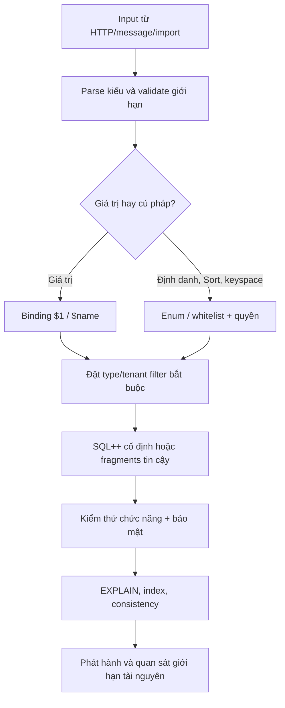

# Ràng buộc đầu vào và phòng tránh ghép chuỗi truy vấn không an toàn

> **Mục tiêu:** Thiết kế truy vấn Couchbase SQL++ nhận đầu vào từ ứng dụng mà không chèn giá trị người dùng vào văn bản câu lệnh. Sau bài học, bạn có thể dùng tham số vị trí `$1`, tham số có tên `$category` cùng `@Param` trong Spring Data Couchbase; dùng `QueryOptions.parameters(...)` của Java SDK; phân biệt **giá trị** với **định danh/cấu trúc SQL++**, nhận biết rủi ro từ SpEL, `LIKE`, `IN` và bộ lọc động, đồng thời kiểm chứng an toàn bằng kiểm thử tích hợp.

Trong module **SPRING_DATA_COUCHBASE**, ứng dụng ánh xạ Java entity thành document JSON và truy cập chúng qua Repository, `CouchbaseTemplate`, API reactive hoặc Couchbase Java SDK. Các document được tổ chức theo **bucket/scope/collection**. Khi đã biết document ID, KV API thường phù hợp; khi cần lọc theo `category`, giá, trạng thái và dữ liệu lồng nhau, Query Service thực thi **SQL++** (tên cũ: N1QL).

Đầu vào tìm kiếm thường đến từ HTTP request, giao diện lọc, thông điệp hàng đợi hoặc file import. **Giá trị từ các nguồn đó không được phép tự biến thành cú pháp truy vấn.** Cách làm nền tảng là giữ **văn bản SQL++ cố định**, sau đó **binding tham số** để gửi giá trị riêng biệt cho Query Service. Tuy nhiên, binding chỉ bảo vệ ranh giới cú pháp của **giá trị**: nó không thay kiểm tra quyền, quy tắc nghiệp vụ hoặc whitelist của tên trường/collection.

| Loại đầu vào | Ví dụ | Cách xử lý |
| --- | --- | --- |
| Giá trị chuỗi | `"keyboard"`, tên sản phẩm | Binding `$1` hoặc `$category` |
| Số và Boolean | Giá tối đa, `active = true` | Binding có kiểu; kiểm tra khoảng hợp lệ |
| Danh sách giá trị | Danh mục được chọn | Binding array; xác định ý nghĩa danh sách rỗng |
| Mẫu `LIKE` | Tiền tố SKU, chuỗi tìm kiếm | Binding **và** xử lý ký tự đại diện theo yêu cầu |
| Tên cột/đường dẫn JSON | `price`, `sku` | Chọn từ whitelist định danh do ứng dụng kiểm soát |
| `ASC`/`DESC`, cấu trúc `ORDER BY` | Thứ tự sắp xếp | Enum/whitelist hoặc API `Sort` được hỗ trợ |
| Bucket/scope/collection | `catalog.commerce.products` | Mapping/metadata cố định và kiểm tra quyền; không binding như giá trị |
| Tenant/quyền xem | Tenant của người đang đăng nhập | Lấy từ security context tin cậy; kiểm tra authorization |

## 1. Bối cảnh dữ liệu và hợp đồng tìm kiếm

Ứng dụng minh họa sử dụng:

| Thành phần | Giá trị |
| --- | --- |
| Bucket | `catalog` |
| Scope | `commerce` |
| Collection | `products` |
| Repository | `ProductRepository` |
| Entity | `Product` |

Document ID `product::KB-101`:

```json
{
  "sku": "KB-101",
  "name": "Bàn phím cơ TKL",
  "category": "keyboard",
  "price": 1450000,
  "active": true,
  "tenantId": "shop-a",
  "tags": ["mechanical", "gaming"],
  "specs": { "connection": "wired" }
}
```

Document ID `product::KB-202`:

```json
{
  "sku": "KB-202",
  "name": "Bàn phím không dây",
  "category": "keyboard",
  "price": 1950000,
  "active": true,
  "tenantId": "shop-a",
  "tags": ["wireless", "office"],
  "specs": { "connection": "wireless" }
}
```

Document ID `product::MS-303`:

```json
{
  "sku": "MS-303",
  "name": "Chuột văn phòng",
  "category": "mouse",
  "price": 420000,
  "active": false,
  "tenantId": "shop-a",
  "tags": ["office", "wireless"],
  "specs": { "connection": "wireless" }
}
```

Document ID `product::KB-404`:

```json
{
  "sku": "KB-404",
  "name": "Bàn phím mini",
  "category": "keyboard",
  "price": 850000,
  "active": true,
  "tenantId": "shop-b",
  "tags": ["compact"],
  "specs": { "connection": "bluetooth" }
}
```

Các JSON chỉ thể hiện trường nghiệp vụ. Khi được lưu bằng Spring Data, body có thể chứa thêm type discriminator như `_class`. Nếu sử dụng `#{#n1ql.filter}` trong `@Query`, dữ liệu test phải có discriminator tương thích với converter của entity; không mặc định các JSON chèn bằng Workbench sẽ được Repository nhận diện giống dữ liệu do Spring Data lưu.

### Entity và Repository nền tảng

```java
import java.util.List;
import org.springframework.data.annotation.Id;
import org.springframework.data.couchbase.core.mapping.Document;
import org.springframework.data.couchbase.repository.Collection;
import org.springframework.data.couchbase.repository.Scope;

@Document
@Scope("commerce")
@Collection("products")
public class Product {
    @Id
    private String id;

    private String sku;
    private String name;
    private String category;
    private Long price;
    private Boolean active;
    private String tenantId;
    private List<String> tags;
    private Specs specs;

    public Product() {}

    public static class Specs {
        private String connection;
        public Specs() {}
    }

    // Bổ sung getter/setter hoặc constructor theo convention dự án.
}
```

Bucket `catalog` được chọn qua cấu hình Spring Data Couchbase. Hai annotation `@Scope`/`@Collection` quyết định collection của entity; `@Id` ánh xạ **document key**, không phải một trường JSON `id` bắt buộc trong body.

Yêu cầu của một API tìm kiếm giả định:

```text
GET /api/products?category=keyboard&maxPrice=1600000
```

Caller có thể chọn `category` và `maxPrice`. Nhưng **tenantId phải do server lấy từ ngữ cảnh xác thực**; người dùng không được tự chọn một tenant khác chỉ bằng cách thay query parameter. Với tenant `shop-a`, điều kiện category keyboard, giá không vượt 1.600.000 và active sẽ trả KB-101. KB-202 vượt giá, KB-404 thuộc tenant khác.

## 2. Rủi ro của ghép chuỗi SQL++ từ đầu vào

Đây là một mẫu **không an toàn**:

```java
// Ví dụ phản diện: không dùng trong code thực tế.
String unsafeSql =
    "SELECT p.sku, p.price "
  + "FROM `catalog`.`commerce`.`products` AS p "
  + "WHERE p.category = '" + categoryFromRequest + "' "
  + "AND p.price <= " + maxPriceFromRequest;
```

Vấn đề không nằm ở dấu `+` của Java nói chung, mà ở việc **dữ liệu không tin cậy đang được ghép vào những vị trí thuộc văn bản SQL++**:

- Nếu category có dấu nháy, câu lệnh có thể lỗi cú pháp.
- Nếu input chứa các ký tự mang ý nghĩa SQL++, nó có nguy cơ làm thay đổi điều kiện lọc thay vì được hiểu là một chuỗi thuần.
- Nếu price đến từ chuỗi HTTP chưa được chuyển và kiểm tra đúng kiểu, có thể đưa dữ liệu sai định dạng vào vị trí số.
- Nếu điều kiện tenant cũng được ghép hoặc bị thiếu, vấn đề không chỉ là SQL++ injection mà còn là **rò rỉ dữ liệu giữa tenant**.

Ghép chuỗi còn gây khó bảo trì: người viết phải tự thêm dấu nháy/escape, dễ sai với `NULL`, array và ký tự đặc biệt. Tự dùng `replace("'", "...")` không phải một cơ chế bảo vệ toàn diện vì cú pháp SQL++ có nhiều loại literal, định danh và biểu thức khác nhau.

**Nguyên tắc:** Viết cấu trúc truy vấn một lần; binding giá trị ở thời điểm gọi. Tránh thiết kế API nhận một chuỗi kiểu `"WHERE price < 1000000"` hay `"ORDER BY ..."` từ client rồi đưa trực tiếp vào Query Service.

### So sánh câu truy vấn có và không có binding

Không an toàn:

```java
String sql = "SELECT p.sku FROM `catalog`.`commerce`.`products` AS p "
           + "WHERE p.name = '" + nameFromRequest + "'";
```

An toàn khi binding:

```sql
SELECT p.sku
FROM `catalog`.`commerce`.`products` AS p
WHERE p.name = $name;
```

Ở câu thứ hai, `$name` là **placeholder cho giá trị**. Tên sản phẩm có dấu nháy hay ký tự đặc biệt vẫn phải được truyền dưới dạng chuỗi; nó không trở thành toán tử hoặc tên field của câu truy vấn.

## 3. Spring Data `@Query` với tham số vị trí `$1`, `$2`

Trong Spring Data Couchbase Repository, `$1` tham chiếu đối số **thứ nhất** của phương thức, `$2` tham chiếu đối số **thứ hai**. Đếm từ 1, khác với chỉ số phần tử mảng Java thông thường.

```java
import java.util.List;
import org.springframework.data.couchbase.repository.CouchbaseRepository;
import org.springframework.data.couchbase.repository.Query;

public interface ProductRepository
        extends CouchbaseRepository<Product, String> {

    @Query("#{#n1ql.selectEntity} WHERE #{#n1ql.filter} "
         + "AND category = $1 "
         + "AND price <= $2 "
         + "AND active = true")
    List<Product> findActiveUnderPrice(
        String category, long maxPrice
    );
}
```

Ví dụ gọi:

```java
List<Product> results =
    productRepository.findActiveUnderPrice("keyboard", 1600000L);
```

Trên dữ liệu mẫu, kết quả gồm KB-101 và KB-404 nếu chưa ràng buộc tenant. **Binding giá trị đúng không đồng nghĩa truy vấn an toàn về quyền truy cập.** Các điều kiện tenant phải được bổ sung độc lập.

| Đối số Java | Giá trị minh họa | Placeholder |
| --- | --- | --- |
| `category` | `"keyboard"` | `$1` |
| `maxPrice` | `1600000L` | `$2` |

Không bọc placeholder chuỗi trong dấu nháy:

```java
// SAI: '$1' là chuỗi literal trong SQL++, không còn tham số.
@Query("#{#n1ql.selectEntity} WHERE #{#n1ql.filter} "
     + "AND category = '$1'")
List<Product> wrongQuotedCategory(String category);
```

Đúng là `category = $1`; driver/binder sẽ gửi giá trị kiểu chuỗi mà không cần dấu nháy thêm quanh placeholder.

### Rủi ro nhầm thứ tự

```java
@Query("#{#n1ql.selectEntity} WHERE #{#n1ql.filter} "
     + "AND price >= $2 AND price <= $3 "
     + "AND category = $1")
List<Product> findByPriceRange(
    String category, long minPrice, long maxPrice
);
```

Câu này hợp lệ vì `$2` ứng với `minPrice` và `$3` ứng với `maxPrice`. Nếu hoán đổi vị trí hai tham số Java nhưng quên sửa placeholder, truy vấn có thể chạy mà trả sai dữ liệu. Với nhiều tham số cùng kiểu, nên cân nhắc chuyển sang **tham số có tên**.

## 4. Tham số có tên `$category` và `@Param`

Tham số có tên giúp điều kiện mô tả rõ ý nghĩa:

```java
import java.util.List;
import org.springframework.data.couchbase.repository.Query;
import org.springframework.data.repository.query.Param;

// Đặt bên trong ProductRepository.
@Query("#{#n1ql.selectEntity} WHERE #{#n1ql.filter} "
     + "AND category = $category "
     + "AND price BETWEEN $minPrice AND $maxPrice "
     + "AND active = $enabled")
List<Product> findWithNamedCriteria(
    @Param("category") String category,
    @Param("minPrice") long from,
    @Param("maxPrice") long to,
    @Param("enabled") boolean active
);
```

Đoạn trên minh họa method khai báo **trong interface Repository**. Các tên `$minPrice`, `$maxPrice` phải khớp chuỗi trong `@Param(...)`; biến Java có thể tên `from`, `to` mà không ảnh hưởng binding nếu annotation đúng.

```java
List<Product> items = productRepository.findWithNamedCriteria(
    "keyboard", 1000000L, 2000000L, true
);
```

Trên bộ dữ liệu mẫu, có hai KB-101 và KB-202 đáp ứng price range; KB-404 rẻ hơn minPrice, dù là keyboard. Điều kiện tenant vẫn chưa được áp dụng trong ví dụ này.

### Quy tắc đối chiếu tên

| Thành phần | Ví dụ | Phải khớp với |
| --- | --- | --- |
| Tên field JSON | `price` | Dữ liệu đã lưu và quy tắc `@Field` |
| Placeholder SQL++ | `$minPrice` | Chuỗi `@Param("minPrice")` |
| Annotation | `@Param("minPrice")` | Placeholder tên trong câu `@Query` |
| Tên biến Java | `from` | Không bắt buộc bằng tên placeholder khi dùng `@Param` |

Các dự án có thể dùng thông tin tên tham số lúc biên dịch (ví dụ `-parameters`) để hỗ trợ một số cơ chế tự phân giải; tuy nhiên, với `@Query` sử dụng placeholder có tên, **`@Param` tường minh** giúp hợp đồng rõ ràng và giảm phụ thuộc vào build.

Nên dùng nhất quán **tham số vị trí hoặc có tên trong một câu `@Query`**, không pha trộn chúng chỉ vì một điều kiện ngắn hơn. Việc kết hợp `#{#n1ql.selectEntity}` (SpEL) và `$category` (binding) trong cùng query là bình thường: đây không phải sự pha trộn hai kiểu placeholder.

### Một tham số dùng được nhiều lần

```java
@Query("#{#n1ql.selectEntity} WHERE #{#n1ql.filter} "
     + "AND (sku = $term OR name = $term)")
List<Product> findSkuOrExactName(
    @Param("term") String term
);
```

Cả hai vị trí `$term` dùng cùng một **giá trị**. Nếu `term` chứa dấu nháy, nó vẫn được binding như một chuỗi; tuy nhiên, mẫu này chỉ so sánh **bằng chính xác**, chưa phải tìm kiếm gần đúng/toàn văn.

## 5. Couchbase Java SDK: truyền query parameters

Đối với câu SQL++ tùy chỉnh không thực thi qua Repository, dùng `Cluster.query` và `QueryOptions.parameters(...)`. **Đừng tự nối đầu vào vào SQL++** dù không dùng Spring Data `@Query`.

### Binding theo tên

```java
import java.util.List;
import com.couchbase.client.java.Cluster;
import com.couchbase.client.java.json.JsonObject;
import com.couchbase.client.java.query.QueryResult;
import static com.couchbase.client.java.query.QueryOptions.queryOptions;

public class ProductSearch {
    private final Cluster cluster;

    public ProductSearch(Cluster cluster) {
        this.cluster = cluster;
    }

    public List<JsonObject> findActiveByCategoryAndPrice(
            String category, long maxPrice) {

        String sql = """
            SELECT p.sku AS sku, p.price AS price
            FROM `catalog`.`commerce`.`products` AS p
            WHERE p.category = $category
              AND p.price <= $maxPrice
              AND p.active = true
            ORDER BY p.sku ASC
            """;

        JsonObject params = JsonObject.create()
            .put("category", category)
            .put("maxPrice", maxPrice);

        QueryResult result = cluster.query(
            sql,
            queryOptions().parameters(params)
        );
        return result.rowsAsObject();
    }
}
```

Ví dụ sử dụng Java 17+ vì có text block. `Cluster` phải được cấu hình và tái sử dụng theo vòng đời ứng dụng. Query được gửi với **cấu trúc cố định** và hai giá trị có kiểu; `rowsAsObject()` thích hợp vì mỗi hàng `SELECT` ở đây là một JSON object có hai field.

### Binding theo vị trí

```java
import com.couchbase.client.java.json.JsonArray;

String sql = """
    SELECT p.sku, p.price
    FROM `catalog`.`commerce`.`products` AS p
    WHERE p.category = $1 AND p.price <= $2
    """;

JsonArray args = JsonArray.from("keyboard", 1600000);

QueryResult result = cluster.query(
    sql,
    queryOptions().parameters(args)
);
```

Phần tử đầu tiên của `JsonArray` tương ứng placeholder SQL++ `$1`; phần tử thứ hai tương ứng `$2`. Java array bắt đầu từ chỉ số 0, nhưng SQL++ positional placeholders bắt đầu từ 1.

### Đừng quên kiểu dữ liệu

```java
JsonObject params = JsonObject.create()
    .put("category", "keyboard")   // String
    .put("maxPrice", 1600000L)     // Number
    .put("enabled", true);         // Boolean
```

Truyền `"1600000"` (chuỗi) thay cho `1600000` (số) có thể dẫn đến so sánh kiểu sai hoặc kết quả không như mong muốn. Binding **không tự xác thực ràng buộc nghiệp vụ** như giá phải không âm, giới hạn số phần tử hoặc người gọi có quyền lọc tenant nào.

### SDK không tự phân giải SpEL

Chuỗi `"#{#n1ql.selectEntity} WHERE ..."` chỉ có nghĩa trong parser `@Query` của Spring Data. Nếu gửi nguyên chuỗi ấy vào `Cluster.query`, Query Service không biết `#{...}` là gì. Trong SDK, viết SQL++ thuần với keyspace/alias và tham số; nếu cần mapper entity, chọn API mapping tương ứng thay vì giả định một `JsonObject` là Java entity đầy đủ.

## 6. Placeholder giá trị không thay tên field hay collection

SQL++ có ranh giới rõ ràng giữa **giá trị** và **cú pháp**. Placeholder được dùng cho số, chuỗi, Boolean, array hoặc object theo cách API hỗ trợ. Nó **không phải macro thay thế định danh**.

Ví dụ **đúng**:

```sql
SELECT p.sku
FROM `catalog`.`commerce`.`products` AS p
WHERE p.category = $category;
```

Ví dụ **sai về mục đích**:

```sql
-- Không dùng placeholder để thay tên collection.
SELECT p.sku FROM $collection AS p;

-- $field là một giá trị, không trở thành tên thuộc tính JSON.
SELECT p.sku
FROM `catalog`.`commerce`.`products` AS p
WHERE $field = "keyboard";
```

Một câu có `WHERE $field = "keyboard"` nếu cú pháp được nhận diện thì so sánh **giá trị của tham số** với chuỗi; nó không tương đương `WHERE p.category = "keyboard"`. Tên field cần là một đoạn cú pháp **được ứng dụng kiểm soát**, không phải một chuỗi tự do của client.

### Whitelist cho tên field tìm kiếm

Giả sử trang quản trị cho chọn **SKU** hoặc **category** để tìm bằng phép bằng. Định nghĩa tập lựa chọn cố định:

```java
public enum SearchField {
    SKU,
    CATEGORY
}

public final class ProductFieldNames {
    private ProductFieldNames() {}

    public static String sqlppPath(SearchField field) {
        return switch (field) {
            case SKU -> "p.sku";
            case CATEGORY -> "p.category";
        };
    }
}
```

Sau khi một giá trị HTTP được parse/validate thành `SearchField`, chỉ **hai chuỗi cố định** ấy mới được dùng làm đường dẫn SQL++:

```java
String field = ProductFieldNames.sqlppPath(
    SearchField.CATEGORY
);

String sql = """
    SELECT p.sku, p.category
    FROM `catalog`.`commerce`.`products` AS p
    WHERE %s = $value
    """.formatted(field);

JsonObject params = JsonObject.create()
    .put("value", "keyboard");

QueryResult result = cluster.query(
    sql, queryOptions().parameters(params)
);
```

Trong đoạn này, **`field` không phải dữ liệu raw từ request**: nó là chuỗi hằng được chọn từ enum, không thể mang theo biểu thức SQL++ lạ. Giá trị `"keyboard"` vẫn dùng `$value`. Đây là một trường hợp có thể xây cấu trúc câu truy vấn theo lựa chọn tin cậy — **khác căn bản** với nối chuỗi `fieldFromHttp` trực tiếp.

Với số lượng field cố định và ít, có thể còn đơn giản hơn: viết hai phương thức Repository riêng hoặc dùng derived query `findBySku`/`findByCategory`. Không cần viết builder động chỉ để tiết kiệm một câu `@Query`.

### `ORDER BY` và hướng sắp xếp động

Không truyền `"DESC"` vào `$direction` rồi mong Query Service hiểu nó là từ khóa:

```sql
-- Không phải cách binding hướng ORDER BY.
ORDER BY p.price $direction
```

Thay vào đó, chỉ cho phép:

- **Field:** `price` hoặc `sku`.
- **Direction:** `ASC` hoặc `DESC`.
- **Tie-breaker:** `sku` hoặc document ID để thứ tự ổn định khi cần phân trang.

Ví dụ ở tầng service:

```java
public enum SortColumn { PRICE, SKU }
public enum SortDirection { ASC, DESC }

public static String orderBy(
        SortColumn column, SortDirection direction) {
    String field = switch (column) {
        case PRICE -> "p.price";
        case SKU -> "p.sku";
    };
    String order = switch (direction) {
        case ASC -> "ASC";
        case DESC -> "DESC";
    };
    return "ORDER BY " + field + " " + order + ", META(p).id ASC";
}
```

Hai phép nối chuỗi ở đây chỉ sử dụng **hằng định danh/từ khóa từ enum** do lập trình viên xác định. Giá trị lọc trong `WHERE` vẫn phải binding. Nếu phiên bản Spring Data hỗ trợ `Sort`/`Pageable` cho tình huống cụ thể, có thể dùng cơ chế của framework với danh sách property được phép, thay vì tạo `ORDER BY` thủ công.

### Tên bucket/scope/collection không phải tham số người dùng

Với Spring Data Couchbase, `@Scope` và `@Collection` ánh xạ entity tới keyspace. Các SpEL `#{#n1ql.bucket}`, `#{#n1ql.scope}`, `#{#n1ql.collection}` có thể cung cấp thông tin theo metadata của framework.

**Không đưa input của HTTP `?collection=...` vào SpEL** để tạo `FROM`. Nếu ứng dụng thật sự cần chọn nhiều collection, hãy ánh xạ một enum quyền hạn đã kiểm tra tới danh sách keyspace cố định, đồng thời xác minh người dùng được truy cập nguồn tương ứng. Một API cho phép tự do chọn bucket có thể làm lộ dữ liệu ngay cả khi mọi điều kiện `WHERE` khác đều dùng binding đúng.

## 7. SpEL nội suy văn bản khác với binding SQL++

`@Query` của Spring Data Couchbase có thể chứa biểu thức SpEL `#{...}`. Chúng được đánh giá khi Spring Data chuẩn bị query, có khả năng **chèn văn bản vào câu SQL++**. Đó không phải sự thay thế trực tiếp cho query parameters.

Ví dụ chuẩn cho full entity:

```java
@Query("#{#n1ql.selectEntity} WHERE #{#n1ql.filter} "
     + "AND category = $category")
List<Product> findByCategorySafe(
    @Param("category") String category
);
```

Trong đó:

| Ký hiệu | Vai trò |
| --- | --- |
| `#{#n1ql.selectEntity}` | Spring Data dựng phần `SELECT/FROM` theo mapping |
| `#{#n1ql.filter}` | Spring Data dựng điều kiện type discriminator |
| `$category` | Query Service nhận **giá trị** được binding |
| `@Param("category")` | Spring Data gắn tên SQL++ với đối số Java |

### Cảnh báo với nội suy đối số qua SpEL

Một mẫu có thể xuất hiện trong ví dụ chuyên sâu:

```java
// Ví dụ mang rủi ro: không nhận raw fieldName từ client.
@Query("#{#n1ql.selectEntity} WHERE #{#n1ql.filter} "
     + "AND #{[0]} = $2")
List<Product> searchByDynamicField(
    String fieldName, String expectedValue
);
```

`#{[0]}` là **SpEL truy cập đối số Java thứ nhất**, đánh chỉ số từ 0 và **nội suy vào văn bản SQL++**. Trong khi đó `$2` là placeholder SQL++ giá trị của đối số thứ hai, đếm từ 1. Nếu caller đưa một `fieldName` chưa được whitelist vào `#{[0]}`, câu truy vấn có thể bị thay đổi cấu trúc, dù `expectedValue` vẫn được binding đúng.

**Thực hành an toàn:** các field/đường dẫn mà SpEL được phép chèn phải đến từ enum/constant do ứng dụng kiểm soát. Với dữ liệu cần so sánh như category, name, giá, email, mã sản phẩm, sử dụng placeholder `$1`/`$name` thay cho nội suy SpEL.

### Mẫu phản diện: nội suy giá trị vào literal

```java
// KHÔNG sử dụng: SpEL chèn đối số vào literal SQL++.
@Query("#{#n1ql.selectEntity} WHERE #{#n1ql.filter} "
     + "AND name = '#{[0]}'")
List<Product> unsafeByName(String name);
```

Giá trị tên sản phẩm có dấu nháy có thể làm hỏng literal hoặc ảnh hưởng cú pháp. Đúng là:

```java
@Query("#{#n1ql.selectEntity} WHERE #{#n1ql.filter} "
     + "AND name = $1")
List<Product> safeByName(String name);
```

### Type filter không phải authorization

`#{#n1ql.filter}` thường phục vụ phân biệt kiểu entity. Nó không tự xác nhận tenant, role hay quyền xem của caller. Trong một collection dùng chung giữa nhiều tenant, **query dù đã sử dụng SpEL type filter vẫn có thể đọc nhầm dữ liệu tenant khác** nếu thiếu điều kiện quyền độc lập.

## 8. `LIKE`: binding vẫn giữ ý nghĩa ký tự đại diện

Một yêu cầu tìm sản phẩm theo tiền tố SKU có thể dùng `LIKE`:

```java
@Query("#{#n1ql.selectEntity} WHERE #{#n1ql.filter} "
     + "AND sku LIKE $pattern "
     + "ORDER BY sku ASC")
List<Product> findBySkuPattern(
    @Param("pattern") String pattern
);
```

`findBySkuPattern("KB-%")` có thể trả các SKU KB-101, KB-202 và KB-404. Binding bảo đảm giá trị `"KB-%"` không trở thành cú pháp tùy ý của một phép `WHERE`, **nhưng `%` vẫn là ký tự đại diện của `LIKE`**. Tương tự, `_` có ý nghĩa khớp một ký tự theo quy tắc SQL++.

### Phân biệt tìm theo mẫu và tìm chuỗi theo nghĩa đen

| Input của người dùng | Ý định | Cách xử lý |
| --- | --- | --- |
| `KB-` | Tìm SKU bắt đầu bằng `KB-` | Tạo một pattern prefix đã kiểm soát và binding |
| `KB-%` | Người dùng chủ động nhập mẫu SQL++ | Chỉ cho phép nếu UI/API được thiết kế rõ là tìm theo mẫu |
| `100%` | Tìm chữ `100%` đúng nguyên văn | Escape wildcard theo quy tắc SQL++ hoặc dùng exact match/tìm kiếm khác |
| `a_b` | Tìm ký tự gạch dưới đúng nguyên văn | Escape wildcard phù hợp, không tự coi `_` là chữ bình thường |

### Tạo tiền tố rồi vẫn binding

```java
public List<Product> searchBySkuPrefix(String prefix) {
    if (prefix == null || prefix.isBlank() || prefix.length() > 40) {
        throw new IllegalArgumentException("Invalid SKU prefix");
    }
    // Nếu API cho phép % hoặc _ ở input, cần escape trước theo
    // quy tắc LIKE của phiên bản Couchbase được sử dụng.
    if (prefix.contains("%") || prefix.contains("_")) {
        throw new IllegalArgumentException("Wildcards are not accepted");
    }

    String pattern = prefix + "%";
    return productRepository.findBySkuPattern(pattern);
}
```

Ví dụ này **cố ý không chấp nhận wildcard người dùng nhập** nên có thể thêm `%` cuối pattern một cách rõ ràng. Chuỗi `pattern` **vẫn được binding** qua `@Param`; không nối nó trực tiếp vào văn bản SQL++.

Nếu sản phẩm hợp pháp có ký tự `%` hoặc `_` trong SKU, thay vì cấm, cần thiết kế cơ chế escape wildcard theo đặc tả SQL++ của phiên bản Couchbase và kiểm thử với dữ liệu thật. Không tự mặc định escape của một hệ quản trị SQL quan hệ hoạt động y hệt. Với tìm kiếm gần đúng, relevance hoặc từ khóa tự nhiên, cân nhắc **Couchbase Search Service** thay vì mở rộng một `LIKE "%term%"` trên dữ liệu rất lớn.

**Binding giải quyết injection, không giải quyết hoàn toàn truy vấn quá rộng hoặc tốn tài nguyên.** Với yêu cầu tìm kiếm công khai, cần thêm giới hạn độ dài input, giới hạn kết quả, rate limiting và index/query plan phù hợp.

## 9. Truyền mảng cho `IN` và `ANY`

Đối với một tập category, dùng một tham số array thay vì tạo chuỗi `"('keyboard','mouse',...)"` bằng phép nối.

### `IN` với Repository

```java
@Query("#{#n1ql.selectEntity} WHERE #{#n1ql.filter} "
     + "AND category IN $categories "
     + "AND active = true")
List<Product> findActiveInCategories(
    @Param("categories") List<String> categories
);
```

Lời gọi:

```java
List<Product> items = productRepository.findActiveInCategories(
    List.of("keyboard", "mouse")
);
```

Trên dữ liệu mẫu, có ba sản phẩm active trong danh sách: KB-101, KB-202 và KB-404; MS-303 thuộc mouse nhưng `active = false`. Dù binding đúng, câu query này **chưa có tenant filter**, vì vậy không dùng nguyên nó cho API phải cô lập shop-a/shop-b.

Đối với SDK, có thể truyền JSON array trong named parameters:

```java
import com.couchbase.client.java.json.JsonArray;

String sql = """
    SELECT p.sku, p.category
    FROM `catalog`.`commerce`.`products` AS p
    WHERE p.category IN $categories
    """;

JsonObject parameters = JsonObject.create()
    .put("categories", JsonArray.from("keyboard", "mouse"));

QueryResult result = cluster.query(
    sql, queryOptions().parameters(parameters)
);
```

### Hợp đồng cho array rỗng

`category IN []` không có phần tử nào để khớp. **Danh sách rỗng không mặc định có nghĩa “lấy tất cả”.** Tầng service nên quyết định:

- Array rỗng → kết quả rỗng, có thể trả ngay mà không truy vấn.
- Array rỗng → không áp dụng bộ lọc, nhưng vẫn phải có giới hạn tenant/quyền và pagination.
- Array rỗng → báo lỗi input, nếu API yêu cầu chọn ít nhất một danh mục.

Không tự chọn phương án “bỏ tất cả `WHERE`” chỉ vì client gửi danh sách rỗng; nó có thể mở rộng dữ liệu ngoài ý định.

### `ANY` trong mảng JSON

`tags` là mảng chuỗi. Tìm document chứa một tag theo binding:

```java
@Query("#{#n1ql.selectEntity} WHERE #{#n1ql.filter} "
     + "AND ANY tag IN tags "
     + "SATISFIES tag = $tag END")
List<Product> findWithTag(@Param("tag") String tag);
```

Với `tag = "wireless"`, KB-202 và MS-303 khớp theo dữ liệu gốc. `tag` sau `ANY` là **biến cục bộ của SQL++**, không phải input Java; `$tag` là giá trị binding từ caller.

Nếu mảng gồm object (ví dụ `variants` với `color` và `stock`), giữ các điều kiện cần thuộc **cùng một phần tử** bên trong một `SATISFIES`:

```sql
WHERE ANY v IN p.variants
      SATISFIES v.color = $color AND v.stock >= $minStock
      END;
```

Đây là phép kiểm tra trên document **có field variants theo schema tương ứng**; bộ dữ liệu mẫu ở đầu bài chưa có mảng này. Không dùng một điều kiện `ANY color` và một điều kiện `ANY stock` tách biệt nếu ý định là cùng một biến thể vừa đúng màu vừa còn hàng.

## 10. `NULL`, `MISSING` và tham số tùy chọn

Couchbase phân biệt:

- `NULL`: field tồn tại trong JSON nhưng giá trị là JSON null.
- `MISSING`: field không tồn tại ở đường dẫn đã truy cập.
- **Java null**: giá trị tham số ở phía ứng dụng, cách truyền và chuyển đổi do API/binder quyết định.

Ví dụ SQL++:

```sql
SELECT p.sku
FROM `catalog`.`commerce`.`products` AS p
WHERE p.discount IS NULL;

SELECT p.sku
FROM `catalog`.`commerce`.`products` AS p
WHERE p.discount IS MISSING;

SELECT p.sku
FROM `catalog`.`commerce`.`products` AS p
WHERE p.discount IS VALUED;
```

Không dùng `discount = $value` với `value = null` rồi giả định sẽ tương đương `IS NULL` hoặc `IS MISSING`. `NULL`/`MISSING` có ngữ nghĩa ba trị và các biểu thức so sánh phải được chọn có chủ đích.

### Truy vấn với bộ lọc không bắt buộc

Giả sử form tìm kiếm cho phép bỏ `category` hoặc `maxPrice`. Có thể chọn hai hướng:

**Hướng A: một số phương thức tĩnh có hợp đồng rõ.**

```java
List<Product> findByCategory(String category);

@Query("#{#n1ql.selectEntity} WHERE #{#n1ql.filter} "
     + "AND category = $category AND price <= $maxPrice")
List<Product> findByCategoryAndMaxPrice(
    @Param("category") String category,
    @Param("maxPrice") long maxPrice
);
```

Service chọn phương thức tương ứng với những field người dùng đã nhập. Mỗi query có cấu trúc cố định, dễ thiết kế index và kiểm thử.

**Hướng B: xây điều kiện động một cách kiểm soát.** Với nhiều lựa chọn độc lập, có thể dùng `CouchbaseTemplate` hoặc SDK và builder chỉ cho phép **mẫu điều kiện tĩnh** do ứng dụng xác định; giá trị của từng điều kiện vẫn được binding. Không nhận một chuỗi `WHERE` tùy ý từ client.

Một mẫu SQL++ thường gặp là:

```sql
WHERE ($category IS NULL OR p.category = $category)
  AND ($maxPrice IS NULL OR p.price <= $maxPrice)
```

Mẫu này **chỉ phù hợp khi ứng dụng chủ động quy định tham số null nghĩa là bỏ qua điều kiện**, binder/version xử lý null đúng và hiệu năng đã được phân tích. Các nhánh `OR` có thể làm kế hoạch index kém chọn lọc; với bộ lọc phức tạp nên đánh giá query động từ các thành phần đã whitelist.

**Tuyệt đối không để “không có category” làm biến mất điều kiện tenant hoặc phân quyền.** Bộ lọc nghiệp vụ có thể tùy chọn, nhưng ràng buộc truy cập phải luôn được duy trì.

## 11. Cô lập tenant và phân quyền không thể giao hết cho binding

Xét hai document keyboard KB-101 thuộc `shop-a` và KB-404 thuộc `shop-b`. Một truy vấn dù dùng binding an toàn:

```java
@Query("#{#n1ql.selectEntity} WHERE #{#n1ql.filter} "
     + "AND category = $category")
List<Product> allTenantsByCategory(
    @Param("category") String category
);
```

vẫn có thể trả document của cả hai tenant. **Không có SQL++ injection** ở đây, nhưng vẫn có nguy cơ **lộ dữ liệu do thiếu authorization**.

### Repository có ràng buộc tenant

```java
@Query("#{#n1ql.selectEntity} WHERE #{#n1ql.filter} "
     + "AND tenantId = $tenantId "
     + "AND category = $category "
     + "AND active = true "
     + "AND price <= $maxPrice")
List<Product> findVisibleProducts(
    @Param("tenantId") String trustedTenantId,
    @Param("category") String category,
    @Param("maxPrice") long maxPrice
);
```

Tầng service lấy tenant từ nguồn **đã xác thực và ủy quyền**:

```java
public List<Product> listVisibleProducts(
        String category, long maxPrice) {

    String tenant = tenantProvider.requireAuthorizedTenant();
    validateCategory(category);
    validatePriceLimit(maxPrice);

    return productRepository.findVisibleProducts(
        tenant, category, maxPrice
    );
}
```

Đây là đoạn minh họa trong class service; `tenantProvider` và các hàm `validate...` do dự án cài đặt. Không có một API Spring Data mặc định tên `requireAuthorizedTenant()`. Nếu caller `shop-a` hỏi keyboard giá dưới 1,6 triệu, kết quả là KB-101.

**Tại sao không nhận `tenantId` trực tiếp từ HTTP?** Vì người dùng có thể sửa query parameter thành tenant khác. Dù giá trị đó được binding hoàn toàn an toàn về cú pháp, ứng dụng vẫn có thể đọc sai dữ liệu. Binding và authorization là **hai tầng bảo vệ khác nhau**.

### Sai ngoặc `AND/OR` làm vượt qua tenant filter

```sql
-- VÍ DỤ PHẢN DIỆN: nhánh OR không còn chịu tenant filter.
WHERE p.tenantId = $tenantId
  AND p.category = $category
   OR p.price <= $maxPrice;
```

Vì `AND` có ưu tiên cao hơn `OR`, nhánh `p.price <= $maxPrice` có thể khớp document tenant khác.

Đúng khi nghiệp vụ muốn “trong tenant này, (khớp category hoặc đủ rẻ)”:

```sql
WHERE p.tenantId = $tenantId
  AND (p.category = $category OR p.price <= $maxPrice);
```

Ràng buộc tenant cũng phải được áp dụng khi đọc bằng **KV theo ID** (`findById`), không chỉ trong `@Query`. Nếu endpoint cho phép caller gửi document ID tùy ý, service phải xác thực quyền trên document trả về hoặc dùng một mô hình key/collection bảo đảm cô lập thích hợp.

### Ràng buộc quyền trên thao tác ghi

Với `UPDATE` hoặc `DELETE` SQL++, thiếu điều kiện tenant còn nguy hiểm hơn vì có thể thay đổi document của tenant khác:

```sql
-- Ví dụ minh họa điều kiện bắt buộc; KHÔNG chạy trên production.
UPDATE `catalog`.`commerce`.`products` AS p
SET p.active = false
WHERE p.tenantId = $trustedTenantId
  AND p.sku = $sku;
```

`$trustedTenantId` và `$sku` cần binding giá trị, nhưng **người gọi cũng phải có quyền thực hiện hành động**. Tầng ứng dụng, RBAC của Couchbase và giới hạn keyspace phải phối hợp; không suy ra quyền ghi từ việc biết document ID.

## 12. Xây truy vấn động an toàn bằng fragment cố định

Một API có nhiều bộ lọc tùy chọn không nhất thiết cần mười phương thức Repository. Có thể xây SQL++ từ **các fragment hằng đã kiểm soát**, rồi binding mọi giá trị đầu vào.

Ví dụ trong một service dùng SDK:

```java
import java.util.List;
import com.couchbase.client.java.Cluster;
import com.couchbase.client.java.json.JsonObject;
import com.couchbase.client.java.query.QueryResult;
import static com.couchbase.client.java.query.QueryOptions.queryOptions;

public class SafeProductSearch {
    private final Cluster cluster;

    public SafeProductSearch(Cluster cluster) {
        this.cluster = cluster;
    }

    public List<JsonObject> search(
            String trustedTenantId,
            String category,
            Long maxPrice,
            int requestedLimit) {

        if (trustedTenantId == null || trustedTenantId.isBlank()) {
            throw new IllegalArgumentException("Missing tenant");
        }
        if (requestedLimit < 1 || requestedLimit > 100) {
            throw new IllegalArgumentException("Limit out of range");
        }
        if (category != null && category.length() > 100) {
            throw new IllegalArgumentException("Category too long");
        }
        if (maxPrice != null && maxPrice < 0) {
            throw new IllegalArgumentException("Negative price");
        }

        StringBuilder sql = new StringBuilder("""
            SELECT p.sku AS sku, p.name AS name, p.price AS price
            FROM `catalog`.`commerce`.`products` AS p
            WHERE p.tenantId = $tenantId
              AND p.active = true
            """);

        JsonObject args = JsonObject.create()
            .put("tenantId", trustedTenantId)
            .put("limit", requestedLimit);

        if (category != null && !category.isBlank()) {
            sql.append(" AND p.category = $category");
            args.put("category", category);
        }
        if (maxPrice != null) {
            sql.append(" AND p.price <= $maxPrice");
            args.put("maxPrice", maxPrice);
        }

        sql.append(" ORDER BY p.sku ASC, META(p).id ASC");
        sql.append(" LIMIT $limit");

        QueryResult result = cluster.query(
            sql.toString(),
            queryOptions().parameters(args)
        );
        return result.rowsAsObject();
    }
}
```

Trong đoạn mã trên:

1. **Mọi đoạn SQL++ được nối đều là chuỗi hằng của ứng dụng** (một tập điều kiện đã định nghĩa).
2. **Mọi giá trị biến đổi đều binding** qua `args.put(...)`.
3. Điều kiện `tenantId` và `active` luôn hiện diện, dù người dùng không chọn bộ lọc tùy chọn.
4. `LIMIT` bị chặn ở tối đa 100; thứ tự được đặt tường minh. Với dữ liệu thực, cần kiểm tra `sku` có duy nhất hay không, và xác định tie-breaker thích hợp.
5. `trustedTenantId` vẫn phải đến từ **nguồn quyền tin cậy**; tên tham số hoặc biến Java không khiến nó tự đáng tin cậy.

Đây là mẫu hỗ trợ học khái niệm builder an toàn. Nếu trong một collection dùng chung nhiều kiểu document, cần thêm type discriminator phù hợp với Spring Data mapping đã lưu, không giả định mọi row đều là `Product`. Khi bộ lọc phức tạp và truy vấn dùng Spring Data mapping, hãy đánh giá `CouchbaseTemplate` hoặc các API truy vấn động mà **phiên bản** của dự án hỗ trợ.

### Vì sao builder an toàn vẫn phải có test?

Các điều kiện tùy chọn có thể ảnh hưởng:

- **Logic:** nếu thiếu `category`, truy vấn được phép trả mọi category của tenant nhưng không được bỏ tenant.
- **Hiệu năng:** nhiều tổ hợp `WHERE` cần index khác nhau, có thể phát sinh Fetch hoặc Scan lớn.
- **Mô hình dữ liệu:** field `NULL/MISSING` và dữ liệu nested có thể không khớp điều kiện như người viết tưởng.
- **Pagination:** thay đổi dữ liệu giữa các request có thể gây trùng/bỏ sót khi dùng offset.

Đừng hiểu “đã binding” là “query đã được tối ưu và được phép chạy trên mọi dữ liệu”.

## 13. Kiểm tra kiểu, phạm vi và kích thước đầu vào

Binding bảo đảm dữ liệu giữ vai trò giá trị, nhưng **không chứng minh giá trị hợp lệ về nghiệp vụ**.

| Trường | Quy tắc ví dụ | Vì sao cần? |
| --- | --- | --- |
| `category` | Không blank, tối đa 100 ký tự, thuộc danh mục cho phép nếu domain yêu cầu | Giảm query vô nghĩa và sai yêu cầu |
| `maxPrice` | Số nguyên không âm, nằm trong ngưỡng ứng dụng cho phép | Tránh sai kiểu/giới hạn tài nguyên |
| `active` | Boolean thực, không phải chuỗi tùy ý `"true"` | So sánh JSON đúng kiểu |
| `categories` | Danh sách không null, tối đa 30 phần tử, không chứa chuỗi rỗng | Giảm độ lớn input, định nghĩa rỗng rõ ràng |
| `skuPrefix` | Giới hạn ký tự/độ dài, wildcard có quy tắc rõ | Tránh `LIKE` quá rộng và input bất thường |
| `pageSize` | Từ 1 đến 100 | Không cho caller yêu cầu hàng triệu row |
| `sortBy` | Enum `PRICE`/`SKU` | Không cho truyền cú pháp `ORDER BY` tùy ý |
| `tenantId` | Lấy từ security context đã xác thực | Cô lập dữ liệu |

### Kiểu tiền tệ

Trong ví dụ, giá được lưu bằng `Long` biểu diễn đơn vị đồng. Với tiền tệ có phần thập phân, nên dùng kiểu/đơn vị có quy tắc chính xác như **số nguyên đơn vị nhỏ nhất** hoặc `BigDecimal` theo converter và cách lưu JSON được quy ước. Không tự dùng `double` cho tiền nếu cần bảo toàn số học thập phân.

### Kiểu thời gian

Nếu document lưu `createdAt` thành chuỗi ISO 8601 UTC, có thể binding ranh giới chuỗi cùng định dạng; nhưng so sánh chuỗi chỉ tương ứng với thứ tự thời gian khi định dạng, múi giờ và độ chính xác được chuẩn hóa. Nếu dữ liệu lưu epoch milliseconds, dùng tham số số tương ứng. Binder không tự “sửa” sự không nhất quán giữa các cách lưu thời gian.

### `LIMIT` và `OFFSET`

`LIMIT`/`OFFSET` nhận giá trị số ở những câu SQL++/phiên bản hỗ trợ binding:

```java
@Query("#{#n1ql.selectEntity} WHERE #{#n1ql.filter} "
     + "AND category = $category "
     + "ORDER BY sku ASC "
     + "LIMIT $limit OFFSET $offset")
List<Product> findPage(
    @Param("category") String category,
    @Param("limit") long limit,
    @Param("offset") long offset
);
```

`limit` phải dương và có trần hợp lý; `offset` không âm và không quá lớn. Phân trang offset sâu có thể tốn chi phí và không bảo đảm snapshot giữa các request; khi phù hợp, cân nhắc phân trang theo khóa (`keyset pagination`).

**Không kết hợp tùy tiện `LIMIT/OFFSET` tự viết với tham số đặc biệt `Pageable`**, vì framework có thể thêm phân trang lần nữa tùy version.

## 14. Binding trong truy vấn ghi: `UPDATE`, `DELETE` và `RETURNING`

Parameter binding có ý nghĩa với **SQL++ DML** tương tự `SELECT`. Nó giúp truyền giá trị mà không biến chúng thành cú pháp, nhưng **không tự bảo đảm thao tác ghi chỉ ảnh hưởng document được phép**.

### Ví dụ cập nhật an toàn về cú pháp

```sql
UPDATE `catalog`.`commerce`.`products` AS p
USE KEYS $documentId
SET p.price = $newPrice
WHERE p.tenantId = $trustedTenantId
RETURNING META(p).id AS documentId,
          p.price AS price;
```

Với SDK, tất cả `documentId`, `newPrice` và `trustedTenantId` phải được binding. Keyspace và tên field là cấu trúc tĩnh được lập trình viên kiểm soát.

Với trường hợp update của một entity theo ID, API `findById` rồi `save` với `@Version` (CAS) thường giúp biểu đạt optimistic locking rõ hơn. **DML SQL++ không mặc nhiên kích hoạt callbacks, converter và kiểm tra CAS của `repository.save`**. Nếu có cạnh tranh cập nhật, cần thiết kế cơ chế xung đột/transaction riêng.

### Ví dụ xóa có kiểm soát

```sql
DELETE FROM `catalog`.`commerce`.`products` AS p
WHERE p.tenantId = $trustedTenantId
  AND p.category = $category
  AND p.active = false
RETURNING META(p).id AS documentId;
```

Trước khi xóa, cần **xem trước danh sách ID với `SELECT`** có điều kiện tương đương và có kế hoạch audit/khôi phục. Một câu `DELETE` không có `WHERE` có thể xóa rất nhiều document; thêm `RETURNING` chỉ thay kết quả trả về, không làm thao tác bớt nguy hiểm.

### `RETURNING` có thể phơi bày dữ liệu nhạy cảm

`DELETE ... RETURNING *` hay `UPDATE ... RETURNING *` có thể trả toàn bộ body document. Không nên đưa kết quả ấy trực tiếp vào API hoặc log nếu chứa dữ liệu khách hàng/tenant không cần thiết. Chọn field tối thiểu, ví dụ ID và SKU, đồng thời kiểm soát quyền Query Select trên dữ liệu được trả về theo RBAC của Couchbase.

### SpEL cho DELETE trong Spring Data

Spring Data Couchbase có các biểu thức `#{#n1ql.delete}` và `#{#n1ql.returning}` phục vụ trường hợp xóa và trả về entity:

```java
@Query("#{#n1ql.delete} WHERE #{#n1ql.filter} "
     + "AND META().id = $id "
     + "AND tenantId = $tenantId "
     + "#{#n1ql.returning}")
Product deleteVisibleProduct(
    @Param("id") String id,
    @Param("tenantId") String trustedTenantId
);
```

Mẫu trên là phương thức **bên trong `ProductRepository`** và cần kiểm thử với version Spring Data hiện dùng. `#n1ql.delete` tạo `DELETE FROM` theo keyspace; `#n1ql.filter` giới hạn kiểu entity; `$id` và `$tenantId` là các giá trị được binding. `#n1ql.returning` tạo phần `RETURNING` hỗ trợ mapping entity — không tự đóng vai trò kiểm tra quyền.

Ngay cả khi trả lại một `Product`, document đã bị xóa khỏi database. Một object “vừa bị xóa” không thể được xem là snapshot đã lưu bền vững nếu chưa có cơ chế audit thích hợp.

## 15. Index, hiệu năng và scan consistency

Một câu truy vấn được binding đúng **không có nghĩa chạy nhanh**. SQL++ vẫn cần index phù hợp với `WHERE` và `ORDER BY` trên **đúng collection**.

Giả sử API thường tìm sản phẩm active theo `tenantId`, `category` và `price`:

```sql
SELECT p.sku, p.name, p.price
FROM `catalog`.`commerce`.`products` AS p
WHERE p.tenantId = $tenantId
  AND p.category = $category
  AND p.active = true
  AND p.price <= $maxPrice
ORDER BY p.price ASC, p.sku ASC
LIMIT $limit;
```

Một index ứng viên để đánh giá:

```sql
CREATE INDEX idx_product_tenant_category_active_price
ON `catalog`.`commerce`.`products`(
  tenantId, category, active, price, sku
);
```

Đây **không phải index tối ưu bắt buộc** cho mọi tập dữ liệu: thứ tự khóa, độ chọn lọc và field trong phép chiếu cần được đánh giá trên workload thực. Index trên collection `commerce.products` không dùng chung cho collection cùng tên ở scope khác.

### Dùng `EXPLAIN` với dữ liệu đại diện

Để nghiên cứu kế hoạch trên Query Workbench, dùng một câu SQL++ thuần tương đương về cấu trúc, với giá trị literal đại diện hoặc query parameters được thiết lập trong Workbench:

```sql
EXPLAIN
SELECT p.sku, p.name, p.price
FROM `catalog`.`commerce`.`products` AS p
WHERE p.tenantId = "shop-a"
  AND p.category = "keyboard"
  AND p.active = true
  AND p.price <= 1600000
ORDER BY p.price ASC, p.sku ASC
LIMIT 20;
```

Kiểm tra Query Service chọn index nào, có cần Fetch document không, có thêm bước Sort không và phạm vi dữ liệu phải quét. Một `@Query` trả full entity có thể có phép chiếu ID/CAS và điều kiện discriminator do SpEL tạo; kế hoạch của nó **không nhất thiết giống hệt** câu `SELECT p.sku` đơn giản.

### Vì sao “đúng query nhưng vừa lưu chưa thấy” không phải SQL++ injection?

Sau khi lưu document bằng KV/Repository, Query/Index Service có thể cần thời gian để phản ánh ghi mới:

```java
productRepository.save(product);
productRepository.findById(productId);     // Thường đọc bằng KV.
productRepository.findActiveUnderPrice(
    "keyboard", 1600000L
);                                          // Query/index.
```

Với scan consistency `NOT_BOUNDED`, SQL++ có thể chưa nhìn thấy ghi mới nhất. `REQUEST_PLUS` yêu cầu index bắt kịp các thay đổi trước thời điểm query nhưng có thể tăng độ trễ. **Binding chỉ bảo vệ cách truyền giá trị; nó không thay đổi scan consistency.**

### CAS, TTL, transaction và API reactive

| Mối quan tâm | Cơ chế chính | Binding có tự giải quyết không? |
| --- | --- | --- |
| Giá trị không bị phân tích thành cú pháp | Query parameters | **Có, trong phạm vi value placeholders** |
| Quyền đọc/ghi và tenant | Authentication, authorization, RBAC, điều kiện tenant | **Không** |
| Hiệu năng tìm theo thuộc tính | Secondary index, kế hoạch Query Service | **Không** |
| Đọc dữ liệu mới qua index | `NOT_BOUNDED`/`REQUEST_PLUS` theo yêu cầu | **Không** |
| Tránh ghi đè bản đọc cũ | CAS và `@Version` | **Không** |
| Thời hạn sống document | TTL/expiry | **Không** |
| Nhóm nhiều thao tác nguyên tử | Couchbase transactions | **Không** |
| Xử lý bất đồng bộ/non-blocking | Reactive Repository/SDK | **Không thay ngữ nghĩa binding** |

`ReactiveCouchbaseRepository` cũng có thể dùng `@Query` với `$name`/`@Param`:

```java
import reactor.core.publisher.Flux;
import org.springframework.data.couchbase.repository.Query;
import org.springframework.data.couchbase.repository.ReactiveCouchbaseRepository;
import org.springframework.data.repository.query.Param;

public interface ReactiveProductRepository
        extends ReactiveCouchbaseRepository<Product, String> {

    @Query("#{#n1ql.selectEntity} WHERE #{#n1ql.filter} "
         + "AND category = $category AND active = true")
    Flux<Product> findActiveInCategory(
        @Param("category") String category
    );
}
```

`Flux<Product>` thay mô hình tiêu thụ kết quả, nhưng **không biến SpEL thành parameter binding và không loại bỏ nhu cầu kiểm tra quyền/index**. Trong luồng WebFlux, tránh `block()` tùy tiện; truyền điều kiện được validate tới reactive API thích hợp.

## 16. Bảng chẩn đoán các lỗi đầu vào và truy vấn

| Triệu chứng | Nguyên nhân có thể | Hướng xử lý |
| --- | --- | --- |
| Tên có dấu nháy làm query lỗi | Nối chuỗi `"WHERE name = '" + input + "'"` | Viết `name = $name` và binding giá trị |
| `@Query` chứa `'$1'` nhưng không nhận giá trị | Placeholder nằm trong dấu nháy | Dùng `$1`, không bọc literal |
| `$category` không có giá trị | Thiếu `@Param("category")` hoặc sai tên | Đối chiếu tên placeholder và annotation |
| `$2` nhận sai mức giá | Thứ tự đối số Java không khớp placeholder | Kiểm tra mapping vị trí hoặc đổi sang `@Param` |
| SDK query chạy nhưng `#{#n1ql.filter}` báo lỗi | SDK không phân giải SpEL của Spring Data | Dùng SQL++ thuần trong SDK |
| `#{[0]}` chèn được field nhưng có rủi ro | Đối số chưa qua whitelist bị nội suy vào query text | Chỉ chọn định danh từ enum/hằng tin cậy |
| `WHERE $fieldName = $value` không lọc theo field | Placeholder chỉ biểu diễn **giá trị**, không thay tên field | Dùng field/đường dẫn có kiểm soát |
| `ORDER BY price $direction` không chạy | `$direction` không thay từ khóa `ASC/DESC` | Chọn hướng từ enum |
| `LIKE $pattern` trả quá nhiều | `%` hoặc `_` vẫn là wildcard | Quy định pattern API, escape hoặc từ chối wildcard input |
| `IN $categories` không có kết quả | Danh sách rỗng hoặc kiểu array sai | Định nghĩa contract rỗng; binding array đúng kiểu |
| Input null không tìm được field thiếu | Nhầm Java null với SQL++ `MISSING` | Dùng `IS NULL`/`IS MISSING`/`IS VALUED` phù hợp |
| Giá so sánh bất thường | Truyền giá số dưới dạng chuỗi | Dùng `long`/`Long`, validate range |
| Query trả document tenant khác dù binding đúng | Thiếu ràng buộc tenant tin cậy | Dùng security context + điều kiện tenant trên mọi đường truy cập |
| Query có tenant vẫn lọt document khác | `OR` không được đặt trong ngoặc | Bảo đảm các nhánh luôn chịu điều kiện tenant |
| Query đúng nhưng chậm | Thiếu index, `LIKE` rộng, array lớn, offset sâu | `EXPLAIN`, giới hạn input/kết quả, thiết kế index |
| Query sau save chưa thấy document | Query index cập nhật bất đồng bộ | KV khi có ID hoặc consistency thích hợp |
| `SELECT *` không ánh xạ được entity | Thiếu phép chiếu metadata theo Spring Data | Dùng `#n1ql.selectEntity` cho full entity |
| Workbench thấy document nhưng Repository không thấy | Discriminator/type filter hoặc keyspace khác | Xem mapping, `#n1ql.filter`, scope/collection |
| DML sửa/xóa quá nhiều document | Thiếu `WHERE`, thiếu tenant/type, điều kiện quá rộng | Xem trước ID, kiểm tra quyền và audit |
| Log chứa tên, email, token người dùng | Bật log query/parameters không kiểm soát | Mask dữ liệu nhạy cảm, hạn chế retention và quyền log |

### Phân biệt ba loại sự cố

Đừng gọi mọi kết quả bất thường là SQL++ injection. Cần xác định loại lỗi để sửa đúng:

1. **Injection/cú pháp:** dữ liệu chưa tin cậy được nối/nội suy vào văn bản SQL++; có thể thay cấu trúc truy vấn. **Giải pháp:** binding giá trị và whitelist cho cấu trúc.
2. **Logic/phân quyền:** câu truy vấn hợp lệ và dùng binding, nhưng thiếu điều kiện tenant/role hoặc ngoặc `AND/OR` sai. **Giải pháp:** thiết kế authorization và test bất biến dữ liệu.
3. **Hiệu năng/nhất quán:** câu truy vấn đúng quyền nhưng scan quá rộng, index không phù hợp, dữ liệu index chưa bắt kịp. **Giải pháp:** giới hạn input, `EXPLAIN`, index và scan consistency phù hợp.

Trong thực tế, ba loại lỗi có thể đồng thời xuất hiện. Ví dụ một bộ lọc `LIKE` được binding nhưng nhận pattern `"%"`, đồng thời thiếu tenant filter; đó không phải lỗi injection ở ký pháp placeholder, nhưng kết quả quá rộng và không được phép.

## 17. Chiến lược kiểm thử phòng ngừa

Một bài kiểm thử chỉ kiểm tra query string chứa `$category` **không đủ** để chứng minh hệ thống an toàn. Nên kết hợp unit tests cho validation/whitelist và integration tests với Couchbase test collection.

### Tập trường hợp cần kiểm tra

| Tình huống | Đầu vào | Kỳ vọng |
| --- | --- | --- |
| Chuỗi thông thường | `"keyboard"` | Trả đúng sản phẩm của tenant |
| Chuỗi có dấu nháy | `"Bàn phím 'Pro'"` | Không đổi cấu trúc query, chỉ so sánh literal |
| Chuỗi có ký tự SQL++ | `"keyboard OR ..."` | Được xem là chuỗi, không được coi là điều kiện |
| Category rỗng | `""` | Bị từ chối hoặc bỏ lọc theo contract, không bỏ tenant |
| Giá âm | `-1` | Validation từ chối |
| Giá dưới dạng chữ | `"abc"` | HTTP parser/validation từ chối |
| Danh sách rỗng | `[]` | Theo contract đã công bố, không tự truy vấn mọi tenant |
| Danh sách quá dài | Hàng nghìn category | Bị giới hạn hoặc chia batch |
| Input wildcard | `"%"`, `"_"` | Không bất ngờ mở rộng tìm kiếm “literal” |
| Field không được phép | `"privateNote"` | Không được đưa vào `ORDER BY`/`WHERE` động |
| Sort direction lạ | `"RANDOMSQL"` | Validation từ chối |
| Document tenant khác | KB-404 với caller shop-a | Không xuất hiện |
| Câu query với `OR` | Hai nhánh điều kiện | Mọi nhánh đều phải chịu tenant/type filter |
| Document type khác | Promotion có field `category` | Không tự được ánh xạ thành `Product` |
| Vừa save rồi query | Product mới | Hành vi phù hợp scan consistency đã chọn |

### Kiểm thử unit cho whitelist

```java
// JUnit 5; đoạn này minh họa một unit test thuần Java.
import static org.junit.jupiter.api.Assertions.*;
import org.junit.jupiter.api.Test;

class ProductFieldNamesTest {
    @Test
    void shouldMapAllowedColumnToFixedSqlppPath() {
        assertEquals(
            "p.category",
            ProductFieldNames.sqlppPath(SearchField.CATEGORY)
        );
        assertEquals(
            "p.sku",
            ProductFieldNames.sqlppPath(SearchField.SKU)
        );
    }
}
```

Đối với API nhận raw sort column từ HTTP, cần một bước parse rõ ràng thành enum; input không hợp lệ phải tạo lỗi validation. **Không có nhánh fallback “cứ lấy chuỗi input làm field”**.

### Kiểm thử tích hợp với Couchbase

Trên một collection test riêng:

1. Lưu `Product` bằng Spring Data Repository để có discriminator tương thích.
2. Tạo hai document thuộc hai tenant khác nhau nhưng cùng category.
3. Gọi `@Query` với category có dấu nháy và ký tự đặc biệt; xác minh query không bị biến đổi cấu trúc, không gây lỗi escaping.
4. Test `LIKE` khi input chứa `%`/`_` theo contract tìm theo literal hoặc mẫu.
5. Test `IN` với array rỗng, một phần tử, nhiều phần tử và giới hạn kích thước.
6. Gọi chức năng sort với toàn bộ enum hợp lệ và một giá trị raw không hợp lệ.
7. Đặt tình huống có `OR` để xác minh mọi nhánh vẫn chịu `tenantId`.
8. Chạy `EXPLAIN` và đối chiếu index cho các tổ hợp bộ lọc phổ biến.
9. Khi dùng `UPDATE/DELETE`, tạo dataset nhỏ, kiểm tra danh sách ID trước/sau thao tác và bảo đảm không tác động tenant khác.
10. Nếu ứng dụng reactive, chạy cùng kịch bản trên Reactive Repository mà không chặn luồng request.

Đây là **kế hoạch kiểm thử**, không phải các test đã được thực thi khi viết bài. Không sử dụng document production có dữ liệu thật để thử tình huống injection hoặc DML sai điều kiện.

### Không biến bảo mật thành bài toán regex duy nhất

Một regex cho phép ký tự chữ/số có thể giúp xác thực một mã SKU, nhưng **không phải biện pháp chống injection thay thế parameter binding**. Nhiều giá trị hợp lệ trong tên người dùng hoặc sản phẩm có dấu nháy, dấu gạch, dấu chấm và ký tự Unicode. Nếu code chỉ an toàn vì “cấm mọi dấu nháy” rồi sau này mở rộng quy tắc input, lỗ hổng ghép chuỗi vẫn còn đó.

**Cách đúng:** binding cho mọi giá trị, validation cho quy tắc domain, whitelist cho định danh/cấu trúc và authorization cho quyền.

## 18. Bài thực hành có đáp án

Các bài dựa trên **bốn product document** ở phần 1. Với Repository dùng `#{#n1ql.filter}`, giả định dữ liệu đã được lưu qua converter Spring Data cùng mapping và có index phù hợp. Kết quả nêu dưới đây là suy luận trên dữ liệu minh họa, không phải kết quả chạy trực tiếp trên cluster.

### Bài 1 — Sửa câu truy vấn ghép chuỗi giá trị

Đoạn phản diện:

```java
String sql = "SELECT p.sku FROM `catalog`.`commerce`.`products` AS p "
           + "WHERE p.category = '" + userCategory + "'";
```

**Yêu cầu:** Chuyển sang query có thể dùng với Java SDK.

**Đáp án:**

```java
String sql = """
    SELECT p.sku
    FROM `catalog`.`commerce`.`products` AS p
    WHERE p.category = $category
    """;

JsonObject params = JsonObject.create()
    .put("category", userCategory);

QueryResult result = cluster.query(
    sql, queryOptions().parameters(params)
);
```

Giá trị `userCategory` được gửi riêng; dấu nháy của input không còn phá vỡ literal SQL++.

### Bài 2 — Chuyển positional parameters sang named parameters

Ban đầu:

```java
@Query("#{#n1ql.selectEntity} WHERE #{#n1ql.filter} "
     + "AND category = $1 AND price <= $2")
List<Product> searchByPosition(String category, long maximum);
```

**Đáp án:**

```java
@Query("#{#n1ql.selectEntity} WHERE #{#n1ql.filter} "
     + "AND category = $category AND price <= $maxPrice")
List<Product> searchByName(
    @Param("category") String category,
    @Param("maxPrice") long maximum
);
```

Khi gọi `searchByName("keyboard", 1600000L)`, kết quả có KB-101 và KB-404 nếu không có điều kiện tenant. Cả hai phiên bản tránh nối dữ liệu vào SQL++ nhưng **chưa đáp ứng yêu cầu phân quyền**.

### Bài 3 — Sửa điều kiện thiếu tenant

**Đầu bài:** API đã binding category và price nhưng phải chỉ trả sản phẩm của tenant đang đăng nhập.

**Đáp án:**

```java
@Query("#{#n1ql.selectEntity} WHERE #{#n1ql.filter} "
     + "AND tenantId = $tenantId "
     + "AND category = $category "
     + "AND price <= $maxPrice "
     + "AND active = true")
List<Product> findAuthorizedInBudget(
    @Param("tenantId") String trustedTenantId,
    @Param("category") String category,
    @Param("maxPrice") long maxPrice
);
```

Nếu caller thuộc `shop-a` và tìm keyboard không vượt 1,6 triệu, chỉ có KB-101. `trustedTenantId` **phải được lấy từ security context**; truyền tenant do client tự chọn dù dùng binding vẫn không an toàn về quyền.

### Bài 4 — Thiết kế sort động

**Yêu cầu:** API chỉ cho phép `sortBy = sku` hoặc `sortBy = price`, hướng tăng/giảm. Có nên viết `ORDER BY $sortBy $direction`?

**Đáp án:** Không. `$sortBy`/`$direction` là **giá trị**, không thay tên field hay từ khóa. Parse request thành `SortColumn`/`SortDirection` enum, sau đó ánh xạ tới `p.sku`/`p.price` và `ASC`/`DESC` cố định hoặc dùng API Sort được hỗ trợ. Các điều kiện `category = $category`, `price <= $maxPrice` vẫn binding như bình thường.

### Bài 5 — Mảng danh mục và trường hợp rỗng

**Yêu cầu:** Tìm sản phẩm active thuộc một trong hai danh mục, không ghép `IN ('...')` thủ công.

```java
@Query("#{#n1ql.selectEntity} WHERE #{#n1ql.filter} "
     + "AND active = true AND category IN $categories")
List<Product> findInList(
    @Param("categories") List<String> categories
);
```

**Đáp án:** Gọi `findInList(List.of("keyboard", "mouse"))` trả KB-101, KB-202, KB-404. Nếu caller gửi danh sách rỗng, phải làm rõ hợp đồng (rỗng, bỏ lọc, hay báo lỗi); không được tự động xóa ràng buộc tenant khi áp dụng vào API thật.

### Bài 6 — `LIKE` và ký tự `%`

**Tình huống:** Người dùng gõ SKU prefix `KB-`, UI cần tìm mọi SKU bắt đầu bằng prefix; người dùng khác nhập `100%` với ý định tìm đúng ký tự phần trăm.

**Đáp án:** Với prefix `KB-`, service tạo pattern `"KB-%"` từ input được kiểm tra rồi **binding** vào `sku LIKE $pattern`. Với `100%` là chuỗi literal, cần xử lý wildcard `%` theo đặc tả SQL++ hoặc chọn phép tìm kiếm khác. Binding không tự chuyển wildcard thành literal; đây là vấn đề **ngữ nghĩa pattern**, không phải lỗ hổng injection trực tiếp.

### Bài 7 — Phân biệt SpEL với placeholder

Cho:

```java
@Query("#{#n1ql.selectEntity} WHERE #{#n1ql.filter} "
     + "AND #{[0]} = $2")
List<Product> byField(String fieldName, String expected);
```

**Câu hỏi:** Đâu là phần có thể chèn cú pháp từ đối số?

**Đáp án:** `#{[0]}` chèn văn bản SQL++ dựa trên đối số Java thứ nhất; nó cần whitelist field. `$2` binding **giá trị** đối số thứ hai. Thay `#{[0]}` bằng `$1` không biến nó thành tên field, mà chỉ tạo so sánh giữa các giá trị.

### Bài 8 — Phát hiện lỗi `OR`

**Đầu bài:**

```sql
WHERE p.tenantId = $tenantId
  AND p.category = $category
   OR p.price <= $maxPrice;
```

**Đáp án sửa khi muốn hai điều kiện nghiệp vụ là lựa chọn thay thế:**

```sql
WHERE p.tenantId = $tenantId
  AND (p.category = $category OR p.price <= $maxPrice);
```

Đặt tenant filter ngoài ngoặc để mọi nhánh phải giữ ràng buộc truy cập. Nếu yêu cầu thực tế là sản phẩm đúng category **và** giá không quá max, hãy dùng `AND` giữa hai điều kiện; đặt ngoặc không thể thay thế phân tích nghiệp vụ.

### Bài 9 — Chọn cách xử lý bộ lọc tùy chọn

**Yêu cầu:** Form có category, maxPrice và active tùy chọn. Tầng service phải hỗ trợ tối đa vài tổ hợp hoặc hàng chục tổ hợp.

**Đáp án:** Nếu chỉ có vài tổ hợp, chọn các phương thức Repository/`@Query` tĩnh riêng. Nếu có nhiều tổ hợp, xây điều kiện từ các **fragment SQL++ hằng do ứng dụng kiểm soát** hoặc API `CouchbaseTemplate` phù hợp; tên field/toán tử là hằng whitelist, giá trị vẫn binding. Ràng buộc tenant phải xuất hiện bất kể điều kiện nào bị bỏ qua.

### Bài 10 — Tìm lỗi ở DML

**Đầu bài:**

```sql
-- KHÔNG chạy trực tiếp.
DELETE FROM `catalog`.`commerce`.`products` AS p
WHERE p.category = $category;
```

**Đáp án:** Binding `$category` giúp chống injection ở giá trị nhưng câu DML vẫn có thể xóa **mọi document thuộc category trên nhiều tenant**. Cần type filter/tenant được phép, chọn trước tập ID, kiểm tra authorization và thiết kế audit. Nếu chỉ xóa một ID, cân nhắc KV `deleteById`/`remove` với kiểm soát quyền và CAS khi phù hợp.

### Bài 11 — Sửa cách kiểm thử “có binding tức là an toàn”

**Tình huống:** Một unit test kiểm tra chuỗi annotation có `$category`; nhóm phát triển kết luận endpoint đã an toàn.

**Đáp án:** Bổ sung integration tests với document thuộc hai tenant, đầu vào có dấu nháy và wildcard, danh sách rỗng/lớn, sort field sai, bộ lọc `OR`, quyền từ security context và query plan. Một placeholder đúng chỉ chứng minh **một phần của ranh giới cú pháp**, không chứng minh authorization, input validation, index và consistency.

### Bài 12 — Lập checklist review một Repository mới

**Yêu cầu:** Một đồng nghiệp thêm method `findByCategoryAndStatus` và cho client truyền `category`, `active`, `sortBy`.

**Đáp án tham khảo:**

1. `@Query` được import từ Spring Data Couchbase, không phải JPA.
2. `category` và `active` dùng `$name + @Param` đúng kiểu.
3. `sortBy` được parse thành enum và giới hạn các field public được sắp xếp.
4. `#n1ql.selectEntity`/`#n1ql.filter` phù hợp với full entity.
5. `tenantId` lấy từ security context, không do client tùy ý chọn.
6. `LIMIT`/`ORDER BY` phù hợp và có index để không quét dữ liệu quá rộng.
7. Test tên có dấu nháy, wildcard, field không hợp lệ, tenant khác và kết quả rỗng.
8. Không ghi toàn bộ tham số nhạy cảm vào log hay trả về entity chứa metadata không cần thiết.

## 19. Câu hỏi tự kiểm tra

1. **Vì sao không nối input vào SQL++ string?** Vì input có thể bị phân tích thành một phần cú pháp, gây lỗi escaping hoặc injection.
2. **`$1` trong `@Query` là tham số thứ mấy?** Đối số Java thứ nhất; placeholder vị trí bắt đầu từ 1.
3. **`$category` lấy tên ở đâu?** Từ tên được Spring Data gắn, nên dùng `@Param("category")` tường minh.
4. **Có cần viết `category = '$category'` để query nhận chuỗi không?** Không; điều đó làm placeholder nằm trong một literal và không binding đúng.
5. **`#{#n1ql.filter}` có giống `$category` không?** Không; đây là SpEL để sinh điều kiện type, còn `$category` là placeholder giá trị.
6. **`#{[0]}` khác `$1` thế nào?** SpEL truy cập đối số Java thứ nhất và có thể chèn query text; `$1` binding giá trị của đối số đầu tiên.
7. **Có thể dùng `$field` thay tên đường dẫn JSON không?** Không. Placeholder không phải macro định danh.
8. **Có thể binding `DESC` vào `ORDER BY $direction` không?** Không theo ý nghĩa thay từ khóa; phải chọn hướng từ enum/whitelist hoặc dùng API Sort phù hợp.
9. **Binding `"%"` vào `LIKE` có làm `%` mất ý nghĩa wildcard không?** Không. Phải phân biệt search pattern và literal.
10. **`category IN []` có tự bỏ bộ lọc không?** Không; danh sách rỗng không khớp phần tử nào.
11. **Java null có đồng nghĩa với trường JSON `MISSING` không?** Không; cần dùng các phép `IS NULL`/`IS MISSING` theo mục đích.
12. **Vì sao binding đúng vẫn có thể lộ dữ liệu tenant khác?** Vì binding không tự thêm hoặc xác thực điều kiện authorization.
13. **Có được ghép SQL++ fragment hằng không?** Có thể, khi fragment là cấu trúc **do ứng dụng kiểm soát** và mọi giá trị thay đổi vẫn binding.
14. **Binding có tự tạo secondary index không?** Không; cần thiết kế index và xem `EXPLAIN`.
15. **`REQUEST_PLUS` có ngăn SQL++ injection không?** Không; nó liên quan độ mới chỉ mục, không liên quan cú pháp giá trị.
16. **`@Version`/CAS có thay binding không?** Không; CAS kiểm soát cập nhật đồng thời, còn binding bảo vệ ranh giới cú pháp giá trị.
17. **Truy vấn DML dùng binding có tự an toàn cho mọi người dùng không?** Không; vẫn cần điều kiện phạm vi, quyền và kiểm soát thao tác ghi.
18. **Có nên log toàn bộ query parameters khi gỡ lỗi không?** Không nếu có dữ liệu nhạy cảm; áp dụng masking, quyền và retention phù hợp.

## 20. Quy trình review an toàn trước khi phát hành

Đối với một điểm truy cập Couchbase mới nhận input từ API, có thể dùng chuỗi kiểm tra sau:



Đây là luồng kiểm soát **nhiều lớp**, không phải trình tự do Spring Data tự thực hiện. Đặc biệt:

- Một kiểu input đã được parse thành `String` vẫn có thể chứa ký tự đặc biệt; **vẫn binding**.
- Một `enum` hợp lệ cho sort không tự chứng minh người dùng được xem mọi field; **vẫn kiểm tra quyền**.
- Một query có `#n1ql.filter` vẫn có thể thiếu tenant filter; **vẫn cô lập dữ liệu**.
- Một query an toàn về cú pháp vẫn có thể dùng index không phù hợp hoặc trả hàng triệu row; **vẫn giới hạn tài nguyên**.

## Tài liệu tham khảo chính thức

- [Spring Data Couchbase — Repositories](https://docs.spring.io/spring-data/couchbase/reference/couchbase/repository.html): `@Query`, binding positional/named parameters, SpEL và Repository query mapping.
- [Spring Data Couchbase — Collections](https://docs.spring.io/spring-data/couchbase/reference/couchbase/collections.html): mapping bucket/scope/collection cho entity.
- [Spring Data Couchbase — Template Query Operations](https://docs.spring.io/spring-data/couchbase/reference/couchbase/template-query-operations.html): truy vấn và điều kiện thông qua Template.
- [Couchbase Java SDK — SQL++ Queries](https://docs.couchbase.com/java-sdk/current/howtos/n1ql-queries-with-sdk.html): `Cluster.query`, query parameters, `JsonObject`/`JsonArray` và query options.
- [Couchbase SQL++ — Parameters and Queries](https://docs.couchbase.com/server/current/n1ql/n1ql-rest-api/index.html): cách truyền tham số truy vấn khi gọi Query Service.
- [Couchbase SQL++ — SELECT](https://docs.couchbase.com/server/current/n1ql/n1ql-language-reference/selectintro.html): điều kiện `WHERE`, `ORDER BY`, `LIMIT` và hình dạng kết quả.
- [Couchbase SQL++ — Collection Operators](https://docs.couchbase.com/server/current/n1ql/n1ql-language-reference/collectionops.html): `ANY` và các điều kiện trên mảng JSON.
- [Couchbase SQL++ — Indexing](https://docs.couchbase.com/server/current/n1ql/n1ql-language-reference/indexing.html): index cho Query Service và phân tích kế hoạch.
- [Couchbase Server — Query Service](https://docs.couchbase.com/server/current/learn/services-and-indexes/services/query-service.html): ngữ cảnh thực thi truy vấn, index và dịch vụ Query.

**Ghi nhớ:** **Giữ SQL++ ở dạng cấu trúc do ứng dụng kiểm soát; truyền dữ liệu đầu vào bằng `$1` hoặc `$name`**. Trong Spring Data Couchbase, dùng `@Param` tường minh và giữ phân biệt với SpEL `#{...}`. Tên field, `ORDER BY` và keyspace không phải placeholder giá trị — chỉ chọn từ whitelist/metadata đã được ủy quyền. Binding ngăn đầu vào trở thành cú pháp nhưng **không thay validation, authorization, index, CAS/TTL, transaction hoặc scan consistency**. Một API tìm kiếm hoặc cập nhật an toàn phải thỏa cả ranh giới cú pháp lẫn ràng buộc dữ liệu và vận hành.
