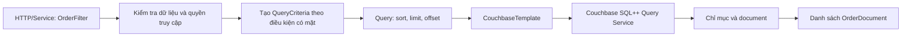

# Tạo `Query` và `QueryCriteria` theo bộ lọc đầu vào

## 1. Bài toán và mục tiêu

Trong hệ thống bán hàng, màn hình tra cứu đơn hàng thường cho phép kết hợp nhiều bộ lọc: khách hàng, trạng thái, khoảng tổng tiền, khoảng thời gian tạo đơn và phân trang. Người dùng có thể chỉ chọn một vài điều kiện, nên số tổ hợp bộ lọc tăng rất nhanh. Tạo một phương thức repository riêng cho từng tổ hợp sẽ khó đọc và khó bảo trì.

Với **Spring Data Couchbase**, ta có thể xây dựng điều kiện lúc chạy bằng `QueryCriteria`, đưa các điều kiện vào `Query`, rồi thực thi bằng `CouchbaseTemplate`. Đây là kỹ thuật thiết yếu trong chủ đề **Truy vấn động** của **SPRING_DATA_COUCHBASE**: xây dựng tầng truy cập Couchbase với document mapping, repository, `CouchbaseTemplate` và SQL++, đồng thời xét đến chỉ mục, hiệu năng, tính nhất quán và lựa chọn API reactive khi cần.

Sau bài này, bạn có thể:

- Phân biệt trách nhiệm của `QueryCriteria`, `Query` và `CouchbaseTemplate`.
- Chuyển các trường tùy chọn trong DTO thành điều kiện `WHERE` kết hợp bằng `AND`.
- Xử lý đúng giá trị không truyền, chuỗi rỗng, số 0, khoảng thời gian và danh sách giá trị.
- Thêm sắp xếp, phân trang, đếm kết quả mà không làm sai phạm vi truy vấn.
- Chọn chỉ mục phù hợp, tránh truy vấn quá rộng và nhận diện những khác biệt của SQL++ so với SQL quan hệ.

> **Phiên bản API:** Ví dụ sử dụng các lớp `org.springframework.data.couchbase.core.query.Query`, `QueryCriteria` và API fluent `CouchbaseTemplate.findByQuery(...)` trong Spring Data Couchbase hiện đại (dòng 5.x/6.x). Cần đối chiếu với phiên bản Spring Boot/Spring Data thực tế của dự án trước khi dùng thêm các API đặc thù phiên bản.

## 2. Ba lớp chịu trách nhiệm khác nhau

| Thành phần | Vai trò | Ví dụ |
| --- | --- | --- |
| `QueryCriteria` | Biểu diễn phép so sánh trên trường document và tổ hợp điều kiện logic | `QueryCriteria.where("status").is("PAID")` |
| `Query` | Chứa một hoặc nhiều tiêu chí, sắp xếp, giới hạn, offset và tùy chọn truy vấn | `Query.query(criteria).limit(20)` |
| `CouchbaseTemplate` | Thực thi truy vấn SQL++ trên entity đã được mapping và chuyển kết quả thành đối tượng Java | `template.findByQuery(OrderDocument.class).matching(query).all()` |

Luồng dữ liệu điển hình:



`QueryCriteria` của Couchbase nằm trong package `org.springframework.data.couchbase.core.query`. Không nhầm với `Criteria` của Spring Data MongoDB hoặc `Specification` của JPA: cú pháp và khả năng diễn dịch không hoàn toàn giống nhau.

### Các toán tử thường dùng

| Bộ lọc | Cách tạo `QueryCriteria` | Ý nghĩa SQL++ tương đương |
| --- | --- | --- |
| Chính xác | `where("status").is("PAID")` hoặc `.eq("PAID")` | `status = "PAID"` |
| Khác | `where("status").ne("CANCELLED")` | `status != "CANCELLED"` |
| Lớn hơn / lớn hơn hoặc bằng | `where("total").gt(100)` / `.gte(100)` | `total > 100` / `total >= 100` |
| Nhỏ hơn / nhỏ hơn hoặc bằng | `where("total").lt(500)` / `.lte(500)` | `total < 500` / `total <= 500` |
| Trong tập giá trị | `where("status").in("NEW", "PAID")` | `status IN ["NEW", "PAID"]` |
| Trong khoảng bao gồm hai đầu | `where("total").between(100, 500)` | `total BETWEEN 100 AND 500` |
| Bắt đầu bằng chuỗi | `where("customerCode").startingWith("VIP")` | Điều kiện tiền tố tương ứng |
| Giá trị JSON `NULL` | `where("note").isNull()` | `note IS NULL` |
| Trường không tồn tại | `where("note").isMissing()` | `note IS MISSING` |

Các phương thức `.and(...)`, `.or(...)` giúp ghép tiêu chí. Khi phải trộn `AND` với `OR`, cần kiểm tra cách nhóm ngoặc trong SQL++ thực tế; đặc biệt điều kiện phân quyền/tenant phải áp dụng cho **mọi** nhánh `OR`. Nếu một trường có nhiều giá trị hợp lệ, `.in(...)` thường rõ ràng hơn tự ghép nhiều nhánh `OR`.

## 3. Chuẩn bị entity và DTO bộ lọc

Giả sử collection đơn hàng chứa các document có dạng sau:

```json
{
  "tenantId": "store-01",
  "orderNumber": "SO-2026-000123",
  "customerId": "customer-42",
  "status": "PAID",
  "total": 425000,
  "createdAtEpochMillis": 1792992000000
}
```

Ánh xạ ở tầng Java:

```java
import java.math.BigDecimal;
import org.springframework.data.annotation.Id;
import org.springframework.data.couchbase.core.mapping.Document;

@Document
public class OrderDocument {
    @Id
    private String id;

    private String tenantId;
    private String orderNumber;
    private String customerId;
    private String status;
    private BigDecimal total;
    private long createdAtEpochMillis;

    // Constructor, getter và setter được lược bỏ để tập trung vào truy vấn.
}
```

Giả định bucket/scope/collection đã được cấu hình hoặc gắn mapping phù hợp trong ứng dụng. Trường `id` của entity là khóa document do Couchbase quản lý, không nhất thiết là trường JSON nằm trong document. `orderNumber` là thuộc tính lưu thực tế, có thể dùng để sắp xếp phụ khi hai đơn có cùng thời điểm tạo.

DTO biểu diễn các điều kiện tùy chọn:

```java
import java.math.BigDecimal;

// Java 17+
public record OrderFilter(
        String customerId,
        String status,
        BigDecimal minTotal,
        BigDecimal maxTotal,
        Long createdFromMillis,
        Long createdBeforeMillis
) {}
```

Quy ước đầu vào là phần quan trọng của thiết kế API:

1. `null` nghĩa là **không áp dụng bộ lọc đó**. Riêng chuỗi toàn khoảng trắng cũng được xem là chưa lọc sau khi kiểm tra.
2. `minTotal = 0` **vẫn là một điều kiện hợp lệ**; không kiểm tra bằng biểu thức truthy hoặc bằng `> 0` để quyết định có tạo bộ lọc hay không.
3. Khoảng thời gian dùng **[từ, trước)**: `createdFromMillis` được bao gồm (`>=`), `createdBeforeMillis` bị loại trừ (`<`). Quy ước này tránh trùng biên giữa hai khoảng liền kề.
4. `tenantId` là phạm vi truy cập bắt buộc, được truyền riêng từ ngữ cảnh xác thực. Không lấy một `tenantId` tùy ý từ người dùng để mở rộng dữ liệu họ được xem.
5. Sử dụng epoch milliseconds dạng số giúp các phép so sánh thời gian nhất quán. Nếu hệ thống lưu `Instant` dưới dạng chuỗi ISO 8601, phải thống nhất định dạng và mapping trước khi đặt điều kiện so sánh.

Ví dụ tìm đơn đã thanh toán của khách `customer-42`, tổng tiền từ 300.000 đến 600.000 đồng, từ đầu một khoảng thời gian và trước ngày kế tiếp; các bộ lọc khác để `null` thì không tham gia truy vấn.

## 4. Cài đặt tìm kiếm động bằng `Query` và `QueryCriteria`

Ví dụ sau sử dụng `CouchbaseTemplate`, giữ mọi điều kiện trong một hàm tạo query để có thể dùng chung cho tìm kiếm và đếm:

```java
import java.math.BigDecimal;
import java.util.List;
import java.util.Set;

import org.springframework.data.couchbase.core.CouchbaseTemplate;
import org.springframework.data.couchbase.core.query.Query;
import org.springframework.data.couchbase.core.query.QueryCriteria;
import org.springframework.data.domain.PageRequest;
import org.springframework.data.domain.Sort;
import org.springframework.stereotype.Service;

@Service
public class OrderSearchService {
    private static final Set<String> ALLOWED_STATUSES =
            Set.of("NEW", "PAID", "SHIPPED", "CANCELLED");

    private final CouchbaseTemplate template;

    public OrderSearchService(CouchbaseTemplate template) {
        this.template = template;
    }

    public List<OrderDocument> search(
            String tenantId, OrderFilter filter, int page, int size) {

        if (page < 0 || size < 1 || size > 100) {
            throw new IllegalArgumentException(
                    "page phải >= 0; size phải trong [1, 100]");
        }

        Query query = buildFilterQuery(tenantId, filter);

        // Đặt thứ tự cố định để phân trang có thể dự đoán được.
        query.with(PageRequest.of(page, size, Sort.by(
                Sort.Order.desc("createdAtEpochMillis"),
                Sort.Order.desc("orderNumber"))));

        return template.findByQuery(OrderDocument.class)
                .matching(query)
                .all();
    }

    public long count(String tenantId, OrderFilter filter) {
        // Không thêm LIMIT/OFFSET vào query dùng để đếm.
        return template.findByQuery(OrderDocument.class)
                .matching(buildFilterQuery(tenantId, filter))
                .count();
    }

    private Query buildFilterQuery(String tenantId, OrderFilter filter) {
        if (!hasText(tenantId)) {
            throw new IllegalArgumentException("Thiếu phạm vi tenantId");
        }
        if (filter == null) {
            throw new IllegalArgumentException("filter không được null");
        }

        if (filter.minTotal() != null && filter.maxTotal() != null
                && filter.minTotal().compareTo(filter.maxTotal()) > 0) {
            throw new IllegalArgumentException("minTotal > maxTotal");
        }
        if (filter.minTotal() != null
                && filter.minTotal().compareTo(BigDecimal.ZERO) < 0) {
            throw new IllegalArgumentException("minTotal không được âm");
        }
        if (filter.createdFromMillis() != null
                && filter.createdBeforeMillis() != null
                && filter.createdFromMillis() >= filter.createdBeforeMillis()) {
            throw new IllegalArgumentException("Khoảng thời gian không hợp lệ");
        }

        // Điều kiện bắt buộc luôn có mặt, kể cả khi mọi filter đều rỗng.
        Query query = Query.query(
                QueryCriteria.where("tenantId").is(tenantId));

        if (hasText(filter.customerId())) {
            query.addCriteria(QueryCriteria.where("customerId")
                    .is(filter.customerId().trim()));
        }

        if (hasText(filter.status())) {
            String status = filter.status().trim();
            if (!ALLOWED_STATUSES.contains(status)) {
                throw new IllegalArgumentException("Trạng thái không hợp lệ");
            }
            query.addCriteria(QueryCriteria.where("status").is(status));
        }

        if (filter.minTotal() != null) {
            query.addCriteria(QueryCriteria.where("total")
                    .gte(filter.minTotal()));
        }
        if (filter.maxTotal() != null) {
            query.addCriteria(QueryCriteria.where("total")
                    .lte(filter.maxTotal()));
        }

        if (filter.createdFromMillis() != null) {
            query.addCriteria(QueryCriteria.where("createdAtEpochMillis")
                    .gte(filter.createdFromMillis()));
        }
        if (filter.createdBeforeMillis() != null) {
            query.addCriteria(QueryCriteria.where("createdAtEpochMillis")
                    .lt(filter.createdBeforeMillis()));
        }

        return query;
    }

    private static boolean hasText(String value) {
        return value != null && !value.isBlank();
    }
}
```

### Vì sao chọn cách triển khai này?

- `Query.query(...)` tạo `Query` với tiêu chí đầu tiên; `query.addCriteria(...)` bổ sung từng tiêu chí. Những tiêu chí này được kết hợp theo logic `AND` khi dựng truy vấn.
- Mỗi điều kiện chỉ xuất hiện khi trường tương ứng có giá trị hợp lệ. Ta không cần viết biểu thức SQL++ dạng `($param IS NULL OR field = $param)` cho tất cả trường.
- Tên trường do mã nguồn lựa chọn từ tập hữu hạn; giá trị được đưa qua `QueryCriteria` để framework chuyển đổi và ràng buộc tham số. Không ghép chuỗi đầu vào trực tiếp vào SQL++.
- `count()` dùng lại **cùng phạm vi lọc**, tạo `Query` riêng chưa phân trang; tổng số dùng cho UI không bị nhầm thành kích thước của trang hiện tại.
- `size` có giới hạn và `tenantId` luôn tồn tại. Vì vậy người dùng để trống bộ lọc tùy chọn cũng không tự động quét dữ liệu của tenant khác.

Một tìm kiếm với `status = "PAID"`, `minTotal = 300000`, `createdFromMillis = 1792992000000` sẽ có logic tương đương:

```sql
-- Minh họa phần logic lọc; KHÔNG phải SQL++ nguyên văn Spring Data sinh ra.
SELECT ...
FROM `shop`.`sales`.`orders` AS o
WHERE o.tenantId = $tenantId
  AND o.status = $status
  AND o.total >= $minTotal
  AND o.createdAtEpochMillis >= $createdFrom
ORDER BY o.createdAtEpochMillis DESC, o.orderNumber DESC
LIMIT 20 OFFSET 0;
```

SQL++ thực tế có thể chứa các trường metadata, điều kiện nhận diện loại entity và cách đặt tên khóa khác với ví dụ, tùy mapping của Spring Data Couchbase. Kiểm tra câu SQL++ và tham số thực tế trong môi trường thử nghiệm khi cần tối ưu truy vấn.

## 5. Tình huống mở rộng thường gặp

### 5.1. Một trường nhận nhiều giá trị: `IN`

Nếu giao diện cho phép chọn đồng thời nhiều trạng thái, đổi `status` trong DTO thành `Set<String> statuses`. Sau khi kiểm tra từng phần tử thuộc danh sách cho phép, bổ sung:

```java
Set<String> statuses = filter.statuses();
if (statuses != null && !statuses.isEmpty()) {
    // Đã xác thực mọi giá trị trong statuses là trạng thái hợp lệ.
    query.addCriteria(QueryCriteria.where("status")
            .in(statuses.toArray(String[]::new)));
}
```

Xác định rõ semantics cho tập rỗng: **không lọc trạng thái** hoặc **trả về rỗng**, tùy hợp đồng API. Không vô tình gọi `IN` với một danh sách rỗng và trông đợi nó luôn mang nghĩa giống `null`. Bất kỳ yêu cầu nào về danh sách trạng thái phải được kiểm tra trước khi tạo tiêu chí.

### 5.2. Kết hợp `AND` và `OR`

Giả sử người dùng tìm `(status = PAID OR status = SHIPPED) AND tenantId = T`. Với nhiều trạng thái trên cùng một trường, dùng `status IN [...]` là phương án dễ kiểm soát:

```java
Query query = Query.query(QueryCriteria.where("tenantId").is(tenantId));
query.addCriteria(QueryCriteria.where("status").in("PAID", "SHIPPED"));
```

Đối với biểu thức phức tạp như `(status = PAID AND total > 100000) OR (status = NEW AND customerId = X)`, cần xây dựng và kiểm tra nhóm ngoặc rõ ràng. Không nối `.or(...)` tùy tiện sau điều kiện phân quyền vì ưu tiên toán tử có thể làm lộ dữ liệu ngoài phạm vi được phép. Khi DSL không biểu diễn rõ nghiệp vụ, cân nhắc truy vấn SQL++ được tham số hóa và kiểm tra kỹ biểu thức `WHERE`.

### 5.3. `NULL`, `MISSING` và giá trị không truyền

Couchbase lưu tài liệu JSON nên cần phân biệt:

| Trạng thái của `note` trong document | Ý nghĩa | Phép kiểm tra phù hợp |
| --- | --- | --- |
| `"note": null` | Trường có mặt, giá trị `NULL` | `isNull()` |
| Không có khóa `note` | Trường `MISSING` | `isMissing()` |
| `"note": ""` | Chuỗi rỗng | `is("")` |
| DTO `filter.note() == null` | Người gọi không áp dụng bộ lọc | Không thêm `QueryCriteria` |

Đừng dùng `.is(null)` một cách mặc định để thay thế cho toàn bộ các trường hợp trên. Nếu hợp đồng API yêu cầu tìm cả `NULL` lẫn `MISSING`, hãy thiết kế rõ phép điều kiện tương ứng và xác minh SQL++ sinh ra.

### 5.4. Sắp xếp và phân trang theo đầu vào

`query.with(PageRequest.of(page, size, sort))` truyền thông tin sắp xếp và giới hạn tới `Query`; `page` đánh số từ 0. Khi cho phép người dùng chọn cột sắp xếp, ánh xạ giá trị đầu vào thành một **danh sách trường cho phép**:

```java
String sortField = switch (requestedSort) {
    case "amount" -> "total";
    case "date"   -> "createdAtEpochMillis";
    default       -> "createdAtEpochMillis";
};
query.with(Sort.by(Sort.Direction.DESC, sortField));
```

Không dùng chuỗi tên trường, tên collection hoặc mảnh SQL++ tùy ý từ HTTP request. Dù giá trị điều kiện đã được bind, **identifier** không phải lúc nào cũng được bind theo cơ chế giống value. Với phân trang sâu, `OFFSET` lớn có thể tốn chi phí; cân nhắc mô hình phân trang theo khóa/cursor trên cặp trường sắp xếp có thứ tự ổn định. Phân trang theo `createdAtEpochMillis` một mình không ổn định nếu nhiều đơn có timestamp giống nhau.

### 5.5. Khi nào dùng repository, template hoặc SQL++ thủ công?

| Nhu cầu | Lựa chọn phù hợp |
| --- | --- |
| Tìm theo ID document | `CouchbaseRepository.findById(...)` / API KV, tránh truy vấn SQL++ không cần thiết |
| Vài điều kiện cố định, dễ đặt tên | Derived query của repository, ví dụ `findByStatusAndCustomerId(...)` |
| Có nhiều điều kiện tùy chọn tại runtime | `Query` + `QueryCriteria` + `CouchbaseTemplate` |
| JOIN, tổng hợp, biểu thức đặc thù SQL++, phép nhóm phức tạp | SQL++ tham số hóa qua API phù hợp, kèm kiểm tra quyền truy cập |
| Luồng ứng dụng reactive | `ReactiveCouchbaseTemplate` và `Flux`/`Mono` thay cho lệnh chặn luồng |

Ví dụ chuyển cùng một `Query` sang API reactive:

```java
// Đặt trong service được inject ReactiveCouchbaseTemplate.
Flux<OrderDocument> orders = reactiveCouchbaseTemplate
        .findByQuery(OrderDocument.class)
        .matching(query)
        .all();
```

`Query` và các tiêu chí có thể được dựng theo cách tương tự; điểm khác nằm ở loại kết quả và quá trình thực thi không chặn. Trong pipeline reactive, tránh gọi `.block()` để biến `Flux` thành xử lý đồng bộ ở request path.

## 6. Chỉ mục, hiệu năng và tính nhất quán

Tạo query đúng logic chưa đủ: SQL++ cần chỉ mục để tránh quét tập document quá lớn. Với bộ lọc thường có `tenantId`, `status` và thời điểm tạo, có thể **bắt đầu** đánh giá hai chỉ mục sau:

```sql
-- Thay shop/sales/orders bằng bucket/scope/collection thực tế.
CREATE INDEX ix_orders_tenant_status_created
ON `shop`.`sales`.`orders`
(tenantId, status, createdAtEpochMillis, orderNumber);

CREATE INDEX ix_orders_tenant_created
ON `shop`.`sales`.`orders`
(tenantId, createdAtEpochMillis, orderNumber);
```

Hai chỉ mục phục vụ các mẫu truy vấn khác nhau: chỉ mục đầu tiên có ích khi lọc `tenantId` cùng `status`; chỉ mục thứ hai dành cho tìm theo `tenantId` và thời gian khi không có `status`. Thứ tự khóa, độ chọn lọc, sorting, `total` và các điều kiện mapping thực tế đều ảnh hưởng đến kế hoạch. Không tạo nhiều chỉ mục chỉ vì có nhiều trường; mỗi chỉ mục tiêu tốn dung lượng và chi phí cập nhật.

Kiểm tra bằng `EXPLAIN` trên câu SQL++ **thực tế** tương ứng với query ứng dụng:

```sql
EXPLAIN SELECT o.orderNumber, o.status, o.total
FROM `shop`.`sales`.`orders` AS o
WHERE o.tenantId = "store-01"
  AND o.status = "PAID"
  AND o.createdAtEpochMillis >= 1792992000000
ORDER BY o.createdAtEpochMillis DESC, o.orderNumber DESC
LIMIT 20;
```

Kiểm tra index được chọn, số bản ghi phải đọc, bước sắp xếp và chi phí thực tế. Thử riêng các tổ hợp có/không có `status`, có/không có khoảng tiền, phân trang đầu và phân trang sâu. Query mẫu trong tài liệu chỉ minh họa; kế hoạch thật còn phụ thuộc kích thước dữ liệu và phiên bản Couchbase.

**Tính nhất quán:** truy vấn SQL++ thông qua chỉ mục có thể chưa nhìn thấy ngay một thay đổi vừa ghi nếu dùng mức nhất quán mặc định. Với luồng cần đọc kết quả mới ngay sau khi ghi, cân nhắc scan consistency phù hợp, ví dụ `QueryScanConsistency.REQUEST_PLUS`:

```java
// Cân nhắc chi phí độ trễ trước khi bật cho tất cả yêu cầu.
import com.couchbase.client.java.query.QueryScanConsistency;

List<OrderDocument> rows = template.findByQuery(OrderDocument.class)
        .withConsistency(QueryScanConsistency.REQUEST_PLUS)
        .matching(query)
        .all();
```

`REQUEST_PLUS` giúp truy vấn chờ chỉ mục bắt kịp các thay đổi đã được xác nhận trước truy vấn; đánh đổi là độ trễ tăng khi có nhiều mutation đang chờ lập chỉ mục. Với truy xuất chính xác theo document ID, ưu tiên KV vì đặc tính và chi phí khác với SQL++.

## 7. Các lỗi phổ biến và cách tránh

| Vấn đề | Tác động | Cách xử lý |
| --- | --- | --- |
| Gọi `.is(null)` cho mọi trường bỏ trống | Lọc sai hoặc nhầm `NULL` với không lọc | Chỉ tạo `QueryCriteria` cho bộ lọc thật sự được cung cấp |
| Bỏ điều kiện `tenantId` khi DTO rỗng | Có thể truy xuất dữ liệu ngoài phạm vi được phép | Tạo điều kiện quyền truy cập bắt buộc trước mọi bộ lọc tùy chọn |
| Nối giá trị hoặc tên trường từ request vào SQL++ | Rủi ro injection hoặc chọn trường ngoài dự kiến | Dùng `QueryCriteria` cho giá trị; whitelist tên trường và hướng sắp xếp |
| `IN` với tập rỗng, khoảng min lớn hơn max | Kết quả khó hiểu | Quy định semantics cho bộ lọc rỗng; xác thực trước khi dựng truy vấn |
| Đếm trên truy vấn đã áp dụng `limit`/`offset` | Có thể nhầm tổng số bản ghi với số bản ghi trang | Tạo query lọc mới cho `count()` |
| Sắp xếp không có khóa phụ, `OFFSET` rất lớn | Trang có thể trùng/thiếu khi dữ liệu đổi; tốn chi phí | Thứ tự ổn định; giới hạn page size; cân nhắc cursor |
| Không có chỉ mục phù hợp | Truy vấn chậm hoặc bị từ chối | Thiết kế index theo tổ hợp bộ lọc và kiểm tra `EXPLAIN` |
| Giả định vừa ghi là query sẽ thấy ngay | Đọc thiếu dữ liệu mới do độ trễ chỉ mục | Chọn scan consistency phù hợp với yêu cầu nghiệp vụ |

## 8. Kịch bản kiểm thử nên có

Kiểm thử tích hợp với Couchbase thật hoặc môi trường tương đương, có dữ liệu thuộc **ít nhất hai tenant**. Cần đối chiếu cả nội dung kết quả lẫn thứ tự và tổng số:

1. **Chỉ có tenantId:** trả về các đơn trong tenant, không lẫn tenant khác; kết quả vẫn bị giới hạn theo trang.
2. **Bộ lọc đơn:** mỗi điều kiện `status`, `customerId`, `minTotal`, `maxTotal`, `createdFromMillis`, `createdBeforeMillis` hoạt động độc lập; `minTotal = 0` được chấp nhận.
3. **Bộ lọc kết hợp:** chỉ trả về đơn thỏa **tất cả** điều kiện `AND`; đặc biệt kiểm tra trường hợp có hai ranh giới của cùng một thuộc tính.
4. **Biên thời gian:** bản ghi đúng `createdFromMillis` được lấy; bản ghi đúng `createdBeforeMillis` bị loại.
5. **Đầu vào không hợp lệ:** page âm, size vượt giới hạn, trạng thái không cho phép, `minTotal > maxTotal`, khoảng thời gian đảo chiều bị từ chối.
6. **Phân trang và đếm:** mỗi trang tối đa `size` phần tử, thứ tự ổn định theo hai khóa, `count()` trả tổng số phù hợp không phụ thuộc trang.
7. **Trạng thái dữ liệu JSON:** kiểm tra phân biệt `MISSING`, `NULL`, chuỗi rỗng khi nghiệp vụ có lọc theo trường tùy chọn.
8. **Hiệu năng:** chạy `EXPLAIN`/đo thời gian ở kích thước dữ liệu đại diện, với nhiều tổ hợp bộ lọc khác nhau, bao gồm truy vấn ít điều kiện nhất được phép.

## 9. Ghi nhớ và tài liệu tham khảo

Thiết kế truy vấn động tốt bắt đầu bằng **hợp đồng bộ lọc rõ ràng**, tiếp theo là **điều kiện phạm vi bắt buộc**, rồi mới thêm các `QueryCriteria` tùy chọn. `Query` điều phối tiêu chí, sắp xếp và phân trang; `CouchbaseTemplate` thực thi. Kết quả đúng về mặt chức năng phải được đi kèm với chỉ mục phù hợp, chiến lược nhất quán và kiểm thử biên.

Tài liệu chính thức để tra cứu API và hành vi cụ thể theo phiên bản:

- Spring Data Couchbase — [QueryCriteria API](https://docs.spring.io/spring-data/couchbase/reference/api/java/org/springframework/data/couchbase/core/query/QueryCriteria.html).
- Spring Data Couchbase — [Query API](https://docs.spring.io/spring-data/couchbase/reference/api/java/org/springframework/data/couchbase/core/query/Query.html).
- Spring Data Couchbase — [Template & direct operations](https://docs.spring.io/spring-data/couchbase/reference/couchbase/template.html).
- Couchbase Server — [SELECT overview và lựa chọn chỉ mục](https://docs.couchbase.com/server/current/n1ql/n1ql-language-reference/selectintro.html).
