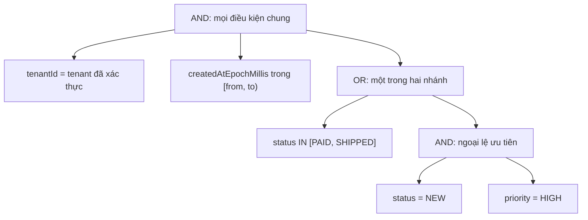

# Kết hợp điều kiện AND, OR và nhóm điều kiện trong Spring Data Couchbase

## 1. Vì sao phải nhóm điều kiện?

Trong một màn hình tìm kiếm đơn hàng, người dùng có thể yêu cầu:

> Hiển thị đơn hàng thuộc cửa hàng hiện tại, được **thanh toán hoặc đã giao**, hoặc **đơn mới có mức ưu tiên cao**; chỉ lấy các đơn tạo trong khoảng thời gian được chọn.

Đây không phải một chuỗi so sánh đơn giản. Nó chứa ba lớp điều kiện:

1. **Phạm vi bắt buộc:** đơn hàng thuộc đúng cửa hàng (tenant) được cấp quyền.
2. **Nhóm nghiệp vụ:** đơn đã thanh toán hoặc đã giao, **hoặc** đơn mới có ưu tiên cao.
3. **Giới hạn thời gian:** thời điểm tạo nằm trong khoảng yêu cầu.

Viết đúng logic theo SQL++:

```sql
WHERE o.tenantId = $tenantId
  AND (
        o.status IN ["PAID", "SHIPPED"]
        OR (o.status = "NEW" AND o.priority = "HIGH")
      )
  AND o.createdAtEpochMillis >= $fromInclusive
  AND o.createdAtEpochMillis < $toExclusive
```

Trong chương **Truy vấn động** của **SPRING_DATA_COUCHBASE**, việc kết hợp `AND`, `OR` và dấu ngoặc tạo nền tảng cho tầng truy cập Couchbase bằng **Spring Data**, dùng được với document mapping, repository, `CouchbaseTemplate` và truy vấn SQL++. Bài này tập trung vào cách biểu diễn đúng logic lọc; đồng thời liên hệ với index, dữ liệu JSON, phân trang, tính nhất quán và API reactive khi đưa truy vấn vào vận hành.

**Mục tiêu học tập:** đọc đúng biểu thức Boolean; kết hợp `QueryCriteria` bằng `and(...)`/`or(...)`; xử lý nhóm điều kiện tùy chọn; tránh lỗi phạm vi truy cập do thiếu ngoặc; dùng SQL++ tham số hóa khi cần bảo đảm cấu trúc nhóm phức tạp; kiểm chứng kết quả bằng dữ liệu thử và `EXPLAIN`.

## 2. Nền tảng logic: AND, OR và thứ tự ưu tiên

Ký hiệu `A`, `B`, `C` là các mệnh đề đúng/sai:

| Biểu thức | Khi nào trả về đúng? | Ví dụ |
| --- | --- | --- |
| `A AND B` | Cả `A` lẫn `B` đều đúng | Thuộc tenant T **và** trạng thái PAID |
| `A OR B` | Ít nhất một trong hai đúng | Trạng thái PAID **hoặc** SHIPPED |
| `NOT A` | `A` sai | Không phải đơn CANCELLED |
| `(A OR B) AND C` | Một trong `A`, `B` đúng **và** `C` đúng | PAID/SHIPPED và còn trong khoảng ngày |
| `A OR (B AND C)` | `A` đúng, hoặc đồng thời `B` và `C` đúng | PAID bất kể ngày, hoặc SHIPPED trong khoảng ngày |

SQL++ áp dụng quy tắc ưu tiên: **dấu ngoặc trước, `NOT` trước `AND`, `AND` trước `OR`**. Vì vậy:

```sql
-- Được hiểu là A OR (B AND C)
WHERE A OR B AND C

-- Khác hẳn với (A OR B) AND C
WHERE (A OR B) AND C
```

Cho `A = TRUE`, `B = FALSE`, `C = FALSE`:

| Biểu thức | Kết quả |
| --- | --- |
| `(A OR B) AND C` | `FALSE` |
| `A OR (B AND C)` | `TRUE` |

Sự khác biệt này đặc biệt nguy hiểm khi `A` chứa điều kiện truy cập dữ liệu. Ví dụ:

```sql
-- SAI: các đơn PAID của tenant khác cũng có thể vượt qua nhánh OR.
WHERE o.status = "PAID"
   OR o.status = "SHIPPED" AND o.tenantId = $tenantId

-- ĐÚNG: điều kiện tenant bao trùm cả hai nhánh.
WHERE o.tenantId = $tenantId
  AND (o.status = "PAID" OR o.status = "SHIPPED")
```

Một quy tắc thực hành: **vẽ ngoặc theo câu nghiệp vụ trước khi viết code**, đặc biệt với các điều kiện tenant, quyền người dùng, dữ liệu chưa xóa và khoảng thời gian.

## 3. Hai cách diễn đạt logic: `QueryCriteria` và SQL++

Spring Data Couchbase cung cấp:

- `QueryCriteria.where("field").is(value)`: tạo một điều kiện trên trường của document.
- `and("field")` / `or("field")`: nối một điều kiện mới bằng phép `AND` hoặc `OR`.
- `and(QueryCriteria)` / `or(QueryCriteria)`: kết hợp các tiêu chí đã được tạo riêng.
- `Query.query(criteria)`: đặt điều kiện vào đối tượng `Query`.
- `CouchbaseTemplate.findByQuery(Entity.class).matching(query).all()`: thực thi truy vấn và ánh xạ kết quả thành entity.

Các phương thức trên thuộc `org.springframework.data.couchbase.core.query.QueryCriteria`, không phải `Criteria` của Spring Data MongoDB hay JPA. Dấu ngoặc được diễn dịch từ biểu thức cuối cùng do thư viện dựng; **không nên suy ra rằng mọi chuỗi gọi `and(...)` và `or(...)` tự động có cấu trúc ngoặc như mong muốn**. Với biểu thức hỗn hợp nhiều tầng, phải xác minh SQL++ được tạo ra hoặc chọn SQL++ tường minh có dấu ngoặc.

### 3.1. Điều kiện AND đơn giản

```java
import org.springframework.data.couchbase.core.query.Query;
import org.springframework.data.couchbase.core.query.QueryCriteria;

QueryCriteria criteria = QueryCriteria.where("tenantId").is(tenantId)
        .and("status").is("PAID")
        .and("total").gte(100_000);

Query query = Query.query(criteria);
```

Logic mong đợi:

```sql
o.tenantId = $tenantId AND o.status = "PAID" AND o.total >= 100000
```

Tất cả điều kiện đều phải đúng. Trường `tenantId` là phạm vi bắt buộc do hệ thống xác thực cung cấp, không lấy nguyên xi từ bộ lọc của người dùng.

### 3.2. Điều kiện OR đơn giản

```java
QueryCriteria criteria = QueryCriteria.where("status").is("PAID")
        .or("status").is("SHIPPED");
```

Logic mong đợi: `status = "PAID" OR status = "SHIPPED"`. Với các giá trị khác nhau **trên cùng một trường**, cách ngắn gọn hơn là:

```java
QueryCriteria statuses = QueryCriteria.where("status")
        .in("PAID", "SHIPPED");
```

Tương đương về mục đích lọc với `status IN ["PAID", "SHIPPED"]`. `IN` giúp tránh nhiều nhánh `OR` trên một thuộc tính và có thể thuận lợi cho tối ưu chỉ mục; vẫn cần xem kế hoạch thực thi thực tế.

### 3.3. Kết hợp các `QueryCriteria` dựng riêng

```java
QueryCriteria activeStatuses = QueryCriteria.where("status")
        .is("PAID")
        .or("status").is("SHIPPED");

QueryCriteria scoped = QueryCriteria.where("tenantId")
        .is(tenantId)
        .and(activeStatuses);

Query query = Query.query(scoped);
```

Đây là ví dụ **cú pháp ghép criteria** được API hỗ trợ. Ý định là `tenantId = T AND (status = PAID OR status = SHIPPED)`. Tuy nhiên, khi dựa vào một thư viện để sinh SQL++, phải kiểm tra cách nhóm ngoặc của **phiên bản Spring Data Couchbase đang chạy** trước khi đưa kết quả vào chức năng có phân quyền. Có thể xem biểu thức `scoped.export()` để hỗ trợ chẩn đoán, kết hợp kiểm tra SQL++ cuối cùng do template sinh và kiểm thử tích hợp. `export()` chỉ phục vụ quan sát, không dùng kết quả chuỗi này làm cơ chế bind tham số.

Với yêu cầu chỉ có hai trạng thái, dùng `IN` giảm sự phức tạp:

```java
QueryCriteria scoped = QueryCriteria.where("tenantId").is(tenantId)
        .and("status").in("PAID", "SHIPPED");
```

Khi nghiệp vụ chứa nhiều nhóm hỗn hợp, cú pháp `and(criteria)` và `or(criteria)` vẫn có ích nhưng **phải kiểm chứng ngoặc**; phần 5 trình bày cách bảo đảm nhóm bằng SQL++ tường minh.

## 4. Thiết kế nhóm điều kiện từ nghiệp vụ

Giả sử collection `shop.sales.orders` có các trường:

```json
{
  "tenantId": "store-01",
  "orderNumber": "SO-2026-0142",
  "customerId": "customer-42",
  "status": "NEW",
  "priority": "HIGH",
  "total": 450000,
  "createdAtEpochMillis": 1792992000000
}
```

Hình dưới minh họa **cây logic**, cho thấy `tenantId` và khoảng thời gian là các điều kiện chung nằm ngoài nhánh `OR`:



Biểu thức chính xác:

```text
AND(
    tenantId = T,
    OR(
        status IN {PAID, SHIPPED},
        AND(status = NEW, priority = HIGH)
    ),
    createdAtEpochMillis >= fromInclusive,
    createdAtEpochMillis < toExclusive
)
```

### 4.1. Kiểm tra bằng một tập dữ liệu nhỏ

Giả sử `tenantId` đang đăng nhập là `store-01`; mọi đơn trong bảng đều nằm trong khoảng thời gian yêu cầu.

| Mã đơn | Tenant | Status | Priority | Được lấy? | Giải thích |
| --- | --- | --- | --- | --- | --- |
| O-01 | store-01 | PAID | LOW | Có | Thuộc nhánh `status IN (...)` |
| O-02 | store-01 | SHIPPED | NORMAL | Có | Thuộc nhánh `status IN (...)` |
| O-03 | store-01 | NEW | HIGH | Có | Thỏa đồng thời `NEW AND HIGH` |
| O-04 | store-01 | NEW | LOW | Không | Không thỏa nhánh nào |
| O-05 | store-01 | CANCELLED | HIGH | Không | HIGH không tự đủ điều kiện |
| O-06 | store-02 | PAID | HIGH | Không | Tenant khác, dù thỏa nhóm nghiệp vụ |

Nếu O-01 có thời điểm tạo nằm ngoài khoảng thì nó cũng bị loại, dù trạng thái là PAID. Đây là mục đích của việc đặt điều kiện thời gian **bên ngoài** nhóm `OR`.

## 5. Cách bảo đảm ngoặc trong truy vấn phức tạp bằng SQL++ tham số hóa

Những biểu thức có cấu trúc như `tenant = T AND (A OR (B AND C)) AND D` cần được viết rõ ràng khi yêu cầu đúng tuyệt đối về grouping. SQL++ hỗ trợ dấu ngoặc và các tham số tên `$param`; sử dụng Couchbase Java SDK khi cần kiểm soát toàn bộ biểu thức.

```java
import com.couchbase.client.java.Cluster;
import com.couchbase.client.java.json.JsonArray;
import com.couchbase.client.java.json.JsonObject;
import com.couchbase.client.java.query.QueryOptions;

import java.util.List;

public final class OrderSearchSqlService {
    private final Cluster cluster;

    public OrderSearchSqlService(Cluster cluster) {
        this.cluster = cluster;
    }

    public List<JsonObject> findMatchingOrders(
            String trustedTenantId,
            long fromInclusive,
            long toExclusive,
            int limit) {

        if (trustedTenantId == null || trustedTenantId.isBlank()) {
            throw new IllegalArgumentException("Thiếu tenantId đã xác thực");
        }
        if (fromInclusive >= toExclusive || limit < 1 || limit > 100) {
            throw new IllegalArgumentException("Khoảng thời gian/limit không hợp lệ");
        }

        String statement = """
            SELECT META(o).id AS documentId,
                   o.orderNumber, o.tenantId, o.status,
                   o.priority, o.total, o.createdAtEpochMillis
            FROM `shop`.`sales`.`orders` AS o
            WHERE o.tenantId = $tenantId
              AND (
                    o.status IN $activeStatuses
                    OR (
                         o.status = $newStatus
                         AND o.priority = $highPriority
                       )
                  )
              AND o.createdAtEpochMillis >= $fromInclusive
              AND o.createdAtEpochMillis < $toExclusive
            ORDER BY o.createdAtEpochMillis DESC, o.orderNumber DESC
            LIMIT $limit
            """;

        JsonObject params = JsonObject.create()
                .put("tenantId", trustedTenantId)
                .put("activeStatuses",
                        JsonArray.create().add("PAID").add("SHIPPED"))
                .put("newStatus", "NEW")
                .put("highPriority", "HIGH")
                .put("fromInclusive", fromInclusive)
                .put("toExclusive", toExclusive)
                .put("limit", limit);

        return cluster.query(
                statement,
                QueryOptions.queryOptions().parameters(params)
        ).rowsAsObject();
    }
}
```

Điểm cần hiểu:

- `tenantId` truyền từ **ngữ cảnh xác thực**; đặt ở vế chung của `AND`, nên cả hai nhánh `OR` đều bị giới hạn tenant.
- Các giá trị vào biến `$tenantId`, `$activeStatuses`, `$fromInclusive`... được **bind** làm tham số. Không nối trực tiếp chuỗi từ request vào câu SQL++.
- Tên bucket, scope, collection và tên trường là **identifier**, không được sử dụng như tham số giá trị. Với nhu cầu chọn collection động, chỉ lấy tên từ cấu hình hoặc danh sách cho phép.
- Đoạn này dùng trực tiếp `Cluster.query(...)` của Couchbase Java SDK, kết quả là `JsonObject`, **không đi qua entity converter của `CouchbaseTemplate`**. Nếu cần mapping entity Spring Data, hãy giữ cấu trúc trong template khi biểu diễn được và đã xác minh; hoặc chuyển đổi kết quả SDK theo hợp đồng dữ liệu riêng.
- Các tên `shop.sales.orders`, field và bảng dữ liệu chỉ mang tính minh họa. Trong ứng dụng thật, phải dùng đúng keyspace đã cấu hình, index và quyền Query Service tương ứng.

### 5.1. Khác biệt giữa nhóm logic và phân trang

`LIMIT`, `OFFSET` và `ORDER BY` không sửa được lỗi đặt ngoặc trong `WHERE`. Trước khi phân trang, phải bảo đảm tập kết quả đã được giới hạn đúng phạm vi. Dùng thứ tự ổn định, ví dụ `createdAtEpochMillis DESC, orderNumber DESC`; với trang sâu, cân nhắc keyset/cursor pagination để tránh chi phí offset lớn và kết quả dao động khi có mutation.

### 5.2. Ghép từng khối điều kiện tùy chọn

Trong truy vấn động, một nhóm `OR` có thể chỉ tồn tại khi người dùng bật lựa chọn tương ứng. Cần phân biệt:

- **Không truyền bộ lọc:** bỏ hẳn nhóm nếu hợp đồng API cho phép.
- **Truyền tập lựa chọn rỗng:** thỏa thuận trước là bỏ bộ lọc hay trả về rỗng; không mặc định sinh `IN []`.
- **Bật nhiều nhánh:** đưa từng nhánh vào cùng một nhóm `(... OR ...)`, không rải các nhánh `OR` ở mức `WHERE` ngoài cùng.
- **Không nhánh nào hợp lệ:** thường nên không tạo nhóm `OR` hoặc trả kết quả rỗng theo chính sách nghiệp vụ; không tự động mở quyền truy cập.

Mô hình tư duy cho bộ lọc động:

```text
common = AND(tenantScope, deletePolicy, ...timeRange)
branches = [conditionA?, AND(conditionB?, conditionC?), ...]
if branches are present:
    final = AND(common, OR(branches))
else:
    final = common  // Chỉ nếu API cho phép tìm theo điều kiện chung
```

Nếu giao diện cho phép nhóm lọc do người dùng tự định nghĩa (`AND`/`OR` lồng nhiều cấp), nên biểu diễn bằng cây `Group(operator, children)` và `Condition(field, operator, value)`. Khi biên dịch cây ra SQL++, luôn thêm dấu ngoặc quanh mỗi `Group`, chỉ dùng field/operator trong whitelist, bind mọi giá trị, đặt giới hạn chiều sâu và số nhánh. Chính sách tenant được gắn ở **gốc**, độc lập với cây người dùng.

## 6. Những trường hợp dễ nhầm của SQL++ trên document JSON

### 6.1. AND/OR với `NULL` hoặc `MISSING`

SQL++ làm việc với dữ liệu JSON, nên một biểu thức logic có thể có bốn kết quả: `TRUE`, `FALSE`, `NULL`, `MISSING`. Điều này khác với bảng chân trị chỉ gồm hai giá trị trong các ví dụ đầu.

| Biểu thức | Kết quả |
| --- | --- |
| `TRUE OR MISSING` | `TRUE` |
| `FALSE OR MISSING` | `MISSING` |
| `FALSE AND MISSING` | `FALSE` |
| `TRUE AND MISSING` | `MISSING` |
| `NOT NULL` | `NULL` |
| `NOT MISSING` | `MISSING` |

Trong `WHERE`, một phép so sánh ra `NULL` hoặc `MISSING` không làm bản ghi vượt qua bộ lọc như `TRUE`. Ví dụ:

```sql
-- Không có trường priority không đồng nghĩa với priority != "LOW".
WHERE o.priority != "LOW"

-- Khi nghiệp vụ muốn cả trường không có giá trị và giá trị khác LOW,
-- hãy mô tả từng trường hợp.
WHERE o.priority IS NOT VALUED OR o.priority != "LOW"
```

`IS NOT VALUED` đúng với trường `NULL` hoặc `MISSING`. Nếu chỉ muốn tìm trường thiếu hẳn, dùng `IS MISSING`; chỉ trường JSON có giá trị null, dùng `IS NULL`. Khi dùng Spring Data, có thể tra cứu các toán tử tương ứng `isNull()`, `isMissing()` và `isNotValued()` của `QueryCriteria`.

### 6.2. Phân biệt `IN` với `OR`

```sql
-- Hai cách thể hiện tương đương trên cùng một trường:
WHERE o.status = "PAID" OR o.status = "SHIPPED"
WHERE o.status IN ["PAID", "SHIPPED"]
```

Khi vế `OR` gồm **các trường khác nhau** hoặc các điều kiện `AND` riêng bên trong, không thể máy móc chuyển toàn bộ thành một `IN`:

```sql
-- Hai nhánh logic khác nhau, cần nhóm:
WHERE o.status = "PAID"
   OR (o.status = "NEW" AND o.priority = "HIGH")
```

### 6.3. Điều kiện phủ định

`NOT (A OR B)` tương đương với `NOT A AND NOT B` trong Boolean thông thường, nhưng phải cẩn thận khi `A`/`B` có `NULL` hoặc `MISSING`. Không được xem `!=` hay `NOT` là cách mặc định để bao gồm các document thiếu trường.

Nếu cần loại các trạng thái xác định, có thể dùng `NOT IN` cho một trường nhưng vẫn phải xác định cách xử lý khi trường không tồn tại, khác kiểu hoặc có `NULL`.

## 7. Kiểm tra cách nhóm và độ đúng của truy vấn

### 7.1. Kiểm tra ở hai lớp

**Lớp 1 — logic nghiệp vụ:** viết biểu thức ở dạng cây hoặc có ngoặc như phần 4, tạo một tập bản ghi nhỏ chứa:

- Bản ghi khớp nhánh đầu của `OR`, không khớp nhánh thứ hai.
- Bản ghi khớp nhánh thứ hai, không khớp nhánh đầu.
- Bản ghi không khớp nhánh nào, nhưng khớp tất cả điều kiện chung.
- Bản ghi khớp một nhánh nhưng **sai tenant**.
- Bản ghi khớp một nhánh nhưng **nằm ngoài khoảng thời gian**.

**Lớp 2 — thực thi:** kiểm tra SQL++ tạo ra thực sự có dấu ngoặc như thiết kế, tham số không bị gắn sai, `WHERE` không vượt ngoài tenant và kết quả trên Couchbase trùng với bảng mong đợi. Khi dùng `QueryCriteria`, `export()` hỗ trợ xem biểu thức, nhưng kết luận cuối cùng phải dựa trên câu query thực tế và kiểm thử tích hợp, vì template có thể bổ sung tiêu chí nhận diện entity.

Ví dụ kiểm tra ý nghĩa nghiệp vụ:

| Tenant đúng? | Trạng thái | Priority | Trong thời gian? | Kết quả |
| --- | --- | --- | --- | --- |
| Có | PAID | LOW | Có | Trả về |
| Có | SHIPPED | NORMAL | Có | Trả về |
| Có | NEW | HIGH | Có | Trả về |
| Có | NEW | LOW | Có | Loại |
| Có | PAID | LOW | Không | Loại |
| Không | PAID | HIGH | Có | Loại |
| Không | NEW | HIGH | Có | Loại |

Một kiểm thử chỉ sử dụng dữ liệu cùng tenant sẽ **không phát hiện** được lỗi `tenantId` đặt sai ngoặc. Vì vậy cần đưa dữ liệu thuộc tenant thứ hai vào bộ kiểm thử.

### 7.2. Đánh giá chi phí truy vấn

Thêm `OR` có thể khiến trình tối ưu phải ghép nhiều đường truy cập dữ liệu. Với các mẫu tìm kiếm phổ biến, cân nhắc chỉ mục theo tiền tố lọc:

```sql
-- Chỉ là gợi ý ban đầu, cần EXPLAIN với dữ liệu thật.
CREATE INDEX ix_orders_tenant_status_created
ON `shop`.`sales`.`orders`(
    tenantId, status, createdAtEpochMillis, orderNumber
);

CREATE INDEX ix_orders_tenant_priority_created
ON `shop`.`sales`.`orders`(
    tenantId, priority, createdAtEpochMillis, orderNumber
);
```

Chạy `EXPLAIN` trên câu SQL++ thực tế để quan sát các bước IndexScan, cách xử lý `OR`, Fetch, Sort và việc sử dụng chỉ mục. Tối ưu theo số lượng dữ liệu, tính chọn lọc, nhánh `OR` thường xuất hiện và tỷ lệ cập nhật document. Không đánh đổi việc **sửa sai ngoặc** lấy truy vấn tưởng như chạy nhanh hơn.

Một số cân nhắc vận hành liên quan:

| Chủ đề | Liên hệ với truy vấn nhóm |
| --- | --- |
| Bucket / scope / collection | Cần xác định đúng keyspace; không cho HTTP request quyết định tên keyspace tùy ý |
| Chỉ mục | Mỗi nhánh `OR` có thể có đường truy cập khác nhau; dùng `EXPLAIN` để kiểm chứng |
| TTL | Document hết hạn có thể biến mất giữa hai lần phân trang; không suy luận sự hiện diện vĩnh viễn |
| CAS | Bảo vệ cập nhật cạnh tranh ở đường ghi; không thay thế logic `WHERE` của tìm kiếm |
| Giao dịch | Truy vấn trong transaction có ngữ nghĩa riêng; không giả định nhiều lần đọc luôn thấy cùng một snapshot |
| Scan consistency | Index có thể trễ so với mutation; chọn mức nhất quán theo nghiệp vụ |
| Reactive | Có thể dùng `ReactiveCouchbaseTemplate` để nhận `Flux`/`Mono`; cấu trúc nhóm lọc vẫn phải đúng |

## 8. Checklist áp dụng vào dự án

Trước khi chấp nhận một truy vấn `AND`/`OR` động:

1. **Viết lại câu nghiệp vụ thành một biểu thức có dấu ngoặc**; xác định rõ nhánh nào phải đồng thời đúng và nhánh nào chỉ cần một phần đúng.
2. **Đặt điều kiện truy cập bắt buộc ở mức ngoài cùng của `AND`**. Không để nhánh `OR` có thể bỏ qua tenant hoặc quyền xem dữ liệu.
3. **Dùng `IN` khi `OR` chỉ so sánh một trường với nhiều giá trị**, sau khi kiểm tra danh sách rỗng.
4. **Chỉ thêm điều kiện tùy chọn khi nó thật sự có giá trị**, không nhầm `null` của DTO với `NULL` trong JSON.
5. **Xác minh câu SQL++ được thực thi**, đặc biệt khi ghép nhiều `QueryCriteria` và các nhánh `OR` lồng nhau.
6. **Bind giá trị qua API**, kiểm soát tên trường, bucket/scope/collection và giới hạn độ phức tạp nếu cho người dùng tạo cây lọc.
7. **Kiểm thử cả nhánh đúng lẫn nhánh sai**, bao gồm tenant khác, dữ liệu thiếu trường, các biên thời gian và phân trang.
8. **Đo `EXPLAIN` với dữ liệu đại diện** trước khi lựa chọn/thay đổi chỉ mục.

## 9. Bài tập tự luyện

**Bài 1 — Sửa ngoặc:** Cho truy vấn:

```sql
WHERE tenantId = $tenantId
  AND status = "PAID"
  OR status = "SHIPPED"
  AND priority = "HIGH"
```

Hãy viết lại để tất cả đơn đều thuộc đúng tenant; một đơn được chọn khi là `PAID` **hoặc** vừa `SHIPPED` vừa `HIGH`.

**Đáp án tham khảo:**

```sql
WHERE tenantId = $tenantId
  AND (
        status = "PAID"
        OR (status = "SHIPPED" AND priority = "HIGH")
      )
```

**Bài 2 — Thay OR bằng IN:** Viết `QueryCriteria` cho `tenantId = T AND (status = PAID OR status = SHIPPED OR status = DELIVERED)`. Có thể dùng `where("tenantId").is(T).and("status").in("PAID", "SHIPPED", "DELIVERED")`.

**Bài 3 — Kiểm thử lỗi tenant:** Tạo hai document cùng trạng thái PAID nhưng thuộc hai tenant, thêm một document NEW/HIGH thuộc tenant thứ hai. Chứng minh truy vấn đúng chỉ trả dữ liệu tenant hiện tại.

**Bài 4 — Tập bộ lọc rỗng:** Một API có tham số `statuses=[]`. Hãy quy định rõ liệu kết quả là tất cả đơn trong tenant hay không đơn nào, rồi hiện thực và viết kiểm thử theo quyết định đó.

## 10. Ghi nhớ và tài liệu tham khảo

Đọc một truy vấn phức tạp như **một cây logic**: `AND` là các ràng buộc phải đồng thời đúng, `OR` là các nhánh lựa chọn, ngoặc xác định phạm vi. Khi dùng Spring Data Couchbase, `QueryCriteria` giúp tổ hợp các điều kiện trong mã Java; khi cấu trúc lồng nhiều tầng khó kiểm chứng, SQL++ tham số hóa với dấu ngoặc tường minh giúp thể hiện đúng nghiệp vụ. Tính chính xác về quyền truy cập luôn phải được kiểm thử cùng với hiệu năng.

Tài liệu chính thức:

- [Spring Data Couchbase — `QueryCriteria` API](https://docs.spring.io/spring-data/couchbase/reference/api/java/org/springframework/data/couchbase/core/query/QueryCriteria.html).
- [Spring Data Couchbase — `Query` API](https://docs.spring.io/spring-data/couchbase/reference/api/java/org/springframework/data/couchbase/core/query/Query.html).
- [Spring Data Couchbase — Repository query methods](https://docs.spring.io/spring-data/couchbase/reference/couchbase/repository.html).
- [Couchbase SQL++ — Operator precedence](https://docs.couchbase.com/server/current/n1ql/n1ql-language-reference/operators.html).
- [Couchbase SQL++ — Logical operators and four-valued logic](https://docs.couchbase.com/server/current/n1ql/n1ql-language-reference/logicalops.html).
- [Couchbase SQL++ — Parameterized queries](https://docs.couchbase.com/server/current/n1ql/n1ql-intro/queriesandresults.html).
