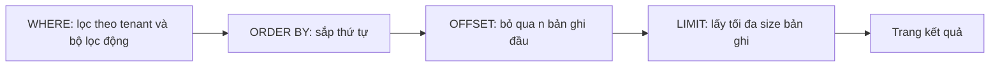

# Sắp xếp, giới hạn và phân trang trong truy vấn động

## 1. Vì sao một truy vấn đúng bộ lọc vẫn có thể cho kết quả khó sử dụng?

Giả sử trang quản trị bán hàng cho phép tìm đơn theo khách hàng, trạng thái và khoảng thời gian. Một yêu cầu như “lấy 20 đơn mới nhất của cửa hàng hiện tại” cần giải quyết **ba bài toán** sau khi lọc:

1. **Sắp xếp (sorting):** xác định thứ tự của các đơn, ví dụ thời gian tạo giảm dần.
2. **Giới hạn (limiting):** mỗi lần chỉ lấy một số lượng phù hợp với giao diện và hạ tầng.
3. **Phân trang (pagination):** xác định 20 bản ghi nào thuộc trang đang yêu cầu và làm sao đi đến trang tiếp theo.

Không có `ORDER BY` thì cơ sở dữ liệu **không bảo đảm thứ tự trả về**. Nếu chỉ sắp xếp bằng thời gian nhưng nhiều đơn có cùng timestamp, thứ tự của các đơn bằng nhau cũng không được xác định đầy đủ. Khi người dùng chuyển trang, điều này có thể gây trùng hoặc thiếu đơn.

Bài này thuộc chương **Truy vấn động** của **SPRING_DATA_COUCHBASE**, nền tảng xây dựng tầng truy cập Couchbase bằng **Spring Data** với document mapping, repository, `CouchbaseTemplate` và SQL++. Nội dung gắn việc sắp xếp/phân trang với thiết kế bucket/scope/collection, chỉ mục, khả năng vận hành, tính nhất quán, TTL, CAS, giao dịch và khả năng chọn API reactive.

Sau bài học, bạn có thể:

- Dùng SQL++ `ORDER BY`, `LIMIT`, `OFFSET` và hiểu chính xác thứ tự xử lý.
- Áp dụng `Sort`, `PageRequest`, `Pageable`, `Query.with(...)`, `Query.limit(...)` và `Query.skip(...)`.
- Xây dựng API lọc/sắp xếp động có whitelist trường, giới hạn trang và điều kiện tenant bắt buộc.
- Phân biệt kết quả `List`, `Page`, `Slice` và tổng số phần tử từ câu đếm.
- Nhận diện giới hạn của offset pagination; dùng keyset/cursor khi cần duyệt sâu.
- Kiểm tra chỉ mục phù hợp với `ORDER BY` và hiểu rủi ro khi document được thêm, sửa hoặc hết TTL giữa các lần đọc.

> **Phiên bản:** Mã minh họa dùng Java 17+, Spring Data Couchbase dòng 5.x/6.x và Couchbase Java SDK 3.x. Tên API `Query.with(Pageable)`, `Query.skip(long)` và `Query.limit(int)` được tra theo API chính thức; kiểm tra lại mapping và phiên bản Spring Boot trong dự án thực tế.

## 2. Dữ liệu và quy tắc sắp xếp ổn định

Giả sử entity có những thuộc tính sau:

```java
import java.math.BigDecimal;
import org.springframework.data.annotation.Id;
import org.springframework.data.couchbase.core.mapping.Document;

@Document
public class OrderDocument {
    @Id
    private String id;

    private String tenantId;
    private String orderNumber;
    private String customerId;
    private String status;
    private BigDecimal total;
    private long createdAtMillis;

    // Constructors, getters và setters được lược bỏ.
}
```

Ví dụ JSON được lưu trong collection `shop.sales.orders`:

```json
{
  "tenantId": "store-01",
  "orderNumber": "SO-2026-0105",
  "customerId": "customer-42",
  "status": "PAID",
  "total": 650000,
  "createdAtMillis": 1792992000000
}
```

Trong ví dụ này, **tên property Java trùng tên field JSON** để tập trung vào phân trang. Nếu dự án dùng `@Field("created_at_ms")`, SQL++ tự viết phải truy cập `created_at_ms`, còn các API Spring Data dùng property path cần được xác minh với converter của phiên bản đang chạy. `@Id` đại diện cho document key, có thể truy cập trong SQL++ bằng `META(o).id`.

**Giả định nghiệp vụ:** mỗi `orderNumber` là duy nhất trong phạm vi một `tenantId`; không đổi khi đơn được cập nhật. `createdAtMillis` được gán một lần lúc tạo và không sửa sau đó. Giả định này rất quan trọng nếu dùng cặp `(createdAtMillis, orderNumber)` để sắp xếp có thứ tự toàn phần và làm cursor.

Ví dụ năm đơn cùng tenant, đã lọc theo `status = "PAID"`:

| Thứ tự theo thời gian giảm dần | `orderNumber` | `createdAtMillis` | Ghi chú |
| ---: | --- | ---: | --- |
| 1 | SO-0105 | 1792992000000 | Cùng timestamp với SO-0104 |
| 2 | SO-0104 | 1792992000000 | Cùng timestamp với SO-0105 |
| 3 | SO-0103 | 1792905600000 | |
| 4 | SO-0102 | 1792819200000 | |
| 5 | SO-0101 | 1792732800000 | |

Nếu dùng `ORDER BY createdAtMillis DESC`, vị trí SO-0104 và SO-0105 có thể hoán đổi. Vì thế chọn thêm **khóa phân biệt ổn định**:

```sql
SELECT o.orderNumber, o.status, o.createdAtMillis
FROM `shop`.`sales`.`orders` AS o
WHERE o.tenantId = $tenantId
  AND o.status = $status
ORDER BY o.createdAtMillis DESC, o.orderNumber DESC;
```

SQL++ so sánh khóa `ORDER BY` từ trái sang phải. Khóa thứ hai chỉ quyết định vị trí khi khóa thứ nhất bằng nhau. Thứ tự này giúp **cùng tập dữ liệu** luôn được chia trang nhất quán hơn; nó không tạo ra snapshot bất biến khi có thao tác ghi đồng thời.

### 2.1. ASC, DESC và dữ liệu thiếu trường

- `ASC`: tăng dần, là mặc định nếu không nêu hướng.
- `DESC`: giảm dần.
- `ORDER BY total DESC, orderNumber ASC`: đơn có tổng tiền cao hơn đi trước, các đơn bằng tiền được sắp theo mã tăng dần.
- `NULL` và `MISSING` có quy tắc xếp vị trí riêng trong SQL++. Có thể dùng `NULLS FIRST`/`NULLS LAST` khi cần, nhưng nên xác định rõ dữ liệu thiếu và làm sạch kiểu dữ liệu.
- Khi cùng một trường trộn number/string, thứ tự tuân theo quy tắc sắp xếp các kiểu JSON, thường **khác** ý nghĩa nghiệp vụ mong muốn. Trường thời gian nên được lưu đồng nhất dạng số hoặc thời gian có kiểu/định dạng nhất quán.

Không dùng `ORDER BY` trên trường cho phép `MISSING` rồi mặc định rằng pagination có ý nghĩa nghiệp vụ. Với bộ lọc đặc thù, cân nhắc ràng buộc dữ liệu bắt buộc, điều kiện `IS VALUED` hoặc chính sách xếp giá trị thiếu rõ ràng.

## 3. SQL++: LIMIT và OFFSET được áp dụng như thế nào?

```sql
SELECT o.orderNumber, o.createdAtMillis
FROM `shop`.`sales`.`orders` AS o
WHERE o.tenantId = $tenantId
  AND o.status = $status
ORDER BY o.createdAtMillis DESC, o.orderNumber DESC
LIMIT 2 OFFSET 2;
```

Với năm dòng trong bảng trên, truy vấn trả về **SO-0103 và SO-0102**: bỏ qua hai dòng đầu theo thứ tự đã xác định, sau đó lấy tối đa hai dòng.

| `page` (bắt đầu từ 0) | `size` | `OFFSET` | Kết quả dự kiến |
| ---: | ---: | ---: | --- |
| 0 | 2 | 0 | SO-0105, SO-0104 |
| 1 | 2 | 2 | SO-0103, SO-0102 |
| 2 | 2 | 4 | SO-0101 |
| 3 | 2 | 6 | Mảng rỗng |

Công thức phân trang theo offset:

\[
\text{OFFSET} = \text{page} \times \text{size}
\]

Trong đó `page >= 0`, `size > 0`; `LIMIT` bằng `size`. Couchbase áp dụng `ORDER BY` trước `OFFSET`/`LIMIT` ở kết quả SELECT; nếu có cả `OFFSET` và `LIMIT`, các dòng được bỏ trước khi giới hạn số dòng được trả về.



`LIMIT` **không** có nghĩa là “lấy trang đầu bất kể thứ tự”. Nếu không có `ORDER BY`, `LIMIT 20` chỉ giới hạn số dòng; tập dòng được lấy không có thứ tự được bảo đảm. Đây là nguyên nhân phổ biến khiến cùng trang hiển thị bản ghi khác nhau giữa những lần gọi.

Đặt `LIMIT` ngay tại tầng query tốt hơn tải toàn bộ document lên JVM rồi cắt `subList`: nó hạn chế số dòng trả về và băng thông, nhưng bản thân query có thể vẫn cần đọc/sắp xếp lượng dữ liệu lớn nếu index không phù hợp.

## 4. Phân trang trong Spring Data Couchbase

### 4.1. Các lớp chính

| API | Vai trò |
| --- | --- |
| `Sort` | Quy định trường và hướng sắp xếp |
| `PageRequest.of(page, size, sort)` | Tạo `Pageable` với trang đánh số từ 0 |
| `Query.with(Sort)` | Thêm sắp xếp vào query |
| `Query.with(Pageable)` | Áp dụng đồng thời sắp xếp, `skip` và `limit` từ `Pageable` |
| `Query.skip(long)` | Bỏ qua một số bản ghi đầu |
| `Query.limit(int)` | Giới hạn số bản ghi trả về |
| `Page<T>` | Nội dung trang cùng metadata tổng số bản ghi/trang |
| `Slice<T>` | Nội dung của một đoạn và thông tin có đoạn tiếp theo hay không |

Ví dụ chỉ sắp xếp rồi lấy tối đa 20 đơn:

```java
import org.springframework.data.couchbase.core.query.Query;
import org.springframework.data.couchbase.core.query.QueryCriteria;
import org.springframework.data.domain.Sort;

Query query = Query.query(
        QueryCriteria.where("tenantId").is(trustedTenantId));

query.with(Sort.by(
        Sort.Order.desc("createdAtMillis"),
        Sort.Order.desc("orderNumber")));
query.limit(20);

List<OrderDocument> orders = template.findByQuery(OrderDocument.class)
        .matching(query)
        .all();
```

Lấy trang thứ hai, 20 dòng mỗi trang:

```java
import org.springframework.data.domain.PageRequest;
import org.springframework.data.domain.Pageable;

Pageable pageable = PageRequest.of(1, 20,
        Sort.by(Sort.Order.desc("createdAtMillis"),
                Sort.Order.desc("orderNumber")));

query.with(pageable); // Tự áp dụng sort, offset=20, limit=20.
```

Không cần gọi thêm `skip(20)`/`limit(20)` sau `with(pageable)`: làm vậy có thể khiến ý định phân trang khó theo dõi và có nguy cơ ghi đè giá trị.

### 4.2. `Page`, `Slice` và `List` khác nhau thế nào?

| Kiểu trả về | Có nội dung? | Có tổng số kết quả? | Chi phí thêm |
| --- | --- | --- | --- |
| `List<T>` | Có | Không | Truy vấn lấy dữ liệu |
| `Slice<T>` | Có | Không; biết `hasNext` | Thường đọc thêm 1 dòng để xác định còn trang tiếp |
| `Page<T>` | Có | Có `totalElements`, `totalPages` | Thường phải chạy truy vấn `COUNT` |

Chọn `Page` nếu UI thực sự cần “trang 3 trên 187 trang”; chọn `Slice` hoặc cách lấy thêm một bản ghi nếu UI chỉ cần “Xem thêm”. Truy vấn đếm có thể tốn chi phí đáng kể với tập dữ liệu lớn.

## 5. Ví dụ hoàn chỉnh: bộ lọc động, Sort whitelist và Page

Giả sử endpoint của hệ thống có các tham số:

```text
GET /orders?status=PAID&from=1792732800000&page=1&size=20&sortBy=date&direction=desc
```

Quy ước:

- `tenantId` lấy từ phiên đăng nhập đã xác thực, **không** đọc từ query string.
- `customerId`, `status`, khoảng thời gian là bộ lọc tùy chọn.
- Client chỉ được chọn `sortBy=date` hoặc `sortBy=amount`. Các trường hợp khác trả lỗi.
- `page` bắt đầu từ 0; `size` thuộc khoảng **1 đến 100**.
- `orderNumber` là khóa phụ được đảm bảo duy nhất trong một tenant.
- Ví dụ giới hạn `OFFSET <= 10_000` để tránh yêu cầu phân trang quá sâu. API nên chuyển sang cursor nếu cần duyệt sâu hơn.

DTO cho bộ lọc:

```java
// Java 17+
public record OrderFilter(
        String customerId,
        String status,
        Long createdFromInclusive,
        Long createdBeforeExclusive
) {}
```

Service:

```java
import java.util.List;
import java.util.Set;

import org.springframework.data.couchbase.core.CouchbaseTemplate;
import org.springframework.data.couchbase.core.query.Query;
import org.springframework.data.couchbase.core.query.QueryCriteria;
import org.springframework.data.domain.Page;
import org.springframework.data.domain.PageImpl;
import org.springframework.data.domain.PageRequest;
import org.springframework.data.domain.Pageable;
import org.springframework.data.domain.Sort;
import org.springframework.stereotype.Service;

@Service
public class OrderSearchService {
    private static final Set<String> STATUSES =
            Set.of("NEW", "PAID", "SHIPPED", "CANCELLED");
    private static final int MAX_SIZE = 100;
    private static final long MAX_OFFSET = 10_000;

    private final CouchbaseTemplate template;

    public OrderSearchService(CouchbaseTemplate template) {
        this.template = template;
    }

    public Page<OrderDocument> searchPage(
            String trustedTenantId,
            OrderFilter filter,
            int page,
            int size,
            String sortBy,
            String direction) {

        validatePage(page, size);
        Sort sort = allowedSort(sortBy, direction);
        Pageable pageable = PageRequest.of(page, size, sort);

        // Query cho dữ liệu: bao gồm sort + limit + offset.
        Query dataQuery = buildFilterQuery(trustedTenantId, filter)
                .with(pageable);
        List<OrderDocument> items = template.findByQuery(OrderDocument.class)
                .matching(dataQuery)
                .all();

        // Query đếm: cùng điều kiện lọc nhưng KHÔNG có sort/limit/offset.
        long total = template.findByQuery(OrderDocument.class)
                .matching(buildFilterQuery(trustedTenantId, filter))
                .count();

        return new PageImpl<>(items, pageable, total);
    }

    private static void validatePage(int page, int size) {
        if (page < 0 || size < 1 || size > MAX_SIZE) {
            throw new IllegalArgumentException("page/size không hợp lệ");
        }
        if ((long) page * size > MAX_OFFSET) {
            throw new IllegalArgumentException(
                    "Trang quá sâu; hãy dùng phân trang bằng cursor");
        }
    }

    private static Sort allowedSort(String sortBy, String direction) {
        String property = switch (sortBy) {
            case "date"   -> "createdAtMillis";
            case "amount" -> "total";
            default -> throw new IllegalArgumentException(
                    "sortBy không được hỗ trợ");
        };

        Sort.Direction requested = switch (direction) {
            case "asc"  -> Sort.Direction.ASC;
            case "desc" -> Sort.Direction.DESC;
            default -> throw new IllegalArgumentException(
                    "direction phải là asc hoặc desc");
        };

        return Sort.by(
                new Sort.Order(requested, property),
                // Khóa phụ ổn định và duy nhất trong phạm vi tenant.
                new Sort.Order(Sort.Direction.DESC, "orderNumber"));
    }

    private static boolean hasText(String s) {
        return s != null && !s.isBlank();
    }

    private Query buildFilterQuery(String tenantId, OrderFilter filter) {
        if (!hasText(tenantId) || filter == null) {
            throw new IllegalArgumentException(
                    "Thiếu phạm vi tenant hoặc bộ lọc");
        }
        if (filter.createdFromInclusive() != null
                && filter.createdBeforeExclusive() != null
                && filter.createdFromInclusive()
                        >= filter.createdBeforeExclusive()) {
            throw new IllegalArgumentException("Khoảng thời gian không hợp lệ");
        }

        Query q = Query.query(QueryCriteria.where("tenantId").is(tenantId));

        if (hasText(filter.customerId())) {
            q.addCriteria(QueryCriteria.where("customerId")
                    .is(filter.customerId().trim()));
        }

        if (hasText(filter.status())) {
            String status = filter.status().trim();
            if (!STATUSES.contains(status)) {
                throw new IllegalArgumentException("Trạng thái không hợp lệ");
            }
            q.addCriteria(QueryCriteria.where("status").is(status));
        }

        if (filter.createdFromInclusive() != null) {
            q.addCriteria(QueryCriteria.where("createdAtMillis")
                    .gte(filter.createdFromInclusive()));
        }
        if (filter.createdBeforeExclusive() != null) {
            q.addCriteria(QueryCriteria.where("createdAtMillis")
                    .lt(filter.createdBeforeExclusive()));
        }

        return q;
    }
}
```

Các lựa chọn đáng chú ý:

1. **Bộ lọc được tạo riêng** trong `buildFilterQuery`, bảo đảm query lấy dữ liệu và query đếm dùng cùng điều kiện bắt buộc/tùy chọn.
2. **`Query.with(Pageable)`** đặt sắp xếp, `skip` và `limit` cho query lấy dữ liệu. Query đếm được dựng mới để không bị ảnh hưởng bởi phân trang.
3. **Trường sắp xếp được whitelist**. Người dùng không thể truyền tên property không cho phép, một đoạn SQL++ hay biểu thức tùy ý.
4. **Khóa phụ** `orderNumber` tránh thứ tự không xác định giữa những document có cùng `total` hoặc `createdAtMillis`.
5. **Giới hạn đầu vào** tránh page size quá lớn và offset quá sâu. Phép nhân được thực hiện trên `long` để tránh tràn `int`.
6. **Tenant** được yêu cầu và thêm vào query trước mọi bộ lọc tùy chọn. Tenant phải xuất phát từ ngữ cảnh quyền truy cập đáng tin cậy.

Trong ví dụ này `sortBy` và `direction` bắt buộc là chuỗi hợp lệ, không `null`. Controller có thể đặt mặc định `date` và `desc` trước khi gọi service.

### 5.1. Vì sao không ghép tên trường trực tiếp vào SQL++?

Đoạn không an toàn:

```java
// KHÔNG làm như sau:
String sql = "SELECT ... ORDER BY " + userProvidedSortBy;
```

Với SQL++ viết tay, identifier như tên trường hoặc hướng sắp xếp không được bind giống các **giá trị** ở `WHERE`. Chọn từ một danh sách cố định:

```java
String sqlSort = switch (sortBy) {
    case "date"   -> "o.createdAtMillis";
    case "amount" -> "o.total";
    default -> throw new IllegalArgumentException("Sort không hợp lệ");
};
```

Sau đó chỉ nối chuỗi `sqlSort` đã được kiểm soát; các giá trị lọc tiếp tục phải bind qua `QueryCriteria` hoặc named parameter.

## 6. Khi chỉ cần biết còn trang tiếp theo: Slice

Trong chức năng cuộn vô hạn, UI thường không cần `totalElements`. Có thể đọc **`size + 1`** document: nếu nhận hơn `size`, còn ít nhất một bản ghi tiếp theo tại thời điểm truy vấn.

Đoạn sau đặt **trong cùng service** của phần 5 và tái sử dụng `validatePage`, `allowedSort`, `buildFilterQuery`:

```java
import java.util.ArrayList;
import org.springframework.data.domain.Slice;
import org.springframework.data.domain.SliceImpl;

public Slice<OrderDocument> searchSlice(
        String tenantId, OrderFilter filter,
        int page, int size, String sortBy, String direction) {

    validatePage(page, size);
    Sort sort = allowedSort(sortBy, direction);
    Pageable pageable = PageRequest.of(page, size, sort);

    // Truy vấn thêm 1 bản ghi; không cần một COUNT riêng.
    Query q = buildFilterQuery(tenantId, filter)
            .with(sort)
            .skip(pageable.getOffset())
            .limit(size + 1);

    List<OrderDocument> fetched = template.findByQuery(OrderDocument.class)
            .matching(q)
            .all();

    boolean hasNext = fetched.size() > size;
    List<OrderDocument> content = hasNext
            ? new ArrayList<>(fetched.subList(0, size))
            : fetched;

    return new SliceImpl<>(content, pageable, hasNext);
}
```

`Page` và `Slice` đều có ích, nhưng `Slice` không giải quyết tự động vấn đề offset sâu: ở trang thứ 10000, cơ sở dữ liệu vẫn có thể phải bỏ qua rất nhiều document. Nếu sản phẩm chỉ cần “Tải thêm”, cân nhắc chuyển sang cursor khi lượng dữ liệu tăng.

### 6.1. Dùng repository khi bộ lọc cố định

Với điều kiện đã xác định, repository có thể nhận `Pageable`:

```java
import org.springframework.data.couchbase.repository.CouchbaseRepository;
import org.springframework.data.domain.Page;
import org.springframework.data.domain.Pageable;
import org.springframework.data.domain.Slice;

public interface OrderRepository
        extends CouchbaseRepository<OrderDocument, String> {

    Page<OrderDocument> findByTenantIdAndStatus(
            String tenantId, String status, Pageable pageable);

    Slice<OrderDocument> readByTenantIdAndStatus(
            String tenantId, String status, Pageable pageable);
}
```

`Pageable` đã chứa `Sort`, do đó không truyền cả `Pageable` và một tham số `Sort` riêng cho cùng một derived query. Khi dùng `@Query` với câu SQL++ tự viết và tham số `Pageable`, tránh đặt sẵn `ORDER BY`/`LIMIT`/`OFFSET` trong câu query inline để Spring Data có thể bổ sung chúng đúng một lần.

## 7. Offset sâu, dữ liệu thay đổi và cách phân trang bằng cursor

Giả sử trang đầu được đọc lúc 10:00:

```text
SO-0105, SO-0104 | SO-0103, SO-0102 | SO-0101
```

Người dùng vừa xem trang 0 (`LIMIT 2 OFFSET 0`). Trước khi họ yêu cầu trang 1, một đơn **SO-0106** có thời gian mới hơn được thêm vào:

```text
SO-0106, SO-0105, SO-0104, SO-0103, SO-0102, SO-0101
```

Lúc này `LIMIT 2 OFFSET 2` trả **SO-0104 và SO-0103**; SO-0104 đã xuất hiện ở trang trước. Điều này xảy ra ngay cả khi `ORDER BY` đã đủ khóa phụ. Offset dựa vào **vị trí trong tập hiện tại**, nên insert/delete trước mốc có thể dịch các trang.

Ngoài ra, `OFFSET 100000 LIMIT 20` có thể đòi hỏi database đọc, sắp xếp hoặc bỏ qua lượng lớn index entry. Bộ tối ưu có thể đẩy `LIMIT`/`OFFSET` xuống index khi có đủ điều kiện; nhưng không phải truy vấn nào cũng làm được. Kiểm tra `EXPLAIN` thay vì giả định đã được tối ưu.

### 7.1. Keyset pagination là gì?

**Keyset**, hay **cursor pagination**, không nói “bỏ qua N dòng”. Nó nói: “lấy các dòng **đứng sau dòng cuối cùng của trang trước theo thứ tự đã chọn**”.

Nếu mọi trang dùng thứ tự:

```sql
ORDER BY o.createdAtMillis DESC, o.orderNumber DESC
```

và bản ghi cuối của trang trước là `(createdAtMillis = 1792992000000, orderNumber = "SO-0104")`, trang tiếp theo cần điều kiện:

```sql
WHERE o.tenantId = $tenantId
  AND o.status = $status
  AND (
       o.createdAtMillis < $lastCreatedAt
       OR (
            o.createdAtMillis = $lastCreatedAt
            AND o.orderNumber < $lastOrderNumber
          )
      )
ORDER BY o.createdAtMillis DESC, o.orderNumber DESC
LIMIT $fetchSize;
```

Sở dĩ dùng dấu `<` cho cả hai khóa vì **cả hai đang được sắp giảm dần**. Nếu thay một khóa thành `ASC`, biểu thức cursor phải được sửa tương ứng. Chỉ lấy khóa thời gian mà bỏ qua `orderNumber` sẽ khiến các đơn cùng timestamp có nguy cơ bị bỏ sót.

### 7.2. Ví dụ Java SDK cho một thứ tự cố định

Ví dụ sau dùng SDK trực tiếp để biểu diễn tường minh điều kiện cursor. Khác với đoạn `CouchbaseTemplate`, các kết quả là `JsonObject` và cần mapping thêm nếu muốn trả entity.

```java
import java.util.ArrayList;
import java.util.List;
import java.util.Set;

import com.couchbase.client.java.Cluster;
import com.couchbase.client.java.json.JsonObject;
import com.couchbase.client.java.query.QueryOptions;

public final class OrderCursorSearch {
    // Chỉ dùng cursor cho kiểu sắp xếp DATE_DESC cố định.
    public record OrderCursor(long createdAtMillis, String orderNumber) {}

    public record CursorPage(
            List<JsonObject> items, OrderCursor nextCursor) {}

    private static final Set<String> STATUSES =
            Set.of("NEW", "PAID", "SHIPPED", "CANCELLED");

    private final Cluster cluster;

    public OrderCursorSearch(Cluster cluster) {
        this.cluster = cluster;
    }

    public CursorPage next(
            String trustedTenantId,
            String status,
            OrderCursor cursor,
            int pageSize) {

        if (trustedTenantId == null || trustedTenantId.isBlank()) {
            throw new IllegalArgumentException("Thiếu tenant");
        }
        if (status == null || !STATUSES.contains(status)) {
            throw new IllegalArgumentException("Status không hợp lệ");
        }
        if (pageSize < 1 || pageSize > 100) {
            throw new IllegalArgumentException("pageSize không hợp lệ");
        }
        if (cursor != null && (cursor.orderNumber() == null
                || cursor.orderNumber().isBlank())) {
            throw new IllegalArgumentException("Cursor không hợp lệ");
        }

        StringBuilder sql = new StringBuilder("""
                SELECT o.orderNumber, o.status, o.createdAtMillis,
                       META(o).id AS documentId
                FROM `shop`.`sales`.`orders` AS o
                WHERE o.tenantId = $tenantId AND o.status = $status
                """);

        JsonObject params = JsonObject.create()
                .put("tenantId", trustedTenantId)
                .put("status", status)
                .put("fetchSize", pageSize + 1);

        if (cursor != null) {
            sql.append("""
                 AND (
                       o.createdAtMillis < $lastCreatedAt
                       OR (o.createdAtMillis = $lastCreatedAt
                           AND o.orderNumber < $lastOrderNumber)
                     )
                """);
            params.put("lastCreatedAt", cursor.createdAtMillis())
                    .put("lastOrderNumber", cursor.orderNumber());
        }

        sql.append("""
                 ORDER BY o.createdAtMillis DESC, o.orderNumber DESC
                 LIMIT $fetchSize
                """);

        List<JsonObject> fetched = cluster.query(
                sql.toString(),
                QueryOptions.queryOptions().parameters(params)
        ).rowsAsObject();

        boolean hasNext = fetched.size() > pageSize;
        int count = Math.min(pageSize, fetched.size());
        List<JsonObject> items =
                new ArrayList<>(fetched.subList(0, count));

        OrderCursor nextCursor = null;
        if (hasNext) {
            JsonObject last = items.get(items.size() - 1);
            nextCursor = new OrderCursor(
                    last.getLong("createdAtMillis"),
                    last.getString("orderNumber"));
        }
        return new CursorPage(items, nextCursor);
    }
}
```

Giải thích:

- **Trang đầu:** gọi `next(tenant, status, null, size)`; câu query không có điều kiện cursor.
- **Trang tiếp:** truyền `nextCursor` của trang trước để tạo điều kiện “đứng sau bản ghi cuối”.
- **`pageSize + 1`:** dùng một bản ghi dư để biết `hasNext`; bản ghi dư **không** đưa vào kết quả hoặc cursor.
- **Tham số:** status, tenant, giá trị cursor và giới hạn đều được bind; tên field và hướng sắp xếp là hằng số trong mã.
- **Thứ tự:** cặp `(createdAtMillis, orderNumber)` phải có giá trị, đúng kiểu, bất biến trong quá trình duyệt và duy nhất theo phạm vi lọc. Nếu không bảo đảm được những điều này, chọn khóa phụ thực sự duy nhất, ví dụ `META(o).id` trong SQL++, và xây điều kiện cursor phù hợp.

Trong API công khai, **không nên để client tự tạo/sửa tuple cursor mà không kiểm tra**. Có thể đóng gói nó thành một token opaque được bảo vệ tính toàn vẹn (chẳng hạn ký HMAC), gắn với tenant, bộ lọc, trường/hướng sort, phiên bản schema và thời hạn token. Không tái sử dụng cursor của bộ lọc khác; query mới phải bắt đầu từ trang đầu.

**Giới hạn thực tế:** keyset giảm vấn đề “dịch vị trí” khi có insert ở trước cursor và thường hữu ích để duyệt sâu, nhưng **không tự bảo đảm snapshot**. Thay đổi `status`, xóa document, hết TTL hoặc đổi giá trị khóa sắp xếp trong lúc phân trang vẫn có thể thay đổi tập kết quả. Nếu cần ảnh chụp nhất quán tại một thời điểm, phải thiết kế mức nhất quán/lưu snapshot riêng theo nghiệp vụ.

## 8. Chỉ mục cho bộ lọc kết hợp ORDER BY

Tạo truy vấn có `LIMIT` là chưa đủ để query nhanh. Với mẫu phổ biến:

```sql
WHERE o.tenantId = $tenantId AND o.status = $status
ORDER BY o.createdAtMillis DESC, o.orderNumber DESC
LIMIT 20;
```

có thể đánh giá một index có tiền tố lọc và khóa sort phù hợp:

```sql
-- Tên bucket/scope/collection minh họa; thay bằng keyspace thực tế.
CREATE INDEX ix_orders_tenant_status_date_desc
ON `shop`.`sales`.`orders` (
    tenantId,
    status,
    createdAtMillis DESC,
    orderNumber DESC
);
```

Nếu nhiều request **không có status** nhưng vẫn lọc theo tenant và sắp theo ngày, index trên `tenantId, status, createdAtMillis` không nhất thiết duy trì thứ tự cần thiết cho toàn bộ các status. Có thể cần index riêng:

```sql
CREATE INDEX ix_orders_tenant_date_desc
ON `shop`.`sales`.`orders` (
    tenantId,
    createdAtMillis DESC,
    orderNumber DESC
);
```

Để lựa chọn index, thử các tổ hợp thường gặp:

| Bộ lọc và sort | Index cần đánh giá | Lưu ý |
| --- | --- | --- |
| Tenant + status; ngày giảm dần | `tenantId, status, createdAtMillis DESC, orderNumber DESC` | Khóa lọc bằng trước khóa sắp xếp |
| Chỉ tenant; ngày giảm dần | `tenantId, createdAtMillis DESC, orderNumber DESC` | Không phụ thuộc status |
| Tenant + status; tổng tiền giảm dần | `tenantId, status, total DESC, orderNumber DESC` | Cần xem tần suất sort theo tiền có xứng đáng index |
| Keyset theo ngày | Index có thứ tự ngày + khóa phụ | Điều kiện cursor cần tương thích với index |
| Sort trên trường lồng hoặc biểu thức | Index theo field/expression thực | Kiểm chứng cách mapping và chi phí tính toán |

Dùng `EXPLAIN` với câu SQL++ cuối cùng:

```sql
EXPLAIN SELECT META(o).id, o.orderNumber, o.createdAtMillis
FROM `shop`.`sales`.`orders` AS o
WHERE o.tenantId = "store-01"
  AND o.status = "PAID"
ORDER BY o.createdAtMillis DESC, o.orderNumber DESC
LIMIT 20 OFFSET 40;
```

Kiểm tra index được chọn, các bước `IndexScan`, `Fetch`, `Order`, `Offset`, `Limit` và khả năng **index pushdown**. Khi điều kiện, chiều sort và index phù hợp, các bước có thể được đẩy xuống Index Service; khi không phù hợp, Query Service có thể phải sắp xếp/tạo lượng kết quả trung gian lớn rồi mới cắt trang.

Mỗi secondary index tốn dung lượng và chi phí ghi; không tạo mọi hoán vị bộ lọc và hướng sắp xếp. Đo bằng dữ liệu đại diện, tần suất truy vấn và mức tải ghi thực tế.

## 9. Phân trang và tính nhất quán

| Tình huống | Điều có thể xảy ra | Cách thiết kế |
| --- | --- | --- |
| Insert mới trước offset đang duyệt | Trùng phần tử giữa hai trang | Keyset/cursor khi cần duyệt liên tục |
| Document bị xóa hoặc hết TTL | Tổng số và số phần tử trang thay đổi | Chấp nhận tập dữ liệu động, hoặc snapshot theo nghiệp vụ |
| Cập nhật `createdAtMillis`/`orderNumber` | Cursor có thể lặp/bỏ sót phần tử | Dùng khóa sắp xếp bất biến, duy nhất |
| Query vừa ghi xong nhưng index chưa bắt kịp | Bản ghi mới có thể chưa xuất hiện trong kết quả SQL++ | Cân nhắc scan consistency thích hợp |
| `Page` gọi query dữ liệu rồi query đếm | Hai query có thể thấy các thời điểm dữ liệu khác nhau | Không giả định kết quả là một snapshot; đánh giá yêu cầu nghiệp vụ |
| Sort trên nhiều giá trị JSON khác kiểu hoặc field thiếu | Thứ tự khó dự đoán về nghiệp vụ | Chuẩn hóa schema, ràng buộc dữ liệu, xác định rõ `NULLS FIRST/LAST` |
| Dùng CAS để cập nhật document | CAS giúp tránh ghi đè không mong muốn, nhưng không ổn định hóa tập đọc | Kết hợp đúng cơ chế ghi và chiến lược đọc/phân trang |

Trong Spring Data Couchbase, `Query.scanConsistency(QueryScanConsistency.REQUEST_PLUS)` có thể được cân nhắc cho các truy vấn đòi hỏi index phản ánh các mutation đã được xác nhận trước lúc query bắt đầu:

```java
import com.couchbase.client.java.query.QueryScanConsistency;

Query query = Query.query(
        QueryCriteria.where("tenantId").is(trustedTenantId))
        .scanConsistency(QueryScanConsistency.REQUEST_PLUS)
        .with(PageRequest.of(0, 20,
                Sort.by(Sort.Order.desc("createdAtMillis"),
                        Sort.Order.desc("orderNumber"))));
```

`REQUEST_PLUS` có thể tăng độ trễ khi index còn cập nhật. Nó **không** biến nhiều request phân trang cách nhau thành một ảnh chụp dữ liệu chung. Nếu cần truy cập theo **document key** đã biết, API KV/repository `findById` có đặc tính khác truy vấn SQL++ và thường phù hợp hơn.

Giao dịch Couchbase giải quyết tính nguyên tử/nhất quán cho những thao tác thuộc phạm vi transaction; không nên giữ một transaction mở xuyên suốt nhiều request người dùng để giả lập quá trình duyệt trang.

### 9.1. Reactive không thay đổi quy tắc phân trang

`ReactiveCouchbaseTemplate` cho phép xử lý kết quả không chặn luồng bằng `Flux`/`Mono`. Dù dùng blocking hay reactive:

- Phải có thứ tự ổn định và khóa phụ phù hợp.
- `limit`, `skip`, `Pageable` và logic cursor vẫn cần được định nghĩa đúng.
- Không tải toàn bộ collection vào `Flux` rồi mới thực hiện `skip`/`take` ở phía ứng dụng để giả lập phân trang database.
- Tránh dùng `.block()` trong request path reactive.

Ví dụ cùng một `Query` đã được giới hạn:

```java
// Được thực thi trong service có ReactiveCouchbaseTemplate.
Flux<OrderDocument> orders = reactiveTemplate
        .findByQuery(OrderDocument.class)
        .matching(query)
        .all();
```

## 10. Checklist kiểm thử và xử lý lỗi

### 10.1. Ma trận kiểm thử cần có

| Tình huống | Kết quả kỳ vọng |
| --- | --- |
| `page=0,size=2` | Hai bản ghi đầu theo thứ tự đã khai báo |
| `page=1,size=2` | Hai bản ghi tiếp theo, không trùng nếu dữ liệu không đổi |
| Trang vượt cuối | Trả danh sách rỗng, metadata hợp lệ |
| Hai đơn cùng `createdAtMillis` | Thứ tự được quyết định bởi `orderNumber` |
| `sortBy=amount,direction=asc` | Tổng tiền tăng dần; các đơn bằng tiền dùng khóa phụ |
| `sortBy` không hợp lệ hoặc có dấu SQL++ | Bị từ chối trước khi dựng truy vấn |
| `size=0`, `size=101`, `page=-1`, offset quá sâu | Bị từ chối bằng thông báo rõ ràng |
| Bộ lọc tùy chọn đều rỗng | Chỉ kết quả của tenant hiện tại, không vượt `LIMIT` |
| Đếm và phân trang | `totalElements` đếm **cùng điều kiện** và không chịu `LIMIT/OFFSET` |
| `Slice` còn dữ liệu | `hasNext=true` nếu tồn tại bản ghi thứ `size+1` |
| Cursor qua nhóm cùng timestamp | Không bỏ qua item có cùng thời gian nhưng mã nhỏ hơn |
| Thay đổi filter trong lúc dùng cursor | Cursor cũ phải bị từ chối hoặc bỏ đi, tìm lại từ đầu |
| Chèn đơn mới trước offset | Minh họa hiện tượng trùng/mất khi dùng offset; đối chiếu keyset |
| Tài liệu thuộc tenant khác | Không bao giờ xuất hiện trong kết quả |

**Kiểm thử tích hợp:** dùng dữ liệu ít nhất hai tenant, nhiều đơn trùng thời điểm tạo, tổng tiền trùng nhau và các trạng thái khác nhau. Cần đọc lại kết quả từ Couchbase thật hoặc môi trường tương đương để phát hiện lỗi mapping và thứ tự. Để chứng minh rủi ro phân trang, thêm/xóa document **giữa hai request** rồi quan sát thay đổi.

### 10.2. Những lỗi dễ mắc

1. **Không có `ORDER BY`**, hoặc chỉ sort trên trường không duy nhất: trang có thể không ổn định.
2. **Quên giới hạn `size`**: một request có thể trả dữ liệu quá lớn.
3. **Nhầm `page` với `OFFSET`**: `page=2,size=20` phải có offset 40, không phải 2.
4. **Đếm trên query đã thêm `skip`/`limit`**: dễ nhầm tổng số với số phần tử trang; tạo lại query lọc trước khi đếm.
5. **Ghép tên sort trực tiếp từ client**: dùng whitelist tên property/field và hướng sort.
6. **Không xét dữ liệu đang thay đổi**: `Page`/cursor không tự tạo snapshot giữa nhiều HTTP request.
7. **Dùng offset cực lớn mà không đo**: kiểm tra `EXPLAIN`; cân nhắc keyset.
8. **Sort theo tên property Java trong SQL++ tự viết khi document dùng `@Field` alias**: kiểm tra tên field thực tế.
9. **Dùng repository inline `@Query` đã có LIMIT rồi truyền thêm `Pageable`**: nguy cơ tạo mệnh đề trùng; để framework đảm nhiệm phần phân trang.
10. **Cố định một index cho mọi tổ hợp sort**: kiểm tra pattern truy vấn và chỉ mục riêng cho các hướng phổ biến.

## 11. Bài tập tự luyện

**Bài 1 — Tính offset.** Với `page=4`, `size=25`, xác định `LIMIT` và `OFFSET`, và giải thích vì sao phải có `ORDER BY`.

**Đáp án:** `LIMIT 25 OFFSET 100`; `ORDER BY` xác định thứ tự trước khi bỏ 100 bản ghi đầu.

**Bài 2 — Sửa thứ tự không ổn định.** Một màn hình dùng `ORDER BY total DESC LIMIT 20 OFFSET 20` và có nhiều đơn cùng `total`. Hãy bổ sung khóa phụ duy nhất trong tenant và giải thích điều kiện cần kiểm tra.

**Đáp án gợi ý:** `ORDER BY total DESC, orderNumber DESC` nếu `orderNumber` không trùng trong tenant và có giá trị ở mọi document. Nếu không, chọn khóa phân biệt khác như document key trong SQL++.

**Bài 3 — Bộ lọc động.** Thêm `minTotal` vào `OrderFilter`. Yêu cầu `minTotal=0` vẫn là điều kiện hợp lệ, `null` là bỏ qua; cả query dữ liệu và query đếm phải phản ánh cùng bộ lọc.

**Bài 4 — Cursor.** Với thứ tự `createdAtMillis DESC, orderNumber DESC`, viết điều kiện để lấy các bản ghi sau cursor `(1000, "SO-0104")`. Nếu đổi `orderNumber` sang `ASC`, hãy thay phép so sánh tương ứng.

**Đáp án:**

```sql
-- Cả hai khóa đều DESC:
AND (createdAtMillis < 1000
     OR (createdAtMillis = 1000 AND orderNumber < "SO-0104"))

-- Ngày DESC, mã đơn ASC:
AND (createdAtMillis < 1000
     OR (createdAtMillis = 1000 AND orderNumber > "SO-0104"))
```

Hai đoạn trên là điều kiện nối tiếp sau `WHERE tenantId = $tenantId` và các điều kiện lọc khác. Giữ ngoặc để nhánh `OR` không vượt qua phạm vi tenant.

**Bài 5 — Chọn API.** Màn hình báo cáo cần số trang chính xác, còn màn hình điện thoại chỉ có nút “Tải thêm”. So sánh `Page`, `Slice` và keyset/cursor về lượng dữ liệu truy vấn, chi phí đếm và khả năng bị ảnh hưởng khi có đơn mới.

## 12. Ghi nhớ và tài liệu tra cứu

Một truy vấn động có thể dùng cho phân trang khi nó đảm bảo đồng thời: **đúng phạm vi lọc, thứ tự được xác định, giới hạn kết quả và chiến lược chuyển trang phù hợp**. `Query.with(Pageable)` của Spring Data giúp áp dụng sort/limit/offset nhất quán; `Page` phục vụ giao diện cần tổng số, `Slice` khi chỉ cần biết còn trang sau. Với tập lớn hoặc ghi liên tục, keyset/cursor có thể phù hợp hơn offset nhưng vẫn cần chính sách dữ liệu thay đổi. Thiết kế chỉ mục theo cả `WHERE` và `ORDER BY`, đo bằng `EXPLAIN` trên query thật.

Tài liệu chính thức:

- [Spring Data Couchbase — `Query` API: `with`, `skip`, `limit`](https://docs.spring.io/spring-data/couchbase/reference/api/java/org/springframework/data/couchbase/core/query/Query.html).
- [Spring Data Couchbase — Query methods, sorting and pagination](https://docs.spring.io/spring-data/couchbase/reference/repositories/query-methods-details.html).
- [Spring Data Couchbase — Repository queries](https://docs.spring.io/spring-data/couchbase/reference/couchbase/repository.html).
- [Spring Data Couchbase — `CouchbaseTemplate`](https://docs.spring.io/spring-data/couchbase/reference/couchbase/template.html).
- [Couchbase SQL++ — `ORDER BY`](https://docs.couchbase.com/server/current/n1ql/n1ql-language-reference/orderby.html).
- [Couchbase SQL++ — `LIMIT`](https://docs.couchbase.com/server/current/n1ql/n1ql-language-reference/limit.html).
- [Couchbase SQL++ — `OFFSET`](https://docs.couchbase.com/server/current/n1ql/n1ql-language-reference/offset.html).
- [Couchbase Server — Index Pushdowns](https://docs.couchbase.com/server/current/indexes/index_pushdowns.html).
