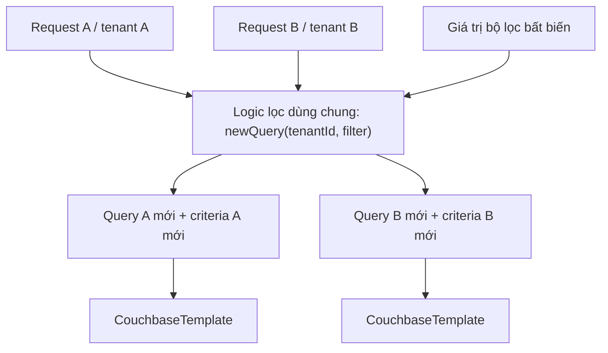

# Tái sử dụng tiêu chí mà không chia sẻ trạng thái khả biến

## 1. Bài toán: tái sử dụng logic nhưng phải cô lập từng lần truy vấn

Một dịch vụ tra cứu đơn hàng thường có nhiều thao tác cùng dựa trên một tập điều kiện: lấy danh sách theo trang, đếm tổng số, xuất báo cáo, hoặc tìm đơn mới nhất. Ta muốn **tái sử dụng quy tắc lọc** để không lặp mã và tránh trường hợp danh sách lọc khác với truy vấn đếm. Tuy nhiên, việc tái sử dụng **cùng một đối tượng truy vấn đang được sửa đổi** có thể tạo lỗi rất khó phát hiện.

Giả sử request A cần tìm đơn của `store-A`, trang 0, và request B cần tìm đơn của `store-B`, trang 3. Nếu cả hai cùng gọi `addCriteria(...)`, `with(Pageable)` hoặc `limit(...)` trên **một `Query` dùng chung**, một lần gọi có thể giữ lại điều kiện, sắp xếp hoặc phân trang của lần gọi khác. Ngay cả khi không có hai luồng chạy đồng thời, việc dùng lại đối tượng đó giữa hai lần gọi tuần tự cũng có thể gây ra lỗi tồn dư trạng thái.

Trong chương **Truy vấn động** của **SPRING_DATA_COUCHBASE**, kỹ thuật an toàn là:

> **Tái sử dụng quy tắc hoặc hàm tạo tiêu chí; khởi tạo một đối tượng `Query` và các `QueryCriteria` mới cho mỗi thao tác cần thực thi.**

Đây là một phần của việc xây dựng tầng truy cập Couchbase với Spring Data: document mapping, repository, `CouchbaseTemplate`, SQL++ và những quyết định liên quan đến bucket/scope/collection, chỉ mục, hiệu năng, tính nhất quán, TTL, CAS, giao dịch và API reactive.

Sau bài học, bạn có thể:

1. Phân biệt **mã tái sử dụng** với **đối tượng trạng thái dùng chung**.
2. Xác định các thao tác có thể sửa `Query` và chuỗi `QueryCriteria`.
3. Tạo **factory method** sinh truy vấn mới dựa trên bộ lọc đầu vào.
4. Dùng chung cùng quy tắc cho truy vấn lấy dữ liệu, đếm, export và phân trang mà không làm rò trạng thái.
5. Thiết kế DTO đầu vào không bị biến đổi ngoài ý muốn và kiểm thử tính cô lập giữa các request.

> **Phiên bản:** Ví dụ dùng Java 17+ và API `org.springframework.data.couchbase.core.query.Query`, `QueryCriteria`, `CouchbaseTemplate` của Spring Data Couchbase hiện đại (5.x/6.x). Hãy đối chiếu API chính xác theo phiên bản Spring Boot/Spring Data sử dụng. Các ví dụ tập trung vào vòng đời đối tượng và không mặc định đối tượng query là an toàn để chia sẻ giữa các luồng.

## 2. Ba loại đối tượng có vòng đời khác nhau

| Đối tượng | Trách nhiệm | Vòng đời nên dùng |
| --- | --- | --- |
| `CouchbaseTemplate` | Thực thi thao tác trên Couchbase, dùng cấu hình kết nối và mapping | Bean được Spring quản lý; thông thường tái sử dụng |
| `QueryCriteria` | Biểu diễn điều kiện so sánh và các mắt xích logic `AND`/`OR` | Tạo mới khi xây một biểu thức truy vấn |
| `Query` | Chứa criteria, sort, skip/limit, tùy chọn nhất quán và metadata query | Tạo mới cho mỗi lần thực thi có tham số/kiểu kết quả riêng |
| DTO bộ lọc | Mang giá trị đầu vào đã kiểm tra | Một snapshot bất biến cho một request |
| Factory / helper | Chuyển bộ lọc thành `Query` và `QueryCriteria` | Hàm, component không giữ query đang biến đổi |

Các API như `Query.addCriteria(...)`, `Query.with(Sort)`, `Query.with(Pageable)`, `Query.skip(...)`, `Query.limit(...)` và `Query.scanConsistency(...)` **thiết lập hoặc thay đổi dữ liệu trên đối tượng `Query` đang được dùng**. `QueryCriteria` có các phương thức nối chuỗi `and(...)`, `or(...)`; khi tái sử dụng một instance hoặc chuỗi tiêu chí, rất dễ mang theo các mối liên kết và điều kiện đã ghép. Vì vậy nên coi toàn bộ cây tiêu chí đang xây dựng là **trạng thái cục bộ của một query**.

Trong API Spring Data Couchbase có constructor `new Query(existingQuery)`, nhưng sự tồn tại của constructor sao chép **không phải cam kết rằng toàn bộ đối tượng criteria lồng nhau sẽ luôn độc lập theo ý định ứng dụng**. Nếu cần tính cô lập chắc chắn, xây query mới từ đầu vào bất biến thay vì dựa vào việc sao chép một query đã thay đổi.

### 2.1. Hình dung luồng dữ liệu đúng



Sơ đồ nhấn mạnh rằng hai request **chia sẻ cách xây** truy vấn, không chia sẻ **instance** `Query`. Trên thực tế, mỗi request có snapshot bộ lọc của riêng mình; các cạnh từ factory đến query chỉ mô tả cơ chế chung, không có một đối tượng mutable chuyển giữa các luồng.

## 3. Phản ví dụ: giữ `Query` trong field hoặc singleton

Đoạn sau **không nên dùng**:

```java
import org.springframework.data.couchbase.core.query.Query;
import org.springframework.data.couchbase.core.query.QueryCriteria;
import org.springframework.data.domain.PageRequest;
import org.springframework.stereotype.Service;

@Service
public class UnsafeOrderQueryFactory {
    // CẢNH BÁO: trạng thái dùng chung cho mọi request của service.
    private final Query shared = Query.query(
            QueryCriteria.where("status").is("PAID"));

    public Query forRequest(String tenantId, int page) {
        shared.addCriteria(QueryCriteria.where("tenantId").is(tenantId));
        shared.with(PageRequest.of(page, 20));
        return shared;
    }
}
```

Các vấn đề xảy ra:

- Gọi A với `tenantId=store-A` rồi gọi B với `tenantId=store-B`: query ban đầu có thể giữ cả hai điều kiện tenant, thay vì mỗi request chỉ có một tenant.
- Gọi lần sau với `page=3` có thể thay đổi `skip`/`limit` của đối tượng đang được lần trước sử dụng.
- Nếu thực thi song song, không có cơ sở để coi các mutation này được đồng bộ theo ranh giới request.
- `@Service` mặc định thường là singleton, nên field `shared` đặc biệt dễ trở thành nguồn trạng thái dùng chung ngoài ý muốn.

Tương tự, đoạn sau cũng không phù hợp:

```java
// CẢNH BÁO: không cache một criteria rồi tiếp tục nối điều kiện riêng.
private static final QueryCriteria BASE =
        QueryCriteria.where("status").is("PAID");

static QueryCriteria forTenant(String tenantId) {
    return BASE.and("tenantId").is(tenantId);
}
```

Các phương thức nối tiêu chí có thể tác động lên cấu trúc chuỗi criteria. Không xem `BASE` như một hằng số bất biến chỉ vì khai báo `static final`: `final` chỉ ngăn gán lại tham chiếu, không khóa trạng thái bên trong đối tượng.

### 3.1. Vấn đề không chỉ xuất hiện trong đa luồng

Ngay cả mã tuần tự cũng có thể sai:

```java
Query q = Query.query(QueryCriteria.where("tenantId").is("store-01"));
q.with(PageRequest.of(2, 20));

// Lần sau đem q đi count mà quên tạo query mới.
// Khi đó q vẫn có thông tin trang 2 và giới hạn 20.
```

Kết quả đếm có thể gây nhầm lẫn hoặc phụ thuộc cách triển khai `count` với các tùy chọn còn sót. Nguyên tắc đúng là **truy vấn đếm được dựng riêng từ cùng bộ lọc**, không dùng lại đối tượng chứa trạng thái phân trang.

## 4. Quy tắc thiết kế: đầu vào bất biến, query mới, dùng xong thì bỏ

Một factory tốt có những đặc điểm:

1. Nhận đầy đủ dữ liệu cần thiết từ tham số; không đọc hoặc sửa field `Query` dùng chung.
2. Kiểm tra phạm vi truy cập bắt buộc và tính hợp lệ của bộ lọc.
3. Khởi tạo `QueryCriteria.where(...)` và `Query.query(...)` **ngay trong mỗi lần gọi**.
4. Mỗi nhánh tùy chọn tạo tiêu chí mới từ dữ liệu hiện tại; không lấy criteria đã ghép của request trước.
5. Trả về query mới cho người gọi thiết lập sắp xếp, phân trang, mức nhất quán phù hợp với mục đích.
6. Không giữ lại query đã tạo trong `static`, field của `@Service`, cache hoặc dữ liệu phiên người dùng.

Mẫu khái quát:

```java
Query newQuery(String trustedTenantId, SearchFilter filter) {
    Query query = Query.query(
            QueryCriteria.where("tenantId").is(trustedTenantId));

    if (filter.hasStatus()) {
        query.addCriteria(
                QueryCriteria.where("status").is(filter.status()));
    }
    // ... Các điều kiện tùy chọn còn lại cũng được tạo mới.
    return query;
}
```

`newQuery` là **hàm được tái sử dụng**. `query` và `QueryCriteria` bên trong là **đối tượng mới** trong lần gọi đó. Lưu ý đoạn trên là mẫu mô tả: các phương thức `hasStatus()` và record DTO ở mục sau do ứng dụng tự định nghĩa.

## 5. Ví dụ hoàn chỉnh với `CouchbaseTemplate`

Hệ thống lưu các đơn hàng trong collection đã cấu hình cho entity. Trong ví dụ, thuộc tính Java và tên trường lưu trữ giống nhau:

```java
import java.math.BigDecimal;
import org.springframework.data.annotation.Id;
import org.springframework.data.couchbase.core.mapping.Document;

@Document
public class OrderDocument {
    @Id
    private String id;
    private String tenantId;
    private String orderNumber;
    private String customerId;
    private String status;
    private BigDecimal total;
    private long createdAtMillis;

    // Constructors, getters và setters được lược bỏ.
}
```

Giả sử một document có dạng:

```json
{
  "tenantId": "store-01",
  "orderNumber": "SO-2026-0421",
  "customerId": "customer-42",
  "status": "PAID",
  "total": 250000,
  "createdAtMillis": 1792992000000
}
```

Vì `@Id` mô tả document key, khóa document không nhất thiết được lưu như thuộc tính JSON `id`. Ở ví dụ này, giả định `orderNumber` có giá trị trong mọi document, duy nhất và bất biến **trong phạm vi tenant**, nên có thể làm khóa sắp xếp phụ. Với tên trường được đổi bằng `@Field`, cần xác minh cách API truy vấn và mapping phiên bản dự án chuyển đường dẫn Java sang đường dẫn lưu trữ.

### 5.1. DTO dùng giá trị bất biến

```java
// Java 17+: String, BigDecimal và Long đều là kiểu giá trị bất biến.
public record OrderFilter(
        String customerId,
        String status,
        BigDecimal minTotal,
        Long createdFromInclusive
) {}
```

`record` giúp tránh việc setter thay đổi DTO sau khi service bắt đầu dựng query. Tuy vậy, `record` chỉ tạo ra **bất biến nông**: nếu một component là `List`, `Set`, `Map`, mảng hoặc object có thể thay đổi, cần defensive copy. Ta sẽ xem cách làm ở mục 7.

### 5.2. Factory luôn tạo query mới

```java
import java.math.BigDecimal;
import java.util.List;
import java.util.Set;

import org.springframework.data.couchbase.core.CouchbaseTemplate;
import org.springframework.data.couchbase.core.query.Query;
import org.springframework.data.couchbase.core.query.QueryCriteria;
import org.springframework.data.domain.Page;
import org.springframework.data.domain.PageImpl;
import org.springframework.data.domain.PageRequest;
import org.springframework.data.domain.Pageable;
import org.springframework.data.domain.Sort;
import org.springframework.stereotype.Service;

@Service
public class OrderSearchService {
    private static final Set<String> ALLOWED_STATUSES =
            Set.of("NEW", "PAID", "SHIPPED", "CANCELLED");
    private final CouchbaseTemplate template;

    public OrderSearchService(CouchbaseTemplate template) {
        this.template = template;
    }

    public Page<OrderDocument> searchPage(
            String trustedTenantId, OrderFilter filter,
            int page, int size) {

        if (page < 0 || size < 1 || size > 100
                || (long) page * size > 10_000L) {
            throw new IllegalArgumentException("page/size không hợp lệ");
        }

        Pageable pageable = PageRequest.of(
                page, size,
                Sort.by(Sort.Order.desc("createdAtMillis"),
                        Sort.Order.desc("orderNumber")));

        // Query dữ liệu A: gồm điều kiện lọc + phân trang.
        Query dataQuery = newFilterQuery(trustedTenantId, filter);
        dataQuery.with(pageable);
        List<OrderDocument> items =
                template.findByQuery(OrderDocument.class)
                        .matching(dataQuery)
                        .all();

        // Query đếm B: tạo MỚI từ cùng input, chưa có skip/limit/sort.
        Query countQuery = newFilterQuery(trustedTenantId, filter);
        long total = template.findByQuery(OrderDocument.class)
                .matching(countQuery)
                .count();

        return new PageImpl<>(items, pageable, total);
    }

    // Cốt lõi của bài: mỗi lời gọi có Query và criteria độc lập.
    private Query newFilterQuery(
            String trustedTenantId, OrderFilter filter) {

        if (trustedTenantId == null || trustedTenantId.isBlank()) {
            throw new IllegalArgumentException("Thiếu phạm vi tenant");
        }
        if (filter == null) {
            throw new IllegalArgumentException("filter không được null");
        }

        // Luôn thêm ràng buộc truy cập trước các điều kiện tùy chọn.
        Query query = Query.query(
                QueryCriteria.where("tenantId").is(trustedTenantId));

        if (filter.customerId() != null
                && !filter.customerId().isBlank()) {
            query.addCriteria(QueryCriteria.where("customerId")
                    .is(filter.customerId().trim()));
        }

        if (filter.status() != null && !filter.status().isBlank()) {
            String status = filter.status().trim();
            if (!ALLOWED_STATUSES.contains(status)) {
                throw new IllegalArgumentException("Status không hợp lệ");
            }
            query.addCriteria(QueryCriteria.where("status").is(status));
        }

        if (filter.minTotal() != null) {
            if (filter.minTotal().compareTo(BigDecimal.ZERO) < 0) {
                throw new IllegalArgumentException("minTotal không được âm");
            }
            query.addCriteria(QueryCriteria.where("total")
                    .gte(filter.minTotal()));
        }

        if (filter.createdFromInclusive() != null) {
            query.addCriteria(QueryCriteria.where("createdAtMillis")
                    .gte(filter.createdFromInclusive()));
        }

        return query;
    }
}
```

Điểm cần phân tích:

- `template` là **phụ thuộc được inject**, có thể dùng lại theo vòng đời bean. Dịch vụ không giữ `Query` hoặc `QueryCriteria` trong field.
- `newFilterQuery(...)` chỉ giữ các biến cục bộ. Dù được gọi hai lần với cùng input, nó trả về **hai instance query khác nhau**.
- Một instance được thêm `Pageable` để lấy dữ liệu. Instance còn lại giữ đúng điều kiện lọc để đếm.
- `tenantId` được lấy từ ngữ cảnh đã xác thực, không cho DTO tùy chọn sửa phạm vi truy cập.
- `minTotal = 0` vẫn có nghĩa bộ lọc được cung cấp; `minTotal == null` mới mang nghĩa bỏ qua.
- Khóa sort phụ `orderNumber` bảo đảm thứ tự toàn phần theo giả định duy nhất và bất biến trong phạm vi tenant. Nếu dự án không bảo đảm điều này, chọn khóa phân biệt khác như document key qua API SQL++ thích hợp. Cách xây đối tượng mới không tự sửa lỗi thứ tự không toàn phần.

**Giới hạn nhất quán:** dù hai query dùng cùng logic, `all()` và `count()` là hai lần thực thi riêng. Khi có ghi/xóa, TTL hết hạn hoặc index chưa bắt kịp, chúng vẫn có thể nhìn thấy hai trạng thái dữ liệu khác nhau. Cần chọn scan consistency hoặc thiết kế snapshot nếu nghiệp vụ yêu cầu kết quả cùng một thời điểm.

## 6. Tái sử dụng mảnh điều kiện bằng factory, không chia sẻ instance

Đôi khi nhiều service cần dùng lại một điều kiện “đơn còn hiệu lực” hoặc “trạng thái được phép hiển thị”. Có ba cách thường gặp:

| Cách viết | Có tái sử dụng? | Có an toàn khỏi chia sẻ trạng thái query? |
| --- | --- | --- |
| `static final QueryCriteria ACTIVE = ...` | Có cùng instance | **Không nên**; đối tượng criteria có thể được ghép tiếp |
| `static final Query BASE_QUERY = ...` | Có cùng instance | **Không**; thao tác với query chứa trạng thái của request khác |
| `static QueryCriteria activeCriteria() { return QueryCriteria.where(...); }` | Có logic tạo | **Có**, mỗi lần tạo mới |
| `Supplier<QueryCriteria>` mà lambda gọi `where(...)` bên trong | Có logic tạo | **Có**, nếu không đóng trên instance mutable |
| `newFilterQuery(filter)` | Có toàn bộ quy tắc | **Có**, nếu helper thật sự cấp phát các thành phần mới |

### 6.1. Factory method

```java
private static QueryCriteria paidCriteria() {
    return QueryCriteria.where("status").is("PAID");
}

private static QueryCriteria highValueCriteria(BigDecimal min) {
    return QueryCriteria.where("total").gte(min);
}

// Mỗi lần gọi các helper này là một QueryCriteria mới.
Query first = Query.query(paidCriteria());
Query second = Query.query(paidCriteria());
```

Đây là cách đơn giản và dễ kiểm thử nhất khi điều kiện dùng lại có thể được biểu diễn bằng một phương thức.

### 6.2. Supplier dùng đúng và sai

```java
import java.util.function.Supplier;

// ĐÚNG: gọi get() sẽ tạo QueryCriteria mới.
Supplier<QueryCriteria> freshPaid =
        () -> QueryCriteria.where("status").is("PAID");

Query queryA = Query.query(freshPaid.get());
Query queryB = Query.query(freshPaid.get());
```

Ngược lại:

```java
// SAI: lambda chỉ trả về cùng một instance đã được tạo sẵn.
QueryCriteria cached = QueryCriteria.where("status").is("PAID");
Supplier<QueryCriteria> sharedPaid = () -> cached;

Query queryA = Query.query(sharedPaid.get());
Query queryB = Query.query(sharedPaid.get());
```

Từ khóa `Supplier` tự nó **không đảm bảo** mỗi lần gọi trả về object mới. Chính nội dung lambda quyết định việc cấp phát mới. Nếu Supplier đóng trên một collection hoặc DTO mutable, giá trị tiêu chí cũng có thể thay đổi giữa các lần gọi.

### 6.3. Kết hợp các mảnh với ranh giới rõ ràng

Nếu muốn ghép một nhóm `OR`, nên dựng nhóm **mới** cho từng query và kiểm tra dấu ngoặc của SQL++ sinh ra:

```java
private static QueryCriteria allowedStatusCriteria() {
    // Hai trạng thái cùng một trường: IN đơn giản hơn OR.
    return QueryCriteria.where("status").in("PAID", "SHIPPED");
}

private static Query newActiveOrdersQuery(String tenantId) {
    Query query = Query.query(
            QueryCriteria.where("tenantId").is(tenantId));
    query.addCriteria(allowedStatusCriteria());
    return query;
}
```

Nếu nghiệp vụ yêu cầu `tenantId = T AND (A OR (B AND C))`, hãy bảo đảm criteria nhóm được tạo mới và **kiểm tra ngoặc thực tế**. Với biểu thức không dễ kiểm soát bằng DSL, có thể dùng SQL++ tham số hóa:

```sql
SELECT META(o).id, o.status, o.total
FROM `shop`.`sales`.`orders` AS o
WHERE o.tenantId = $tenantId
  AND (
        o.status IN $activeStatuses
        OR (o.status = $newStatus AND o.total >= $minTotal)
      );
```

Ở đây các giá trị `$tenantId`, `$activeStatuses`, `$newStatus`, `$minTotal` phải được bind qua API truy vấn. Không nối giá trị từ HTTP request trực tiếp vào chuỗi SQL++.

## 7. DTO có collection: record không đồng nghĩa deep immutable

Một bẫy khác là giữ các điều kiện ở dạng list mutable trong một `record`:

```java
import java.util.List;

record UnsafeFilter(List<String> statuses) {}

List<String> callerList = new ArrayList<>();
callerList.add("PAID");

UnsafeFilter filter = new UnsafeFilter(callerList);
callerList.add("CANCELLED"); // filter.statuses() cũng đã đổi.
```

`UnsafeFilter` là record, nhưng nó vẫn giữ **tham chiếu** tới cùng `List`. Nếu request đang được xử lý và code khác thêm trạng thái vào list, factory ở những lần gọi khác nhau có thể nhận giá trị khác nhau.

Giải pháp là tạo defensive copy:

```java
import java.util.List;
import java.util.Objects;

public record StatusFilter(List<String> statuses) {
    public StatusFilter {
        Objects.requireNonNull(statuses, "statuses");
        statuses = List.copyOf(statuses);
    }
}
```

`List.copyOf` tạo một danh sách không cho sửa và cắt liên kết với collection có thể thay đổi bên ngoài. Nó từ chối phần tử `null`; nếu hợp đồng API cho phép `statuses == null` mang nghĩa “không lọc”, cần xử lý trước khi gọi `List.copyOf`:

```java
public record OptionalStatusFilter(List<String> statuses) {
    public OptionalStatusFilter {
        statuses = statuses == null ? null : List.copyOf(statuses);
    }
}
```

Điều này chỉ **bảo vệ phần vỏ collection**. Nếu phần tử là object mutable, cần snapshot từng phần tử sang giá trị bất biến; nếu cần giữ thứ tự và cho phép trùng, `List.copyOf` thích hợp hơn `Set.copyOf`. Với dữ liệu lọc phức tạp, có thể định nghĩa DTO riêng gồm các record con bất biến.

Khi đóng băng bộ lọc, việc tạo query cho danh sách và đếm từ **cùng snapshot** có ý nghĩa rõ hơn. Không nên lưu filter mutable vào field singleton để các request khác có thể sửa nó.

## 8. Có nên cache truy vấn?

Caching có thể hữu ích, nhưng nên cache đúng loại dữ liệu.

### 8.1. Những thứ có thể chia sẻ

- **Hằng số bất biến:** tên trường lưu trữ đã kiểm tra, tập trạng thái được phép, giới hạn trang tối đa.
- **Hàm xây query:** static method, helper component không giữ query instance, Supplier tạo mới.
- **Mô tả bộ lọc bất biến:** record/enum dùng làm cấu hình, hoặc schema cho phép xây SQL++.
- **Kết nối và template:** bean `CouchbaseTemplate`, SDK `Cluster` được quản lý theo vòng đời ứng dụng, theo hướng dẫn của thư viện.

### 8.2. Những thứ không nên cache làm mẫu mutable

- Đối tượng `Query` mà lần gọi sau sẽ thêm `criteria`, `sort`, `skip`, `limit`.
- Đối tượng `QueryCriteria` được nối `and(...)`/`or(...)` theo request.
- Một `Pageable` rồi dùng nó như trường cấu hình có thể bị thay bởi request khác. Bản thân `PageRequest` là value object, có thể chia sẻ nếu thật sự là cấu hình cố định; trong ứng dụng, tạo riêng từ `page/size/sort` để tránh nhầm ý nghĩa.
- Một `JsonObject`/map tham số SDK đang được thêm giá trị, nếu định tái sử dụng giữa các request.

Nếu thực sự cần cache, hãy cân nhắc **cache kết quả** theo khóa gồm tenant, quyền truy cập, bộ lọc, sort, trang và version phù hợp; phải có chính sách TTL/invalidation. **Cache kết quả** là một quyết định khác với cache `Query`: một kết quả cũ có thể sai sau khi đơn hàng đổi trạng thái, hết TTL hoặc bị xóa. Trong các ứng dụng có nhiều tenant, thiếu tenant trong cache key có thể gây lẫn dữ liệu giữa những người dùng.

### 8.3. Một lựa chọn rõ ràng: mô tả truy vấn bất biến

```java
public record SearchDefinition(
        String trustedTenantId,
        OrderFilter filter
) {}

public Query newQuery(SearchDefinition definition) {
    return newFilterQuery(
            definition.trustedTenantId(),
            definition.filter());
}
```

`SearchDefinition` chỉ lưu **dữ liệu để dựng** truy vấn. Phương thức `newQuery` được gọi lại mỗi khi cần query. Khi DTO bên trong cũng bất biến, đối tượng mô tả có thể được truyền giữa các tầng mà không làm chia sẻ mutable `Query`.

## 9. Tính đúng đắn khi chạy song song

Trong Spring Boot, nhiều request có thể đồng thời gọi cùng một instance `@Service`. Không có đảm bảo rằng hai lần gọi sẽ chạy tuần tự theo thứ tự dự đoán. Bởi vậy thiết kế phải giải quyết việc chia sẻ trạng thái **ngay cả trước khi thêm xử lý `@Async` hoặc reactive**.

Ví dụ mạch xử lý nguy hiểm:

| Mốc | Request A | Request B |
| --- | --- | --- |
| 1 | Nhận tenant A | Nhận tenant B |
| 2 | Thêm điều kiện A vào query dùng chung | |
| 3 | | Thêm điều kiện B vào query dùng chung |
| 4 | Dùng query đã bị cả hai request tác động | Dùng cùng đối tượng |

Kết quả có thể là điều kiện quá hẹp, phân trang sai hoặc hành vi khó tái hiện. Không được dựa vào việc gọi `synchronized` quanh toàn bộ truy vấn như giải pháp mặc định: nó làm tuần tự hóa xử lý và không giải quyết thiết kế sai về vòng đời object. **Tạo query cục bộ** vừa rõ ràng vừa tránh khóa không cần thiết.

### 9.1. Kiểm thử tính cô lập theo ba cấp

**Cấp 1 — Factory:** gọi `newFilterQuery` hai lần với cùng bộ lọc và xác nhận hai `Query` là **hai instance khác nhau**. Sau đó thay sort/limit của query A, xác minh query B không có các tùy chọn này. Đừng chỉ kiểm tra hai chuỗi SQL++ bằng nhau rồi kết luận không chia sẻ instance.

**Cấp 2 — Ngữ nghĩa:** tạo các đơn test ở `store-A` và `store-B` có trạng thái giống nhau. Gọi xen kẽ:

```text
searchPage("store-A", status=PAID, page=0)
searchPage("store-B", status=PAID, page=2)
searchPage("store-A", status=PAID, page=0)
```

Kỳ vọng hai lần của `store-A` trả cùng tập dữ liệu nếu cơ sở dữ liệu không đổi, và **không có document nào từ `store-B`** trong kết quả A. Đồng thời kiểm tra `count` không chịu `skip/limit` của query lấy dữ liệu.

**Cấp 3 — Chạy song song:** dùng hai luồng hoặc một test load nhỏ đồng thời gửi nhiều tenant, nhiều `page/size` và bộ lọc khác nhau. Xác minh từng kết quả chỉ chứa đúng tenant và thỏa điều kiện riêng; thực hiện trên dữ liệu ổn định để tránh nhiễu do mutation hoặc TTL. Test song song hỗ trợ phát hiện lỗi, nhưng không thể chứng minh có thể chia sẻ Query một cách an toàn chỉ vì chạy qua vài lần.

### 9.2. Gợi ý test bằng JUnit

Ví dụ dưới được đặt trong bài kiểm thử tích hợp có sẵn `OrderSearchService service` và dữ liệu đã chuẩn bị:

```java
import static org.assertj.core.api.Assertions.assertThat;

import org.junit.jupiter.api.Test;
import org.springframework.data.domain.Page;

@Test
void filteringOneTenantDoesNotAffectAnotherRequest() {
    OrderFilter paid = new OrderFilter(null, "PAID", null, null);

    Page<OrderDocument> firstA =
            service.searchPage("store-A", paid, 0, 10);
    Page<OrderDocument> pageB =
            service.searchPage("store-B", paid, 0, 5);
    Page<OrderDocument> secondA =
            service.searchPage("store-A", paid, 0, 10);

    assertThat(firstA.getContent())
            .extracting(OrderDocument::getTenantId)
            .containsOnly("store-A");
    assertThat(pageB.getContent())
            .extracting(OrderDocument::getTenantId)
            .containsOnly("store-B");
    assertThat(secondA.getContent())
            .extracting(OrderDocument::getTenantId)
            .containsOnly("store-A");
    assertThat(secondA.getTotalElements())
            .isEqualTo(firstA.getTotalElements());
}
```

Đoạn test giả định entity có getter `getTenantId()` đã được lược bỏ ở ví dụ domain. Không nên chạy kiểm thử này trên bộ dữ liệu thay đổi liên tục và rồi kết luận việc đếm không ổn định là lỗi sharing. Một bài test độc lập nên tạo dữ liệu tenant A/B và dọn dữ liệu test theo cơ chế phù hợp của môi trường.

## 10. Liên hệ với SQL++, chỉ mục và reactive

### 10.1. Một query mới không có nghĩa là mọi lần đọc đều giống nhau

Hai query tạo mới từ cùng bộ lọc có thể được thực thi ở **hai thời điểm**. Dữ liệu Couchbase có thể thay đổi vì:

- Mutation cập nhật trạng thái đơn hàng.
- Document hết hạn theo **TTL** hoặc bị xóa.
- Chỉ mục SQL++ chưa phản ánh ngay mutation ở mức scan consistency mặc định.
- Giao dịch hoặc thao tác ghi dùng **CAS** làm thay đổi trạng thái được quan sát sau đó.

Factory giúp **cô lập trạng thái truy vấn phía Java**; để bảo đảm kết quả nhất quán, cần xem riêng ngữ nghĩa đọc/ghi của Couchbase. Nếu nghiệp vụ đòi hỏi “read your own writes”, đánh giá scan consistency như `REQUEST_PLUS` và độ trễ đi kèm. Không giả định `Page` và truy vấn `COUNT` độc lập là một snapshot.

### 10.2. Truy vấn giống nhau vẫn cần index phù hợp

Ví dụ tra cứu theo `tenantId`, `status` và sắp theo thời gian:

```sql
CREATE INDEX ix_orders_tenant_status_created
ON `shop`.`sales`.`orders` (
    tenantId, status, createdAtMillis DESC
);
```

`EXPLAIN` trên SQL++ được sinh ra thực tế giúp xem có sử dụng index mong đợi hay không. Các request cùng dùng factory nhưng có tổ hợp bộ lọc khác nhau có thể chọn kế hoạch truy vấn khác nhau. Một hằng số tên index/field có thể dùng chung, trong khi mỗi `Query` vẫn được tạo riêng.

### 10.3. Reactive không biến query mutable thành an toàn

Đối với `ReactiveCouchbaseTemplate`, nên áp dụng cùng nguyên tắc:

```java
// Trong service có ReactiveCouchbaseTemplate reactiveTemplate:
public Flux<OrderDocument> findReactive(
        String tenantId, OrderFilter filter) {
    Query query = newFilterQuery(tenantId, filter);
    return reactiveTemplate.findByQuery(OrderDocument.class)
            .matching(query)
            .all();
}
```

`Flux` được đăng ký thực thi khi có subscriber; không sửa `query` sau khi trả `Flux` cho các luồng khác. Khi **mỗi subscription phải có query mới**, dùng `Flux.defer` để cấp phát trong lần subscribe, thay vì giữ cùng query cho mọi subscription:

```java
public Flux<OrderDocument> findReactivePerSubscription(
        String tenantId, OrderFilter filter) {
    return Flux.defer(() -> {
        Query query = newFilterQuery(tenantId, filter);
        return reactiveTemplate.findByQuery(OrderDocument.class)
                .matching(query)
                .all();
    });
}
```

Ví dụ giả định `tenantId` và `filter` đã được xác nhận và snapshot trước khi tạo publisher. `Flux.defer` giải quyết vòng đời query cho từng subscription; không tự khắc phục việc capture một `List` mutable hoặc một `tenantId` sai nguồn. Không gọi `.block()` để đồng bộ hóa luồng reactive trong request path.

## 11. Checklist trước khi đưa vào sử dụng

| Câu hỏi | Kỳ vọng |
| --- | --- |
| `Query` có nằm trong `static`, field singleton, cache hoặc session không? | Không, trừ khi chỉ dùng làm dữ liệu bất biến đã được chứng minh, điều mà bài này không giả định |
| Mỗi query có các `QueryCriteria` mới không? | Có |
| `filter` có thể bị nơi khác sửa trong lúc dựng query không? | Không; snapshot/defensive copy khi cần |
| Query dữ liệu và query đếm có dùng cùng **logic lọc** không? | Có; gọi cùng factory nhưng nhận hai query mới |
| `Sort`, `Pageable`, `limit`, `skip` có được thêm vào đúng query không? | Có; không rò sang count hoặc request khác |
| Tenant bắt buộc có được tạo từ ngữ cảnh tin cậy không? | Có, không do client tự chọn |
| Các tên field và hướng sort động có được kiểm soát không? | Có whitelist; giá trị được bind |
| Đã kiểm thử tuần tự xen kẽ và đồng thời hai tenant chưa? | Có |
| SQL++ được tạo và index có đúng không? | Kiểm tra truy vấn thực tế và `EXPLAIN` |
| Query reactive có được cấp phát trong vòng đời phù hợp không? | Có; dùng `defer` nếu yêu cầu mỗi subscription độc lập |

## 12. Bài tập thực hành

**Bài 1 — Nhận diện trạng thái dùng chung.** Vì sao đoạn sau nguy hiểm?

```java
private static final Query BASE =
        Query.query(QueryCriteria.where("tenantId").is("store-01"));

Query forPage(int page) {
    return BASE.with(PageRequest.of(page, 20));
}
```

**Đáp án gợi ý:** `BASE` chỉ được gán một lần nhưng bản thân `Query` có thể bị sửa thông qua `with(...)`. Các lần gọi sau có thể thay `skip/limit` trong đối tượng cũ. Hãy thay bằng factory `newQuery(tenantId)` tạo instance mới.

**Bài 2 — Hai thao tác, một logic.** Tạo `searchPage` và `countOrders` dùng chung `newFilterQuery`. Chứng minh `countOrders` trả tổng số đơn khớp bộ lọc, không bị giới hạn bởi `page/size` của `searchPage`.

**Bài 3 — Deep immutability.** Cho `record Filter(List<String> statuses)`. Viết compact constructor phòng việc caller thêm phần tử vào list sau khi tạo filter. Sau đó thử `filter.statuses().add("PAID")` và nêu hành vi mong đợi.

**Đáp án:** dùng `statuses = List.copyOf(statuses)` nếu danh sách bắt buộc, hoặc xử lý `null` theo hợp đồng. Thao tác `add` trên list của record đã snapshot phải bị từ chối.

**Bài 4 — Tìm lỗi reactive.** Một service lưu `Query` trong field rồi dùng nó trong hai `Flux` khác nhau. Hãy thay bằng factory + `Flux.defer(...)`, giải thích tại sao mỗi subscription cần một query mới nếu publisher có thể được đăng ký nhiều lần.

**Bài 5 — Test giao thoa tenant.** Chuẩn bị dữ liệu `store-A` và `store-B` đều có trạng thái PAID. Gọi `searchPage` xen kẽ với các page size khác nhau và xác minh không có document của tenant khác lọt vào kết quả; đối chiếu tổng số từ truy vấn đếm riêng.

## 13. Tổng kết và tài liệu tham khảo

**Tái sử dụng logic xây tiêu chí, không tái sử dụng đối tượng tiêu chí đang thay đổi.** Trong Spring Data Couchbase, `CouchbaseTemplate` là cộng tác viên dài hạn, còn `Query` và `QueryCriteria` phải được xây phù hợp với từng lần thực thi. Một DTO đầu vào bất biến và một factory thuần theo dữ liệu giúp tránh điều kiện chồng chéo, sai phân trang, sai count và rủi ro chạy đồng thời. Tính nhất quán của dữ liệu ở Couchbase, tối ưu index và kế hoạch query là các khía cạnh riêng vẫn cần kiểm tra.

Tài liệu chính thức:

- [Spring Data Couchbase — `Query` API](https://docs.spring.io/spring-data/couchbase/reference/api/java/org/springframework/data/couchbase/core/query/Query.html), đặc biệt `Query(Query)`, `addCriteria`, `with`, `skip`, `limit` và `scanConsistency`.
- [Spring Data Couchbase — `QueryCriteria` API](https://docs.spring.io/spring-data/couchbase/reference/api/java/org/springframework/data/couchbase/core/query/QueryCriteria.html), đặc biệt `where`, `and`, `or`, `in` và `export`.
- [Spring Data Couchbase — Template operations](https://docs.spring.io/spring-data/couchbase/reference/couchbase/template.html).
- [Spring Data — Paging and sorting](https://docs.spring.io/spring-data/commons/reference/repositories/query-methods-details.html).
- [Project Reactor — `Flux.defer` API](https://projectreactor.io/docs/core/release/api/reactor/core/publisher/Flux.html#defer-java.util.function.Supplier-).
- [Couchbase Server — Indexing overview](https://docs.couchbase.com/server/current/indexes/indexing-overview.html).
