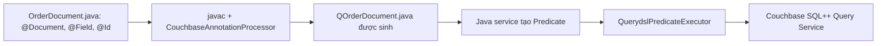

# Querydsl: sinh kiểu truy vấn và cấu hình annotation processor

## 1. Bài toán: làm sao viết truy vấn động có kiểm tra kiểu ngay khi biên dịch?

Một màn hình tra cứu đơn hàng cho phép lọc theo khách hàng, trạng thái, khoảng tiền và thời gian tạo. Khi số lượng điều kiện tùy chọn tăng, cách viết truy vấn bằng chuỗi SQL++ hoặc nối các tên trường có thể khiến lỗi chính tả chỉ lộ ra lúc chạy. Chẳng hạn đổi thuộc tính Java `createdAtMillis` thành `createdOnMillis` nhưng quên sửa một chuỗi `"createdAtMillis"` trong mã lọc sẽ không được Java compiler phát hiện.

**Querydsl** cung cấp một mô hình biểu thức có kiểu tại thời điểm biên dịch. Công cụ **annotation processing** đọc metadata của lớp entity rồi sinh ra lớp truy vấn dạng `QOrderDocument`. Thay vì viết tên thuộc tính dưới dạng chuỗi, ta có thể dùng `QOrderDocument.orderDocument.status.eq("PAID")` hoặc `QOrderDocument.orderDocument.total.goe(minTotal)`. Nếu field bị đổi tên hoặc đổi kiểu, lỗi có thể xuất hiện ngay khi biên dịch.

Trong chương **Truy vấn động** của **SPRING_DATA_COUCHBASE**, đây là một hướng triển khai bổ sung cho `Query`, `QueryCriteria`, repository, `CouchbaseTemplate` và SQL++. Module xây dựng tầng truy cập Couchbase với document mapping, bucket/scope/collection, chỉ mục, TTL, CAS, giao dịch, lựa chọn blocking/reactive API, hiệu năng và tính nhất quán. Querydsl chủ yếu giúp **mô tả predicate và gắn với repository theo kiểu an toàn hơn**; nó không tự giải quyết các vấn đề index, scan consistency hoặc phân quyền.

Sau bài này, bạn có thể:

1. Giải thích vai trò của **Querydsl Q-type**, annotation processor và `QuerydslPredicateExecutor`.
2. Thiết lập processor riêng của **Spring Data Couchbase** trong Gradle hoặc Maven.
3. Xác định thư mục generated sources và kiểm tra `QOrderDocument` được sinh từ `OrderDocument`.
4. Tạo predicate động có điều kiện bắt buộc, `AND`, `OR`, tập trạng thái và phân trang.
5. Phân biệt Querydsl dành cho Couchbase với `querydsl-jpa` và bộ xử lý annotation của JPA.
6. Khoanh vùng những lỗi thường gặp khi sinh Q-type, đổi cấu trúc entity và triển khai ứng dụng.

> **Lưu ý tương thích:** Ví dụ dùng Java 17+, Spring Data Couchbase dòng 5.x/6.x và Querydsl theo các tọa độ `com.querydsl`. Một số phiên bản Querydsl được cộng đồng duy trì dưới nhóm `io.github.openfeign.querydsl`; nếu chọn bản fork, phải kiểm tra tính tương thích của toàn bộ dependency và processor, thay vì trộn hai bộ artifact tùy ý. Các đoạn cấu hình là mẫu để tích hợp vào dự án đang có Spring Boot/Spring Data phù hợp, không phải một project build độc lập.

## 2. Querydsl và luồng tạo mã

Querydsl được cấu thành từ ba lớp trách nhiệm khác nhau:

| Thành phần | Vai trò | Ví dụ |
| --- | --- | --- |
| **Entity Java** | Định nghĩa cấu trúc dữ liệu ứng dụng và mapping Couchbase | `OrderDocument` có `status`, `total` |
| **APT (annotation processing tool)** | Chạy trong bước compile, đọc annotation/kiểu và sinh nguồn Java | `CouchbaseAnnotationProcessor` |
| **Q-type được sinh** | Biểu diễn field bằng kiểu Querydsl, dùng để xây predicate | `QOrderDocument.orderDocument.status.eq(...)` |
| **Repository executor** | Chuyển predicate sang truy vấn phù hợp với store và thực thi | `QuerydslPredicateExecutor<OrderDocument>` |

Luồng hoạt động:



**Thứ tự quan trọng:** Q-type phải có trong nguồn được biên dịch **trước khi** mã service tham chiếu tới nó. Cách bình thường là cho annotation processor chạy trong `compileJava`: compiler sinh nguồn và biên dịch nguồn vừa sinh trong cùng quy trình.

Đừng nhầm những tên sau:

- `QuerydslPredicateExecutor` nằm trong package **`org.springframework.data.querydsl`**. Nó là hợp đồng repository do Spring Data Commons cung cấp.
- `CouchbaseAnnotationProcessor` nằm trong **`org.springframework.data.couchbase.repository.support`**. Đây là processor chuyên biệt cho mapping Couchbase.
- `com.querydsl.core.types.Predicate`, `BooleanExpression`, `BooleanBuilder` và các `Q...` thuộc phần mô hình truy vấn Querydsl.
- `QueryCriteria` và `Query` nằm trong **`org.springframework.data.couchbase.core.query`**; đây là một DSL khác, không cần Q-type.

Q-type là **mã Java sinh ở thời điểm build**, không phải một schema được Couchbase tạo trong bucket, scope hoặc collection.

## 3. Entity ví dụ và lớp Q được kỳ vọng

Giả sử đơn hàng được mapping bằng:

```java
package com.example.orders.domain;

import java.math.BigDecimal;
import org.springframework.data.annotation.Id;
import org.springframework.data.couchbase.core.mapping.Document;
import org.springframework.data.couchbase.core.mapping.Field;

@Document
public class OrderDocument {
    @Id
    private String id;

    @Field("tenant_id")
    private String tenantId;

    @Field("customer_id")
    private String customerId;

    private String status;
    private BigDecimal total;

    @Field("created_at_ms")
    private Long createdAtMillis;

    @Field("order_number")
    private String orderNumber;

    // Constructors, getters, setters được lược bỏ.
}
```

Document JSON tương ứng có thể là:

```json
{
  "tenant_id": "store-01",
  "customer_id": "customer-42",
  "status": "PAID",
  "total": 450000,
  "created_at_ms": 1792992000000,
  "order_number": "SO-2026-0042"
}
```

Annotation `@Field("tenant_id")` cho Spring Data biết tên **trường JSON lưu trữ**. Q-type vẫn biểu diễn **property Java** là `tenantId`. Đừng tự viết `q.tenant_id` nếu entity có property `tenantId`.

Sau khi processor chạy, một lớp có tên `QOrderDocument` thường được sinh trong cùng package của entity. **Lược đồ minh họa** dưới đây giúp bạn hiểu kết quả; không tạo thủ công hoặc cố định nội dung lớp này:

```java
// Minh họa ý nghĩa, KHÔNG phải file generated đầy đủ.
package com.example.orders.domain;

public class QOrderDocument
        extends com.querydsl.core.types.dsl.EntityPathBase<OrderDocument> {

    public static final QOrderDocument orderDocument = /* generated */;
    public final com.querydsl.core.types.dsl.StringPath tenantId =
            /* generated */;
    public final com.querydsl.core.types.dsl.StringPath status =
            /* generated */;
    public final com.querydsl.core.types.dsl.NumberPath<BigDecimal> total =
            /* generated */;
    public final com.querydsl.core.types.dsl.NumberPath<Long> createdAtMillis =
            /* generated */;
}
```

Trong Q-type thực tế, processor còn thêm constructor, trường khác và metadata. Nó không cần trùng từng dòng với ví dụ trên.

| Property Java | Kiểu của Q-path thường sinh | Phép so sánh ví dụ |
| --- | --- | --- |
| `tenantId: String` | `StringPath` | `q.tenantId.eq("store-01")` |
| `status: String` | `StringPath` | `q.status.in("PAID", "SHIPPED")` |
| `total: BigDecimal` | `NumberPath<BigDecimal>` | `q.total.goe(new BigDecimal("100000"))` |
| `createdAtMillis: Long` | `NumberPath<Long>` | `q.createdAtMillis.goe(1792992000000L)` |
| `orderNumber: String` | `StringPath` | `q.orderNumber.asc()` hoặc `.desc()` |

Tên Q-type, package và các thành phần thực tế phụ thuộc entity, phiên bản processor và cấu hình Querydsl. Với entity lồng nhau, generic collection hoặc custom converter, hãy đọc mã được sinh và xác minh truy vấn thực tế thay vì suy đoán mọi đường dẫn đều được hỗ trợ tự động.

## 4. Cấu hình Gradle: annotation processor chuyên biệt cho Couchbase

Ví dụ dưới đây dành cho dự án **Gradle Groovy DSL (`build.gradle`)** đã có Spring Boot plugin, Java plugin và dependency `spring-boot-starter-data-couchbase`. Nếu dùng Kotlin DSL (`build.gradle.kts`), cần chuyển cú pháp tương ứng.

```groovy
// Trích đoạn build.gradle; Java/Spring Boot plugin đã được cấu hình.
def querydslVersion = '5.1.0' // Ví dụ; kiểm tra phiên bản phù hợp của dự án.

dependencies {
    implementation 'org.springframework.boot:spring-boot-starter-data-couchbase'

    // Kiểu Predicate, BooleanExpression, BooleanBuilder và Q-path.
    implementation "com.querydsl:querydsl-core:${querydslVersion}"

    // Theo hướng dẫn Couchbase, querydsl-apt cũng nằm trong dependency.
    implementation "com.querydsl:querydsl-apt:${querydslVersion}"

    // Compiler phải nhìn thấy Querydsl APT và Couchbase processor.
    annotationProcessor "com.querydsl:querydsl-apt:${querydslVersion}"
    annotationProcessor 'org.springframework.data:spring-data-couchbase'
}

tasks.withType(JavaCompile).configureEach {
    options.compilerArgs += [
        '-processor',
        'org.springframework.data.couchbase.repository.support.CouchbaseAnnotationProcessor'
    ]
}
```

Điều cần hiểu:

1. `implementation` đưa thư viện mà **mã Java đang biên dịch và ứng dụng đang chạy** cần dùng lên classpath. Q-type tham chiếu `com.querydsl.core`.
2. `annotationProcessor` đưa thư viện chạy lúc **biên dịch** lên processor path. Chỉ `implementation` mà thiếu processor path có thể dẫn đến không sinh `QOrderDocument`.
3. Processor phải là **`CouchbaseAnnotationProcessor`**, không phải `com.querydsl.apt.jpa.JPAAnnotationProcessor`. Dự án này lưu dữ liệu document Couchbase, không dùng JPA entity mapping.
4. Dependency `spring-data-couchbase` của processor nên nhận phiên bản tương thích từ Spring Boot/Spring Data BOM đang dùng. Nếu project không quản lý version theo BOM, phải khai báo version tương ứng một cách tường minh.
5. Tài liệu Couchbase hiện đặt `querydsl-apt` trong dependencies, ngoài cấu hình processor. Nếu muốn tinh giản runtime classpath, phải kiểm tra yêu cầu của phiên bản Spring Data thực tế và chạy kiểm thử repository trước khi đổi scope.

**Rất dễ bỏ sót khi dùng Lombok hoặc MapStruct:** tùy chọn `-processor` **liệt kê rõ** processor cần chạy. Nếu dự án có nhiều annotation processor, thêm các processor cần thiết theo cấu hình tương thích hoặc điều chỉnh chiến lược khám phá processor. Đừng cấu hình chỉ Couchbase rồi vô tình làm dừng các processor khác.

### 4.1. Gradle dùng Kotlin DSL

Nếu dự án dùng `build.gradle.kts`, ý tưởng tương tự:

```kotlin
// Đoạn cấu hình minh họa trong build.gradle.kts.
val querydslVersion = "5.1.0"

dependencies {
    implementation("com.querydsl:querydsl-core:${querydslVersion}")
    implementation("com.querydsl:querydsl-apt:${querydslVersion}")
    annotationProcessor("com.querydsl:querydsl-apt:${querydslVersion}")
    annotationProcessor("org.springframework.data:spring-data-couchbase")
}

tasks.withType<JavaCompile>().configureEach {
    options.compilerArgs.addAll(
        listOf(
            "-processor",
            "org.springframework.data.couchbase.repository.support.CouchbaseAnnotationProcessor"
        )
    )
}
```

Kotlin DSL cần có Java plugin để có task `JavaCompile`; nếu build script chưa tự import, khai báo `import org.gradle.api.tasks.compile.JavaCompile` ở đầu `build.gradle.kts`. Cách cấu hình processor cho test source set phải bổ sung riêng `testAnnotationProcessor` nếu các entity chỉ nằm trong `src/test/java`.

### 4.2. Thư mục generated sources trong Gradle

Với Java plugin và annotation processing mặc định, đầu ra thường ở:

```text
build/
  generated/
    sources/
      annotationProcessor/
        java/
          main/
            com/example/orders/domain/QOrderDocument.java
```

Chạy `./gradlew compileJava` (Windows PowerShell: `.\gradlew.bat compileJava`) trong dự án **khi thực hành**, rồi tìm `QOrderDocument.java`. Không di chuyển thủ công tệp Q-type sang `src/main/java`: Gradle quản lý nó như nguồn được sinh và cần tái sinh khi entity thay đổi. Nếu IDE không thấy lớp dù build CLI thành công, kiểm tra import Gradle và đánh dấu thư mục generated sources trong IDE.

## 5. Cấu hình Maven: compiler plugin + processor path

Trong **Maven**, `maven-compiler-plugin` cần biết processor và dependency để chạy nó. Bản mẫu sau giả định project đang quản lý Spring Data Couchbase qua Spring Boot BOM/parent. Thuộc tính `spring-data-couchbase.version` là **phiên bản thực tế được giải quyết trong dự án**; đặt nó bằng version của dependency đang dùng, không tạo hai phiên bản Spring Data khác nhau trong cùng classpath.

```xml
<properties>
    <querydsl.version>5.1.0</querydsl.version>
    <!-- Cần xác định theo Spring Boot/Spring Data BOM đang dùng. -->
    <spring-data-couchbase.version>REPLACE_WITH_MATCHING_VERSION</spring-data-couchbase.version>
</properties>

<dependencies>
    <!-- Spring Boot starter-data-couchbase đã có trong ứng dụng. -->
    <dependency>
        <groupId>com.querydsl</groupId>
        <artifactId>querydsl-core</artifactId>
        <version>${querydsl.version}</version>
    </dependency>
    <dependency>
        <groupId>com.querydsl</groupId>
        <artifactId>querydsl-apt</artifactId>
        <version>${querydsl.version}</version>
    </dependency>
</dependencies>

<build>
    <plugins>
        <plugin>
            <groupId>org.apache.maven.plugins</groupId>
            <artifactId>maven-compiler-plugin</artifactId>
            <configuration>
                <annotationProcessorPaths>
                    <path>
                        <groupId>com.querydsl</groupId>
                        <artifactId>querydsl-apt</artifactId>
                        <version>${querydsl.version}</version>
                    </path>
                    <path>
                        <groupId>org.springframework.data</groupId>
                        <artifactId>spring-data-couchbase</artifactId>
                        <version>${spring-data-couchbase.version}</version>
                    </path>
                </annotationProcessorPaths>
                <annotationProcessors>
                    <annotationProcessor>
                        org.springframework.data.couchbase.repository.support.CouchbaseAnnotationProcessor
                    </annotationProcessor>
                </annotationProcessors>
                <generatedSourcesDirectory>
                    ${project.build.directory}/generated-sources/annotations
                </generatedSourcesDirectory>
            </configuration>
        </plugin>
    </plugins>
</build>
```

Đây là **trích đoạn cấu hình**, không dán trùng các phần tử `<dependencies>`/`<build>` nếu `pom.xml` đã có chúng. Hãy hợp nhất vào cấu trúc Maven hiện tại. `REPLACE_WITH_MATCHING_VERSION` phải được thay bằng version hợp lệ trước khi chạy.

Khác với một cấu hình chỉ để sinh nguồn bằng `<proc>only</proc>`, cấu hình ở trên để compiler **tiếp tục biên dịch** các nguồn của ứng dụng. Chỉ dùng `proc:only` nếu bạn có bước biên dịch tiếp theo đã được thiết kế rõ ràng, vì `proc:only` không hoàn thành việc compile Java thông thường.

### 5.1. Kiểm tra đầu ra Maven

Sau `mvn compile`, Q-type thông thường có đường dẫn:

```text
target/
  generated-sources/
    annotations/
      com/example/orders/domain/QOrderDocument.java
```

Maven compiler plugin hiện đại có thể bổ sung generated sources vào compile source path. Nếu IDE chưa nhận, hãy import lại Maven project và xem `target/generated-sources/annotations`. Không cần commit Q-type sinh ra vào repository trừ khi quy ước dự án yêu cầu rõ ràng; thông thường chỉ commit entity và cấu hình build.

### 5.2. Java 22+/23+ và annotation processor

Các JDK hiện đại tăng yêu cầu opt-in annotation processing. Vì vậy, **không dựa vào việc tự động phát hiện processor một cách ngẫu nhiên**: khai báo processor path và tên processor rõ ràng trong Maven/Gradle. Với nhiều processor như Lombok/MapStruct, cấu hình đầy đủ để chúng cùng chạy.

Không tự chuyển sang `querydsl-jpa` hoặc classifier `jpa`/`jakarta` chỉ vì một tài liệu dành cho Spring Data JPA dùng những tọa độ đó. Ở đây processor của Spring Data Couchbase hiểu metadata Couchbase; vấn đề package `jakarta.persistence` của JPA là một ngữ cảnh khác.

## 6. Sử dụng Q-type với repository Couchbase

Khi đã có `QOrderDocument`, khai báo repository:

```java
package com.example.orders.repository;

import com.example.orders.domain.OrderDocument;
import org.springframework.data.couchbase.repository.CouchbaseRepository;
import org.springframework.data.querydsl.QuerydslPredicateExecutor;

public interface OrderRepository
        extends CouchbaseRepository<OrderDocument, String>,
                QuerydslPredicateExecutor<OrderDocument> {
}
```

Spring Data Couchbase cung cấp `QuerydslCouchbasePredicateExecutor` để thực thi `Predicate` trên repository. Các thao tác phổ biến:

| Gọi repository | Kết quả | Khi dùng |
| --- | --- | --- |
| `findAll(predicate)` | Các entity thỏa predicate | Tra cứu đơn giản |
| `findAll(predicate, pageable)` | `Page<OrderDocument>` | Lọc, sắp xếp và phân trang |
| `findAll(predicate, sort)` | Danh sách đã sắp | Lọc và sort không cần trang |
| `count(predicate)` | `long` | Đếm tổng phù hợp |
| `exists(predicate)` | `boolean` | Kiểm tra sự tồn tại |
| `findOne(predicate)` | `Optional<OrderDocument>` | Kỳ vọng tối đa một kết quả |

Khi dùng `findOne`, cần bảo đảm predicate đủ chọn lọc và chỉ có tối đa một entity hợp lệ; nếu nhiều entity khớp, API có thể báo lỗi vì không thể xác định một kết quả duy nhất.

Ví dụ đầu tiên:

```java
import com.example.orders.domain.QOrderDocument;
import com.querydsl.core.types.Predicate;

QOrderDocument q = QOrderDocument.orderDocument;

Predicate paidInCurrentTenant = q.tenantId.eq(trustedTenantId)
        .and(q.status.eq("PAID"));

Iterable<OrderDocument> paid =
        repository.findAll(paidInCurrentTenant);
```

Trên Couchbase, trường query thường được chuyển thành SQL++; SQL++ cần **secondary index phù hợp** cho những điều kiện không đi qua truy cập KV theo document key. Câu SQL++ cuối cùng có thể có điều kiện nhận diện entity và tên field lưu trữ khác tên property Java. Với `@Field("tenant_id")`, cần kiểm tra query thực tế và mapping của `SpringDataCouchbaseSerializer` khi triển khai.

## 7. Xây predicate động có kiểm soát

### 7.1. DTO bộ lọc

```java
package com.example.orders.service;

import java.math.BigDecimal;
import java.util.Set;

public record OrderFilter(
        String customerId,
        Set<String> statuses,
        BigDecimal minTotal,
        BigDecimal maxTotal,
        Long createdFromInclusive,
        Long createdBeforeExclusive
) {
    public OrderFilter {
        statuses = statuses == null ? null : Set.copyOf(statuses);
    }
}
```

Quy ước đầu vào:

- `null` ở một trường tùy chọn có nghĩa là **không lọc theo trường đó**.
- `statuses == null` nghĩa là không lọc; `statuses.isEmpty()` bị từ chối để tránh ý nghĩa mơ hồ.
- `minTotal = 0` là giá trị hợp lệ; chỉ `null` mới bỏ bộ lọc.
- Khoảng thời gian dùng **[từ, trước)**: bao gồm cận dưới, loại trừ cận trên.
- `tenantId` không nằm trong DTO vì phải lấy từ thông tin xác thực. Client không được tự nâng phạm vi dữ liệu bằng cách gửi một tenant khác.

`Set.copyOf` là **defensive copy**: tránh việc một `Set` được truyền vào bị sửa sau khi DTO được tạo. Phần tử `null` bị từ chối; hành vi này phù hợp với quy ước trạng thái hợp lệ trong ví dụ.

### 7.2. Service dùng BooleanExpression

Đoạn sau có thể đặt trong service được Spring quản lý:

```java
package com.example.orders.service;

import java.math.BigDecimal;
import java.util.Set;

import com.example.orders.domain.OrderDocument;
import com.example.orders.domain.QOrderDocument;
import com.example.orders.repository.OrderRepository;
import com.querydsl.core.types.dsl.BooleanExpression;
import org.springframework.data.domain.Page;
import org.springframework.data.domain.PageRequest;
import org.springframework.data.domain.Pageable;
import org.springframework.data.domain.Sort;
import org.springframework.stereotype.Service;

@Service
public class OrderQuerydslService {
    private static final Set<String> ALLOWED_STATUSES =
            Set.of("NEW", "PAID", "SHIPPED", "CANCELLED");

    private final OrderRepository repository;

    public OrderQuerydslService(OrderRepository repository) {
        this.repository = repository;
    }

    public Page<OrderDocument> search(
            String trustedTenantId, OrderFilter filter,
            int page, int size) {

        if (page < 0 || size < 1 || size > 100
                || (long) page * size > 10_000L) {
            throw new IllegalArgumentException("page/size không hợp lệ");
        }

        BooleanExpression predicate =
                buildPredicate(trustedTenantId, filter);
        Pageable pageable = PageRequest.of(
                page, size,
                Sort.by(Sort.Order.desc("createdAtMillis"),
                        Sort.Order.desc("orderNumber")));

        return repository.findAll(predicate, pageable);
    }

    public long count(String trustedTenantId, OrderFilter filter) {
        return repository.count(buildPredicate(trustedTenantId, filter));
    }

    private static BooleanExpression buildPredicate(
            String trustedTenantId, OrderFilter filter) {

        if (trustedTenantId == null || trustedTenantId.isBlank()) {
            throw new IllegalArgumentException("Thiếu tenant đã xác thực");
        }
        if (filter == null) {
            throw new IllegalArgumentException("filter không được null");
        }
        if (filter.minTotal() != null && filter.maxTotal() != null
                && filter.minTotal().compareTo(filter.maxTotal()) > 0) {
            throw new IllegalArgumentException("minTotal > maxTotal");
        }
        if (filter.minTotal() != null
                && filter.minTotal().compareTo(BigDecimal.ZERO) < 0) {
            throw new IllegalArgumentException("minTotal không được âm");
        }
        if (filter.createdFromInclusive() != null
                && filter.createdBeforeExclusive() != null
                && filter.createdFromInclusive()
                    >= filter.createdBeforeExclusive()) {
            throw new IllegalArgumentException("Khoảng thời gian không hợp lệ");
        }

        QOrderDocument q = QOrderDocument.orderDocument;
        BooleanExpression predicate = q.tenantId.eq(trustedTenantId);

        if (filter.customerId() != null
                && !filter.customerId().isBlank()) {
            predicate = predicate.and(
                    q.customerId.eq(filter.customerId().trim()));
        }

        if (filter.statuses() != null) {
            if (filter.statuses().isEmpty()
                    || !ALLOWED_STATUSES.containsAll(filter.statuses())) {
                throw new IllegalArgumentException("Danh sách status không hợp lệ");
            }
            predicate = predicate.and(q.status.in(filter.statuses()));
        }

        if (filter.minTotal() != null) {
            predicate = predicate.and(q.total.goe(filter.minTotal()));
        }
        if (filter.maxTotal() != null) {
            predicate = predicate.and(q.total.loe(filter.maxTotal()));
        }
        if (filter.createdFromInclusive() != null) {
            predicate = predicate.and(
                    q.createdAtMillis.goe(filter.createdFromInclusive()));
        }
        if (filter.createdBeforeExclusive() != null) {
            predicate = predicate.and(
                    q.createdAtMillis.lt(filter.createdBeforeExclusive()));
        }

        return predicate;
    }
}
```

Giải thích những lựa chọn quan trọng:

1. `buildPredicate(...)` cấp phát một **biểu thức riêng** cho mỗi lần gọi. `BooleanExpression.and(...)` tạo phép kết hợp theo kiểu Querydsl; không cần nối tên field thành chuỗi SQL++.
2. Tất cả kết quả đều phải khớp `q.tenantId.eq(trustedTenantId)`. Điều kiện truy cập này luôn nằm trong nhánh `AND` chung; không lấy tenant từ bộ lọc client.
3. Mỗi trường tùy chọn chỉ được thêm khi có giá trị hợp lệ. `status` dùng `.in(Set<String>)` thay vì tự ghép hàng loạt biểu thức `OR`.
4. `PageRequest` chứa sort và giới hạn. Ở đây giả định `orderNumber` **duy nhất, có mặt và bất biến trong một tenant** để làm khóa sắp xếp phụ; nếu không, cần chọn khóa khác hoặc cơ chế cursor phù hợp.
5. `count(...)` dùng **cùng hàm tạo predicate**; không dựa vào một đối tượng `Pageable` đã áp dụng cho truy vấn trước. Dù điều kiện giống nhau, count và lấy trang vẫn là hai lần thực thi có thể quan sát dữ liệu khác nhau khi có mutation/TTL.

### 7.3. Nhóm `OR` mà vẫn giới hạn tenant

Yêu cầu: “Đơn PAID hoặc đơn NEW có tổng tiền ít nhất 500.000, nhưng luôn cùng tenant hiện tại”.

```java
QOrderDocument q = QOrderDocument.orderDocument;

BooleanExpression eligible = q.status.eq("PAID")
        .or(q.status.eq("NEW")
                .and(q.total.goe(new BigDecimal("500000"))));

BooleanExpression scoped = q.tenantId.eq(trustedTenantId)
        .and(eligible);
```

Ý định SQL++:

```sql
WHERE o.tenant_id = $tenantId
  AND (
        o.status = "PAID"
        OR (o.status = "NEW" AND o.total >= 500000)
      )
```

Đây là lợi ích của biểu thức có cấu trúc: nhóm `OR` được tạo trước, sau đó gắn vào điều kiện tenant ở ngoài. Tuy nhiên, trong môi trường thật vẫn phải **kiểm tra SQL++ được sinh** và cách nhóm ngoặc ở phiên bản Spring Data Couchbase đang dùng, đặc biệt trước khi dùng predicate cho dữ liệu có phân quyền.

### 7.4. BooleanBuilder dùng khi nào?

Querydsl có `BooleanBuilder` để thêm tiêu chí từng bước:

```java
import com.querydsl.core.BooleanBuilder;
import com.querydsl.core.types.Predicate;

QOrderDocument q = QOrderDocument.orderDocument;
BooleanBuilder builder =
        new BooleanBuilder(q.tenantId.eq(trustedTenantId));

if (requestedStatus != null) {
    builder.and(q.status.eq(requestedStatus));
}

Predicate predicate = builder.getValue();
```

`BooleanBuilder` là **đối tượng khả biến**. Tạo mới cho mỗi request, không giữ một builder chung trong field singleton, không dùng `static final` builder rồi nối thêm điều kiện theo người dùng. Với số lượng điều kiện vừa phải, `BooleanExpression` trong ví dụ chính dễ kiểm soát vòng đời và nhóm biểu thức hơn.

## 8. Kết nối với `@Field`, index và Couchbase SQL++

Querydsl làm việc trên **tên thuộc tính trong entity Java**. Mapping Spring Data Couchbase phải chuyển chúng sang **tên field thực tế trong document JSON**.

| Java / Querydsl | JSON | SQL++ tương ứng |
| --- | --- | --- |
| `q.tenantId` | `tenant_id` | `o.tenant_id` |
| `q.customerId` | `customer_id` | `o.customer_id` |
| `q.createdAtMillis` | `created_at_ms` | `o.created_at_ms` |
| `q.orderNumber` | `order_number` | `o.order_number` |
| `q.status` | `status` | `o.status` |
| `q.total` | `total` | `o.total` |

Lưu ý: bảng này là **hợp đồng mapping được thiết kế**. Bằng chứng cuối cùng phải là document thực, query sinh ra và kết quả kiểm thử tích hợp. Nếu `@Field` bị đổi mà dữ liệu cũ chưa di trú, Q-type vẫn có thể biên dịch thành công dù query không khớp document lịch sử.

Với dữ liệu ở bucket `shop`, scope `sales`, collection `orders`, một cặp index ban đầu có thể là:

```sql
CREATE INDEX ix_orders_tenant_status_created
ON `shop`.`sales`.`orders`(
    tenant_id, status, created_at_ms DESC, order_number DESC
);

CREATE INDEX ix_orders_tenant_created
ON `shop`.`sales`.`orders`(
    tenant_id, created_at_ms DESC, order_number DESC
);
```

Index đầu phục vụ mẫu truy vấn tenant + status + ngày; index thứ hai có thể phù hợp khi không lọc theo status. Các tổ hợp lọc theo `customer_id` hoặc `total` có thể cần index khác. Đừng tự tạo mọi biến thể; dùng `EXPLAIN` trên câu SQL++ **thực tế** cùng dữ liệu đại diện để quan sát index scan, sort, fetch và chi phí.

Querydsl không tạo index và cũng không biến một query thiếu index thành nhanh. Khi truy vấn theo **document key** đã biết, dùng `repository.findById(id)` hoặc Couchbase KV API thường hợp lý hơn chạy Query Service. Với các tình huống SQL++ nâng cao như JOIN, array index, `ANY ... SATISFIES`, `UNNEST`, transaction hoặc query hints đặc thù, xem xét `CouchbaseTemplate`/SQL++ tham số hóa khi mức biểu đạt của executor không đáp ứng rõ yêu cầu.

### 8.1. Nhất quán, TTL và CAS không nằm trong Q-type

- **TTL:** Document có thể hết hạn giữa hai lần phân trang dù predicate không đổi.
- **Scan consistency:** SQL++ sử dụng chỉ mục có thể chưa nhìn thấy ngay mutation vừa ghi ở mức nhất quán mặc định. Tùy yêu cầu có thể cấu hình consistency tương ứng ở tầng repository/query.
- **CAS:** Dùng cho cập nhật có điều kiện để tránh ghi đè đồng thời, không thay thế cho predicate truy vấn.
- **Giao dịch:** Các thao tác trong transaction có phạm vi và ngữ nghĩa riêng. Không dựa vào Q-type để giả định hai request HTTP liên tiếp nhìn cùng một snapshot.
- **Reactive:** `QuerydslPredicateExecutor` minh họa ở đây là giao diện repository **đồng bộ**. Nếu ứng dụng là reactive, kiểm tra API thực sự được hỗ trợ ở phiên bản Spring Data Couchbase; có thể cần `ReactiveCouchbaseTemplate`, `QueryCriteria` hoặc SQL++ SDK reactive để tránh chặn luồng.

## 9. Annotation processing là bước build, không phải bước runtime

Khi chạy ứng dụng:

1. `QOrderDocument.java` đã được sinh và biên dịch thành `QOrderDocument.class`.
2. Service gọi các phương thức trên Q-type để tạo `Predicate`.
3. Repository nhận `Predicate` và chuyển thành truy vấn Couchbase.

Ứng dụng **không gọi lại `CouchbaseAnnotationProcessor` mỗi khi nhận request**. Nếu Q-type chưa được sinh, thất bại thường xuất hiện từ bước compile. Nếu Q-type cũ được đóng gói/IDE giữ cache sau khi entity thay đổi, lỗi có thể xuất hiện là không tìm thấy field mới hoặc kết quả truy vấn sai mapping.

Khi dùng Gradle/Maven trong CI, hãy bảo đảm build sạch tái sinh Q-type từ entity trên repository. Không phụ thuộc vào một file Q tồn tại riêng trong IDE của người viết mã nhưng chưa được quản lý bởi build.

### 9.1. Các lỗi thường gặp và cách khoanh vùng

| Triệu chứng | Nguyên nhân thường gặp | Cách kiểm tra và xử lý |
| --- | --- | --- |
| `cannot find symbol: QOrderDocument` | Processor chưa chạy, sai processor path, entity chưa được compile | Xem `compileJava`/`mvn compile`, kiểm tra Q-file trong generated sources |
| `CouchbaseAnnotationProcessor not found` | Thiếu `spring-data-couchbase` trên annotation processor path | Thêm artifact Spring Data Couchbase có version tương thích |
| `NoClassDefFoundError: com/querydsl/...` khi compile | Thiếu Querydsl APT/core ở processor path | Kiểm tra dependencies và xung đột version, chạy build sạch |
| Compiler báo processor không hỗ trợ annotation hoặc không sinh Q-type | Dùng `JPAAnnotationProcessor` hoặc processor khác | Chọn `org.springframework.data.couchbase.repository.support.CouchbaseAnnotationProcessor` |
| Chỉ build CLI thành công, IDE đỏ lớp `Q...` | IDE chưa nhận thư mục generated sources | Import lại Gradle/Maven, kiểm tra source roots |
| Q-type vẫn có field cũ sau khi sửa entity | Generated sources cũ hoặc incremental build lỗi | Clean build có kiểm soát, không sửa Q-file bằng tay |
| Lỗi `javax.persistence`/`jakarta.persistence` | Copy cấu hình Querydsl JPA vào module Couchbase | Bỏ processor/classifier JPA khi chỉ xử lý `@Document` |
| Lombok/MapStruct dừng sinh mã | Dùng `-processor` chỉ liệt kê Couchbase | Cấu hình đầy đủ các processor đang sử dụng |
| Querydsl compile nhưng repository không tìm thấy dữ liệu | `@Field`/keyspace/secondary index không khớp thực tế | Kiểm tra JSON, SQL++, `EXPLAIN`, index và phân quyền |
| `findAll(predicate, pageable)` quá chậm | Thiếu index phù hợp, page sâu hoặc sort tốn chi phí | Giới hạn page size, đo `EXPLAIN`, cân nhắc keyset |
| `NoSuchMethodError` hoặc `LinkageError` về Querydsl | Version `querydsl-core`/`querydsl-apt` hoặc dependency Spring Data không tương thích | Kiểm tra dependency tree, thống nhất phiên bản, kiểm thử tích hợp |

Nếu dùng Java 23+ hoặc compiler mới, việc annotation processing không được tự kích hoạt có thể gây `Q...` mất khỏi build dù entity vẫn hiện diện. Đặt processor rõ ràng, kiểm tra log build và source generated trước khi điều tra lỗi repository.

### 9.2. Bản Querydsl fork của OpenFeign

Hệ sinh thái Querydsl có bản fork OpenFeign (`io.github.openfeign.querydsl`) do việc duy trì Querydsl gốc có giai đoạn chậm lại. Spring Data hỗ trợ bản fork trên cơ sở **best effort**. Tên package Java như `com.querydsl.core` có thể không đổi dù Maven/Gradle **groupId** thay đổi.

Không chọn ngẫu nhiên `querydsl-core` từ nhóm cũ nhưng `querydsl-apt` từ nhóm mới. Nếu chuyển fork, kiểm tra artifact, phiên bản, processor API thực tế và classpath của **CouchbaseAnnotationProcessor**; chạy thử build sạch, truy vấn repository và mapping `@Field` trước khi nâng cấp toàn bộ.

## 10. Kiểm thử sau khi cấu hình

### 10.1. Kiểm tra build

Thực hành theo chuỗi sau:

1. Dùng đúng dependency/processor path cho build tool của dự án.
2. Chạy build sạch bằng lệnh tương ứng (Gradle `clean compileJava` hoặc Maven `clean compile`) trên máy phát triển/CI.
3. Kiểm tra `QOrderDocument.java` nằm trong **generated sources**, đúng package và có các path kiểu `StringPath`, `NumberPath` tương ứng.
4. Đổi tạm tên property trong nhánh thử nghiệm và xác minh compile phát hiện chỗ mã sử dụng Q-field cũ; hoàn tác thay đổi này khi kết thúc thử nghiệm.
5. Bảo đảm `QOrderDocument` được biên dịch cùng ứng dụng và hoạt động cả sau khi checkout mã trên một máy/CI sạch.

### 10.2. Kiểm thử tích hợp repository

Chuẩn bị dữ liệu ít nhất hai tenant; các đơn có `PAID`, `SHIPPED`, `NEW`, nhiều giá trị `total` và mốc thời gian ở hai đầu khoảng.

| Đầu vào | Kết quả cần kiểm tra |
| --- | --- |
| Chỉ `tenantId = store-01` | Không có document của `store-02` |
| Tenant + statuses `[PAID, SHIPPED]` | Chỉ nhận hai trạng thái được phép |
| `minTotal = 0` | Không bị coi là “không lọc”; vẫn đúng điều kiện `>= 0` |
| `minTotal > maxTotal` | Từ chối trước khi gửi truy vấn |
| `createdFromInclusive = T` | Lấy bản ghi đúng mốc T |
| `createdBeforeExclusive = T` | Loại bản ghi đúng mốc T |
| Sort ngày giảm dần, cùng timestamp | Khóa phụ `orderNumber` xác định thứ tự |
| `count(predicate)` | Tổng số bằng tập lọc, không chịu page size |
| Q-type dùng `@Field("tenant_id")` | Kết quả đúng document JSON thực |
| Thêm/sửa `@Field` trong entity | Q-type tái sinh; câu SQL++ vẫn dùng tên lưu trữ đúng |

Ví dụ kiểm thử tích hợp (giả định fixture đã seed và có repository):

```java
import static org.assertj.core.api.Assertions.assertThat;
import com.example.orders.domain.QOrderDocument;
import com.querydsl.core.types.Predicate;
import org.junit.jupiter.api.Test;

@Test
void querydslPredicateMustRemainScopedToTenant() {
    QOrderDocument q = QOrderDocument.orderDocument;
    Predicate predicate = q.tenantId.eq("store-01")
            .and(q.status.in("PAID", "SHIPPED"));

    var orders = repository.findAll(predicate);

    assertThat(orders).isNotEmpty();
    assertThat(orders).allSatisfy(order ->
            assertThat(order.getTenantId()).isEqualTo("store-01"));
}
```

Test giả định entity có getter `getTenantId()` và dữ liệu `store-01` đã chứa ít nhất một đơn phù hợp. Cần bổ sung fixture của `store-02` có cùng trạng thái để bắt được lỗi tenant không được áp dụng. Test chạy trực tiếp với Couchbase thật hoặc môi trường tích hợp tương đương mới kiểm chứng được mapping, index và SQL++.

### 10.3. Kiểm tra tính đúng, hiệu năng và giới hạn API

- Không tự động bind mọi HTTP query parameter thành một Q-path bất kỳ. Dùng DTO và **danh sách trường/giá trị cho phép**, đặc biệt với tenant, thông tin phân quyền hoặc các field nhạy cảm.
- Với Spring Data web `@QuerydslPredicate`, xem kỹ mặc định binding và dùng `QuerydslBinderCustomizer` khi muốn giới hạn các field cho phép. Predicate do người dùng gửi luôn phải được **kết hợp AND** với điều kiện quyền truy cập do server tạo.
- Q-type không chứng minh index đã tối ưu: lấy SQL++ thực tế, chạy `EXPLAIN` và quan sát latency trên dữ liệu đại diện.
- Nếu ứng dụng dùng CouchbaseTemplate cho các truy vấn SQL++ đặc thù, không ép toàn bộ nghiệp vụ vào Querydsl chỉ để duy trì một DSL duy nhất; chọn công cụ thể hiện rõ nhất câu query cần chạy.
- Q-type là mã biên dịch; việc cập nhật schema document lịch sử, TTL, transaction hoặc CAS vẫn cần quy trình riêng.

## 11. Bài tập tự luyện

**Bài 1 — Chọn đúng annotation processor.** Một dự án Couchbase có `@Document` và đã khai báo `querydsl-apt`, nhưng build dùng `com.querydsl.apt.jpa.JPAAnnotationProcessor`. Hãy chỉ ra lý do Q-type có thể không được sinh đúng và sửa tên processor.

**Đáp án:** dùng `org.springframework.data.couchbase.repository.support.CouchbaseAnnotationProcessor` và bảo đảm artifact Spring Data Couchbase nằm trên processor path.

**Bài 2 — Đọc Q-type.** Cho entity:

```java
@Document
public class ProductDocument {
    @Id String id;
    @Field("sku_code") String sku;
    BigDecimal price;
    Boolean active;
}
```

Viết predicate tương đương: “SKU bằng `SKU-42`, giá ít nhất 100.000 và active là true”. Giả sử Q-type được sinh tên `QProductDocument`.

**Đáp án gợi ý:**

```java
QProductDocument q = QProductDocument.productDocument;
var predicate = q.sku.eq("SKU-42")
        .and(q.price.goe(new BigDecimal("100000")))
        .and(q.active.isTrue());
```

**Bài 3 — Đặt đúng phạm vi tenant.** Viết biểu thức “cùng tenant và (PAID hoặc (NEW và tổng tiền > 500.000))” theo Q-type. Chỉ rõ dấu ngoặc được thể hiện bằng các lần gọi `.and(...)` và `.or(...)`.

**Bài 4 — Kiểm tra build.** Liệt kê ba nơi cần kiểm tra khi IDE báo không thấy `QOrderDocument`: compiler processor path, kết quả generated sources, classpath được IDE import. Nêu lý do không nên tạo một file Q thủ công trong `src/main/java`.

**Bài 5 — Chọn công cụ.** So sánh Querydsl predicate, `CouchbaseTemplate`/`QueryCriteria` và SQL++ tham số hóa cho ba tình huống: màn hình lọc scalar nhiều điều kiện; tìm phần tử mảng object bằng `ANY ... SATISFIES`; tra cứu chính xác document key. Giải thích vai trò của secondary index và KV.

## 12. Ghi nhớ và nguồn tra cứu

**Querydsl gồm một bước sinh mã ở thời điểm build và một bước thực thi predicate ở runtime.** Với Spring Data Couchbase, Q-type được sinh bằng `CouchbaseAnnotationProcessor`, rồi được dùng qua `QuerydslPredicateExecutor`. Cấu hình đúng processor path, kiểm tra file `Q...` được sinh, phân biệt tên property Java với field JSON và luôn áp dụng tenant đáng tin cậy là những yếu tố quyết định tính đúng. Annotation processing không tự tạo index hoặc bảo đảm query sẽ thấy ngay mọi mutation.

Tài liệu chính thức:

- [Spring Data Couchbase — Couchbase repositories, QueryDSL Configuration](https://docs.spring.io/spring-data/couchbase/reference/couchbase/repository.html).
- [Spring Data Couchbase — `CouchbaseAnnotationProcessor` API](https://docs.spring.io/spring-data/couchbase/reference/api/java/org/springframework/data/couchbase/repository/support/CouchbaseAnnotationProcessor.html).
- [Spring Data Couchbase — `QuerydslCouchbasePredicateExecutor` API](https://docs.spring.io/spring-data/couchbase/reference/api/java/org/springframework/data/couchbase/repository/support/QuerydslCouchbasePredicateExecutor.html).
- [Spring Data Commons — Querydsl extension và `QuerydslPredicateExecutor`](https://docs.spring.io/spring-data/couchbase/reference/repositories/core-extensions.html).
- [Querydsl — Project repository](https://github.com/querydsl/querydsl).
- [OpenFeign Querydsl — Project repository](https://github.com/OpenFeign/querydsl).
- [Couchbase Server — Indexes](https://docs.couchbase.com/server/current/indexes/indexing-overview.html).
