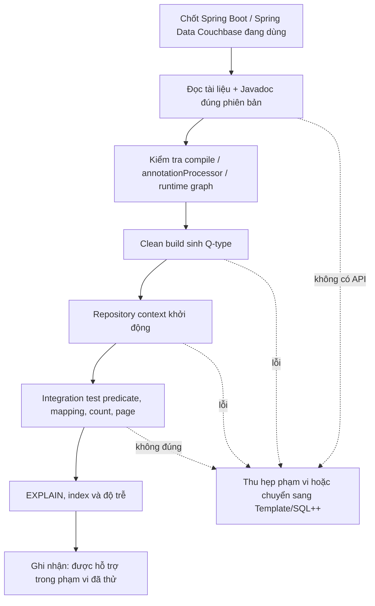

# Xác minh phạm vi hỗ trợ Querydsl theo phiên bản phụ thuộc

## 1. Vì sao “có Querydsl trong classpath” chưa đủ?

Khi xây dựng màn hình lọc đơn hàng động, Querydsl giúp viết điều kiện có kiểu: `q.status.eq("PAID")`, `q.total.goe(minTotal)` thay vì nối tên trường thành chuỗi. Tuy nhiên, một ứng dụng **SPRING_DATA_COUCHBASE** chỉ thực sự sử dụng được Querydsl khi nhiều thành phần tương thích với nhau: phiên bản Spring Data Couchbase, Spring Data Commons, các artifact Querydsl, annotation processor, lớp `Q...` sinh ra, repository executor và cách chuyển predicate sang SQL++.

Một tình huống thường gặp: dự án đã sinh được `QOrderDocument.java` nhưng khi khởi động, Spring không tạo được repository; hoặc repository khởi động được, nhưng predicate đi qua field có `@Field("tenant_id")` lại không lọc đúng document JSON. **Sinh được mã không chứng minh được hành vi lúc chạy**.

Bài học thuộc chương **Truy vấn động** của module Spring Data Couchbase. Ta sẽ xây dựng quy trình xác minh tương thích có bằng chứng, thay vì chọn phiên bản theo cảm tính. Quy trình đặt trong bối cảnh tầng dữ liệu có document mapping, repository, `CouchbaseTemplate`, SQL++, bucket/scope/collection, chỉ mục, TTL, CAS, giao dịch và lựa chọn API reactive để bảo đảm hiệu năng, tính nhất quán và vận hành.

**Mục tiêu học tập:**

1. Phân biệt **hỗ trợ được ghi trong tài liệu**, **API có mặt trong artifact**, **sinh mã thành công** và **chạy truy vấn thành công**.
2. Xác định các phiên bản dependency **thực sự được giải quyết** trong Maven/Gradle, không chỉ những phiên bản được khai báo trực tiếp.
3. Kiểm tra `CouchbaseAnnotationProcessor`, `querydsl-core`, `querydsl-apt`, `QuerydslPredicateExecutor` và `Q...` theo cùng một cấu hình.
4. Xác minh phạm vi predicate hỗ trợ qua test tối thiểu, mapping `@Field`, SQL++ sinh ra và `EXPLAIN`.
5. Đưa ra quyết định dùng Querydsl, dùng API Spring Data khác, hay dùng SQL++ tham số hóa cho từng tình huống.

> **Nguyên tắc:** Hãy kiểm tra trên **version đã khóa của dự án** và lưu lại kết quả. Các ví dụ dưới đây là mẫu hướng dẫn để người học thực hành, không phải báo cáo rằng một dự án cụ thể đã được biên dịch hay thử nghiệm.

## 2. “Hỗ trợ Querydsl” gồm những tầng nào?

| Tầng xác minh | Câu hỏi | Bằng chứng đủ mạnh |
| --- | --- | --- |
| **Tài liệu** | Phiên bản Spring Data Couchbase đang dùng có mô tả Querydsl không? | Trang reference **đúng phiên bản**, mục `QueryDSL Configuration` |
| **API** | Có `QuerydslCouchbasePredicateExecutor`, `CouchbaseAnnotationProcessor` không? | Javadoc hoặc artifact **cùng phiên bản** |
| **Dependency** | `querydsl-core`, `querydsl-apt` và các Spring Data module có được giải quyết nhất quán không? | Báo cáo dependency graph cho compile, processor và runtime |
| **Sinh mã** | Compiler sinh được `QOrderDocument` từ `@Document` không? | Build sạch và file được tạo trong generated sources |
| **Repository** | Context khởi động và `QuerydslPredicateExecutor` nhận `Predicate` không? | Kiểm thử context/repository chạy thật |
| **Ngữ nghĩa** | `@Field`, `AND`/`OR`, `IN`, sort/page/count lọc đúng dữ liệu không? | Kiểm thử tích hợp với nhiều tenant và document thử |
| **Vận hành** | Query có index thích hợp, có đáp ứng mức nhất quán và độ trễ không? | SQL++ thực tế, `EXPLAIN`, đo latency và ghi nhận scan consistency |

Một bước thất bại **không đồng nghĩa** mọi tầng khác đều thất bại. Ví dụ `Q...` không được sinh thường là lỗi build; còn `Q...` đã sinh mà query sai khi đổi tên JSON field thường là lỗi mapping, biểu thức hoặc dữ liệu.



## 3. Phạm vi được tài liệu Spring Data Couchbase xác nhận

Tài liệu chính thức của Spring Data Couchbase **5.5** và **6.0/6.x** đều có mục **QueryDSL Configuration** và chỉ dẫn sử dụng processor:

```text
org.springframework.data.couchbase.repository.support.CouchbaseAnnotationProcessor
```

Javadoc của `QuerydslCouchbasePredicateExecutor` ghi **Since: 5.0**. Đây là bằng chứng rằng lớp triển khai executor theo tên hiện tại đã được giới thiệu từ dòng đó; **không phải** lời khẳng định rằng mọi phương thức hoặc mọi cấu trúc predicate đều có cùng hành vi qua mọi bản vá. Tài liệu lịch sử các phiên bản cũ cần được kiểm tra riêng nếu dự án đang dùng một dòng cũ hơn.

| Dòng cần đánh giá | Bằng chứng chính thức có thể dùng | Kết luận hợp lý trước khi chạy test |
| --- | --- | --- |
| **5.0–5.4** | Javadoc executor ghi `Since: 5.0`; cần mở reference/Javadoc đúng bản đang dùng | Có cơ sở về API executor; chưa được coi là xác minh đầy đủ từng tính năng |
| **5.5.x** | Reference 5.5 có mục `QueryDSL Configuration` và Gradle/Maven APT | Có hướng dẫn cấu hình chính thức; tiếp tục thử sinh Q-type và repository |
| **6.0.x** | Reference 6.0 tiếp tục mô tả `CouchbaseAnnotationProcessor` | Có hướng dẫn chính thức; cần xác minh bản Spring Data/Querydsl thực được giải quyết |
| **6.1/6.2.x** | Trang reference/Javadoc của dòng 6.x mô tả executor và các method `findAll`, `count`, `exists` | Hỗ trợ Querydsl repository ở phạm vi API đã liệt kê; kiểm thử hành vi riêng cho ứng dụng |
| **Bản rất cũ, bản preview/SNAPSHOT hoặc bản chưa có tài liệu tương ứng** | Không suy ra từ trang “latest” | Đánh dấu **chưa xác minh**, tra artifact/tag và chạy thử cụ thể |

**Điểm đặc biệt:** tài liệu của từng dòng có thể được cập nhật theo thời gian. Không dùng một trang `/reference/` luôn trỏ bản mới nhất để kết luận thay cho phiên bản đã khóa trong dự án. Ưu tiên URL gắn dòng, ví dụ:

- Spring Data Couchbase 5.5: https://docs.spring.io/spring-data/couchbase/reference/5.5/couchbase/repository.html
- Spring Data Couchbase 6.0: https://docs.spring.io/spring-data/couchbase/reference/6.0/couchbase/repository.html
- Spring Data Couchbase 6.2: https://docs.spring.io/spring-data/couchbase/reference/6.2/couchbase/repository.html
- Javadoc executor: https://docs.spring.io/spring-data/couchbase/reference/api/java/org/springframework/data/couchbase/repository/support/QuerydslCouchbasePredicateExecutor.html

Số phiên bản mới nhất hay trạng thái GA/RC thay đổi theo thời gian; vì thế **không hardcode “mới nhất”** vào logic lựa chọn dependency. Chọn dòng được Spring Boot/BOM quản lý trong ứng dụng, sau đó đối chiếu reference tương ứng.

### 3.1. Phạm vi API được xác nhận không đồng nghĩa hỗ trợ tất cả SQL++

`QuerydslPredicateExecutor<T>` cho phép các thao tác phổ biến như:

```java
Iterable<T> findAll(Predicate predicate);
Page<T> findAll(Predicate predicate, Pageable pageable);
long count(Predicate predicate);
boolean exists(Predicate predicate);
Optional<T> findOne(Predicate predicate);
```

Đây là những **chữ ký minh họa** theo giao diện Spring Data, không phải khai báo lại toàn bộ mã nguồn. Một số lớp triển khai Couchbase có kiểu trả về cụ thể hẹp hơn, chẳng hạn `List<T>`, nhưng mã gọi qua `QuerydslPredicateExecutor<T>` nên dựa vào **kiểu đã khai báo của interface**.

Không suy ra tự động rằng executor xử lý được mọi biểu thức:

- JOIN, `UNNEST`, aggregate nâng cao hoặc window function trong SQL++.
- `ANY ... IN ... SATISFIES ... END` cho mọi mảng object và array index.
- Tùy chọn query-specific như scan consistency, query hints và transactional semantics.
- Mọi biến thể nested path hoặc custom converter.

Những trường hợp này đòi hỏi **kiểm thử SQL++ do serializer của Couchbase sinh ra**. Nếu DSL không biểu diễn được hoặc tối ưu không đạt, có thể chuyển riêng truy vấn đó sang `CouchbaseTemplate`, `QueryCriteria` hoặc SQL++ tham số hóa.

### 3.2. Giao diện ReactiveQuerydsl không phải bằng chứng Couchbase triển khai

Spring Data Commons có giao diện:

```java
org.springframework.data.querydsl.ReactiveQuerydslPredicateExecutor<T>
```

Nhưng sự tồn tại của giao diện **trong Commons** không đồng nghĩa mọi module data store đều cung cấp triển khai reactive. Javadoc của giao diện này nhắc người dùng kiểm tra tài liệu **riêng của từng module**. Với Couchbase, reference về `QuerydslCouchbasePredicateExecutor` mô tả executor **blocking** và reference reactive Couchbase mô tả các giao diện repository/reactive query riêng.

Do đó không tự viết `ReactiveOrderRepository extends ReactiveQuerydslPredicateExecutor<OrderDocument>` rồi coi nó là hỗ trợ chính thức mà chưa xác minh repository factory thực sự nhận diện/gắn được interface trên phiên bản đã chọn. Nếu không có bằng chứng hoặc smoke test, dùng `ReactiveCouchbaseTemplate` và DSL mà module reactive hỗ trợ, hoặc Couchbase Java SDK reactive. **Không gọi `.block()` trong đường xử lý reactive** chỉ để sử dụng executor blocking.

## 4. Bước 1 — Chốt phiên bản phụ thuộc thực tế

Chỉ nhìn thấy:

```groovy
implementation 'org.springframework.boot:spring-boot-starter-data-couchbase'
```

không cho biết phiên bản cuối cùng của `spring-data-couchbase`. Spring Boot và Spring Data BOM thường quản lý cả `spring-data-commons`, Couchbase SDK và các module liên quan. Phiên bản trong dependency graph có thể khác điều lập trình viên tưởng rằng mình đã chọn, do dependency constraints, dependency management, override hoặc conflict resolution.

Trước tiên, ghi lại:

| Thông tin | Cần biết vì sao? |
| --- | --- |
| `spring-boot` / Spring Boot plugin | Xác định dòng platform/BOM |
| `spring-data-couchbase` | Xác định API Couchbase và processor |
| `spring-data-commons` | Xác định interface `QuerydslPredicateExecutor` và kiểu trả về |
| `querydsl-core` | Xác định kiểu `Predicate`, `BooleanExpression`, Q-path |
| `querydsl-apt` | Kiểm tra bản APT dùng để sinh Q-type |
| `com.querydsl` hay `io.github.openfeign.querydsl` | Xác định dòng artifact Querydsl, tránh trộn lẫn |
| Java/JDK và compiler plugin | Ảnh hưởng việc kích hoạt annotation processing |
| Couchbase SDK, server và index | Ảnh hưởng khả năng thực thi và hiệu năng SQL++ |

### 4.1. Kiểm tra bằng Gradle

Các lệnh dưới đây **dành cho học viên chạy trong dự án của mình**; bài viết không tự chạy build. Với Gradle Wrapper:

```bash
./gradlew dependencies --configuration compileClasspath
./gradlew dependencies --configuration annotationProcessor
./gradlew dependencies --configuration runtimeClasspath

./gradlew dependencyInsight --configuration compileClasspath --dependency spring-data-couchbase
./gradlew dependencyInsight --configuration compileClasspath --dependency spring-data-commons
./gradlew dependencyInsight --configuration compileClasspath --dependency querydsl-core
./gradlew dependencyInsight --configuration annotationProcessor --dependency querydsl-apt
./gradlew dependencyInsight --configuration runtimeClasspath --dependency querydsl-apt
```

Trên Windows, thay `./gradlew` bằng `.\gradlew.bat`. Những báo cáo này giúp tìm:

- **Đường phụ thuộc** nào kéo `querydsl-core` hoặc `querydsl-apt` vào.
- **Phiên bản cuối cùng được chọn** sau conflict resolution.
- Artifact nằm ở **compile classpath**, **annotation processor path** và **runtime classpath** hay chỉ một nơi.
- Có hai nhóm Querydsl khác nhau cung cấp lớp `com.querydsl.*` hay không.

**Lưu ý:** Các dependency configuration có thể khác nếu project dùng plugin tùy chỉnh, multi-module hoặc Kotlin/kapt. Khi đó phải xem cấu hình biên dịch đúng **module chứa entity và repository**; không lấy dependency graph của root project thay cho subproject.

### 4.2. Kiểm tra bằng Maven

```bash
./mvnw dependency:tree -Dincludes=org.springframework.data
./mvnw dependency:tree -Dincludes=com.querydsl
./mvnw dependency:tree -Dincludes=io.github.openfeign.querydsl
./mvnw help:effective-pom
```

Với Windows có thể dùng `mvnw.cmd`. Maven `dependency:tree` giúp thấy runtime/compile artifacts nhưng **không nhất thiết thể hiện đầy đủ** mọi artifact trong `<annotationProcessorPaths>` của `maven-compiler-plugin`. Cần xem thêm effective POM và thông tin từ compiler plugin để biết annotation processor path thực tế.

Đặc biệt quan trọng khi sử dụng `<dependencyManagement>` hoặc Spring Boot parent: một version ghi trong một POM trung gian chưa chắc là version cuối được dùng. Nếu có phần `<annotationProcessorPaths>`, phải xác minh cả bản Querydsl APT lẫn `spring-data-couchbase` trong phần đó.

## 5. Bước 2 — Xác minh ba classpath và processor

Tài liệu Couchbase hướng dẫn cấu hình APT bằng:

```text
org.springframework.data.couchbase.repository.support.CouchbaseAnnotationProcessor
```

Theo cùng tài liệu, việc kích hoạt Querydsl trên repository còn cần lưu ý dependency `querydsl-apt` **ở runtime**. Do đó không chỉ hỏi “tôi đã thêm `annotationProcessor` chưa?”, mà phải so sánh các classpath sau:

| Classpath | Thành phần cần xem | Triệu chứng khi thiếu |
| --- | --- | --- |
| Compile | `querydsl-core`, `Q...` được sinh, Spring Data repository API | Không tìm thấy `Predicate`, `QOrderDocument`, `QuerydslPredicateExecutor` |
| Annotation processing | `CouchbaseAnnotationProcessor`, `querydsl-apt`, các phụ thuộc của processor | Không sinh `Q...` hoặc `Processor ... not found` |
| Runtime | Các lớp Querydsl mà repository infrastructure cần theo dòng Spring Data đang dùng; hướng dẫn Couchbase nêu `querydsl-apt` | Context không khởi động, `ClassNotFoundException`/`NoClassDefFoundError` |

Một **mẫu kiểm kê** Gradle Groovy DSL cho dự án đã sử dụng Spring Boot dependency management:

```groovy
def querydslVersion = '5.1.0' // Ví dụ minh họa; không bắt buộc cho mọi dòng.

dependencies {
    implementation 'org.springframework.boot:spring-boot-starter-data-couchbase'
    implementation "com.querydsl:querydsl-core:${querydslVersion}"

    // Theo tài liệu Spring Data Couchbase, cần xem cả runtime.
    implementation "com.querydsl:querydsl-apt:${querydslVersion}"

    // Công cụ sinh mã khi compile Java.
    annotationProcessor "com.querydsl:querydsl-apt:${querydslVersion}"
    annotationProcessor 'org.springframework.data:spring-data-couchbase'
}

tasks.withType(JavaCompile).configureEach {
    options.compilerArgs += [
        '-processor',
        'org.springframework.data.couchbase.repository.support.CouchbaseAnnotationProcessor'
    ]
}
```

Đoạn trên **không phải công thức cứng cho mọi JDK/BOM**. Điều kiện cần xác minh là build tool thực sự nạp được processor và không trộn các phiên bản Querydsl. Nếu dự án có Lombok, MapStruct hoặc processor khác, việc ghi rõ một `-processor` duy nhất có thể làm các processor còn lại không chạy; phải cấu hình danh sách đầy đủ hoặc giải pháp tương thích.

### 5.1. Kiểm kê Maven annotation processor path

Ví dụ các mục cần xuất hiện hoặc được cấu hình tương đương:

```xml
<!-- Trích đoạn trong cấu hình maven-compiler-plugin -->
<annotationProcessorPaths>
    <path>
        <groupId>com.querydsl</groupId>
        <artifactId>querydsl-apt</artifactId>
        <version>${querydsl.version}</version>
    </path>
    <path>
        <groupId>org.springframework.data</groupId>
        <artifactId>spring-data-couchbase</artifactId>
        <version>${spring-data-couchbase.version}</version>
    </path>
</annotationProcessorPaths>
<annotationProcessors>
    <annotationProcessor>
        org.springframework.data.couchbase.repository.support.CouchbaseAnnotationProcessor
    </annotationProcessor>
</annotationProcessors>
```

`spring-data-couchbase.version` phải được đặt theo artifact **đang được dùng trong dự án**, không phải một con số lấy ngẫu nhiên từ bài viết. Đồng thời xem dependency runtime của `querydsl-apt` theo hướng dẫn Spring Data Couchbase. Đừng sao chép nguyên một execution `proc:only` rồi vô tình bỏ qua giai đoạn compile bình thường; nếu project dùng bước sinh mã riêng, hãy có bước compile các nguồn vừa sinh.

### 5.2. Bản Querydsl gốc và fork OpenFeign

Spring Data Commons mô tả fork Querydsl cộng đồng bởi **OpenFeign**, nhóm Maven:

```text
io.github.openfeign.querydsl
```

và nêu rằng Spring Data hỗ trợ fork này **theo best effort**. Bản Querydsl gốc sử dụng nhóm `com.querydsl`. Các Java package có thể vẫn là `com.querydsl.*` kể cả khi nhóm Maven thay đổi. Vì thế, **import giống nhau không phải bằng chứng hai bộ artifact có thể trộn tự do**.

| Tình huống | Đánh giá |
| --- | --- |
| Core/APT cùng nhóm `com.querydsl`, cùng phiên bản phù hợp | Đường kiểm chứng đơn giản theo ví dụ chính thức |
| Core/APT cùng nhóm `io.github.openfeign.querydsl`, đã thử với Spring Data đang dùng | Có thể lựa chọn nếu pass smoke test; hỗ trợ best effort |
| Core thuộc nhóm cũ, APT thuộc nhóm fork; phiên bản không được kiểm soát | Rủi ro xung đột/không tương thích; nên loại bỏ |
| Cả hai nhóm cùng nằm trong runtime và cung cấp trùng `com.querydsl.*` | Có thể gây kết quả phụ thuộc classpath, `NoSuchMethodError` hoặc lỗi khó tái hiện |
| Dùng `querydsl-jpa` hoặc `JPAAnnotationProcessor` chỉ vì thấy ví dụ JPA | Không phải cấu hình Couchbase tương đương |

Nếu muốn nâng cấp sang fork, thực hiện như một thay đổi dependency độc lập: khóa phiên bản, xem dependency graph, thử **clean build → repository startup → integration test**, rồi mới kết luận dùng được.

## 6. Bước 3 — Clean build và xác minh Q-type

Với entity minh họa:

```java
package com.example.orders;

import java.math.BigDecimal;
import org.springframework.data.annotation.Id;
import org.springframework.data.couchbase.core.mapping.Document;
import org.springframework.data.couchbase.core.mapping.Field;

@Document
public class OrderDocument {
    @Id private String id;
    @Field("tenant_id") private String tenantId;
    @Field("order_number") private String orderNumber;
    private String status;
    private BigDecimal total;
}
```

Nếu processor được cấu hình và chạy đúng, ta mong đợi lớp **`com.example.orders.QOrderDocument`** có các path như `tenantId`, `status`, `total`, `orderNumber`. Đây là tên thuộc tính Java, không phải khóa JSON `tenant_id`.

Trong thao tác thực hành:

```bash
# Gradle
./gradlew clean compileJava

# Maven
./mvnw clean compile
```

Tìm `QOrderDocument.java` tại generated sources, thường:

```text
# Gradle / Java plugin
build/generated/sources/annotationProcessor/java/main/com/example/orders/QOrderDocument.java

# Maven Compiler Plugin
target/generated-sources/annotations/com/example/orders/QOrderDocument.java
```

**Điểm kiểm tra quan trọng:**

1. Q-type được sinh **bởi build hiện tại**, không phải file cũ trong IDE hoặc một file được commit thủ công vào `src/main/java`.
2. Package/tên class đúng và kiểu trường hợp lý: `StringPath` cho `status`, `NumberPath<BigDecimal>` cho `total`.
3. Mã service tham chiếu Q-type và **biên dịch thành công**.
4. Thử đổi tên một property trong nhánh thử nghiệm, clean build lại, thấy vị trí sử dụng field cũ báo compile error. Hoàn tác thay đổi sau thử nghiệm.
5. Nếu dự án có entity trong test source set, kiểm tra thêm `testAnnotationProcessor`; nếu dùng Kotlin entity, chú ý `kapt`/KSP và không mặc định `JavaCompile` quét Kotlin source.

Không dùng kết quả “IDE hiện ra lớp Q” làm bằng chứng duy nhất: **CI clean build** phải tự tái sinh toàn bộ Q-type mà không cần thao tác tay.

## 7. Bước 4 — Repository smoke test trên Couchbase thật

### 7.1. Khai báo repository

```java
import org.springframework.data.couchbase.repository.CouchbaseRepository;
import org.springframework.data.querydsl.QuerydslPredicateExecutor;

public interface OrderRepository
        extends CouchbaseRepository<OrderDocument, String>,
                QuerydslPredicateExecutor<OrderDocument> {
}
```

Đoạn này chỉ dựa vào interface chính thức; **không** tự tạo `new QuerydslCouchbasePredicateExecutor<>(...)` khi Spring Data repository factory có thể gắn implementation thích hợp.

Ví dụ sử dụng Q-type:

```java
import com.querydsl.core.types.dsl.BooleanExpression;
import org.springframework.data.domain.Page;
import org.springframework.data.domain.PageRequest;
import org.springframework.data.domain.Sort;

QOrderDocument q = QOrderDocument.orderDocument;

BooleanExpression predicate = q.tenantId.eq(trustedTenantId)
        .and(q.status.in("PAID", "SHIPPED"))
        .and(q.total.goe(new BigDecimal("100000")));

Page<OrderDocument> page = repository.findAll(
        predicate,
        PageRequest.of(0, 20,
                Sort.by(Sort.Order.desc("orderNumber"))));

long total = repository.count(predicate);
```

**Phân quyền:** `trustedTenantId` phải đến từ ngữ cảnh đã xác thực. Không xây predicate chỉ dựa trên một `tenantId` người dùng tùy ý gửi qua HTTP. Với nhóm `OR`, luôn gắn tenant ở `AND` ngoài cùng.

### 7.2. Fixture để chứng minh ngữ nghĩa

Chuẩn bị dữ liệu test trên đúng bucket/scope/collection và tạo index phù hợp:

| Document | Tenant | Status | Total | Kỳ vọng với predicate trên |
| --- | --- | --- | ---: | --- |
| A | store-01 | PAID | 200000 | Có |
| B | store-01 | SHIPPED | 100000 | Có |
| C | store-01 | NEW | 500000 | Không |
| D | store-01 | PAID | 50000 | Không |
| E | store-02 | PAID | 200000 | Không |

Với `trustedTenantId="store-01"`, **đúng hai document A và B** phải được trả về; `count(predicate)` phải là 2 nếu fixture không có thêm document trùng điều kiện. Thử ít nhất một document **tenant khác** có status và total giống nhau để phát hiện lỗi bỏ sót tenant.

Gợi ý cấu trúc JUnit:

```java
import static org.assertj.core.api.Assertions.assertThat;
import org.junit.jupiter.api.Test;

@Test
void querydslRepositoryMustRespectTenantAndMapping() {
    QOrderDocument q = QOrderDocument.orderDocument;
    var predicate = q.tenantId.eq("store-01")
            .and(q.status.in("PAID", "SHIPPED"))
            .and(q.total.goe(new BigDecimal("100000")));

    Iterable<OrderDocument> result = repository.findAll(predicate);

    assertThat(result)
            .extracting(OrderDocument::getTenantId)
            .containsOnly("store-01");
    assertThat(repository.count(predicate)).isEqualTo(2L);
}
```

Ví dụ test giả định đã seed chính xác fixture phía trên, kết quả không rỗng, entity có getter `getTenantId()` và index đã sẵn sàng. Để kiểm tra đầy đủ, so sánh **document ID** hoặc `orderNumber` với A/B, không chỉ kiểm tra tenant.

### 7.3. Kiểm tra nhóm `OR`

Xây và kiểm tra:

```java
BooleanExpression activeOrHigh = q.status.eq("PAID")
        .or(q.status.eq("NEW")
                .and(q.total.goe(new BigDecimal("500000"))));

BooleanExpression tenantScoped =
        q.tenantId.eq(trustedTenantId).and(activeOrHigh);
```

Ý định:

```sql
WHERE tenant_id = $tenantId
  AND (
       status = "PAID"
       OR (status = "NEW" AND total >= 500000)
      )
```

Kết quả không được bao gồm đơn của tenant khác dù đơn đó thỏa nhánh `OR`. Kiểm tra SQL++ thực tế để bảo đảm nhóm ngoặc, tên field và tham số được diễn dịch như mong muốn.

## 8. Bước 5 — Lập ma trận phạm vi tính năng đã thử

Không nên gộp mọi trường hợp vào câu “Querydsl hỗ trợ đầy đủ”. Dùng bảng dưới đây như một **ma trận kiểm thử**, đánh dấu kết quả thực nghiệm theo phiên bản:

| Nhu cầu | API/biểu thức cần thử | Mức có thể kết luận trước test |
| --- | --- | --- |
| So sánh scalar `=`, `>=`, `<=` | `.eq()`, `.goe()`, `.loe()` | Q-type có API; cần kiểm tra SQL++ và kết quả |
| Danh sách giá trị | `.in(...)` | Có DSL; xác minh membership và danh sách rỗng |
| Nhóm AND/OR | `.and(...)`, `.or(...)` | Có DSL; cần test ngoặc và tenant |
| Đường dẫn `@Field` | `q.tenantId` so với JSON `tenant_id` | Phải xác minh serializer và document thực |
| Sort, pageable | `findAll(predicate, pageable)` | Đã được liệt kê trong executor; kiểm tra sort, size, offset |
| Count, exists | `count(predicate)`, `exists(predicate)` | Đã được liệt kê; test cùng bộ lọc |
| Nested object | Q-path cho property lồng | Phụ thuộc entity, Q-type và serializer; bắt buộc test |
| Mảng object | `ANY ... SATISFIES` tương đương | **Không mặc định hỗ trợ**; thử hoặc dùng SQL++ trực tiếp |
| JOIN, UNNEST, GROUP BY | Nghiệp vụ SQL++ nâng cao | Không được suy ra từ `PredicateExecutor` |
| Phạm vi collection | `@Scope`, `@Collection`, cấu hình entity/repo | Xác minh bucket/scope/collection thực tế |
| Read-your-writes | Scan consistency và mutation state | Không mặc định được đảm bảo nhờ Querydsl |
| Reactive Querydsl | `ReactiveQuerydslPredicateExecutor` | Có interface trong Commons; **chưa chứng minh Couchbase implementation** |
| Transaction/CAS/TTL | Phân tích thao tác ghi và thời gian dữ liệu sống | Không phải tính năng được Q-type đảm bảo |

Mỗi trường hợp nên ghi kết quả ở một hồ sơ kiểm thử:

```text
SPRING_BOOT_VERSION       = <resolved>
SPRING_DATA_COUCHBASE     = <resolved>
SPRING_DATA_COMMONS       = <resolved>
QUERYDSL_GROUP            = <com.querydsl | io.github.openfeign.querydsl>
QUERYDSL_CORE             = <resolved>
QUERYDSL_APT              = <resolved>
JDK                      = <version>
APT_Q_TYPE               = PASS | FAIL
REPOSITORY_CONTEXT       = PASS | FAIL
SCALAR_PREDICATE         = PASS | FAIL
FIELD_MAPPING            = PASS | FAIL
TENANT_ISOLATION         = PASS | FAIL
PAGING_COUNT             = PASS | FAIL
REACTIVE_EXECUTOR        = VERIFIED | NOT_VERIFIED | NOT_USED
EXPLAIN_INDEX            = <actual index / observed plan>
```

Đừng ghi “PASS” cho một dòng chưa chạy; đánh dấu `NOT_VERIFIED` hoặc `NOT_USED` trung thực hơn. Hồ sơ phải gắn với **commit/build** và môi trường Couchbase tương ứng để tái kiểm tra sau nâng cấp.

## 9. Bước 6 — Kiểm tra SQL++, chỉ mục và phạm vi dữ liệu

Trong Couchbase, đa số truy vấn repository không truy xuất document bằng key sẽ đi qua Query Service/SQL++, cần index phù hợp. Querydsl không tự tạo index, không đổi tên JSON và không xử lý tự động khác biệt giữa truy vấn trên collection này với collection khác.

Với `@Field("tenant_id")`, `@Field("order_number")`, một index SQL++ minh họa là:

```sql
CREATE INDEX ix_orders_tenant_status_order
ON `shop`.`sales`.`orders` (
    tenant_id, status, order_number DESC
);
```

Ví dụ kiểm tra ý định query ở tầng SQL++:

```sql
EXPLAIN SELECT META(o).id AS documentId,
               o.order_number, o.status, o.total
FROM `shop`.`sales`.`orders` AS o
WHERE o.tenant_id = "store-01"
  AND o.status IN ["PAID", "SHIPPED"]
  AND o.total >= 100000
ORDER BY o.order_number DESC
LIMIT 20;
```

Đây là câu SQL++ mô tả **ngữ nghĩa mong đợi**, không phải khẳng định Spring Data sinh chính xác từng ký tự như vậy. Khi test, thu thập câu query thực tế, đối chiếu `WHERE`, `ORDER BY`, dấu ngoặc, tên field và điều kiện type metadata do Spring Data có thể tự thêm. Sau đó xem `EXPLAIN` để biết index scan, fetch và sort.

Phải phân biệt các lỗi:

| Triệu chứng | Khả năng nguyên nhân | Hướng kiểm tra |
| --- | --- | --- |
| `QOrderDocument` không có `tenantId` | APT hoặc entity không đúng | Generated source, entity import, compiler logs |
| Q-field đúng nhưng kết quả rỗng | Tên field JSON sai, index/dữ liệu thiếu hoặc type discriminator | Đọc document thực, SQL++ và `@Field` |
| Query trả kết quả nhưng lẫn tenant | Ghép `OR` sai, không gắn phạm vi bắt buộc | Test nhiều tenant, xem `WHERE` cuối |
| `COUNT` khác trang dữ liệu | Mutation/TTL hoặc scan consistency, hay bộ lọc không đồng nhất | Kiểm tra predicate, timestamp, index lag |
| Predicate đúng nhưng rất chậm | Thiếu index phù hợp, sort/page quá sâu | `EXPLAIN`, đo latency và mẫu truy vấn |
| Read-after-write không thấy document mới | Query Service dùng index, scan consistency không đủ | Thiết kế mức nhất quán theo nghiệp vụ |

CAS bảo vệ cập nhật cạnh tranh và TTL quyết định thời gian tồn tại document; không thể thay chúng bằng một điều kiện Querydsl. Nếu biết **document key**, truy cập qua repository `findById(id)`/KV phù hợp hơn một truy vấn Querydsl để lọc theo ID.

## 10. Chẩn đoán lỗi theo vị trí xảy ra

### 10.1. Lỗi compile hoặc annotation processing

**Triệu chứng:** `cannot find symbol: QOrderDocument`.

Thứ tự xử lý:

1. Kiểm tra `OrderDocument` có `@Document` và được compile trong đúng source set.
2. Xem processor path có cả `spring-data-couchbase` và `querydsl-apt`.
3. Xác minh processor class `CouchbaseAnnotationProcessor` đúng package, không dùng processor JPA.
4. Clean build để loại generated sources cũ.
5. Kiểm tra vị trí generated sources, import Gradle/Maven trong IDE.
6. Nếu JDK/compiler mới yêu cầu opt-in processing, khai báo processor tường minh; kiểm tra cấu hình Lombok/MapStruct không bị vô tình vô hiệu hóa.

**Triệu chứng:** `Processor ... not found` hoặc `NoClassDefFoundError: com/querydsl/apt/...`.

Khả năng lớn là classpath **annotation processing** chưa đủ, không phải server Couchbase bị lỗi. Xem báo cáo processor path, không chỉ runtime dependency tree.

### 10.2. Lỗi khởi tạo repository hoặc runtime

**Triệu chứng:** `ClassNotFoundException`, `NoClassDefFoundError`, `NoSuchMethodError`, `LinkageError`, repository factory không tạo được executor.

Kiểm tra:

- Phiên bản `spring-data-couchbase` và `spring-data-commons` có cùng release train/BOM.
- Cả core và APT Querydsl ở các classpath cần thiết có tương thích không.
- Có sự pha trộn `com.querydsl` và `io.github.openfeign.querydsl` hoặc duplicate class không.
- Hướng dẫn Couchbase về dependency `querydsl-apt` ở runtime đã được thỏa mãn chưa.
- Có nhầm interface reactive với executor Couchbase blocking không.

Không xử lý bằng cách thêm vô điều kiện nhiều phiên bản jar vào classpath; điều đó có thể khiến lỗi không ổn định hơn.

### 10.3. Build chạy nhưng kết quả SQL++ không đúng

Lỗi có thể nằm **ngoài Querydsl**:

- Dữ liệu được ghi với alias `@Field` cũ chưa được di trú.
- Query thiếu index, hoặc index không bao phủ các field `MISSING` theo cách mong đợi.
- Document thuộc bucket/scope/collection khác với nơi repository truy vấn.
- Điều kiện tenant hoặc type discriminator không đúng.
- Giá trị query được truyền sai kiểu JSON: số bị gửi thành chuỗi, timestamp không đồng nhất.
- Pagination không có thứ tự toàn phần, hoặc dữ liệu thay đổi giữa các lần yêu cầu.

Đây là lý do cần một integration test với Couchbase thật chứ không dừng ở `Q...` biên dịch được.

## 11. Quy trình ra quyết định chọn công cụ

Đừng chọn Querydsl chỉ vì thư viện có Q-type. Chọn công cụ phù hợp với **phạm vi API đã được kiểm chứng**:

| Nhu cầu | Công cụ ưu tiên để thử trước | Điều kiện để chấp nhận |
| --- | --- | --- |
| Nhiều điều kiện scalar tùy chọn, sort/page | Querydsl + `QuerydslPredicateExecutor` | Dependency đồng bộ, Q-type sinh được, mapping và integration tests PASS |
| Truy vấn dynamic đơn giản với Spring Data nhưng không muốn APT | `CouchbaseTemplate` + `Query`/`QueryCriteria` | Truy vấn sinh ra có nhóm logic và mapping đúng |
| Truy vấn nhiều nhánh `OR` và quyền tenant | Querydsl hoặc `QueryCriteria`; SQL++ nếu cần | Dấu ngoặc thực tế và tenant luôn đúng |
| `ANY` với mảng object, `UNNEST`, JOIN hay aggregation đặc thù | SQL++ tham số hóa | Kiểm thử đúng semantics, index và độ trễ |
| Truy cập theo document key | KV API hoặc `repository.findById` | Không cần Query Service/secondary index |
| Luồng reactive | API reactive thực sự do Couchbase hỗ trợ | Không ép executor blocking vào pipeline reactive |
| Đọc ngay sau ghi | Query với mức scan consistency phù hợp hoặc KV | Đáp ứng SLA và ngữ nghĩa nhất quán đã xác định |

**Quy tắc quyết định:** Chọn Querydsl khi lợi ích type-safe rõ ràng **và** bộ hỗ trợ của phiên bản hiện tại đã qua kiểm chứng. Nếu không, một truy vấn `CouchbaseTemplate` hoặc SQL++ được tham số hóa, kiểm thử và có chỉ mục đúng có thể đơn giản, minh bạch hơn.

## 12. Checklist nghiệm thu khi nâng cấp dependency

Trước mỗi lần nâng Spring Boot, Spring Data Couchbase hoặc Querydsl:

1. **Ghi lại version trước/sau** từ dependency graph, không đoán qua tên starter.
2. **Pin BOM/release train** hoặc thống nhất cơ chế quản lý Spring Data.
3. **Kiểm tra Querydsl groupId và APT/core** ở compile, processor và runtime.
4. **Đọc reference/Javadoc đúng version**, không mặc định trang “latest” khớp hệ thống.
5. **Clean build tái sinh Q-type**; kiểm tra không phụ thuộc generated sources cũ.
6. **Khởi động repository context** với `QuerydslPredicateExecutor`.
7. **Chạy fixture nhiều tenant** cho predicate, `AND`/`OR`, `IN`, sort/page/count, mapping `@Field`.
8. **Kiểm tra SQL++ và `EXPLAIN`** với index thực, đo latency các truy vấn chính.
9. **Kiểm tra read-after-write, TTL, CAS và transaction** theo yêu cầu nghiệp vụ; Querydsl không thay thế các cơ chế này.
10. **Ghi trạng thái `PASS/FAIL/NOT_VERIFIED`** cho từng tính năng; chỉ công bố hỗ trợ ở những mục đã có bằng chứng.

Một lần nâng cấp library có thể thay đổi điểm nối giữa APT và runtime mà không thay đổi code service. Vì thế **smoke test build và repository** nên thuộc pipeline CI khi Querydsl là một tính năng thực sự quan trọng của hệ thống.

## 13. Bài tập thực hành

**Bài 1 — Nhận diện bằng chứng.** Một dự án sinh được `QOrderDocument` nhưng `OrderRepository extends QuerydslPredicateExecutor<OrderDocument>` làm Spring context khởi động thất bại. Hãy chỉ ra tầng kiểm chứng nào đã đạt, tầng nào chưa đạt và ba nguồn cần kiểm tra đầu tiên.

**Gợi ý:** Đã đạt sinh mã; chưa đạt runtime/repository. Kiểm tra dependency graph runtime, sự hiện diện `querydsl-apt` theo tài liệu Couchbase, và phiên bản `spring-data-couchbase`/`spring-data-commons`.

**Bài 2 — Dependency conflict.** Trong Gradle, `querydsl-core` đến từ `com.querydsl` nhưng `querydsl-apt` đến từ fork OpenFeign. Nêu vì sao import `com.querydsl.core.types.Predicate` vẫn biên dịch không đủ chứng minh tương thích và cách kiểm tra.

**Gợi ý:** GroupId Maven khác nhưng package có thể cùng tên. Phải xem cả compile/processor/runtime graph, chọn bộ artifact thống nhất rồi chạy lại build và repository test.

**Bài 3 — Phân biệt reactive.** Tìm thấy `ReactiveQuerydslPredicateExecutor<T>` trong Spring Data Commons. Vì sao không thể kết luận rằng `ReactiveCouchbaseRepository` hỗ trợ tự động interface này?

**Gợi ý:** Commons cung cấp hợp đồng dùng chung; implementation cho module Couchbase cần được xác minh riêng qua reference/Javadoc và integration test.

**Bài 4 — Tạo ma trận hỗ trợ.** Với phiên bản của dự án học tập, hãy điền mẫu ở phần 8 và đánh dấu `PASS`, `FAIL`, `NOT_VERIFIED` cho `eq`, `in`, `count`, `Pageable`, `@Field`, nested object, array predicate và reactive.

**Bài 5 — Bài toán thực tế.** Một API tìm đơn yêu cầu tenant đúng, status thuộc một tập, và phải có ít nhất một line item đúng SKU và số lượng. Hãy chọn Querydsl hoặc SQL++ tham số hóa và giải thích cách xác minh điều kiện cùng phần tử (`ANY ... SATISFIES`) cùng chỉ mục.

## 14. Tổng kết và nguồn tham khảo

**Phạm vi hỗ trợ Querydsl không được quyết định chỉ bằng tên thư viện.** Phải chốt đúng Spring Data Couchbase/Spring Data Commons/Querydsl đã được giải quyết, có annotation processor phù hợp, có Q-type mới, repository chạy được và SQL++ thực thi đúng dữ liệu. Hỗ trợ scalar predicate, pagination và count là những điểm khởi đầu có thể kiểm thử; các truy vấn đặc thù hoặc reactive cần chứng cứ riêng. Cách đánh giá theo tầng này giúp nâng cấp phụ thuộc an toàn mà vẫn giữ được lợi ích type-safe của Querydsl.

Nguồn chính thức để tự kiểm tra theo phiên bản:

- [Spring Data Couchbase 5.5 — Couchbase repositories / QueryDSL Configuration](https://docs.spring.io/spring-data/couchbase/reference/5.5/couchbase/repository.html).
- [Spring Data Couchbase 6.0 — Couchbase repositories / QueryDSL Configuration](https://docs.spring.io/spring-data/couchbase/reference/6.0/couchbase/repository.html).
- [Spring Data Couchbase 6.2 — Couchbase repositories / QueryDSL Configuration](https://docs.spring.io/spring-data/couchbase/reference/6.2/couchbase/repository.html).
- [Spring Data Couchbase — `QuerydslCouchbasePredicateExecutor` Javadoc](https://docs.spring.io/spring-data/couchbase/reference/api/java/org/springframework/data/couchbase/repository/support/QuerydslCouchbasePredicateExecutor.html).
- [Spring Data Couchbase — `CouchbaseAnnotationProcessor` Javadoc](https://docs.spring.io/spring-data/couchbase/reference/api/java/org/springframework/data/couchbase/repository/support/CouchbaseAnnotationProcessor.html).
- [Spring Data Commons — Querydsl extension và lưu ý OpenFeign fork](https://docs.spring.io/spring-data/couchbase/reference/repositories/core-extensions.html).
- [Spring Data Commons — `ReactiveQuerydslPredicateExecutor` Javadoc](https://docs.spring.io/spring-data/couchbase/reference/data-commons/api/java/org/springframework/data/querydsl/ReactiveQuerydslPredicateExecutor.html).
- [Spring Data Commons — Dependency Management và Spring Boot](https://docs.spring.io/spring-data/couchbase/reference/data-commons/dependencies.html).
- [Couchbase SQL++ — Indexes](https://docs.couchbase.com/server/current/indexes/indexing-overview.html).
