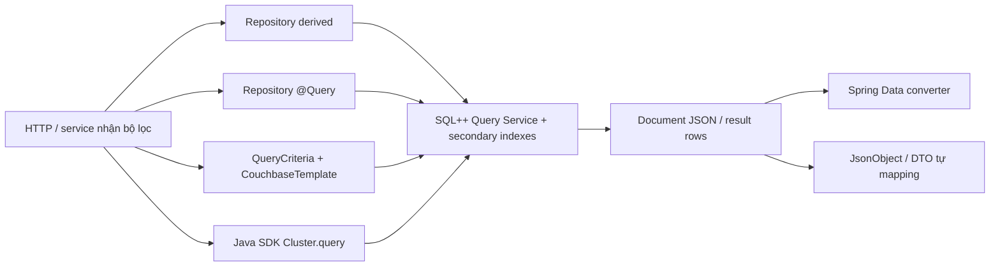
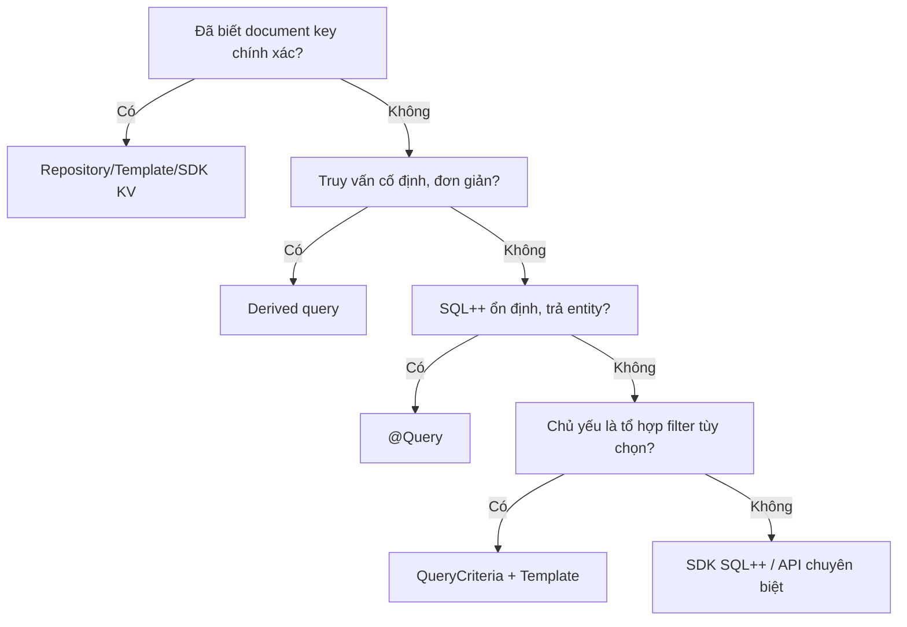

# So sánh truy vấn dẫn xuất, @Query, QueryCriteria và gọi SDK

## 1. Cùng một bài toán, bốn mức trừu tượng

Một hệ thống bán hàng cần tìm đơn hàng trong Couchbase theo cửa hàng đang đăng nhập, trạng thái, khách hàng, khoảng thời gian và đôi khi theo SKU trong mảng dòng hàng. Có thể thực hiện bằng bốn cách:

1. **Truy vấn dẫn xuất (derived query):** Spring Data phân tích tên phương thức repository như `findByTenantIdAndStatus(...)`.
2. **`@Query` trên repository:** người viết khai báo câu **SQL++ (trước đây gọi là N1QL)** bằng annotation, Spring Data quản lý tham số và kết quả.
3. **`Query` / `QueryCriteria` với `CouchbaseTemplate`:** dựng các điều kiện trong Java theo những bộ lọc thực sự được gửi.
4. **Couchbase Java SDK:** gọi `Cluster.query(...)` (hoặc API SDK khác) để chủ động điều khiển SQL++, tùy chọn thực thi và xử lý JSON.

Bài thuộc chương **Truy vấn động** của **SPRING_DATA_COUCHBASE**, nằm trong lộ trình xây dựng tầng truy cập Couchbase bằng document mapping, repository, `CouchbaseTemplate` và SQL++. Bên cạnh cú pháp, quyết định chọn API còn ảnh hưởng đến thiết kế bucket/scope/collection, chỉ mục, TTL, CAS, giao dịch, nhất quán truy vấn, hiệu năng và khả năng triển khai reactive.

**Mục tiêu:** sau bài này, bạn biết chọn cách truy vấn phù hợp thay vì mặc định một cách cho mọi trường hợp; hiểu cách truyền tham số, mapping, tính linh hoạt, chi phí bảo trì; và xây dựng bộ kiểm thử đối chiếu kết quả giữa các API.

> Các ví dụ hướng tới Java 17+, Spring Data Couchbase hiện đại (5.x/6.x) và Couchbase Java SDK 3.x. Những điểm liên quan tên field, macro `@Query` và API cụ thể phải được đối chiếu trên phiên bản ứng dụng thực tế. Không giả định một đoạn SQL++ tự viết được converter của Spring Data sửa tên trường giúp.

## 2. Mô hình dữ liệu dùng xuyên suốt

Giả sử bucket `shop`, scope `sales`, collection `orders` lưu đơn hàng. Entity có một số **tên thuộc tính Java khác tên khóa JSON** để dễ thấy ranh giới mapping:

```java
package com.example.orders;

import java.math.BigDecimal;
import java.util.List;
import org.springframework.data.annotation.Id;
import org.springframework.data.couchbase.core.mapping.Document;
import org.springframework.data.couchbase.core.mapping.Field;

@Document
public class OrderDocument {
    @Id
    private String id;

    @Field("tenant_id")
    private String tenantId;

    @Field("customer_id")
    private String customerId;

    private String status;
    private BigDecimal total;

    @Field("created_at_ms")
    private Long createdAtMillis;

    @Field("order_number")
    private String orderNumber;

    @Field("line_items")
    private List<LineItem> lineItems;

    // Constructors, getters, setters được lược bỏ.
}

class LineItem {
    private String sku;
    private Integer quantity;
}
```

Một document JSON:

```json
{
  "tenant_id": "store-01",
  "customer_id": "customer-42",
  "status": "PAID",
  "total": 450000,
  "created_at_ms": 1792992000000,
  "order_number": "SO-2026-0042",
  "line_items": [
    { "sku": "SKU-42", "quantity": 2 },
    { "sku": "SKU-09", "quantity": 1 }
  ]
}
```

Trong hệ thống thật, Spring Data còn có thể ghi type discriminator như `_class`; giá trị thực phụ thuộc converter, type alias và cấu hình mapping. **`@Id` biểu diễn document key**, không tự đồng nhất với một trường JSON tên `id`; trong SQL++ có thể truy cập key bằng `META(o).id`.

### 2.1. Hợp đồng truy vấn chung

Ta cần lấy đơn theo các điều kiện:

- `tenantId` **bắt buộc**, lấy từ thông tin đăng nhập đáng tin cậy; không cho client tự chọn tenant.
- `status` có thể cố định là PAID, hoặc là danh sách trạng thái cho phép.
- `customerId`, `createdFromInclusive`, `createdBeforeExclusive` là bộ lọc tùy chọn.
- Với truy vấn nâng cao, tìm **ít nhất một phần tử** trong `line_items` có `sku` và `quantity` cùng thỏa.
- Dữ liệu trả về tối đa 20–100 dòng mỗi trang, sắp xếp theo `createdAtMillis` giảm dần với một khóa phụ duy nhất.

Để so sánh công bằng, mỗi cách phải áp dụng cùng điều kiện phân quyền, cùng semantics cho `null`/bộ lọc vắng mặt, cùng kiểu giá trị và cùng thứ tự sort.

## 3. Bức tranh tổng quan

| Tiêu chí | Derived query | Repository `@Query` | `QueryCriteria` + Template | Java SDK |
| --- | --- | --- | --- | --- |
| **Độ ngắn với truy vấn cố định** | Rất ngắn | Ngắn đến vừa | Nhiều mã hơn | Nhiều mã nhất |
| **Biến đổi tổ hợp điều kiện lúc chạy** | Kém thuận tiện; nhiều chữ ký | Câu SQL++ cố định, có thể dùng điều kiện tùy chọn | **Phù hợp** để thêm/bỏ từng điều kiện | **Linh hoạt tối đa**, tự chịu trách nhiệm |
| **Truy vấn SQL++ nâng cao** | Giới hạn bởi quy tắc tên phương thức | Viết SQL++ tường minh | Tốt cho các toán tử DSL hỗ trợ | Mọi cú pháp server/SDK hỗ trợ |
| **Mapping entity ↔ JSON** | Spring Data | Spring Data khi chọn đúng các trường cần dựng entity | Spring Data | **Không tự chạy qua Spring Data converter** |
| **Đường dẫn `@Field`** | Dựa vào metadata property | SQL++ inline phải dùng tên lưu trữ | Kiểm chứng mapper/SQL++ được sinh | Tự dùng JSON key thực tế |
| **Truyền giá trị an toàn** | Tham số repository | Placeholder `$1` hoặc `$name` | Criteria được converter xuất thành truy vấn | `QueryOptions.parameters(...)` |
| **Sort, page, count** | `Pageable`, return type repository | Có thể dùng `Pageable`; không viết trùng clause | `Query.with(Pageable)`; đếm bằng query riêng | Viết `ORDER BY`, `LIMIT`, `OFFSET`/cursor và count riêng |
| **Tính năng SDK đặc thù** | Không trực tiếp | Một phần | Qua fluent template | Toàn quyền với `QueryOptions`, metadata, SDK |
| **Reactive** | Có API repository reactive phù hợp | Dùng repository reactive phù hợp | `ReactiveCouchbaseTemplate` | `cluster.reactive()` và API reactive |
| **Chi phí bảo trì** | Tên phương thức dài khi tổ hợp phức tạp | Quản lý SQL++ inline | Quản lý factory criteria và unit/integration test | Quản lý toàn bộ SQL++, mapping kết quả và options |

**Không có một cách luôn nhanh hơn ba cách còn lại.** Chúng đều có thể phát sinh SQL++ tới cùng Query Service. Hiệu năng phụ thuộc **SQL++ thực tế, index, kích thước dữ liệu, kế hoạch thực thi và scan consistency**, không chỉ tên API ở phía Java.



Sơ đồ mô tả các đường **truy vấn dựa trên SQL++**. Trường hợp truy xuất bằng **document key đã biết** khác biệt: `repository.findById(id)`, `CouchbaseTemplate.findById(...)` hoặc SDK KV có thể đi trực tiếp qua Key/Value Service, không cần tạo truy vấn SQL++ và không phụ thuộc secondary index.

## 4. Cách 1 — Truy vấn dẫn xuất từ tên phương thức

Spring Data phân tích tên phương thức, property và toán tử rồi tạo truy vấn phù hợp. Khai báo repository:

```java
package com.example.orders;

import java.util.List;
import org.springframework.data.couchbase.repository.CouchbaseRepository;
import org.springframework.data.domain.Page;
import org.springframework.data.domain.Pageable;

public interface OrderRepository
        extends CouchbaseRepository<OrderDocument, String> {

    List<OrderDocument> findByTenantIdAndStatus(
            String tenantId, String status);

    Page<OrderDocument> findByTenantIdAndStatus(
            String tenantId, String status, Pageable pageable);

    List<OrderDocument> findByTenantIdAndCustomerIdAndStatus(
            String tenantId, String customerId, String status);

    List<OrderDocument> findByTenantIdAndCreatedAtMillisGreaterThanEqual(
            String tenantId, Long createdFromInclusive);
}
```

Ví dụ dùng với trang đầu:

```java
import org.springframework.data.domain.PageRequest;
import org.springframework.data.domain.Sort;

var page = repository.findByTenantIdAndStatus(
        trustedTenantId,
        "PAID",
        PageRequest.of(0, 20,
                Sort.by(Sort.Order.desc("createdAtMillis"),
                        Sort.Order.desc("orderNumber"))));
```

**Lưu ý quan trọng:**

1. Tên phương thức dùng **property Java**: `TenantId`, `CustomerId`, `CreatedAtMillis`; không đặt tên phương thức theo alias JSON `tenant_id` hoặc `created_at_ms`.
2. `Pageable` mang thông tin sort, giới hạn và vị trí trang. Trả về `Page` thường kéo theo công việc xác định tổng số phần tử; `Slice` có thể hợp lý hơn nếu chỉ cần biết còn trang tiếp theo.
3. Nếu lọc theo một trong 20 tổ hợp của các trường tùy chọn, không nên cố tạo 20 phương thức dài và lặp lại logic.
4. Có thể dùng những từ khóa diễn đạt `And`, `Or`, `Between`, `In`, `GreaterThanEqual`... nhưng **không giả định mọi SQL++ phức tạp** đều biểu diễn tốt bằng tên phương thức.
5. Đảm bảo `orderNumber` là khóa phân biệt ổn định/duy nhất trong một tenant; nếu không, cần chọn khóa phụ khác để phân trang ổn định.

### 4.1. Ưu điểm và giới hạn

**Nên dùng khi:** điều kiện ngắn, ít thay đổi và mô tả trực tiếp bằng property, ví dụ “lấy tất cả đơn PAID của tenant T”.

**Không nên ép dùng khi:** người dùng được chọn nhiều bộ lọc tùy chọn, câu truy vấn cần `ANY ... SATISFIES`, truy vấn có aggregation phức tạp, JOIN hoặc thao tác đặc thù của Query Service. Tên phương thức quá dài khó đọc, khó bảo trì và che khuất ý định SQL++.

### 4.2. Derived query không phải KV

`findByTenantIdAndStatus(...)` thường là truy vấn SQL++ vì nó không biết document key chính xác. Nó cần **secondary index phù hợp**.

Ngược lại:

```java
OrderDocument order = repository
        .findById("order::2026::0042")
        .orElseThrow();
```

Đây là truy cập theo document key và thường đi qua KV. Không nên dựng một derived query `findByIdAndStatus(...)` chỉ để tái kiểm tra một document nếu logic phù hợp hơn là KV + kiểm tra phạm vi trong ứng dụng; việc kiểm tra tenant sau khi đọc phải bảo đảm **không làm lộ dữ liệu** và đúng hợp đồng phân quyền.

## 5. Cách 2 — `@Query` với SQL++ cố định trên repository

Spring Data Couchbase hỗ trợ `org.springframework.data.couchbase.repository.Query`. Annotation này cho phép cung cấp câu SQL++ trong phương thức repository; Spring Data thực thi với tham số và chuyển kết quả thành kiểu trả về được khai báo.

### 5.1. Một câu query đầy đủ để dựng entity

```java
package com.example.orders;

import java.util.List;
import org.springframework.data.couchbase.repository.CouchbaseRepository;
import org.springframework.data.couchbase.repository.Query;
import org.springframework.data.repository.query.Param;

public interface OrderSqlRepository
        extends CouchbaseRepository<OrderDocument, String> {

    @Query("#{#n1ql.selectEntity} " +
           "WHERE #{#n1ql.filter} " +
           "AND tenant_id = $tenantId " +
           "AND status = $status")
    List<OrderDocument> findByTenantAndStatusSql(
            @Param("tenantId") String trustedTenantId,
            @Param("status") String status);
}
```

Hai macro SpEL có ý nghĩa riêng:

- `#{#n1ql.selectEntity}` tạo phần `SELECT ... FROM ...` chứa các trường cần thiết để converter **dựng lại entity**, bao gồm metadata về document key/CAS khi phù hợp.
- `#{#n1ql.filter}` thêm điều kiện phân biệt loại entity của Spring Data, tránh lẫn document được các repository/entity khác quản lý trong cùng keyspace.

**`#{#n1ql.filter}` không phải cơ chế phân quyền tenant.** Nó không thay thế `AND tenant_id = $tenantId` xuất phát từ ngữ cảnh xác thực. Hai điều kiện phục vụ hai mục đích khác nhau.

Tên `tenant_id` ở câu SQL++ là **tên field JSON thực tế**; nếu chỉ viết `tenantId`, converter sẽ không tự sửa mọi chuỗi SQL++ thủ công. Các macro `#n1ql.bucket`, `#n1ql.scope`, `#n1ql.collection` cũng có thể dùng khi cần tự dựng phần FROM, nhưng với truy vấn entity thông thường nên ưu tiên `selectEntity`.

### 5.2. Tham số vị trí và tham số tên

Ví dụ ở trên dùng **named parameter** `$tenantId`, `$status` được ánh xạ bằng `@Param`. Cũng có thể dùng **positional parameter** `$1`, `$2`:

```java
@Query("#{#n1ql.selectEntity} WHERE #{#n1ql.filter} " +
       "AND tenant_id = $1 AND status = $2")
List<OrderDocument> findWithPositionalParams(
        String tenantId, String status);
```

Không trộn lẫn hai phong cách placeholder trong cùng một câu `@Query`. `@Param` rõ nghĩa và tránh lệ thuộc vào việc lưu tên tham số của compiler. Các giá trị phải được bind; không dùng nối chuỗi với input:

```java
// KHÔNG LÀM: tạo SQL++ bằng ghép giá trị trực tiếp.
String unsafe = "WHERE status = '" + requestedStatus + "'";
```

Điểm cần phân biệt: `@Query` phía **repository** có placeholder `$1`, `$name` và macro SpEL. API `Cluster.query(...)` phía **SDK** lại dùng `QueryOptions.parameters(...)`. Hai API không tự chia sẻ logic binding với nhau.

### 5.3. `@Query` thể hiện điều kiện mảng tốt hơn tên phương thức

Ví dụ “có ít nhất một dòng hàng với SKU và số lượng cùng thỏa”:

```java
@Query("#{#n1ql.selectEntity} WHERE #{#n1ql.filter} " +
       "AND tenant_id = $tenantId " +
       "AND ANY li IN line_items " +
       "SATISFIES li.sku = $sku AND li.quantity >= $minQuantity END")
List<OrderDocument> findContainingItem(
        @Param("tenantId") String trustedTenantId,
        @Param("sku") String sku,
        @Param("minQuantity") int minQuantity);
```

Đoạn `ANY` đảm bảo **hai phép kiểm tra áp dụng trên cùng một phần tử `li`**. Nếu thay bằng hai mệnh đề `ANY` độc lập, một dòng chứa SKU đúng và một dòng khác có quantity đủ lớn có thể làm đơn bị tính nhầm là khớp.

### 5.4. `Pageable` với inline query

Tài liệu Spring Data Couchbase cho phép tham số `Pageable`/`Sort` trong repository. Khi dùng với `@Query` inline, **đừng viết sẵn `ORDER BY`, `LIMIT`, `OFFSET` trong câu inline**, rồi lại truyền `Pageable`: framework còn bổ sung các clause đó và server có thể từ chối câu truy vấn có mệnh đề trùng.

```java
@Query("#{#n1ql.selectEntity} WHERE #{#n1ql.filter} " +
       "AND tenant_id = $tenantId AND status = $status")
Page<OrderDocument> findStatusPageSql(
        @Param("tenantId") String trustedTenantId,
        @Param("status") String status,
        Pageable pageable);
```

Đây là một truy vấn **về cơ bản cố định**. Nếu muốn bỏ qua điều kiện status khi không truyền, có thể viết SQL++ kiểu `($status IS NULL OR status = $status)`; tuy nhiên cách này cần thiết kế rõ semantics `NULL` và đánh giá khả năng dùng index. Với nhiều bộ lọc, `QueryCriteria` hoặc SDK với các mảnh điều kiện có kiểm soát thường dễ tối ưu hơn.

### 5.5. Điểm mạnh và giới hạn của `@Query`

**Nên dùng khi:** SQL++ có cấu trúc phức tạp nhưng ổn định, chẳng hạn truy vấn mảng, một phép tổng hợp/điều kiện đặc thù, hoặc muốn giữ thao tác trong repository.

**Cần cẩn trọng khi:** trả entity từ truy vấn projection không chứa các trường metadata cần thiết, viết nhầm tên JSON, bỏ macro `#n1ql.filter`, trộn placeholder, ghép input thô thành identifier, hoặc muốn biến câu SQL++ cố định thành hàng trăm tổ hợp điều kiện tùy chọn.

## 6. Cách 3 — `QueryCriteria` và `CouchbaseTemplate`

Khi client có thể gửi hoặc không gửi từng trường, một factory dựng điều kiện lúc chạy thường phù hợp hơn nhiều phương thức derived hoặc một câu `@Query` dài với nhiều nhánh vô hiệu hóa.

### 6.1. DTO bộ lọc

```java
import java.math.BigDecimal;
import java.util.Set;

public record OrderFilter(
        String customerId,
        Set<String> statuses,
        BigDecimal minTotal,
        Long fromInclusive,
        Long beforeExclusive
) {
    public OrderFilter {
        statuses = statuses == null ? null : Set.copyOf(statuses);
    }
}
```

Trong hợp đồng này, `null` là **không lọc**, còn `statuses=[]` bị coi là không hợp lệ. Một `record` có `Set` được copy sẽ tránh người gọi sửa dữ liệu bộ lọc trong lúc service đang dựng truy vấn.

### 6.2. Tạo query mới từ từng điều kiện hiện diện

```java
import java.math.BigDecimal;
import java.util.List;
import java.util.Set;

import org.springframework.data.couchbase.core.CouchbaseTemplate;
import org.springframework.data.couchbase.core.query.Query;
import org.springframework.data.couchbase.core.query.QueryCriteria;
import org.springframework.data.domain.PageRequest;
import org.springframework.data.domain.Sort;
import org.springframework.stereotype.Service;

@Service
public class OrderCriteriaSearch {
    private static final Set<String> ALLOWED_STATUSES =
            Set.of("NEW", "PAID", "SHIPPED", "CANCELLED");

    private final CouchbaseTemplate template;

    public OrderCriteriaSearch(CouchbaseTemplate template) {
        this.template = template;
    }

    public List<OrderDocument> search(
            String trustedTenantId, OrderFilter filter,
            int page, int size) {

        if (page < 0 || size < 1 || size > 100
                || (long) page * size > 10_000L) {
            throw new IllegalArgumentException("page/size không hợp lệ");
        }

        Query query = newFilterQuery(trustedTenantId, filter);
        query.with(PageRequest.of(page, size,
                Sort.by(Sort.Order.desc("createdAtMillis"),
                        Sort.Order.desc("orderNumber"))));

        return template.findByQuery(OrderDocument.class)
                .matching(query)
                .all();
    }

    public long count(
            String trustedTenantId, OrderFilter filter) {
        // Query riêng, không có skip/limit/sort của truy vấn dữ liệu.
        return template.findByQuery(OrderDocument.class)
                .matching(newFilterQuery(trustedTenantId, filter))
                .count();
    }

    private Query newFilterQuery(
            String tenantId, OrderFilter filter) {

        if (tenantId == null || tenantId.isBlank() || filter == null) {
            throw new IllegalArgumentException("Tenant/filter không hợp lệ");
        }
        if (filter.fromInclusive() != null
                && filter.beforeExclusive() != null
                && filter.fromInclusive() >= filter.beforeExclusive()) {
            throw new IllegalArgumentException("Khoảng thời gian không hợp lệ");
        }

        Query query = Query.query(
                QueryCriteria.where("tenantId").is(tenantId));

        if (filter.customerId() != null
                && !filter.customerId().isBlank()) {
            query.addCriteria(QueryCriteria.where("customerId")
                    .is(filter.customerId().trim()));
        }

        if (filter.statuses() != null) {
            if (filter.statuses().isEmpty()
                    || !ALLOWED_STATUSES.containsAll(filter.statuses())) {
                throw new IllegalArgumentException("Status không hợp lệ");
            }
            query.addCriteria(QueryCriteria.where("status")
                    .in(filter.statuses().toArray(new String[0])));
        }

        if (filter.minTotal() != null) {
            if (filter.minTotal().compareTo(BigDecimal.ZERO) < 0) {
                throw new IllegalArgumentException("minTotal phải >= 0");
            }
            query.addCriteria(QueryCriteria.where("total")
                    .gte(filter.minTotal()));
        }

        if (filter.fromInclusive() != null) {
            query.addCriteria(QueryCriteria.where("createdAtMillis")
                    .gte(filter.fromInclusive()));
        }
        if (filter.beforeExclusive() != null) {
            query.addCriteria(QueryCriteria.where("createdAtMillis")
                    .lt(filter.beforeExclusive()));
        }

        return query;
    }
}
```

Ở ví dụ này, `tenantId`, `customerId`, `createdAtMillis` trong `QueryCriteria.where(...)` là **property Java** để diễn đạt tiêu chí ở tầng Spring Data. Vì entity có `@Field` alias, cần **xác minh câu SQL++ cuối cùng được sinh** bởi API và phiên bản thực tế có dùng `tenant_id`, `customer_id`, `created_at_ms` đúng như JSON. Không mặc định mọi biến thể DSL tự biến mọi chuỗi path thành tên lưu trữ.

### 6.3. Ưu điểm và giới hạn

**Nên dùng khi:** tổ hợp bộ lọc tùy chọn là vấn đề chính; ứng dụng muốn tận dụng converter, mapping entity, `CouchbaseTemplate`, sắp xếp và phân trang theo `Pageable`.

**Phải kiểm tra khi:** nhóm `AND`/`OR` lồng sâu; biểu thức mảng/array index đặc biệt; điều kiện phụ thuộc biểu thức SQL++ của server; tên field được đổi bằng `@Field`; hoặc một API mới chỉ xuất hiện từ một phiên bản Spring Data nhất định.

Quan trọng: **đừng giữ một `Query` hay chuỗi `QueryCriteria` đang được sửa đổi trong field singleton** rồi tái sử dụng cho các request. Chỉ tái sử dụng factory `newFilterQuery`, tạo đối tượng mới mỗi lần. Không tái sử dụng query đã thêm `Pageable` để đi đếm.

### 6.4. Kiểm soát consistency

Với truy vấn SQL++ cần chờ chỉ mục bắt kịp các mutation đã xác nhận trước lúc query bắt đầu, có thể cân nhắc fluent API:

```java
import com.couchbase.client.java.query.QueryScanConsistency;

Query consistentQuery = query.scanConsistency(
        QueryScanConsistency.REQUEST_PLUS);

List<OrderDocument> orders = template
        .findByQuery(OrderDocument.class)
        .matching(consistentQuery)
        .all();
```

`REQUEST_PLUS` có thể tăng độ trễ. Nó **không** khiến hai lần gọi `search()` và `count()` ở các thời điểm khác nhau trở thành một snapshot. Chọn mức consistency theo yêu cầu nghiệp vụ thay vì áp dụng mặc định cho mọi request.

## 7. Cách 4 — Gọi trực tiếp Couchbase Java SDK

Khi muốn kiểm soát cấu trúc SQL++ nâng cao, tên field, tham số Query Service, result metadata, prepared query hoặc truy vấn vượt giới hạn một repository, SDK cho phép đi thẳng xuống cơ sở dữ liệu.

Với Couchbase Java SDK 3.x, một câu SQL++ điển hình được thực thi qua `Cluster.query(statement, options)`. Kết quả là `QueryResult`; `rowsAsObject()` trả các `JsonObject` theo hình dạng phần `SELECT`.

### 7.1. Truy vấn tham số hóa với điều kiện mảng

```java
import java.util.List;
import com.couchbase.client.java.Cluster;
import com.couchbase.client.java.json.JsonObject;
import com.couchbase.client.java.query.QueryOptions;

public final class OrderSdkSearch {
    private final Cluster cluster;

    public OrderSdkSearch(Cluster cluster) {
        this.cluster = cluster;
    }

    public List<JsonObject> findOrdersContainingSku(
            String trustedTenantId,
            String sku,
            int minQuantity,
            int limit) {

        if (trustedTenantId == null || trustedTenantId.isBlank()) {
            throw new IllegalArgumentException("Thiếu tenant đã xác thực");
        }
        if (sku == null || sku.isBlank()) {
            throw new IllegalArgumentException("Thiếu SKU");
        }
        if (minQuantity < 1 || limit < 1 || limit > 100) {
            throw new IllegalArgumentException("Số lượng/limit không hợp lệ");
        }

        String sql = """
            SELECT META(o).id AS documentId,
                   o.order_number AS orderNumber,
                   o.status AS status,
                   o.created_at_ms AS createdAtMillis
            FROM `shop`.`sales`.`orders` AS o
            WHERE o.tenant_id = $tenantId
              AND ANY li IN o.line_items
                  SATISFIES li.sku = $sku
                       AND li.quantity >= $minQuantity
                  END
            ORDER BY o.created_at_ms DESC, META(o).id DESC
            LIMIT $limit
            """;

        JsonObject parameters = JsonObject.create()
                .put("tenantId", trustedTenantId)
                .put("sku", sku.trim())
                .put("minQuantity", minQuantity)
                .put("limit", limit);

        return cluster.query(
                sql,
                QueryOptions.queryOptions()
                        .parameters(parameters)
                        .readonly(true)
        ).rowsAsObject();
    }
}
```

Đây là một **truy vấn SQL++ trực tiếp**, không chạy thông qua Spring Data converter. Vì thế:

- `o.tenant_id`, `o.line_items`, `o.created_at_ms` là **tên field trong JSON**, không phải tên thuộc tính Java.
- `$tenantId`, `$sku`, `$minQuantity` và `$limit` được truyền qua `QueryOptions.parameters(JsonObject)`, không nối vào `String sql`.
- `SELECT` quyết định cấu trúc kết quả; `JsonObject` chứa `documentId`, `orderNumber`, `status` và `createdAtMillis`, **không phải một instance `OrderDocument`**.
- Query không tự thêm `#{#n1ql.filter}` của repository. Nếu nhiều entity type dùng chung collection, cần đưa chính sách lọc loại document phù hợp với schema/type alias thực tế.
- `readonly(true)` thể hiện ý định đọc; nó không thay thế quyền tài khoản Couchbase hoặc kiểm soát tenant.
- Mã này giả định `Cluster` được cấu hình/inject bởi Spring hoặc thành phần quản lý vòng đời. Không tạo `Cluster.connect(...)` mới cho từng HTTP request.

### 7.2. Nếu cần filter hoặc sort thay đổi

Các placeholder dùng để **bind giá trị**, không thể tùy tiện dùng thay cho mọi identifier hay từ khóa của SQL++. Không cho client gửi một câu SQL++ tự do hoặc tên field gắn thẳng vào `ORDER BY`.

```java
String orderExpression = switch (requestedSortBy) {
    case "date"   -> "o.created_at_ms";
    case "number" -> "o.order_number";
    default -> throw new IllegalArgumentException("Trường sort không được hỗ trợ");
};

String direction = switch (requestedDirection) {
    case "asc"  -> "ASC";
    case "desc" -> "DESC";
    default -> throw new IllegalArgumentException("Hướng sort không hợp lệ");
};

// Chỉ nối biểu thức/hướng đã lấy từ whitelist do server định nghĩa.
String orderClause = " ORDER BY " + orderExpression + " " + direction
        + ", META(o).id DESC";
```

Nếu thêm nhiều bộ lọc tùy chọn, hãy tạo các đoạn `WHERE` từ cấu trúc/tên field **được whitelist**, nhóm `AND`/`OR` có ngoặc, rồi bind toàn bộ giá trị. Hệ thống không nên chấp nhận `requestedSortBy` như một đoạn SQL++ hay lấy tên tenant/collection trực tiếp từ request để ghép câu query.

### 7.3. Khác biệt giữa Query Service và KV API của SDK

SDK còn hỗ trợ truy cập document bằng key:

```java
import com.couchbase.client.java.Collection;
import com.couchbase.client.java.kv.GetResult;

Collection orders = cluster.bucket("shop")
        .scope("sales")
        .collection("orders");

GetResult result = orders.get("order::2026::0042");
JsonObject storedBody = result.contentAsObject();
```

Đây là **KV Get** theo document key; khác với `Cluster.query(...)` qua Query Service, nó không đòi hỏi secondary index. Tuy nhiên, nếu key có thể truy cập nhiều tenant, tầng ứng dụng vẫn cần kiểm tra quyền sử dụng document; biết key không tự đồng nghĩa được phép đọc.

### 7.4. Khi nào nên xuống SDK?

**Nên cân nhắc SDK khi:**

- Cần SQL++ có `JOIN`, `UNNEST`, aggregation, subquery, array predicate hoặc các cấu trúc khó biểu diễn rõ ràng bằng DSL hiện có.
- Cần query metadata, một `QueryOptions` đặc thù, định dạng kết quả JSON/projection tùy chỉnh, hoặc muốn kiểm soát đầy đủ cách sinh statement.
- Một phần ứng dụng có truy vấn vượt khả năng/giới hạn được kiểm chứng của repository và template.
- Cần API KV, sub-document, durability, CAS hoặc transaction của SDK một cách tường minh.

**Chi phí đi kèm:** tự quản lý khóa JSON, discriminator, mapping về DTO, tên bucket/scope/collection, giới hạn kết quả, quyền tenant, xử lý ngoại lệ SDK và bộ kiểm thử SQL++. Các ngoại lệ trực tiếp của SDK cũng không nhất thiết được dịch sang hệ thống `DataAccessException` như trong Spring Data.

## 8. Chọn API theo yêu cầu thực tế

| Tình huống | Khuyến nghị đầu tiên | Lý do |
| --- | --- | --- |
| Lấy đơn PAID theo tenant, ít biến thể | **Derived query** | Rất ngắn, rõ nghĩa, có type/property checking theo tên phương thức |
| Một truy vấn SQL++ ổn định có `ANY` trên dòng hàng | **`@Query`** hoặc SDK | Repository vẫn chuyển entity; SQL++ biểu diễn điều kiện same-element rõ |
| Trang quản trị có 6 bộ lọc tùy chọn và pagination | **`QueryCriteria` + Template** | Chỉ tạo những điều kiện có mặt; dễ dùng một factory cho list và count |
| Dashboard có aggregate/UNNEST/JOIN đặc thù | **SDK SQL++** hoặc `@Query` phù hợp với projection | Kiểm soát câu query và cấu trúc output |
| Truy cập chính xác document key | **Repository `findById`** / Template KV / SDK KV | Tránh Query Service và secondary index không cần thiết |
| Cần kết quả `OrderDocument` từ Spring converter | **Repository/Template** | Ít mã chuyển JSON thủ công |
| Cần điều khiển query options/metadata chuyên biệt | **SDK** | Truy cập trực tiếp `QueryOptions`, `QueryResult` |
| Cần khả năng reactive | **API reactive thực sự được hỗ trợ** | Không ép code blocking vào luồng reactive |

Một cách ra quyết định nhanh:



Sơ đồ này là điểm bắt đầu, không phải quy tắc máy móc. Có thể sử dụng repository cho thao tác phổ biến, template cho màn hình tìm kiếm linh hoạt và SDK cho một truy vấn báo cáo đặc thù **trong cùng hệ thống**. Điều quan trọng là các đường truy cập có hợp đồng phân quyền và ngữ nghĩa dữ liệu thống nhất.

## 9. Bốn cách cùng phải tuân thủ những nguyên tắc nào?

### 9.1. Bảo vệ tenant và type discriminator

Đối với ứng dụng nhiều tenant, điều kiện `tenantId = trustedTenantId` cần được áp dụng **mọi lần truy vấn**. Nó phải lấy từ authentication/authorization context, không phải từ query string do client gửi.

```sql
-- Đúng: tenant áp dụng cho cả nhóm điều kiện tùy chọn.
WHERE tenant_id = $tenantId
  AND (status = "PAID" OR status = "SHIPPED")
```

```sql
-- Sai: nhánh SHIPPED có thể trả document của tenant khác.
WHERE tenant_id = $tenantId AND status = "PAID"
   OR status = "SHIPPED"
```

Derived query/Template có thể thêm điều kiện phân biệt entity qua converter; `@Query` nên dùng `#{#n1ql.filter}` khi phù hợp; SDK phải tự xác định có cần type filter hay không. **Không được nhầm type filter với tenant authorization.**

### 9.2. Tên property Java, khóa JSON và document ID

| Trường khái niệm | Trong derived/criteria | Trong SQL++ của `@Query`/SDK |
| --- | --- | --- |
| Tenant | `tenantId` | `tenant_id` |
| Customer | `customerId` | `customer_id` |
| Thời gian | `createdAtMillis` | `created_at_ms` |
| Mã đơn | `orderNumber` | `order_number` |
| Document key | `@Id`, `findById` | `META(o).id` |

Khi đổi annotation `@Field`, phải rà soát mọi `@Query`, câu SQL++ SDK, chỉ mục và dữ liệu lịch sử; annotation không tự migrate document cũ.

### 9.3. `NULL`, `MISSING` và “không truyền filter”

Trong SQL++:

- JSON có key `"customer_id": null` tương ứng với `NULL`.
- Document thiếu key `customer_id` cho `MISSING`.
- DTO `customerId == null` trong **hợp đồng API ví dụ** có nghĩa **không thêm điều kiện lọc customer**.

Ba ý nghĩa đó không thay thế cho nhau. Nếu nghiệp vụ yêu cầu tìm document có trường bị thiếu, cần truy vấn rõ `IS MISSING`. Nếu yêu cầu chỉ tìm `NULL`, dùng `IS NULL`. Không dùng `customer_id = NULL` như cách diễn đạt “bỏ qua điều kiện”.

### 9.4. Giới hạn trang và thứ tự toàn phần

Mỗi API phải kiểm soát `page >= 0`, `1 <= size <= 100` và giới hạn offset sâu. Thứ tự `createdAtMillis DESC` đơn lẻ chưa đủ nếu nhiều đơn có cùng thời gian; thêm `orderNumber` hoặc document key làm khóa phụ ổn định và duy nhất.

Với dataset lớn hoặc request phân trang liên tục khi có ghi, cân nhắc **keyset/cursor pagination** thay cho offset. Cursor cần cố định cả sort lẫn filter; chuyển API từ Template sang SDK không tự giải quyết vấn đề trùng/thiếu bản ghi do dữ liệu thay đổi.

### 9.5. Secondary index quyết định nhiều hơn tên API

Với mẫu truy vấn lọc tenant + status rồi sort thời gian:

```sql
CREATE INDEX ix_orders_tenant_status_created
ON `shop`.`sales`.`orders`(
    tenant_id, status, created_at_ms DESC, order_number DESC
);
```

Với truy vấn `ANY li IN line_items SATISFIES li.sku = ... END`, có thể nghiên cứu **array index**:

```sql
CREATE INDEX ix_orders_tenant_item_sku
ON `shop`.`sales`.`orders`(
    tenant_id,
    DISTINCT ARRAY li.sku FOR li IN line_items END
);
```

Các index trên là **điểm khởi đầu**; chúng không bảo đảm tối ưu cho mọi tổ hợp status, customer, quantity và sort. Với một câu SQL++ lấy từ bất cứ API nào, chạy `EXPLAIN` để kiểm tra index được chọn, index scan, fetch, sort và số item được xử lý. Tránh tạo index theo tên property Java `createdAtMillis` nếu JSON thực lưu `created_at_ms`.

### 9.6. TTL, CAS, giao dịch và scan consistency

| Khía cạnh | Ảnh hưởng khi truy vấn | Quyết định ứng dụng |
| --- | --- | --- |
| **TTL** | Document có thể hết hạn giữa hai trang hoặc giữa query list/count | Xác định UI chấp nhận tập dữ liệu động hay cần snapshot |
| **CAS / `@Version`** | Bảo vệ ghi cập nhật cạnh tranh, **không** tạo snapshot cho các query | Dùng optimistic locking khi cập nhật; không thay thế kiểm soát đọc |
| **Giao dịch** | Giới hạn nhất quán nằm trong phạm vi transaction | Không giữ transaction mở qua nhiều request người dùng để giả lập phân trang |
| **Scan consistency** | SQL++ có thể đọc secondary index chưa bắt kịp mutation mới | Chọn `REQUEST_PLUS`/mutation-state khi nghiệp vụ yêu cầu và đo độ trễ |
| **KV vs SQL++** | KV theo document key có đường đọc khác với Query Service | Ưu tiên `findById`/KV khi chỉ cần document key |

Trong SDK có `QueryOptions.scanConsistency(QueryScanConsistency.REQUEST_PLUS)` và `QueryOptions.consistentWith(MutationState)`; trong Spring Data có lựa chọn scan consistency thích hợp theo API/version. Chọn đúng yêu cầu đọc-ngay-sau-ghi; không xem `REQUEST_PLUS` là cam kết snapshot xuyên nhiều HTTP request.

### 9.7. Reactive và xử lý ngoại lệ

- **Repository reactive** và `ReactiveCouchbaseTemplate` thích hợp khi toàn pipeline là non-blocking và phiên bản Spring Data đang dùng hỗ trợ thao tác cần thiết.
- SDK có API reactive như `cluster.reactive().query(...)`. Kết quả thường đi qua `Mono`/`Flux`, cần xử lý backpressure, lỗi và tài nguyên phù hợp.
- Không dùng `.block()` trong request path reactive chỉ để gọi một repository blocking.
- Spring Data cung cấp exception translation cho nhiều lỗi truy cập dữ liệu; SDK trực tiếp có hệ exception riêng. Khi trộn API, định nghĩa chiến lược phân loại lỗi, retry và metrics nhất quán.

## 10. Kiểm thử bốn cách với cùng dữ liệu

Không thể so sánh chính xác nếu bốn đoạn code chạy trên tập dữ liệu khác nhau hoặc sử dụng các điều kiện khác nhau. Chuẩn bị fixture ít nhất hai tenant:

| Document | Tenant | Status | Total | SKU/quantity | Kết quả với tenant store-01, status PAID |
| --- | --- | --- | ---: | --- | --- |
| A | store-01 | PAID | 450000 | SKU-42 × 2 | Có |
| B | store-01 | PAID | 120000 | SKU-42 × 1 | Có |
| C | store-01 | NEW | 900000 | SKU-42 × 5 | Không |
| D | store-01 | SHIPPED | 500000 | SKU-09 × 3 | Không |
| E | store-02 | PAID | 900000 | SKU-42 × 4 | **Không** |

**Kiểm thử tương đương:** dùng derived `findByTenantIdAndStatus`, repository `@Query`, `QueryCriteria` và SDK với bộ lọc tenant/store/status giống nhau. So sánh **tập document ID** (không chỉ số lượng) và thứ tự sau khi thêm `ORDER BY` giống nhau. Với truy vấn SKU + minQuantity, so sánh riêng `@Query` và SDK vì derived/criteria không nhất thiết biểu diễn cùng semantics một cách tự nhiên.

### 10.1. Ma trận kiểm thử

| Ca | Điều cần xác minh |
| --- | --- |
| Chỉ tenant, không có bộ lọc tùy chọn | Không trả record của tenant khác |
| Status PAID | Kết quả A/B, không có C/D/E |
| `minTotal=0` | Không bị xem nhầm thành “không truyền” |
| `statuses=[]` và `statuses=null` | Tuân thủ hợp đồng đã chọn: rỗng bị từ chối, null là không lọc |
| `fromInclusive = T` | Giữ document đúng bằng T |
| `beforeExclusive = T` | Loại document đúng bằng T |
| `line_items=[{SKU-42,1},{SKU-09,5}]` | Không khớp SKU-42 với minQty=2 nếu dùng cùng phần tử |
| Field `customer_id` bị thiếu hoặc `null` | `MISSING` khác `NULL` và khác tham số filter vắng mặt |
| Hai đơn cùng timestamp | Khóa sort phụ xác định thứ tự |
| `Page` và `COUNT` | Count cùng điều kiện, không bị `LIMIT/OFFSET` của trang |
| Dữ liệu được ghi rồi truy vấn tức thì | Mức scan consistency đáp ứng hợp đồng đã chọn |
| `@Field("tenant_id")` | SQL++ thực dùng khóa `tenant_id`, không phải `tenantId` |
| Query thiếu index phù hợp | `EXPLAIN` và metrics thể hiện chi phí, không quy lỗi cho “API chậm” |

### 10.2. Đo công bằng

1. Lấy **SQL++ thực tế** (và parameters đã ẩn dữ liệu nhạy cảm) của mỗi cách, không chỉ nhìn Java source.
2. Chạy `EXPLAIN` cho mẫu SQL++ giống nhau và ghi tên index được chọn.
3. Giữ cùng keyspace, số document, phân bố tenant/status, `LIMIT`, `ORDER BY` và scan consistency.
4. Đo p50/p95/p99 latency qua nhiều lần gọi; không kết luận chỉ từ một lần chạy local khi cache còn lạnh.
5. Phân biệt tổng thời gian end-to-end (bao gồm converter/JSON serialization/network) với thời gian Query Service được báo trong metrics.
6. Kiểm soát độ lớn document và projection: `SELECT` nguyên entity có chi phí chuyển dữ liệu khác với chỉ chọn vài cột.

Nên log một request correlation ID/client context ID để đối chiếu ứng dụng với Query Service, nhưng **không log trực tiếp toàn bộ giá trị nhạy cảm** như tenant, customer hoặc dữ liệu thanh toán.

## 11. Các lỗi thường gặp và cách xử lý

| Sai lầm | Tại sao sai | Cách khắc phục |
| --- | --- | --- |
| Gọi derived query cho mọi biến thể filter | Tên phương thức phình to, thiếu linh hoạt | Dùng criteria factory hoặc SDK/SQL++ rõ ràng |
| Cho rằng `@Query` tự đổi `customerId` thành `customer_id` trong chuỗi | SQL++ inline chạy trên JSON field lưu trữ | Dùng đúng field thực và kiểm thử mapping |
| Bỏ `#{#n1ql.filter}` khi trả entity | Có thể lẫn document type | Dùng macro được khuyến nghị, kiểm chứng discriminator |
| Xem `#{#n1ql.filter}` là điều kiện tenant | Type filter khác authorization | Thêm tenant đáng tin cậy riêng |
| Trộn `$1` và `$tenantId` trong một `@Query` | Bộ parser có các chế độ binding khác nhau | Chọn một phong cách và dùng `@Param` rõ |
| Dùng SQL++ `@Query` có sẵn `LIMIT` rồi lại truyền `Pageable` | Có thể trùng clause làm malformed query | Để framework thêm sort/page một lần |
| Tái sử dụng một `Query` mutable giữa các request | Rò criteria và phân trang | Tạo query mới cho mỗi lần thực thi |
| Dùng SDK rồi cast `rowsAsObject()` sang `List<OrderDocument>` | Không qua Spring Data converter | Mapping DTO có kiểm soát hoặc dùng API Spring Data |
| Ghép `sortBy` client trực tiếp vào SQL++ | Identifier/keyword không được bind như giá trị | Whitelist tên field và hướng sort |
| Chạy Query Service theo ID chính xác | Tốn query/index không cần thiết | Dùng KV/`findById` |
| So latency giữa hai API với SQL++ và index khác nhau | Kết luận không công bằng | Chuẩn hóa query/parameters và đo `EXPLAIN` |

## 12. Bài tập thực hành và đáp án gợi ý

**Bài 1 — Chọn API:** Nêu phương án phù hợp nhất cho từng nghiệp vụ:

1. Lấy đơn theo tenant và trạng thái cố định.
2. Màn hình có bảy bộ lọc tùy chọn, có phân trang.
3. Tìm đơn có ít nhất một dòng hàng vừa đúng SKU vừa có số lượng từ 3.
4. Đọc chính xác document theo ID đã biết.

**Đáp án gợi ý:** (1) derived query; (2) `QueryCriteria` + Template; (3) `@Query` hoặc SDK với `ANY ... SATISFIES`; (4) KV/`findById`.

**Bài 2 — Tìm lỗi bảo mật:** Sửa câu sau để mọi nhánh đều giới hạn tenant:

```sql
WHERE tenant_id = $tenantId AND status = "PAID"
   OR status = "SHIPPED"
```

**Đáp án:**

```sql
WHERE tenant_id = $tenantId
  AND (status = "PAID" OR status = "SHIPPED")
```

**Bài 3 — Mapping:** Entity có `@Field("created_at_ms") private Long createdAtMillis;`. Viết tên property cho derived method, đường dẫn SQL++ trong `@Query` và SDK. Vì sao không thể dùng trực tiếp cùng một chuỗi ở cả ba nơi?

**Đáp án:** derived sử dụng `CreatedAtMillis`; SQL++ inline và SDK dùng `created_at_ms`. Chúng hoạt động ở những tầng mapping khác nhau.

**Bài 4 — Count và phân trang:** Viết một `newFilterQuery(...)` trả `Query` mới cho mỗi lần gọi; dùng một query thêm `PageRequest` để đọc trang và một query khác để `count()`. Giải thích rủi ro nếu dùng cùng instance đã gắn `skip/limit`.

**Bài 5 — SDK:** Mở rộng `findOrdersContainingSku` để nhận `status` tùy chọn và `sortBy` trong danh sách cho phép. Dùng `JsonObject` để bind giá trị, không nối input thành SQL++ identifier.

**Bài 6 — Chọn index:** Với query `WHERE tenant_id = $tenantId AND status = $status ORDER BY created_at_ms DESC`, đề xuất index; chạy `EXPLAIN` và kiểm tra bước `Order`/index pushdown thay vì kết luận từ tên index.

## 13. Tổng kết và tài liệu tham khảo

**Derived query** tốt nhất cho điều kiện ngắn, ổn định. **`@Query`** dùng khi cần SQL++ rõ ràng nhưng vẫn muốn kết quả qua repository và converter. **`QueryCriteria` + Template** giải quyết linh hoạt các tập bộ lọc tùy chọn, giúp dùng chung factory cho list/count. **Java SDK** cho quyền kiểm soát tối đa với SQL++, KV và query options, đổi lại phải tự kiểm soát tên field, kết quả và an toàn.

Tất cả cách dùng SQL++ đều phải có **tenant scope đúng, named/positional parameters hợp lệ, secondary index phù hợp, giới hạn kết quả và kiểm thử trên document thật**. Không chọn API theo cảm giác nhanh/chậm; đo truy vấn cuối cùng và đọc `EXPLAIN`.

Nguồn chính thức:

- [Spring Data Couchbase — Repositories and Querying](https://docs.spring.io/spring-data/couchbase/reference/couchbase/repository.html).
- [Spring Data Couchbase — `@Query` Javadoc](https://docs.spring.io/spring-data/couchbase/docs/current/api/org/springframework/data/couchbase/repository/Query.html).
- [Spring Data Couchbase — Template and direct operations](https://docs.spring.io/spring-data/couchbase/reference/couchbase/template.html).
- [Spring Data Couchbase — `Query` API](https://docs.spring.io/spring-data/couchbase/reference/api/java/org/springframework/data/couchbase/core/query/Query.html).
- [Spring Data Couchbase — `QueryCriteria` API](https://docs.spring.io/spring-data/couchbase/reference/api/java/org/springframework/data/couchbase/core/query/QueryCriteria.html).
- [Couchbase Java SDK — SQL++ Query](https://docs.couchbase.com/java-sdk/current/howtos/sqlpp-queries-with-sdk.html).
- [Couchbase Server — Indexing Overview](https://docs.couchbase.com/server/current/indexes/indexing-overview.html).
- [Couchbase SQL++ — Array Indexing](https://docs.couchbase.com/server/current/n1ql/n1ql-language-reference/indexing-arrays.html).
