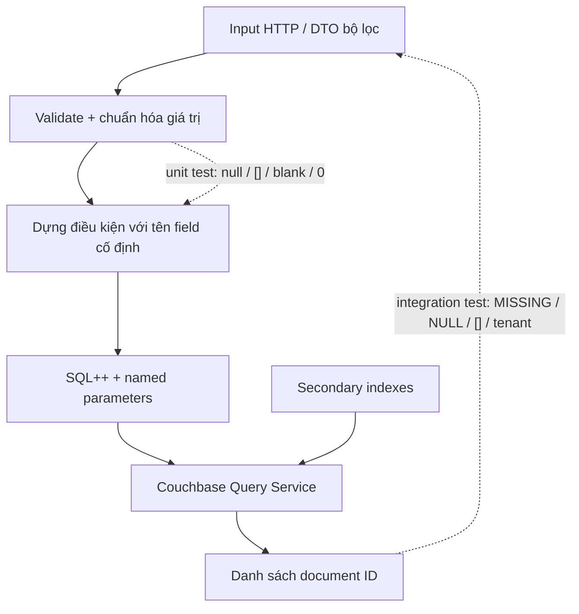

# Kiểm thử bộ lọc động với dữ liệu null, thiếu trường và đầu vào rỗng

## 1. Bài toán: truy vấn chạy được nhưng bộ lọc cho kết quả sai

Giả sử một API tìm đơn hàng hỗ trợ nhiều điều kiện tùy chọn: trạng thái, mã khách hàng, thẻ đơn hàng và dòng hàng chứa SKU. Sau khi triển khai, API gặp những lỗi khó phát hiện:

- Người dùng không gửi trạng thái nhưng hệ thống lại chỉ tìm đơn có `status = NULL`.
- Một document **không có** khóa `customer_id` bị đánh đồng với document có `"customer_id": null`.
- Danh sách trạng thái `[]` bị hiểu thành “bỏ lọc”, làm trả nhiều đơn hơn dự kiến.
- `minTotal = 0` bị loại khỏi câu query vì code kiểm tra giá trị như boolean.
- Hai điều kiện SKU và số lượng khớp trên **hai phần tử khác nhau** của mảng `line_items`.
- Kiểm thử tạo document qua KV thành công, nhưng truy vấn SQL++ ngay sau đó chưa thấy bản ghi vì chỉ mục chưa cập nhật.

Đây là bài học thuộc chương **Truy vấn động** của **SPRING_DATA_COUCHBASE**. Mục tiêu không chỉ là viết `WHERE`, mà là **thiết kế bộ ca kiểm thử bảo đảm ngữ nghĩa dữ liệu và ngữ nghĩa tham số đầu vào** khi dùng document mapping, repository, `CouchbaseTemplate` hoặc SQL++ của Couchbase Java SDK. Những vấn đề về bucket/scope/collection, index, TTL, CAS, giao dịch và reactive API được xét trong giới hạn ảnh hưởng đến tính đúng đắn của kiểm thử.

**Sau bài này, bạn có thể:**

1. Phân biệt `NULL`, `MISSING`, chuỗi rỗng, mảng rỗng, giá trị `0` và `false` trong Couchbase.
2. Thiết kế hợp đồng rõ ràng cho tham số `null`, tham số vắng mặt, `[]`, `""` và chuỗi chỉ có khoảng trắng.
3. Dùng `IS NULL`, `IS MISSING`, `IS VALUED`, `IS NOT VALUED` và phép so sánh `=` đúng mục đích.
4. Viết fixture và test theo bảng đối chiếu kết quả, bao gồm dữ liệu từ tenant khác.
5. Kiểm tra truy vấn mảng, phân trang, `COUNT`, mapping `@Field`, chỉ mục và scan consistency.
6. Phân tách lỗi của **logic dựng query** với lỗi của **dữ liệu hoặc môi trường thực thi**.

> Ví dụ dùng Java 17+, Couchbase Server có SQL++, Couchbase Java SDK 3.x và ngữ cảnh Spring Data Couchbase 5.x/6.x. Các phép kiểm tra về `NULL`/`MISSING` dựa trên SQL++ của **Couchbase Server**, không phải những quy tắc của Couchbase Lite hoặc SQL quan hệ.

## 2. Hai trục cần kiểm thử độc lập

Phải tách bạch hai khái niệm:

1. **Trạng thái đầu vào của API:** client *không gửi* bộ lọc, gửi `null`, gửi `[]`, gửi `""`, hay gửi một giá trị cụ thể?
2. **Trạng thái dữ liệu trong document:** khóa JSON *không tồn tại* (`MISSING`), có khóa với giá trị `null` (`NULL`), có chuỗi rỗng, mảng rỗng hay giá trị khác?

Chúng nằm ở hai tầng khác nhau. DTO Java nhận `customerId == null` **không đồng nghĩa** document trong Couchbase có `customer_id IS NULL`.

| Ngữ cảnh | Biểu diễn | Ý nghĩa | Ví dụ kiểm thử |
| --- | --- | --- | --- |
| HTTP không gửi `customerId` | Thuộc tính DTO `null` | Theo hợp đồng ví dụ: **bỏ qua** filter customer | Trả cả đơn có và không có customer |
| HTTP gửi JSON `"customerId": null` | Có thể cũng thành DTO `null` | Không phân biệt được với vắng mặt nếu chỉ dùng một trường Java nullable | Kiểm tra parser/hợp đồng API |
| JSON document **thiếu** `customer_id` | `MISSING` | Không có khóa trong document | `customer_id IS MISSING` |
| JSON có `"customer_id": null` | `NULL` | Khóa tồn tại, giá trị null | `customer_id IS NULL` |
| JSON có `"customer_id": ""` | Chuỗi dài 0 | Có giá trị string, không phải `NULL` | `customer_id = ""` |
| JSON có `"tags": []` | Mảng không phần tử | Mảng hiện diện nhưng rỗng | `ARRAY_LENGTH(tags) = 0` khi có mảng |
| DTO `statuses = []` | Tập filter không phần tử | Phải quy định: từ chối, trả rỗng, hoặc cố ý bỏ lọc | Test lựa chọn hợp đồng |
| DTO `minTotal = 0` | Số bằng 0 | **Đã gửi** điều kiện, không phải vắng mặt | Kiểm tra `>= 0` vẫn được thêm |
| DTO `giftWrapped = false` | Boolean false | **Đã gửi** điều kiện, không phải vắng mặt | Kiểm tra `= false` vẫn được thêm |

Trong Java, `Optional.empty()`, `null` và “không có trường trong JSON request” cũng không tự động biểu diễn đủ ba trạng thái khác nhau. Khi API cần tìm **cụ thể** các document `NULL` hoặc `MISSING`, nên bổ sung một tham số ý định rõ ràng thay vì dùng một `String? customerId` duy nhất.

### 2.1. Đầu vào rỗng không có một cách xử lý “chuẩn” duy nhất

Một API có thể chọn những quy tắc sau, miễn là thực hiện nhất quán:

| Input | Hợp đồng được chọn trong bài này | Vì sao |
| --- | --- | --- |
| `statuses == null` | Không lọc `status` | Client chưa yêu cầu bộ lọc |
| `statuses.isEmpty()` | **400 Bad Request** | Tránh lầm `[]` với “mọi trạng thái” |
| `statuses` có giá trị không cho phép | **400 Bad Request** | Ngăn trạng thái ngoài domain |
| `customerMode == ANY` | Không lọc trường customer | Ý định rõ ràng |
| `customerMode == NULL_VALUE` | Chỉ tìm JSON `NULL` | `IS NULL` |
| `customerMode == MISSING` | Chỉ tìm document thiếu khóa | `IS MISSING` |
| `customerMode == VALUED` | Trường có giá trị khác `NULL` và `MISSING` | `IS VALUED` |
| `customerMode == EXACT`, `customerValue = ""` | Tìm **chuỗi rỗng thực sự** | Có ý nghĩa kiểm toán dữ liệu |
| `customerMode == EXACT`, `customerValue == null` | **400 Bad Request** | Không có giá trị để so sánh |
| `tag == null` | Không lọc tag | Bộ lọc tùy chọn |
| `tag == ""` hoặc toàn khoảng trắng | **400 Bad Request** | Tránh filter mơ hồ |

Nếu sản phẩm muốn `statuses=[]` trả trang rỗng thì cũng hợp lệ như một quyết định thiết kế, nhưng **cần test rõ**. Trong bài này ta chọn từ chối; không được âm thầm đổi sang “không lọc”.

## 3. Semantics SQL++ của `NULL` và `MISSING`

Xét ba document minh họa có cấu trúc:

```json
{"tenant_id": "store-01", "status": "PAID"}
```

```json
{"tenant_id": "store-01", "status": "PAID", "customer_id": null}
```

```json
{"tenant_id": "store-01", "status": "PAID", "customer_id": ""}
```

Document thứ nhất (thiếu khóa) và thứ hai (JSON null) đều có thể được ánh xạ thành `String customerId == null` trong một object Java thông thường; document thứ ba có giá trị chuỗi rỗng `""`. Vì vậy chỉ nhìn vào Java field là không đủ để phân biệt hai trường hợp đầu.

### 3.1. Toán tử kiểm tra sự hiện diện

```sql
-- Khóa customer_id không tồn tại:
WHERE o.customer_id IS MISSING

-- Khóa có mặt với giá trị JSON null:
WHERE o.customer_id IS NULL

-- Có giá trị không phải NULL và không phải MISSING:
WHERE o.customer_id IS VALUED

-- Bao gồm cả NULL lẫn MISSING:
WHERE o.customer_id IS NOT VALUED

-- Có mặt nhưng có thể là null:
WHERE o.customer_id IS NOT MISSING

-- Có mặt và bằng chuỗi rỗng:
WHERE o.customer_id = ""
```

Theo tài liệu so sánh SQL++ của Couchbase Server, hai cách kiểm tra `IS VALUED` và `IS NOT VALUED` thể hiện rõ nhu cầu “có giá trị” và “thiếu giá trị hoặc null”.

| Trạng thái `customer_id` | `IS MISSING` | `IS NULL` | `IS VALUED` | `IS NOT VALUED` | `= ""` được chọn bởi `WHERE`? |
| --- | :---: | :---: | :---: | :---: | :---: |
| Không có khóa | T | MISSING | F | T | Không |
| Khóa có giá trị JSON `null` | F | T | F | T | Không |
| Chuỗi rỗng `""` | F | F | T | F | **Có** |
| `"C-42"` | F | F | T | F | Không |

`T/F` lần lượt là `TRUE`/`FALSE`. Với field `MISSING`, biểu thức `IS NULL` trả `MISSING` theo bảng *Boolean Logic* của Couchbase Server, chứ không phải `FALSE` thuần túy. Phép so sánh thông thường như `o.customer_id = ""` cũng có thể đánh giá thành `NULL` hoặc `MISSING` khi toán hạng không có giá trị. Trong `WHERE`, chỉ kết quả được coi là `TRUE` mới làm dòng được chọn. **Không nên đơn giản hóa** mọi biểu thức thành boolean hai giá trị.

### 3.2. Vì sao `field = NULL` không diễn đạt `IS NULL`?

```sql
-- SAI cho nhu cầu tìm khóa JSON chứa null:
WHERE o.customer_id = NULL

-- ĐÚNG:
WHERE o.customer_id IS NULL
```

SQL++ có các giá trị logic `TRUE`, `FALSE`, `NULL`, `MISSING`. So sánh với `NULL` không tương đương toán tử kiểm tra `IS NULL`. Tương tự, không dùng `field != NULL` để chọn bản ghi có giá trị.

Một ví dụ dễ mắc lỗi với tham số tùy chọn:

```sql
WHERE o.tenant_id = $tenantId
  AND o.customer_id = $customerId
```

Nếu `$customerId` được bind thành `null` để diễn đạt “không lọc”, truy vấn **không tự bỏ qua** điều kiện `o.customer_id = $customerId`. Cần chủ động **không thêm** điều kiện hoặc dùng một thiết kế có nhánh vô hiệu hóa được kiểm thử kỹ.

### 3.3. Cách kiểm tra object lồng

```sql
-- Có thể đúng vì thiếu hẳn object shipping hoặc thiếu mã bưu chính.
WHERE o.shipping.postal_code IS MISSING

-- Chỉ nhắm trường hợp object shipping không tồn tại.
WHERE o.shipping IS MISSING

-- Object shipping có mặt nhưng postal_code thiếu.
WHERE o.shipping IS VALUED
  AND o.shipping.postal_code IS MISSING
```

Khi nghiệp vụ phân biệt “thiếu object cha” với “thiếu field con”, hai trường hợp phải có fixture riêng. Không dựa vào getter Java trả `null` rồi suy ngược toàn bộ cấu trúc JSON lưu trữ.

## 4. Mảng, `IN` và các giá trị rỗng

### 4.1. Scalar thuộc một tập khác với kiểm tra phần tử mảng

```sql
-- Trường scalar status thuộc danh sách do client chọn:
WHERE o.status IN $statuses

-- Trường lưu trữ tags là mảng; tìm một thẻ bên trong:
WHERE ANY t IN o.tags SATISFIES t = $tag END

-- Mảng line_items chứa một object đồng thời đúng SKU và số lượng:
WHERE ANY li IN o.line_items
      SATISFIES li.sku = $sku AND li.quantity >= $minQuantity
      END
```

`IN` với `$statuses` nhận **mảng đầu vào**; `ANY` duyệt **mảng trong document**. Với `statuses=[]`, biểu thức membership không thể tạo kết quả khớp thông thường, nhưng hợp đồng bài này từ chối input đó **trước khi query**. Không dùng `if (statuses.isEmpty()) { /* bỏ điều kiện */ }` nếu client thực sự gửi một tập chọn rỗng.

### 4.2. `tags` vắng mặt, null, rỗng và chứa phần tử

| JSON `tags` | Có chứa `"priority"`? | Ca nên kiểm tra |
| --- | --- | --- |
| Không có trường | Không được chọn bởi `ANY` | Dữ liệu cũ thiếu field |
| `"tags": null` | Không được chọn | Key có mặt nhưng null |
| `"tags": []` | **Không** | Mảng rỗng |
| `"tags": ["priority"]` | **Có** | Khớp chính xác |
| `"tags": ["other"]` | Không | Phần tử không khớp |
| `"tags": ["Priority"]` | Không với phép `=` phân biệt chữ hoa/chữ thường | Chuẩn hóa nếu nghiệp vụ cần |

Không coi `tags IS MISSING`, `tags IS NULL` và `tags = []` là một. Với nhu cầu “mảng có mặt và có độ dài bằng 0”, dùng biểu thức kiểm tra kiểu/phù hợp với `ARRAY_LENGTH`, ví dụ:

```sql
WHERE IS_ARRAY(o.tags) AND ARRAY_LENGTH(o.tags) = 0
```

### 4.3. Kiểm tra “cùng một item”

Giả sử:

```json
{
  "line_items": [
    {"sku": "SKU-42", "quantity": 1},
    {"sku": "SKU-99", "quantity": 5}
  ]
}
```

Với yêu cầu `SKU-42` và `quantity >= 2`, truy vấn **đúng** là:

```sql
WHERE ANY li IN o.line_items
      SATISFIES li.sku = $sku AND li.quantity >= $minQuantity
      END
```

Hai `ANY` độc lập (`ANY li ... sku` **AND** `ANY li ... quantity`) có thể khớp **hai phần tử khác nhau**, dẫn tới dương tính giả. Test phải chứa một document như mẫu trên để bắt lỗi.

### 4.4. `0`, `false`, `""` là giá trị chứ không phải vắng mặt

Khi lọc theo tổng tiền tối thiểu, `0` là một ranh giới hợp lệ:

```java
if (minTotal != null) {
    // Đúng: minTotal = BigDecimal.ZERO vẫn được sử dụng.
    query.addCriteria(QueryCriteria.where("total").gte(minTotal));
}
```

Với boolean bao gói:

```java
if (giftWrapped != null) {
    // Đúng: Boolean.FALSE không bị bỏ qua.
    // Chọn toán tử phù hợp ở query builder của dự án.
}
```

Tránh các check bằng giá trị như `if (minTotal.signum() > 0)` khi hợp đồng cho phép `0`, hoặc `if (Boolean.TRUE.equals(giftWrapped))` khi cần lọc cả `false`.

## 5. Thiết kế dữ liệu kiểm thử có thể tiên đoán kết quả

Giả sử tập dữ liệu dưới đây nằm trong collection `shop.sales.orders`. Toàn bộ document có `created_at_ms` là số, thứ tự sắp xếp được cố định theo `created_at_ms` và document ID.

| ID test | Tenant | Status | `customer_id` | `tags` | `line_items` | Mục đích |
| --- | --- | --- | --- | --- | --- | --- |
| A | store-IT | PAID | **MISSING** | `[]` | `[]` | Thiếu field + mảng rỗng |
| B | store-IT | PAID | `null` | `null` | `null` | JSON null |
| C | store-IT | PAID | `""` | **MISSING** | **MISSING** | Chuỗi rỗng |
| D | store-IT | SHIPPED | `"C-42"` | `["priority"]` | SKU-42 × 1; SKU-99 × 5 | Phát hiện hai `ANY` sai |
| E | store-IT | PAID | `"C-42"` | `["priority"]` | SKU-42 × 2 | Khớp cùng item |
| F | **other-IT** | PAID | **MISSING** | `["priority"]` | SKU-42 × 4 | Bắt lỗi lộ tenant |
| G | store-IT | **MISSING** | `"C-99"` | `[]` | `[]` | Thiếu `status` |
| H | store-IT | `null` | `"C-99"` | `[]` | `[]` | `status = NULL` |

Document **A** không có key `customer_id`; document **B** có key chứa JSON `null`. Phải seed dữ liệu bằng thao tác phù hợp với cấu trúc JSON cần kiểm tra, vì một số converter/serializer có thể bỏ qua các trường Java `null` khi ghi.

### 5.1. Dự đoán kết quả trước khi viết assertion

Với filter tenant bằng `store-IT`:

| Truy vấn | ID kỳ vọng | Giải thích |
| --- | --- | --- |
| Chỉ tenant | A, B, C, D, E, G, H | F bị loại |
| `customer_id IS MISSING` | A | F sai tenant |
| `customer_id IS NULL` | B | Không lấy A |
| `customer_id IS VALUED` | C, D, E, G, H | Chuỗi rỗng vẫn là một giá trị |
| `customer_id IS NOT VALUED` | A, B | Gộp NULL/MISSING |
| `customer_id = ""` | C | Khác NULL/MISSING |
| `status IN ["PAID"]` | A, B, C, E | G/H không khớp |
| `status IN ["PAID", "SHIPPED"]` | A, B, C, D, E | G/H không khớp |
| `ANY t IN tags SATISFIES t = "priority" END` | D, E | F sai tenant |
| `ANY li IN line_items SATISFIES li.sku = "SKU-42" AND li.quantity >= 2 END` | E | D không khớp cùng item |

Nếu một assertion thất bại, bảng giúp truy vết **semantics** thay vì vội thay code cho đến khi test xanh. Khi dùng nhiều query cùng filter, nên đối chiếu cả **tập ID** lẫn số lượng, vì `COUNT` đúng vẫn có thể che lỗi hoán đổi kết quả.

## 6. Hai lớp kiểm thử: bộ lọc đầu vào và truy vấn thực



**Unit test** kiểm tra validation, các nhánh builder, danh sách tham số, thứ tự/mẫu câu query và không chia sẻ trạng thái mutable. Không cần Couchbase thật cho những điều đó.

**Integration test** kiểm tra điều kiện trên document JSON thực, hành vi của Query Service, index, mapping Spring Data và consistency. Hãy ưu tiên dùng fixture riêng với ID có tiền tố test; tránh phụ thuộc collection dùng chung đang thay đổi liên tục.

Không dùng mock `Cluster.query` rồi tuyên bố đã kiểm chứng semantics `NULL`/`MISSING`: mock chỉ chứng minh code **gọi** API như dự kiến, không chứng minh Couchbase **thực thi** predicate đúng.

## 7. Một builder có hợp đồng rõ để kiểm thử được

Để tách biệt lỗi đầu vào với hành vi SQL++, ta xây một ví dụ dùng Couchbase Java SDK. Với các điều kiện đơn giản, Spring Data `QueryCriteria` hoặc derived repository vẫn là lựa chọn tốt; ví dụ dưới cố ý dùng **SQL++ tường minh** vì cần phân biệt `IS NULL` và `IS MISSING` bằng đúng cú pháp server.

### 7.1. Không nén bốn ý nghĩa vào một chuỗi `null`

Thay vì chỉ có `String customerId`, định nghĩa chế độ tìm:

```java
import java.util.Set;

public enum CustomerMode {
    ANY,        // Không lọc customer_id.
    MISSING,    // Chỉ document thiếu key.
    NULL_VALUE, // Chỉ document chứa JSON null.
    VALUED,     // Field có giá trị, kể cả chuỗi rỗng.
    EXACT       // So sánh chính xác với một chuỗi, kể cả "".
}

public record SearchFilter(
        Set<String> statuses,
        CustomerMode customerMode,
        String customerValue,
        String tag,
        String sku,
        Integer minQuantity
) {
    public SearchFilter {
        statuses = statuses == null ? null : Set.copyOf(statuses);
        customerMode =
                customerMode == null ? CustomerMode.ANY : customerMode;
    }
}
```

Những khai báo trên đặt trong các file Java riêng tương ứng. `Set.copyOf` tránh việc caller sửa collection sau khi tạo DTO; nó không cho phép phần tử `null`. Khi HTTP parser phân biệt được “field vắng mặt” và “field được gửi là null”, controller cần chuẩn hóa rõ vào `CustomerMode`, không dựa vào một `null` mơ hồ.

### 7.2. Builder chỉ ghép mảnh SQL++ cố định

```java
import java.util.List;
import java.util.Set;

import com.couchbase.client.java.Cluster;
import com.couchbase.client.java.json.JsonArray;
import com.couchbase.client.java.json.JsonObject;
import com.couchbase.client.java.query.QueryOptions;
import com.couchbase.client.java.query.QueryScanConsistency;

public final class OrderFilterSearch {
    private static final Set<String> ALLOWED_STATUSES =
            Set.of("NEW", "PAID", "SHIPPED", "CANCELLED");

    private final Cluster cluster;

    public OrderFilterSearch(Cluster cluster) {
        this.cluster = cluster;
    }

    // JsonObject vẫn mutable, nhưng mỗi lần compile cấp phát một instance mới.
    public record QuerySpec(String statement, JsonObject parameters) {}

    public QuerySpec compile(
            String trustedTenantId, SearchFilter filter, int limit) {

        if (trustedTenantId == null || trustedTenantId.isBlank()) {
            throw new IllegalArgumentException("Thiếu tenant đã xác thực");
        }
        if (filter == null) {
            throw new IllegalArgumentException("Thiếu bộ lọc");
        }
        if (limit < 1 || limit > 100) {
            throw new IllegalArgumentException("limit phải từ 1 đến 100");
        }

        StringBuilder sql = new StringBuilder("""
            SELECT RAW META(o).id
            FROM `shop`.`sales`.`orders` AS o
            WHERE o.tenant_id = $tenantId
            """);
        JsonObject parameters = JsonObject.create()
                .put("tenantId", trustedTenantId)
                .put("limit", limit);

        if (filter.statuses() != null) {
            if (filter.statuses().isEmpty()
                    || !ALLOWED_STATUSES.containsAll(filter.statuses())) {
                throw new IllegalArgumentException("statuses không hợp lệ");
            }
            JsonArray statuses = JsonArray.create();
            filter.statuses().forEach(statuses::add);
            sql.append(" AND o.status IN $statuses");
            parameters.put("statuses", statuses);
        }

        switch (filter.customerMode()) {
            case ANY -> {
                if (filter.customerValue() != null) {
                    throw new IllegalArgumentException(
                            "ANY không nhận customerValue");
                }
            }
            case MISSING -> {
                requireNoCustomerValue(filter);
                sql.append(" AND o.customer_id IS MISSING");
            }
            case NULL_VALUE -> {
                requireNoCustomerValue(filter);
                sql.append(" AND o.customer_id IS NULL");
            }
            case VALUED -> {
                requireNoCustomerValue(filter);
                sql.append(" AND o.customer_id IS VALUED");
            }
            case EXACT -> {
                if (filter.customerValue() == null) {
                    throw new IllegalArgumentException(
                            "EXACT cần customerValue, có thể là chuỗi rỗng");
                }
                sql.append(" AND o.customer_id = $customerValue");
                parameters.put("customerValue", filter.customerValue());
            }
        }

        if (filter.tag() != null) {
            if (filter.tag().isBlank()) {
                throw new IllegalArgumentException("tag không được rỗng");
            }
            sql.append(
                    " AND ANY t IN o.tags SATISFIES t = $tag END");
            parameters.put("tag", filter.tag().trim());
        }

        // Chỉ một ANY để SKU và quantity áp dụng trên cùng line_item.
        if (filter.sku() != null || filter.minQuantity() != null) {
            StringBuilder itemCondition = new StringBuilder();

            if (filter.sku() != null) {
                if (filter.sku().isBlank()) {
                    throw new IllegalArgumentException("sku không được rỗng");
                }
                itemCondition.append("li.sku = $sku");
                parameters.put("sku", filter.sku().trim());
            }

            if (filter.minQuantity() != null) {
                if (filter.minQuantity() < 1) {
                    throw new IllegalArgumentException(
                            "minQuantity phải >= 1");
                }
                if (itemCondition.length() > 0) {
                    itemCondition.append(" AND ");
                }
                itemCondition.append("li.quantity >= $minQuantity");
                parameters.put("minQuantity", filter.minQuantity());
            }

            sql.append(" AND ANY li IN o.line_items SATISFIES ")
                    .append(itemCondition)
                    .append(" END");
        }

        // Luôn có khoảng trắng trước ORDER BY/LIMIT.
        sql.append(
                " ORDER BY o.created_at_ms DESC, META(o).id DESC");
        sql.append(" LIMIT $limit");

        return new QuerySpec(sql.toString(), parameters);
    }

    private static void requireNoCustomerValue(SearchFilter filter) {
        if (filter.customerValue() != null) {
            throw new IllegalArgumentException(
                    "Chế độ presence không nhận customerValue");
        }
    }

    // Để thuận tiện khi kiểm thử, SELECT RAW trả ID kiểu String.
    public List<String> searchIds(
            String tenantId, SearchFilter filter, int limit) {
        QuerySpec query = compile(tenantId, filter, limit);
        return cluster.query(
                query.statement(),
                QueryOptions.queryOptions()
                        .parameters(query.parameters())
                        .scanConsistency(QueryScanConsistency.REQUEST_PLUS)
        ).rowsAs(String.class);
    }
}
```

**Giải thích các giới hạn của ví dụ:**

1. `trustedTenantId` là tham số do tầng xác thực cung cấp, không phải bất kỳ chuỗi tenant nào được client chọn.
2. Mọi đoạn SQL++ nối vào `StringBuilder` đều là **chuỗi cố định** do lập trình viên viết. Các giá trị từ request đi qua named parameter.
3. `customerMode` là enum hữu hạn; không cho client gửi một đoạn SQL++ như `IS MISSING OR true`.
4. `QuerySpec.parameters` chứa `JsonObject` có thể thay đổi nhưng **không được tái sử dụng giữa các request**. Nếu cần truyền qua các tầng, chỉ truyền snapshot bất biến hoặc giới hạn phạm vi của `QuerySpec`.
5. `customerMode=EXACT` giữ nguyên `customerValue`; do đó chuỗi rỗng **có thể được tìm một cách chủ ý**. Ngược lại, tag và SKU có chính sách từ chối chuỗi trắng và trim giá trị hợp lệ.
6. `REQUEST_PLUS` giúp test tránh đọc chỉ mục chưa bắt kịp fixture mới ghi. Trong production, phải cân nhắc latency và mức nhất quán yêu cầu thay vì áp dụng tùy ý cho mọi query.
7. Ví dụ SQL++ cần secondary index trên collection; thao tác lưu fixture qua KV không tự tạo index.

### 7.3. Kiểm thử đầu vào bằng đơn vị nhỏ

Những test dưới đây có thể chạy ở tầng unit vì gọi `compile` **không truy cập Couchbase**. Giả sử `OrderFilterSearch search` đã được tạo với một `Cluster` test double hoặc instance do cấu hình kiểm thử cung cấp; riêng hàm `compile` không sử dụng `cluster`.

```java
import static org.assertj.core.api.Assertions.assertThat;
import static org.assertj.core.api.Assertions.assertThatThrownBy;
import java.util.Set;
import org.junit.jupiter.api.Test;

@Test
void nullStatusesMeansNoStatusPredicate() {
    var filter = new SearchFilter(
            null, CustomerMode.ANY, null, null, null, null);
    var query = search.compile("store-IT", filter, 20);

    assertThat(query.statement()).doesNotContain("o.status IN");
    assertThat(query.parameters().getString("tenantId"))
            .isEqualTo("store-IT");
}

@Test
void emptyStatusesMustBeRejected() {
    var filter = new SearchFilter(
            Set.of(), CustomerMode.ANY, null, null, null, null);
    assertThatThrownBy(() -> search.compile("store-IT", filter, 20))
            .isInstanceOf(IllegalArgumentException.class);
}

@Test
void exactBlankIsNotTheSameAsNull() {
    var filter = new SearchFilter(
            null, CustomerMode.EXACT, "", null, null, null);
    var query = search.compile("store-IT", filter, 20);

    assertThat(query.statement())
            .contains("o.customer_id = $customerValue");
    assertThat(query.parameters().getString("customerValue"))
            .isEmpty();
}

@Test
void missingAndNullAreDifferentQueryClauses() {
    var missing = new SearchFilter(
            null, CustomerMode.MISSING, null, null, null, null);
    var nullValue = new SearchFilter(
            null, CustomerMode.NULL_VALUE, null, null, null, null);

    assertThat(search.compile("store-IT", missing, 20).statement())
            .contains("o.customer_id IS MISSING")
            .doesNotContain("o.customer_id IS NULL");
    assertThat(search.compile("store-IT", nullValue, 20).statement())
            .contains("o.customer_id IS NULL")
            .doesNotContain("o.customer_id IS MISSING");
}

@Test
void oneAnyMustContainBothItemConditions() {
    var filter = new SearchFilter(
            null, CustomerMode.ANY, null, null, "SKU-42", 2);
    var query = search.compile("store-IT", filter, 20);

    assertThat(query.statement()).contains(
            "ANY li IN o.line_items SATISFIES " +
            "li.sku = $sku AND li.quantity >= $minQuantity END");
}
```

Các test này **không thay thế** integration test. Một chuỗi SQL++ có đúng phần `IS MISSING` vẫn có thể sai phạm vi tenant, sai keyspace hoặc thiếu index khi thực thi; unit test chỉ khoanh vùng lỗi builder.

## 8. Kiểm thử tích hợp: seed đúng JSON và đối chiếu ID

### 8.1. Không dùng converter để tạo fixture nếu đang test chính converter

Nếu lớp Java dùng `@Field("customer_id")` và trường `customerId` là `null`, converter của dự án có thể lưu JSON `null` hoặc bỏ qua khóa tùy cấu hình. Vì mục tiêu bài này là **phân biệt hai trường hợp**, hãy tạo fixture bằng SDK `JsonObject`/KV hoặc file JSON được kiểm soát. Sau đó đọc lại body qua KV để xác nhận key **có hoặc không** thật sự.

Ví dụ tạo ba biến thể A/B/C trong một test có `Collection collection` và tenant được tạo riêng:

```java
import java.util.UUID;
import com.couchbase.client.java.json.JsonArray;
import com.couchbase.client.java.json.JsonObject;

String tenant = "it-" + UUID.randomUUID();
String idA = "order::" + tenant + "::A";
String idB = "order::" + tenant + "::B";
String idC = "order::" + tenant + "::C";

// A: cố ý KHÔNG put("customer_id", ...).
JsonObject a = JsonObject.create()
        .put("tenant_id", tenant)
        .put("status", "PAID")
        .put("created_at_ms", 100L)
        .put("tags", JsonArray.create())
        .put("line_items", JsonArray.create());

// B: parse JSON literal để khẳng định các khóa có giá trị null.
JsonObject b = JsonObject.fromJson("""
        {"status":"PAID","customer_id":null,
         "tags":null,"line_items":null}
        """)
        .put("tenant_id", tenant)
        .put("created_at_ms", 200L);

// C: customer_id là string rỗng, tags và line_items cố ý thiếu.
JsonObject c = JsonObject.create()
        .put("tenant_id", tenant)
        .put("status", "PAID")
        .put("customer_id", "")
        .put("created_at_ms", 300L);

collection.upsert(idA, a);
collection.upsert(idB, b);
collection.upsert(idC, c);

// Sau test phải xóa idA/idB/idC trong finally hoặc @AfterEach.
```

Khi triển khai đủ fixture A–H, tạo document thuộc **tenant khác** và các dòng hàng D/E để kiểm tra quyền truy cập và điều kiện cùng phần tử.

### 8.2. Đọc lại fixture để chứng minh `MISSING` khác `NULL`

Có thể dùng Query Service:

```sql
SELECT META(o).id AS documentId,
       CASE
           WHEN o.customer_id IS MISSING THEN "MISSING"
           WHEN o.customer_id IS NULL THEN "NULL_VALUE"
           WHEN o.customer_id = "" THEN "EMPTY_STRING"
           ELSE "VALUED"
       END AS customerState
FROM `shop`.`sales`.`orders` AS o
WHERE o.tenant_id = $tenantId
ORDER BY META(o).id;
```

Khi chạy với tenant của A/B/C, cột `customerState` cần lần lượt là `MISSING`, `NULL_VALUE`, `EMPTY_STRING`. Dùng `CASE` để chuyển trạng thái thành chuỗi rõ ràng: nếu chỉ `SELECT o.customer_id`, một trường `MISSING` có thể không xuất hiện trong kết quả JSON và gây nhầm trong khâu quan sát.

Hoặc đọc lại qua KV bằng `collection.get(id).contentAsObject()` và kiểm tra các phương thức phù hợp của SDK để phân biệt key tồn tại với giá trị null. Đừng chỉ kiểm tra `getString("customer_id") == null` vì kết quả đó không bảo đảm phân biệt hai trường hợp.

### 8.3. Assertion theo tập ID, không chỉ theo số lượng

Trong class kiểm thử đã seed A–H và khởi tạo `OrderFilterSearch search`, dùng tenant riêng của fixture:

```java
import static org.assertj.core.api.Assertions.assertThat;
import java.util.Set;
import org.junit.jupiter.api.Test;

@Test
void recognizesNullMissingAndEmptyString() {
    var missing = new SearchFilter(
            null, CustomerMode.MISSING, null, null, null, null);
    var nullValue = new SearchFilter(
            null, CustomerMode.NULL_VALUE, null, null, null, null);
    var empty = new SearchFilter(
            null, CustomerMode.EXACT, "", null, null, null);

    assertThat(search.searchIds(tenant, missing, 20))
            .containsExactlyInAnyOrder(idA);
    assertThat(search.searchIds(tenant, nullValue, 20))
            .containsExactlyInAnyOrder(idB);
    assertThat(search.searchIds(tenant, empty, 20))
            .containsExactlyInAnyOrder(idC);
}

@Test
void tagAndSameItemQuantityMustNotLeakOtherTenant() {
    var tagged = new SearchFilter(
            null, CustomerMode.ANY, null, "priority", null, null);
    var sameItem = new SearchFilter(
            null, CustomerMode.ANY, null, null, "SKU-42", 2);

    // Fixture D, E khớp tag; D không khớp SKU + quantity trên cùng item.
    // Fixture F ở tenant khác phải luôn bị loại.
    assertThat(search.searchIds(tenant, tagged, 20))
            .containsExactlyInAnyOrder(idD, idE);
    assertThat(search.searchIds(tenant, sameItem, 20))
            .containsExactlyInAnyOrder(idE);
}

@Test
void statusesMustNotMatchNullOrMissingStatus() {
    var filter = new SearchFilter(
            Set.of("PAID"), CustomerMode.ANY, null, null, null, null);
    assertThat(search.searchIds(tenant, filter, 20))
            .containsExactlyInAnyOrder(idA, idB, idC, idE);
}
```

Các đoạn trên minh họa **phương thức kiểm thử**, không phải một test class copy-paste hoàn chỉnh: `tenant`, `idA`–`idH`, `collection`, `search` phải được tạo trong fixture setup và chỉ có phạm vi test. Khi seed dữ liệu bằng UUID tenant, nhớ tạo ID của F thuộc tenant khác nhưng vẫn truy vấn trong cùng collection để bắt lỗi thiếu điều kiện tenant.

**Dọn dữ liệu trong `finally` hoặc `@AfterEach`:** xóa đúng ID do test tạo, không dùng `DELETE FROM collection` không có điều kiện hoặc xóa toàn bộ collection dùng chung. Có thể dùng một bucket/scope/collection dành riêng cho integration test để tránh ảnh hưởng dữ liệu thật.

## 9. Kiểm thử Spring Data Couchbase khác gì kiểm thử SDK?

SQL++ trực tiếp cho phép nhìn thấy rõ `IS NULL`, `IS MISSING` và tên field JSON. Spring Data thêm một tầng **entity mapping** có thể làm thay đổi cách giá trị được lưu/đọc. Vì vậy, với cùng bộ fixture cần ít nhất hai nhóm test:

| Lớp test | Cần kiểm chứng |
| --- | --- |
| SQL++ / SDK trực tiếp | Semantics `NULL`, `MISSING`, `IN`, `ANY` của server; bind tham số |
| Spring Data `@Field` + repository/template | Đường dẫn Java đúng tên JSON thực, converter xử lý null và object lồng đúng |
| Query động `QueryCriteria` | Trường filter vắng mặt không tạo criteria; `0`, `false` không bị bỏ |
| `@Query` repository | Macro entity/type filter, tên trường JSON và các placeholder đúng |
| Reactive template/SDK | Cùng kết quả khi subscription chạy, không rò query mutable qua các subscription |

### 9.1. Một factory `QueryCriteria` chỉ nhận các giá trị đã được chuẩn hóa

Với các điều kiện **so sánh scalar thông thường**, có thể tách khâu validation và dựng criteria:

```java
import org.springframework.data.couchbase.core.query.Query;
import org.springframework.data.couchbase.core.query.QueryCriteria;
import java.math.BigDecimal;

Query buildScalarQuery(
        String trustedTenantId,
        String status,
        BigDecimal minTotal) {

    Query query = Query.query(
            QueryCriteria.where("tenantId").is(trustedTenantId));

    // status == null là không lọc theo hợp đồng API.
    if (status != null) {
        if (status.isBlank()) {
            throw new IllegalArgumentException("status không được rỗng");
        }
        query.addCriteria(QueryCriteria.where("status").is(status));
    }

    // BigDecimal.ZERO là filter hợp lệ, không bị bỏ qua.
    if (minTotal != null) {
        query.addCriteria(
                QueryCriteria.where("total").gte(minTotal));
    }
    return query;
}
```

Nếu document dùng `@Field("tenant_id")` nhưng tên property là `tenantId`, phải xác minh **SQL++ thực tế** được Spring Data sinh ra đúng alias JSON trong phiên bản đang chạy. Với điều kiện `IS MISSING` trên một JSON field hoặc cấu trúc mảng phức tạp không biểu diễn rõ bằng DSL đã được kiểm chứng, đừng cố giả định một phương thức `QueryCriteria` bất kỳ sẽ có ngữ nghĩa giống SQL++; dùng `@Query` SQL++ tham số hóa hoặc SDK.

### 9.2. Kiểm thử converter ghi `null` hay bỏ field

Trình tự test nên là:

1. Tạo entity `OrderDocument` với `customerId == null`.
2. Ghi qua repository hoặc `CouchbaseTemplate` vào **document key riêng**.
3. Đọc body thực qua SDK KV, xác định JSON có `customer_id: null` hay không có key.
4. Dùng SQL++ `IS NULL` và `IS MISSING` để xác minh trạng thái mà converter thực sự lưu.
5. Đối chiếu với hành vi đọc lại thành entity; một Java field `null` không đủ chứng minh trạng thái JSON gốc.

Đừng dùng giả định “Spring Data luôn ghi `null`” hoặc “Spring Data luôn loại `null`” nếu chưa kiểm tra converter và annotation liên quan.

### 9.3. Trường hợp `@Query` trên repository

```java
@Query("#{#n1ql.selectEntity} WHERE #{#n1ql.filter} " +
       "AND tenant_id = $tenantId AND customer_id IS MISSING")
List<OrderDocument> findOrdersWithMissingCustomer(
        @Param("tenantId") String trustedTenantId);
```

Đây là truy vấn cố định kiểm tra JSON field thiếu, đồng thời giữ điều kiện tenant. `#{#n1ql.filter}` là type discriminator/filter do Spring Data cung cấp khi cần dựng entity; **không** thay thế điều kiện phân quyền. Nếu fixture được tạo trực tiếp bằng SDK mà thiếu type metadata cần thiết cho mapping, kết quả repository có thể khác SDK. Vì thế test repository phải seed document theo đúng hợp đồng type alias hoặc tạo fixture Spring Data tương ứng rồi kiểm tra body.

## 10. Bộ kiểm thử âm: ngăn việc biến “đầu vào rỗng” thành truy vấn quá rộng

Một bộ lọc có thể vượt kiểm thử ở nhánh hợp lệ nhưng sai ở các nhánh lỗi. Với builder phần 7, cần tạo các ca âm sau:

| Đầu vào | Kết quả theo hợp đồng | Lỗi thiết kế sẽ phát hiện |
| --- | --- | --- |
| `tenantId == null` | Throw trước khi truy vấn | Bỏ qua điều kiện tenant |
| `tenantId == "   "` | Throw trước khi truy vấn | Chấp nhận tenant trắng |
| `statuses == null` | Không có `o.status IN` | Biến null thành `status IS NULL` |
| `statuses == []` | Throw | Lén bỏ `IN` và trả toàn bộ |
| `statuses == {"HACKED"}` | Throw | Không kiểm soát giá trị domain |
| `statuses` chứa phần tử `null` | Bị chặn ở snapshot/validation | Đưa giá trị không hợp lệ vào `IN` |
| `customerMode == EXACT`, `customerValue == null` | Throw | Không phân biệt exact với null |
| `customerMode == EXACT`, `customerValue == ""` | Bind `""` và có `=` | Tự loại chuỗi rỗng dù ý định exact |
| `customerMode == MISSING`, `customerValue="C-42"` | Throw | Nhận hai yêu cầu mâu thuẫn |
| `tag == ""` hoặc `"  "` | Throw | Tạo điều kiện tag mơ hồ |
| `sku == ""` hoặc `"  "` | Throw | Biến điều kiện SKU thành luôn sai/khác ý định |
| `minQuantity == 0` hoặc âm | Throw | Chấp nhận điều kiện trái domain |
| `limit == 0` hoặc `limit > 100` | Throw | Tải dữ liệu quá mức hoặc trang vô nghĩa |
| `limit == 1` và nhiều document phù hợp | Trả tối đa một ID | Giới hạn thực tế không được áp dụng |

**Không đủ** nếu chỉ kiểm tra chuỗi exception. Với mỗi trường hợp bị từ chối, hãy xác minh SDK/repository **không được gọi**. Như vậy lỗi validation không thể vẫn gửi một query quá rộng rồi mới thông báo thất bại.

### 10.1. Tránh phân biệt “không gửi field” bằng cách đoán trên DTO nullable

Khi endpoint nhận JSON:

```json
{}
```

và:

```json
{"customerId": null}
```

một `record Request(String customerId)` thông thường có thể nhận cùng `null` ở cả hai trường hợp. Nếu nghiệp vụ phân biệt “không gửi” với “yêu cầu tìm JSON null”, phải thiết kế hợp đồng rõ, ví dụ:

```json
{"customerMode": "NULL_VALUE"}
```

hoặc:

```json
{"customerMode": "EXACT", "customerValue": ""}
```

Đừng suy diễn rằng `"customerId": null` từ request nhất thiết phải được biến thành `IS NULL` trong database. Hợp đồng HTTP, validation, builder và test đều cần thống nhất trên cùng một ý nghĩa.

### 10.2. Kiểm thử tham số được bind, không nội suy SQL++

Đặt một giá trị cố tình chứa ký tự trông giống SQL++:

```java
String input = "C-42' OR true OR 'a'='a";

var filter = new SearchFilter(
        null, CustomerMode.EXACT, input, null, null, null);
var query = search.compile("store-IT", filter, 20);

assertThat(query.statement())
        .contains("o.customer_id = $customerValue")
        .doesNotContain("OR true");
assertThat(query.parameters().getString("customerValue"))
        .isEqualTo(input);
```

Builder trong bài chỉ tạo đoạn cố định `o.customer_id = $customerValue`, trong khi `input` nằm **nguyên vẹn trong tham số**. Các phép thử này kiểm tra **nguyên tắc bind giá trị**. Nếu API cho phép sort/field name do client chọn, cần một whitelist riêng cho **identifier**, vì named parameters không thay thế tên field hoặc từ khóa SQL++.

## 11. Chỉ mục, scan consistency, TTL và tính lặp lại của test

### 11.1. Index phải cho phép nhìn thấy fixture đang thử

Fixture được ghi qua KV trước khi query. Truy vấn SQL++ thường cần secondary index phù hợp. Với mọi document thử có `tenant_id`, có thể tạo một index phục vụ truy vấn theo tenant và thời gian:

```sql
-- Dành cho keyspace thử nghiệm hoặc đã được phê duyệt trong dự án.
CREATE INDEX ix_orders_it_tenant_time
ON `shop`.`sales`.`orders`(
    tenant_id,
    created_at_ms DESC
);
```

Đối với truy vấn `customer_id IS MISSING`, cần chú ý **chỉ mục có thể không chứa các document thiếu khóa index dẫn đầu**. Ví dụ một index chỉ bắt đầu bằng `customer_id` có thể không phục vụ tốt việc tìm những document thiếu trường đó. Index lấy `tenant_id` — trường luôn có trong fixture — làm khóa đầu tiên giúp query có điểm truy cập theo tenant; phần kiểm tra missing vẫn cần xác nhận bằng `EXPLAIN` và kết quả thực tế.

```sql
EXPLAIN SELECT RAW META(o).id
FROM `shop`.`sales`.`orders` AS o
WHERE o.tenant_id = "store-IT"
  AND o.customer_id IS MISSING
ORDER BY o.created_at_ms DESC, META(o).id DESC
LIMIT 20;
```

Không tạo `PRIMARY INDEX` trong môi trường production chỉ để “cho test chạy xanh”. Mục tiêu là học cách thiết kế secondary index phù hợp, không làm che đi một truy vấn sẽ thất bại hoặc quá chậm trong production.

### 11.2. Vì sao cần scan consistency trong integration test?

```java
cluster.query(
        sql,
        QueryOptions.queryOptions()
                .parameters(parameters)
                .scanConsistency(QueryScanConsistency.REQUEST_PLUS)
);
```

Theo SDK 3.x, mức mặc định `NOT_BOUNDED` dùng trạng thái index hiện có; mutation vừa ghi có thể chưa xuất hiện ngay. `REQUEST_PLUS` yêu cầu index bắt kịp các mutation được xác nhận tới thời điểm query bắt đầu trước khi hoàn thành truy vấn, nhưng có thể tăng độ trễ.

Vì vậy, nếu integration test “vừa upsert A, lập tức query A” thất bại không ổn định, cần kiểm tra:

1. Secondary index đã **online và sẵn sàng** chưa?
2. Query có dùng đúng bucket/scope/collection không?
3. Đã chọn `REQUEST_PLUS` hoặc `MutationState` phù hợp chưa?
4. Fixture có `tenant_id` và các field đúng kiểu không?
5. Document có bị một test khác xóa hay hết TTL không?

`REQUEST_PLUS` không biến nhiều truy vấn tách rời thành một snapshot chung. Đừng lẫn **index lag** với sai semantics `MISSING`.

### 11.3. TTL, CAS và giao dịch trong quá trình kiểm thử

| Cơ chế | Vì sao có thể gây sai kết luận | Cách kiểm soát |
| --- | --- | --- |
| **TTL** | Fixture tự hết hạn giữa lúc seed và assertion | Dùng thời hạn đủ dài hoặc không đặt expiry trong test |
| **CAS / `@Version`** | Một luồng/test khác cập nhật document khiến giá trị thay đổi | Không chia sẻ ID fixture; tách test ghi đồng thời |
| **Giao dịch** | Test tưởng thấy dữ liệu đã ghi nhưng transaction chưa commit | Chỉ query sau khi commit hoặc dùng transaction-aware API đúng thiết kế |
| **Index lag** | Query không thấy mutation mới | Dùng scan consistency thích hợp, xác nhận index ready |
| **Phân trang** | Insert/delete giữa hai trang làm thay đổi vị trí | Seed ổn định, sort đủ khóa phụ, đánh giá riêng bài toán dữ liệu động |
| **Dùng chung tenant test** | Hai test song song vô tình lọc lẫn fixture | Mỗi test run dùng tenant/ID riêng, có cleanup |

### 11.4. Count và sort phải dùng đúng cùng bộ lọc

Ví dụ một test tìm đơn có `customer_id IS NOT VALUED` rồi phân trang. Nếu query dữ liệu dùng `IS NOT VALUED` nhưng query đếm vô tình dùng `IS NULL`, test có thể trả trang gồm A/B nhưng `totalElements` chỉ đếm B. Vì vậy test `Page` cần kiểm tra:

- Query list và query count dùng **cùng điều kiện tenant** và cùng chế độ customer.
- Query count **không bị `LIMIT`/`OFFSET`** của trang dữ liệu.
- `ORDER BY` có khóa phụ duy nhất để kiểm thử thứ tự không mơ hồ.
- `totalElements` đúng trên fixture không biến động; không đòi snapshot xuyên nhiều request nếu ứng dụng không thiết kế cơ chế đó.

Đối với `Query`/`QueryCriteria` của Spring Data, cách an toàn là tạo **hai Query mới từ cùng factory**, sau đó chỉ thêm `Pageable` vào query đọc dữ liệu. Không giữ một `Query` mutable dùng chung trong singleton.

## 12. Kiểm thử reactive và các tổ hợp dữ liệu lớn

### 12.1. Reactive vẫn phải tuân thủ cùng hợp đồng

Nếu hệ thống dùng `ReactiveCouchbaseTemplate` hoặc SDK reactive, định nghĩa `null`, `MISSING`, `[]` và `limit` **không thay đổi**. Khác biệt là thời điểm subscribe và xử lý bất đồng bộ.

```java
// Trong một service có ReactiveCouchbaseTemplate reactiveTemplate:
Mono<List<OrderDocument>> findReactive(
        String trustedTenantId, String status) {
    return Mono.defer(() -> {
        Query query = buildScalarQuery(trustedTenantId, status, null);
        return reactiveTemplate.findByQuery(OrderDocument.class)
                .matching(query)
                .all()
                .collectList();
    });
}
```

`Mono.defer` giúp mỗi lần subscribe tạo query mới; nó **không bảo vệ** một DTO có collection mutable bị sửa từ ngoài. Snapshot đầu vào trước khi tạo publisher. Với SQL++ SDK reactive, cũng cần giữ named parameter và cùng case matrix. Không dùng `.block()` trong request path reactive chỉ để tái sử dụng API blocking.

### 12.2. Property-based và combinatorial testing

Sau khi các test ví dụ cố định A–H đã đạt, có thể tăng độ bao phủ bằng cách sinh có kiểm soát:

- `statuses` từ tập `null`, `[]`, `[PAID]`, `[PAID, SHIPPED]`, trạng thái không hợp lệ.
- `customerMode` từ `ANY`, `MISSING`, `NULL_VALUE`, `VALUED`, `EXACT`; với `EXACT`, sinh `""` và chuỗi thông thường.
- `tags` trong document từ `MISSING`, `NULL`, `[]`, `["priority"]`, `["other"]`.
- `line_items` từ `MISSING`, `NULL`, `[]`, một item đúng, hai item tách điều kiện, hai item đều đúng.
- Tenant đúng/sai, limit tại biên `1`, `100`, ngoài biên `0`, `101`.

Viết một **reference evaluator** thuần Java cho dữ liệu test có biểu diễn riêng trạng thái `MISSING`, rồi so sánh tập ID kỳ vọng với kết quả SQL++. Đặt random seed cố định để ca thất bại có thể tái hiện. Khi refactor query builder, chạy lại bộ kiểm thử này để phát hiện thay đổi semantics ngoài ý muốn.

Đặc biệt với `AND`/`OR`: sinh các tổ hợp có ít nhất một tenant khác nhưng thỏa mọi điều kiện tùy chọn; nếu nhánh `OR` nằm ngoài nhóm tenant, test sẽ phát hiện rò rỉ.

## 13. Checklist lỗi thường gặp

| Sai lầm | Hậu quả | Test cần có |
| --- | --- | --- |
| Dùng `field = NULL` để tìm JSON null | Không tìm đúng bản ghi | Fixture có `null` và `MISSING` riêng |
| Đồng nhất DTO `null` và JSON `NULL` | Bỏ lọc hoặc lọc sai | Input vắng mặt so với `customerMode=NULL_VALUE` |
| Dùng `isEmpty()` rồi bỏ điều kiện tập rỗng | Query quá rộng | `statuses=[]` phải lỗi theo hợp đồng |
| `if (minTotal > 0)` | Bỏ `0` hợp lệ | Test `minTotal=0` |
| Chỉ test mảng có phần tử khớp | Không bắt lỗi `NULL`, `MISSING`, `[]` | Bộ fixture ba trạng thái |
| Viết hai `ANY` riêng | Khớp hai item khác nhau | Fixture D với SKU-42 × 1, SKU-99 × 5 |
| Thiếu ngoặc `OR` quanh filter tùy chọn | Lộ tenant khác | Fixture F có dữ liệu khớp |
| Truy vấn ngay sau KV upsert với index chưa cập nhật | Test chập chờn | `REQUEST_PLUS`, index online |
| Test dựa vào thứ tự ngẫu nhiên | Flaky assertions | So tập ID hoặc sort đủ khóa |
| Chỉ test repository qua converter | Không biết JSON thực là null hay thiếu key | SDK KV/SQL++ kiểm tra fixture |
| Test dùng ID cố định, chạy song song | Ghi đè fixture nhau | UUID tenant + cleanup theo ID |
| Log cả SQL++ và tham số nhạy cảm | Lộ dữ liệu/tenant | Log an toàn, redaction tham số |

## 14. Bài tập tự luyện

**Bài 1 — Dự đoán kết quả.** Với fixture A–H, tenant `store-IT`, hãy xác định ID trả về của:

```sql
WHERE o.tenant_id = $tenantId
  AND o.customer_id IS NOT VALUED
```

**Đáp án:** A và B. A thiếu key; B có JSON null. F cũng thiếu key nhưng sai tenant.

**Bài 2 — Phân biệt chuỗi rỗng với null.** Vì sao `customerMode=EXACT`, `customerValue=""` phải trả C chứ không trả A/B? Đề xuất một unit test và một integration test.

**Gợi ý:** Unit test xác minh câu query chứa `= $customerValue` và parameter là chuỗi rỗng; integration test xác minh ID C trên dữ liệu JSON thật.

**Bài 3 — Bảo vệ tenant.** Sửa câu:

```sql
WHERE o.tenant_id = $tenantId AND o.status = "PAID"
   OR o.customer_id IS MISSING
```

**Đáp án:**

```sql
WHERE o.tenant_id = $tenantId
  AND (o.status = "PAID" OR o.customer_id IS MISSING)
```

Sau đó thêm fixture của tenant khác có `customer_id` thiếu để kiểm tra không lọt vào kết quả.

**Bài 4 — Tập trạng thái rỗng.** Phân tích ba cách xử lý `statuses=[]`: (a) từ chối, (b) trả mảng rỗng, (c) bỏ điều kiện. Cách nào đang được chọn trong bài? Tại sao không nên tự đổi từ (a) sang (c)?

**Đáp án:** Bài chọn (a). Bỏ điều kiện có thể làm truy vấn trả tất cả trạng thái, trái ý định client khi gửi tập không có phần tử và có nguy cơ tăng độ rộng truy cập.

**Bài 5 — Phát hiện lỗi ANY.** Với:

```json
{"line_items":[
    {"sku":"SKU-42","quantity":1},
    {"sku":"SKU-99","quantity":5}
]}
```

Hãy viết SQL++ đúng để lọc SKU-42 với số lượng từ 2, đồng thời giải thích vì sao hai `ANY` độc lập cho kết quả sai.

**Đáp án:** Dùng **một** `ANY li ... SATISFIES li.sku = $sku AND li.quantity >= $minQuantity END`. Khi tách hai `ANY`, SKU có thể khớp item thứ nhất và số lượng khớp item thứ hai.

**Bài 6 — Kiểm thử mapper.** Một entity có `@Field("customer_id")` nhưng `customerId == null`. Hãy đề xuất quy trình xác minh converter đã ghi JSON `null` hay bỏ key và cách kiểm tra cả hai qua SDK.

**Bài 7 — Test chập chờn.** Integration test vừa `upsert` rồi truy vấn SQL++, đôi khi không tìm thấy ID. Hãy liệt kê các nguyên nhân cần kiểm tra trước khi đổi predicate.

**Gợi ý:** Index online, keyspace đúng, consistency của query, TTL, test song song ghi/xóa fixture, JSON body và filter tenant.

## 15. Tổng kết và tài liệu tham khảo

**Kiểm thử bộ lọc động phải đồng thời kiểm tra hợp đồng đầu vào và trạng thái JSON đã lưu.** `null` của DTO có thể chỉ có nghĩa “không lọc”, trong khi SQL++ phân biệt `NULL` với `MISSING`, chuỗi rỗng và mảng rỗng. Hãy viết fixture đủ các biến thể, dự đoán tập ID, bind mọi giá trị qua parameters và luôn giữ điều kiện tenant bắt buộc. Sau đó kiểm chứng cả SQL++ trực tiếp lẫn mapping Spring Data, kiểm soát index lag và chạy những ca âm trước khi tối ưu hiệu năng.

Nguồn chính thức:

- [Couchbase Server SQL++ — Boolean Logic](https://docs.couchbase.com/server/current/n1ql/n1ql-language-reference/booleanlogic.html): `TRUE`/`FALSE`/`NULL`/`MISSING` và điều kiện `WHERE`.
- [Couchbase Server SQL++ — Comparison Operators](https://docs.couchbase.com/server/current/n1ql/n1ql-language-reference/comparisonops.html): `IS NULL`, `IS MISSING`, `IS VALUED`.
- [Couchbase Server SQL++ — Array Functions](https://docs.couchbase.com/server/current/n1ql/n1ql-language-reference/arrayfun.html).
- [Couchbase Server SQL++ — Collection Operators](https://docs.couchbase.com/server/current/n1ql/n1ql-language-reference/collectionops.html): `IN`, `ANY`, `EVERY`.
- [Couchbase Java SDK — Query with Parameters and Scan Consistency](https://docs.couchbase.com/java-sdk/current/howtos/sqlpp-queries-with-sdk.html).
- [Couchbase Java SDK — `QueryOptions` API](https://docs.couchbase.com/sdk-api/couchbase-java-client/com/couchbase/client/java/query/QueryOptions.html).
- [Spring Data Couchbase — Object Mapping](https://docs.spring.io/spring-data/couchbase/reference/couchbase/object-mapping.html).
- [Spring Data Couchbase — Template Operations](https://docs.spring.io/spring-data/couchbase/reference/couchbase/template.html).
- [Spring Data Couchbase — Repository `@Query`](https://docs.spring.io/spring-data/couchbase/reference/couchbase/repository.html).
- [Couchbase Server — Indexing Overview](https://docs.couchbase.com/server/current/indexes/indexing-overview.html).
