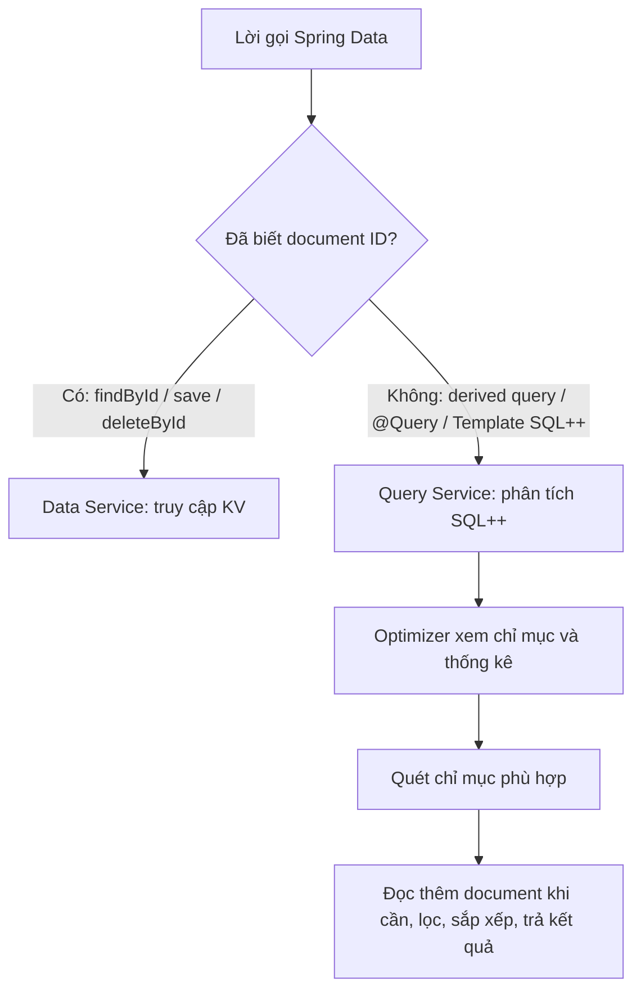

# Vai trò của chỉ mục với truy vấn repository và SQL++ trong Spring Data Couchbase

Trong Couchbase, một truy vấn có điều kiện có thể trả về đúng dữ liệu nhưng vẫn rất chậm nếu hệ thống phải duyệt quá nhiều document. **Chỉ mục (index)** giúp Query Service tìm những document thỏa điều kiện mà không phải quét toàn bộ collection. Với **Spring Data Couchbase**, việc hiểu chỉ mục đặc biệt quan trọng vì các phương thức repository trông đơn giản như `findByCustomerIdAndStatus(...)` thường được chuyển thành truy vấn **SQL++**.

Bài này thuộc chương **Chỉ mục** của module **SPRING_DATA_COUCHBASE**. Trọng tâm là mối liên hệ giữa document mapping, repository, `CouchbaseTemplate`, SQL++, cách chọn chỉ mục và tác động đến hiệu năng, tính nhất quán, chi phí vận hành. Các ví dụ dùng bucket `commerce`, scope `sales`, collection `orders`; hãy đổi các tên này theo môi trường thực tế.

## 1. Mục tiêu học tập

Sau bài học, bạn có thể:

- Phân biệt thao tác **key-value (KV)** theo document ID với truy vấn **SQL++** cần chỉ mục.
- Giải thích vì sao truy vấn repository có thể thất bại hoặc chậm khi thiếu chỉ mục phù hợp.
- Thiết kế chỉ mục thứ cấp, chỉ mục ghép và chỉ mục có điều kiện từ mẫu `WHERE`, `ORDER BY` và `SELECT`.
- Dùng `EXPLAIN` để kiểm tra Couchbase đang chọn chỉ mục nào, có cần đọc document gốc hay sắp xếp bổ sung không.
- Nhận diện tác động của cập nhật document, TTL, tính nhất quán truy vấn và reactive API lên chiến lược đánh chỉ mục.

## 2. Chỉ mục nằm ở đâu trong luồng truy cập dữ liệu?

Couchbase tổ chức dữ liệu theo **bucket → scope → collection → document**. Mỗi document có một **ID duy nhất trong collection** và các trường JSON. Có hai đường truy cập cần phân biệt:

| Cách truy cập | Ví dụ Spring Data | Cách Couchbase tìm dữ liệu | Cần chỉ mục SQL++? |
| --- | --- | --- | --- |
| KV theo ID | `repository.findById("order::1001")`, `save(...)`, `deleteById(...)` | Tra cứu qua khóa document bằng Data Service | **Không** |
| Repository query theo thuộc tính | `findByCustomerIdAndStatus(...)` | Tạo và thực thi SQL++ thông qua Query Service | **Thường có** |
| `@Query` / `CouchbaseTemplate` chạy SQL++ | `WHERE customerId = $1` | Query Service lập kế hoạch dựa trên các chỉ mục khả dụng | **Thường có** |
| SQL++ có `USE KEYS` | `SELECT ... USE KEYS "order::1001"` | Query Service truy cập khóa đã biết | Không cần GSI cho điều kiện theo khóa, nhưng vẫn có chi phí của SQL++ |

> **Ghi nhớ:** `findById` nhanh không có nghĩa `findByStatus` sẽ nhanh. Hai lời gọi có thể đi qua những cơ chế tìm kiếm khác nhau.

Luồng xử lý khái quát:



### Primary index và secondary index

- **Primary index** lập danh sách khóa document để hỗ trợ các truy vấn SQL++ tổng quát. Nó thường hữu ích cho khám phá dữ liệu hoặc môi trường phát triển nhưng có thể dẫn tới quét rất nhiều bản ghi; không nên xem đây là giải pháp mặc định cho truy vấn production.
- **Secondary index / Global Secondary Index (GSI)** tổ chức các giá trị trường JSON để tìm document theo điều kiện, ví dụ `customerId`, `status`, `createdAt`. Đây là công cụ chính để tối ưu phần lớn truy vấn repository theo thuộc tính.
- **Composite index** là secondary index gồm nhiều khóa, theo thứ tự được chỉ định. Thứ tự khóa quyết định những mẫu lọc và sắp xếp nào tận dụng tốt chỉ mục.

Ví dụ tạo primary index cho collection (chỉ để minh họa):

```sql
CREATE PRIMARY INDEX ix_orders_primary
ON `commerce`.`sales`.`orders`;
```

Với hệ thống thực, nên bắt đầu từ **mẫu truy vấn cần phục vụ** rồi tạo secondary index cụ thể.

## 3. Từ document và repository đến truy vấn thực tế

Giả sử collection `commerce.sales.orders` chứa document như sau (ID là `order::1001`):

```json
{
  "_class": "com.example.sales.Order",
  "customerId": "C-42",
  "status": "PAID",
  "createdAt": "2026-11-01T09:00:00Z",
  "total": 950000,
  "items": [
    { "sku": "SKU-9", "quantity": 2 }
  ]
}
```

Ở đây `createdAt` là chuỗi thời gian ISO-8601 được chuẩn hóa về UTC; nếu dùng chuỗi để so sánh/sắp xếp thì cần thống nhất định dạng và múi giờ. Tên và giá trị `_class` là ví dụ về thông tin kiểu mà Spring Data Couchbase có thể lưu để ánh xạ entity; giá trị thực phụ thuộc cấu hình và `@TypeAlias`.

Entity và repository minh họa (lược bỏ constructor, getter/setter):

```java
import java.time.Instant;
import org.springframework.data.annotation.Id;
import org.springframework.data.couchbase.core.mapping.Document;
import org.springframework.data.couchbase.core.mapping.Scope;
import org.springframework.data.couchbase.core.mapping.Collection;
import org.springframework.data.couchbase.repository.CouchbaseRepository;

@Document
@Scope("sales")
@Collection("orders")
public class Order {
    @Id
    private String id;
    private String customerId;
    private String status;
    private Instant createdAt;
    private long total;
}

public interface OrderRepository extends CouchbaseRepository<Order, String> {
    List<Order> findByCustomerIdAndStatusOrderByCreatedAtDesc(
        String customerId, String status
    );
}
```

Ví dụ cần import thêm `java.util.List`; bucket tương ứng được cấu hình ở ứng dụng. Trường và cách lưu thời gian phải nhất quán giữa entity và dữ liệu thực tế.

Khi gọi:

```java
repository.findById("order::1001");
repository.findByCustomerIdAndStatusOrderByCreatedAtDesc("C-42", "PAID");
```

Lời gọi đầu tiên tìm theo ID bằng KV. Lời gọi thứ hai là **derived query**: Spring Data tạo câu SQL++ từ tên phương thức, dùng Query Service và cần kế hoạch truy vấn có thể sử dụng chỉ mục. Hình thức SQL++ thực tế có thể chứa điều kiện phân biệt kiểu entity (chẳng hạn `_class`) và các trường metadata phục vụ mapping; muốn biết chính xác hãy bật logging truy vấn và kiểm tra câu lệnh đã phát sinh.

Một truy vấn SQL++ tương đương về mặt nghiệp vụ:

```sql
SELECT META(o).id AS orderId,
       o.customerId, o.status, o.createdAt, o.total
FROM `commerce`.`sales`.`orders` AS o
WHERE o.customerId = "C-42"
  AND o.status = "PAID"
ORDER BY o.createdAt DESC
LIMIT 20;
```

Giả sử chức năng danh sách đơn hàng luôn lọc theo khách hàng, tiếp theo theo trạng thái, sau đó lấy đơn mới nhất. Một chỉ mục khởi đầu hợp lý là:

```sql
CREATE INDEX ix_orders_customer_status_created
ON `commerce`.`sales`.`orders`(
    `customerId`,
    `status`,
    `createdAt` DESC
);
```

Couchbase có thể định vị dải khóa của khách hàng `C-42`, tiếp tục thu hẹp theo trạng thái `PAID` và tận dụng thứ tự `createdAt` nếu kế hoạch đáp ứng các điều kiện sử dụng thứ tự chỉ mục. Quyết định cuối cùng do optimizer đưa ra: **tạo chỉ mục không đảm bảo mọi truy vấn sẽ chọn nó**.

## 4. Thiết kế chỉ mục từ mẫu truy vấn

### 4.1. Ưu tiên điều kiện lọc và thứ tự khóa

Để chọn khóa cho composite index, hãy xem:

1. **Các điều kiện bằng (`=`)**: tập trường thường được lọc cùng nhau. Trong ví dụ trên, `customerId` thường chọn lọc cao hơn `status`, nên là ứng viên tốt cho khóa dẫn đầu.
2. **Điều kiện khoảng** như `createdAt >= ...`, `< ...` và yêu cầu `ORDER BY`: cân nhắc đặt trường thời gian sau các điều kiện bằng để thu hẹp dải quét và hỗ trợ thứ tự trả về.
3. **Các truy vấn khác dùng chung chỉ mục**: chỉ mục `(customerId, status, createdAt)` hữu ích cho lọc theo `customerId` hoặc `customerId + status`, nhưng không đồng nghĩa tối ưu cho truy vấn **chỉ lọc theo `status`**.
4. **Độ chọn lọc, phân bố dữ liệu và khối lượng ghi**: trường có ít giá trị khác nhau như `status` thường ít chọn lọc khi đứng một mình; mỗi chỉ mục bổ sung cũng phải được duy trì lúc document thay đổi.

Một cách đối chiếu nhu cầu với thiết kế ban đầu:

| Mẫu truy vấn phổ biến | Chỉ mục ứng viên | Lưu ý |
| --- | --- | --- |
| `customerId = ?` | `(customerId)` | Dùng một chỉ mục đơn nếu không có nhu cầu lọc/sắp xếp khác |
| `customerId = ? AND status = ? ORDER BY createdAt DESC` | `(customerId, status, createdAt DESC)` | Phù hợp mẫu danh sách đơn hàng theo khách hàng |
| `status = ? AND createdAt >= ?` | `(status, createdAt)` | Cần cân nhắc riêng nếu trang quản trị lọc toàn bộ đơn theo trạng thái |
| `status = "OPEN" AND customerId = ?` | Partial index với điều kiện `status = "OPEN"` | Hữu ích khi truy vấn cố định nhóm đơn đang mở |
| `ANY i IN items SATISFIES i.sku = ? END` | Array index trên `items[*].sku` | Index thông thường trên trường đầu mảng không thay thế array index đúng mẫu |

Đây là **ứng viên thiết kế**, không phải quy tắc bắt buộc. Nếu ứng dụng có hai màn hình với điều kiện truy vấn khác nhau, có thể cần hai chỉ mục khác nhau. Trước khi tạo, kiểm tra khối lượng dữ liệu, tần suất gọi và `EXPLAIN` của từng mẫu truy vấn.

### 4.2. Partial index cho tập document hay được tìm kiếm

Nếu gần như mọi truy vấn công việc cần các đơn `OPEN`, có thể tạo chỉ mục chỉ gồm nhóm này:

```sql
CREATE INDEX ix_orders_open_customer_created
ON `commerce`.`sales`.`orders`(`customerId`, `createdAt` DESC)
WHERE `status` = "OPEN";
```

Một truy vấn có điều kiện cố định tương ứng:

```sql
SELECT META(o).id, o.customerId, o.createdAt
FROM `commerce`.`sales`.`orders` AS o
WHERE o.status = "OPEN"
  AND o.customerId = "C-42"
ORDER BY o.createdAt DESC;
```

Để optimizer chọn partial index, điều kiện truy vấn cần **hàm ý được predicate của chỉ mục**. Với điều kiện thay đổi động như `status = $status`, đặc biệt khi lập kế hoạch prepared statement, không nên mặc định rằng partial index có thể được dùng cho mọi giá trị; kiểm tra kế hoạch trên câu truy vấn thực tế. Partial index giảm phạm vi document được đánh chỉ mục nhưng không phục vụ truy vấn không thỏa predicate.

### 4.3. Array index cho dữ liệu lồng nhau

Khi tìm đơn hàng theo SKU nằm trong mảng `items`, cần xem xét array index:

```sql
CREATE INDEX ix_orders_item_sku
ON `commerce`.`sales`.`orders`(
    DISTINCT ARRAY item.sku FOR item IN items END
);

SELECT META(o).id AS orderId
FROM `commerce`.`sales`.`orders` AS o
WHERE ANY item IN o.items SATISFIES item.sku = "SKU-9" END;
```

Biểu thức của array index và biểu thức `ANY ... SATISFIES ... END` cần tương thích để optimizer có thể khai thác chỉ mục. Trường hợp array phức tạp hoặc kết hợp thêm `status`, phải kiểm chứng bằng `EXPLAIN` thay vì giả định index sẽ khớp.

### 4.4. Covering index: giảm số lần đọc document gốc

Chỉ mục có thể chứa đủ trường mà truy vấn cần trả về, giúp kế hoạch tránh bước lấy JSON từ Data Service (**covering index**). Ví dụ với một màn hình chỉ cần `customerId`, `status`, `createdAt`, `total`:

```sql
CREATE INDEX ix_orders_list_cover
ON `commerce`.`sales`.`orders`(
    `customerId`, `status`, `createdAt` DESC, `total`
);

SELECT o.customerId, o.status, o.createdAt, o.total
FROM `commerce`.`sales`.`orders` AS o
WHERE o.customerId = "C-42" AND o.status = "PAID"
ORDER BY o.createdAt DESC
LIMIT 20;
```

Chỉ gọi là *covering* sau khi xem kế hoạch và xác nhận những trường cần thiết đều được cung cấp từ index, không có bước `Fetch` không cần thiết. Một repository trả về **entity đầy đủ** thường cần thêm nhiều trường/metadata để ánh xạ, vì vậy chỉ mục không mặc nhiên cover được truy vấn của repository. Thêm quá nhiều trường vào index làm tăng kích thước và chi phí bảo trì; ưu tiên những màn hình đọc rất nhiều nhưng chỉ cần một projection nhỏ.

## 5. `@Query` và `CouchbaseTemplate` có thay đổi yêu cầu về chỉ mục không?

Không. **Cơ chế truy vấn phụ thuộc vào SQL++ được gửi tới Couchbase**, không phụ thuộc vào việc câu lệnh đến từ derived repository, `@Query` hay `CouchbaseTemplate`.

Ví dụ repository dùng `@Query` để kiểm soát điều kiện và giới hạn kết quả:

```java
import java.util.List;
import org.springframework.data.couchbase.repository.Query;

public interface OrderRepository extends CouchbaseRepository<Order, String> {
    @Query("#{#n1ql.selectEntity} WHERE #{#n1ql.filter} " +
           "AND customerId = $1 AND status = $2 " +
           "ORDER BY createdAt DESC LIMIT 20")
    List<Order> findLatestOrders(String customerId, String status);
}
```

Ở đây `#{#n1ql.selectEntity}` và `#{#n1ql.filter}` là các biểu thức hỗ trợ mapping của Spring Data Couchbase: chúng giúp tạo phần `SELECT`/`FROM` và bộ lọc entity phù hợp với ngữ cảnh. Chúng **không** tự tạo chỉ mục. Dùng tham số `$1`, `$2` để truyền giá trị thay vì nối trực tiếp chuỗi nhập từ người dùng vào SQL++.

Tương tự, nếu dùng `CouchbaseTemplate` thực thi SQL++ qua phương thức query của phiên bản Spring Data đang dùng, lệnh đó vẫn đi qua Query Service và optimizer. Tách riêng quyết định về API trong ứng dụng khỏi quyết định thiết kế GSI; dùng `EXPLAIN` trên SQL++ thực tế để đánh giá.

### Điều kiện `_class` trong Spring Data

Spring Data Couchbase có thể lưu thông tin kiểu entity trong `_class`, và câu SQL++ do repository sinh ra có thể thêm một bộ lọc theo kiểu này. Điều đó tạo ra hai câu hỏi khi thiết kế chỉ mục:

- Collection chứa **một kiểu document hay nhiều kiểu**? Nếu có nhiều kiểu, bộ lọc `_class` có thể làm thay đổi số document cần quét.
- Liệu kế hoạch chỉ dùng index của các trường nghiệp vụ hay sẽ có lợi khi thêm `_class` vào composite index? Chỉ đưa `_class` vào khi truy vấn phát sinh, dữ liệu và `EXPLAIN` cho thấy điều này có ích; đừng cố định một thứ tự khóa chỉ vì ví dụ code.

Khi so sánh truy vấn tự viết trong Query Workbench với repository, nhớ kiểm tra **cả điều kiện kiểu, projection và cách phân trang** để không kết luận sai về hiệu năng.

## 6. Dùng `EXPLAIN` để biết chỉ mục có được sử dụng

Ví dụ kiểm tra kế hoạch của truy vấn danh sách đơn hàng:

```sql
EXPLAIN
SELECT META(o).id AS orderId,
       o.customerId, o.status, o.createdAt, o.total
FROM `commerce`.`sales`.`orders` AS o
WHERE o.customerId = "C-42"
  AND o.status = "PAID"
ORDER BY o.createdAt DESC
LIMIT 20;
```

Trong JSON kế hoạch, hãy tìm các dấu hiệu sau (tên operator có thể khác giữa phiên bản Couchbase):

| Dấu hiệu trong kế hoạch | Ý nghĩa cần kiểm tra |
| --- | --- |
| `IndexScan` / `IndexScan3` | Có quét index nào, tên index có đúng thiết kế hay không? |
| `PrimaryScan` hoặc quét primary index | Truy vấn đang xét tập document rộng; cân nhắc secondary index đúng mẫu |
| `spans` / điều kiện quét index | Index đã giới hạn theo `customerId`, `status` chưa, hay đang quét gần như toàn bộ? |
| `Fetch` | Có phải đọc JSON gốc vì index không cover đủ trường? |
| `Order` / bước sort | Có phải sắp xếp kết quả bổ sung dù index chứa `createdAt`? |
| `Filter`, `Limit` | Điều kiện còn áp dụng sau scan và giới hạn hàng trả về ở đâu? |

Ngoài `EXPLAIN`, dùng **Query Workbench/Query Profile** hoặc cơ chế thu thập metrics có sẵn để xem số hàng index quét, số document đọc, thời gian thực thi, thời gian chờ và mức sử dụng tài nguyên. Chạy với dữ liệu đại diện: khi chỉ có 10 document, một phương án quét toàn bộ có thể trông vẫn nhanh nhưng sẽ xuống cấp khi số lượng tăng lớn.

Truy vấn metadata giúp xem tên và trạng thái chỉ mục:

```sql
SELECT name, state, index_key, condition
FROM system:indexes
WHERE bucket_id = "commerce"
  AND scope_id = "sales"
  AND keyspace_id = "orders";
```

Chỉ mục cần ở trạng thái khả dụng, thường là `online`, trước khi kỳ vọng truy vấn sử dụng. Việc vừa phát lệnh `CREATE INDEX` không có nghĩa quá trình build và đồng bộ index đã hoàn tất ngay lập tức.

## 7. Hiệu năng, tính nhất quán và vận hành chỉ mục

### 7.1. Chỉ mục tăng tốc đọc nhưng làm phát sinh chi phí ghi

Khi insert, update hoặc delete document, Couchbase phải cập nhật các mục index tương ứng. Tạo nhiều index trùng lặp có thể làm tăng dung lượng, bộ nhớ, tài nguyên Index Service và độ trễ cập nhật. Một index ghép tốt đôi khi thay được một số index đơn, nhưng không có quy tắc rằng ít index nhất luôn tối ưu: cần cân bằng **độ trễ đọc, tốc độ ghi, dung lượng và các mẫu truy vấn thật**.

TTL cũng liên quan trực tiếp: document hết hạn sẽ không còn là bản ghi hợp lệ để truy vấn; quá trình xử lý hết hạn và cập nhật index diễn ra theo cơ chế nội bộ. Không nên thiết kế nghiệp vụ yêu cầu lập tức nhìn thấy việc hết hạn trong mọi truy vấn SQL++ mà không xét độ trễ cập nhật chỉ mục và mức nhất quán.

### 7.2. Scan consistency khác với việc có index

Một truy vấn SQL++ chạy với mức nhất quán mặc định thường ưu tiên tốc độ và có thể **chưa nhìn thấy ngay** mutation vừa hoàn tất do index cập nhật bất đồng bộ. Hai mức thường gặp:

- `NOT_BOUNDED`: không đợi index bắt kịp mutation; độ trễ thường thấp hơn nhưng kết quả có thể tạm thời cũ.
- `REQUEST_PLUS`: đợi index bắt kịp các mutation liên quan trước khi thực thi truy vấn; giúp đọc dữ liệu mới hơn nhưng có thể tăng thời gian chờ.

Ví dụ một service vừa `save(order)` rồi query `findByStatus(...)`: truy vấn có thể chưa phản ánh ngay document mới với thiết lập nhất quán mặc định. Nếu chỉ cần đọc lại **chính document vừa ghi**, hãy cân nhắc KV `findById` theo khóa đã biết. Nếu cần một truy vấn lọc tập nhiều document và đòi hỏi tính mới của dữ liệu, cấu hình scan consistency tương ứng trong API Spring Data/Couchbase SDK của phiên bản đang sử dụng và đo tác động độ trễ.

**CAS**, giao dịch và scan consistency giải quyết những vấn đề khác nhau: CAS bảo vệ cập nhật cạnh tranh trên một document; giao dịch xử lý phạm vi thao tác cần tính nguyên tử; scan consistency quyết định dữ liệu cập nhật đến đâu khi Query Service đọc từ index. Có index đúng không tự làm truy vấn nhất quán tức thì.

### 7.3. Reactive API không thay thế index

`ReactiveCouchbaseRepository` và các API reactive giúp ứng dụng điều phối I/O và backpressure hiệu quả hơn khi có nhiều lời gọi đồng thời. Tuy nhiên, một truy vấn SQL++ quét quá nhiều index entry vẫn gây tải lớn cho Query/Index Service dù kết quả được phát qua `Flux` hoặc `Mono`. Tối ưu **predicate, index, projection, limit và phân trang** trước khi kỳ vọng reactive cải thiện thời gian xử lý một truy vấn tốn kém.

### 7.4. Quản trị vòng đời index

Đối với production, nên:

1. Xác định các truy vấn theo màn hình/API, tần suất, bộ lọc và yêu cầu độ trễ; ưu tiên truy vấn nóng.
2. Tạo và quản lý index bằng quy trình thay đổi có kiểm soát theo môi trường, không dựa vào việc ứng dụng tự tạo primary index mỗi lần khởi động.
3. Theo dõi quá trình build, trạng thái `online`, dung lượng index và tài nguyên Index Service; cân nhắc phương án replica/phân vùng theo phiên bản và quy mô cụm.
4. Đo trước và sau khi thay đổi bằng query profile/metrics trên dữ liệu đủ lớn, đồng thời theo dõi ảnh hưởng tới ghi.
5. Chỉ gỡ index cũ sau khi xác minh không còn truy vấn hoặc dịch vụ nào dùng tới nó.

## 8. Các lỗi thường gặp và cách sửa

| Hiện tượng | Nguyên nhân thường gặp | Hướng xử lý |
| --- | --- | --- |
| `findById` nhanh, `findByStatus` chậm hoặc báo không có index | KV không dùng GSI, còn truy vấn thuộc tính cần index | Xem SQL++ được sinh, tạo secondary index theo predicate, chạy `EXPLAIN` |
| Có primary index nhưng query càng ngày càng chậm | Truy vấn vẫn quét phần lớn collection | Tạo composite index phù hợp mẫu `WHERE` + `ORDER BY` |
| Tạo index rồi mà plan không chọn | Thứ tự khóa không hợp, predicate không phù hợp, index chưa `online`, hoặc optimizer đánh giá kế hoạch khác tốt hơn | Kiểm tra `system:indexes`, `spans`, predicate thực tế và thống kê/metrics |
| Query Workbench nhanh hơn repository | Repository có thể thêm `_class`, lấy toàn entity hoặc phân trang khác | So sánh **đúng SQL++**, tham số và projection do ứng dụng gửi |
| Query trả dữ liệu cũ ngay sau `save` | Index update bất đồng bộ và mức scan consistency | Đánh giá `REQUEST_PLUS` hoặc đọc KV theo ID tùy nhu cầu |
| Thêm nhiều index nhưng write throughput giảm | Mỗi index tạo thêm công việc duy trì | Gom/tránh index trùng lặp sau khi đo workload |
| Có index chứa `createdAt` nhưng vẫn phải sort | Thứ tự khóa, điều kiện khoảng hoặc `ORDER BY` không tương thích với đường quét | Kiểm tra toán tử `Order` trong `EXPLAIN`; thiết kế lại thứ tự khóa theo truy vấn |

## 9. Bài thực hành: chọn chỉ mục cho ba endpoint

Giả sử API bán hàng có ba endpoint:

- `GET /orders/{id}`: đọc một đơn hàng theo ID.
- `GET /customers/{customerId}/orders?status=PAID`: xem đơn đã thanh toán của một khách hàng theo thời gian mới nhất.
- `GET /admin/orders?status=OPEN&from=...`: xem toàn bộ đơn đang mở kể từ thời điểm chỉ định.

**Bước 1 — Xác định đường truy cập.** Endpoint đầu dùng KV, chưa cần GSI. Hai endpoint sau dùng SQL++ vì lọc theo trường nghiệp vụ.

**Bước 2 — Đề xuất index.** Cho endpoint thứ hai, thử `(customerId, status, createdAt DESC)`. Cho endpoint thứ ba, thử `(status, createdAt)` hoặc một partial index nếu trạng thái `OPEN` là cố định, phổ biến và kế hoạch chứng minh phù hợp. Không mặc định index của endpoint thứ hai sẽ tối ưu endpoint thứ ba vì khóa dẫn đầu là `customerId`.

**Bước 3 — Kiểm tra truy vấn.** Chạy `EXPLAIN` cho từng SQL++ với dữ liệu thực tế, quan sát index được chọn, dải scan, `Fetch`, sort và số bản ghi xử lý. So sánh độ trễ trước/sau khi tạo index. Nếu Spring Data thêm bộ lọc `_class`, phải chạy lại `EXPLAIN` trên câu lệnh tương ứng.

**Bước 4 — Xem xét khả năng vận hành.** Nếu hệ thống ghi đơn thường xuyên, đo thêm chi phí duy trì index. Nếu endpoint vừa ghi xong rồi lập tức truy vấn danh sách, chọn scan consistency theo yêu cầu nghiệp vụ; nếu chỉ đọc lại một đơn đã biết ID, dùng KV là hợp lý hơn.

### Câu hỏi tự kiểm tra

1. Vì sao `repository.findById(id)` không cần secondary index nhưng `findByCustomerId(id)` thường cần?
2. Khi truy vấn lọc theo `customerId` và `status`, rồi sắp xếp theo `createdAt DESC`, chỉ mục `(status, createdAt)` còn thiếu gì so với `(customerId, status, createdAt DESC)`?
3. Tại sao một index chứa đủ các trường trong `WHERE` vẫn có thể xuất hiện bước `Fetch` hoặc `Order` trong kế hoạch?
4. Vì sao `REQUEST_PLUS` có thể ảnh hưởng đến thời gian phản hồi dù index đã được thiết kế tốt?
5. Khi nào nên cân nhắc một array index hoặc partial index thay vì thêm một secondary index đơn thông thường?

**Kết luận:** Trong Spring Data Couchbase, hiệu năng của repository query được quyết định phần lớn bởi SQL++ thực tế, thiết kế chỉ mục và cách Query Service lập kế hoạch. Hãy chọn KV khi đã biết document ID; với truy vấn theo thuộc tính, đi từ mẫu `WHERE`/`ORDER BY`/`SELECT` đến chỉ mục, sau đó xác nhận bằng `EXPLAIN` và metrics trong điều kiện dữ liệu đại diện.
