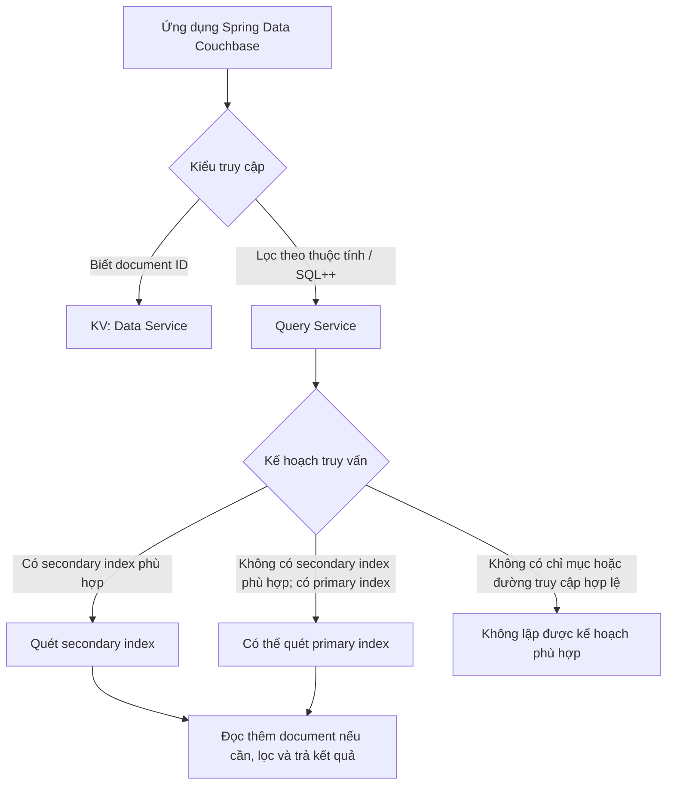

# Primary index và secondary index trong Spring Data Couchbase

Trong Couchbase, việc đọc document bằng khóa và việc tìm document bằng điều kiện SQL++ là hai cách truy cập dữ liệu khác nhau. Ứng dụng sử dụng **Spring Data Couchbase** có thể gọi `findById(...)` rất nhanh nhưng gặp lỗi thiếu chỉ mục, hoặc mất nhiều thời gian, khi gọi `findByEmail(...)`. Một nguyên nhân thường gặp là chưa phân biệt rõ **primary index** và **secondary index**.

Bài học thuộc chương **Chỉ mục** của module **SPRING_DATA_COUCHBASE**, tập trung vào cách hai loại chỉ mục phục vụ Query Service, mối liên hệ với repository và `CouchbaseTemplate`, cũng như các quyết định cần cân nhắc khi thiết kế bucket/scope/collection và vận hành hệ thống. Kiến thức này là nền tảng để lựa chọn chỉ mục theo truy vấn SQL++, tối ưu hiệu năng và xử lý yêu cầu nhất quán trong ứng dụng có TTL, CAS, giao dịch hoặc API reactive.

## 1. Mục tiêu học tập

Sau bài này, bạn có thể:

1. Phân biệt **document ID**, **primary index** và **secondary index**; hiểu vì sao chỉ mục trong SQL++ không giống ràng buộc khóa chính của cơ sở dữ liệu quan hệ.
2. Tạo primary index và secondary index cho một collection bằng SQL++, biết cách đọc ý nghĩa của từng câu lệnh.
3. Chọn chỉ mục thứ cấp đơn, chỉ mục ghép hoặc chỉ mục có điều kiện từ các mẫu truy vấn repository.
4. Xác định bằng `EXPLAIN` truy vấn có đang quét primary index hay secondary index và liệu có cần đọc document gốc.
5. Giải thích ảnh hưởng của chỉ mục lên chi phí ghi, việc cập nhật bất đồng bộ, tính nhất quán và khả năng mở rộng.

## 2. Bối cảnh: document, khóa và Query Service

Giả sử dữ liệu khách hàng được lưu trong:

| Cấp tổ chức | Giá trị ví dụ | Ý nghĩa |
| --- | --- | --- |
| Bucket | `app` | Vùng dữ liệu logic và cấu hình lưu trữ |
| Scope | `identity` | Nhóm các collection liên quan đến định danh |
| Collection | `customers` | Nơi lưu các document khách hàng |
| Document ID | `customer::1001` | Khóa duy nhất của document bên trong collection |

Một document có ID `customer::1001` có thể chứa:

```json
{
  "_class": "com.example.identity.Customer",
  "tenantId": "TENANT-A",
  "email": "linh@example.com",
  "status": "ACTIVE",
  "registeredAt": "2026-11-01T08:30:00Z",
  "loyaltyPoints": 120
}
```

`_class` minh họa metadata kiểu mà Spring Data Couchbase có thể sử dụng để ánh xạ entity; tên field/giá trị thực tế phụ thuộc cấu hình và cách dùng `@TypeAlias`. Trong các ví dụ, `registeredAt` là thời gian dạng ISO-8601 chuẩn hóa về UTC; nếu dùng chuỗi để lọc khoảng hoặc sắp xếp, tất cả document cần lưu nhất quán định dạng.

Ba khái niệm dễ bị nhầm lẫn:

- **Document ID:** khóa nhận diện document; tính duy nhất của ID trong collection được hệ thống KV quản lý. Các thao tác KV tìm bằng ID **không cần** primary index SQL++.
- **Primary index:** chỉ mục dành cho **Query Service** để truy xuất tập khóa document trong một collection, kể cả khi truy vấn SQL++ không có điều kiện phù hợp với secondary index.
- **Secondary index:** chỉ mục dành cho **Query Service**, được tổ chức theo giá trị của một hoặc nhiều biểu thức trên document (ví dụ `email`, `tenantId`, `status`).

Trong Couchbase, primary index là một dạng chỉ mục của hệ thống Index Service phục vụ SQL++, không phải thao tác tạo ràng buộc `PRIMARY KEY` của SQL quan hệ. Xóa hoặc không tạo primary index **không làm mất tính duy nhất của document ID** và không cản trở thao tác KV theo ID.



Luồng trên chỉ mô tả trường hợp phổ biến. SQL++ còn có những đường truy cập khác, chẳng hạn `USE KEYS` khi khóa đã biết. Optimizer quyết định kế hoạch dựa trên truy vấn, chỉ mục sẵn có và các yếu tố thống kê/chi phí.

## 3. Primary index: quét theo tập document của collection

### 3.1. Tạo primary index

Ví dụ SQL++:

```sql
CREATE PRIMARY INDEX ix_customers_primary
ON `app`.`identity`.`customers`;
```

Tên chỉ mục `ix_customers_primary` là do nhóm phát triển đặt. Câu lệnh tạo primary index trên **collection** `app.identity.customers`; nó không tự động tạo primary index cho mọi collection khác trong bucket.

Nếu cần duyệt dữ liệu để khám phá, có thể chạy:

```sql
SELECT META(c).id AS id, c.email, c.status
FROM `app`.`identity`.`customers` AS c
LIMIT 10;
```

Primary index giúp Query Service có một đường tìm đến các document dù truy vấn không chỉ định trường để lọc. Điều này tiện khi khám phá cấu trúc dữ liệu, kiểm tra nhanh dữ liệu hoặc làm thử nghiệm ban đầu.

### 3.2. Vì sao primary index thường không phù hợp cho truy vấn nhiều dữ liệu?

Xét truy vấn:

```sql
SELECT META(c).id AS id, c.email
FROM `app`.`identity`.`customers` AS c
WHERE c.email = "linh@example.com";
```

Khi **chỉ có primary index**, Query Service có thể phải đi qua rất nhiều ID rồi đọc nội dung document để kiểm tra `email`. Primary index không có cấu trúc tra cứu được tổ chức theo `email`, nên không thể thu hẹp trực tiếp tới địa chỉ email bằng khóa của primary index.

Nếu collection chỉ có vài trăm document, sự chênh lệch có thể khó nhận ra. Với hàng triệu document và truy vấn lặp lại nhiều lần, việc quét phạm vi lớn rồi lọc khiến tiêu thụ CPU, I/O và thời gian phản hồi tăng. `LIMIT 10` hạn chế số kết quả trả về nhưng **không đảm bảo** Query Service chỉ cần xem đúng 10 document để thỏa điều kiện.

Các điểm cần nhớ:

- Primary index thường giúp truy vấn SQL++ tổng quát có thể chạy, nhưng không đồng nghĩa truy vấn đó đã tối ưu.
- Nếu không có primary index và cũng không có đường truy cập/chỉ mục phù hợp, Query Service có thể báo lỗi không tìm được index cho keyspace.
- Primary index **không** thay thế thứ tự khóa của composite index và không cung cấp cơ chế tìm theo giá trị trường JSON.
- Trong production, tạo primary index một cách tùy tiện có thể che giấu các mẫu truy vấn thiếu secondary index.

**Lưu ý quan trọng:** Khi repository gọi `findById("customer::1001")`, SDK thường dùng thao tác KV với Data Service. Lệnh này **không quét primary index**. Tên “primary” dễ khiến người học liên tưởng nó phục vụ tất cả thao tác theo khóa chính; thực tế ý nghĩa của nó gắn với truy vấn SQL++.

## 4. Secondary index: tìm theo thuộc tính của document

### 4.1. Secondary index một trường

Nếu API thường tìm khách hàng theo email, tạo chỉ mục theo `email`:

```sql
CREATE INDEX ix_customers_email
ON `app`.`identity`.`customers`(`email`);
```

Truy vấn:

```sql
SELECT META(c).id AS id, c.email, c.status
FROM `app`.`identity`.`customers` AS c
WHERE c.email = "linh@example.com";
```

Chỉ mục này cho phép optimizer tìm phạm vi mục index có `email` bằng giá trị yêu cầu. Nếu kế hoạch chọn index, lượng document cần xét có thể nhỏ hơn rất nhiều so với quét primary index.

Một số lưu ý chính xác về dữ liệu:

- Secondary index thường được gọi là **Global Secondary Index (GSI)** trong Couchbase; một index lưu các entry cho giá trị biểu thức đã chọn.
- Một secondary index một trường **không áp đặt tính duy nhất** của giá trị `email`. Hai document vẫn có thể có email giống nhau nếu ứng dụng không kiểm soát riêng.
- Với GSI thông thường, document không có giá trị (**`MISSING`**) ở khóa index dẫn đầu có thể không được đưa vào index. Đừng giả định truy vấn tìm document thiếu trường được phục vụ như truy vấn `email = ...`; cách xử lý `MISSING` còn phụ thuộc định nghĩa chỉ mục và phiên bản Couchbase.
- Query Service không bắt buộc phải chọn index vừa tạo nếu đánh giá kế hoạch khác phù hợp hơn. Hãy kiểm tra bằng `EXPLAIN`.

### 4.2. Composite index: nhiều trường theo thứ tự

Giả sử giao diện quản lý khách hàng thường lọc `tenantId` và `status`, rồi hiển thị khách hàng đăng ký mới nhất.

```sql
SELECT META(c).id AS id, c.email, c.registeredAt
FROM `app`.`identity`.`customers` AS c
WHERE c.tenantId = "TENANT-A"
  AND c.status = "ACTIVE"
ORDER BY c.registeredAt DESC
LIMIT 20;
```

Chỉ mục ứng viên:

```sql
CREATE INDEX ix_customers_tenant_status_registered
ON `app`.`identity`.`customers`(
  `tenantId`,
  `status`,
  `registeredAt` DESC
);
```

Ở đây:

1. `tenantId` là khóa đầu: phù hợp các truy vấn luôn giới hạn trong một tenant.
2. `status` đứng tiếp theo: giúp thu hẹp các entry trong tenant đó.
3. `registeredAt DESC` hỗ trợ tìm khách hàng gần đây và có thể phục vụ thứ tự của `ORDER BY` khi các điều kiện khác tương thích.

Một index `(tenantId, status, registeredAt)` **không tương đương** index `(status, tenantId, registeredAt)` cho mọi truy vấn. Ví dụ, truy vấn chỉ lọc `status = "ACTIVE"` không chắc khai thác hiệu quả index có `tenantId` làm khóa dẫn đầu.

Để chọn thứ tự khóa, hãy xét **điều kiện bằng**, **điều kiện khoảng**, **thứ tự sắp xếp**, **độ chọn lọc của dữ liệu**, và **tần suất xuất hiện của mẫu truy vấn**. Thứ tự nào tốt nhất cần được đánh giá bằng dữ liệu đại diện, `EXPLAIN` và metrics; không có một quy tắc đơn giản áp dụng cho mọi workload.

### 4.3. Partial index: chỉ lập chỉ mục cho nhóm document

Nếu tác vụ thường xem khách hàng đang hoạt động, có thể tạo một **partial index**:

```sql
CREATE INDEX ix_customers_active_tenant_registered
ON `app`.`identity`.`customers`(
  `tenantId`,
  `registeredAt` DESC
)
WHERE `status` = "ACTIVE";
```

Index này chứa các entry cho document thỏa predicate `status = "ACTIVE"`. Nó có thể ít entry hơn index bao phủ cả collection, từ đó tiết kiệm tài nguyên và giúp truy vấn phù hợp quét ít dữ liệu hơn.

```sql
SELECT c.tenantId, c.registeredAt, c.email
FROM `app`.`identity`.`customers` AS c
WHERE c.status = "ACTIVE"
  AND c.tenantId = "TENANT-A"
ORDER BY c.registeredAt DESC;
```

Truy vấn cần có điều kiện **hàm ý được** predicate của partial index thì optimizer mới có cơ sở dùng nó. Nếu `status` là tham số động của prepared query, việc lập kế hoạch và khả năng chọn partial index phụ thuộc truy vấn thực tế; cần chạy `EXPLAIN` trên trường hợp triển khai, không mặc định index áp dụng cho mọi giá trị status.

### 4.4. Covering index: đọc dữ liệu ngay từ index

Một index được gọi là **covering** đối với truy vấn cụ thể khi nó có đủ thông tin để thực hiện truy vấn mà không phải `Fetch` JSON của document gốc từ Data Service.

Ví dụ giao diện chỉ cần `tenantId`, `status`, `registeredAt` và `email`:

```sql
CREATE INDEX ix_customers_list_cover
ON `app`.`identity`.`customers`(
  `tenantId`,
  `status`,
  `registeredAt` DESC,
  `email`
);

SELECT c.tenantId, c.status, c.registeredAt, c.email
FROM `app`.`identity`.`customers` AS c
WHERE c.tenantId = "TENANT-A"
  AND c.status = "ACTIVE"
ORDER BY c.registeredAt DESC
LIMIT 20;
```

Với projection như trên, optimizer **có thể** tạo kế hoạch cover bằng index này. Tuy nhiên, nếu repository cần trả toàn bộ entity hoặc có thêm bộ lọc theo `_class`, một số thuộc tính cần thiết có thể chưa nằm trong index; khi đó vẫn có thể xuất hiện `Fetch`. Xác nhận qua kế hoạch thực tế trước khi gọi là covering index.

Thêm trường vào index cũng làm entry lớn hơn và tăng chi phí cập nhật. Chỉ nên thiết kế covering index cho các truy vấn đọc thường xuyên và thật sự được lợi từ việc giảm `Fetch`.

## 5. So sánh primary index và secondary index

| Tiêu chí | Primary index | Secondary index |
| --- | --- | --- |
| Dữ liệu tra cứu chính | Khóa document để duyệt tập document của collection | Giá trị của một hoặc nhiều biểu thức trên document |
| Ví dụ tạo | `CREATE PRIMARY INDEX ... ON collection` | `CREATE INDEX ... ON collection(field1, field2)` |
| Truy vấn phù hợp | Khám phá dữ liệu hoặc truy vấn SQL++ tổng quát không có index cụ thể | Lọc, sắp xếp và projection theo mẫu truy vấn đã biết |
| Khả năng thu hẹp theo `email = ?` | Thường phải kiểm tra nhiều document | Có thể định vị dải index theo `email` |
| Có hỗ trợ truy cập KV bằng ID không? | KV **không cần** primary index | KV **không cần** secondary index |
| Số lượng/kiểu khóa | Đặc biệt cho khóa document | Một trường, nhiều trường, biểu thức, partial/array index |
| Chi phí duy trì | Có; index cần cập nhật khi dữ liệu thay đổi | Có; phụ thuộc số index, số trường và khối lượng ghi |
| Khuyến nghị production | Tránh phụ thuộc như giải pháp chung cho các truy vấn nghiệp vụ | Thiết kế theo các mẫu `WHERE`, `ORDER BY` và `SELECT` thực tế |

**Không nên hiểu “primary index nhanh hơn secondary index vì là primary”.** Tên chỉ mục nói lên đường truy cập, không phải cấp độ ưu tiên hay bảo đảm tốc độ. Với truy vấn có điều kiện chọn lọc trên trường JSON, secondary index đúng mẫu thường hiệu quả hơn nhiều.

## 6. Liên hệ trực tiếp với Spring Data Couchbase

### 6.1. Repository có thể dùng hai đường truy cập khác nhau

Entity minh họa:

```java
import java.time.Instant;
import org.springframework.data.annotation.Id;
import org.springframework.data.couchbase.core.mapping.Collection;
import org.springframework.data.couchbase.core.mapping.Document;
import org.springframework.data.couchbase.core.mapping.Scope;

@Document
@Scope("identity")
@Collection("customers")
public class Customer {
    @Id
    private String id;
    private String tenantId;
    private String email;
    private String status;
    private Instant registeredAt;
    // Constructor, getter/setter được lược bỏ.
}
```

Repository:

```java
import java.util.List;
import java.util.Optional;
import org.springframework.data.couchbase.repository.CouchbaseRepository;

public interface CustomerRepository
        extends CouchbaseRepository<Customer, String> {

    Optional<Customer> findByEmail(String email);

    List<Customer> findByTenantIdAndStatusOrderByRegisteredAtDesc(
        String tenantId, String status
    );
}
```

Khi gọi repository:

```java
repository.findById("customer::1001");
repository.findByEmail("linh@example.com");
repository.findByTenantIdAndStatusOrderByRegisteredAtDesc(
    "TENANT-A", "ACTIVE"
);
```

- `findById`: đã biết ID, thường dùng đường KV; **không cần** index SQL++.
- `findByEmail`: derived query theo thuộc tính, thường thực thi dưới dạng SQL++; secondary index `(email)` là ứng viên.
- `findByTenantIdAndStatusOrderByRegisteredAtDesc`: derived query có nhiều predicate và thứ tự; composite index `(tenantId, status, registeredAt DESC)` là ứng viên.

Cấu hình ứng dụng xác định bucket `app`; annotation cho scope/collection xác định nơi entity được ánh xạ. Nếu repository truy vấn nhầm collection, một index được tạo đúng kiểu nhưng trên **collection khác** vẫn không giúp được.

### 6.2. `@Query` và `CouchbaseTemplate` không tự tạo index

Có thể kiểm soát điều kiện SQL++ trong repository bằng `@Query`:

```java
import java.util.List;
import org.springframework.data.couchbase.repository.Query;

public interface CustomerRepository
        extends CouchbaseRepository<Customer, String> {

    @Query("#{#n1ql.selectEntity} WHERE #{#n1ql.filter} " +
           "AND tenantId = $1 AND status = $2 " +
           "ORDER BY registeredAt DESC LIMIT 20")
    List<Customer> findRecentCustomers(String tenantId, String status);
}
```

Hai biểu thức `#{#n1ql.selectEntity}` và `#{#n1ql.filter}` là các tiện ích SQL++ của Spring Data Couchbase, giúp truy vấn phù hợp với ánh xạ entity. Các tham số `$1`, `$2` truyền giá trị theo vị trí, tránh ghép chuỗi nhập từ bên ngoài vào câu SQL++.

Nếu dùng `CouchbaseTemplate` để dựng và thực thi truy vấn theo điều kiện, SQL++ vẫn do Query Service lập kế hoạch dựa trên các index thực có. **API nào phát sinh SQL++ không quyết định index được sử dụng; nội dung truy vấn và cấu trúc index mới là yếu tố then chốt.**

Spring Data Couchbase có thể thêm điều kiện phân biệt loại entity theo `_class` hoặc tên alias kiểu đã cấu hình. Bởi vậy, khi đánh giá secondary index, phải xem **câu SQL++ thực tế** từ ứng dụng, kể cả projection và điều kiện bổ sung; truy vấn SQL++ viết tay không luôn tương đương derived query.

### 6.3. Reactive repository cũng dùng các nguyên tắc này

```java
import reactor.core.publisher.Flux;
import org.springframework.data.couchbase.repository.ReactiveCouchbaseRepository;

public interface ReactiveCustomerRepository
        extends ReactiveCouchbaseRepository<Customer, String> {

    Flux<Customer> findByTenantIdAndStatus(
        String tenantId, String status
    );
}
```

API reactive giúp ứng dụng điều phối I/O và dữ liệu trả về không đồng bộ. Nó **không loại bỏ** công việc quét index tại Query/Index Service. Một derived query sai index vẫn có thể tiêu tốn nhiều tài nguyên, dù kiểu trả về là `Flux<Customer>`. Chọn index theo truy vấn trước, rồi đánh giá lợi ích của API reactive theo tải đồng thời và cách xử lý luồng kết quả.

## 7. Kiểm tra bằng `EXPLAIN`: Query Service thực sự dùng index nào?

Sau khi tạo index, hãy phân tích kế hoạch của câu SQL++ tương đương với repository:

```sql
EXPLAIN
SELECT c.email, c.status, c.registeredAt
FROM `app`.`identity`.`customers` AS c
WHERE c.tenantId = "TENANT-A"
  AND c.status = "ACTIVE"
ORDER BY c.registeredAt DESC
LIMIT 20;
```

Trong kế hoạch JSON, tên toán tử có thể khác giữa các phiên bản Couchbase. Đọc theo các câu hỏi:

| Dấu hiệu | Cần tìm hiểu |
| --- | --- |
| `PrimaryScan` / `PrimaryScan3` | Có đang dựa vào primary index để duyệt tập document rộng không? |
| `IndexScan` / `IndexScan3` | Secondary index nào đang được chọn? Có khớp index mong đợi không? |
| `spans` hoặc điều kiện scan | Index có giới hạn được theo `tenantId` và `status` không? |
| `Fetch` | Query Service có đọc thêm document gốc vì index chưa cover query không? |
| `Filter` | Còn bao nhiêu điều kiện phải áp dụng sau khi quét index? |
| `Order` | Có phải sắp xếp thêm dù index có `registeredAt` không? |
| `Limit` | Giới hạn kết quả được thực thi ở đâu trong kế hoạch? |

Để xem chỉ mục đang được khai báo và trạng thái:

```sql
SELECT name, state, is_primary, index_key, condition
FROM system:indexes
WHERE bucket_id = "app"
  AND scope_id = "identity"
  AND keyspace_id = "customers";
```

Chỉ mục cần xây dựng và ở trạng thái khả dụng (thường là `online`) trước khi sử dụng. Sau `CREATE INDEX`, việc build và đồng bộ index có thể mất thời gian; vì vậy không nên đánh đồng việc câu lệnh tạo index được chấp nhận với việc index đã sẵn sàng phục vụ truy vấn.

Để đánh giá hiệu quả, đo thêm Query Profile hoặc metrics: thời gian thực thi, số entry index được quét, số document phải `Fetch`, lượng dữ liệu trả về và tài nguyên Index Service. Chạy đo trên lượng dữ liệu đại diện; trên tập 10 document, primary scan và secondary index có thể cho thời gian gần như nhau nhưng khác biệt lớn khi dữ liệu tăng.

### Phân biệt lỗi thiếu chỉ mục và index chưa tối ưu

- **Thiếu chỉ mục khả dụng:** Query Service có thể không lập được kế hoạch cho truy vấn. Tạo một index phù hợp với predicate, rồi kiểm tra trạng thái build.
- **Có primary index, không có secondary index phù hợp:** truy vấn có thể chạy nhưng phải quét phạm vi rất rộng. Không dừng việc tối ưu ở trạng thái “truy vấn chạy được”.
- **Có secondary index nhưng không được chọn:** thứ tự khóa, biểu thức, `MISSING`, partial predicate, ánh xạ `_class`, trạng thái index hoặc đánh giá của optimizer đều có thể là nguyên nhân. Xem `EXPLAIN` và SQL++ thực tế trước khi thêm index khác.

## 8. Vận hành: index ảnh hưởng gì đến ghi, TTL và tính nhất quán?

### 8.1. Chi phí duy trì index

Mỗi lần document được thêm, cập nhật, xóa hoặc hết hạn theo TTL, các index liên quan cần phản ánh thay đổi đó. Vì vậy nhiều secondary index đồng nghĩa nhiều công việc duy trì hơn, tăng nhu cầu lưu trữ, tài nguyên Index Service và có thể ảnh hưởng thông lượng ghi.

Đừng tạo một index mới cho **mỗi câu SQL++** nếu các truy vấn có thể dùng chung composite index; cũng đừng gộp mọi trường vào một index lớn thiếu định hướng. Quyết định cần dựa trên độ trễ đọc, tỷ lệ đọc/ghi, mức chọn lọc, kích thước index và nhu cầu thay đổi truy vấn.

Các thay đổi chỉ mục trong production nên được quản lý như một phần của quy trình triển khai: tạo theo thứ tự phù hợp, theo dõi quá trình build, xác nhận kế hoạch truy vấn, đo trước/sau, rồi mới xem xét bỏ index dư thừa. Việc tạo index lớn có thể tiêu thụ tài nguyên đáng kể khi hệ thống đang có tải.

### 8.2. Tính nhất quán của SQL++ và index

KV write và cập nhật GSI không phải lúc nào cũng được quan sát đồng thời trong truy vấn SQL++. Sau khi `save(customer)` thành công, một SQL++ query lọc `status = "ACTIVE"` có thể chưa thấy document vừa ghi nếu sử dụng mức scan consistency ưu tiên hiệu năng.

Hai lựa chọn thường gặp:

| Scan consistency | Ý nghĩa thực tế | Đánh đổi |
| --- | --- | --- |
| `NOT_BOUNDED` | Không đợi index bắt kịp các mutation trước truy vấn | Thường giảm thời gian chờ nhưng có thể tạm đọc trạng thái cũ |
| `REQUEST_PLUS` | Đợi index bắt kịp các mutation liên quan tại thời điểm truy vấn | Kết quả mới hơn, có thể tăng độ trễ |

Nếu cần đọc lại đúng khách hàng vừa cập nhật và đã biết ID, thao tác KV là lựa chọn trực tiếp. Nếu yêu cầu tìm kiếm theo điều kiện trên nhiều document, cần cấu hình mức nhất quán phù hợp trong Spring Data Couchbase/SDK và đo độ trễ thực tế. Tồn tại secondary index đúng cũng **không** tự bảo đảm “read your writes” cho mọi SQL++ query.

**CAS** phục vụ kiểm soát cập nhật cạnh tranh trên document; **giao dịch** phục vụ nhóm thao tác có yêu cầu nguyên tử; **TTL** quyết định thời gian tồn tại của document. Chúng không phải các loại index và không thay thế việc chọn scan consistency khi dùng SQL++. Với các truy vấn trong giao dịch, hành vi nhất quán còn phải tuân theo cơ chế giao dịch và API cụ thể đang sử dụng.

## 9. Các hiểu lầm thường gặp

| Nhận định dễ gặp | Phân tích đúng |
| --- | --- |
| “`findById` cần primary index.” | `findById` theo document ID thường đi qua KV, không phụ thuộc GSI. |
| “Có primary index là mọi truy vấn SQL++ đều nhanh.” | Primary index có thể hỗ trợ truy vấn chạy nhưng vẫn phải quét tập document rất lớn. |
| “Secondary index giống unique constraint.” | Index theo `email` không mặc nhiên ngăn email trùng. |
| “Một index `(tenantId, status)` tối ưu cả truy vấn chỉ lọc `status`.” | Index có thứ tự khóa; điều kiện thiếu khóa dẫn đầu có thể không khai thác tốt index đó. |
| “Tạo index là có thể dùng ngay.” | Index cần hoàn tất quá trình build và ở trạng thái khả dụng. |
| “Thêm mọi field vào index sẽ luôn tốt hơn.” | Index lớn làm tăng chi phí lưu trữ, cập nhật và có thể không cải thiện query thực tế. |
| “Repository, `@Query` và `CouchbaseTemplate` dùng chỉ mục khác nhau.” | Nếu đều chạy SQL++, cùng Query Service/optimizer quyết định đường truy cập theo câu truy vấn. |
| “Reactive repository xử lý được việc thiếu index.” | Reactive thay đổi cách ứng dụng xử lý I/O, không giảm công việc quét của Query Service. |
| “Index tốt đảm bảo dữ liệu vừa ghi xuất hiện ngay trong SQL++.” | Cần xét cập nhật GSI bất đồng bộ và scan consistency. |

## 10. Thực hành: chọn primary hay secondary index cho bốn tình huống

Giả sử collection `app.identity.customers` có vài triệu document, thuộc nhiều tenant, dữ liệu được cập nhật thường xuyên.

**Tình huống A — Lấy hồ sơ theo ID.** API nhận `customer::1001`. Chọn thao tác KV `findById`; không cần tạo primary/secondary index chỉ để phục vụ yêu cầu này.

**Tình huống B — Tìm email trong một tenant.** API dùng `tenantId = ? AND email = ?`. Hãy thử index `(tenantId, email)`, hoặc cân nhắc `(email, tenantId)` tùy mẫu truy vấn chung và độ chọn lọc. Câu lệnh minh họa:

```sql
CREATE INDEX ix_customers_tenant_email
ON `app`.`identity`.`customers`(`tenantId`, `email`);

EXPLAIN
SELECT META(c).id, c.email
FROM `app`.`identity`.`customers` AS c
WHERE c.tenantId = "TENANT-A"
  AND c.email = "linh@example.com";
```

**Tình huống C — Liệt kê khách hàng ACTIVE mới đăng ký.** API dùng `tenantId = ? AND status = "ACTIVE" ORDER BY registeredAt DESC LIMIT 20`. Thử `(tenantId, status, registeredAt DESC)` hoặc partial index dành cho `ACTIVE`; chọn theo tần suất truy vấn, tỷ lệ ACTIVE và khả năng sử dụng predicate trong kế hoạch.

**Tình huống D — Dò dữ liệu trong môi trường phát triển.** Nhóm cần xem một số document bất kỳ để kiểm tra cấu trúc. Primary index có thể hỗ trợ truy vấn tổng quát. Khi chuyển thành endpoint nghiệp vụ gọi thường xuyên trong production, phải đánh giá lại và thiết kế secondary index phù hợp.

Với mỗi tình huống, hãy thực hiện quy trình:

1. Ghi rõ **câu SQL++ thực tế** do ứng dụng gửi, gồm `_class`, `WHERE`, `ORDER BY`, `SELECT` và `LIMIT` nếu có.
2. Xác định truy vấn theo document ID hay theo thuộc tính; nếu theo thuộc tính, đề xuất khóa index từ các predicate.
3. Tạo index trong môi trường thử nghiệm và đợi trạng thái `online`.
4. Chạy `EXPLAIN`, kiểm tra index được chọn, phạm vi quét và các toán tử `Fetch`/`Order`.
5. Đo thời gian, số bản ghi quét và ảnh hưởng tới ghi với dữ liệu đại diện trước khi quyết định giữ index.

### Câu hỏi tự kiểm tra

1. Vì sao primary index không phải điều kiện bắt buộc để `findById` hoạt động?
2. Khi chỉ có primary index, Query Service phải thực hiện thêm công việc gì để lọc `email = "linh@example.com"`?
3. Vì sao secondary index `(tenantId, status, registeredAt DESC)` hữu ích với danh sách khách hàng theo tenant nhưng có thể kém phù hợp khi chỉ lọc theo `status`?
4. Index nào có thể là covering index đối với một truy vấn chỉ chọn `tenantId`, `status` và `email`? Tại sao phải xem `EXPLAIN` để xác nhận?
5. Vì sao sau `save(...)` thành công, truy vấn SQL++ sử dụng secondary index vẫn có thể tạm thời trả dữ liệu cũ?

**Kết luận:** Primary index tạo đường truy cập SQL++ tổng quát theo tập khóa document; secondary index tổ chức dữ liệu theo các trường và biểu thức để phục vụ truy vấn nghiệp vụ chọn lọc. Trong **Spring Data Couchbase**, hãy dùng KV khi đã biết document ID, thiết kế secondary index từ SQL++ thật của repository hoặc `CouchbaseTemplate`, rồi xác nhận bằng `EXPLAIN` và đo đạc trên dữ liệu đại diện. Phân biệt đúng hai loại chỉ mục giúp tránh cả lỗi thiếu index lẫn chi phí vận hành do đánh chỉ mục thiếu mục tiêu.
