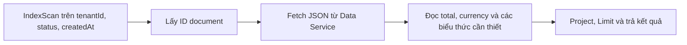
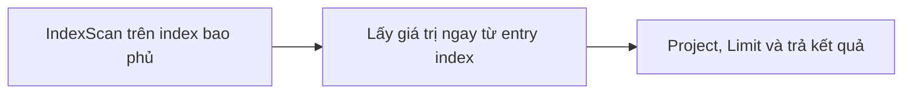

# Chỉ mục bao phủ và giảm bước đọc tài liệu trong Spring Data Couchbase

Một secondary index tốt giúp Couchbase tìm đúng document mà không phải quét toàn bộ collection. Tuy nhiên, sau khi tìm được khóa của document, Query Service vẫn có thể phải lấy **toàn bộ nội dung JSON từ Data Service** chỉ để đọc thêm vài trường. Bước đọc này thường xuất hiện dưới dạng **`Fetch`** trong kế hoạch truy vấn SQL++. Với endpoint trả danh sách hàng nghìn lần mỗi phút, số lần đọc bổ sung có thể trở thành chi phí đáng kể.

**Chỉ mục bao phủ** (*covering index*) là chỉ mục cung cấp đủ thông tin để truy vấn hoàn thành mà không cần đọc document gốc cho đường truy cập đó. Trong **Spring Data Couchbase**, hiểu covering index giúp lựa chọn đúng giữa truy vấn trả **entity đầy đủ** và truy vấn chỉ trả **projection** gồm các trường thật sự cần cho màn hình/API.

Bài thuộc chương **Chỉ mục** của module **SPRING_DATA_COUCHBASE**: xây dựng tầng dữ liệu bằng document mapping, repository, `CouchbaseTemplate` và SQL++; thiết kế bucket/scope/collection, tối ưu hiệu năng, tính nhất quán và vận hành. Các ví dụ cũng chỉ ra mối liên hệ với TTL, CAS, giao dịch và reactive API, nhưng trọng tâm xuyên suốt là **giảm bước đọc document bằng index**.

## 1. Mục tiêu học tập

Sau bài này, bạn có thể:

1. Phân biệt **index scan**, **document fetch** và **covering index** trong Query Service.
2. Xác định điều kiện để một chỉ mục bao phủ truy vấn: các trường trong `WHERE`, `SELECT`, `ORDER BY` và những biểu thức khác phải có dữ liệu cần thiết từ index hoặc từ điều kiện đã được chứng minh.
3. Thiết kế index ghép có thêm các trường projection, đồng thời nhận biết khi nào thêm quá nhiều trường là phản tác dụng.
4. Giải thích vì sao `findById`, derived repository query, `@Query`, `CouchbaseTemplate` và truy vấn SQL++ chỉ lấy vài cột có đường truy cập khác nhau.
5. Dùng `EXPLAIN` và Query Profile để xác nhận `Fetch` có thật sự được loại bỏ, và đánh giá lợi ích so với chi phí duy trì index.

## 2. Document và truy vấn mẫu

Giả sử hệ thống thương mại điện tử dùng bucket `commerce`, scope `sales` và collection `orders`. Document có ID `order::1001`:

```json
{
  "_class": "salesOrder",
  "tenantId": "TENANT-A",
  "customerId": "C-42",
  "status": "PAID",
  "createdAt": "2026-11-20T08:15:00Z",
  "total": 1500000,
  "currency": "VND",
  "shippingAddress": {
    "city": "Ha Noi",
    "district": "Ba Dinh",
    "line1": "12 Example Street"
  },
  "items": [
    { "sku": "SKU-42", "quantity": 2, "unitPrice": 350000 },
    { "sku": "SKU-18", "quantity": 1, "unitPrice": 800000 }
  ],
  "audit": {
    "createdBy": "checkout-service",
    "lastUpdatedBy": "payment-service"
  }
}
```

Trong ví dụ, `_class` là discriminator phục vụ ánh xạ entity, có thể là `@TypeAlias` hoặc tên lớp Java tùy cấu hình. `createdAt` là chuỗi ISO-8601 chuẩn hóa UTC; phải xem định dạng thật do Spring Data converter lưu khi thiết kế phép lọc/sắp xếp.

Giả sử màn hình danh sách đơn hàng chỉ cần:

- Tenant, trạng thái, thời điểm tạo.
- Tổng tiền và loại tiền.
- Mã đơn hàng (document ID) để mở trang chi tiết.

Màn hình này **không cần** `shippingAddress`, `items` và `audit`. Truy vấn:

```sql
SELECT META(o).id AS orderId,
       o.tenantId,
       o.status,
       o.createdAt,
       o.total,
       o.currency
FROM `commerce`.`sales`.`orders` AS o
WHERE o.tenantId = "TENANT-A"
  AND o.status = "PAID"
ORDER BY o.createdAt DESC
LIMIT 20;
```

Đây là một ứng viên tốt để xét covering index: phần dữ liệu cần trả rất nhỏ so với document hoàn chỉnh.

## 3. Luồng thực thi: index scan và document fetch

### 3.1. Khi index chỉ giúp tìm document

Giả sử ban đầu có secondary index:

```sql
CREATE INDEX ix_orders_tenant_status_created
ON `commerce`.`sales`.`orders`(
    `tenantId`,
    `status`,
    `createdAt` DESC
);
```

Index này phục vụ tốt `WHERE tenantId = ? AND status = ?` và có thể giúp `ORDER BY createdAt DESC`. Nhưng `total` và `currency` chưa nằm trong khóa của index.

Đối với truy vấn danh sách trên, kế hoạch có thể gồm:



Đây là sơ đồ khái niệm, **không phải kế hoạch `EXPLAIN` được chụp từ một cụm Couchbase thật**. Optimizer có thể sắp xếp operator khác đi và đẩy `LIMIT`/`ORDER BY` xuống index khi phù hợp.

Việc quét index và lấy document là **hai công việc** khác nhau. Nếu `WHERE` rất chọn lọc, số lần `Fetch` có thể nhỏ và chấp nhận được. Nếu API thường đọc danh sách với nhiều kết quả, `Fetch` lặp lại có thể tạo thêm lưu lượng và thời gian chờ giữa Query Service với Data Service.

### 3.2. Khi index đủ thông tin để trả kết quả

Thử một index chứa cả những trường hiển thị:

```sql
CREATE INDEX ix_orders_list_cover
ON `commerce`.`sales`.`orders`(
    `tenantId`,
    `status`,
    `createdAt` DESC,
    `total`,
    `currency`
);
```

Với truy vấn `SELECT` chỉ gồm `tenantId`, `status`, `createdAt`, `total`, `currency` và `META(o).id`, Query Service **có thể** lấy đủ thông tin từ index mà không cần đọc nội dung JSON của document gốc. Khóa document là thông tin gắn với entry index và có thể được sử dụng trong kế hoạch bao phủ phù hợp.



Nếu `EXPLAIN` xác nhận kế hoạch có `covers` phù hợp và **không có `Fetch`** cho collection `orders`, đó là bằng chứng truy vấn đã được bao phủ theo đường truy cập này.

> **Lưu ý cốt lõi:** Một index không tự mang nhãn “covering” cho mọi trường hợp. **Index bao phủ một truy vấn cụ thể**, phụ thuộc cả `SELECT`, `WHERE`, `ORDER BY`, kiểu phép nối, biểu thức và predicate thực tế.

## 4. Những gì index cần cung cấp để bao phủ truy vấn

Để Query Service không phải đọc document gốc, các biểu thức cần tính từ document phải có sẵn trong index hoặc đã được suy ra hợp lệ từ điều kiện của index. Kiểm tra lần lượt:

| Phần của SQL++ | Ví dụ | Tác động đến covering |
| --- | --- | --- |
| `WHERE` | `tenantId = "TENANT-A" AND status = "PAID"` | Index cần hỗ trợ đánh giá điều kiện; có thể tận dụng các khóa hoặc `filter_covers` từ partial index |
| `SELECT` | `total, currency` | Nếu index không chứa dữ liệu cần trả, thường phải `Fetch` |
| `ORDER BY` | `createdAt DESC` | Cần biết giá trị để sắp xếp; chỉ mục đúng thứ tự có thể giảm thêm chi phí sort |
| `GROUP BY` / tổng hợp | `GROUP BY status`, `SUM(total)` | Cần dữ liệu cho nhóm và phép tính; có thể yêu cầu index hỗ trợ tổng hợp/pushdown phù hợp |
| Biểu thức | `LOWER(customerId)` | Phải có giá trị/biểu thức cần thiết; expression index chỉ hỗ trợ nếu biểu thức tương thích |
| Metadata | `META(o).id` | ID thường có trong entry index; metadata khác cần được kiểm chứng theo phép chọn và phiên bản |
| Bộ lọc entity | `_class = "salesOrder"` | Spring Data có thể thêm điều kiện; index hoặc partial predicate phải đủ để đánh giá |

Ví dụ index `(tenantId, status, createdAt DESC, total, currency)` có thể bao phủ:

```sql
SELECT o.tenantId, o.status, o.createdAt, o.total, o.currency
FROM `commerce`.`sales`.`orders` AS o
WHERE o.tenantId = "TENANT-A"
  AND o.status = "PAID"
ORDER BY o.createdAt DESC
LIMIT 20;
```

Nhưng nếu đổi thành:

```sql
SELECT o.*
FROM `commerce`.`sales`.`orders` AS o
WHERE o.tenantId = "TENANT-A"
  AND o.status = "PAID"
ORDER BY o.createdAt DESC
LIMIT 20;
```

thì index ví dụ không chứa `shippingAddress`, `items`, `audit` và các trường khác. Query Service thường phải đọc toàn bộ document. Câu lệnh `SELECT o.*` hoặc truy vấn ánh xạ toàn entity là nguyên nhân phổ biến khiến covering không đạt được.

### 4.1. Covering không đồng nghĩa chỉ cần có index

Có ba mức tối ưu riêng:

1. **Có index khả dụng:** Query Service có thể lập kế hoạch mà không cần quét primary index rộng.
2. **Index quét chọn lọc:** `spans` hoặc range tận dụng các điều kiện, giảm số entry phải xét.
3. **Index bao phủ truy vấn:** Các trường cần thiết nằm trong index, giảm hoặc bỏ bước `Fetch` document gốc.

Một index có thể **cover** nhưng vẫn quét rất nhiều entry do khóa dẫn đầu không chọn lọc. Ngược lại, một index quét cực hẹp có thể phải `Fetch` vài document mà vẫn nhanh hơn việc quét một index cover nhưng quá rộng. Vì vậy phải đo **cả số entry được quét và số document cần đọc**.

### 4.2. Chú ý `MISSING` và kiểu dữ liệu

Với GSI thông thường, các document có giá trị `MISSING` ở khóa index dẫn đầu có thể không được đưa vào index. Do đó, không thể chỉ nhìn danh sách trường của index rồi khẳng định index có thể trả **mọi** document trong một truy vấn không có điều kiện phù hợp.

Trong ví dụ đã có `tenantId = "TENANT-A"` và `status = "PAID"`, điều kiện bằng loại bỏ tình huống thiếu các trường đó. Nếu ứng dụng cần báo cáo document **không có `tenantId`** hoặc có `total = NULL`, hãy kiểm tra ngữ nghĩa SQL++, thiết kế index và kế hoạch riêng; `NULL` khác `MISSING`.

Nếu `createdAt` được lưu khác kiểu giữa các document (số timestamp ở dữ liệu mới, chuỗi ISO-8601 ở dữ liệu cũ), một index có đủ khóa chưa chắc cho kết quả lọc/sắp xếp theo thời gian đúng nghiệp vụ. Trước khi tối ưu `Fetch`, phải đảm bảo mapping và dữ liệu thống nhất.

## 5. Thiết kế thứ tự khóa cho index vừa lọc, sắp xếp vừa bao phủ

Ví dụ truy vấn:

```sql
SELECT META(o).id AS orderId, o.createdAt, o.total, o.currency
FROM `commerce`.`sales`.`orders` AS o
WHERE o.tenantId = "TENANT-A"
  AND o.status = "PAID"
ORDER BY o.createdAt DESC
LIMIT 20;
```

Ứng viên:

```sql
CREATE INDEX ix_orders_tenant_status_created_total_currency
ON `commerce`.`sales`.`orders`(
    `tenantId`,
    `status`,
    `createdAt` DESC,
    `total`,
    `currency`
);
```

Vai trò từng nhóm khóa:

- `tenantId` và `status`: hai điều kiện bằng, thường giúp hạn chế dải index scan.
- `createdAt DESC`: hỗ trợ giới hạn theo thời gian và cung cấp thứ tự theo thời điểm mới nhất trong nhóm đã cố định hai khóa đầu.
- `total` và `currency`: cung cấp dữ liệu hiển thị. Chúng đứng sau khóa sắp xếp để không phá vỡ thứ tự `createdAt` mong muốn trong truy vấn này.

### 5.1. Tại sao không đặt trường hiển thị lên đầu?

Xét index:

```sql
CREATE INDEX ix_orders_bad_for_listing
ON `commerce`.`sales`.`orders`(
    `total`, `currency`, `tenantId`, `status`, `createdAt` DESC
);
```

Nó có đủ các trường để *có khả năng* cover một truy vấn lấy những trường đó, nhưng `total` và `currency` đứng đầu không phù hợp với điều kiện chỉ lọc theo `tenantId` và `status`. Kết quả có thể là scan quá rộng.

**Covering và selectivity phải được thiết kế cùng nhau.** Một index lớn chứa tất cả trường nhưng đặt thứ tự không phù hợp có thể thua index nhỏ hơn, lọc tốt hơn và chấp nhận vài `Fetch`.

### 5.2. Khi nào thêm trường projection vào cuối index?

Thêm trường hiển thị ở cuối thường đáng thử khi:

- Endpoint được gọi thường xuyên và chỉ trả một projection nhỏ, ổn định.
- Nhiều document thỏa predicate hoặc số lượng request lớn khiến `Fetch` trở thành chi phí đo được.
- Các trường thêm vào nhỏ, tương đối ổn định, ít thay đổi.
- Query Profile cho thấy việc loại `Fetch` tạo ra lợi ích đáng kể mà không làm chậm ghi quá mức.

Ngược lại, cân nhắc **không** thêm:

- Trường text dài, mảng lớn, object lồng nhau hoặc dữ liệu hiển thị hiếm khi được yêu cầu.
- Trường cập nhật liên tục nhưng không cần cho phần lớn truy vấn.
- Trường chỉ dùng trong trang chi tiết vốn truy cập bằng document ID qua KV.
- Nhiều trường khiến một index chuyên biệt trở thành bản sao lớn của phần lớn document.

### 5.3. `ORDER BY` và việc đẩy `LIMIT`

Ngay cả khi index cover `SELECT`, kế hoạch vẫn có thể cần sort bổ sung nếu thứ tự khóa không tương thích `ORDER BY`.

Ví dụ:

```sql
SELECT o.createdAt, o.total
FROM `commerce`.`sales`.`orders` AS o
WHERE o.tenantId = "TENANT-A"
ORDER BY o.createdAt DESC
LIMIT 20;
```

Nếu chỉ có index `(tenantId, status, createdAt DESC, total)`, các entry trong tenant được phân nhóm theo `status` trước `createdAt`. Vì truy vấn không cố định `status`, index không cung cấp sẵn thứ tự `createdAt DESC` cho **toàn tenant**. Nếu endpoint này quan trọng, index `(tenantId, createdAt DESC, total)` có thể là ứng viên tốt hơn.

Với `status IN ["PAID", "SHIPPED"]`, mỗi nhóm status có thể theo thời gian giảm dần, nhưng kết quả kết hợp các nhóm không tự động theo thứ tự thời gian toàn cục. `EXPLAIN` sẽ cho biết có bước `Order` hay chiến lược hợp nhất khác.

**Không đồng nhất “không có `Fetch`” với “không có `Order`”.** Đây là hai mục tiêu tối ưu riêng cần quan sát trong cùng kế hoạch.

## 6. `EXPLAIN`: xác nhận có thực sự giảm bước đọc document

Hãy chạy:

```sql
EXPLAIN
SELECT META(o).id AS orderId,
       o.tenantId, o.status, o.createdAt, o.total, o.currency
FROM `commerce`.`sales`.`orders` AS o
WHERE o.tenantId = "TENANT-A"
  AND o.status = "PAID"
ORDER BY o.createdAt DESC
LIMIT 20;
```

Quan sát kế hoạch JSON và tìm các dấu hiệu sau (tên operator có thể khác giữa phiên bản Couchbase):

| Dấu hiệu trong kế hoạch | Cách diễn giải |
| --- | --- |
| `IndexScan`, `IndexScan3` hoặc operator index tương đương | Truy vấn chọn index nào, khóa index nào được quét? |
| `covers` | Các biểu thức/trường nào đã được cung cấp từ index? |
| `filter_covers` | Có điều kiện nào được suy ra từ predicate index mà không cần đọc JSON? |
| `Fetch` | Có cần đọc document gốc từ Data Service hay không? |
| `Filter` | Điều kiện nào vẫn cần kiểm tra sau scan? Filter không nhất thiết đồng nghĩa có `Fetch` |
| `Order` | Kết quả có cần sắp xếp bổ sung không? |
| `Limit` / đẩy `LIMIT` | Có giới hạn kết quả từ sớm hay phải xử lý nhiều hàng trước? |
| `spans` / range | Index đã giới hạn tốt theo `tenantId` và `status` chưa? |

Một biểu diễn **minh họa**, không phải JSON `EXPLAIN` thật:

```text
Chưa cover:
  IndexScan(ix_orders_tenant_status_created)
    -> Fetch(orders)
    -> Project(orderId, tenantId, status, createdAt, total, currency)
    -> ...

Có khả năng cover:
  IndexScan(ix_orders_list_cover, covers=[tenantId,status,createdAt,total,currency,id])
    -> Project(orderId, tenantId, status, createdAt, total, currency)
    -> ...
```

Các operator `Project`, `Order`, `Limit` có thể xuất hiện ở vị trí khác và một số bước được optimizer gộp/pushdown. Điều quan trọng là **kế hoạch có chọn index mong muốn và không cần `Fetch` trên đường truy cập đang kiểm tra hay không**.

### 6.1. Kiểm tra index đã sẵn sàng

```sql
SELECT name, state, index_key, condition, is_primary
FROM system:indexes
WHERE bucket_id = "commerce"
  AND scope_id = "sales"
  AND keyspace_id = "orders";
```

Chỉ mục vừa tạo cần hoàn tất build, thường đạt trạng thái `online`, trước khi Query Service có thể sử dụng. Tạo index xong chưa đồng nghĩa index đã phục vụ được truy vấn tại thời điểm đó.

### 6.2. Không dừng ở `EXPLAIN`

`EXPLAIN` cho biết kế hoạch dự kiến, nhưng chưa đủ để đánh giá hiệu năng thực tế. Dùng Query Profile hoặc cơ chế giám sát tương ứng để đo:

- Số entry index được quét so với số hàng kết quả.
- Số document và dữ liệu phải fetch; thời gian dành cho các operator.
- Tổng latency và các percentile như p95/p99 của endpoint.
- CPU, I/O và dung lượng Index Service; tải khi đồng thời có truy vấn/ghi.
- Thời gian sort, nếu `ORDER BY` chưa tận dụng được thứ tự index.

Trong môi trường có ít document, khác biệt giữa có và không có covering index có thể rất nhỏ. Với dữ liệu lớn và áp lực đọc cao, số lần `Fetch` tránh được mới có thể phản ánh lợi ích rõ. Không đưa ra một con số tăng tốc cố định nếu chưa đo workload.

## 7. Spring Data Couchbase: vì sao repository trả entity đầy đủ khó cover hơn?

### 7.1. Entity và derived repository query

Entity minh họa:

```java
import java.time.Instant;
import java.util.List;
import org.springframework.data.annotation.Id;
import org.springframework.data.annotation.TypeAlias;
import org.springframework.data.couchbase.core.mapping.Collection;
import org.springframework.data.couchbase.core.mapping.Document;
import org.springframework.data.couchbase.core.mapping.Scope;

@Document
@TypeAlias("salesOrder")
@Scope("sales")
@Collection("orders")
public class SalesOrder {
    @Id
    private String id;
    private String tenantId;
    private String customerId;
    private String status;
    private Instant createdAt;
    private long total;
    private String currency;
    private ShippingAddress shippingAddress;
    private List<OrderItem> items;
    // Constructor, getter và setter được lược bỏ.
}
```

Các kiểu `ShippingAddress` và `OrderItem` là lớp giá trị của dự án, không trình bày đầy đủ trong đoạn minh họa. Bucket `commerce` được cấu hình ở ứng dụng; scope và collection được xác định bởi mapping tương ứng.

Repository:

```java
import java.util.List;
import java.util.Optional;
import org.springframework.data.couchbase.repository.CouchbaseRepository;

public interface SalesOrderRepository
        extends CouchbaseRepository<SalesOrder, String> {

    Optional<SalesOrder> findById(String id);

    List<SalesOrder> findByTenantIdAndStatusOrderByCreatedAtDesc(
        String tenantId, String status
    );
}
```

`findById` với document ID đã biết thường đi theo đường **KV** nên không cần SQL++ index. Phương thức tìm theo `tenantId`/`status` là **derived query**; Spring Data có thể tạo SQL++ và ánh xạ lại `SalesOrder` đầy đủ, bao gồm `items` và `shippingAddress`.

Ngay cả khi index có `tenantId`, `status`, `createdAt`, `total` và `currency`, nó vẫn **không chứa toàn bộ dữ liệu entity**. Query Service có thể cần `Fetch` để ánh xạ entity.

Một lỗi tối ưu thường gặp là tạo index bao phủ cho **câu `SELECT` viết tay chỉ chọn vài trường**, rồi kiểm tra endpoint Spring Data mà endpoint đó thực tế dùng `SELECT` trả toàn entity. Hai truy vấn này có mục tiêu bao phủ khác nhau.

### 7.2. `@Query` với lựa chọn toàn entity

Ví dụ:

```java
import java.util.List;
import org.springframework.data.couchbase.repository.Query;

public interface SalesOrderRepository
        extends CouchbaseRepository<SalesOrder, String> {

    @Query("#{#n1ql.selectEntity} WHERE #{#n1ql.filter} " +
           "AND tenantId = $1 AND status = $2 " +
           "ORDER BY createdAt DESC LIMIT 20")
    List<SalesOrder> findLatestOrders(String tenantId, String status);
}
```

Các biểu thức `#{#n1ql.selectEntity}` và `#{#n1ql.filter}` hỗ trợ xây dựng truy vấn ánh xạ entity trong Spring Data Couchbase. Chúng **không** có nghĩa truy vấn chỉ lấy một projection tối thiểu: `selectEntity` thường phục vụ việc lấy dữ liệu cần thiết để ánh xạ entity.

Ngoài ra, `filter` có thể bổ sung điều kiện theo discriminator như `_class`. Muốn cover truy vấn repository, phải tính cả điều kiện kiểu và projection mà SQL++ thực tế yêu cầu. **Đừng kết luận chỉ từ tên method hoặc định nghĩa index.**

### 7.3. Projection và truy vấn chỉ lấy các trường cần thiết

Nếu API chỉ hiển thị danh sách, hãy phân biệt hai hợp đồng dữ liệu:

| Hợp đồng | Dữ liệu cần | Đặc điểm |
| --- | --- | --- |
| `SalesOrder` entity | Toàn bộ đơn hàng và những thuộc tính phục vụ mapping | Thường cần `Fetch` nếu index chỉ chứa vài trường |
| `OrderListRow` projection | ID, tenant, status, thời gian, tổng tiền, loại tiền | Có thể được phục vụ từ covering index |

Ví dụ một DTO đơn giản:

```java
public record OrderListRow(
    String orderId,
    String tenantId,
    String status,
    String createdAt,
    long total,
    String currency
) {}
```

`OrderListRow` là hợp đồng trả dữ liệu cho màn hình, không phải entity cần lưu. Ở các phiên bản Java/Spring Data khác nhau, khả năng ánh xạ `record`, interface projection hoặc DTO bằng repository query có thể khác nhau; cần kiểm tra truy vấn được tạo ra. **Chỉ tạo một kiểu projection Java không bảo đảm Spring Data tự động sinh SQL++ covering.**

Để đánh giá chắc chắn, có thể dùng SQL++ với `SELECT` chỉ các trường cần thiết qua cơ chế query phù hợp của `CouchbaseTemplate` hoặc SDK, rồi kiểm tra kế hoạch tương ứng:

```sql
SELECT META(o).id AS orderId,
       o.tenantId, o.status, o.createdAt, o.total, o.currency
FROM `commerce`.`sales`.`orders` AS o
WHERE o.tenantId = $tenantId
  AND o.status = $status
ORDER BY o.createdAt DESC
LIMIT 20;
```

Nếu dùng `CouchbaseTemplate` để thực thi/trả kết quả của truy vấn SQL++, lưu ý API, projection và metadata mapping cần phù hợp với phiên bản Spring Data đang sử dụng. Trường hợp cần tự điều khiển SQL++ và kiểu kết quả, Couchbase Java SDK cũng có Query API bên dưới.

Một ví dụ với Java SDK, khi ứng dụng đã có một `Cluster` được cấu hình:

```java
import com.couchbase.client.java.Cluster;
import com.couchbase.client.java.json.JsonObject;
import com.couchbase.client.java.query.QueryResult;
import java.util.List;

import static com.couchbase.client.java.query.QueryOptions.queryOptions;

public class OrderListQuery {
    private final Cluster cluster;

    public OrderListQuery(Cluster cluster) {
        this.cluster = cluster;
    }

    public List<JsonObject> findLatest(String tenantId, String status) {
        String sql = """
            SELECT META(o).id AS orderId,
                   o.tenantId, o.status, o.createdAt, o.total, o.currency
            FROM `commerce`.`sales`.`orders` AS o
            WHERE o.tenantId = $tenantId AND o.status = $status
            ORDER BY o.createdAt DESC
            LIMIT 20
            """;

        QueryResult result = cluster.query(
            sql,
            queryOptions().parameters(
                JsonObject.create()
                    .put("tenantId", tenantId)
                    .put("status", status)
            )
        );
        return result.rowsAsObject();
    }
}
```

Ví dụ này dùng Java text block (Java 15 trở lên) và Couchbase Java SDK; `JsonObject` của SDK chưa tự ánh xạ thành `OrderListRow`. Có thể chuyển đổi kết quả tại tầng service hoặc sử dụng cơ chế DTO/projection phù hợp. Điểm cần học là **câu SQL++ trả đúng vài trường**, tạo khả năng cover; khả năng cover vẫn do optimizer quyết định.

### 7.4. Reactive không thay thế covering index

`ReactiveCouchbaseRepository` hoặc API reactive của template/SDK cho phép xử lý I/O không đồng bộ và luồng kết quả. Nhưng nếu truy vấn vẫn phải `Fetch` hàng chục nghìn document, các dịch vụ phía Couchbase vẫn thực hiện công việc đó. Covering index có thể giảm chi phí truy vấn độc lập với việc API phía Java đồng bộ hay reactive.

Với reactive, không nên chỉ đo lượng request đồng thời; cần đo cả query latency, số entry đọc, số document `Fetch`, memory và tải Query/Index Service.

## 8. Điều kiện `_class`, partial index và khả năng bao phủ

### 8.1. Bộ lọc entity có thể làm thay đổi kế hoạch

Giả sử Spring Data lưu discriminator:

```json
{
  "_class": "salesOrder",
  "tenantId": "TENANT-A",
  "status": "PAID"
}
```

Repository có thể thực thi câu SQL++ với điều kiện `_class = "salesOrder"` hoặc alias khác. Index `(tenantId,status,createdAt,total,currency)` không tự bao gồm `_class` trong danh sách khóa. Tùy khả năng suy ra predicate và các field cần thiết, Query Service có thể cần đọc thêm document nếu không đánh giá được điều kiện kiểu từ index.

Một hướng là **partial index** chỉ chứa entity đơn hàng:

```sql
CREATE INDEX ix_orders_sales_list_cover
ON `commerce`.`sales`.`orders`(
    `tenantId`, `status`, `createdAt` DESC, `total`, `currency`
)
WHERE `_class` = "salesOrder";
```

Truy vấn tương ứng:

```sql
SELECT META(o).id AS orderId,
       o.tenantId, o.status, o.createdAt, o.total, o.currency
FROM `commerce`.`sales`.`orders` AS o
WHERE o._class = "salesOrder"
  AND o.tenantId = "TENANT-A"
  AND o.status = "PAID"
ORDER BY o.createdAt DESC
LIMIT 20;
```

Index có `WHERE _class = "salesOrder"` đã giới hạn tập document theo loại. Optimizer **có thể** suy ra bộ lọc kiểu được thỏa và sử dụng `filter_covers` phù hợp mà không cần đặt `_class` thành khóa index, nhưng phải kiểm tra `EXPLAIN`. Điều kiện này không giúp truy vấn SQL++ muốn lấy nhiều entity khác; nó cần đường truy cập riêng.

Đặc biệt, nếu repository thực sự dùng `_class = "com.example.sales.SalesOrder"`, partial index cho `"salesOrder"` không khớp. Giá trị discriminator phải lấy từ **document và SQL++ thực tế**, không suy từ ví dụ.

### 8.2. Partial index theo trạng thái nghiệp vụ

Một dashboard luôn hiển thị đơn đang mở, chưa xóa mềm:

```sql
CREATE INDEX ix_open_orders_list_cover
ON `commerce`.`sales`.`orders`(
    `tenantId`,
    `createdAt` DESC,
    `total`,
    `currency`
)
WHERE `_class` = "salesOrder"
  AND `status` = "OPEN"
  AND `deleted` = FALSE;
```

Query:

```sql
SELECT META(o).id AS orderId, o.tenantId, o.createdAt, o.total, o.currency
FROM `commerce`.`sales`.`orders` AS o
WHERE o._class = "salesOrder"
  AND o.status = "OPEN"
  AND o.deleted = FALSE
  AND o.tenantId = "TENANT-A"
ORDER BY o.createdAt DESC
LIMIT 20;
```

Nếu query có đầy đủ predicate index và projection được bao phủ, đây là một ứng viên index nhỏ và hiệu quả. Trái lại, query lấy **mọi** trạng thái hoặc kể cả document bị xóa mềm không thể chỉ dùng index này làm nguồn dữ liệu đầy đủ.

### 8.3. Cẩn thận với tham số động

Ứng dụng có thể gọi derived repository method với `status = $status`, còn partial index chỉ chứa `status = "OPEN"`. Query Service phải lập kế hoạch đúng cho mọi giá trị tham số; trong prepared query, optimizer không nhất thiết suy ra tham số luôn là `"OPEN"`. Một endpoint chỉ phục vụ trạng thái `OPEN` có thể dùng predicate literal rõ ràng, rồi bind `tenantId`; vẫn phải kiểm tra kế hoạch trên phiên bản Couchbase hiện dùng.

Không nên dùng một partial index `WHERE status = "OPEN"` để thay thế index cho mọi truy vấn có trạng thái động.

## 9. Vì sao `SELECT META().id` và projection khác `SELECT *`?

Một hiểu nhầm phổ biến: truy vấn lấy document ID có bắt buộc phải `Fetch` không? Trong các kế hoạch GSI phù hợp, entry index chứa khóa document hoặc thông tin cần thiết để truy vết document; optimizer có thể trả `META(o).id` từ index mà không phải đọc JSON gốc.

Ví dụ:

```sql
SELECT META(o).id AS orderId
FROM `commerce`.`sales`.`orders` AS o
WHERE o.tenantId = "TENANT-A"
  AND o.status = "PAID";
```

Index `(tenantId,status)` có thể đủ thông tin. Nhưng:

```sql
SELECT META(o).id AS orderId, o.items
FROM `commerce`.`sales`.`orders` AS o
WHERE o.tenantId = "TENANT-A"
  AND o.status = "PAID";
```

thường cần đọc thêm `items` vì index không chứa mảng này. Việc cố đưa toàn bộ mảng `items` vào index chỉ để bỏ `Fetch` có thể gây tăng kích thước/chí phí không đáng có.

Metadata khác như thông tin CAS hoặc expiration cần được đánh giá theo truy vấn, phiên bản Couchbase và khả năng biểu diễn trong index; đừng giả định mọi giá trị `META()` đều được cover chỉ vì document ID có thể được cover.

## 10. Covering index với biểu thức, object lồng nhau và mảng

### 10.1. Biểu thức được tính toán trong truy vấn

Truy vấn dùng biểu thức:

```sql
SELECT LOWER(o.customerId) AS customerKey
FROM `commerce`.`sales`.`orders` AS o
WHERE o.tenantId = "TENANT-A"
  AND LOWER(o.customerId) = "c-42";
```

Một index trên `customerId` có thể cung cấp giá trị để tính toán, nhưng mức độ pushdown và khả năng lập kế hoạch tối ưu không nhất thiết giống index trên biểu thức `LOWER(customerId)`.

Có thể thử:

```sql
CREATE INDEX ix_orders_tenant_customer_lower
ON `commerce`.`sales`.`orders`(
    `tenantId`,
    LOWER(`customerId`)
);
```

Khi biểu thức index tương thích chính xác với predicate và projection, optimizer có thêm khả năng dùng giá trị biểu thức trực tiếp. Xác nhận `covers` và việc có/không có `Fetch` bằng `EXPLAIN`; không chỉ dựa vào sự giống nhau về tên field.

### 10.2. Object lồng nhau

Màn hình chỉ hiển thị thành phố giao hàng:

```sql
SELECT o.shippingAddress.city AS city, o.tenantId
FROM `commerce`.`sales`.`orders` AS o
WHERE o.tenantId = "TENANT-A"
  AND o.shippingAddress.city = "Ha Noi";
```

Index trên đường dẫn JSON có thể phù hợp:

```sql
CREATE INDEX ix_orders_tenant_shipping_city
ON `commerce`.`sales`.`orders`(
    `tenantId`,
    `shippingAddress`.`city`
);
```

Không cần thêm toàn bộ object `shippingAddress` khi query chỉ lấy `city`. Nếu query lấy đầy đủ địa chỉ, các trường còn lại có thể làm xuất hiện `Fetch`.

### 10.3. Mảng và array index

Một array index:

```sql
CREATE INDEX ix_orders_tenant_sku
ON `commerce`.`sales`.`orders`(
    `tenantId`,
    DISTINCT ARRAY i.sku FOR i IN items END
);
```

có thể giúp truy vấn:

```sql
SELECT META(o).id AS orderId, o.tenantId
FROM `commerce`.`sales`.`orders` AS o
WHERE o.tenantId = "TENANT-A"
  AND ANY i IN o.items SATISFIES i.sku = "SKU-42" END;
```

Tuy nhiên, từ việc index hỗ trợ điều kiện `ANY` **không thể suy ra** nó cover được truy vấn trả toàn bộ `items` hoặc thống kê từng `quantity`. Đối với các phép `UNNEST`, `ALL ARRAY`, `FLATTEN_KEYS` hoặc tổng hợp trên phần tử mảng, cần thiết kế và kiểm tra riêng; index có thể làm giảm tập ứng viên nhưng vẫn cần `Fetch` hay thêm toán tử.

## 11. Tác động lên chi phí ghi, TTL, CAS và nhất quán

### 11.1. Covering index không miễn phí

Để loại bỏ `Fetch`, ta thường thêm các trường projection vào index. Hệ quả có thể gồm:

- **Dung lượng index tăng:** mỗi entry lưu thêm giá trị trường, có thể tăng nhu cầu bộ nhớ và disk.
- **Chi phí cập nhật tăng:** thay đổi `total` hay `currency` có thể ảnh hưởng index chứa các trường đó; thêm index cũng gia tăng công việc duy trì.
- **Thời gian build và quản trị tăng:** phải theo dõi trạng thái `online`, chi phí triển khai, replica và tác động với tải đang chạy.
- **Tính linh hoạt giảm:** một thay đổi nhỏ ở projection có thể làm endpoint không còn được cover nếu cần trường mới.

Do đó, không có quy tắc “càng nhiều covering index càng tốt”. Hãy ưu tiên các màn hình có lưu lượng đọc lớn, dữ liệu trả nhỏ, độ trễ cần tối ưu và các trường projection ổn định.

### 11.2. TTL làm thay đổi tập entry nhưng không đổi khái niệm covering

Document có TTL sẽ hết hạn theo vòng đời được cấu hình. Các index liên quan cần phản ánh việc document không còn hợp lệ; nhưng một index bao phủ **không** làm TTL hoạt động tức thì hơn hay thay thế logic kiểm tra thời hạn nghiệp vụ. Khi TTL hoặc xóa document ảnh hưởng kết quả truy vấn SQL++, vẫn cần xem cơ chế cập nhật index và yêu cầu nhất quán.

### 11.3. CAS và giao dịch xử lý ghi, index xử lý đọc

**CAS** giúp phát hiện cập nhật cạnh tranh trên một document; **giao dịch** phục vụ yêu cầu nguyên tử của một phạm vi thao tác. Covering index không giải quyết xung đột ghi, không tự bảo đảm tính nguyên tử và không biến truy vấn SQL++ thành một lượt KV read.

Nếu đơn hàng được cập nhật từ `OPEN` sang `PAID` trong một thao tác, các index có khóa `status` hoặc predicate phụ thuộc trạng thái cần phản ánh thay đổi đó. Quá trình cập nhật GSI có thể bất đồng bộ với KV write.

### 11.4. Scan consistency là quyết định riêng

Ví dụ service vừa lưu đơn hàng rồi truy vấn danh sách:

```text
save(order) hoàn tất
   -> SQL++ query WHERE status = "PAID"
   -> kết quả có thể tạm thời chưa bao gồm mutation mới
      nếu index chưa bắt kịp và scan consistency không yêu cầu chờ
```

| Scan consistency | Ý nghĩa |
| --- | --- |
| `NOT_BOUNDED` | Không đợi index bắt kịp các mutation trước khi chạy; có thể giảm độ trễ nhưng dữ liệu tạm thời cũ |
| `REQUEST_PLUS` | Đợi index bắt kịp mutation có liên quan ở thời điểm truy vấn; kết quả mới hơn nhưng thường phải đánh đổi thêm thời gian chờ |

Việc query được cover không làm thay đổi nguyên tắc này: **covering tối ưu số lần đọc document, scan consistency điều chỉnh mức đồng bộ của dữ liệu trong index**. Nếu chỉ cần đọc lại một đơn theo document ID đã biết, `findById` qua KV thường phù hợp hơn một SQL++ query theo thuộc tính.

Với reactive API, phải bảo đảm luồng ghi đã hoàn tất trước khi đo read-after-write, nhưng ngay cả khi đã chờ xong write, SQL++ vẫn chịu ngữ nghĩa scan consistency của GSI.

## 12. Phương pháp lựa chọn index: đo chi phí tổng thể

Giả sử endpoint danh sách đơn thường chạy theo `tenantId`/`status` và chỉ cần năm trường. Có ba phương án:

| Phương án | Index / cách đọc | Ưu điểm | Đánh đổi |
| --- | --- | --- | --- |
| A | Index ngắn `(tenantId,status,createdAt DESC)`, đọc `total/currency` bằng `Fetch` | Index nhỏ, giảm chi phí duy trì | Mỗi truy vấn có thể cần đọc JSON gốc |
| B | Index bao phủ `(tenantId,status,createdAt DESC,total,currency)` | Có thể bỏ `Fetch` khi projection không thay đổi | Index lớn hơn, cập nhật nhiều trường hơn |
| C | Dùng KV cho trang chi tiết sau khi list ID | Trang chi tiết có khóa rõ ràng, không cần index SQL++ riêng cho ID | Nếu danh sách vẫn cần nhiều thuộc tính, có thể phát sinh nhiều lượt KV read |

Đánh giá theo tuần tự:

1. Thu thập câu SQL++ **thực tế** mà repository hoặc template gửi, gồm cả bộ lọc `_class`, các tham số, projection và `ORDER BY`.
2. Chạy `EXPLAIN` với index hiện tại; kiểm tra `spans`, `Fetch`, `Order` và `covers`.
3. Xác nhận điểm nghẽn: truy vấn chậm vì quét quá nhiều entry, vì `Fetch`, vì sort hay vì khối lượng kết quả?
4. Tạo **một** index ứng viên để thử trên môi trường phù hợp, đợi build xong và xác nhận trạng thái khả dụng.
5. So sánh Query Profile/metrics, tải đọc/ghi và dung lượng index trước/sau.
6. Giữ index nếu lợi ích trên endpoint quan trọng đủ lớn so với chi phí; xác nhận không có tác dụng phụ trên các truy vấn khác trước khi gỡ index cũ.

### Cẩn trọng với một phép đo “nhanh hơn” trên tập dữ liệu nhỏ

Không nên chỉ so sánh một lần chạy `SELECT ... LIMIT 20` trên vài chục document. Cache, mức tải của cụm, tỉ lệ document phù hợp và số entry phải quét có thể khiến phép đo thiếu đại diện. Hãy thử nhiều tenant lớn/nhỏ, trạng thái phổ biến/hiếm, số lượng kết quả và mức đồng thời tương đương production.

Khi ghi rất nhiều, một index bao phủ có thêm `total`, `currency` có thể tăng chi phí cập nhật. Nếu API chỉ được gọi vài lần mỗi ngày, lợi ích bỏ `Fetch` có thể không đáng để duy trì index chuyên biệt.

## 13. Chẩn đoán các sai lầm phổ biến

| Triệu chứng | Nguyên nhân cần kiểm tra | Hướng xử lý |
| --- | --- | --- |
| Có index trên mọi trường `WHERE` nhưng vẫn có `Fetch` | `SELECT` còn dùng `total`, `currency` hoặc trường khác chưa nằm trong index | Kiểm tra projection; cân nhắc index thêm trường nếu endpoint đủ quan trọng |
| Đã thêm đủ projection mà vẫn có `Fetch` | Repository trả toàn entity; có `_class` hoặc biểu thức khác cần dữ liệu ngoài index | Đọc SQL++ thật và `covers`; thử projection nhỏ/partial index phù hợp |
| Không có `Fetch` nhưng query vẫn chậm | Index scan quá rộng hoặc cần sort/tổng hợp lớn | Xem `spans`, `Order`, số entry scan và Query Profile |
| `ORDER BY createdAt DESC` vẫn sort | Một khóa `status` ở giữa chưa được cố định hoặc thứ tự index không tương thích | Thiết kế thứ tự khóa theo predicate thực tế |
| Index chứa nhiều trường nhưng bị optimizer bỏ qua | Khóa dẫn đầu không phù hợp, index chưa `online` hoặc kế hoạch khác rẻ hơn | Kiểm tra `EXPLAIN`, trạng thái index và phân bố dữ liệu |
| Query Workbench được cover, còn endpoint Spring Data thì không | Workbench dùng projection nhỏ nhưng repository `selectEntity` cần nhiều trường/metadata | So sánh câu SQL++ do ứng dụng gửi, không chỉ so sánh business predicate |
| Sau thay đổi index, write throughput giảm | Index rộng hơn và phải bảo trì khi nhiều field thay đổi | Đo tác động ghi, cân nhắc giữ index ngắn |
| API vẫn thấy trạng thái cũ sau `save` | GSI cập nhật bất đồng bộ; scan consistency không yêu cầu bắt kịp | Chọn consistency phù hợp hoặc đọc KV theo ID |
| Truy vấn cần `items`/object lớn bị `Fetch` | Index chỉ chứa các field scalar nhỏ | Đánh giá liệu nên giữ `Fetch` cho trang chi tiết thay vì index hóa object lớn |

## 14. Bài thực hành: từ `Fetch` đến covering index

Giả sử hệ thống có ba endpoint:

- **A. `GET /orders/{id}`:** trả toàn bộ đơn hàng từ document ID.
- **B. `GET /tenants/{id}/orders?status=PAID`:** trả danh sách 20 đơn mới nhất, chỉ gồm ID, trạng thái, thời gian, tổng tiền và loại tiền.
- **C. `GET /tenants/{id}/orders/{orderId}/detail`:** trả `shippingAddress`, `items` và lịch sử nghiệp vụ để xem chi tiết một đơn.

### Bước 1 — Xác định đường truy cập

A và C đã biết document ID, có thể đọc bằng KV. B lọc theo thuộc tính của nhiều document nên cần SQL++ và chỉ mục phù hợp.

### Bước 2 — Thử index ngắn

```sql
CREATE INDEX ix_lab_orders_short
ON `commerce`.`sales`.`orders`(
    `tenantId`, `status`, `createdAt` DESC
);
```

Chạy:

```sql
EXPLAIN
SELECT META(o).id AS orderId, o.status, o.createdAt, o.total, o.currency
FROM `commerce`.`sales`.`orders` AS o
WHERE o.tenantId = "TENANT-A"
  AND o.status = "PAID"
ORDER BY o.createdAt DESC
LIMIT 20;
```

Ghi lại: index được chọn, `Fetch` có xuất hiện không, phạm vi quét và thời gian chạy trên dữ liệu mẫu đủ lớn.

### Bước 3 — Thử index bao phủ

```sql
CREATE INDEX ix_lab_orders_cover
ON `commerce`.`sales`.`orders`(
    `tenantId`, `status`, `createdAt` DESC, `total`, `currency`
);
```

Sau khi index `online`, chạy lại `EXPLAIN`. Xác nhận `covers` và việc không còn `Fetch`; nếu optimizer chọn index khác, hãy đối chiếu kế hoạch và môi trường thử nghiệm trước khi kết luận. Dùng Query Profile để đo khác biệt thực sự.

### Bước 4 — Cố ý thêm một trường ngoài index

```sql
EXPLAIN
SELECT META(o).id AS orderId, o.status, o.createdAt,
       o.total, o.currency, o.shippingAddress
FROM `commerce`.`sales`.`orders` AS o
WHERE o.tenantId = "TENANT-A"
  AND o.status = "PAID"
ORDER BY o.createdAt DESC
LIMIT 20;
```

So sánh với truy vấn B. Dự đoán khi thêm `shippingAddress`, index đã thử không còn bao phủ đủ projection, nên `Fetch` có thể xuất hiện trở lại. Thử tiếp `SELECT o.*` để thấy khác biệt giữa danh sách và trang chi tiết.

### Bước 5 — Kiểm tra dưới workload ghi

Tạo/sửa nhiều đơn, đặc biệt thay đổi `total` hoặc `currency`. Theo dõi kích thước index, chi phí cập nhật và query latency; quyết định index bao phủ có đáng giữ cho endpoint B hay không.

### Câu hỏi tự kiểm tra

1. Covering index khác gì một index chỉ giúp thu hẹp `WHERE`?
2. Với index `(tenantId, status, createdAt DESC)`, truy vấn lấy thêm `total` và `currency` có thể cần `Fetch` vì sao?
3. Vì sao đưa `total` và `currency` lên đầu index có thể làm quét kém hiệu quả dù index chứa đủ các trường cần hiển thị?
4. Vì sao `SELECT o.*` trong repository thường khó được cover hơn `SELECT META(o).id, o.createdAt, o.total`?
5. Khi `EXPLAIN` không có `Fetch` nhưng vẫn có `Order`, bạn nên kiểm tra điều gì?
6. Partial index theo `_class` hoặc `status` có thể giúp bao phủ truy vấn thế nào? Điều kiện để optimizer sử dụng là gì?
7. Vì sao covering index không tự giải quyết việc truy vấn SQL++ chưa thấy mutation mới ngay sau `save(...)`?
8. Khi nào nên giữ index ngắn và chấp nhận một số `Fetch` thay vì mở rộng index?

**Kết luận:** Một truy vấn SQL++ tốt không chỉ tìm được document bằng index, mà còn tránh đọc JSON gốc khi index đã chứa đủ dữ liệu cần thiết. Để đạt **covering index** trong Spring Data Couchbase, hãy bắt đầu từ câu SQL++ thật và projection của API, thiết kế thứ tự khóa để lọc/sắp xếp hiệu quả, bổ sung những trường hiển thị thực sự cần, rồi dùng `EXPLAIN` xác minh `covers` và việc có/không có `Fetch`. Mọi lợi ích phải được cân đối với kích thước và chi phí cập nhật index, yêu cầu nhất quán, cũng như cách repository hoặc `CouchbaseTemplate` ánh xạ dữ liệu.
