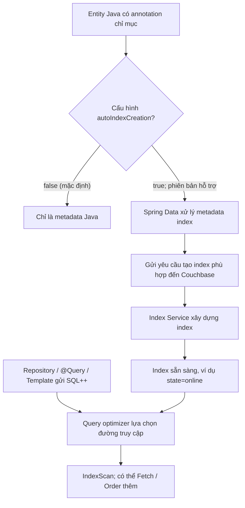

# `@QueryIndexed` và `@CompositeQueryIndex` trong mô hình Spring Data Couchbase được hỗ trợ

Trong Spring Data Couchbase, lập trình viên có thể mô tả một số **secondary index cho truy vấn SQL++ ngay trên entity Java** bằng các annotation `@QueryIndexed` và `@CompositeQueryIndex`. Khi cấu hình **tạo chỉ mục tự động** được bật và phiên bản Spring Data Couchbase hỗ trợ cơ chế này, framework có thể sử dụng metadata của entity để yêu cầu Couchbase tạo những index tương ứng.

Điểm quan trọng nhất: **khai báo annotation không đồng nghĩa index đã được tạo, sẵn sàng hoặc tối ưu cho truy vấn**. Spring Data Couchbase mặc định dự kiến nhóm phát triển tự quản lý các index; tính năng tạo index từ annotation cần được bật tường minh. Cách làm này hữu ích trong giai đoạn học tập, phát triển và thử nghiệm, còn ở hệ thống production thường cần quy trình quản lý schema/index có kiểm soát.

Bài thuộc chương **Chỉ mục** của module **SPRING_DATA_COUCHBASE**: xây dựng tầng truy cập Couchbase bằng document mapping, repository, `CouchbaseTemplate` và SQL++, thiết kế bucket/scope/collection và bảo đảm hiệu năng, tính nhất quán, khả năng vận hành. Các ví dụ đặt trọng tâm vào **annotation, cấu hình bật tạo index, điều kiện hỗ trợ và phương pháp kiểm chứng**; TTL, CAS, giao dịch và API reactive được liên hệ ở phần vận hành.

## 1. Mục tiêu học tập

Sau bài này, bạn có thể:

1. Giải thích vai trò của `@QueryIndexed`, `@CompositeQueryIndex` và `@CompositeQueryIndexes` trong **automatic index management**.
2. Đặt đúng annotation trên field hoặc class Java, dùng các thuộc tính `name`, `direction` và `fields` theo API được hỗ trợ.
3. Phân biệt **khai báo index**, **bật cơ chế tạo index**, **index có mặt trong Couchbase** và **optimizer chọn index cho truy vấn**.
4. Viết và đánh giá ví dụ có entity, repository, `@Query` và SQL++ với composite index phù hợp `WHERE` / `ORDER BY`.
5. Biết khi nào nên tạo index bằng SQL++/migration thay cho annotation và cách kiểm chứng bằng `system:indexes`, `EXPLAIN`, metrics.

## 2. Vì sao entity annotation lại liên quan đến SQL++ index?

Giả sử collection `commerce.sales.orders` chứa document như sau (ID: `order::1001`):

```json
{
  "_class": "salesOrder",
  "tenantId": "T-A",
  "customerId": "C-42",
  "status": "PAID",
  "createdAt": "2026-11-20T08:15:00Z",
  "total": 1500000
}
```

Các ví dụ dùng bucket `commerce`, scope `sales`, collection `orders`. Field `_class` minh họa thông tin kiểu mà Spring Data có thể sử dụng khi ánh xạ entity; giá trị thực có thể là alias hoặc tên class đầy đủ tùy cấu hình. `createdAt` minh họa một chuỗi ISO-8601 UTC được lưu nhất quán; luôn kiểm tra định dạng được converter lưu trong ứng dụng trước khi tạo index theo thời gian.

Ứng dụng có hai cách truy cập điển hình:

| Lời gọi | Cách Couchbase tìm dữ liệu | Có cần chỉ mục GSI cho lời gọi đó? |
| --- | --- | --- |
| `repository.findById("order::1001")` | Truy cập key-value (KV) theo document ID | Không |
| `findByCustomerId("C-42")` | Repository thường tạo truy vấn SQL++ theo thuộc tính | Thường cần index thích hợp |
| `findByTenantIdAndStatusOrderByCreatedAtDesc(...)` | SQL++ có nhiều điều kiện và sắp xếp | Nên có composite index tương ứng |
| `@Query` hoặc `CouchbaseTemplate` chạy SQL++ | Query Service lập kế hoạch bằng các chỉ mục hiện có | Tùy SQL++ thực tế; thường cần index |

**`@QueryIndexed` không dành cho `@Id` chỉ vì ID được gọi là “khóa chính”.** Khi đã biết document ID, Data Service tìm khóa trực tiếp. Các annotation đang học dành cho **Query Service** và secondary index trên trường/biểu thức được dùng trong SQL++.

Luồng khái quát:



Sơ đồ mô tả **ý định và các bước cần xác minh**, không bảo đảm mọi index được tạo hoặc chọn trong mọi cấu hình. Việc tạo index còn phụ thuộc quyền trên Couchbase, collection tồn tại, dịch vụ index, cách bootstrap ứng dụng và phiên bản framework.

## 3. `@QueryIndexed`: khai báo chỉ mục cho một field

### 3.1. Vị trí và thuộc tính được hỗ trợ

Trong Spring Data Couchbase có hỗ trợ, annotation:

```java
import org.springframework.data.couchbase.core.index.QueryIndexed;
```

được đặt trên **field** của entity (API cũng cho phép dùng ở định nghĩa annotation). Hai thuộc tính đáng chú ý:

| Thuộc tính | Kiểu | Ý nghĩa |
| --- | --- | --- |
| `name` | `String` | Tên chỉ mục mong muốn; mặc định là chuỗi rỗng để framework xử lý tên |
| `direction` | `QueryIndexDirection` | Hướng khóa index, mặc định `ASCENDING`; enum có `ASCENDING` và `DESCENDING` |

Ví dụ entity đơn giản:

```java
import org.springframework.data.annotation.Id;
import org.springframework.data.annotation.TypeAlias;
import org.springframework.data.couchbase.core.index.QueryIndexed;
import org.springframework.data.couchbase.core.mapping.Collection;
import org.springframework.data.couchbase.core.mapping.Document;
import org.springframework.data.couchbase.core.mapping.Scope;

@Document
@TypeAlias("salesOrder")
@Scope("sales")
@Collection("orders")
public class SalesOrder {
    @Id
    private String id;

    @QueryIndexed(name = "ix_orders_customer")
    private String customerId;

    private String tenantId;
    private String status;
    private String createdAt;
    private long total;

    // Constructor, getter và setter được lược bỏ.
}
```

Về mặt ý định, annotation trên `customerId` phục vụ một index theo trường này, tương tự SQL++:

```sql
CREATE INDEX ix_orders_customer
ON `commerce`.`sales`.`orders`(`customerId`);
```

Đây là **câu DDL tương đương về mục đích**, không khẳng định framework nhất định sinh đúng chuỗi DDL này. Tên, biểu thức, scope, collection và cách tạo phải được kiểm chứng trên Couchbase sau khi ứng dụng khởi động.

### 3.2. Định nghĩa hướng giảm dần

Nếu truy vấn thường cần sắp theo một trường đơn, API cho phép khai báo hướng:

```java
import org.springframework.data.couchbase.core.index.QueryIndexed;
import org.springframework.data.couchbase.core.index.QueryIndexDirection;

@QueryIndexed(
    name = "ix_orders_created_desc",
    direction = QueryIndexDirection.DESCENDING
)
private String createdAt;
```

Đoạn trên là **một field minh họa để đưa vào entity**, không phải một class Java độc lập. Nó diễn đạt một secondary index theo `createdAt` giảm dần.

Nếu endpoint thực tế dùng `WHERE tenantId = ? AND status = ? ORDER BY createdAt DESC`, index đơn trên `createdAt` có thể không đủ tốt: hệ thống vẫn phải lọc nhiều entry khác tenant hoặc status. Khi đó nên cân nhắc **composite index** có các khóa lọc đứng trước.

### 3.3. Những gì `@QueryIndexed` không tự làm

- Không tạo tính duy nhất cho `customerId` như unique constraint trong cơ sở dữ liệu quan hệ.
- Không biến `findById` thành truy vấn SQL++, cũng không thay thế cơ chế key-value.
- Không bảo đảm một derived repository method dùng index vừa khai báo.
- Không khởi tạo cơ chế tạo index nếu `autoIndexCreation()` vẫn tắt.
- Không tự giải quyết `NULL`/`MISSING`, điều kiện theo kiểu `_class`, phân trang hoặc tính nhất quán của GSI.

## 4. `@CompositeQueryIndex`: khai báo chỉ mục ghép trên entity

### 4.1. Đặt trên class, không phải một field

`@CompositeQueryIndex` được đặt trên **class** và có:

| Thuộc tính | Bắt buộc? | Ý nghĩa |
| --- | --- | --- |
| `fields` | Có | Mảng chuỗi mô tả thứ tự các khóa của composite index |
| `name` | Không | Tên chỉ mục mong muốn; mặc định rỗng |

Ví dụ:

```java
import org.springframework.data.annotation.Id;
import org.springframework.data.annotation.TypeAlias;
import org.springframework.data.couchbase.core.index.CompositeQueryIndex;
import org.springframework.data.couchbase.core.mapping.Collection;
import org.springframework.data.couchbase.core.mapping.Document;
import org.springframework.data.couchbase.core.mapping.Scope;

@Document
@TypeAlias("salesOrder")
@Scope("sales")
@Collection("orders")
@CompositeQueryIndex(
    name = "ix_orders_tenant_status_created",
    fields = {"tenantId", "status", "createdAt DESC"}
)
public class SalesOrder {
    @Id
    private String id;
    private String tenantId;
    private String customerId;
    private String status;
    private String createdAt;
    private long total;

    // Constructor, getter và setter được lược bỏ.
}
```

`fields` là danh sách **có thứ tự**, và tài liệu Spring Data Couchbase có ví dụ chuỗi hướng sắp xếp như `"name desc"`. Ví dụ trên dùng `"createdAt DESC"` theo cùng ý tưởng. Cần kiểm tra định nghĩa index đã tạo trên phiên bản framework đang dùng và đối chiếu với tên trường JSON thực.

Ý định DDL tương đương:

```sql
CREATE INDEX ix_orders_tenant_status_created
ON `commerce`.`sales`.`orders`(
    `tenantId`,
    `status`,
    `createdAt` DESC
);
```

Index này hợp với truy vấn:

```sql
SELECT META(o).id AS orderId,
       o.tenantId, o.status, o.createdAt, o.total
FROM `commerce`.`sales`.`orders` AS o
WHERE o.tenantId = "T-A"
  AND o.status = "PAID"
ORDER BY o.createdAt DESC
LIMIT 20;
```

Hai khóa đầu được giới hạn bằng điều kiện `=`; `createdAt DESC` là khóa sắp xếp tiếp theo. Nếu truy vấn thiếu điều kiện `tenantId`, index này có thể phải quét phạm vi rộng hơn nhiều.

### 4.2. Thứ tự phần tử trong `fields` là một quyết định thiết kế

So sánh:

```java
@CompositeQueryIndex(fields = {"tenantId", "status", "createdAt DESC"})
```

và:

```java
@CompositeQueryIndex(fields = {"status", "tenantId", "createdAt DESC"})
```

Cả hai chứa các trường tương tự, nhưng có khóa dẫn đầu khác nhau. Nếu API thường luôn lọc tenant và đôi khi không lọc status, index bắt đầu bằng `tenantId` có thể phục vụ nhiều biến thể hơn. Nếu dashboard toàn hệ thống lọc `status` nhưng không có tenant, index bắt đầu bằng `status` có thể hợp lý.

Điều kiện trong `WHERE` được viết trước hay sau nhau **không** quyết định thứ tự index; thứ tự trong `fields` mới là cấu trúc của chỉ mục ghép.

### 4.3. `@CompositeQueryIndexes` và nhiều khai báo

Khi một entity có nhiều mẫu truy vấn, Spring Data Couchbase cung cấp `@CompositeQueryIndexes` để chứa danh sách `@CompositeQueryIndex`; `@CompositeQueryIndex` cũng là annotation có thể lặp lại trên class.

Ví dụ về hai mẫu truy vấn:

```java
@Document
@CompositeQueryIndex(
    name = "ix_orders_tenant_status_created",
    fields = {"tenantId", "status", "createdAt DESC"}
)
@CompositeQueryIndex(
    name = "ix_orders_tenant_customer_created",
    fields = {"tenantId", "customerId", "createdAt DESC"}
)
public class SalesOrder {
    // Các field và @Id của entity được lược bỏ.
}
```

Khả năng lặp lại annotation giúp code rõ ràng, nhưng **không phải cứ mỗi repository method là nên tạo thêm một index**. Mỗi index làm tăng dung lượng, tài nguyên Index Service và công việc khi document thay đổi. Hãy nhóm các mẫu truy vấn có thể dùng chung composite index và đo hiệu quả trước khi quyết định số lượng.

## 5. Bật automatic index management: bước bắt buộc

### 5.1. Mặc định không tự tạo index

Spring Data Couchbase mô tả tính năng tự tạo index từ annotation là **không bật theo mặc định**. Nếu entity có:

```java
@QueryIndexed
private String customerId;
```

nhưng ứng dụng không bật cơ chế tạo index, annotation chỉ là metadata trên Java class. Không thể kết luận index đã tồn tại chỉ vì ứng dụng biên dịch và khởi động thành công.

### 5.2. Cấu hình khi ứng dụng dùng `AbstractCouchbaseConfiguration`

Trong một lớp cấu hình **đang kế thừa** `AbstractCouchbaseConfiguration` và đã cung cấp các thiết lập kết nối/bucket cần thiết, có thể override:

```java
import org.springframework.data.couchbase.config.AbstractCouchbaseConfiguration;
import org.springframework.context.annotation.Configuration;

@Configuration
public class CouchbaseConfiguration extends AbstractCouchbaseConfiguration {

    // Các override bắt buộc khác của cấu hình Couchbase
    // (connection string, credentials, bucket name...) được lược bỏ.

    @Override
    protected boolean autoIndexCreation() {
        return true;
    }
}
```

Đây là **trích đoạn minh họa**, chưa phải lớp cấu hình chạy độc lập vì các phương thức cấu hình kết nối bắt buộc chưa được viết. Khi dùng Spring Boot autoconfiguration hoặc cấu hình tùy biến khác, hãy xác định **lớp cấu hình thực sự được sử dụng** rồi mới quyết định nơi override. Việc khai báo một lớp `AbstractCouchbaseConfiguration` thừa trong ứng dụng có thể xung đột với cấu hình hiện hữu.

Quy trình kiểm chứng:

1. Kiểm tra dự án dùng phiên bản Spring Data Couchbase có hai annotation này và hook `autoIndexCreation()` hay không.
2. Bật tạo index trong **cấu hình đang hoạt động**, ở môi trường được phép.
3. Đảm bảo service account có quyền tạo index, bucket/scope/collection đích đã tồn tại và cụm có các dịch vụ cần thiết.
4. Khởi động ứng dụng; xem log chỉ mục và các lỗi build/authorization nếu xuất hiện.
5. Đọc `system:indexes` và `EXPLAIN` để chứng minh index đã thực sự được tạo và có thể phục vụ SQL++.

**Khác biệt quan trọng:** `autoIndexCreation() == true` chỉ bật *cơ chế xử lý metadata*. Nó không phải bảo đảm rằng mọi truy vấn có index tối ưu, mọi index đã `online` hoặc mọi thay đổi annotation đều tự động di trú cấu trúc index cũ theo ý muốn.

### 5.3. Khuyến nghị theo môi trường

| Môi trường | Cách tiếp cận |
| --- | --- |
| Học tập, thử nghiệm local | Có thể bật tự tạo index để quan sát tác động annotation |
| Development chung | Bật có kiểm soát; xem index được tạo, tránh tên trùng và chi phí build |
| Staging | Chạy quy trình tạo index như production; đo kế hoạch truy vấn và tác động ghi |
| Production | Thường quản lý DDL bằng script/migration và quy trình triển khai được phê duyệt; không phụ thuộc vào khởi động ứng dụng để thay đổi index |

Khi nhiều instance Spring Boot cùng khởi động, tự tạo index có thể phát sinh các yêu cầu tạo trùng hoặc công việc DDL không mong muốn trong thời gian scale. Tùy quyền, trạng thái index và cơ chế quản lý hiện có, hãy ưu tiên tách trách nhiệm **triển khai index** khỏi vòng đời mở rộng instance ứng dụng ở môi trường quan trọng.

## 6. Annotation giải quyết đến đâu, SQL++ thủ công cần ở đâu?

Hai annotation hỗ trợ khai báo các index từ **field** và **danh sách field**. Chúng không phải một ngôn ngữ DDL thay thế toàn bộ khả năng của Couchbase.

| Nhu cầu | `@QueryIndexed` / `@CompositeQueryIndex` | Hướng thực hiện khi cần kiểm soát sâu |
| --- | --- | --- |
| Index đơn theo field | Phù hợp với cơ chế hỗ trợ | SQL++ `CREATE INDEX` nếu cần quản trị qua migration |
| Index ghép theo nhiều field và thứ tự | `@CompositeQueryIndex(fields = {...})` | SQL++ để quản lý tên, khóa, trạng thái và kế hoạch triển khai |
| Index hướng giảm dần | `direction` hoặc chuỗi trường có `DESC` | Kiểm tra DDL tạo ra và optimizer |
| Partial index `WHERE _class = ...` / `status = ...` | Hai annotation trên không có thuộc tính `WHERE` chuyên dụng | Tạo index bằng SQL++ `CREATE INDEX ... WHERE ...` |
| Array index `DISTINCT ARRAY ... FOR ... IN ... END` | Không có API annotation chuyên biệt cho biểu thức array như một mô hình DDL hoàn chỉnh | Tạo và kiểm tra array index bằng SQL++ |
| Expression index, covering và lựa chọn index nâng cao | Khả năng biểu đạt phụ thuộc chuỗi `fields` và phiên bản; không nên giả định bao quát mọi lựa chọn | Quản lý DDL, `EXPLAIN` và metrics |
| Đổi, thay thế, xóa index cũ | Không nên dựa vào thay đổi annotation để suy ra toàn bộ quy trình migration | Script/migration có kiểm tra phụ thuộc và phương án rollback |

Ví dụ partial index theo loại entity và trạng thái nghiệp vụ:

```sql
CREATE INDEX ix_open_orders_by_tenant_created
ON `commerce`.`sales`.`orders`(
    `tenantId`, `createdAt` DESC
)
WHERE `_class` = "salesOrder"
  AND `status` = "OPEN";
```

Đây là DDL thích hợp để đặt trong công cụ quản lý index nếu workload tập trung vào đơn `OPEN` và truy vấn thực sự có predicate phù hợp. Chỉ mục này khác index ghép toàn phần `(tenantId, status, createdAt DESC)`: nó chỉ chứa nhóm document đã thỏa `_class = "salesOrder" AND status = "OPEN"`.

Index có điều kiện đặc biệt nhạy với **SQL++ thực được gửi**. Nếu repository tạo `status = $2`, optimizer có thể không suy ra được giá trị tham số luôn là `OPEN` đối với prepared query; phải kiểm tra `EXPLAIN` trong ngữ cảnh chạy thực. Các annotation đơn giản không tự giải quyết vấn đề này.

## 7. Gắn annotation với truy vấn repository

### 7.1. Từ method name đến SQL++

Repository minh họa:

```java
import java.util.List;
import org.springframework.data.couchbase.repository.CouchbaseRepository;

public interface SalesOrderRepository
        extends CouchbaseRepository<SalesOrder, String> {

    List<SalesOrder> findByCustomerId(String customerId);

    List<SalesOrder> findByTenantIdAndStatusOrderByCreatedAtDesc(
        String tenantId, String status
    );
}
```

Kết nối với index:

- `findByCustomerId`: index đơn trên `customerId` là ứng viên đầu tiên, nhưng nếu có điều kiện kiểu entity hoặc tenant bổ sung, còn phải kiểm tra `EXPLAIN`.
- `findByTenantIdAndStatusOrderByCreatedAtDesc`: index ghép `(tenantId, status, createdAt DESC)` là ứng viên nếu ứng dụng luôn lọc hai khóa bằng và muốn đơn mới trước.
- `findById` kế thừa từ repository: thường dùng KV, không cần index SQL++ cho ID.

Một derived repository method không tự chọn index chỉ vì Java entity được gắn `@CompositeQueryIndex`. Query Service chọn đường truy cập dựa trên SQL++ đã phát sinh và index **đang hiện diện, sẵn sàng**.

### 7.2. `@Query` và điều kiện ánh xạ entity

Ví dụ chủ động viết query cho top 20 đơn:

```java
import java.util.List;
import org.springframework.data.couchbase.repository.CouchbaseRepository;
import org.springframework.data.couchbase.repository.Query;

public interface SalesOrderRepository
        extends CouchbaseRepository<SalesOrder, String> {

    @Query("#{#n1ql.selectEntity} WHERE #{#n1ql.filter} " +
           "AND tenantId = $1 AND status = $2 " +
           "ORDER BY createdAt DESC LIMIT 20")
    List<SalesOrder> findRecentByTenantAndStatus(
        String tenantId, String status
    );
}
```

`#{#n1ql.selectEntity}` giúp chọn các trường/metadata cần để ánh xạ entity, còn `#{#n1ql.filter}` thêm điều kiện phân biệt loại entity theo mapping. Các tham số `$1`, `$2` truyền giá trị truy vấn theo vị trí.

Điều kiện `_class` có thể khiến index chưa bao phủ đầy đủ truy vấn hoặc cần thêm bước lọc/`Fetch`. Không nên dựa vào chỉ mục do annotation sinh ra để kết luận `@Query` không cần fetch: phải xem projection và các điều kiện thực.

### 7.3. `CouchbaseTemplate` và reactive API

`CouchbaseTemplate` cho phép dựng truy vấn theo điều kiện/tiêu chí và ánh xạ kết quả. Nếu đường thực thi gửi SQL++ đến Query Service, index do annotation tạo hay do DDL thủ công đều được optimizer đánh giá như nhau.

Tương tự, `ReactiveCouchbaseRepository` và các API reactive thay đổi cách ứng dụng điều phối I/O, nhưng không thay đổi việc cần thiết kế index tốt cho SQL++. Một `Flux<SalesOrder>` không làm index scan kém chọn lọc trở nên rẻ hơn. Khi benchmark, cần đo cả độ trễ của Query/Index Service và chi phí xử lý luồng tại ứng dụng.

## 8. Mapping, scope và tên trường: kiểm tra mô hình thật

### 8.1. Tên field Java có thể khác key trong JSON

Ví dụ:

```java
import org.springframework.data.couchbase.core.mapping.Field;

@Field("created_at")
private String createdAt;
```

Mục đích của `@Field` là ánh xạ một thuộc tính Java sang tên JSON khác. Tuy nhiên, khi `@CompositeQueryIndex(fields = {...})` nhận các **chuỗi** mô tả khóa, cần xác minh framework đang xử lý mapping như thế nào và key cuối cùng được tạo trên Couchbase.

Đừng tự giả định `fields = {"createdAt DESC"}` chắc chắn tạo index cho `created_at` trong mọi phiên bản. Hãy xem `index_key` trong `system:indexes` và chạy `EXPLAIN` với SQL++ thực tế:

```sql
SELECT o.created_at
FROM `commerce`.`sales`.`orders` AS o
WHERE o.tenantId = "T-A"
ORDER BY o.created_at DESC
LIMIT 20;
```

Nếu key mapping không phù hợp, index tồn tại nhưng có thể không được sử dụng. Khi cần kiểm soát tuyệt đối biểu thức JSON đích, tạo DDL bằng SQL++ từ schema đã xác minh.

### 8.2. Bucket, scope và collection phải khớp

Entity được ánh xạ với `@Scope("sales")` và `@Collection("orders")`. Bucket thường được cấu hình ở lớp Couchbase configuration hoặc theo repository operations mapping. Nếu môi trường có:

```text
commerce.sales.orders
commerce.archive.orders
commerce.sales.order_events
```

thì index trên `commerce.sales.orders` không giúp truy vấn ở `commerce.archive.orders`. Sau khi bật auto-index, cần kiểm tra index được tạo trên **đúng keyspace** thay vì chỉ tìm tên index ở toàn cụm.

### 8.3. Trường kiểu entity `_class` và `@TypeAlias`

Nếu collection trộn nhiều loại document, Spring Data có thể lọc theo discriminator. Một `@TypeAlias("salesOrder")` có thể liên quan giá trị metadata kiểu được lưu. Hãy xác nhận cả hai:

1. Document thực có field phân biệt kiểu nào và giá trị nào?
2. SQL++ do derived repository/`@Query` phát ra có predicate kiểu ra sao?

Annotation chỉ mục theo field không thay thế cơ chế type mapping. Nếu truy vấn cần lọc chặt theo `_class`, có thể cần xem xét index ghép/partial index qua DDL thủ công, dựa trên kết quả `EXPLAIN`.

## 9. Xác minh bốn trạng thái: code, index, kế hoạch, hiệu năng

### 9.1. Trạng thái A — Có khai báo trong Java

Kiểm tra class đúng được Spring Data quét và có:

```java
@CompositeQueryIndex(
    name = "ix_orders_tenant_status_created",
    fields = {"tenantId", "status", "createdAt DESC"}
)
```

Nhưng **không** kết luận index tồn tại từ đoạn code này.

### 9.2. Trạng thái B — Index thật sự tồn tại và sẵn sàng

Chạy SQL++:

```sql
SELECT name, state, is_primary, index_key, condition
FROM system:indexes
WHERE bucket_id = "commerce"
  AND scope_id = "sales"
  AND keyspace_id = "orders";
```

Đối chiếu tên, biểu thức và thứ tự khóa; xem trạng thái `online` hoặc trạng thái khả dụng tương ứng trong phiên bản. Việc lệnh tạo index được chấp nhận không có nghĩa index đã build xong, đặc biệt với collection lớn.

### 9.3. Trạng thái C — Query Service chọn index

Chạy:

```sql
EXPLAIN
SELECT META(o).id AS orderId,
       o.tenantId, o.status, o.createdAt, o.total
FROM `commerce`.`sales`.`orders` AS o
WHERE o.tenantId = "T-A"
  AND o.status = "PAID"
ORDER BY o.createdAt DESC
LIMIT 20;
```

Đọc kế hoạch:

| Thành phần | Cần kiểm tra |
| --- | --- |
| `IndexScan` / `IndexScan3` | Index được chọn có phải index dự kiến không? |
| `spans` / range | Có giới hạn theo cả `tenantId` và `status` không? |
| `Fetch` | Có cần đọc JSON gốc để lấy `total` hoặc điều kiện ánh xạ entity không? |
| `Order` | Có phải sắp xếp ngoài index không? |
| `covers` | Index có bao phủ projection mong muốn không? |
| `Limit` | Có đẩy giới hạn kết quả xuống sớm được không? |

Không có quy tắc rằng optimizer nhất định chọn index mới nhất hoặc index có tên khớp với repository method. Có thể có index khác phù hợp hơn theo chi phí, điều kiện hoặc dữ liệu thống kê.

### 9.4. Trạng thái D — Truy vấn thực sự nhanh và đáng duy trì

`EXPLAIN` cho kế hoạch, chưa thay thế đo đạc. Với dữ liệu đại diện, dùng Query Profile/metrics quan sát:

- Số index entry quét so với số hàng kết quả.
- Số document fetch, thời gian sort và chi phí truy vấn.
- Latency ở tải tương đương thực tế, nhất là p95/p99.
- Dung lượng index, Index Service CPU/memory và tác động lên ghi.

Nếu index vừa tạo không cải thiện đủ, việc giữ nó vẫn phát sinh chi phí vận hành. Khi đó điều chỉnh thứ tự khóa, projection hoặc lựa chọn cách quản lý DDL theo workload.

## 10. Lựa chọn thực tế: annotation hay migration DDL?

### 10.1. Trường hợp phù hợp để thử annotation

Một dự án mẫu cần nhanh chóng có index theo `customerId` và một composite index theo `tenantId + status + createdAt`, môi trường local cho phép app tự tạo index. Việc đặt `@QueryIndexed` và `@CompositeQueryIndex` gần entity giúp người học nhìn mối liên hệ giữa **dữ liệu** và **mẫu SQL++**.

Hãy dùng cách này để:

1. Tìm hiểu API của Spring Data Couchbase.
2. Dựng môi trường thử nghiệm riêng.
3. Quan sát metadata annotation chuyển thành index thật.
4. Đối chiếu index với `EXPLAIN`.

### 10.2. Trường hợp nên quản lý chỉ mục bằng migration/script

Khi cần partial index, array index, index nhiều trường/biểu thức phức tạp, covering index chuyên biệt, triển khai theo từng môi trường hoặc kiểm soát phiên bản DDL, một quy trình SQL++ có kiểm thử thường rõ ràng hơn.

Ví dụ quản lý index:

```sql
CREATE INDEX ix_orders_tenant_status_created
ON `commerce`.`sales`.`orders`(
    `tenantId`, `status`, `createdAt` DESC
);
```

Quy trình triển khai cần đảm bảo tên index không xung đột, không tạo lặp ngoài dự kiến, theo dõi quá trình build, đo tác động lên Query/Index Service và có phương án chuyển truy vấn trước khi bỏ index cũ. Không nên chỉ sửa annotation rồi kỳ vọng index cũ được thay thế/xóa đúng ý một cách tự động.

### 10.3. Không quản lý cùng một index theo hai nguồn mâu thuẫn

Nếu production dùng SQL++ migration để đặt tên và cấu trúc index, hãy cẩn trọng khi đồng thời bật `autoIndexCreation()` với annotation có cấu trúc khác. Hai nơi mô tả cùng mục tiêu có thể gây nhầm lẫn về index đang được dùng, tên và thời điểm tạo. Nhóm nên xác định cơ chế nào là **nguồn quản lý chính** rồi theo dõi drift giữa source code và cụm Couchbase.

## 11. Hiệu năng ghi, TTL, CAS, giao dịch và tính nhất quán

### 11.1. Index thêm vào đồng nghĩa thêm công việc duy trì

Khi insert/update/delete document, Couchbase phải duy trì các GSI liên quan. Annotation khiến việc khai báo index thuận tiện, nhưng index được tạo vẫn tiêu thụ dung lượng, bộ nhớ/tài nguyên Index Service và công việc cập nhật như index tạo bằng SQL++.

Với nhiều entity, mỗi field gắn `@QueryIndexed` và nhiều `@CompositeQueryIndex` có thể khiến số index tăng nhanh. Khi thay đổi `status` của đơn từ `OPEN` sang `PAID`, index có khóa `status` cũng phải phản ánh mutation. Vì vậy hãy tránh chiến lược “đánh index mọi field” thiếu đo đạc.

### 11.2. TTL không làm annotation index quản lý vòng đời dữ liệu

TTL là cơ chế hết hạn document. Khi document hết hạn, các index liên quan cần phản ánh việc document không còn hợp lệ, nhưng `@QueryIndexed` và `@CompositeQueryIndex` **không phải** annotation cấu hình TTL và không làm document hết hạn nhanh hơn.

Nếu API tìm “đơn trong 7 ngày gần đây”, cần thiết kế field thời gian, điều kiện range và index phù hợp; chỉ số TTL có thể được lựa chọn riêng khi nghiệp vụ thật sự cần tự xóa document theo vòng đời.

### 11.3. CAS và giao dịch giải quyết bài toán ghi

**CAS** hỗ trợ phát hiện xung đột cập nhật trên document; **giao dịch** phục vụ một phạm vi thao tác cần nguyên tử và nhất quán theo cơ chế giao dịch của Couchbase. Không cơ chế nào tự tạo composite index đúng mẫu SQL++, và annotation index cũng không thay thế CAS/giao dịch.

Khi truy vấn dữ liệu vừa ghi qua SQL++, cần xét việc GSI cập nhật bất đồng bộ. Sau khi `repository.save(order)` thành công, `findByTenantIdAndStatus(...)` vẫn có thể tạm chưa nhìn thấy mutation vừa ghi với scan consistency mặc định.

| Mức scan consistency thường gặp | Ý nghĩa |
| --- | --- |
| `NOT_BOUNDED` | Truy vấn không đợi index bắt kịp tất cả mutation trước đó; thường giảm độ trễ nhưng dữ liệu có thể tạm cũ |
| `REQUEST_PLUS` | Đợi index bắt kịp các mutation liên quan tới thời điểm truy vấn; kết quả mới hơn nhưng có thể tăng thời gian chờ |

Annotation chỉ mục quyết định **đường truy cập có thể được tạo**; scan consistency quyết định **mức độ mới của dữ liệu tại lúc Query Service đọc index**. Nếu đã biết ID document cần đọc lại, KV `findById` thường phù hợp hơn query SQL++ chỉ để xác nhận một bản ghi.

### 11.4. Reactive API không làm bỏ qua bước thiết kế index

`ReactiveCouchbaseRepository` hoặc API reactive của `CouchbaseTemplate` xử lý I/O không đồng bộ, nhưng truy vấn SQL++ vẫn chạy trên Query Service/Index Service. Index được tạo từ annotation hay script đều chịu các giới hạn về khóa, tính nhất quán và chi phí scan. Cần ưu tiên `WHERE`/`ORDER BY`/projection/index phù hợp rồi mới đánh giá thông lượng reactive dưới tải.

## 12. Các lỗi thường gặp và cách xử lý

| Hiện tượng | Nguyên nhân khả dĩ | Cách kiểm tra và xử lý |
| --- | --- | --- |
| Thêm `@QueryIndexed` nhưng không thấy index | Tự tạo index chưa bật; entity không được xử lý; thiếu quyền | Kiểm tra `autoIndexCreation()` thực tế, bootstrap, log và `system:indexes` |
| Index tồn tại nhưng truy vấn không dùng | Điều kiện không phù hợp khóa dẫn đầu, query có `_class` hoặc optimizer chọn index khác | Xem SQL++ thật và `EXPLAIN` |
| `@CompositeQueryIndex` đã có nhưng query vẫn sort | Thứ tự field trong `fields` không tương thích `ORDER BY` | Kiểm tra operator `Order`, thử đổi thiết kế khóa |
| Query Workbench nhanh, repository chậm | Repository chọn toàn entity hoặc thêm bộ lọc kiểu | So sánh `SELECT`, `WHERE` và tham số thực từ ứng dụng |
| Dùng `@Field("created_at")` nhưng index sai key | Mapping JSON và chuỗi `fields` không tương thích | Xem `index_key` và thử `EXPLAIN` với field JSON thật |
| Tên index trùng hoặc lỗi tạo khi nhiều instance khởi động | Cơ chế tạo index hoạt động đồng thời hay trùng với script quản lý | Xem log và DDL; phân định nguồn quản lý index |
| Có index nhưng `state` chưa `online` | Build chưa hoàn tất | Đợi/troubleshoot build, không đánh dấu index sẵn sàng sớm |
| Truy vấn tìm đơn `OPEN` vẫn quét nhiều | Cần partial index cố định predicate hoặc khóa lọc khác | Thiết kế DDL theo workload, đo scan/Fetch |
| Đọc dữ liệu cũ ngay sau `save` | GSI cập nhật bất đồng bộ và scan consistency | Chọn mức consistency phù hợp, hoặc đọc KV theo ID |
| Thêm nhiều annotation nhưng ghi chậm hơn | Quá nhiều index phải cập nhật | Đo tài nguyên Index Service và bỏ index dư thừa qua quy trình quản lý |

## 13. Bài thực hành: từ annotation tới kế hoạch truy vấn

Mục tiêu: tạo thử hai index trên collection `commerce.sales.orders`, rồi xác nhận truy vấn Spring Data có sử dụng chúng hay không.

### Bước 1 — Khai báo entity

```java
import org.springframework.data.annotation.Id;
import org.springframework.data.annotation.TypeAlias;
import org.springframework.data.couchbase.core.index.QueryIndexed;
import org.springframework.data.couchbase.core.index.CompositeQueryIndex;
import org.springframework.data.couchbase.core.mapping.Collection;
import org.springframework.data.couchbase.core.mapping.Document;
import org.springframework.data.couchbase.core.mapping.Scope;

@Document
@TypeAlias("salesOrder")
@Scope("sales")
@Collection("orders")
@CompositeQueryIndex(
    name = "ix_practice_orders_tenant_status_created",
    fields = {"tenantId", "status", "createdAt DESC"}
)
public class SalesOrder {
    @Id
    private String id;
    @QueryIndexed(name = "ix_practice_orders_customer")
    private String customerId;
    private String tenantId;
    private String status;
    private String createdAt;
    private long total;

    // Constructor, getter và setter được lược bỏ.
}
```

### Bước 2 — Bật tạo index có chủ đích

Trong cấu hình Couchbase đang được sử dụng ở môi trường bài thực hành, bật:

```java
@Override
protected boolean autoIndexCreation() {
    return true;
}
```

Khởi động ứng dụng đã cấu hình kết nối, quyền tạo index và collection cần thiết. Tránh thử trực tiếp trên cụm production đang quản lý DDL bằng script.

### Bước 3 — Xác minh cấu trúc index

```sql
SELECT name, state, index_key, condition
FROM system:indexes
WHERE bucket_id = "commerce"
  AND scope_id = "sales"
  AND keyspace_id = "orders";
```

Ghi lại: chỉ mục nào được tạo? `index_key` của composite index có đúng ba khóa theo thứ tự dự kiến không? Tên field JSON có khớp với mapping của ứng dụng không? Index đã `online` chưa?

### Bước 4 — Thử `EXPLAIN` với hai truy vấn

```sql
EXPLAIN
SELECT META(o).id AS orderId
FROM `commerce`.`sales`.`orders` AS o
WHERE o.customerId = "C-42";

EXPLAIN
SELECT META(o).id AS orderId, o.createdAt
FROM `commerce`.`sales`.`orders` AS o
WHERE o.tenantId = "T-A"
  AND o.status = "PAID"
ORDER BY o.createdAt DESC
LIMIT 20;
```

Xem index nào được optimizer chọn, giới hạn dải quét, có `Fetch`/`Order` không. Tiếp theo bỏ điều kiện `tenantId` của truy vấn thứ hai rồi thử lại để quan sát tác động của **khóa dẫn đầu**.

### Bước 5 — Kiểm tra truy vấn repository thật

Gọi các method:

```java
repository.findByCustomerId("C-42");
repository.findByTenantIdAndStatusOrderByCreatedAtDesc("T-A", "PAID");
```

Bật log truy vấn phù hợp với phiên bản ứng dụng để xem SQL++ phát ra. Đối chiếu với `EXPLAIN` viết tay, nhất là các điều kiện `_class` và projection. Khi SQL++ thực khác ví dụ, hãy ưu tiên phân tích SQL++ thực.

### Bước 6 — Ra quyết định triển khai

So sánh lợi ích và chi phí của hai index; xác định có index nào trùng lặp với index đã quản lý bằng migration hay không. Nếu ứng dụng cần partial index, array index hoặc covering index đặc biệt, đề xuất DDL thủ công có kiểm soát.

### Câu hỏi tự kiểm tra

1. Vì sao đặt `@QueryIndexed` lên `customerId` chưa đủ để khẳng định Couchbase có index tương ứng?
2. `@QueryIndexed` và `@CompositeQueryIndex` khác nhau ở vị trí đặt và những thuộc tính nào?
3. Trong `fields = {"tenantId", "status", "createdAt DESC"}`, vì sao thứ tự ba phần tử quan trọng hơn thứ tự các điều kiện `AND` trong query?
4. Vì sao `findById` thường không cần index SQL++ dù entity có `@Id`?
5. Khi một class dùng `@Field("created_at")`, cần kiểm tra điều gì trước khi tin rằng index theo `createdAt` đã tạo đúng?
6. Vì sao automatic index creation thích hợp cho local/dev nhưng cần kiểm soát nghiêm ngặt hơn ở production?
7. Nếu cần index `WHERE status = "OPEN"`, hai annotation trong bài có thuộc tính nào để khai báo predicate `WHERE` trực tiếp không?
8. Vì sao `EXPLAIN` và metrics vẫn cần thiết dù index đã được tạo từ Java annotation?
9. Annotation index có thay thế được CAS, giao dịch, TTL hoặc scan consistency không?

## 14. Tài liệu tham khảo để kiểm tra API theo phiên bản

- [Spring Data Couchbase — Couchbase repositories, mục Automatic Index Management](https://docs.spring.io/spring-data/couchbase/reference/couchbase/repository.html): vị trí đặt annotation, ví dụ composite index và cách bật `autoIndexCreation()`.
- [`QueryIndexed` Javadoc](https://docs.spring.io/spring-data/couchbase/reference/api/java/org/springframework/data/couchbase/core/index/QueryIndexed.html): thuộc tính `name` và `direction`.
- [`CompositeQueryIndex` Javadoc](https://docs.spring.io/spring-data/couchbase/reference/api/java/org/springframework/data/couchbase/core/index/CompositeQueryIndex.html): thuộc tính `fields` và `name`, khả năng lặp lại.
- [`CompositeQueryIndexes` Javadoc](https://docs.spring.io/spring-data/couchbase/reference/api/java/org/springframework/data/couchbase/core/index/CompositeQueryIndexes.html): annotation chứa danh sách nhiều composite index.
- [`AbstractCouchbaseConfiguration` Javadoc](https://docs.spring.io/spring-data/couchbase/reference/api/java/org/springframework/data/couchbase/config/AbstractCouchbaseConfiguration.html): hook `autoIndexCreation()` trong lớp cấu hình.

Các ví dụ được viết cho **những phiên bản Spring Data Couchbase có hỗ trợ các API trên**. Trước khi áp dụng cho một dự án cụ thể, cần kiểm tra version dependency đang dùng, cách cấu hình repository/mapping và các index thực tế trong Couchbase.

**Kết luận:** `@QueryIndexed` và `@CompositeQueryIndex` giúp mô tả secondary index ngay trong model Spring Data Couchbase, nhưng chỉ phát huy vai trò tạo index khi **automatic index management được bật và hoạt động trong cấu hình được hỗ trợ**. Để dùng đúng, hãy chọn field và thứ tự composite index theo SQL++ thực, xác minh index đã được tạo trên đúng collection, kiểm tra `EXPLAIN` và đo chi phí đọc/ghi. Với yêu cầu nâng cao hoặc môi trường production, quản lý index bằng SQL++ và quy trình triển khai có kiểm soát thường cho khả năng vận hành rõ ràng hơn.
