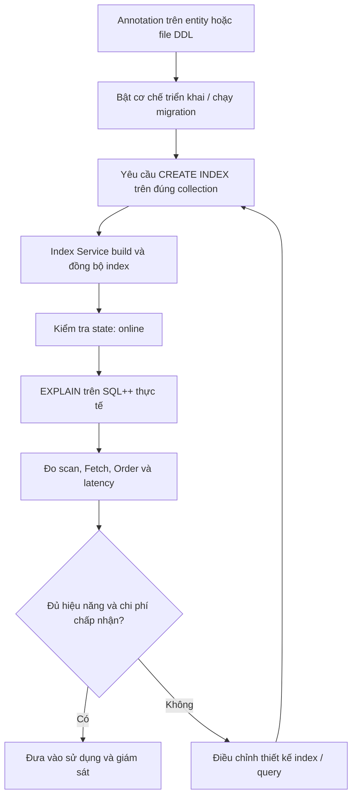

# Cấu hình tạo chỉ mục tự động và ranh giới với triển khai production trong Spring Data Couchbase

Trong giai đoạn phát triển, người học thường muốn thêm `@QueryIndexed` vào entity, khởi động ứng dụng và có ngay chỉ mục cho repository query. Spring Data Couchbase có cơ chế **tạo chỉ mục tự động từ metadata mapping** trong những phiên bản và cấu hình hỗ trợ. Tuy nhiên, khi hệ thống có nhiều instance, nhiều collection và dữ liệu lớn, việc để mỗi lần khởi động ứng dụng có khả năng yêu cầu thay đổi index sẽ ảnh hưởng đến quyền truy cập, hiệu năng, thứ tự triển khai và khả năng xử lý sự cố.

Bài thuộc chương **Chỉ mục** của module **SPRING_DATA_COUCHBASE**. Mục tiêu là thiết lập ranh giới rõ giữa **quản lý index thuận tiện ở local/test** và **quản lý index có kiểm soát trong production**, gắn với document mapping, repository, `CouchbaseTemplate`, SQL++, thiết kế bucket/scope/collection, truy vấn reactive, TTL, CAS, giao dịch và tính nhất quán.

Các ví dụ mô tả nguyên tắc dành cho **phiên bản Spring Data Couchbase có hỗ trợ `@QueryIndexed`, `@CompositeQueryIndex` và `autoIndexCreation()`**. Tên API, các quyền cần có và hành vi bootstrap phải được đối chiếu với **phiên bản cụ thể** của ứng dụng. Đặc biệt, không giả định có một thuộc tính Spring Boot chung cho mọi phiên bản chỉ vì thấy cờ bật trong ví dụ.

## 1. Mục tiêu học tập

Sau bài này, bạn có thể:

1. Phân biệt khai báo annotation, cấu hình tạo chỉ mục, quá trình build index và việc Query Service chọn index.
2. Bật hoặc tắt `autoIndexCreation()` trong cấu hình Spring Data Couchbase theo môi trường được kiểm soát.
3. Hiểu vì sao automatic index creation phù hợp với bài thực hành nhưng có rủi ro khi nhiều instance cùng khởi động trên production.
4. Lập quy trình triển khai chỉ mục theo từng bước: thiết kế DDL, tạo, đợi sẵn sàng, kiểm tra `EXPLAIN`, chuyển truy vấn và thu hồi index cũ.
5. Kiểm tra tên keyspace, trạng thái index, quyền, sai lệch schema, performance và tính nhất quán sau khi thay đổi.

## 2. Bốn trạng thái khác nhau của một chỉ mục

Điều quan trọng nhất là không gộp bốn trạng thái thành một:

| Trạng thái | Bằng chứng cần có | Điều **chưa** thể kết luận |
| --- | --- | --- |
| **Đã khai báo** | Entity có `@QueryIndexed` hoặc `@CompositeQueryIndex` | Chưa biết Couchbase đã có index |
| **Đã yêu cầu tạo** | Cơ chế auto-index hoạt động hoặc migration phát DDL thành công | Chưa chắc index build xong |
| **Đã sẵn sàng** | `system:indexes` cho thấy trạng thái khả dụng, thường là `online` | Chưa chắc optimizer dùng index |
| **Đã được dùng hiệu quả** | `EXPLAIN` và metrics cho thấy index được chọn, scan/Fetch/sort phù hợp | Chưa chắc lợi ích đọc bù được chi phí ghi và vận hành |

Vòng đời khái quát:



Khi repository gọi `findById(id)` với document ID đã biết, Spring Data Couchbase thường dùng KV operation: lời gọi này **không cần GSI/primary index của Query Service**. Các index trong bài phục vụ **SQL++ theo thuộc tính**, chẳng hạn `findByTenantIdAndStatus(...)` hoặc một truy vấn từ `CouchbaseTemplate`.

## 3. Mô hình ví dụ: một collection và hai mẫu truy vấn

Hệ thống đơn hàng dùng:

| Thành phần | Giá trị ví dụ |
| --- | --- |
| Bucket | `commerce` |
| Scope | `sales` |
| Collection | `orders` |
| Document ID | `order::1001` |

Document:

```json
{
  "_class": "salesOrder",
  "tenantId": "T-A",
  "customerId": "C-42",
  "status": "PAID",
  "createdAt": "2026-11-20T08:15:00Z",
  "total": 1500000,
  "currency": "VND"
}
```

`_class` minh họa discriminator của entity; cách lưu thực tế phụ thuộc cấu hình và `@TypeAlias`. `createdAt` trong ví dụ là chuỗi ISO-8601 UTC nhất quán để mô phỏng truy vấn thời gian. Nếu Java lưu `Instant` theo bộ converter khác, cần xem biểu diễn JSON thực trước khi đưa trường này vào index.

Hai truy vấn nghiệp vụ:

```sql
-- Tìm đơn của một khách hàng
SELECT META(o).id AS id, o.customerId, o.status
FROM `commerce`.`sales`.`orders` AS o
WHERE o.customerId = "C-42";

-- Danh sách đơn theo tenant và trạng thái, mới nhất trước
SELECT META(o).id AS id, o.tenantId, o.status, o.createdAt
FROM `commerce`.`sales`.`orders` AS o
WHERE o.tenantId = "T-A" AND o.status = "PAID"
ORDER BY o.createdAt DESC
LIMIT 20;
```

Chỉ mục đơn theo `customerId` và chỉ mục ghép `(tenantId, status, createdAt DESC)` là những ứng viên ban đầu. Tên collection, giá trị kiểu và các điều kiện bổ sung của Spring Data phải được xác minh trên SQL++ thực.

## 4. Khai báo index trong model: annotation làm được những gì?

Trong Spring Data Couchbase có hỗ trợ, `@QueryIndexed` đánh dấu field cho secondary index và `@CompositeQueryIndex` khai báo index ghép trên entity. Ví dụ:

```java
import org.springframework.data.annotation.Id;
import org.springframework.data.annotation.TypeAlias;
import org.springframework.data.couchbase.core.index.QueryIndexed;
import org.springframework.data.couchbase.core.index.CompositeQueryIndex;
import org.springframework.data.couchbase.core.mapping.Document;
import org.springframework.data.couchbase.core.mapping.Scope;
import org.springframework.data.couchbase.core.mapping.Collection;

@Document
@TypeAlias("salesOrder")
@Scope("sales")
@Collection("orders")
@CompositeQueryIndex(
    name = "ix_orders_tenant_status_created",
    fields = {"tenantId", "status", "createdAt DESC"}
)
public class SalesOrder {
    @Id
    private String id;

    @QueryIndexed(name = "ix_orders_customer")
    private String customerId;

    private String tenantId;
    private String status;
    private String createdAt;
    private long total;

    // Constructor, getter, setter được lược bỏ.
}
```

Về mục tiêu truy vấn, chúng tương ứng gần với DDL sau:

```sql
CREATE INDEX ix_orders_customer
ON `commerce`.`sales`.`orders`(`customerId`);

CREATE INDEX ix_orders_tenant_status_created
ON `commerce`.`sales`.`orders`(
    `tenantId`, `status`, `createdAt` DESC
);
```

Hai câu SQL++ này chỉ minh họa **ý định** của annotation; không nên khẳng định framework luôn phát đúng chuỗi DDL hoặc tên index như minh họa. Tên và biểu thức index thực tế phải đọc từ `system:indexes` trong môi trường chạy.

### 4.1. Annotation là mô tả, không phải migration đầy đủ

`@QueryIndexed` và `@CompositeQueryIndex` hỗ trợ những cấu hình index được API trình bày. Chúng không bao quát mọi tính năng và chính sách vận hành của Index Service:

- Index có điều kiện `WHERE status = "OPEN"` hoặc `WHERE _class = "salesOrder"` cần kiểm soát **predicate**; thường phù hợp với SQL++ DDL trực tiếp.
- Index trên mảng có biểu thức `DISTINCT ARRAY ... FOR ... IN ... END`, `ALL ARRAY` hoặc `FLATTEN_KEYS` thường cần thiết kế và kiểm chứng riêng.
- Covering index, expression index, thứ tự sắp xếp phức tạp hoặc các tùy chọn build/replica có thể đòi hỏi DDL mà annotation không diễn đạt đầy đủ.
- Xóa, đổi tên, thay thế index cũ theo phiên bản ứng dụng **không nên suy ra** chỉ từ việc sửa annotation rồi khởi động lại.

Quan trọng hơn, **index do annotation tạo và index do script tạo đều là index thực trên Couchbase**. Sau khi chúng tồn tại, Query Service chọn đường truy cập theo SQL++ và kế hoạch tối ưu, không dựa trên nguồn gốc tạo index.

## 5. Bật `autoIndexCreation()` trong môi trường phù hợp

### 5.1. Mặc định tắt và cần bật chủ động

Theo mô hình cấu hình Spring Data Couchbase có hỗ trợ, automatic index creation **không bật mặc định**. Dù entity có `@QueryIndexed`, ứng dụng chưa chắc tạo index nếu chưa bật cơ chế này.

Một cách thường gặp là override hook trong lớp kế thừa `AbstractCouchbaseConfiguration`:

```java
import org.springframework.context.annotation.Configuration;
import org.springframework.data.couchbase.config.AbstractCouchbaseConfiguration;

@Configuration
public class CouchbaseConfig extends AbstractCouchbaseConfiguration {
    // Các phương thức cấu hình kết nối và bucket bắt buộc
    // của AbstractCouchbaseConfiguration được lược bỏ.

    @Override
    protected boolean autoIndexCreation() {
        return true;
    }
}
```

Đây là **đoạn trích**, chưa phải cấu hình đầy đủ có thể chạy độc lập. Ứng dụng cần kết nối, thông tin xác thực, bucket và cách cấu hình repository phù hợp phiên bản đang sử dụng.

**Chú ý với Spring Boot:** không tạo thêm một lớp `AbstractCouchbaseConfiguration` tùy ý nếu ứng dụng đã dùng auto-configuration hoặc cấu hình Couchbase riêng. Cần xác định **lớp cấu hình thực sự được kích hoạt** và hook được hỗ trợ ở phiên bản tương ứng.

### 5.2. Không hardcode `true` cho mọi môi trường

Khi muốn dùng cùng mã nguồn cho local và production, có thể dùng **một cờ cấu hình do ứng dụng tự định nghĩa**:

```java
import org.springframework.core.env.Environment;
import org.springframework.data.couchbase.config.AbstractCouchbaseConfiguration;

public abstract class EnvironmentAwareCouchbaseConfig
        extends AbstractCouchbaseConfiguration {

    private final Environment environment;

    protected EnvironmentAwareCouchbaseConfig(Environment environment) {
        this.environment = environment;
    }

    @Override
    protected boolean autoIndexCreation() {
        return environment.getProperty(
            "app.couchbase.create-query-indexes", Boolean.class, false
        );
    }
}
```

Đây là **mẫu cho việc đọc một property tự định nghĩa**, chưa phải cấu hình khởi tạo đầy đủ. Cấu hình thực của dự án có thể áp dụng cùng ý tưởng bằng một bean hoặc lớp cấu hình khác đang điều khiển index creation. Property `app.couchbase.create-query-indexes` **không được khẳng định là property có sẵn của Spring Boot**.

Ví dụ hai cấu hình môi trường:

```yaml
# application-local.yml
app:
  couchbase:
    create-query-indexes: true
```

```yaml
# application-prod.yml
app:
  couchbase:
    create-query-indexes: false
```

Nếu dùng profile Spring, phải xác minh profile nào thực sự active và thứ tự ưu tiên các nguồn property. Mục tiêu là để local/test có thể chủ động tạo index, còn production dùng quy trình triển khai DDL riêng.

### 5.3. Một nguồn cấu hình, một nguồn quản lý index

Trong một dự án vừa có Spring Boot auto-configuration, vừa có cấu hình Couchbase thủ công, việc thêm override không đúng chỗ có thể làm cờ không được áp dụng hoặc tạo bean trùng. Vì vậy, trước khi kết luận auto-index bật:

1. Xác định phiên bản Spring Data Couchbase và cách khởi tạo `CouchbaseTemplate`/repository.
2. Tìm lớp cấu hình thực sự điều khiển mapping và index creation của ứng dụng.
3. Xác nhận nguồn property/profile và giá trị runtime.
4. Kiểm tra kết quả ở Couchbase, thay vì chỉ dựa vào log “application started”.

Khi production sử dụng migration SQL++, cơ chế đó nên là **nguồn quản lý index đã thống nhất**. Không để cấu hình tự tạo index của ứng dụng vô tình cạnh tranh với pipeline triển khai.

## 6. Những điều kiện cần trước khi tự tạo index thành công

Tạo index là **thao tác trên hệ thống Couchbase**, không chỉ là tác vụ nội bộ của Spring Data. Các điều kiện thường cần gồm:

| Điều kiện | Nếu chưa đáp ứng thì sao? |
| --- | --- |
| Kết nối được đến cụm | Ứng dụng không thể phát yêu cầu tạo index |
| Bucket/scope/collection đúng tên và đã tồn tại | Lệnh tạo trên sai keyspace thất bại hoặc không phục vụ repository thật |
| Có Query/Index Service và tài nguyên cho build | Việc tạo/build index có thể không hoàn thành đúng kỳ vọng |
| Tài khoản có quyền quản lý index trên phạm vi cần thiết | Có thể nhận lỗi phân quyền khi yêu cầu DDL |
| Entity/index metadata nằm trong phạm vi được framework xử lý | Annotation trên class không được quét có thể không tạo index |
| Tên index không xung đột không mong muốn | DDL có thể lỗi hoặc index hiện tại khác cấu trúc mong muốn |
| Quá trình build hoàn tất | Truy vấn chưa thể dùng index nếu chưa ở trạng thái khả dụng |

**Phạm vi quyền:** ứng dụng đọc/ghi document có thể không cần quyền tạo index. Ngược lại, cơ chế tự tạo index cần khả năng thực hiện các thao tác DDL tương ứng. Trên production, nên phân tách **tài khoản runtime** với **tài khoản triển khai index** để giới hạn quyền và giảm rủi ro thao tác ngoài ý muốn.

### 6.1. Không đồng nhất “lệnh tạo thành công” với “index online”

Index cần thời gian để build từ dữ liệu hiện có và duy trì các mutation liên quan. Với collection lớn, việc tạo index tiêu thụ CPU, bộ nhớ, I/O và tài nguyên Index Service. Một câu lệnh DDL được chấp nhận chưa bảo đảm tất cả truy vấn đã có thể sử dụng index mới.

Một query kiểm tra metadata:

```sql
SELECT name, state, is_primary, index_key, condition
FROM system:indexes
WHERE bucket_id = "commerce"
  AND scope_id = "sales"
  AND keyspace_id = "orders";
```

Kiểm tra tên, thứ tự khóa, predicate và trạng thái `online` (hoặc trạng thái khả dụng tương đương trên phiên bản đang dùng). Nếu index chưa sẵn sàng, cần chẩn đoán build/permissions/capacity trước khi kích hoạt code phụ thuộc index.

### 6.2. Tên và ánh xạ field có thể lệch

Ví dụ Java dùng:

```java
import org.springframework.data.couchbase.core.mapping.Field;

@Field("created_at")
private String createdAt;
```

Khi annotation composite dùng chuỗi `"createdAt DESC"`, phải xác minh index thực có tạo trên **key JSON `created_at`** hay không. Không nên giả định mapping và chuỗi biểu thức index luôn được xử lý như nhau ở mọi phiên bản/framework.

So sánh `index_key` từ `system:indexes` với câu SQL++ do ứng dụng thực thi. Tương tự, `@TypeAlias` có thể thay đổi giá trị `_class`, ảnh hưởng điều kiện query và partial index.

## 7. Vì sao tự tạo index trong production cần thận trọng?

Giả sử hệ thống có 12 instance Spring Boot cùng khởi động khi triển khai. Mỗi instance có thể bắt đầu quá trình bootstrap repository và xử lý metadata chỉ mục. Khi tất cả đều có quyền DDL, những vấn đề sau cần được kiểm soát:

- **Yêu cầu tạo trùng:** nhiều instance phát hiện chưa có index và cùng yêu cầu tạo. Dù hệ thống/framework có cách xử lý một số tình huống trùng, không nên mặc định quá trình đó hoàn toàn không có race hoặc không phát sinh log lỗi.
- **Thời điểm bất định:** index có thể đang build khi phiên bản ứng dụng mới bắt đầu nhận lưu lượng truy vấn.
- **Rủi ro năng lực cụm:** một index lớn được build trong giờ cao điểm có thể tranh tài nguyên với các query/ghi đang phục vụ người dùng.
- **Quyền runtime quá rộng:** chỉ để tạo index lúc startup mà mọi instance luôn có quyền DDL là một quyết định cần cân nhắc.
- **Khó kiểm soát thay đổi:** code và index thực tế có thể lệch do thay đổi annotation, bản phát hành rollback hoặc môi trường khác nhau.
- **Khó quy trách nhiệm:** khi index được tạo bởi startup thay vì pipeline có bản ghi triển khai, việc truy vết lúc tạo và lý do thay đổi trở nên khó hơn.

Không phải mọi rủi ro đều chắc chắn xảy ra, nhưng chúng khiến việc biến startup thành bước migration trở nên khó vận hành ở production.

### 7.1. Không nên dựa vào startup để sửa mọi loại sai lệch

Hãy phân biệt:

| Thay đổi trong mã | Điều cần xử lý ở Couchbase |
| --- | --- |
| Thêm annotation index mới | Cần tạo/index build và kiểm tra truy vấn |
| Đổi thứ tự `fields` của composite index | Có thể cần index mới; không giả định index cũ được sửa ngay |
| Đổi `name` | Có thể phát sinh index mang tên mới trong khi tên cũ vẫn tồn tại |
| Xóa annotation | Không suy ra index đã được xóa khỏi Couchbase |
| Đổi field JSON bằng `@Field` | Cần đánh giá lại index cũ, SQL++ và dữ liệu legacy |
| Đổi collection/scope | Cần index trên keyspace mới; index ở keyspace cũ không theo sang |

Một quy trình migration có kiểm soát xử lý các thay đổi này rõ ràng hơn, đặc biệt khi phải duy trì nhiều phiên bản ứng dụng chạy song song.

### 7.2. Tài khoản runtime và tài khoản triển khai

Mô hình vận hành thường được khuyến nghị:

```text
Pipeline triển khai (quyền DDL được giới hạn)
    └── tạo / build / kiểm tra index
           └── xác nhận trạng thái online + kế hoạch truy vấn
                 └── triển khai hoặc bật tính năng ứng dụng
                       └── runtime account: chỉ quyền cần thiết cho đọc/ghi/query
```

Tên quyền cụ thể thay đổi theo cấu hình phân quyền/version Couchbase; hãy cấp đúng các privilege quản lý index trên phạm vi cần thao tác theo tài liệu của môi trường. Tránh cấp quyền quản trị toàn cụm chỉ để phục vụ một bước tạo index.

## 8. Quy trình triển khai index cho production

Giả sử tính năng mới cần xem danh sách đơn hàng theo `tenantId`, `status` và `createdAt DESC`. Chỉ mục mới:

```sql
CREATE INDEX ix_orders_tenant_status_created_v2
ON `commerce`.`sales`.`orders`(
    `tenantId`,
    `status`,
    `createdAt` DESC
);
```

Để triển khai an toàn, có thể tiến hành theo sáu giai đoạn dưới đây.

### Giai đoạn 1 — Phân tích workload và lập migration

Trước khi tạo index, tập hợp câu SQL++ thực sự được repository/`@Query`/`CouchbaseTemplate` gửi, gồm:

- Predicate `WHERE`, điều kiện kiểu entity `_class`, tham số SQL++, điều kiện tenant và soft-delete.
- `ORDER BY`, `LIMIT`, phân trang và các phép `JOIN`/`UNNEST` nếu có.
- Projection `SELECT`: trả toàn entity hay chỉ một số trường.
- Tần suất gọi, mục tiêu độ trễ, cardinality và tỷ lệ ghi.

Chọn thứ tự khóa từ các mẫu đó. Với `tenantId = ? AND status = ? ORDER BY createdAt DESC`, index có các khóa bằng ở đầu và khóa thời gian ở sau là ứng viên. Nếu truy vấn bỏ `tenantId` hoặc chỉ lọc thời gian, index cần thiết kế/đánh giá khác.

Lưu DDL trong hệ thống quản lý thay đổi của dự án cùng lý do tạo, owner, endpoint sử dụng, ngày triển khai và cách xác nhận. Dùng tên index có chủ ý như `_v2` khi cần thay thế index cũ mà không làm gián đoạn truy vấn.

### Giai đoạn 2 — Thử trên dữ liệu và môi trường đại diện

Trên staging, tạo index, đợi build hoàn tất và kiểm tra `system:indexes`. Dữ liệu thử nên có tenant lớn/nhỏ, trạng thái phổ biến/hiếm, số document và tỷ lệ cập nhật đủ gần production để đo được ảnh hưởng.

Nếu có khác biệt đáng kể về phiên bản Couchbase, topology Index Service, quyền hoặc tính năng, kết quả staging chỉ mang tính định hướng. Cần chuẩn bị kế hoạch theo điều kiện cụm production thực tế.

### Giai đoạn 3 — Tạo index khi tải cho phép

Chạy DDL qua tài khoản/đường triển khai đã được phép. Xác định trước tài nguyên cần thiết, khung thời gian thay đổi và chỉ số cần giám sát trong lúc build. Couchbase có thể hỗ trợ cách xây dựng index trì hoãn để gom nhiều index cùng build trong các phiên bản/cấu hình phù hợp; chỉ áp dụng tùy chọn đó nếu nhóm đã kiểm tra cú pháp và giới hạn của cụm đang dùng.

Việc xây dựng index cần được theo dõi đến trạng thái khả dụng. Nếu build thất bại hoặc tài nguyên cụm vượt ngưỡng chấp nhận, xử lý tình trạng đó trước khi chuyển tính năng.

### Giai đoạn 4 — Xác nhận kế hoạch SQL++ trước khi chuyển truy vấn

`EXPLAIN`:

```sql
EXPLAIN
SELECT META(o).id AS orderId,
       o.tenantId, o.status, o.createdAt
FROM `commerce`.`sales`.`orders` AS o
WHERE o.tenantId = "T-A"
  AND o.status = "PAID"
ORDER BY o.createdAt DESC
LIMIT 20;
```

Tìm trong kết quả:

| Thành phần | Ý nghĩa |
| --- | --- |
| `IndexScan` hoặc `IndexScan3` | Truy vấn đang chọn index nào? |
| `spans` | Có giới hạn được theo hai khóa bằng không? |
| `Fetch` | Có cần lấy JSON gốc vì projection/điều kiện chưa đủ trong index không? |
| `Order` | Có cần sort bổ sung, hay tận dụng thứ tự index? |
| `covers` | Các trường nào có thể được lấy từ index? |
| `Limit` | Có đẩy giới hạn kết quả vào kế hoạch phù hợp không? |

Tên operator cụ thể có thể thay đổi theo phiên bản Couchbase. Trên query thực tế do Spring Data phát ra có thể có điều kiện `_class` hoặc projection khác ví dụ SQL++ viết tay; **phải chạy lại `EXPLAIN` trên câu thực tế**.

### Giai đoạn 5 — Triển khai ứng dụng theo thứ tự phụ thuộc

Với tính năng chỉ chạy ổn khi index mới tồn tại, thứ tự phù hợp thường là:

1. Chuẩn bị DDL/index và kiểm tra build thành công.
2. Xác nhận Query Service nhìn thấy index, `EXPLAIN` và các chỉ số cơ bản đạt yêu cầu.
3. Triển khai phiên bản ứng dụng hoặc bật feature flag truy vấn mới.
4. Theo dõi query latency, timeout, thời gian chờ, scan và tác động lên Index Service.

Nếu ứng dụng phải dùng index cũ trong giai đoạn chuyển tiếp, duy trì cả hai index trong một thời gian có kiểm soát. Đừng xóa chỉ mục cũ khi vẫn có phiên bản ứng dụng hoặc endpoint dùng nó.

### Giai đoạn 6 — Thu hồi chỉ mục cũ sau khi xác minh

Xác định truy vấn nào còn dùng index cũ qua kế hoạch truy vấn và metrics quan sát. Chỉ khi không còn phụ thuộc, mới cân nhắc:

```sql
-- Chỉ chạy sau khi xác minh không còn phụ thuộc:
DROP INDEX `commerce`.`sales`.`orders`.`ix_orders_old`;
```

**Lưu ý:** Ví dụ `DROP INDEX` chỉ là thao tác mô tả vòng đời quản trị, không phải bước phải chạy trong bài thực hành. Thay đổi destructive này cần đặt trong quy trình triển khai đã phê duyệt, với kế hoạch khôi phục nếu ứng dụng còn phụ thuộc index cũ.

## 9. Rollback ứng dụng không đồng nghĩa rollback index

Giả sử đã tạo index `_v2`, rồi triển khai phiên bản ứng dụng mới nhưng phải rollback code. Khi đó:

- **Rollback code:** đưa truy vấn trở lại phiên bản cũ hoặc tắt feature flag.
- **Rollback index:** là quyết định riêng; có thể giữ index mới tạm thời nếu không gây áp lực đáng kể, hoặc gỡ sau khi đã xác minh không còn ai dùng.
- **Rollback dữ liệu:** nếu migration cũng đổi tên field hay định dạng document, phải có chiến lược tương thích dữ liệu; index không tự chuyển đổi JSON.

Không tự động gỡ index mới chỉ vì rollback ứng dụng, vì phiên bản khác hoặc một báo cáo đang chạy có thể đã bắt đầu sử dụng nó. Trước khi thay index hiện hữu, xác định rõ index mới/old có thể tồn tại song song bao lâu và tiêu chí để gỡ.

Nếu migration tạo index thất bại, cần dừng việc bật phần code phụ thuộc index, ghi nhận lỗi và sửa DDL/capacity/permissions. Không dùng primary index làm phương án thay thế âm thầm cho một endpoint có SLA nghiêm ngặt chỉ để “query chạy được”.

## 10. Quan hệ giữa index lifecycle và Spring Data Couchbase

### 10.1. Repository và `@Query`

Repository minh họa:

```java
import java.util.List;
import org.springframework.data.couchbase.repository.CouchbaseRepository;
import org.springframework.data.couchbase.repository.Query;

public interface SalesOrderRepository
        extends CouchbaseRepository<SalesOrder, String> {

    List<SalesOrder> findByTenantIdAndStatusOrderByCreatedAtDesc(
        String tenantId, String status
    );

    @Query("#{#n1ql.selectEntity} WHERE #{#n1ql.filter} " +
           "AND tenantId = $1 AND status = $2 " +
           "ORDER BY createdAt DESC LIMIT 20")
    List<SalesOrder> findLatestOrders(String tenantId, String status);
}
```

Derived query và `@Query` đều có thể dùng SQL++ để tìm theo thuộc tính. Chỉ mục do annotation tạo hay migration tạo không làm thay đổi cách SQL++ được optimizer tối ưu. `#{#n1ql.filter}` có thể đưa vào điều kiện theo loại entity; một composite index không bao phủ `_class` có thể có plan khác SQL++ minh họa.

Khi chạy quá trình thay index, cần kiểm tra **cả các method repository hiện có** và truy vấn mới. Chỉ tối ưu theo một câu SQL++ viết tay có thể bỏ sót các điều kiện mapping mà Spring Data tự thêm.

### 10.2. `CouchbaseTemplate`

`CouchbaseTemplate` được dùng khi cần query linh hoạt, projection hoặc các điều kiện phức tạp. Nếu template thực thi SQL++, nó vẫn phụ thuộc index thực tế của Query Service. Do đó quy trình migration phải bao quát cả SQL++ phát sinh từ template, không chỉ method repository.

Nếu truy vấn chọn một projection nhỏ (ví dụ ID, `status` và `createdAt`), có thể cân nhắc index bao phủ để giảm `Fetch`. Nếu template/repository trả toàn bộ entity chứa mảng lớn, index có cùng `WHERE` chưa chắc cover được `SELECT`; đo plan và dữ liệu thực tế.

### 10.3. API reactive

`ReactiveCouchbaseRepository` và template reactive hỗ trợ I/O bất đồng bộ và backpressure, nhưng một SQL++ query vẫn cần index thích hợp. Tự tạo index khi startup không giúp một truy vấn reactive đang quét quá nhiều index entry trở nên tối ưu.

Trong môi trường nhiều instance reactive, số truy vấn đồng thời có thể lớn: cần kiểm soát thời điểm build index, giám sát Query/Index Service và không để bootstrap tự tạo index bất ngờ ngay khi tăng số replica.

## 11. Tính nhất quán, TTL, CAS và giao dịch nằm ở đâu?

### 11.1. Index online chưa đồng nghĩa truy vấn luôn thấy mutation mới nhất

GSI được Couchbase duy trì bất đồng bộ so với thao tác KV. Sau khi `repository.save(order)` hoàn tất, SQL++ có thể tạm chưa thấy trạng thái vừa cập nhật nếu mức scan consistency không đòi hỏi chờ index bắt kịp.

| Scan consistency | Ảnh hưởng thực tế |
| --- | --- |
| `NOT_BOUNDED` | Không chờ index bắt kịp mutation ở thời điểm truy vấn; thường ít chờ nhưng có thể đọc dữ liệu cũ |
| `REQUEST_PLUS` | Đợi index bắt kịp các mutation liên quan tại thời điểm truy vấn; tính mới tốt hơn nhưng có thể tăng latency |

Đây là vấn đề **nhất quán của truy vấn**, tách biệt với việc index đã được tạo hay build thành công. Để đọc lại chính document vừa ghi theo ID đã biết, KV `findById` là đường truy cập trực tiếp.

### 11.2. TTL và cập nhật index

Document có TTL sẽ hết hạn theo chính sách vòng đời dữ liệu. Index phải được cập nhật để phản ánh insert/update/delete/expiry, nhưng annotation `@QueryIndexed` không phải cơ chế thiết lập TTL và không làm TTL nhanh hơn. Khi tự tạo nhiều index, lượng công việc duy trì có thể tăng cả lúc document được xóa/hết hạn.

### 11.3. CAS và giao dịch

CAS dùng để phát hiện xung đột cập nhật document; giao dịch phục vụ các nhóm thao tác cần nguyên tử theo cơ chế Couchbase. Chúng là cơ chế ghi và đảm bảo nghiệp vụ, không thay thế index SQL++.

Ví dụ đơn chuyển `OPEN → PAID` có thể cần CAS để tránh ghi đè cạnh tranh. Index theo `status` phải phản ánh sự thay đổi đó và SQL++ vẫn chịu mức scan consistency. Không nên suy rằng việc tạo index tự động giải quyết lỗi nhất quán hoặc cạnh tranh cập nhật.

## 12. Chẩn đoán sự cố tạo index và triển khai

| Hiện tượng | Giả thuyết cần xác minh | Hướng xử lý |
| --- | --- | --- |
| Có `@QueryIndexed` nhưng không có index | Cờ auto-index chưa bật trong cấu hình đang dùng, entity không được xử lý | Xác minh hook/runtime, log và `system:indexes` |
| App báo thiếu quyền lúc tạo index | Runtime account không có quyền DDL cần thiết | Chỉ cấp quyền ở môi trường cần auto-create, hoặc chuyển DDL sang pipeline |
| Index xuất hiện trên collection khác | Mapping scope/collection hoặc bucket không khớp | So sánh annotation, cấu hình và `system:indexes` |
| Sau đổi `@Field`, index không dùng | Tên field JSON và index key bị lệch | Đọc `index_key` và SQL++ thực |
| Index vừa tạo nhưng repository vẫn lỗi | Index chưa build/`online` hoặc query cần index khác | Kiểm tra trạng thái, `EXPLAIN` và predicate |
| Nhiều instance cùng khởi động tạo log lỗi DDL | Yêu cầu tạo trùng hoặc xung đột bootstrap | Tách deployment index khỏi runtime, kiểm soát một nguồn tạo |
| Query chạy được nhưng chậm | Index thiếu khóa dẫn đầu hoặc phải `Fetch`/`Order` nhiều | Phân tích spans, Query Profile và thiết kế lại khóa |
| Sau rollback code, index “thừa” | Vòng đời schema và code đã tách nhau | Xác minh phụ thuộc và cleanup theo kế hoạch |
| Index mới quá lớn, ghi chậm | Nhiều trường/biểu thức index hoặc build chiếm tài nguyên | Đo kích thước, chi phí ghi; điều chỉnh chiến lược |
| Query trả trạng thái cũ sau `save` | GSI cập nhật bất đồng bộ và consistency mặc định | Cân nhắc `REQUEST_PLUS` hoặc đọc KV theo ID |

### Chẩn đoán theo trình tự

1. **Kiểm tra metadata entity và cấu hình:** có đúng annotation, hook và profile không?
2. **Kiểm tra Couchbase:** đúng bucket/scope/collection, quyền và trạng thái Index Service không?
3. **Kiểm tra index thật:** tên, thứ tự `index_key`, `condition` và `state` có khớp không?
4. **Kiểm tra query thật:** derived repository/`@Query`/template thực sự gửi SQL++ nào?
5. **Kiểm tra optimizer:** index scan, spans, fetch, sort, limit có phù hợp không?
6. **Kiểm tra workload:** số entry quét, tỷ lệ ghi và tài nguyên cụm có đáp ứng không?

Không nên sửa đồng thời quá nhiều index khi chưa xác định nguyên nhân gốc: một index “sai thứ tự” và một index “chưa online” cần các phương án xử lý rất khác nhau.

## 13. Bài thực hành: chuyển từ auto-index local sang migration production

Giả sử nhóm đang phát triển trang “Danh sách đơn theo tenant”, cần query nhanh trên `commerce.sales.orders`. Có hai nhánh thực hành: local và quy trình staging/production giả lập.

### Nhánh A — Local: quan sát annotation và auto-index

1. Tạo collection thử nghiệm `commerce.sales.orders` và dữ liệu đơn hàng có `tenantId`, `status`, `createdAt`.
2. Khai báo `@CompositeQueryIndex(name = "ix_orders_tenant_status_created", fields = {"tenantId", "status", "createdAt DESC"})` trên entity.
3. Bật `autoIndexCreation()` trong lớp cấu hình thực sự được sử dụng, chỉ cho profile local/test.
4. Khởi động ứng dụng một lần và xem kết quả `system:indexes`; xác nhận index có đúng khóa và trạng thái.
5. Chạy `EXPLAIN` trên SQL++ tương đương repository; kiểm tra `IndexScan`, `Fetch`, `Order`.

Quan sát thêm trường hợp bỏ điều kiện `tenantId` khỏi truy vấn: index với `tenantId` dẫn đầu có thể không còn là lựa chọn tốt. Kết luận phải dựa trên plan thực tế.

### Nhánh B — Staging/production giả lập: quản lý index qua DDL

1. Đặt `app.couchbase.create-query-indexes: false` trong cấu hình sử dụng ở môi trường giả lập.
2. Đưa câu DDL `CREATE INDEX` vào một migration có tên/version và mô tả phạm vi triển khai.
3. Dùng tài khoản có quyền tạo index để chạy migration vào đúng collection.
4. Đợi index `online` và kiểm tra `EXPLAIN` trên SQL++ thật.
5. Sau khi index sẵn sàng, bật endpoint/tính năng mới; theo dõi Query Profile.
6. Nếu thay thế một index cũ, xác nhận không còn query phụ thuộc trước khi lên kế hoạch gỡ.

### Mẫu checklist phát hành một index

| Hạng mục | Câu hỏi kiểm chứng |
| --- | --- |
| **DDL** | Đúng tên index, keyspace, thứ tự khóa, predicate và projection cần phục vụ? |
| **Quyền** | Pipeline có quyền tạo/build index; runtime không mang quyền dư thừa? |
| **Dữ liệu** | Đã xét phân bố tenant/status, kích thước và tỷ lệ mutation? |
| **Build** | Index đạt trạng thái khả dụng, không còn lỗi build? |
| **Query** | `EXPLAIN` trên truy vấn Spring Data thực có chọn index mong đợi? |
| **Hiệu năng** | Có số liệu về scan, `Fetch`, `Order`, latency và chi phí ghi? |
| **Chuyển đổi** | Có trình tự deploy tính năng sau index và giữ tương thích với code cũ? |
| **Rollback** | Biết cách tắt truy vấn mới, giữ/gỡ index theo phụ thuộc thực tế? |
| **Giám sát** | Có người theo dõi Index/Query Service và endpoint sau deploy? |

Checklist trên dùng để luyện tư duy vận hành; quy trình triển khai chính thức của tổ chức có thể thêm bước kiểm thử, phân quyền và phê duyệt phù hợp.

## 14. Câu hỏi tự kiểm tra

1. Vì sao một entity có `@QueryIndexed` chưa chứng minh Couchbase đã tạo index?
2. `autoIndexCreation()` bật có đồng nghĩa mọi index đã `online` trước khi ứng dụng nhận request không?
3. Vì sao không nên giữ quyền tạo index trên mọi runtime instance của ứng dụng production chỉ để dùng annotation?
4. Nếu sửa thứ tự `fields` trong `@CompositeQueryIndex`, vì sao cần kiểm tra index cũ và có thể cần migration mới?
5. Làm thế nào để xác nhận index được tạo trên đúng bucket/scope/collection?
6. Tại sao phải chạy `EXPLAIN` trên câu SQL++ thực do repository phát ra, gồm cả bộ lọc `_class`?
7. Sau khi index mới `online`, điều gì còn cần đo trước khi tuyên bố truy vấn được tối ưu?
8. Nêu trình tự triển khai index trước khi bật một endpoint phụ thuộc vào index đó.
9. Khi rollback ứng dụng, tại sao không nên tự động `DROP INDEX` ngay?
10. Vì sao chỉ mục tự tạo không thay thế TTL, CAS, giao dịch hoặc scan consistency?

## 15. Kết luận

Spring Data Couchbase có thể hỗ trợ tạo secondary index từ annotation khi cấu hình tự tạo index được bật. Cơ chế này giúp dựng nhanh môi trường local/test và học mối quan hệ giữa entity, repository và SQL++. Tuy nhiên, **khai báo annotation, tạo index, build hoàn tất và tối ưu truy vấn là bốn trạng thái độc lập cần xác minh**.

Ở production, nên quản lý index như một phần của quá trình thay đổi hệ thống: DDL được version hóa, quyền triển khai được phân tách, index được build và xác nhận trước khi bật code phụ thuộc, kế hoạch `EXPLAIN` và số liệu Query Profile được kiểm tra, index cũ chỉ được thu hồi sau khi xác minh không còn phụ thuộc. Cách tiếp cận này giúp tầng dữ liệu **SPRING_DATA_COUCHBASE** đạt hiệu năng và tính nhất quán phù hợp mà vẫn kiểm soát được chi phí vận hành.
