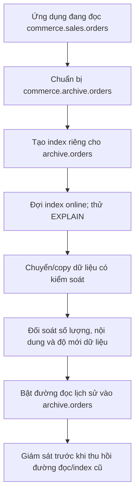

# Quản lý chỉ mục riêng cho scope và collection trong Spring Data Couchbase

Một ứng dụng Spring Data Couchbase có thể sử dụng cùng một bucket để lưu đơn hàng, khách hàng, sự kiện và dữ liệu lịch sử. Những document đó thường được chia vào nhiều **scope** và **collection**. Khi một repository query chạy chậm hoặc báo không có chỉ mục phù hợp, chỉ kiểm tra “bucket đã có index chưa?” là chưa đủ: **chỉ mục SQL++ được định nghĩa trên một keyspace cụ thể**, nên phải biết chính xác query đang đọc collection nào.

Bài thuộc chương **Chỉ mục** của module **SPRING_DATA_COUCHBASE**, tập trung vào cách quản lý index theo bucket/scope/collection khi xây dựng tầng truy cập bằng document mapping, repository, `CouchbaseTemplate` và SQL++. Các quyết định về vị trí tạo index còn ảnh hưởng đến hiệu năng, quyền truy cập, khả năng triển khai, vận hành, xử lý TTL, CAS, giao dịch và lựa chọn API reactive.

## 1. Mục tiêu học tập

Sau bài này, bạn có thể:

1. Phân biệt vai trò của **bucket**, **scope**, **collection** và **document ID**; nhận diện keyspace mà Query Service thực sự truy vấn.
2. Viết SQL++ `CREATE INDEX`, `CREATE PRIMARY INDEX` và `EXPLAIN` với đường dẫn collection đầy đủ.
3. Dùng `system:indexes` để kiểm tra index theo bộ ba `bucket_id`, `scope_id`, `keyspace_id`, không nhầm các collection cùng tên.
4. Ánh xạ entity/repository Spring Data Couchbase tới đúng scope và collection, đồng thời phân biệt truy vấn SQL++ với thao tác KV theo document ID.
5. Tổ chức vòng đời index từ development đến production: quyền, version DDL, thứ tự chuyển dữ liệu, trạng thái build, xác nhận truy vấn, thu hồi index cũ và theo dõi chi phí.

## 2. Bucket, scope và collection là những ranh giới gì?

Couchbase tổ chức dữ liệu theo cấu trúc:

```text
Cluster
└── bucket: commerce
    ├── scope: sales
    │   ├── collection: orders
    │   ├── collection: order_events
    │   └── collection: customers
    └── scope: archive
        ├── collection: orders
        └── collection: order_events
```

Trong ví dụ:

| Thành phần | Ý nghĩa | Giá trị |
| --- | --- | --- |
| Bucket | Đơn vị tổ chức/lưu trữ dữ liệu, có cấu hình tài nguyên và chính sách liên quan | `commerce` |
| Scope | Không gian nhóm các collection, giúp tổ chức miền dữ liệu và phạm vi quản trị | `sales`, `archive` |
| Collection | Tập document được truy cập độc lập trong bucket/scope | `orders`, `order_events` |
| Document ID | Khóa định danh một document **trong collection** | `order::1001` |

Đường dẫn đầy đủ của hai collection đơn hàng:

```text
commerce.sales.orders
commerce.archive.orders
```

Chúng có **cùng tên collection** nhưng là **hai keyspace khác nhau**. Có thể có document cùng ID `order::1001` ở cả hai vì không gian khóa KV thuộc về từng collection; điều đó không khiến chúng là cùng một document.

**Hệ quả với index:** Chỉ mục trên `commerce.sales.orders` không lập chỉ mục các document của `commerce.archive.orders`, dù cấu trúc JSON của hai nơi hoàn toàn giống nhau. Cũng không có chuyện tạo một index trên `commerce.sales.orders` rồi tự động áp dụng cho mọi collection trong scope `sales`.

> Trong SQL++ của Couchbase, khi đề cập một index cho nghiệp vụ, hãy ghi rõ **index của collection nào**, không chỉ nói “index trong bucket commerce”.

### 2.1. Mối quan hệ với collection mặc định

Các bucket trong mô hình collection có scope và collection mặc định tên `_default`. Ví dụ một keyspace đầy đủ:

```sql
SELECT META(d).id AS id
FROM `commerce`.`_default`.`_default` AS d
LIMIT 10;
```

Ứng dụng cũ có thể dùng cách truy vấn bucket mà ngầm làm việc với collection mặc định, trong khi ứng dụng mới dùng `commerce.sales.orders`. Đừng suy đoán hai cách trỏ tới cùng dữ liệu: trước khi di chuyển repository hay tạo index, phải kiểm tra **keyspace thực tế** mà SDK/framework đang sử dụng và phiên bản Couchbase được triển khai.

## 3. Document và ba mẫu truy vấn của cùng một ứng dụng

Giả sử một đơn hàng đang hoạt động trong `commerce.sales.orders` có ID `order::1001`:

```json
{
  "_class": "salesOrder",
  "tenantId": "TENANT-A",
  "customerId": "C-42",
  "status": "PAID",
  "createdAt": "2026-11-20T08:15:00Z",
  "total": 1500000
}
```

Một sự kiện thuộc `commerce.sales.order_events` có ID `event::3001`:

```json
{
  "_class": "orderEvent",
  "tenantId": "TENANT-A",
  "orderId": "order::1001",
  "eventType": "PAYMENT_CONFIRMED",
  "eventTime": "2026-11-20T08:16:00Z"
}
```

Một đơn hàng lịch sử ở `commerce.archive.orders` có thể có cấu trúc giống đơn hàng đang hoạt động, nhưng truy vấn đọc từ keyspace lịch sử. Trong ví dụ, các trường thời gian dùng chuỗi ISO-8601 UTC được chuẩn hóa; dự án dùng `Instant` và converter cần kiểm tra giá trị JSON thật trước khi xây index range hoặc sort.

Ba mục đích truy vấn:

**A — Liệt kê đơn đang hoạt động của tenant theo trạng thái:**

```sql
SELECT META(o).id AS orderId, o.status, o.createdAt, o.total
FROM `commerce`.`sales`.`orders` AS o
WHERE o.tenantId = "TENANT-A"
  AND o.status = "PAID"
ORDER BY o.createdAt DESC
LIMIT 20;
```

**B — Liệt kê sự kiện của một đơn:**

```sql
SELECT META(e).id AS eventId, e.orderId, e.eventType, e.eventTime
FROM `commerce`.`sales`.`order_events` AS e
WHERE e.orderId = "order::1001"
ORDER BY e.eventTime DESC;
```

**C — Tra cứu đơn ở scope lịch sử:**

```sql
SELECT META(o).id AS orderId, o.status, o.createdAt
FROM `commerce`.`archive`.`orders` AS o
WHERE o.tenantId = "TENANT-A"
ORDER BY o.createdAt DESC
LIMIT 20;
```

Tuy cả ba truy vấn đều ở bucket `commerce`, chúng đọc **ba collection khác nhau**. Một index ghép theo `tenantId` và `createdAt` ở collection A không giúp được B hoặc C.

## 4. Tạo index trên đúng collection bằng SQL++

### 4.1. Đường dẫn keyspace đầy đủ

Cú pháp thiết kế phổ biến:

```sql
CREATE INDEX index_name
ON `bucket_name`.`scope_name`.`collection_name`(
    field1, field2
);
```

Trong phần DDL của quy trình triển khai, nên dùng đường dẫn keyspace đầy đủ để tránh phụ thuộc vào **query context** hiện tại. Dấu backtick bao quanh tên bucket/scope/collection là cách trích dẫn identifier trong SQL++; đặc biệt hữu ích nếu tên trùng từ dành riêng hoặc có ký tự cần escape.

Index cho ba trường hợp vừa nêu:

```sql
-- A: đơn đang hoạt động
CREATE INDEX ix_sales_orders_tenant_status_created
ON `commerce`.`sales`.`orders`(
    `tenantId`,
    `status`,
    `createdAt` DESC
);

-- B: sự kiện đơn hàng
CREATE INDEX ix_sales_events_order_time
ON `commerce`.`sales`.`order_events`(
    `orderId`,
    `eventTime` DESC
);

-- C: đơn hàng lịch sử
CREATE INDEX ix_archive_orders_tenant_created
ON `commerce`.`archive`.`orders`(
    `tenantId`,
    `createdAt` DESC
);
```

Tên index ở đây được chọn để dễ nhận ra môi trường/nghiệp vụ, nhưng **chính keyspace của lệnh `ON`** mới xác định document nào được lập chỉ mục. Đừng chỉ dựa vào tên có chuỗi `archive` hay `sales`; tên chỉ là quy ước do đội phát triển đặt.

### 4.2. Primary index cũng thuộc một keyspace cụ thể

Để thí nghiệm truy vấn SQL++ tổng quát trong môi trường phát triển:

```sql
CREATE PRIMARY INDEX ix_sales_orders_primary
ON `commerce`.`sales`.`orders`;
```

Primary index này thuộc **collection `sales.orders`**, không thuộc mọi collection trong scope `sales` hay mọi scope của bucket `commerce`. Không tạo primary index hàng loạt chỉ để “cho mọi query chạy được” trên production: nó có thể làm các query thiếu secondary index phù hợp quét quá nhiều document.

**Khác với primary index:** thao tác `findById("order::1001")` theo document ID thường dùng đường KV; nó không cần SQL++ primary index hay secondary index. Việc thêm `@Id` vào Java entity cũng không tự yêu cầu tạo primary index SQL++.

### 4.3. Một scope không đồng nghĩa một index chung

Có thể muốn tạo một index cho mọi collection chứa `tenantId` dưới scope `sales`. Couchbase không hoạt động theo cách một `CREATE INDEX` duy nhất tự phủ tất cả collection. Thay vào đó:

1. Liệt kê chính xác những collection có truy vấn cần index.
2. Viết DDL tương ứng cho từng keyspace.
3. Tạo và kiểm tra theo từng collection.
4. Xác nhận truy vấn từ repository/template của từng loại document.

Không nhất thiết tạo cùng một index cho mọi collection: `orders` cần index theo `tenantId/status/createdAt`, còn `order_events` có thể cần `orderId/eventTime`. Thiết kế theo **truy vấn và tính chất dữ liệu của từng collection**, không theo một “mẫu index chung của scope”.

## 5. Query context và các đường dẫn tương đối

SQL++ có cơ chế query context giúp những tên keyspace tương đối được diễn giải trong một bucket/scope đã chọn. Vì vậy một câu như:

```sql
SELECT META(o).id AS id, o.status
FROM orders AS o
WHERE o.status = "PAID";
```

có thể được hiểu theo context đang dùng. Nếu context là `commerce.sales`, mục tiêu có thể là `commerce.sales.orders`; nếu context chuyển thành `commerce.archive`, cùng tên `orders` sẽ chỉ một collection khác.

Điều đó dễ gây nhầm lẫn trong:

- SQL++ chạy thủ công trên Query Workbench.
- Lệnh `Cluster.query(...)` qua Java SDK, nơi query context là một phần cấu hình thực thi.
- Truy vấn động được dựng bởi service hoặc `CouchbaseTemplate`.
- Code migration sử dụng tên collection tương đối.

**Khuyến nghị:** Với DDL/migration và khi điều tra một query lỗi, ưu tiên sử dụng **tên ba phần** `bucket.scope.collection` trong SQL++ để biết chắc collection nào đang được truy vấn. Nếu ứng dụng chủ đích dùng query context, cấu hình đó phải được ghi rõ, kiểm thử và theo dõi.

Không nên kết luận “index thiếu” chỉ từ một câu SQL++ tương đối khi chưa biết câu đó đang chạy trong context nào.

## 6. Kiểm tra catalog `system:indexes` theo bucket, scope, collection

Một lỗi vận hành phổ biến: lệnh kiểm tra chỉ mục trả tên `ix_orders_tenant_created`, nên nhóm cho rằng index đã sẵn sàng — nhưng index ấy nằm ở **scope khác**. Để tránh nhầm, phải lọc catalog theo đầy đủ keyspace.

### 6.1. Kiểm tra một collection cụ thể

```sql
SELECT name,
       state,
       is_primary,
       index_key,
       condition,
       bucket_id,
       scope_id,
       keyspace_id
FROM system:indexes
WHERE bucket_id = "commerce"
  AND scope_id = "sales"
  AND keyspace_id = "orders";
```

Đọc từng trường:

| Trường catalog | Dùng để làm gì? |
| --- | --- |
| `bucket_id` | Xác nhận bucket mà index thuộc về |
| `scope_id` | Xác nhận scope cụ thể |
| `keyspace_id` | Xác nhận collection cụ thể |
| `name` | Tên index dùng để tìm trong kế hoạch/trạng thái |
| `state` | Trạng thái build/sẵn sàng, thường cần `online` để phục vụ query |
| `is_primary` | Phân biệt primary index và secondary index |
| `index_key` | Danh sách biểu thức/khóa theo thứ tự thực tế |
| `condition` | Predicate của partial index, nếu có |

Cần chú ý khi chạy catalog query: quyền truy cập metadata, phiên bản Couchbase và topology có thể ảnh hưởng những thông tin được xem; nếu truy vấn thiếu quyền, kiểm tra tài khoản và privilege phù hợp thay vì kết luận index không tồn tại.

### 6.2. Kiểm tra các collection cùng tên ở hai scope

```sql
SELECT bucket_id, scope_id, keyspace_id, name, state, index_key
FROM system:indexes
WHERE bucket_id = "commerce"
  AND keyspace_id = "orders"
  AND scope_id IN ["sales", "archive"];
```

Không lọc theo `scope_id` có thể khiến một dòng index của `archive.orders` bị hiểu nhầm là index của `sales.orders`. Với hệ thống có nhiều bucket hoặc nhiều môi trường, hãy ghi cả cluster/environment trong nhật ký kiểm tra ngoài các trường metadata này.

### 6.3. So sánh định nghĩa thực với DDL dự kiến

Sau khi tạo index, đối chiếu:

- Đúng keyspace? `commerce.sales.orders` hay `commerce.archive.orders`?
- Đúng tên index? Có index gần giống nhau do lần triển khai cũ không?
- Đúng thứ tự `index_key`? Ví dụ `tenantId, status, createdAt DESC`.
- Có predicate `condition` ngoài dự kiến không? Nó có thể loại bỏ một số document.
- Index đã `online` chưa? Nếu chưa, phải chẩn đoán quá trình build.

Một lệnh tạo index được chấp nhận **không bảo đảm** index đã online và optimizer có thể sử dụng ngay, đặc biệt với collection lớn.

## 7. Spring Data Couchbase ánh xạ entity đến collection nào?

### 7.1. Entity cho đơn hàng đang hoạt động

Ví dụ ánh xạ:

```java
import java.time.Instant;
import org.springframework.data.annotation.Id;
import org.springframework.data.annotation.TypeAlias;
import org.springframework.data.couchbase.core.mapping.Collection;
import org.springframework.data.couchbase.core.mapping.Document;
import org.springframework.data.couchbase.core.mapping.Scope;

@Document
@TypeAlias("salesOrder")
@Scope("sales")
@Collection("orders")
public class SalesOrder {
    @Id
    private String id;
    private String tenantId;
    private String customerId;
    private String status;
    private Instant createdAt;
    private long total;

    // Constructor, getter, setter được lược bỏ.
}
```

Trong cấu hình minh họa, bucket được xác định ở lớp cấu hình Couchbase của ứng dụng (ví dụ `commerce`). Hai annotation `@Scope("sales")` và `@Collection("orders")` thể hiện phạm vi lưu entity trong mô hình Spring Data Couchbase hỗ trợ mapping theo scope/collection.

**Không được bỏ qua bucket trong cấu hình runtime.** Một entity có `@Scope("sales")` và `@Collection("orders")` không tự chứng minh repository đang dùng bucket `commerce`; bucket đến từ cấu hình/operations mapping hiện hành.

### 7.2. Entity cho sự kiện là một collection khác

```java
import java.time.Instant;
import org.springframework.data.annotation.Id;
import org.springframework.data.annotation.TypeAlias;
import org.springframework.data.couchbase.core.mapping.Collection;
import org.springframework.data.couchbase.core.mapping.Document;
import org.springframework.data.couchbase.core.mapping.Scope;

@Document
@TypeAlias("orderEvent")
@Scope("sales")
@Collection("order_events")
public class OrderEvent {
    @Id
    private String id;
    private String tenantId;
    private String orderId;
    private String eventType;
    private Instant eventTime;

    // Constructor, getter, setter được lược bỏ.
}
```

Entity này ở **cùng scope** với `SalesOrder` nhưng **khác collection**. Dù cả hai có `tenantId`, một index theo `tenantId` được tạo ở collection `orders` không giúp truy vấn `order_events`.

Nếu có class riêng cho dữ liệu lưu trữ, ví dụ `ArchivedOrder` với `@Scope("archive")` và `@Collection("orders")`, repository của nó làm việc với keyspace khác. Khi triển khai migration từ scope `sales` sang `archive`, cần chuẩn bị index của cả hai nơi trong giai đoạn chuyển tiếp.

### 7.3. Repository query và SQL++ thực tế

```java
import java.util.List;
import org.springframework.data.couchbase.repository.CouchbaseRepository;

public interface SalesOrderRepository
        extends CouchbaseRepository<SalesOrder, String> {

    List<SalesOrder> findByTenantIdAndStatusOrderByCreatedAtDesc(
        String tenantId,
        String status
    );
}
```

Phương thức tìm theo thuộc tính thường được chuyển thành truy vấn SQL++; Query Service cần index trên đúng collection đã được repository ánh xạ. Nó có thể thêm điều kiện phân biệt entity, ví dụ `_class`, tùy metadata và cách cấu hình mapping.

Vì vậy, khi repository không dùng index dù SQL++ viết tay có thể dùng, hãy kiểm tra:

1. Repository đang liên kết đến entity/class nào?
2. Bucket thực sự là gì, scope/collection runtime là gì?
3. SQL++ được tạo có thêm bộ lọc kiểu hay projection toàn entity không?
4. Index theo đúng keyspace và field JSON đang được truy vấn có `online` chưa?

Không suy luận keyspace từ tên repository hoặc package; lấy từ cấu hình và **truy vấn thực tế**.

### 7.4. `@Query` và `CouchbaseTemplate`

Một ví dụ `@Query` trong repository:

```java
import java.util.List;
import org.springframework.data.couchbase.repository.Query;

public interface SalesOrderRepository
        extends CouchbaseRepository<SalesOrder, String> {

    @Query("#{#n1ql.selectEntity} WHERE #{#n1ql.filter} " +
           "AND tenantId = $1 AND status = $2 " +
           "ORDER BY createdAt DESC LIMIT 20")
    List<SalesOrder> findRecentOrders(String tenantId, String status);
}
```

`#{#n1ql.selectEntity}` và `#{#n1ql.filter}` hỗ trợ việc chọn các trường/metadata cho mapping và lọc theo loại entity. Chúng không có nghĩa tự tạo GSI và không thay thế bước xác nhận query chạy trên keyspace mong đợi.

`CouchbaseTemplate` hoặc truy vấn SQL++ qua Java SDK cho phép kiểm soát query linh hoạt. Khi chúng truy cập `commerce.archive.orders` thay vì `commerce.sales.orders`, kế hoạch query và index hữu dụng có thể khác hẳn dù câu `WHERE` giống nhau. Hãy kiểm soát query context/đường dẫn collection trong các query được dựng động.

### 7.5. Reactive repository không thay đổi ranh giới collection

`ReactiveCouchbaseRepository` và reactive template cho phép xử lý I/O bất đồng bộ, nhưng Query/Index Service vẫn truy cập **keyspace được định danh**. Một query reactive không thể tự dùng index của collection khác. Nếu API đọc cùng dữ liệu ở scope lịch sử, phải thiết kế index riêng ở scope lịch sử; chỉ thay kiểu trả về `Flux` không giải quyết được.

## 8. Dùng `EXPLAIN` để xác nhận index theo đúng keyspace

Giả sử index `ix_sales_orders_tenant_status_created` đã online ở `commerce.sales.orders`. Phân tích:

```sql
EXPLAIN
SELECT META(o).id AS orderId,
       o.tenantId, o.status, o.createdAt
FROM `commerce`.`sales`.`orders` AS o
WHERE o.tenantId = "TENANT-A"
  AND o.status = "PAID"
ORDER BY o.createdAt DESC
LIMIT 20;
```

Trong kế hoạch, cần tìm:

| Dấu hiệu | Điều cần xác minh |
| --- | --- |
| Keyspace/operator scan | Có đang quét `commerce.sales.orders` không? |
| `IndexScan`, `IndexScan3` hoặc tên operator tương đương | Index được chọn thuộc keyspace này hay index khác? |
| `spans` | Index có giới hạn theo `tenantId` và `status` không? |
| `Fetch` | Truy vấn có cần đọc thêm document gốc không? |
| `Order` | Thứ tự `createdAt DESC` có tận dụng được index không? |
| `covers` | Index có chứa đủ các trường cho projection được chọn không? |
| `Limit` | Giới hạn kết quả có được đẩy xuống phù hợp hay không? |

Tên operator và cấu trúc JSON có thể thay đổi theo phiên bản Couchbase. Việc không thấy index mong đợi có thể là do keyspace khác, predicate không phù hợp, index chưa `online` hoặc optimizer chọn đường truy cập có chi phí thấp hơn.

Thực hiện lại cùng một câu truy vấn nhưng đổi `FROM` sang:

```sql
EXPLAIN
SELECT META(o).id AS orderId,
       o.tenantId, o.status, o.createdAt
FROM `commerce`.`archive`.`orders` AS o
WHERE o.tenantId = "TENANT-A"
  AND o.status = "PAID"
ORDER BY o.createdAt DESC
LIMIT 20;
```

Đây là **một truy vấn khác về mặt keyspace**, không chỉ là “cùng truy vấn đổi dữ liệu”. Index `ix_sales_orders_tenant_status_created` trên `sales.orders` không phải đường truy cập của `archive.orders`. Nếu collection lịch sử cần lọc cả `status` thường xuyên, có thể phải mở rộng index lịch sử hoặc bổ sung một index khác phù hợp.

## 9. Tạo và quản lý index theo collection trong production

Khi hệ thống chuyển từ một collection chung sang nhiều scope/collection, cần coi index là một phần của **kế hoạch di trú và vận hành**, không chỉ là vài câu `CREATE INDEX`.

### 9.1. Bản kê index theo keyspace

Lập bản kê thể hiện **đúng keyspace và mục đích sử dụng**:

| Keyspace | Truy vấn chính | Index ứng viên | Người sở hữu |
| --- | --- | --- | --- |
| `commerce.sales.orders` | Danh sách đơn theo tenant + status, mới nhất | `(tenantId,status,createdAt DESC)` | Nhóm dịch vụ đơn hàng |
| `commerce.sales.order_events` | Lịch sử sự kiện theo order ID | `(orderId,eventTime DESC)` | Nhóm dịch vụ sự kiện |
| `commerce.archive.orders` | Lịch sử theo tenant và thời gian | `(tenantId,createdAt DESC)` | Nhóm lưu trữ/báo cáo |

Đây là **ứng viên thiết kế**, không phải bộ index bắt buộc. Số index thực giữ lại cần dựa trên số liệu scan, `Fetch`, `Order`, latency và chi phí ghi của từng collection.

### 9.2. Quản lý DDL theo môi trường

Ở local/test, Spring Data Couchbase có thể hỗ trợ tạo chỉ mục từ `@QueryIndexed` hoặc `@CompositeQueryIndex` khi `autoIndexCreation()` được bật trên phiên bản/cấu hình tương ứng. Ở production, thường nên quản lý DDL bằng migration hoặc pipeline độc lập:

1. Xác định version DDL, tên keyspace, tên index và truy vấn phụ thuộc.
2. Kiểm tra collection đích đã tồn tại; nếu chưa, bước chuẩn bị collection phải đi trước DDL.
3. Dùng tài khoản triển khai có **quyền quản lý index** trên phạm vi thích hợp.
4. Tạo index, theo dõi build và xác nhận trạng thái khả dụng.
5. Chạy `EXPLAIN` trên SQL++ thực của repository/template.
6. Chỉ triển khai/bật tính năng đọc keyspace mới khi index và truy vấn đã sẵn sàng.
7. Theo dõi sau phát hành; gỡ index cũ khi chắc chắn không còn phụ thuộc.

Tránh cấp quyền tạo/xóa index cho mọi runtime instance chỉ để phục vụ thao tác ở startup. Các quyền cụ thể phụ thuộc cấu hình RBAC và phiên bản Couchbase; nên theo nguyên tắc đặc quyền tối thiểu.

### 9.3. Tạo index cho collection mới trước khi chuyển lưu lượng

Một quá trình di chuyển đơn hàng:



Thứ tự cụ thể phụ thuộc hình thức chuyển dữ liệu và yêu cầu SLA; ví dụ trên minh họa tư duy **chuẩn bị index trên đích trước khi bật luồng truy vấn phụ thuộc**. Sau khi di trú, cần xác minh những mutation phát sinh trong thời gian chuyển tiếp đã được xử lý đúng, không chỉ dựa vào số document một lần.

### 9.4. Rollback code khác rollback index

Nếu code mới bị rollback, chưa chắc phải xóa index vừa tạo. Có thể vẫn có batch job, API khác hoặc phiên bản ứng dụng khác dùng index đó. Trước khi bỏ index, phải:

- Kiểm tra các truy vấn và phiên bản ứng dụng đang hoạt động.
- Xác minh index có còn được optimizer chọn hoặc có vai trò dự phòng.
- Ước lượng chi phí giữ tạm so với rủi ro gỡ nhầm.
- Đưa thao tác thu hồi vào migration/maintenance được kiểm soát.

Đừng chạy `DROP INDEX` dựa duy nhất vào tên index có vẻ “cũ”; trong hệ thống nhiều scope, cần xác định đúng **đường dẫn index**, đúng collection và đúng môi trường.

## 10. Quyền truy cập: scope/collection là ranh giới quản trị, không phải quy tắc index toàn cục

Couchbase hỗ trợ phân quyền theo phạm vi tài nguyên tùy role và phiên bản. Khi tổ chức nhiều collection, nên tách:

- **Quyền đọc/ghi document** cho runtime ứng dụng.
- **Quyền truy vấn SQL++** với các tài nguyên cần thiết.
- **Quyền quản lý index/DDL** cho công cụ triển khai hoặc nhóm vận hành.

Không nên ngầm cho rằng một service có quyền truy vấn `commerce.sales.orders` thì tự động có quyền tạo index cho `commerce.archive.orders`. Cũng không nên coi việc index chỉ chứa document của một collection như một **cơ chế phân quyền**: quyền đọc dữ liệu phải được kiểm soát bằng RBAC và các kiểm tra nghiệp vụ.

Với ứng dụng đa tenant trong cùng collection `orders`, điều kiện `tenantId = ?` và kiểm tra quyền tenant vẫn phải nằm trong logic truy cập. Chỉ mục ghép có `tenantId` ở đầu giúp giảm phạm vi quét, **không** thay thế authorization.

## 11. Cùng tên collection nhưng khác nhu cầu nhất quán và vòng đời

### 11.1. Collection hoạt động và collection lịch sử

`commerce.sales.orders` thường có tỷ lệ ghi/cập nhật trạng thái cao; `commerce.archive.orders` có thể được đọc theo thời gian nhiều hơn và ít mutation hơn. Vì vậy:

| Thuộc tính | `sales.orders` | `archive.orders` |
| --- | --- | --- |
| Truy vấn chính | Lọc status, tenant, mới nhất | Lọc tenant, khoảng thời gian lịch sử |
| Tỷ lệ ghi | Thường nhiều cập nhật hơn | Thường chủ yếu nạp dữ liệu theo lô hoặc đọc |
| Chiến lược index ứng viên | `(tenantId,status,createdAt DESC)` | `(tenantId,createdAt DESC)` |
| Ngân sách chi phí ghi | Cần đặc biệt tính các index trên trường hay thay đổi | Cân nhắc chi phí lúc import/build và lưu trữ dài hạn |

Bảng là một ví dụ về hai loại workload. Nếu collection lịch sử còn phục vụ nhiều báo cáo theo `status`, nó có thể cần thêm khóa/chỉ mục phù hợp. Không nên máy móc sao chép toàn bộ index từ collection hoạt động sang collection lịch sử.

### 11.2. TTL

TTL quyết định vòng đời của document. Khi document hết hạn, hệ thống phải phản ánh sự thay đổi trong các index liên quan. Nhưng **tạo index trên một collection không cấu hình TTL cho collection đó** và cũng không làm dữ liệu tự chuyển sang scope lịch sử.

Nếu dữ liệu đang hoạt động được chuyển sang archive trước khi hết hạn, cần thiết kế:

1. Cơ chế copy/chuyển dữ liệu và đối soát.
2. Thời điểm bắt đầu cho phép đọc ở archive.
3. Điều kiện xóa/expire bản gốc theo chính sách.
4. Index độc lập phù hợp ở đích.

Tránh coi việc xóa bản gốc và tạo index ở archive là một thao tác nguyên tử chỉ vì cùng bucket. Cách đảm bảo nhất quán phụ thuộc cơ chế ghi, giao dịch và luồng đồng bộ mà ứng dụng thực hiện.

### 11.3. CAS, giao dịch và đồng bộ dữ liệu

CAS hỗ trợ phát hiện xung đột khi cập nhật một document; giao dịch xử lý phạm vi nguyên tử theo cơ chế được hỗ trợ. Cả hai không tạo index và không thay thế việc xác định keyspace.

Ví dụ, hai service cùng cập nhật `order::1001` ở `sales.orders` có thể dùng CAS để tránh ghi đè. Nhưng trong `archive.orders` có thể tồn tại một document **cùng ID**: đó là bản ghi khác trong collection khác, cần quy tắc đồng bộ riêng. Không được giả định CAS của document nguồn cũng là CAS của document đích.

### 11.4. Scan consistency của SQL++ vẫn phụ thuộc GSI

Sau khi `save(...)` hoàn tất, GSI có thể chưa bắt kịp mutation mới. Điều này áp dụng với index của từng collection:

| Mức scan consistency | Ảnh hưởng |
| --- | --- |
| `NOT_BOUNDED` | Query không yêu cầu chờ index bắt kịp mutation trước khi quét; kết quả có thể tạm thời cũ |
| `REQUEST_PLUS` | Query đợi index bắt kịp những mutation liên quan tại thời điểm truy vấn, tăng độ mới nhưng có thể tăng độ trễ |

Khi chuyển dữ liệu sang collection đích, “document đã được ghi qua KV” và “SQL++ query trên index ở collection đích đã nhìn thấy document” là **hai trạng thái cần kiểm tra riêng**. Chọn scan consistency theo SLA và nhu cầu read-after-write, thay vì chỉ nhìn trạng thái `online` của index.

## 12. Chẩn đoán sự cố theo keyspace

| Hiện tượng | Nguyên nhân có thể | Cách kiểm tra |
| --- | --- | --- |
| Repository báo thiếu index dù bucket có nhiều index | Index ở collection hoặc scope khác | Lọc `system:indexes` bằng cả `bucket_id`, `scope_id`, `keyspace_id` |
| SQL++ viết tay hoạt động, repository không | Query context, mapping scope/collection hoặc bộ lọc `_class` khác | Xem SQL++ được Spring Data phát ra và keyspace thực |
| Index cùng tên xuất hiện nhiều lần trong báo cáo toàn hệ thống | Dữ liệu metadata thuộc các keyspace khác nhau | Hiển thị thêm bucket/scope/collection ở mọi bảng giám sát |
| Sau di chuyển collection, truy vấn chậm hơn | Đích chưa có index chuyên biệt hoặc index chưa `online` | Kiểm tra DDL trên đích, `EXPLAIN` và build state |
| Query catalog không thấy index | Lọc sai keyspace hoặc quyền xem metadata chưa đủ | Kiểm tra bộ lọc, tài khoản và quyền |
| `SELECT` theo tenant vẫn quét nhiều | Index có khóa dẫn đầu không phù hợp hoặc primary scan | Kiểm tra `IndexScan`, `spans` và phân bố dữ liệu |
| Lịch sử có document nhưng tìm SQL++ chưa thấy | GSI đích chưa bắt kịp dữ liệu mới | Kiểm tra scan consistency và hoàn tất import |
| Sau thêm nhiều collection, chi phí index tăng nhanh | Sao chép index giống nhau dù workload khác nhau | Lập bản kê index theo keyspace và bỏ index không có truy vấn sử dụng |
| Xóa nhầm index đang dùng | Nhầm cùng tên collection hoặc chưa kiểm tra phụ thuộc | Đặt quy trình review đầy đủ keyspace và phân tích query trước khi gỡ |

### Thứ tự xử lý khi gặp lỗi

1. **Nhận diện query:** Query SQL++ hay KV, từ repository, `@Query`, template hoặc SDK?
2. **Xác định nơi truy cập:** Cluster/environment, bucket, scope và collection chính xác là gì?
3. **Xem index thực:** Index nào trên keyspace đó? Trạng thái build và `index_key` ra sao?
4. **Đọc `EXPLAIN`:** Có IndexScan phù hợp, quét chọn lọc, `Fetch`/`Order` cần thiết không?
5. **Kiểm tra dữ liệu:** Collection có đủ document, field và discriminator đúng không?
6. **Kiểm tra vận hành:** Quyền, quota/tài nguyên Index Service và độ mới dữ liệu có vấn đề không?

Quy trình này giúp phân biệt **lỗi chọn sai collection** với **lỗi thiết kế index trong collection đúng**, vốn cần hai cách sửa hoàn toàn khác nhau.

## 13. Bài thực hành: index cho ba collection độc lập

Chuẩn bị ba keyspace (trong môi trường được phép tạo collection/index):

```text
commerce.sales.orders
commerce.sales.order_events
commerce.archive.orders
```

Giả sử mỗi collection đã có dữ liệu mẫu với cấu trúc tương ứng như phần 3.

### Bước 1 — Viết bản kê truy vấn

| Màn hình | Truy vấn chính | Keyspace |
| --- | --- | --- |
| Danh sách đơn hoạt động | `tenantId = ? AND status = ? ORDER BY createdAt DESC` | `commerce.sales.orders` |
| Dòng thời gian một đơn | `orderId = ? ORDER BY eventTime DESC` | `commerce.sales.order_events` |
| Danh sách đơn lịch sử | `tenantId = ? ORDER BY createdAt DESC` | `commerce.archive.orders` |

Hãy xác định index tương ứng theo thứ tự khóa và hướng sắp xếp. Sau đó tạo ba index bằng SQL++ như phần 4, ở môi trường thử nghiệm.

### Bước 2 — Kiểm tra metadata theo từng keyspace

```sql
SELECT bucket_id, scope_id, keyspace_id,
       name, state, index_key
FROM system:indexes
WHERE bucket_id = "commerce"
  AND scope_id IN ["sales", "archive"]
  AND keyspace_id IN ["orders", "order_events"];
```

Kết quả có thể gồm nhiều index đang tồn tại trong môi trường. Hãy lọc/đối chiếu theo **bộ ba keyspace**, không chỉ theo `name`. Đợi trạng thái khả dụng rồi mới kiểm thử phụ thuộc.

### Bước 3 — Dùng `EXPLAIN` để so sánh

Chạy `EXPLAIN` cho ba câu SQL++ ở phần 3. Ghi tên index, phạm vi quét và sự hiện diện của `Fetch`/`Order`. Sau đó cố ý thay `FROM commerce.sales.orders` thành `FROM commerce.archive.orders` trong một câu truy vấn và giải thích vì sao index được chọn có thể khác.

### Bước 4 — So sánh Spring Data mapping với SQL++

Viết/đọc entity `SalesOrder` có `@Scope("sales")`, `@Collection("orders")` và entity sự kiện có `@Scope("sales")`, `@Collection("order_events")`. Gọi các repository query có điều kiện `tenantId`/`orderId`, quan sát SQL++ thực tế và đảm bảo collection tương ứng được dùng.

Nếu lớp SQL++ viết tay dùng query context tương đối nhưng Spring Data dùng keyspace được mapping, hãy kiểm tra cả hai trước khi kết luận index sai. Khi cần dữ liệu archive, chọn entity/operations mapping hoặc truy vấn rõ vào `commerce.archive.orders`.

### Bước 5 — Lập kế hoạch triển khai an toàn

Viết kế hoạch ngắn cho yêu cầu chuyển 6 tháng đơn cũ từ `sales.orders` sang `archive.orders`. Bản kế hoạch phải chỉ rõ:

1. Chuẩn bị index của `archive.orders`.
2. Cách copy/chuyển dữ liệu, kiểm tra integrity và mutation xảy ra trong lúc di trú.
3. Thời điểm cho phép API đọc archive và tính nhất quán cần thiết.
4. Cách xử lý rollback nếu query mới không đạt SLA.
5. Điều kiện trước khi gỡ index hoặc xóa document ở nguồn.

### Câu hỏi tự kiểm tra

1. Vì sao index trên `commerce.sales.orders` không được dùng cho `commerce.archive.orders` dù hai collection cùng tên `orders`?
2. Document ID `order::1001` có thể tồn tại ở hai collection khác nhau không? Điều đó liên quan gì đến KV lookup?
3. Vì sao khi kiểm tra `system:indexes` cần lọc bằng `bucket_id`, `scope_id` và `keyspace_id`?
4. Một SQL++ dùng `FROM orders` sẽ phụ thuộc vào yếu tố gì để xác định collection cần đọc?
5. Khi repository bị lỗi thiếu index nhưng Query Workbench chạy được, bạn cần so sánh những chi tiết nào?
6. Vì sao `@Scope`, `@Collection` không tự tạo index cho entity, và `@Id` không đồng nghĩa primary index SQL++?
7. Nếu dữ liệu mới đã copy sang archive, vì sao SQL++ có thể chưa thấy ngay trong một truy vấn `NOT_BOUNDED`?
8. Vì sao cần giữ index của scope cũ trong thời gian hai phiên bản ứng dụng cùng hoạt động?

## 14. Tổng kết

Quản lý chỉ mục trong Spring Data Couchbase phải bắt đầu từ câu hỏi **“truy vấn đang chạy trên bucket, scope và collection nào?”**. Index SQL++ là tài nguyên gắn với một keyspace cụ thể: collection cùng tên ở hai scope khác nhau vẫn có index riêng, và những collection khác nhau trong cùng scope cũng không dùng chung index.

Hãy ánh xạ entity/repository đúng nơi lưu dữ liệu, viết DDL với keyspace đầy đủ, tra cứu `system:indexes` theo ba cấp, dùng `EXPLAIN` để xác minh đường scan, rồi tổ chức migration/index build/giám sát theo collection. Cách làm này giúp ứng dụng **SPRING_DATA_COUCHBASE** khai thác repository và `CouchbaseTemplate` hiệu quả, đồng thời quản lý an toàn quyền truy cập, chi phí ghi, TTL, CAS, giao dịch, tính nhất quán và các API reactive trong hệ thống nhiều collection.
