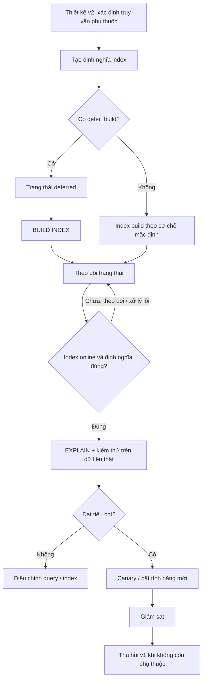

# Xây dựng chỉ mục, chờ sẵn sàng và triển khai thay đổi có kiểm soát trong Spring Data Couchbase

Một thay đổi tưởng như đơn giản — thêm chỉ mục cho truy vấn danh sách đơn hàng — có thể gây sự cố nếu ứng dụng bắt đầu sử dụng truy vấn mới **trước khi index được xây dựng xong**. Một câu lệnh `CREATE INDEX` được Query Service chấp nhận không có nghĩa toàn bộ dữ liệu đã được đưa vào chỉ mục, index đã sẵn sàng trong bộ tối ưu, hay truy vấn Spring Data Couchbase sẽ tự chọn index đó.

Trong môi trường production, cần xem quản lý chỉ mục như **một thay đổi hạ tầng dữ liệu có vòng đời riêng**: chuẩn bị DDL, kiểm tra quyền và tài nguyên, tạo/build index, chờ trạng thái có thể phục vụ, kiểm tra `EXPLAIN`, triển khai hoặc bật đường đọc mới, giám sát tải, rồi mới gỡ index cũ khi thật sự an toàn. Đặc biệt, hãy tránh để nhiều instance ứng dụng cùng quản lý DDL khi khởi động nếu tổ chức đã có pipeline triển khai tập trung.

Bài thuộc chương **Chỉ mục** của module **SPRING_DATA_COUCHBASE**. Các ví dụ nối kết SQL++, document mapping, repository, `CouchbaseTemplate`, bucket/scope/collection, chỉ mục ghép và bao phủ, TTL, CAS, giao dịch, tính nhất quán và API reactive. Mục tiêu là giúp người học hiểu **cả cơ chế kỹ thuật lẫn trình tự vận hành** để thay đổi chỉ mục mà không làm gián đoạn API.

## 1. Mục tiêu học tập

Sau bài này, bạn có thể:

1. Phân biệt trạng thái **đã yêu cầu tạo**, **đã tạo định nghĩa**, **đang build**, **`online`** và **đang được optimizer dùng hiệu quả**.
2. Tạo secondary index theo keyspace chính xác, dùng `WITH {"defer_build": true}` và `BUILD INDEX` khi cần tách giai đoạn khai báo khỏi giai đoạn xây dựng.
3. Thiết kế bước chờ sẵn sàng dựa trên `system:indexes` với **deadline, kiểm tra lỗi và xác minh định nghĩa**, thay vì đợi một số giây cố định.
4. Lập kế hoạch **expand → verify → switch → observe → contract** để thay index cũ hoặc chuẩn bị cho truy vấn mới.
5. Đối chiếu index mới với SQL++ thực của Spring Data repository/`@Query`/`CouchbaseTemplate`, `EXPLAIN` và Query Profile.
6. Nhận biết giới hạn của `autoIndexCreation()`, quyền triển khai, scan consistency và các tình huống rollback.

## 2. Bối cảnh thực tế: endpoint mới cần index mới

Giả sử ứng dụng thương mại điện tử sử dụng:

| Thành phần | Giá trị minh họa |
| --- | --- |
| Bucket | `commerce` |
| Scope | `sales` |
| Collection | `orders` |
| Document ID | `order::1042` |

Một document:

```json
{
  "_class": "salesOrder",
  "tenantId": "TENANT-A",
  "customerId": "C-42",
  "status": "PAID",
  "createdAt": "2026-11-20T08:15:00Z",
  "total": 1500000,
  "currency": "VND",
  "deleted": false
}
```

Trong ví dụ, `_class` là discriminator do tầng mapping có thể sử dụng; giá trị thực phụ thuộc cấu hình `@TypeAlias` hoặc tên Java class. `createdAt` được biểu diễn bằng chuỗi ISO-8601 UTC thống nhất. Nếu dự án lưu `Instant` dưới dạng khác, phải đối chiếu với JSON thực khi thiết kế index.

Endpoint mới cần trả **20 đơn mới nhất của một tenant theo trạng thái**:

```sql
SELECT META(o).id AS orderId,
       o.tenantId, o.status, o.createdAt, o.total
FROM `commerce`.`sales`.`orders` AS o
WHERE o.tenantId = "TENANT-A"
  AND o.status = "PAID"
ORDER BY o.createdAt DESC
LIMIT 20;
```

Index cũ chỉ có `tenantId`:

```sql
CREATE INDEX ix_orders_tenant_v1
ON `commerce`.`sales`.`orders`(`tenantId`);
```

Nó có thể hỗ trợ lọc tenant nhưng còn phải xét `status` và sắp xếp theo `createdAt`. Khi tenant có hàng trăm nghìn đơn, Query Service có thể quét nhiều entry và phải `Fetch`/`Order`. Nhóm muốn triển khai index `v2`:

```sql
CREATE INDEX ix_orders_tenant_status_created_v2
ON `commerce`.`sales`.`orders`(
    `tenantId`,
    `status`,
    `createdAt` DESC
);
```

Đề xuất này hợp lý về mặt mẫu truy vấn: hai điều kiện bằng nằm ở đầu, thứ tự thời gian ở sau. **Nó vẫn chỉ là ứng viên** cho đến khi được build, kiểm tra plan và đo đạc. Nếu repository trả toàn bộ `SalesOrder`, có thể vẫn xuất hiện `Fetch` để đọc thêm các thuộc tính không nằm trong index.

## 3. Một index đi qua những trạng thái nào?

Hãy tách khái niệm về vòng đời:

| Giai đoạn | Ý nghĩa | Việc cần làm |
| --- | --- | --- |
| **Đề xuất** | Có thiết kế DDL và lý do nghiệp vụ | Review khóa, điều kiện, keyspace, chi phí |
| **Đã gửi DDL** | Yêu cầu `CREATE INDEX` đã được phát | Kiểm tra lỗi trả về, không coi là đã online |
| **Đã có định nghĩa** | Metadata index tồn tại | Đối chiếu tên, `index_key` và `condition` |
| **Deferred/building** | Index được hoãn build hoặc đang xây dữ liệu | `BUILD INDEX` nếu deferred; theo dõi tiến trình |
| **Online** | Index ở trạng thái có thể phục vụ truy vấn | Kiểm tra `system:indexes` trên đúng keyspace |
| **Được optimizer chọn** | `EXPLAIN` cho thấy Query Service sử dụng index | Đối chiếu với SQL++ thực của endpoint |
| **Hiệu quả và ổn định** | Đo dưới workload đạt SLA, chi phí chấp nhận được | Giám sát latency, scan, write load |

`online` là điều kiện quan trọng để một index được xem là sẵn sàng cho query, nhưng **không bảo đảm Query Service sẽ chọn index đó**, và cũng không thay thế cấu hình scan consistency nếu cần đọc dữ liệu vừa ghi.

### 3.1. Sơ đồ vòng đời thay đổi



Sơ đồ mô tả quyết định, không yêu cầu lặp chờ vô hạn: bước theo dõi phải có **thời hạn và xử lý tình huống lỗi**.

## 4. Tạo secondary index trên đúng scope và collection

### 4.1. Ghi rõ keyspace trong DDL

Một câu `CREATE INDEX` trên collection đích:

```sql
CREATE INDEX ix_orders_tenant_status_created_v2
ON `commerce`.`sales`.`orders`(
    `tenantId`, `status`, `createdAt` DESC
);
```

Một collection `commerce.archive.orders` là **keyspace khác**, dù tên collection cũng là `orders`. Index của `sales.orders` không tự lập chỉ mục document ở `archive.orders`. Trong migration, dùng đường dẫn ba phần `bucket.scope.collection` để tránh nhầm query context.

Với query tìm document theo ID `order::1042`, `repository.findById(id)` thường dùng KV; không cần GSI cho thao tác đó. Index đang tạo phục vụ SQL++ khi tìm theo thuộc tính hoặc sắp xếp trên nhiều document.

### 4.2. Xác nhận index cũ và tránh tạo trùng mù quáng

Trước khi tạo, tra catalog:

```sql
SELECT name, state, index_key, condition,
       bucket_id, scope_id, keyspace_id
FROM system:indexes
WHERE bucket_id = "commerce"
  AND scope_id = "sales"
  AND keyspace_id = "orders";
```

Kiểm tra index cùng chức năng đã tồn tại chưa và có query đang dùng hay không. Nếu định dùng `CREATE INDEX IF NOT EXISTS` trong phiên bản hỗ trợ, hãy nhớ: **“tồn tại” không đồng nghĩa “đúng định nghĩa mới”**. Một index mang đúng tên nhưng thứ tự khóa hoặc predicate khác vẫn có thể không đáp ứng yêu cầu. Migration phải kiểm tra `index_key`, `condition` và trạng thái thực, thay vì bỏ qua mọi khác biệt.

### 4.3. Vì sao không nên dùng primary index làm đường dự phòng chung?

Primary index có thể cho phép một số SQL++ query chạy mà thiếu secondary index chuyên biệt, nhưng việc quét primary index thường không đáp ứng hiệu năng khi dữ liệu lớn. Nếu endpoint mới phụ thuộc v2, không nên âm thầm bật tính năng khi v2 chưa sẵn sàng chỉ vì trên môi trường test query vẫn chạy được nhờ primary index.

Chỉ tiêu thành công phải là **truy vấn chạy trên index thích hợp, đáp ứng latency và không gây tải quá mức**, không chỉ “SQL++ trả được kết quả”.

## 5. `defer_build`: tách khai báo index khỏi giai đoạn build

### 5.1. Mục đích

Trong SQL++ của Couchbase, tùy phiên bản/cấu hình được hỗ trợ, tùy chọn `WITH {"defer_build": true}` giúp tạo **định nghĩa index** mà chưa bắt đầu quá trình xây dữ liệu. Điều này hữu ích khi muốn:

- Chuẩn bị nhiều index rồi chủ động chọn thời điểm build.
- Gom các yêu cầu build theo keyspace nếu bản Couchbase hỗ trợ thực thi `BUILD INDEX` cho nhiều tên.
- Tránh khởi động một công việc build lớn đúng thời điểm deployment code nhạy cảm.
- Tách bước review/đăng ký DDL khỏi bước cấp tài nguyên để xây index.

Ví dụ:

```sql
CREATE INDEX ix_orders_tenant_status_created_v2
ON `commerce`.`sales`.`orders`(
    `tenantId`, `status`, `createdAt` DESC
)
WITH {"defer_build": true};
```

Sau câu này, hãy xác nhận metadata của index. **Nếu index ở trạng thái deferred thì nó chưa phải index sẵn sàng cho endpoint mới**.

### 5.2. Kích hoạt build theo tên index

Khi đã quyết định thời điểm build:

```sql
BUILD INDEX ON `commerce`.`sales`.`orders`(
    `ix_orders_tenant_status_created_v2`
);
```

Đây là ví dụ build một index đã được tạo theo chế độ deferred. Với nhiều index deferred cùng collection, cú pháp `BUILD INDEX` có thể nhận danh sách tên; cần kiểm tra phiên bản và cân nhắc tải trước khi build theo nhóm.

Ví dụ hai index phục vụ hai endpoint khác nhau:

```sql
CREATE INDEX ix_orders_by_customer_v2
ON `commerce`.`sales`.`orders`(
    `customerId`, `createdAt` DESC
)
WITH {"defer_build": true};

CREATE INDEX ix_orders_by_status_v2
ON `commerce`.`sales`.`orders`(
    `status`, `createdAt` DESC
)
WITH {"defer_build": true};

-- Kích hoạt xây dựng khi khung tài nguyên cho phép.
BUILD INDEX ON `commerce`.`sales`.`orders`(
    `ix_orders_by_customer_v2`,
    `ix_orders_by_status_v2`
);
```

Không cần lúc nào cũng dùng `defer_build`. Với một index nhỏ, thời điểm phù hợp và pipeline có giám sát, tạo/build theo cơ chế mặc định có thể đơn giản hơn. Điều quan trọng là **pipeline biết phải chờ index sẵn sàng trước khi đổi đường đọc**.

### 5.3. Các đánh đổi khi build

Build index tiêu thụ CPU, bộ nhớ, I/O và tài nguyên Index Service. Trên collection lớn, thời gian và mức ảnh hưởng phụ thuộc:

- Số lượng document thực, số trường/biểu thức được lập chỉ mục và độ lớn entry.
- Tần suất insert/update/delete trong lúc build.
- Số index cùng xây và cách phân phối Index Service.
- Tài nguyên hiện có, topology, replica/partition nếu được cấu hình và hỗ trợ.
- Workload Query Service/KV đang phục vụ cùng lúc.

Không có một khoảng thời gian build cố định đúng cho mọi cụm. Hãy **đo và theo dõi trạng thái**, không dùng công thức “đợi 30 giây” như một bảo đảm.

## 6. Chờ index sẵn sàng bằng trạng thái, không bằng thời gian đoán

### 6.1. Đọc trạng thái của index đích

```sql
SELECT name, state, index_key, condition,
       bucket_id, scope_id, keyspace_id
FROM system:indexes
WHERE bucket_id = "commerce"
  AND scope_id = "sales"
  AND keyspace_id = "orders"
  AND name = "ix_orders_tenant_status_created_v2";
```

Các trạng thái có thể thấy tùy phiên bản/triển khai gồm:

| Trạng thái ví dụ | Diễn giải vận hành |
| --- | --- |
| Không có dòng | Có thể DDL chưa chạy, sai keyspace, lỗi tạo hoặc tài khoản không thấy metadata |
| `deferred` | Định nghĩa đã được hoãn build; cần kích hoạt `BUILD INDEX` nếu đó là kế hoạch |
| `building` hoặc trạng thái trung gian tương đương | Quá trình xây dựng đang diễn ra; chưa mở tính năng phụ thuộc |
| `online` | Index có thể được Query Service xét để dùng; tiếp tục xác minh định nghĩa và `EXPLAIN` |
| Trạng thái lỗi/không hợp lệ khác | Kiểm tra log, quyền, cấu hình, tài nguyên và phiên bản; không giả định tự phục hồi |

Tên chính xác của trạng thái khác nhau theo phiên bản Couchbase. Quy tắc kiểm soát rollout vẫn giống nhau: **chỉ coi đạt điều kiện readiness khi catalog trả đúng index, đúng keyspace, đúng định nghĩa và trạng thái khả dụng**.

### 6.2. Thuật toán readiness có deadline

Một chương trình migration hoặc deployment check có thể dùng thuật toán:

```text
DEADLINE = thời hạn cấu hình theo chính sách triển khai

1. Truy vấn system:indexes cho tên + bucket/scope/collection đích.
2. Nếu không có dòng:
   - Phân biệt lỗi DDL, sai keyspace, quyền và metadata chưa khả dụng.
   - Retry có giới hạn nếu lỗi được phân loại là tạm thời.
3. Nếu có dòng:
   - So khớp thứ tự index_key, condition và tên index.
   - Nếu định nghĩa khác mong đợi: DỪNG, báo drift.
   - Nếu state = online: PASS readiness.
   - Nếu state = deferred: chỉ BUILD khi bước điều phối dự kiến.
   - Nếu building: chờ theo nhịp kiểm tra có giới hạn.
   - Nếu state/lỗi khác: điều tra, không tự công bố PASS.
4. Nếu vượt DEADLINE: FAIL bước triển khai, KHÔNG bật endpoint mới.
5. Sau PASS: chạy EXPLAIN, rồi kiểm thử tính đúng và hiệu năng.
```

Không nên dùng vòng lặp vô hạn, cũng không nên retry mọi lỗi mãi mãi. Lỗi phân quyền hoặc index key khác dự kiến sẽ **không** tự được sửa bằng cách chờ thêm. Việc kiểm tra có thể dùng polling với khoảng nghỉ/backoff hợp lý, nhưng cần deadline và thông điệp lỗi đủ rõ để người vận hành xử lý.

### 6.3. Đúng trạng thái chưa đủ: cần kiểm tra định nghĩa

Hãy so khớp tối thiểu:

- Bucket: `commerce`; scope: `sales`; collection: `orders`.
- Tên index: `ix_orders_tenant_status_created_v2`.
- `index_key`: lần lượt `tenantId`, `status`, `createdAt DESC`, không hoán đổi thứ tự.
- `condition`: không có predicate ngoài dự kiến, trừ khi migration cố ý tạo partial index.
- `state`: đủ điều kiện sử dụng, thường là `online`.

Nếu index có cùng tên nhưng `status` đứng trước `tenantId`, một kiểm tra chỉ nhìn `name` và `online` sẽ bỏ sót thay đổi cấu trúc. Nếu index là partial index với `WHERE status = "OPEN"` trong khi endpoint hỏi mọi trạng thái, nó không chứa đủ dữ liệu cho query.

## 7. Sau `online`, kiểm tra `EXPLAIN` với SQL++ thật

### 7.1. Kế hoạch dự kiến

Đối với endpoint mới:

```sql
EXPLAIN
SELECT META(o).id AS orderId, o.tenantId,
       o.status, o.createdAt, o.total
FROM `commerce`.`sales`.`orders` AS o
WHERE o.tenantId = "TENANT-A"
  AND o.status = "PAID"
ORDER BY o.createdAt DESC
LIMIT 20;
```

Các dấu hiệu cần xem:

| Operator hoặc thuộc tính | Câu hỏi |
| --- | --- |
| `IndexScan`/`IndexScan3` | Index nào thực sự được chọn, thuộc keyspace nào? |
| `spans` | Có hạn chế dải quét theo `tenantId` và `status` không? |
| `Fetch` | Query có phải đọc JSON gốc để lấy `total` hoặc điều kiện khác không? |
| `Filter` | Predicate nào vẫn xử lý sau scan? |
| `Order` | `createdAt DESC` có sẵn từ thứ tự index hay vẫn phải sort? |
| `covers` / `filter_covers` | Index có đủ dữ liệu cho projection và predicate không? |
| `Limit` | Giới hạn 20 kết quả được áp dụng hiệu quả ở đâu? |

Một index `online` nhưng không xuất hiện trong `EXPLAIN` có thể do query không phù hợp, optimizer chọn đường truy cập có chi phí thấp hơn, điều kiện theo entity không khớp, hoặc index khác đã đáp ứng tốt hơn. Đó **không nhất thiết** là lỗi build.

### 7.2. Xem `Fetch` và covering index riêng

Index `(tenantId,status,createdAt DESC)` hỗ trợ tìm và sắp xếp nhưng không chứa `total`. Truy vấn lấy `total` có thể phải `Fetch`:

```sql
CREATE INDEX ix_orders_list_cover_v2
ON `commerce`.`sales`.`orders`(
    `tenantId`,
    `status`,
    `createdAt` DESC,
    `total`
);
```

Index này có thể bao phủ projection danh sách nhỏ, nhưng tăng dung lượng và chi phí duy trì. Việc bỏ `Fetch` không phải lúc nào cũng bù được chi phí ghi. Hãy đo latency và tải Index Service với truy vấn thật rồi mới giữ cả index bao phủ và index ngắn.

### 7.3. Thử ở các giá trị tham số đại diện

Không chỉ chạy `EXPLAIN` với `TENANT-A` nếu nó là tenant rất nhỏ. Hãy kiểm tra tenant lớn/nhỏ và trạng thái phổ biến/hiếm, vì phân bố dữ liệu ảnh hưởng số entry scan và chi phí.

Nếu ứng dụng dùng prepared query với `status = $status`, không khẳng định một partial index `WHERE status = "PAID"` luôn được chọn. Query Service có thể không chứng minh được tham số luôn là `PAID` khi lập kế hoạch. Đối chiếu câu SQL++ và cơ chế chuẩn bị statement trên **phiên bản Couchbase đang chạy**.

## 8. Kết nối với Spring Data Couchbase

### 8.1. Entity mapping và namespace

Entity minh họa:

```java
import java.time.Instant;
import org.springframework.data.annotation.Id;
import org.springframework.data.annotation.TypeAlias;
import org.springframework.data.couchbase.core.mapping.Collection;
import org.springframework.data.couchbase.core.mapping.Document;
import org.springframework.data.couchbase.core.mapping.Scope;

@Document
@TypeAlias("salesOrder")
@Scope("sales")
@Collection("orders")
public class SalesOrder {
    @Id
    private String id;
    private String tenantId;
    private String customerId;
    private String status;
    private Instant createdAt;
    private long total;
    private String currency;
    private boolean deleted;

    // Constructor, getter và setter được lược bỏ.
}
```

Trong cấu hình minh họa, bucket `commerce` được xác định bởi ứng dụng; `@Scope` và `@Collection` chỉ định phạm vi entity trong mô hình mapping được hỗ trợ. Đừng kết luận repository sẽ đọc `commerce.sales.orders` nếu chưa xác nhận bucket và operations mapping tại runtime.

### 8.2. Derived repository query

```java
import java.util.List;
import org.springframework.data.couchbase.repository.CouchbaseRepository;

public interface SalesOrderRepository
        extends CouchbaseRepository<SalesOrder, String> {

    List<SalesOrder> findByTenantIdAndStatusOrderByCreatedAtDesc(
        String tenantId, String status
    );
}
```

Phương thức tìm theo thuộc tính có thể được Spring Data chuyển thành SQL++. Câu lệnh thực có thể thêm điều kiện discriminator như `_class` và chọn các trường cần thiết để ánh xạ **toàn entity**. Do đó `EXPLAIN` của một `SELECT` chỉ lấy ID trong Workbench **không thay thế** kế hoạch của method repository trả `SalesOrder` đầy đủ.

Nếu endpoint mới phụ thuộc chỉ mục `v2`, việc triển khai code phải chờ v2 đủ sẵn sàng và đã được thử với truy vấn repository thật. Chỉ “khởi động app thành công” không bảo đảm nó sẽ chọn index mới cho những request đầu tiên.

### 8.3. `@Query` và tham số

```java
import java.util.List;
import org.springframework.data.couchbase.repository.Query;

public interface SalesOrderRepository
        extends CouchbaseRepository<SalesOrder, String> {

    @Query("#{#n1ql.selectEntity} WHERE #{#n1ql.filter} " +
           "AND tenantId = $1 AND status = $2 " +
           "ORDER BY createdAt DESC LIMIT 20")
    List<SalesOrder> findLatestByTenantAndStatus(
        String tenantId, String status
    );
}
```

`#{#n1ql.selectEntity}` và `#{#n1ql.filter}` hỗ trợ mapping entity, bao gồm metadata/lọc kiểu trong mô hình hỗ trợ. Chúng không tự đảm bảo index đã tồn tại hay `online`. `$1` và `$2` là tham số vị trí, giúp tránh ghép trực tiếp giá trị người dùng vào câu SQL++.

Khi canary, hãy lấy câu SQL++ được ứng dụng phát sinh bằng cách ghi log/quan sát thích hợp theo phiên bản. So sánh cả projection và predicate với `EXPLAIN`; không chỉ kiểm tra tên method.

### 8.4. `CouchbaseTemplate` và reactive

`CouchbaseTemplate` có thể dùng để dựng truy vấn linh hoạt hoặc ánh xạ projection. Nếu nó gửi SQL++ lên Query Service, yêu cầu chỉ mục sẵn sàng là như với repository. Truy vấn được xây dựng động cần đặc biệt chú ý field JSON, `ORDER BY`, query context và điều kiện theo tenant.

`ReactiveCouchbaseRepository` hay API reactive của template/SDK giúp ứng dụng điều phối I/O bất đồng bộ, nhưng không loại bỏ việc Query Service phải chờ một index chưa build xong hoặc quét nhiều entry. Với hệ thống reactive có lượng request đồng thời cao, sự cố index readiness lúc rollout có thể gây nhiều timeout cùng lúc. Hãy đặt **readiness gate ở quá trình triển khai**, không dựa vào tăng retry tại mọi request.

### 8.5. Automatic index creation không thay thế migration production

Trong phiên bản Spring Data Couchbase hỗ trợ, entity có `@QueryIndexed`, `@CompositeQueryIndex` và cơ chế `autoIndexCreation()`. Tính năng tự tạo index mặc định không được bật trong mô hình cấu hình thường gặp; nó hữu ích cho local/test.

Ở production, hãy cân nhắc **tắt auto-create trong runtime** và chạy DDL bằng một pipeline/tài khoản triển khai chuyên trách. Nếu không, nhiều replica Spring Boot khởi động cùng lúc có thể yêu cầu tạo index trùng thời điểm và đưa công việc build vào giai đoạn nhận lưu lượng. Không nên cấp quyền quản lý index cho mọi service instance chỉ để làm một việc vốn thuộc quy trình phát hành.

## 9. Chiến lược triển khai không gián đoạn: expand → verify → switch → observe → contract

Giả sử `ix_orders_tenant_v1` vẫn đang phục vụ endpoint cũ và một query mới cần `ix_orders_tenant_status_created_v2`.

### 9.1. Expand — tạo v2 song song, không xóa v1

Trước tiên triển khai DDL `v2`; có thể dùng `defer_build` để chọn thời điểm build. Giữ v1 tồn tại. Trạng thái mong muốn:

```text
Query endpoint cũ ------> v1 đang online
Index mới v2 ------------> created / deferred / building
Endpoint mới ------------> chưa bật
```

Cách này giữ đường truy cập cũ trong thời gian index mới đang xây. **Không đổi DDL cũ theo kiểu phá hủy** nếu còn code đang sử dụng nó.

### 9.2. Verify — đợi online, kiểm tra plan và kết quả

Readiness gate phải kiểm tra:

1. v2 có mặt trên **đúng `commerce.sales.orders`**.
2. `index_key`/`condition` khớp migration.
3. Trạng thái đủ điều kiện phục vụ query (`online` theo catalog).
4. `EXPLAIN` trên SQL++ thực chọn đường truy cập chấp nhận được.
5. Kết quả truy vấn đúng (tenant, trạng thái, phân trang) và số liệu thử nghiệm đáp ứng mục tiêu.

Nếu một điều kiện thất bại, **không chuyển lưu lượng**. Việc index online không đủ nếu query thực tế không dùng nó hoặc độ trễ vẫn vượt SLA.

### 9.3. Switch — triển khai hoặc bật tính năng có kiểm soát

Sau khi verify:

- Triển khai phiên bản ứng dụng mới hoặc bật feature flag cho một phần lưu lượng.
- Nếu có canary, theo dõi tỷ lệ lỗi/timeout và độ trễ của chính endpoint bị ảnh hưởng.
- Kiểm tra có chuyển hướng query sang collection mới hoặc dùng `@Query` khác trong lúc phát hành không.
- Giữ rollback nhanh của code/feature flag, không phụ thuộc việc gỡ index.

Nếu Query Service tự chọn index, không nên mặc định ứng dụng “đã chuyển sang v2” chỉ vì v2 tồn tại. Có thể cần kiểm tra lại `EXPLAIN` sau khi thay đổi query hoặc thống kê. Hint `USE INDEX` là công cụ chẩn đoán khi cần so sánh, không nên ép tên index trong code production thiếu lý do và kế hoạch nâng cấp.

### 9.4. Observe — đo sau khi đưa vào phục vụ thật

Giám sát:

| Chỉ số | Vì sao quan trọng |
| --- | --- |
| Latency p50/p95/p99 | Xác nhận endpoint cải thiện dưới tải thật |
| Query timeout và lỗi index | Phát hiện index/query không khả dụng hoặc áp lực tài nguyên |
| Index entries scanned / documents fetched | Biết index có giảm quét và `Fetch` đúng dự tính |
| `Order`/sort cost | Phát hiện index không tận dụng được thứ tự |
| CPU/memory/I/O Index Service | Đảm bảo build và index mới không làm cụm quá tải |
| KV write latency/throughput | Xác nhận chi phí duy trì index không gây regression khi ghi |
| Scan consistency wait | Phân biệt thời gian chờ độ mới với thời gian quét |

Nếu index mới không đạt mục tiêu, có thể rollback **feature/query** về đường cũ. Quyết định xóa index mới là một bước riêng sau khi xem còn phụ thuộc hay không.

### 9.5. Contract — thu hồi v1 khi chắc chắn không còn dùng

Chỉ xem xét gỡ v1 khi:

- Các phiên bản ứng dụng cũ đã được thay thế hoặc không còn phụ thuộc v1.
- Batch job, báo cáo và các truy vấn ngoài repository cũng đã được kiểm tra.
- Plan/metrics không còn cho thấy nhu cầu thiết yếu của v1.
- Có quy trình change approval và phương án khôi phục nếu cần.

Ví dụ cú pháp gỡ, **không thực thi trong production nếu chưa phê duyệt**:

```sql
DROP INDEX `commerce`.`sales`.`orders`.`ix_orders_tenant_v1`;
```

Lưu ý có những trường hợp v1 vẫn hữu ích cho query chỉ lọc tenant dù v2 có thêm `status`. Việc thay thế một index không chỉ dựa trên “v2 có nhiều khóa hơn”: phải xem **toàn bộ tập truy vấn** trước khi gỡ.

## 10. Quản lý lỗi, timeout và rollback

### 10.1. DDL lỗi trước khi tạo định nghĩa

Nguyên nhân có thể là quyền không đủ, keyspace không tồn tại, trùng tên index hoặc cú pháp/tùy chọn không tương thích phiên bản. Pipeline cần ghi lỗi cụ thể, dừng bước phụ thuộc và **không bật ứng dụng mới**.

Đừng retry vô hạn lỗi phân quyền. Kiểm tra account triển khai có các privilege quản lý index trên phạm vi cần thiết; tài khoản runtime chỉ nên có các quyền tối thiểu phù hợp với nhu cầu đọc/ghi/query.

### 10.2. Build lâu hoặc không chuyển `online`

Phân biệt **build thực sự đang tiến triển** với **build lỗi/hết tài nguyên**. Theo dõi trạng thái, tài nguyên cụm và log. Nếu vượt deadline:

1. Đánh dấu bước rollout thất bại.
2. Giữ endpoint mới tắt hoặc giữ đường đọc cũ.
3. Điều tra tải Index Service, topology, quyền và dữ liệu.
4. Chỉ thử build lại sau khi biết trạng thái thực và cách phục hồi được hỗ trợ.

Không bật feature dựa vào “index chắc sắp xong”. Nếu query tạm fallback sang primary index, tình trạng tải có thể tệ hơn cả việc hoãn rollout.

### 10.3. v2 online nhưng optimizer không dùng

Kiểm tra theo thứ tự:

- Có dùng đúng bucket/scope/collection không?
- SQL++ của Spring Data có thêm `_class`, `deleted` hoặc điều kiện khác không?
- `WHERE` có dùng khóa dẫn đầu của index không?
- Query có sắp xếp theo đúng thứ tự keys và hướng `ASC/DESC` không?
- Có partial predicate, dữ liệu `MISSING`/`NULL` hoặc tham số động khiến index không phù hợp không?
- Optimizer có một index khác hiệu quả hơn không?

Ở đây **chờ thêm không sửa được lỗi thiết kế index**. Phải sửa SQL++ hoặc lựa chọn index sau khi có bằng chứng từ `EXPLAIN` và metrics.

### 10.4. Rollback code không đồng nghĩa xóa v2

Một rollback an toàn có thể chỉ tắt tính năng hoặc quay về code cũ. Index v2 vẫn có thể được giữ tạm nếu chi phí chấp nhận được; việc xóa nó cần một quyết định riêng. Nếu xóa nhầm index còn phục vụ batch hoặc ứng dụng khác, rollback có thể trở thành một sự cố thứ hai.

**Vòng đời dữ liệu, vòng đời code và vòng đời index cần được phối hợp nhưng không đồng nhất.**

## 11. Readiness, scan consistency và tính đúng sau khi cập nhật

### 11.1. Online là sẵn sàng quét, không phải cam kết luôn mới nhất

Global Secondary Index được duy trì bất đồng bộ với KV mutations. Sau khi repository lưu một document mới:

```text
KV save(order) hoàn tất
    -> mutation được xử lý để cập nhật GSI
    -> SQL++ có thể nhìn thấy mutation ở mức consistency phù hợp
```

Một index đã `online` vẫn có thể tạm chưa phản ánh mutation vừa ghi nếu query sử dụng mức scan consistency không chờ. Vì vậy, kiểm tra readiness trước deploy và yêu cầu **read-after-write** của endpoint là hai bài toán khác nhau.

| Scan consistency của SQL++ | Hệ quả |
| --- | --- |
| `NOT_BOUNDED` | Không yêu cầu chờ index bắt kịp mutation trước query; có thể ít chờ hơn nhưng kết quả tạm thời cũ |
| `REQUEST_PLUS` | Đợi index bắt kịp các mutation liên quan tại thời điểm query; dữ liệu mới hơn nhưng có thể tăng latency |

Chọn scan consistency theo tính đúng nghiệp vụ, không dùng `REQUEST_PLUS` như một cách “chữa” index chưa build xong. Nếu ứng dụng chỉ cần đọc lại một document có ID đã biết, `findById` theo KV có thể phù hợp hơn truy vấn SQL++.

### 11.2. TTL thay đổi tập document được index

TTL khiến document hết hạn theo chính sách; các index liên quan phải phản ánh việc document bị loại bỏ. Khi thiết kế/migration index trên collection có TTL ngắn và tải mutation cao, cần đo thêm chi phí cập nhật. Nhưng **TTL không phải tín hiệu rằng index đã online** và không giúp tiến trình build hoàn thành ngay.

### 11.3. CAS và giao dịch là bài toán ghi độc lập

CAS giúp phát hiện xung đột cập nhật document. Giao dịch phục vụ yêu cầu nguyên tử trong phạm vi thao tác mà Couchbase hỗ trợ. Chúng không tự tạo index, cũng không bảo đảm một `CREATE INDEX` là một bước trong giao dịch nghiệp vụ của ứng dụng.

Khi thay đổi `status` trong document, index có khóa `status` cần được cập nhật. Nếu service xử lý cạnh tranh bằng CAS/giao dịch, SQL++ vẫn cần scan consistency phù hợp để quan sát thay đổi mới. Đừng nhầm tính nguyên tử của thao tác ghi với **độ mới của index tại lúc query**.

## 12. Khi collection, schema hoặc ứng dụng được chuyển đổi đồng thời

Thay index có thể đi kèm thay cấu trúc JSON hoặc đổi nơi lưu document. Khi đó cần thiết kế theo *expand-and-contract* ở **cả dữ liệu lẫn query**.

### 12.1. Đổi tên field

Giả sử phiên bản cũ lưu `createdAt`, phiên bản mới lưu `created_at`. Index v2 trên `created_at` chỉ phục vụ query dùng field đó; document cũ không có field mới có thể không được index theo cách mong muốn.

Quy trình nên có:

1. Xác định khoảng thời gian hai schema cùng tồn tại.
2. Viết ứng dụng đọc tương thích hoặc thực hiện backfill có kiểm soát.
3. Tạo index theo key thực được query trong từng giai đoạn.
4. Đối soát dữ liệu cũ/mới, `NULL`/`MISSING` và kết quả phân trang.
5. Chỉ gỡ field/index cũ khi đã hết phiên bản đọc cũ.

**Index không tự migrate document**. Việc đặt annotation `@Field("created_at")` trên Java entity cũng không tự đổi dữ liệu đã lưu từ trước.

### 12.2. Đổi scope hoặc collection

Một index trên `commerce.sales.orders` không phục vụ `commerce.archive.orders`. Nếu chuyển đơn cũ sang collection archive, cần tạo index **trên đích** trước khi chuyển query đọc, rồi xác minh dữ liệu được chuyển đầy đủ và độ mới phù hợp. Tạo index trên nguồn không thay thế DDL cho đích.

### 12.3. Hai phiên bản ứng dụng chạy song song

Trong rolling deployment, code cũ và code mới có thể cùng hoạt động. V2 phải tương thích với SQL++ mới, nhưng không được gỡ v1 nếu code cũ vẫn dựa vào nó. Việc đánh giá phụ thuộc cần bao gồm repository queries, template queries, job nền, báo cáo, và các SQL++ ngoài ứng dụng chính.

## 13. Bảng kiểm phát hành index production

| Cổng kiểm tra | Cần xác nhận trước khi đi tiếp |
| --- | --- |
| **Thiết kế** | Có owner, danh sách query phụ thuộc, tiêu chí SLA, thứ tự khóa phù hợp |
| **Keyspace** | Bucket/scope/collection và query context đã được xác minh |
| **DDL** | Tên index không xung đột; expression, predicate, options đúng bản Couchbase |
| **Quyền** | Pipeline có quyền quản lý index; runtime không mang quyền DDL dư thừa |
| **Tài nguyên** | Build window, Index Service capacity và tác động lên write/query được đánh giá |
| **Readiness** | Index hiện diện, định nghĩa đúng, `state` đủ điều kiện như `online` |
| **Kế hoạch** | `EXPLAIN` của SQL++ thực có IndexScan/spans/Fetch/Order chấp nhận được |
| **Tính đúng** | Kết quả với tenant lớn/nhỏ, `NULL`/`MISSING`, sort/page và consistency đều đạt |
| **Hiệu năng** | Query Profile, p95/p99, scan/fetch và write load đạt ngưỡng đã đặt |
| **Cutover** | Endpoint mới được bật sau readiness; có canary/feature flag nếu cần |
| **Rollback** | Có cách tắt query mới mà không phải xóa index ngay |
| **Cleanup** | Chỉ gỡ index cũ sau khi xác nhận không còn phụ thuộc |

Các mục này là **khung kiểm soát**, không thay thế quy trình thay đổi chính thức của tổ chức. Đối với cụm có yêu cầu availability cao, có thể cần bổ sung phương án index replica, capacity reserve, thời điểm maintenance và cơ chế cảnh báo theo triển khai cụ thể.

## 14. Những lỗi thường gặp

| Hiện tượng | Nguyên nhân khả dĩ | Cách xử lý |
| --- | --- | --- |
| `CREATE INDEX` chạy xong nhưng query mới chưa ổn | Index chưa `online` hoặc chưa có plan phù hợp | Kiểm tra `system:indexes`, sau đó `EXPLAIN` |
| Index luôn ở `deferred` | Đã tạo với `defer_build` nhưng chưa chạy `BUILD INDEX` | Điều phối build khi tài nguyên sẵn sàng |
| Bước chờ online treo quá lâu | Polling không có deadline hoặc lỗi build bị che | Bổ sung timeout và phân loại lỗi |
| Có index `online` nhưng API vẫn chậm | Query còn `Fetch`/`Order` lớn hoặc index không chọn lọc | Dùng Query Profile và điều chỉnh index/query |
| v2 tồn tại nhưng repository chọn v1 | Query khác dự kiến, optimizer chọn theo chi phí | Kiểm tra SQL++ thật và `EXPLAIN`, không ép index vội |
| Truy vấn từ Workbench có plan tốt, production không | Workbench dùng projection/literal khác, thiếu filter `_class` | So sánh câu SQL++ và tham số thực tế |
| Query lỗi sau khi bật feature mới | Readiness gate chỉ kiểm tra DDL tồn tại, không kiểm tra trạng thái/plan | Chặn cutover đến khi đủ điều kiện |
| Build index làm tải cụm tăng mạnh | Thiếu capacity plan hoặc build nhiều index cùng lúc | Điều chỉnh kế hoạch xây dựng và giám sát Index Service |
| Rollback app rồi mất đường query cũ | Đã drop v1 quá sớm | Giữ v1 qua giai đoạn chuyển tiếp và rollback |
| Tạo index ở scope khác với repository | Sai keyspace hoặc query context | Kiểm tra đủ bucket/scope/collection |
| Đơn vừa đổi trạng thái vẫn hiện trong list | GSI cập nhật bất đồng bộ, consistency không chờ | Xác định yêu cầu `REQUEST_PLUS` hoặc dùng KV theo ID |
| Thêm index khiến ghi chậm | Mỗi mutation cần duy trì nhiều index | Đo write load, giữ index có giá trị thực |

## 15. Bài thực hành: rollout `v2` không làm gián đoạn `v1`

Mục tiêu: mô phỏng việc thêm index cho endpoint list và rèn kỹ năng kiểm soát thứ tự triển khai. **Chỉ thực hiện DDL trên môi trường lab được cấp phép**, không dùng nguyên các câu lệnh để thay đổi production chưa phê duyệt.

### Bước 1 — Chuẩn bị dữ liệu và `v1`

Collection `commerce.sales.orders` có dữ liệu nhiều tenant và trạng thái. Tạo index cũ trong lab nếu chưa có:

```sql
CREATE INDEX ix_lab_orders_tenant_v1
ON `commerce`.`sales`.`orders`(
    `tenantId`
);
```

Chạy `EXPLAIN` cho:

```sql
EXPLAIN
SELECT META(o).id AS id, o.createdAt, o.total
FROM `commerce`.`sales`.`orders` AS o
WHERE o.tenantId = "TENANT-A" AND o.status = "PAID"
ORDER BY o.createdAt DESC
LIMIT 20;
```

Ghi lại index được chọn, `Fetch`, `Order` và số entry scan từ profiling. Đây là **baseline**, không giả định query chắc chắn dùng v1 nếu lab còn index khác.

### Bước 2 — Tạo `v2` ở chế độ deferred

```sql
CREATE INDEX ix_lab_orders_tenant_status_created_v2
ON `commerce`.`sales`.`orders`(
    `tenantId`, `status`, `createdAt` DESC
)
WITH {"defer_build": true};
```

Kiểm tra:

```sql
SELECT name, state, index_key, condition
FROM system:indexes
WHERE bucket_id = "commerce"
  AND scope_id = "sales"
  AND keyspace_id = "orders"
  AND name IN [
      "ix_lab_orders_tenant_v1",
      "ix_lab_orders_tenant_status_created_v2"
  ];
```

Nêu lý do **không bật endpoint mới** khi v2 chưa build và cách phân biệt v1 đang phục vụ query với v2 mới chỉ có định nghĩa.

### Bước 3 — Kích hoạt build và chờ có deadline

```sql
BUILD INDEX ON `commerce`.`sales`.`orders`(
    `ix_lab_orders_tenant_status_created_v2`
);
```

Viết giả mã polling theo mục 6: không quá deadline, dừng khi metadata sai, chỉ PASS nếu đúng index/keyspace và `state = "online"`. Nếu gặp lỗi phân quyền hoặc index `deferred` nhưng migration quên lệnh build, **không** retry vô hạn.

### Bước 4 — So sánh kế hoạch và metrics

Sau khi v2 online, chạy lại `EXPLAIN` ở bước 1. Đọc `IndexScan`, `spans`, `Fetch`, `Order` và `Limit`; sau đó đo Query Profile.

Không giả định v2 chắc chắn thắng v1: kiểm tra sự khác nhau trên tenant lớn, status phổ biến và status hiếm. Nếu optimizer chọn index khác, ghi rõ điều đó và giải thích có thể do chi phí/kế hoạch.

### Bước 5 — Mô phỏng canary và rollback

Giả lập việc bật endpoint mới cho một phần request. Đặt tiêu chí rõ (ví dụ p95 không vượt ngưỡng được nhóm định nghĩa, không tăng timeout và Index Service không quá tải). Khi tiêu chí không đạt, **tắt tính năng mới**, giữ v1 để đường cũ tiếp tục chạy. Không vội `DROP INDEX` trong lúc thử nghiệm.

### Bước 6 — Đánh giá việc gỡ v1

Kiểm tra xem API chỉ lọc tenant không kèm status còn hoạt động không; index v1 có thể vẫn phù hợp. Đánh giá các job và report khác. Chỉ khi không còn phụ thuộc, mới lập kế hoạch xóa v1 qua quy trình có kiểm soát.

### Mẫu nhật ký triển khai

| Sự kiện | Bằng chứng cần lưu |
| --- | --- |
| DDL v2 được review | Query phụ thuộc, keyspace, khóa index, options |
| CREATE thành công | Kết quả DDL, thời điểm, account triển khai |
| Build bắt đầu | Tên index và trạng thái trước/sau lệnh |
| Readiness PASS | Catalog trả đúng định nghĩa và `online` |
| EXPLAIN PASS | Plan với tên index, spans, Fetch, Order |
| Canary PASS | Latency/timeout, Query Profile, tải Index Service |
| Cutover hoàn tất | Phiên bản code/feature flag, người xác nhận |
| Cleanup v1 | Bằng chứng hết phụ thuộc và phương án rollback |

Không điền PASS nếu chưa có bằng chứng thực tế. Đây là mẫu để người học tự thu thập kết quả, **không phải log của một cluster đã chạy**.

### Câu hỏi tự kiểm tra

1. Vì sao `CREATE INDEX` được chấp nhận không chứng minh index đã sẵn sàng?
2. `WITH {"defer_build": true}` khác gì so với tạo index để build ngay?
3. Khi nào cần thực hiện `BUILD INDEX` và vì sao phải giới hạn thời gian chờ?
4. Một index `online` nhưng `index_key` khác DDL kỳ vọng có được coi là readiness PASS không?
5. Khi v2 online nhưng `EXPLAIN` vẫn chọn v1, những nguyên nhân nào cần kiểm tra?
6. Vì sao cần giữ v1 trong giai đoạn rolling deployment/canary?
7. `EXPLAIN` và Query Profile cung cấp những bằng chứng khác nhau gì?
8. Vì sao repository trả toàn entity có thể vẫn cần `Fetch` dù index v2 lọc tốt?
9. Khi ứng dụng vừa ghi dữ liệu, vì sao index online không đồng nghĩa SQL++ sẽ luôn thấy mutation ngay ở `NOT_BOUNDED`?
10. Khi rollback code, tại sao không nên tự động gỡ v2? Khi nào mới nên gỡ v1?
11. Nếu chuyển dữ liệu sang scope khác, readiness phải kiểm tra index ở keyspace nào?
12. Hãy thiết kế ba điều kiện bắt buộc trước khi bật một endpoint mới chỉ truy vấn qua index v2.

## 16. Kết luận

**Xây dựng chỉ mục là một quá trình, không phải một câu lệnh đơn lẻ.** Với Spring Data Couchbase, hãy thiết kế index từ câu SQL++ thực của repository/`@Query`/`CouchbaseTemplate`; tạo trên đúng bucket/scope/collection; dùng `defer_build` và `BUILD INDEX` khi cần điều phối; theo dõi `system:indexes` với deadline để xác nhận **đúng định nghĩa và trạng thái online**; sau đó xác minh `EXPLAIN` và số liệu thực thi trước khi chuyển lưu lượng.

Ở production, trình tự **mở rộng song song → kiểm chứng → chuyển đổi → giám sát → thu hồi** thường an toàn hơn việc xóa index cũ rồi tạo index mới khi ứng dụng đang chạy. Quản lý quyền DDL, năng lực Index Service, rollback, TTL, CAS, giao dịch và scan consistency thành các trách nhiệm rõ ràng sẽ giúp module **SPRING_DATA_COUCHBASE** vận hành ổn định khi dữ liệu và lưu lượng tiếp tục tăng.
