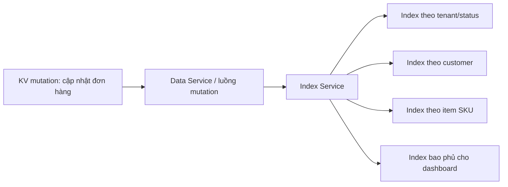
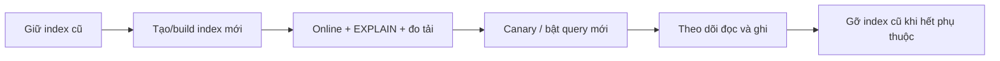

# Chi phí ghi, dung lượng và bảo trì khi thêm nhiều chỉ mục trong Spring Data Couchbase

Trong Couchbase, một secondary index có thể làm truy vấn SQL++ nhanh hơn rất nhiều: thay vì quét toàn bộ collection, Query Service dùng index để chọn các document phù hợp. Tuy nhiên, **mỗi index là một cấu trúc dữ liệu cần lưu trữ và duy trì**. Khi ứng dụng ghi document, Couchbase phải xử lý các thay đổi liên quan để các chỉ mục tiếp tục phản ánh dữ liệu mới. Thêm nhiều index vì vậy không phải là tối ưu miễn phí.

Một hệ thống đặt hàng thường có hai nhu cầu đối lập:

- **Đọc:** tìm 20 đơn mới nhất theo tenant, tra cứu theo khách hàng, lọc theo SKU và trạng thái, trả báo cáo nhanh.
- **Ghi:** tạo đơn, thêm dòng hàng, cập nhật trạng thái thanh toán, thay đổi địa chỉ, xóa mềm hoặc cho document hết hạn theo TTL.

Thiết kế index tốt phải cân bằng hai phía. Tối ưu chỉ dựa trên `EXPLAIN` của một câu `SELECT` có thể cải thiện API danh sách nhưng khiến Index Service quá tải, tăng dung lượng lưu trữ hoặc kéo dài thời gian bắt kịp các mutation.

Bài thuộc chương **Chỉ mục** của module **SPRING_DATA_COUCHBASE**. Nội dung kết nối thiết kế bucket/scope/collection, document mapping, repository, `CouchbaseTemplate`, SQL++, TTL, CAS, giao dịch và reactive API, nhưng tập trung vào **chi phí ghi, dung lượng và công việc bảo trì của tập chỉ mục**.

## 1. Mục tiêu học tập

Sau bài này, bạn có thể:

1. Giải thích các lớp chi phí của Global Secondary Index (GSI): tạo/build, lưu trữ, cập nhật theo mutation, truy vấn và vận hành.
2. Phân biệt chi phí của index đơn, index ghép, partial index, covering index, expression index và array index.
3. Ước lượng theo **mô hình tương đối** thay vì áp dụng một công thức byte cố định sai cho mọi engine/phiên bản Couchbase.
4. Xác định index dư thừa, index có ít truy vấn sử dụng và đánh đổi khi gom hoặc tách composite index.
5. Đo lợi ích đọc cùng tác động ghi bằng `EXPLAIN`, Query Profile, metrics của Index Service, KV và workload đại diện.
6. Lập quy trình thêm, xây dựng, theo dõi, điều chỉnh và thu hồi index với kiểm soát rủi ro production.

## 2. Mô hình nghiệp vụ: một collection, nhiều câu hỏi

Giả sử bucket `commerce`, scope `sales` và collection `orders` chứa các document:

```json
{
  "_class": "salesOrder",
  "tenantId": "TENANT-A",
  "customerId": "C-42",
  "status": "PAID",
  "createdAt": "2026-11-20T08:15:00Z",
  "updatedAt": "2026-11-20T08:17:00Z",
  "total": 1500000,
  "currency": "VND",
  "deleted": false,
  "tags": ["priority", "gift"],
  "shipping": {
    "city": "Ha Noi",
    "district": "Ba Dinh"
  },
  "items": [
    { "sku": "SKU-42", "quantity": 2, "price": 350000 },
    { "sku": "SKU-18", "quantity": 1, "price": 800000 }
  ]
}
```

Document ID có dạng `order::1001`. Field `_class` là discriminator của Spring Data Couchbase trong mô hình minh họa; giá trị thực phụ thuộc cấu hình mapping hoặc `@TypeAlias`. `createdAt` và `updatedAt` ở đây là chuỗi thời gian chuẩn hóa ISO-8601 UTC. Nếu ứng dụng dùng `Instant` với cách lưu khác, phải kiểm tra JSON thực tế khi thiết kế index thời gian.

Ứng dụng có những endpoint:

| Chức năng | Mẫu truy vấn hoặc thao tác | Đặc điểm workload |
| --- | --- | --- |
| Trang danh sách | `tenantId = ? AND status = ? ORDER BY createdAt DESC LIMIT 20` | Đọc thường xuyên, cần độ trễ thấp |
| Lịch sử khách hàng | `tenantId = ? AND customerId = ? ORDER BY createdAt DESC` | Đọc vừa phải |
| Tìm theo SKU | `ANY i IN items SATISFIES i.sku = ? END` | Truy vấn phần tử mảng |
| Báo cáo doanh thu | Lọc theo ngày, trạng thái; tổng hợp `total` | Ít truy vấn nhưng có thể quét nhiều |
| Thanh toán | Đổi `status` và `updatedAt`, có thể cập nhật `total` | Ghi thường xuyên |
| Chỉnh sửa giỏ/đơn | Thêm, sửa, xóa phần tử `items` | Phát sinh thay đổi array index |
| Đọc chi tiết theo ID | `findById("order::1001")` | Thường dùng KV, không cần GSI |

**Câu hỏi thiết kế:** Nếu tạo một index riêng cho từng màn hình và từng trường, tổng chi phí sẽ ra sao? Để trả lời, phải xem từng index **được đọc khi nào** và **phải duy trì khi nào**.

## 3. Một index tạo ra những lớp chi phí nào?

### 3.1. Chi phí tạo và build ban đầu

Lệnh `CREATE INDEX` tạo cấu trúc chỉ mục trên collection đích. Với collection đã có nhiều document, Index Service cần xây dựng thông tin index từ dữ liệu hiện hữu. Quá trình này có thể tiêu thụ CPU, bộ nhớ, I/O và băng thông liên quan, đồng thời tiếp tục xử lý các mutation mới.

```sql
CREATE INDEX ix_orders_tenant_status_created
ON `commerce`.`sales`.`orders`(
    `tenantId`, `status`, `createdAt` DESC
);
```

Một lệnh DDL được chấp nhận **không bảo đảm index đã sẵn sàng**. Hãy kiểm tra `system:indexes` và chờ trạng thái phù hợp (thường là `online`) trước khi bật truy vấn phụ thuộc.

### 3.2. Chi phí lưu trữ và bộ nhớ

Index duy trì khóa index, thông tin định danh document và dữ liệu/phần phụ trợ cần thiết theo cơ chế của phiên bản/engine. Index có nhiều khóa, khóa chuỗi dài, nhiều entry trên một document, replica hoặc partition thường yêu cầu thêm tài nguyên so với index đơn nhỏ.

Không nên lấy **kích thước JSON** trừ đi vài trường rồi xem phần còn lại là dung lượng index. Dung lượng thực phụ thuộc cách mã hóa khóa, engine, phân bố dữ liệu, nén, phân mảnh, replica, partition, cấu hình và độ lớn document ID.

### 3.3. Chi phí duy trì khi ghi

Khi ứng dụng insert, update, delete hoặc document hết hạn, các chỉ mục có liên quan phải được đưa về trạng thái phù hợp với dữ liệu nguồn. GSI của Couchbase được duy trì **bất đồng bộ qua luồng mutation**; trong nhiều triển khai, Index Service nhận mutation qua DCP (*Database Change Protocol*) để cập nhật cấu trúc index.

Về mặt vận hành:

- Thêm index tạo thêm việc phải **đánh giá hoặc cập nhật** khi document thay đổi.
- Cập nhật field là khóa index có thể khiến entry của index đó thay đổi.
- Thêm/xóa phần tử mảng có thể ảnh hưởng nhiều entry trong array index.
- Partial index có thể cần thêm/bỏ entry khi document đi vào hoặc ra khỏi predicate.
- Mức chi phí thực không phải luôn “mỗi mutation viết lại toàn bộ mọi index” — phụ thuộc dữ liệu thay đổi và cơ chế tối ưu của engine. Cần đo trên phiên bản triển khai.

### 3.4. Chi phí khi đọc

Một index có thể tiết kiệm `Fetch`, `Filter` hoặc `Order` của Query Service và giảm số document phải quét. Đó là **lợi ích** để bù cho chi phí ghi/lưu trữ. Nhưng có index mà optimizer không bao giờ chọn, hoặc index chỉ quét rộng như index đã có, thì lợi ích nhỏ trong khi chi phí duy trì vẫn tồn tại.

### 3.5. Chi phí vận hành và vòng đời

Index không chỉ “tạo một lần”:

- Phải theo dõi build, trạng thái sẵn sàng và các lỗi duy trì.
- Có thể cần đánh giá replica, partition, cấu hình Index Service và dự phòng tài nguyên.
- Phải quản lý quá trình thêm, đổi, kiểm thử, thu hồi index theo các phiên bản ứng dụng.
- Cần kiểm tra index trên đúng bucket/scope/collection, tránh tạo dư cùng loại ở keyspace không dùng.
- Đối với collection lớn hoặc hệ thống ghi nhiều, build/rebalance/index maintenance cần được lên kế hoạch cùng năng lực cụm.

## 4. “Write amplification” khi số lượng index tăng

### 4.1. Tư duy về số cấu trúc cần cập nhật

Nếu một collection có **một** index theo `tenantId`, thay đổi document chỉ liên quan đến số cấu trúc index tương đối nhỏ. Nếu bổ sung index theo `status`, `createdAt`, `customerId`, `total`, nhiều index ghép, array index và covering index, hệ thống có thêm những cấu trúc phải duy trì.

Có thể hình dung:



Sơ đồ chỉ biểu thị **các loại việc có thể phát sinh**, không khẳng định mỗi mutation đều viết đầy đủ tất cả index. Chi phí thật phụ thuộc các khóa/predicate được lập chỉ mục và loại mutation.

### 4.2. Ví dụ hai thao tác ghi khác nhau

**Thao tác A — cập nhật trạng thái thanh toán:**

```json
{
  "status": "SHIPPED",
  "updatedAt": "2026-11-20T11:00:00Z"
}
```

Nếu có các index theo `status`, theo `(tenantId,status,createdAt)` hoặc partial index `WHERE status = "PAID"`, các cấu trúc này có thể phải phản ánh giá trị mới và việc document rời predicate.

**Thao tác B — thêm một dòng hàng:**

```json
{
  "items": [
    { "sku": "SKU-42", "quantity": 2 },
    { "sku": "SKU-18", "quantity": 1 },
    { "sku": "SKU-99", "quantity": 1 }
  ]
}
```

Array index theo `items[*].sku` có thể phải bổ sung hoặc điều chỉnh entry tương ứng. Nếu còn nhiều index riêng theo `items[*].price`, `quantity`, tag, category hoặc kết hợp, việc duy trì cấu trúc tăng lên. Index chứa mảng lớn có thể gây chi phí cao hơn hẳn một index theo một field scalar nhỏ.

### 4.3. Độ trễ KV và độ trễ nhìn thấy dữ liệu qua SQL++ là hai thứ khác nhau

Khi `repository.save(order)` hoàn tất, thao tác KV có thể đã thành công, nhưng GSI chưa chắc đã phản ánh mutation mới tại thời điểm SQL++ chạy với scan consistency ưu tiên tốc độ.

Do đó, thêm index có thể tác động đến **khả năng bắt kịp mutation của Index Service** và latency khi truy vấn yêu cầu đợi index mới hơn. Không nên quy mọi mức tăng latency trực tiếp cho đường ghi KV; phải đo riêng **write latency, độ trễ index và query latency**.

## 5. So sánh chi phí của các kiểu index

| Kiểu index | Điểm mạnh khi đọc | Điều cần tính khi ghi/lưu trữ |
| --- | --- | --- |
| Index đơn | Nhỏ và hữu ích nếu filter đúng field | Một cấu trúc phải duy trì; nhiều index đơn có thể chồng lấp |
| Composite index | Lọc bằng tiền tố và có thể phục vụ sắp xếp | Entry chứa nhiều khóa hơn; thay đổi khóa liên quan có thể phát sinh update |
| Covering index | Có thể loại `Fetch` cho projection cụ thể | Lưu thêm field; index rộng, field thường cập nhật sẽ tăng chi phí duy trì |
| Partial index | Chỉ lưu document thỏa predicate, có thể nhỏ hơn | Khi predicate thay đổi phải thêm/bỏ entry; query phải hàm ý điều kiện index |
| Array index | Tìm theo phần tử mảng nhanh hơn | Một document có thể đóng góp nhiều entry; chi phí phụ thuộc cardinality và lặp giá trị |
| Expression index | Tăng tốc điều kiện trên biểu thức cụ thể | Phải tính/duy trì biểu thức; tính hữu ích phụ thuộc sự tương thích với query |
| Replica/partition của index | Hỗ trợ khả năng phục vụ, phân phối tải theo cấu hình | Tăng nhu cầu dung lượng/tài nguyên; cách tính thực tế phụ thuộc phiên bản và topology |

Một index **covering** hoặc **partial** vẫn có thể là composite index; các khái niệm trên không nhất thiết tách biệt. Ví dụ partial composite index có thêm field projection vừa có khả năng bao phủ query, vừa bị giới hạn bởi predicate.

## 6. Index đơn so với composite index: có nên giữ tất cả?

Giả sử có ba ứng viên:

```sql
CREATE INDEX ix_orders_tenant
ON `commerce`.`sales`.`orders`(
    `tenantId`
);

CREATE INDEX ix_orders_tenant_status
ON `commerce`.`sales`.`orders`(
    `tenantId`, `status`
);

CREATE INDEX ix_orders_tenant_status_created
ON `commerce`.`sales`.`orders`(
    `tenantId`, `status`, `createdAt` DESC
);
```

Index ghép dài hơn có **tiền tố khóa** `tenantId`, rồi `(tenantId,status)`. Vì vậy nó có thể là ứng viên cho một số query mà index ngắn cũng phục vụ. Nhưng đừng tự động kết luận index ngắn là dư thừa:

1. Index ngắn có thể chiếm ít tài nguyên hơn và hiệu quả cho query chỉ cần tiền tố.
2. Composite index dài hơn có thể yêu cầu scan nhiều dữ liệu index hơn hoặc mang chi phí duy trì cao hơn.
3. Query chỉ lọc tenant và `ORDER BY createdAt DESC` không được index `(tenantId,status,createdAt DESC)` hỗ trợ thứ tự toàn tenant như index `(tenantId,createdAt DESC)` do `status` nằm giữa.
4. Các truy vấn có projection/partial predicate khác nhau có thể chọn index khác.
5. Lợi ích phụ thuộc phân bố tenant và số trạng thái, không chỉ quan hệ tiền tố.

### 6.1. Bước kiểm tra trước khi gỡ index ngắn

Trên môi trường kiểm thử:

```sql
EXPLAIN
SELECT META(o).id AS orderId
FROM `commerce`.`sales`.`orders` AS o
WHERE o.tenantId = "TENANT-A";
```

Sau đó kiểm tra truy vấn còn lọc trạng thái:

```sql
EXPLAIN
SELECT META(o).id AS orderId, o.createdAt
FROM `commerce`.`sales`.`orders` AS o
WHERE o.tenantId = "TENANT-A"
  AND o.status = "PAID"
ORDER BY o.createdAt DESC
LIMIT 20;
```

So sánh index được chọn, `spans`, `Fetch`, `Order` và Query Profile. Để kết luận index ngắn có thể bỏ, phải xem **toàn bộ workload**, kể cả batch job/report và những query không đi qua Spring repository.

### 6.2. Không tạo index cho mọi hoán vị khóa

Với ba field `tenantId`, `status` và `createdAt`, số hoán vị tăng rất nhanh nếu tạo một index cho mọi thứ tự. Mỗi hoán vị là một cấu trúc riêng, phải duy trì và giám sát.

Thay vào đó, chọn các **mẫu query thực sự quan trọng**:

- `tenantId = ? AND status = ? ORDER BY createdAt DESC`.
- `tenantId = ? ORDER BY createdAt DESC`.
- `tenantId = ? AND customerId = ? ORDER BY createdAt DESC`.

Có thể chỉ cần vài index chuyên biệt hoặc một số index dùng chung phù hợp; kết luận phụ thuộc số liệu thực tế. Nếu một mẫu query được gọi mỗi quý một lần, có thể chấp nhận scan/fetch cao hơn hoặc xử lý bằng hệ thống báo cáo riêng thay vì duy trì index nóng quanh năm.

## 7. Chi phí của covering index: giảm `Fetch` không có nghĩa tổng chi phí giảm

### 7.1. Từ index lọc đến index bao phủ

Index cơ bản:

```sql
CREATE INDEX ix_orders_list_basic
ON `commerce`.`sales`.`orders`(
    `tenantId`, `status`, `createdAt` DESC
);
```

Truy vấn:

```sql
SELECT META(o).id AS orderId,
       o.createdAt, o.total, o.currency
FROM `commerce`.`sales`.`orders` AS o
WHERE o.tenantId = "TENANT-A"
  AND o.status = "PAID"
ORDER BY o.createdAt DESC
LIMIT 20;
```

Index cơ bản có thể lọc/sắp xếp tốt nhưng chưa chứa `total` và `currency`. Query Service có thể phải `Fetch` document gốc để đọc hai giá trị đó.

Index bao phủ ứng viên:

```sql
CREATE INDEX ix_orders_list_cover
ON `commerce`.`sales`.`orders`(
    `tenantId`, `status`, `createdAt` DESC,
    `total`, `currency`
);
```

Với cùng SQL++, index mới **có thể** cung cấp đủ các field, giúp bỏ `Fetch`. Lợi ích đọc cần đối chiếu với:

- Kích thước index tăng do hai khóa thêm vào.
- Các lần cập nhật `total` hoặc `currency` và chi phí bảo trì liên quan.
- Tốc độ build, bộ nhớ/disk sử dụng và tác động lên Index Service.
- Nguy cơ query sau này thêm field ngoài index, khiến covering không còn tác dụng.

### 7.2. Khi nào không nên cố covering?

Một trang chi tiết cần `items`, `shipping` và `audit` có thể đọc theo document ID bằng KV. Nếu cố thêm cả object và array lớn vào index chỉ để loại `Fetch` cho một endpoint hiếm gặp, chi phí lưu trữ và cập nhật thường khó biện minh.

Hãy phân biệt:

| Endpoint | Cách tiếp cận khởi đầu |
| --- | --- |
| Danh sách đơn được gọi hàng nghìn lần/phút, projection nhỏ | Đo covering index |
| Trang chi tiết đã có ID | Cân nhắc KV `findById` |
| Báo cáo chạy một lần/ngày | So sánh scan/fetch với chi phí duy trì index quanh năm |
| Tìm kiếm phức tạp trên nhiều object/mảng | Cân nhắc index chuyên biệt hoặc điều chỉnh mô hình đọc |

Covering là **một tối ưu cho query**, không phải mục tiêu phải đạt cho mọi repository method.

## 8. Partial index: tiết kiệm dung lượng nhưng tăng yêu cầu về predicate

Giả sử 90% đơn đã hoàn thành, còn dashboard chỉ cần đơn `OPEN` chưa xóa mềm. Một index theo mọi trạng thái có thể lưu nhiều document không bao giờ xuất hiện trên dashboard.

Ứng viên partial index:

```sql
CREATE INDEX ix_open_orders_tenant_created
ON `commerce`.`sales`.`orders`(
    `tenantId`, `createdAt` DESC
)
WHERE `_class` = "salesOrder"
  AND `status` = "OPEN"
  AND `deleted` = FALSE;
```

Query tương ứng:

```sql
SELECT META(o).id AS orderId, o.createdAt
FROM `commerce`.`sales`.`orders` AS o
WHERE o._class = "salesOrder"
  AND o.status = "OPEN"
  AND o.deleted = FALSE
  AND o.tenantId = "TENANT-A"
ORDER BY o.createdAt DESC
LIMIT 20;
```

**Lợi ích có thể có:** ít document được đưa vào index hơn nên giảm dung lượng và số entry phải scan cho nhóm truy vấn phù hợp. **Đánh đổi:** cần xử lý khi document chuyển từ `OPEN` sang `PAID` hoặc chuyển `deleted` từ `FALSE` sang `TRUE`, vì document phải rời tập thỏa predicate.

### 8.1. Không biến điều kiện động thành index thiếu dữ liệu

Nếu API nhận `status` bất kỳ, partial index chỉ chứa `OPEN` không phục vụ đầy đủ cho `PAID` và `SHIPPED`. Hơn nữa, trong prepared SQL++ với `status = $status`, optimizer không nhất thiết chứng minh tham số luôn bằng `OPEN` để dùng partial index.

Vì vậy, index partial có thể giảm chi phí khi **mẫu truy vấn thực sự ổn định**, nhưng không thay thế mọi secondary index tổng quát.

### 8.2. Chú ý discriminator thực tế

Giá trị `_class` do Spring Data ghi có thể là tên lớp Java đầy đủ hoặc alias, tùy cấu hình. Nếu dùng `@TypeAlias("salesOrder")`, phải xác minh document JSON và SQL++ do repository tạo. Một partial index với predicate sai giá trị có thể không được optimizer chọn hoặc loại dữ liệu cần thiết.

## 9. Array index và cardinality: một document có thể có nhiều entry

Một order chứa danh sách `items`. Nếu cần tìm đơn theo SKU, có thể tạo:

```sql
CREATE INDEX ix_orders_item_sku
ON `commerce`.`sales`.`orders`(
    DISTINCT ARRAY item.sku FOR item IN items END
);
```

Query:

```sql
SELECT META(o).id AS orderId
FROM `commerce`.`sales`.`orders` AS o
WHERE ANY item IN o.items
      SATISFIES item.sku = "SKU-42"
      END;
```

Không phải mỗi document chỉ tạo đúng **một** entry như mô hình index scalar đơn. Số entry phụ thuộc số giá trị được trích từ mảng, kiểu `DISTINCT ARRAY` hoặc `ALL ARRAY` và cấu trúc mảng.

### 9.1. Số phần tử và số SKU khác nhau

Ví dụ ba document:

| Document | `items` | Số SKU phân biệt | Nhận xét |
| --- | --- | ---: | --- |
| A | 1 item | 1 | Nhỏ |
| B | 20 item, 20 SKU khác nhau | 20 | Nhiều giá trị index |
| C | 20 item, cùng 1 SKU lặp lại | 1 | `DISTINCT ARRAY` có thể tránh entry lặp theo giá trị trong document |

Với `ALL ARRAY`, các giá trị lặp có thể được giữ lại để phục vụ những kiểu query tương ứng; trong workload có nhiều item lặp, số entry sẽ khác cách dùng `DISTINCT ARRAY`. Không khẳng định con số entry vật lý chính xác chỉ từ bảng này, vì còn phụ thuộc phiên bản, biểu thức index và cơ chế lưu trữ.

### 9.2. Mutation trong mảng có thể đắt hơn một field scalar

Khi thêm, xóa hoặc sửa phần tử `items`, Index Service phải điều chỉnh thông tin được trích từ mảng. Nếu một document có hàng trăm item và một số index cùng trích nhiều thuộc tính `sku`, `quantity`, `price`, chi phí có thể tăng đáng kể.

Do đó:

1. Chỉ lập array index cho truy vấn thật sự cần.
2. Chọn đúng expression và `ANY`/`UNNEST` để optimizer có thể sử dụng.
3. Cân nhắc `DISTINCT` hoặc `ALL` theo ngữ nghĩa, không chọn `ALL` chỉ vì “đủ dữ liệu hơn”.
4. Đo phân bố độ dài mảng (p50/p95/max) và số giá trị phân biệt.
5. Với dữ liệu mảng rất lớn hoặc truy vấn nhiều chiều nóng, cân nhắc thiết kế mô hình đọc riêng khi chi phí index trở nên không phù hợp.

## 10. Ước lượng dung lượng theo mô hình tương đối

### 10.1. Công thức tư duy, không phải thuật toán định cỡ chính xác

Để lập kế hoạch ban đầu, có thể ước lượng tương đối:

\[
\text{Dung lượng index} \approx
\sum_{\text{index } j}
\left(
\text{số entry}_j
\times
\text{dung lượng trung bình mỗi entry}_j
\right)
\times
\text{hệ số lưu trữ/replica}
\]

Trong đó:

- **Số entry** phụ thuộc số document thỏa predicate và số giá trị mảng/biểu thức index tạo ra.
- **Dung lượng mỗi entry** phụ thuộc khóa index, document ID, encoding, overhead và engine.
- **Hệ số lưu trữ/replica** là cách tư duy về các bản sao và overhead; không được coi là một hệ số cố định đúng trong mọi phiên bản/topology.

Đây **không phải công thức thay thế công cụ định cỡ của Couchbase**. Không thể chỉ lấy số document × số khóa × một hằng số byte rồi bảo đảm chính xác; phải quan sát dung lượng index thật sau khi build và dùng hướng dẫn sizing tương ứng với phiên bản/engine đang triển khai.

### 10.2. Một kịch bản định lượng *giả định*

Giả sử có **1 triệu document**, mỗi document có trung bình 6 item với 5 SKU phân biệt. Xét ba index:

| Index giả định | Logic số entry trước overhead | Điều cần đo thực |
| --- | --- | --- |
| `tenantId` đơn | Thường theo quy mô document đủ điều kiện | Độ dài khóa/ID và chính sách entry |
| Partial `status = OPEN`, giả sử 10% document | Theo quy mô khoảng 100.000 document thỏa điều kiện | Tỷ lệ thỏa thực tế, thay đổi trạng thái |
| `DISTINCT ARRAY item.sku` | Có thể theo quy mô khoảng 5 triệu giá trị SKU phân biệt trong từng document | Độ dài mảng, lặp giá trị, biểu thức/engine |

Các số trong bảng là **dữ liệu tình huống giả định để suy luận**, không phải dự báo dung lượng thật hoặc cam kết đúng số entry nội bộ. Ngay trong một bộ dữ liệu 1 triệu đơn, nếu mảng có 1–2 item thay vì 50–100 item, hiệu ứng lên array index có thể rất khác.

### 10.3. Những thông số cần thu thập để sizing

- Số document hiện tại và dự kiến sau 6–12 tháng cho **từng collection**.
- Tỷ lệ document thỏa partial predicate.
- Độ dài, số giá trị phân biệt và phân bố của những mảng được index.
- Độ dài trung bình của khóa chuỗi và document ID.
- Số lượng index, số replica/partition và tùy chọn Index Service.
- Tần suất mutation, tỷ lệ insert/update/delete/TTL expiration.
- Mức tải đồng thời Query/Index Service, yêu cầu HA và khả năng tăng trưởng.
- Chỉ số disk, memory, fragmentation/compaction và write throughput thực sau build.

## 11. Index Service, replica, partition và bảo trì dài hạn

### 11.1. Index không chỉ dùng disk

Các index cần tài nguyên để phục vụ scan, cập nhật mutation và duy trì trạng thái. Tùy cấu hình và engine, Index Service có thể sử dụng memory và storage theo cách khác nhau. Nếu thêm nhiều index khiến nhu cầu vượt năng lực phân bổ, độ trễ index scan hoặc độ trễ bắt kịp mutation có thể tăng.

Không nên dùng một ngưỡng memory/disk chung cho mọi version Couchbase. Hãy theo dõi các chỉ số do cụm thực tế công bố, nhận diện nghẽn CPU, memory, disk I/O hoặc network, và lập kế hoạch dự phòng.

### 11.2. Replica tăng khả năng phục vụ nhưng tiêu thụ thêm tài nguyên

Các cấu hình replica của secondary index có thể tăng khả năng phục vụ/failover theo tính năng và topology triển khai. Đổi lại, những bản sao phải được lưu trữ và duy trì. Không được tính dung lượng index chỉ từ **một** bản index rồi xem như tổng nhu cầu cụm nếu còn replica.

Phương án replica không thay thế backup/phục hồi dữ liệu và không tự giải quyết sai logic SQL++.

### 11.3. Partition không làm chi phí biến mất

Partition có thể giúp phân phối cấu trúc hoặc tải index theo cơ chế Couchbase hỗ trợ, nhưng tổng dữ liệu index vẫn phải được lưu và xử lý. Phân phối tải chỉ có ích khi topology/cấu hình và workload phù hợp. Cần tính thêm chi phí quản lý, phân phối và khả năng phục hồi khi node gặp sự cố.

### 11.4. Fragmentation, compaction và thời gian bảo trì

Khi document liên tục thay đổi, các engine lưu trữ index có thể phát sinh công việc quản lý không gian, compaction hoặc bảo trì cấu trúc theo cơ chế từng phiên bản. Những quá trình đó có thể tác động đến disk I/O hoặc latency nếu cụm đã ở sát giới hạn.

Đặc biệt, thêm một index lớn làm tăng thời gian build/rebalance và lượng dữ liệu phải di chuyển trong một số thao tác vận hành. Hãy đưa việc tạo index vào capacity plan, không chỉ vào lịch phát hành code.

## 12. Đo tác động: cần hai đường đo đọc và ghi

Một index không được đánh giá bằng câu “truy vấn mới nhanh hơn 2 lần” nếu không biết write throughput và chi phí tài nguyên thay đổi thế nào.

### 12.1. Các metric cần quan sát

| Nhóm | Điều cần đo | Câu hỏi cần trả lời |
| --- | --- | --- |
| Đọc SQL++ | Latency p50/p95/p99, timeout, error rate | Index mới có cải thiện endpoint quan trọng? |
| Kế hoạch | `IndexScan`, `spans`, `Fetch`, `Order`, `covers` | Query có thật sự dùng index và giảm công việc? |
| Index scan | Entries scanned / rows returned, thời gian scan | Có đọc quá nhiều entry để trả ít hàng? |
| Ghi KV | Mutations/s, write latency, error/conflict rate | Đường ghi có bị ảnh hưởng hoặc tăng xung đột? |
| Index Service | CPU, memory, disk usage/I/O, backlog hoặc lag theo metrics được hỗ trợ | Index có bắt kịp mutation và đủ capacity? |
| Dung lượng | Kích thước các index, replica, tăng trưởng theo thời gian | Dung lượng có phù hợp dự báo? |
| Vận hành | Build duration, tình trạng `online`, lỗi DDL/rebalance | Có tăng rủi ro triển khai và phục hồi? |
| Nhất quán | Thời gian chờ ở mức consistency yêu cầu | Truy vấn có cần chờ index catch-up quá lâu? |

Tên metric cụ thể khác nhau giữa các phiên bản, công cụ quan sát và cách triển khai. Không tự bịa tên endpoint hoặc API metrics; dùng dashboard/telemetry sẵn có và xác minh chúng thực sự đo điều gì.

### 12.2. Kiểm tra index đã tồn tại trên đúng keyspace

```sql
SELECT name, state, is_primary, index_key, condition,
       bucket_id, scope_id, keyspace_id
FROM system:indexes
WHERE bucket_id = "commerce"
  AND scope_id = "sales"
  AND keyspace_id = "orders";
```

Catalog giúp lập **bản kê cấu trúc** chứ không tự cho biết index nào là dư thừa. Một index có mặt ở catalog vẫn có thể không được optimizer chọn; một index được chọn thường xuyên cũng có thể phục vụ truy vấn không quan trọng so với chi phí duy trì.

### 12.3. Dùng `EXPLAIN` đúng câu SQL++ thực

```sql
EXPLAIN
SELECT META(o).id AS orderId, o.createdAt, o.total
FROM `commerce`.`sales`.`orders` AS o
WHERE o.tenantId = "TENANT-A"
  AND o.status = "PAID"
ORDER BY o.createdAt DESC
LIMIT 20;
```

Hãy ghi lại index được chọn, độ hẹp của `spans`, có `Fetch` và `Order` không, `LIMIT` được đẩy xuống đâu. Nếu index mới không xuất hiện trong kế hoạch, không thể ghi nhận thành công chỉ dựa vào việc index đã `online`.

### 12.4. Query Profile mới cho số liệu chạy thực

`EXPLAIN` là kế hoạch dự kiến, không phải phép đo đầy đủ số entry đã đọc trong một lần query. Query Profile hoặc cơ chế profiling tương ứng giúp quan sát lượng công việc và thời gian operator.

Đặc biệt, khi so sánh hai index, không được thay đồng thời tất cả tham số, projection, consistency và dữ liệu rồi quy kết chênh lệch cho index. Cần một baseline và một thử nghiệm có kiểm soát.

## 13. Spring Data Couchbase: index có ảnh hưởng đến repository ra sao?

### 13.1. Mapping entity

Ví dụ:

```java
import java.time.Instant;
import java.util.List;
import org.springframework.data.annotation.Id;
import org.springframework.data.annotation.TypeAlias;
import org.springframework.data.couchbase.core.mapping.Document;
import org.springframework.data.couchbase.core.mapping.Scope;
import org.springframework.data.couchbase.core.mapping.Collection;

@Document
@TypeAlias("salesOrder")
@Scope("sales")
@Collection("orders")
public class SalesOrder {
    @Id
    private String id;
    private String tenantId;
    private String customerId;
    private String status;
    private Instant createdAt;
    private Instant updatedAt;
    private long total;
    private boolean deleted;
    private List<OrderItem> items;

    // Constructor, getter, setter được lược bỏ.
}
```

`OrderItem` là một kiểu value object minh họa. Bucket `commerce` được xác định bởi cấu hình Couchbase của ứng dụng, không tự suy ra từ `@Scope`/`@Collection`.

Nếu một repository cập nhật `status` liên tục, các index có khóa hoặc predicate theo `status` cần được duy trì. Nếu có hàng chục index chồng lắp trường đó, chi phí cập nhật có thể tăng trong khi không phải index nào cũng mang lại lợi ích đọc tương ứng.

### 13.2. Derived repository query

```java
import java.util.List;
import org.springframework.data.couchbase.repository.CouchbaseRepository;

public interface SalesOrderRepository
        extends CouchbaseRepository<SalesOrder, String> {

    List<SalesOrder> findByTenantIdAndStatusOrderByCreatedAtDesc(
        String tenantId, String status
    );

    List<SalesOrder> findByTenantIdAndCustomerId(
        String tenantId, String customerId
    );
}
```

Hai method có thể tạo SQL++ theo thuộc tính và tận dụng các index khác nhau. Index được tạo bằng annotation hay DDL thủ công đều được Query Service xem là cấu trúc trên collection đích. Framework không tự biến **mọi** derived query thành query rẻ chỉ vì model có `@QueryIndexed`.

### 13.3. `@Query` và bộ lọc entity

```java
import java.util.List;
import org.springframework.data.couchbase.repository.Query;

public interface SalesOrderRepository
        extends CouchbaseRepository<SalesOrder, String> {

    @Query("#{#n1ql.selectEntity} WHERE #{#n1ql.filter} " +
           "AND tenantId = $1 AND status = $2 " +
           "ORDER BY createdAt DESC LIMIT 20")
    List<SalesOrder> findRecent(String tenantId, String status);
}
```

`#{#n1ql.selectEntity}` giúp chọn dữ liệu phục vụ mapping, còn `#{#n1ql.filter}` có thể bổ sung điều kiện theo kiểu entity. Điều kiện `_class` trong query thực có thể ảnh hưởng partial index; việc chọn toàn entity có thể khiến một index không bao phủ được projection dù nó chứa đầy đủ các khóa lọc.

Để quyết định index nên thêm hay bỏ, hãy thu thập **SQL++ thực**, không chỉ nhìn tên method hay field Java.

### 13.4. `CouchbaseTemplate` và API reactive

`CouchbaseTemplate` thích hợp khi cần query linh hoạt hoặc projection. Nếu template gửi SQL++ qua Query Service, các index vẫn phải hỗ trợ đúng `WHERE`, `ORDER BY` và `SELECT`. Việc viết template không tránh được chi phí duy trì index.

`ReactiveCouchbaseRepository` hoặc API reactive giúp ứng dụng xử lý I/O không đồng bộ, nhưng không làm cho các index tự nhỏ lại hay cho Index Service có thêm tài nguyên. Khi độ đồng thời cao, workload query và mutation đồng thời có thể làm lộ rõ nút thắt của Index Service; phải đo ở phía Couchbase, không chỉ đo throughput luồng reactive phía Java.

## 14. Ghi bằng KV, CAS, giao dịch và TTL: ảnh hưởng tới tập index

### 14.1. Đọc KV theo ID không cần GSI

Nếu request chỉ cần:

```java
repository.findById("order::1001");
```

đường truy cập thường là KV lookup theo document ID, không cần secondary index SQL++. Vì vậy đừng tạo thêm nhiều GSI chỉ để phục vụ một thao tác `findById` đã có khóa.

### 14.2. CAS: xử lý conflict chứ không giảm số index

Giả sử hai request cập nhật trạng thái và giỏ hàng trên cùng document. **CAS** giúp phát hiện phiên bản đã thay đổi và hỗ trợ ứng dụng retry hoặc báo conflict. CAS không làm biến mất yêu cầu duy trì index sau một mutation được ghi thành công.

Nếu thao tác cập nhật bị từ chối do CAS mismatch, nó không phải một cập nhật dữ liệu thành công cần được nhìn thấy qua GSI. Nếu retry thành công và document thay đổi, các index liên quan phải phản ánh giá trị mới theo cơ chế cập nhật của Couchbase.

### 14.3. Giao dịch: tính nguyên tử không đồng nghĩa query index “miễn phí”

Giao dịch được dùng khi cần một tập thao tác có tính nguyên tử theo phạm vi Couchbase hỗ trợ. Khi transaction thay đổi document, dữ liệu vẫn phải được lập chỉ mục phù hợp khi thay đổi được ghi nhận. Index không thay thế giao dịch; ngược lại, có giao dịch cũng không làm quá trình duy trì nhiều GSI mất chi phí.

Khi dùng SQL++ trong hoặc sau transaction, cần xem đúng ngữ nghĩa consistency của API và phiên bản. Không suy luận mọi query SQL++ tự đạt read-your-writes chỉ vì GSI đã được tạo.

### 14.4. TTL và xóa

Document hết hạn theo TTL hoặc bị xóa sẽ không còn là dữ liệu hợp lệ của collection. Các index phải phản ánh điều đó theo cơ chế duy trì. Trong collection có churn lớn do TTL, việc giữ nhiều index cho document tồn tại rất ngắn có thể tiêu tốn tài nguyên đáng kể.

Giải pháp không nhất thiết là bỏ TTL: cần cân nhắc nhu cầu truy vấn trong vòng đời ngắn của document, việc lưu dữ liệu lịch sử ở collection khác và số index thật sự cần cho từng collection.

### 14.5. Scan consistency và index lag

GSI được duy trì bất đồng bộ nên sau `save`, Query Service có thể tạm đọc dữ liệu cũ với mức ưu tiên tốc độ:

| Scan consistency | Tác động |
| --- | --- |
| `NOT_BOUNDED` | Không đợi index bắt kịp mutation mới tại thời điểm query; có thể nhanh hơn nhưng kết quả tạm cũ |
| `REQUEST_PLUS` | Đợi index bắt kịp các mutation liên quan trước khi chạy; mới hơn nhưng có thể tăng độ trễ |

Khi tăng nhiều index hoặc tăng tải mutation, hãy quan sát khả năng bắt kịp và thời gian chờ của query yêu cầu consistency mạnh hơn. **Không** khẳng định chỉ thêm index sẽ luôn làm `REQUEST_PLUS` chậm; tác động phải đo theo tài nguyên và backlog thực tế.

## 15. Quy trình rà soát index dư thừa và index ít giá trị

Một cuộc rà soát có thể thực hiện theo trình tự:

### Bước 1 — Kiểm kê theo đúng keyspace

Từ `system:indexes`, lập danh sách index cho từng bucket/scope/collection với tên, khóa, predicate, trạng thái. Nếu cùng bucket có `sales.orders` và `archive.orders`, không gộp chúng thành một vì hai collection có workload và index độc lập.

### Bước 2 — Lập bản đồ truy vấn ↔ index

Với mỗi endpoint/job/report, ghi:

- SQL++ thực cùng tham số, kiểu entity filter và projection.
- Tần suất, dữ liệu trả, latency và SLA.
- Index thực được chọn theo `EXPLAIN`.
- Số entry scan, `Fetch`, `Order`, số lần/tỷ lệ truy vấn.
- Các index ứng viên mà query có thể dùng nếu thay đổi DDL.

Nếu index không có query thường xuyên sử dụng, **chưa đủ căn cứ xóa ngay**: có thể là index phục vụ batch hiếm, dự phòng cho sự cố hoặc phụ thuộc của một phiên bản ứng dụng chưa được quan sát trong cửa sổ đo.

### Bước 3 — Tìm quan hệ chồng lắp

Ví dụ index `(tenantId)`, `(tenantId,status)`, `(tenantId,status,createdAt)`. Phân tích liệu index dài có thể thay index ngắn cho các mẫu query quan trọng hay không. Kiểm tra trường hợp `ORDER BY` thiếu khóa nằm giữa và ảnh hưởng `Fetch`/projection.

### Bước 4 — Đánh giá lợi ích và chi phí

Một bảng quyết định:

| Index | Mẫu query chính | Lợi ích đọc | Chi phí/cần quan sát | Quyết định giả định |
| --- | --- | --- | --- | --- |
| `(tenantId,status,createdAt DESC)` | Danh sách đơn | Lọc/sort tốt | Thay đổi status và chi phí entry | Giữ nếu query nóng |
| `(tenantId)` | Chỉ lọc tenant | Có thể quét nhẹ | Có thể chồng lắp | So sánh trước khi bỏ |
| `(tenantId,status,createdAt DESC,total,currency)` | Danh sách có total | Giảm `Fetch` | Rộng, total có thể thay đổi | Benchmark |
| `DISTINCT ARRAY item.sku` | Tìm đơn theo SKU | Lọc mảng | Nhiều entry khi item lớn | Giữ nếu tính năng quan trọng |
| Partial `OPEN` | Dashboard đơn mở | Nhỏ hơn nếu OPEN ít | Ra/vào predicate khi trạng thái đổi | Giữ khi predicate ổn định |

### Bước 5 — Thử thay đổi có kiểm soát

Không xóa ngay index khi chưa biết các truy vấn phụ thuộc. Trước hết tạo thiết kế thay thế trên staging, kiểm chứng plan và workload; nếu cần đưa index mới vào production, dùng rollout có kiểm soát.

### Bước 6 — Thu hồi và theo dõi

Khi đã xác nhận không còn phụ thuộc và có phương án khôi phục, gỡ index thông qua quy trình DDL được phê duyệt. Sau đó theo dõi query timeout, latency, scan, Index Service và đường ghi để phát hiện regression.

## 16. Thêm index có kiểm soát trong production

### 16.1. Thiết kế và dự toán trước khi tạo

Một yêu cầu tạo index nên nêu:

1. Keyspace chính xác và chủ sở hữu nghiệp vụ.
2. Câu SQL++ thực cần tối ưu; đặc biệt `WHERE`, `ORDER BY`, `SELECT` và mức consistency.
3. Index đề xuất: thứ tự khóa, partial predicate, array expression và projection.
4. Dự kiến tác động đến dung lượng, mutation, write throughput và Index Service.
5. Chỉ tiêu chấp nhận: query latency, số entry scan, write p95, tài nguyên.
6. Cách triển khai, readiness gate, rollback và điều kiện bỏ index cũ.

Không dùng lời hứa “thêm index chắc chắn nhanh hơn” thay cho tiêu chí đo được.

### 16.2. Chủ động điều phối build

Với cụm và phiên bản hỗ trợ, có thể tách khai báo khỏi build:

```sql
CREATE INDEX ix_orders_tenant_status_created_v2
ON `commerce`.`sales`.`orders`(
    `tenantId`, `status`, `createdAt` DESC
)
WITH {"defer_build": true};
```

Đến thời điểm được phê duyệt:

```sql
BUILD INDEX ON `commerce`.`sales`.`orders`(
    `ix_orders_tenant_status_created_v2`
);
```

Đợi index ở trạng thái khả dụng bằng `system:indexes`, với deadline và xử lý lỗi. Không chỉ `sleep` một khoảng cố định rồi bật endpoint.

### 16.3. Expand → verify → switch → observe → contract



**Expand:** giữ đường truy cập cũ trong lúc index mới build. **Verify:** so khớp `index_key`/`condition`, `online`, `EXPLAIN` và dữ liệu kiểm thử. **Switch:** bật query mới theo feature flag/canary nếu phù hợp. **Observe:** đo cả đọc và ghi, lag và tài nguyên. **Contract:** chỉ gỡ index cũ sau khi kiểm tra mọi phụ thuộc.

### 16.4. Quyền DDL

Quản lý index là thao tác hạ tầng dữ liệu. Trong production, thường nên dùng tài khoản/pipeline triển khai có quyền DDL theo phạm vi, tách khỏi tài khoản runtime chỉ cần KV/Query. Spring Data Couchbase có cơ chế khai báo `@QueryIndexed`/`@CompositeQueryIndex` và `autoIndexCreation()` trong những phiên bản được hỗ trợ, nhưng không nên dựa vào khởi động của mọi replica ứng dụng để tự tạo index lớn không có kiểm soát.

Việc nhiều app instance cùng bootstrap có thể dẫn tới yêu cầu tạo trùng hoặc khó điều phối thời điểm build. Đừng dùng annotation như một hệ thống migration thay thế toàn bộ quy trình triển khai index.

## 17. Bài thực hành: đọc nhanh hơn bao nhiêu, ghi đắt hơn bao nhiêu?

Mục tiêu: thực nghiệm với một collection và ít nhất ba loại index để xem **tổng chi phí** thay đổi ra sao. Không chạy DDL trên cụm production nếu chưa có quyền và quy trình phê duyệt.

### 17.1. Chuẩn bị dataset

Tạo data trong `commerce.sales.orders` với:

- Nhiều tenant có quy mô khác nhau.
- `status` phân bố không đều giữa `OPEN`, `PAID` và `SHIPPED`.
- Mỗi document có 1–50 phần tử `items`, một tỷ lệ SKU lặp.
- Một tỷ lệ document được cập nhật `status`/`total` thường xuyên.

Nên có đủ dữ liệu để Query Profile và Index Service metrics phản ánh khác biệt, thay vì chỉ một vài chục document đều nằm trong cache.

### 17.2. Baseline không có covering/array index mới

Giữ một index phù hợp với danh sách:

```sql
CREATE INDEX ix_lab_orders_list_basic
ON `commerce`.`sales`.`orders`(
    `tenantId`, `status`, `createdAt` DESC
);
```

Chạy một query list:

```sql
EXPLAIN
SELECT META(o).id AS id, o.createdAt, o.total
FROM `commerce`.`sales`.`orders` AS o
WHERE o.tenantId = "TENANT-A"
  AND o.status = "PAID"
ORDER BY o.createdAt DESC
LIMIT 20;
```

Ghi plan, Query Profile và kết quả đo ghi dưới tải cố định: write p95, mutation throughput, CPU/IO Index Service, dung lượng index.

### 17.3. Thêm covering index

```sql
CREATE INDEX ix_lab_orders_list_cover
ON `commerce`.`sales`.`orders`(
    `tenantId`, `status`, `createdAt` DESC, `total`
);
```

Sau khi build online, chạy lại query. Kiểm tra `Fetch`, `covers` và độ trễ. Đồng thời lặp workload ghi, nhất là update `status` hoặc `total`, để xem tác động đến Index Service/đường ghi. Không kết luận nếu workload trước/sau khác phân bố dữ liệu hoặc số request.

### 17.4. Thêm array index

```sql
CREATE INDEX ix_lab_orders_items_sku
ON `commerce`.`sales`.`orders`(
    DISTINCT ARRAY i.sku FOR i IN items END
);
```

Đo:

```sql
EXPLAIN
SELECT META(o).id AS id
FROM `commerce`.`sales`.`orders` AS o
WHERE ANY i IN o.items
      SATISFIES i.sku = "SKU-42"
      END;
```

So sánh số entry/quy mô index khi nhóm document có 1, 10 và 50 phần tử; thử cập nhật mảng. Lưu ý `EXPLAIN` có thể chọn index khác nếu đã tồn tại; xác minh `IndexScan` thực và dùng Query Profile.

### 17.5. Thử partial index

```sql
CREATE INDEX ix_lab_orders_open_tenant_created
ON `commerce`.`sales`.`orders`(
    `tenantId`, `createdAt` DESC
)
WHERE `status` = "OPEN"
  AND `deleted` = FALSE;
```

Chạy query phù hợp predicate và quan sát dung lượng index khi `OPEN` chỉ là một phần nhỏ tổng document. Cập nhật nhiều đơn `OPEN → PAID` để xem thay đổi entry và tài nguyên. Nhớ rằng query có trạng thái động không mặc nhiên dùng được partial index này.

### 17.6. Bảng kết quả cần điền sau khi chạy

| Cấu hình | Index được chọn | Query p95 | KV write p95 | Dung lượng index | Index Service CPU/I/O | Ghi chú |
| --- | --- | --- | --- | --- | --- | --- |
| Baseline | Chưa đo | Chưa đo | Chưa đo | Chưa đo | Chưa đo | Index đơn/ghép hiện có |
| + Covering | Chưa đo | Chưa đo | Chưa đo | Chưa đo | Chưa đo | Thử giảm `Fetch` |
| + Array | Chưa đo | Chưa đo | Chưa đo | Chưa đo | Chưa đo | Đánh giá nhiều item |
| + Partial | Chưa đo | Chưa đo | Chưa đo | Chưa đo | Chưa đo | Thử trạng thái `OPEN` |

**Không điền số giả là kết quả thực nghiệm.** Các ô “Chưa đo” giúp phân biệt dữ liệu cần thu thập với ví dụ lý thuyết.

### 17.7. Thảo luận và quyết định

Giả sử dữ liệu lab cho thấy covering index giúp list nhanh đáng kể, nhưng mức cải thiện nhỏ so với tài nguyên tăng và workload ghi vốn đang gần ngưỡng. Có nên giữ index? Câu trả lời phụ thuộc SLA, tải đọc/ghi thực và khả năng tăng capacity, không chỉ dựa vào kết quả một lần `EXPLAIN`.

Ngược lại, một partial index nhỏ phục vụ dashboard rất nóng có thể đạt tỷ lệ lợi ích/chi phí tốt dù cần duy trì entry khi trạng thái thay đổi. Cần đối chiếu **tần suất trạng thái chuyển**, tỷ lệ document thỏa predicate và độ trễ query.

## 18. Câu hỏi tự kiểm tra

1. Vì sao tạo thêm secondary index có thể cải thiện SQL++ nhưng tăng áp lực lên Index Service khi ghi?
2. “GSI được cập nhật bất đồng bộ” khác gì việc `save(...)` thành công theo KV?
3. Vì sao không thể khẳng định mọi mutation đều ghi lại toàn bộ mọi index?
4. Index ghép dài hơn có luôn thay thế hiệu quả index chỉ chứa tiền tố của nó không? Hãy nêu một tình huống `ORDER BY`.
5. Covering index giúp giảm `Fetch` nhưng có những chi phí bổ sung nào?
6. Khi nào partial index giúp giảm kích thước index? Điều gì xảy ra khi document rời predicate?
7. Vì sao array index trên một mảng 50 item có thể tốn hơn index scalar theo `tenantId`?
8. Tại sao phải đo cả số lượng phần tử và giá trị phân biệt của mảng khi ước lượng array index?
9. Index replica/partition ảnh hưởng thế nào đến sizing và khả năng vận hành?
10. Khi một index không xuất hiện trong `EXPLAIN`, có đủ căn cứ xóa nó ngay không?
11. Vì sao cần đo cả read p95, write p95, index disk/CPU và scan consistency wait?
12. Khi nào `findById` qua KV có thể giúp tránh nhu cầu tạo một index chỉ để đọc trang chi tiết?
13. Trong rolling deployment, tại sao phải giữ index cũ một thời gian sau khi đã tạo index mới?
14. TTL, CAS và giao dịch có loại bỏ chi phí bảo trì index sau mutation thành công không?

## 19. Kết luận

**Thêm chỉ mục là một quyết định đánh đổi, không phải thao tác tối ưu không có chi phí.** Một secondary index phải được build, lưu trữ, cập nhật theo mutation, giám sát và quản lý vòng đời. Composite index có thể trùng chức năng, covering index có thể giảm `Fetch` nhưng tăng độ rộng, partial index giảm tập document được lập chỉ mục nhưng cần predicate phù hợp, còn array index có thể tạo nhiều entry cho một document.

Trong **Spring Data Couchbase**, hãy xuất phát từ SQL++ thực của repository, `@Query` và `CouchbaseTemplate`, xác định index được Query Service dùng bằng `EXPLAIN`, sau đó đo cả truy vấn đọc, đường ghi KV, tài nguyên Index Service và độ mới dữ liệu. Chỉ giữ những index có lợi ích đủ lớn đối với workload, quản lý mọi thay đổi bằng triển khai có kiểm soát và thu hồi index dư thừa sau khi đã xác minh các phụ thuộc. Đó là nền tảng để hệ thống vừa **đọc nhanh**, vừa **ghi ổn định**, có dung lượng và chi phí vận hành dự đoán được.
