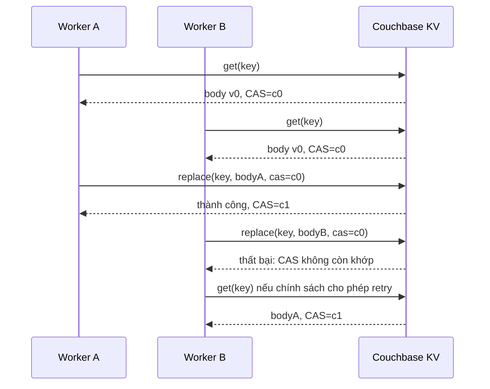

# CAS là token phiên bản của tài liệu trong Spring Data Couchbase

## 1. Bài toán mất cập nhật khi nhiều tiến trình cùng ghi

Giả sử một nền tảng học trực tuyến lưu một document tiến độ:

```json
{
  "tenantId": "acme",
  "learnerId": "learner-17",
  "courseId": "java-101",
  "completedLessons": 6,
  "lastActivity": "lesson-6"
}
```

Document có ID `progress::acme::learner-17::java-101`. Hai worker cùng đọc khi `completedLessons = 6`:

- Worker A nhận sự kiện hoàn thành bài 7, chuẩn bị ghi `completedLessons = 7`.
- Worker B xử lý một yêu cầu cũ, chuẩn bị ghi `completedLessons = 6` với một thuộc tính khác vừa cập nhật.

Nếu cả hai ghi nguyên document mà không kiểm soát phiên bản, lần ghi cuối có thể **ghi đè dữ liệu mới hơn**. Đây là vấn đề *lost update*, không phải vấn đề Couchbase tạo trùng document key.

**CAS (Compare-And-Swap)** là cơ chế cốt lõi của Couchbase để xử lý loại cạnh tranh này theo cách **khóa lạc quan** (*optimistic locking*). Thay vì khóa document ngay từ đầu và giữ khóa suốt thời gian người dùng thao tác, ứng dụng đọc một **token phiên bản**, làm việc trên dữ liệu đã đọc và yêu cầu server chỉ chấp nhận cập nhật nếu document **chưa thay đổi** từ lúc đó.

Bài này giải thích CAS với vai trò **token phiên bản của một document**, cách đọc và sử dụng trong Couchbase Java SDK và Spring Data Couchbase, cách phản ứng khi xung đột và những giới hạn khi có TTL, transaction, truy vấn SQL++ và Reactive API.

## 2. CAS là gì?

Mỗi document Couchbase có thể được truy cập kèm một **CAS value** do server quản lý. CAS là một giá trị **64 bit** dùng như dấu phiên bản của document tại thời điểm quan sát. Khi document bị thay đổi qua thao tác ghi, token CAS của phiên bản mới thay đổi; ứng dụng có thể dùng token đã đọc để yêu cầu một thao tác ghi có điều kiện.

Hiểu đúng ba bước:

1. **Read:** lấy document và CAS hiện tại, giả sử `CAS = c0`.
2. **Modify:** dựa trên dữ liệu đó chuẩn bị nội dung mới.
3. **Compare-and-swap:** gửi nội dung mới cùng yêu cầu “chỉ ghi nếu CAS hiện tại vẫn là `c0`”.

Nếu chưa có writer nào thay phiên bản đang được bảo vệ, server cho phép ghi và trả **CAS mới** (ví dụ `c1`). Nếu document đã đổi sang một CAS khác, server từ chối thao tác có điều kiện; ứng dụng phải quyết định đọc lại, gộp thay đổi hoặc báo xung đột.



**CAS bảo vệ một phiên bản của một document trong một thao tác ghi**, không phải một giao dịch tự động bao trùm nhiều document, nhiều hệ thống hay toàn bộ quy trình nghiệp vụ.

### 2.1. Điều gì quan trọng về bản chất token?

| Thuộc tính | Cách hiểu đúng | Hiểu lầm cần tránh |
| --- | --- | --- |
| Độ rộng | Giá trị 64 bit do Couchbase quản lý | Là một chuỗi UUID ứng dụng tự tạo |
| Phạm vi | Gắn với phiên bản của document cụ thể | Là bộ đếm chung của cả bucket/cluster |
| Mục đích | So sánh phiên bản còn hiệu lực tại thời điểm ghi | Dùng để tính tuổi document hoặc sắp xếp lịch sử |
| Khi đọc | `get` trả body và token CAS quan sát được | Đọc document sẽ tự khóa document |
| Khi cập nhật | Dùng CAS cũ để xác thực thao tác ghi | Tự tăng CAS bằng `cas + 1` ở Java |
| Khi thành công | Mutation trả CAS của phiên bản vừa ghi | Có thể tiếp tục dùng CAS cũ mãi mãi |
| Khi xung đột | Phải giải quyết theo nghiệp vụ | Retry vô hạn với nội dung cũ sẽ tự đúng |
| Khi xóa/hết hạn | Document có thể không còn tồn tại | CAS đảm bảo key tồn tại vĩnh viễn |

CAS là một **token opaque**: không cần và không nên suy diễn ý nghĩa từ giá trị số của nó. Không lấy `c1 > c0` làm điều kiện xác định sự kiện nào mới hơn, không coi chênh lệch CAS là số lần cập nhật và không dùng CAS làm dấu thời gian nghiệp vụ.

### 2.2. CAS khác những loại “version” nào?

- **Document ID:** xác định *document nào*. Ví dụ `order::acme::order-123`. CAS xác định *phiên bản document đó*.
- **`@Version` trong Spring Data Couchbase:** một field Java để Spring Data tích hợp cơ chế optimistic locking bằng CAS. Đây không phải bộ đếm tùy ý do ứng dụng tự quản.
- **`schemaVersion` trong JSON:** đánh dấu định dạng dữ liệu như v1/v2 để migration; schemaVersion có thể không đổi qua hàng nghìn lượt ghi.
- **`businessRevision`:** số lần sửa nghiệp vụ do ứng dụng định nghĩa nếu cần audit; không thay thế CAS.
- **Timestamp:** thời điểm nghiệp vụ hoặc server ghi nhận; có thể được lưu trong body và dùng cho báo cáo, nhưng không phải token kiểm tra mất cập nhật.

Trong Spring Data Couchbase, CAS là **metadata của document**, không phải thuộc tính nội dung JSON bắt buộc có tên `cas`. Nếu chỉ lưu một trường JSON `"cas": 42` mà không gắn tùy chọn CAS vào lệnh KV, Couchbase sẽ không tự hiểu đó là yêu cầu cập nhật có điều kiện.

## 3. Vì sao gọi là khóa *lạc quan*?

Khóa lạc quan dựa trên giả định rằng **đa số lần cập nhật không tranh chấp nhau**. Ứng dụng không giữ khóa dài hạn trong khi người dùng sửa dữ liệu:

```text
Đọc body + CAS
      |
      v
Xử lý nghiệp vụ / người dùng chỉnh sửa
      |
      v
Ghi với CAS đã đọc
      |
      +-- CAS vẫn đúng ------> chấp nhận
      |
      +-- CAS đã đổi --------> xung đột, xử lý theo chính sách
```

Cách này phù hợp với document được cập nhật không quá thường xuyên hoặc khi người dùng có thể được thông báo “dữ liệu đã thay đổi, vui lòng tải lại”. Nó tránh nhu cầu duy trì lock trong suốt khoảng thời gian dài giữa lúc đọc và ghi.

**Nhưng CAS không xếp hàng chờ cho mọi writer**. Nếu 1.000 worker cùng cập nhật một document “nóng”, rất nhiều thao tác có thể thất bại vì xung đột; cần đánh giá lại mô hình dữ liệu, kiểu lệnh atomic, mức contention và chiến lược retry.

### 3.1. So sánh nhanh với khóa bi quan

| Tiêu chí | Optimistic locking bằng CAS | Pessimistic locking |
| --- | --- | --- |
| Lúc đọc | Không cần giữ lock | Có thể chiếm lock trước khi cập nhật |
| Khi ghi | Kiểm tra phiên bản ngay lúc ghi | Dựa vào quyền sở hữu lock còn hợp lệ |
| Xung đột | Một writer có thể bị từ chối và xử lý lại | Writer khác có thể phải chờ/từ chối |
| Độ phức tạp | Đơn giản cho một document, cần chính sách retry | Cần quản lý lock, timeout, lease |
| Tình huống phù hợp | Cập nhật ít tranh chấp, UI sửa dữ liệu | Một số workflow có tranh chấp cao cần điều phối chặt |
| Giới hạn | Không tự bao trùm nhiều document | Lock cũng không tự tạo transaction đa hệ thống |

Couchbase SDK cũng có cơ chế lock ở mức KV cho một số nhu cầu đặc biệt, nhưng **CAS không đồng nghĩa đã gọi get-and-lock**. Bài này chỉ tập trung vào CAS như điều kiện kiểm tra phiên bản.

## 4. Đọc CAS trong Couchbase Java SDK

Couchbase Java SDK cho phép lấy CAS từ kết quả `get`:

```java
import com.couchbase.client.java.Collection;
import com.couchbase.client.java.kv.GetResult;
import com.couchbase.client.java.json.JsonObject;

public class CasReader {
    private final Collection collection;

    public CasReader(Collection collection) {
        this.collection = collection;
    }

    public void show(String key) {
        GetResult found = collection.get(key);
        JsonObject body = found.contentAsObject();

        long observedCas = found.cas();

        System.out.println("status = " + body.getString("status"));
        System.out.println(
            "CAS = " + Long.toUnsignedString(observedCas));
    }
}
```

Trong Java SDK, CAS được biểu diễn qua `long`. Việc in bằng `Long.toUnsignedString(...)` là để hiển thị đầy đủ bit-pattern 64 bit theo dạng số không dấu; ứng dụng **không cần dùng giá trị đó để cộng, trừ hay so sánh thứ tự**.

`found.cas()` đại diện cho phiên bản **cùng lúc với body vừa đọc**. Đọc body ở lần này nhưng lấy CAS của một lần đọc khác sẽ khiến thao tác ghi khó giải thích và dễ bị từ chối sai.

> Ví dụ giả định collection chứa JSON object. Nếu lưu binary hoặc cấu trúc khác, cần đọc body bằng API phù hợp thay vì `contentAsObject()`.

### 4.1. CAS của document không được người dùng tự chọn

Không thiết kế code như:

```java
long myCas = 1L;            // Không phải version ứng dụng cấp.
long guessedNext = myCas + 1; // Không phải cách sinh CAS mới.
```

Couchbase trả token hiện hành. Client truyền lại **đúng token đã quan sát** khi cần ghi có điều kiện. Sau một mutation thành công, server trả token khác cho phiên bản mới.

Nếu API bên ngoài muốn gửi một “version” để chống ghi đè từ trình duyệt, có thể ánh xạ CAS thành một token HTTP như ETag/If-Match theo hợp đồng, nhưng phải đảm bảo mã hóa/giải mã thống nhất, xử lý giá trị 64 bit đúng và kiểm tra quyền truy cập độc lập. CAS không phải bí mật xác thực.

## 5. Thay thế document bằng điều kiện CAS

Ví dụ người dùng sửa tên hiển thị trong một profile. Client đọc document, thay đổi field rồi gọi `replace` kèm CAS:

```java
import com.couchbase.client.core.error.CasMismatchException;
import com.couchbase.client.java.Collection;
import com.couchbase.client.java.json.JsonObject;
import com.couchbase.client.java.kv.GetResult;
import com.couchbase.client.java.kv.MutationResult;

import static com.couchbase.client.java.kv.ReplaceOptions.replaceOptions;

public final class ProfileUpdater {
    private final Collection collection;

    public ProfileUpdater(Collection collection) {
        this.collection = collection;
    }

    public long changeDisplayName(String key, String name) {
        GetResult loaded = collection.get(key);
        JsonObject edited = loaded.contentAsObject();
        edited.put("displayName", name);

        try {
            MutationResult written = collection.replace(
                key,
                edited,
                replaceOptions().cas(loaded.cas()));

            return written.cas(); // CAS mới sau ghi thành công.
        } catch (CasMismatchException conflict) {
            throw new IllegalStateException(
                "Profile đã được cập nhật bởi tiến trình khác; hãy đọc lại",
                conflict);
        }
    }
}
```

Ở đây:

1. `collection.get(key)` lấy body và CAS `c0`.
2. `replaceOptions().cas(loaded.cas())` yêu cầu Couchbase chỉ thay document nếu CAS vẫn là `c0`.
3. Khi thành công, `MutationResult.cas()` cung cấp CAS của phiên bản mới.
4. Khi document thay đổi trước lúc replace, SDK có thể báo `CasMismatchException`.
5. Khi document bị xóa hoặc hết hạn giữa đọc và ghi, thao tác có thể báo **document không còn tồn tại**, chứ không nhất thiết chỉ là CAS mismatch.

**Đây là một lần thử ghi**, không tự động merge và không tự retry. Đoạn code cố ý nổi bật điều kiện CAS; production còn phải xác thực tenant, kiểm tra field, quyền ghi, xử lý timeout và đáp ứng chính sách business.

### 5.1. Vì sao không dùng `upsert` để “cập nhật cho chắc”?

`upsert` có thể ghi document khi key chưa có hoặc thay nội dung khi key đã tồn tại. Nếu dùng upsert một cách vô điều kiện trong tình huống cần optimistic locking, một writer chậm có thể ghi đè nội dung mới mà không nhận biết xung đột.

`replace` có thể kết hợp với điều kiện CAS để yêu cầu **đúng phiên bản**; `insert` phục vụ create-if-absent, còn `remove` có thể dùng CAS khi muốn xóa **đúng phiên bản** đã đọc.

| Mục đích | Thao tác KV phù hợp | Điểm cần nhớ |
| --- | --- | --- |
| Tạo mới khi key chưa tồn tại | `insert(key, body)` | Không ghi đè document có sẵn |
| Cập nhật document đã biết | `replace(key, newBody, cas=observed)` | Phát hiện writer khác đã sửa |
| Xóa đúng phiên bản đã xem | `remove(key, cas=observed)` | Không xóa mù document mới bị sửa |
| Ghi không điều kiện | `upsert` hoặc ghi không kèm CAS nếu phù hợp | Không được nhầm với optimistic locking |
| Cập nhật có tính toán nhiều document | Transaction khi phù hợp | CAS đơn document chưa đủ |

Không phải mọi lệnh `replace` đều tự bảo vệ khỏi lost update: **phải truyền đúng CAS** hoặc dùng một tầng mapping thực sự triển khai optimistic locking.

### 5.2. Xóa với CAS

Ví dụ chỉ được xóa phiên bản đã được kiểm tra:

```java
import com.couchbase.client.java.Collection;
import com.couchbase.client.java.kv.GetResult;
import static com.couchbase.client.java.kv.RemoveOptions.removeOptions;

public void deleteObservedVersion(Collection collection, String key) {
    GetResult found = collection.get(key);

    // Tầng nghiệp vụ cần kiểm tra quyền và điều kiện xóa ở đây.

    collection.remove(
        key,
        removeOptions().cas(found.cas()));
}
```

Nếu document bị người khác cập nhật sau lúc đọc, xóa có điều kiện bị từ chối thay vì xóa nội dung mà caller chưa xem. Nếu document đã biến mất, phải xử lý riêng tình huống not-found theo hợp đồng API; không coi mọi not-found là “xóa thành công” nếu thao tác có side effect cần đối soát.

## 6. Minh họa hai writer và lỗi lost update

Giả sử một sản phẩm được lưu:

```json
{
  "sku": "SKU-101",
  "name": "Bàn phím",
  "price": 500000,
  "stock": 10
}
```

Hai worker đọc phiên bản `c0`:

| Thời điểm | Worker A | Worker B | Couchbase |
| --- | --- | --- | --- |
| T0 | Đọc `stock=10`, CAS `c0` | Đọc `price=500000`, CAS `c0` | Body v0 |
| T1 | Chuẩn bị `stock=9` | Chuẩn bị `price=480000` | Chưa thay đổi |
| T2 | `replace(..., cas=c0)` thành công | Chưa ghi | Body của A, CAS `c1` |
| T3 | Đã xong | `replace(..., cas=c0)` thất bại | Vẫn là body của A |
| T4 | — | Đọc lại body/`c1` rồi quyết định áp dụng thay đổi giá | Có thể giữ được cả hai ý định |

Nếu B bỏ CAS và ghi đè toàn bộ body đã đọc ở T0, `stock=10` có thể quay trở lại, gây **lost update**. CAS khiến xung đột trở nên rõ ràng.

**Không nên suy diễn rằng cả hai thay đổi luôn có thể tự động merge.** Nếu A và B cùng chỉnh giá theo các quy tắc khác nhau, một ứng dụng bán hàng có thể yêu cầu người dùng xử lý xung đột thay vì tự chọn ghi cuối.

### 6.1. CAS không phải thao tác tăng/giảm nguyên tử

Mẫu `get → tăng stock → replace với CAS` có thể hoạt động khi tranh chấp thấp nếu được retry và kiểm tra bất biến đúng. Tuy nhiên, với bộ đếm có tần suất ghi cao, có thể cần:

- API **atomic counter** của Couchbase khi dữ liệu được mô hình hóa thích hợp.
- Thao tác **sub-document mutation** khi chỉ cập nhật một phần JSON và semantics phù hợp.
- Phân mảnh dữ liệu nóng hoặc gom sự kiện để giảm số writer tranh chấp một document.
- Transaction khi phép biến đổi cần điều kiện ở nhiều document.

CAS cho biết phiên bản đã đổi; nó **không tự cộng số lượng**, không thể thay thế kiểm tra `stock >= quantity`, và không đảm bảo mọi phép trừ đều hợp lệ khi retry.

## 7. Spring Data Couchbase tích hợp CAS qua `@Version`

Spring Data Couchbase cung cấp cơ chế optimistic locking khi entity có trường đánh dấu **`@Version`**. Với Couchbase, trường này dùng để ánh xạ CAS của document.

Ví dụ:

```java
import java.time.Instant;

import org.springframework.data.annotation.Id;
import org.springframework.data.annotation.Version;
import org.springframework.data.couchbase.core.mapping.Document;

@Document
public class StudentProfileDocument {

    @Id
    private String id;

    private String tenantId;
    private String displayName;
    private Instant updatedAt;

    @Version
    private Long version;

    protected StudentProfileDocument() {}

    public StudentProfileDocument(String id,
                                  String tenantId,
                                  String displayName) {
        this.id = id;
        this.tenantId = tenantId;
        this.displayName = displayName;
        this.updatedAt = Instant.now();
    }

    public String getId() {
        return id;
    }

    public Long getVersion() {
        return version;
    }

    public void rename(String nextName) {
        this.displayName = nextName;
        this.updatedAt = Instant.now();
    }
}
```

Repository:

```java
import org.springframework.data.couchbase.repository.CouchbaseRepository;

public interface StudentProfileRepository
        extends CouchbaseRepository<StudentProfileDocument, String> {
}
```

Luồng cập nhật:

```java
public final class StudentProfileService {
    private final StudentProfileRepository repository;

    public StudentProfileService(StudentProfileRepository repository) {
        this.repository = repository;
    }

    public StudentProfileDocument rename(
            String authorizedProfileId,
            String nextName) {

        StudentProfileDocument current =
            repository.findById(authorizedProfileId).orElseThrow();

        current.rename(nextName);

        // Spring Data dùng thông tin @Version/CAS của entity
        // để bảo vệ optimistic locking khi lưu theo đường phù hợp.
        return repository.save(current);
    }
}
```

Ở đây caller phải đã được xác thực và kiểm tra quyền đối với `authorizedProfileId`. Cách thức mapping/exception chính xác phụ thuộc phiên bản Spring Data Couchbase đang dùng; cần integration test với cấu hình thực tế.

Nếu document bị một request khác sửa sau lúc `findById`, lệnh `save` theo đường có kiểm soát phiên bản sẽ **không nên ghi đè im lặng**. Spring Data thường báo lỗi thuộc nhóm **`OptimisticLockingFailureException`**; tầng API nên map xung đột sang phản hồi phù hợp, ví dụ HTTP `409 Conflict`, sau khi phân loại đúng lỗi.

### 7.1. `@Version` và CAS không phải một field JSON do người dùng sửa

Không tự tăng trường `version`:

```java
// Anti-pattern:
profile.setVersion(profile.getVersion() + 1L);
```

`@Version` dành cho Spring Data quản lý phiên bản/CAS khi ánh xạ entity. Đây không phải “số revision nghiệp vụ” do client lựa chọn. Khi lưu document mới hoặc đọc lại document, framework quản lý thông tin phiên bản theo hợp đồng mapping.

Nếu cần hiển thị lịch sử thay đổi cho người dùng hoặc lưu `revisionNumber` liên tục, hãy định nghĩa một trường nghiệp vụ riêng và thiết kế quy tắc tăng nó. Không suy ra revision số thứ tự từ CAS.

### 7.2. Khi nào `@Version` thực sự bảo vệ đường ghi?

Cơ chế này phải đi qua **API mapping hỗ trợ optimistic locking**. Một thao tác SDK trực tiếp như:

```java
collection.upsert(key, jsonBody);
```

không tự kiểm tra `@Version` của entity Java, vì SDK nhận key và body trực tiếp; nó không chạy Spring Data entity mapping. Tương tự, một câu SQL++ `UPDATE` hoặc một job ETL có thể ghi vào document và làm CAS thay đổi; writer Spring Data cũ sẽ phát hiện CAS mismatch khi ghi về sau, nhưng **câu SQL++ đó không tự thừa hưởng điều kiện @Version của repository**.

Nếu dự án trộn `CouchbaseRepository`, `CouchbaseTemplate` và SDK, cần viết rõ đường nào dùng CAS, đường nào đang ghi không điều kiện. Đừng chỉ thấy entity có `@Version` rồi giả định **mọi writer** được bảo vệ.

### 7.3. Entity tải từ repository khác DTO dựng mới

Một DTO request chỉ có `id` và nội dung sửa không đồng nghĩa đã có **CAS tương ứng phiên bản mà người dùng nhìn thấy**. Nếu controller dựng entity mới với `@Version = null` rồi `save`, ứng dụng có nguy cơ đi sai đường create/update hoặc nhận lỗi tùy mapping.

Đối với UI cần chống ghi đè phiên bản cũ:

1. Trả cho client một **token phiên bản opaque** khi đọc.
2. Client gửi lại token đó với yêu cầu sửa, chẳng hạn qua `If-Match`.
3. Server **không được lẳng lặng đọc CAS mới nhất rồi coi như client đã chấp nhận phiên bản mới**.
4. Server so phiên bản client đã xem với phiên bản thực hiện ghi, và dùng CAS condition thích hợp.
5. Nếu xung đột, trả phản hồi để client tải lại hoặc thực hiện merge có chủ đích.

**CAS token không phải quyền truy cập**. Trước khi đọc hoặc ghi, tầng service vẫn phải kiểm tra tenant và quyền của người dùng.

## 8. Phân biệt xung đột CAS với các lỗi khác

Ứng dụng nên có chính sách phản ứng theo loại thất bại, không bắt mọi lỗi rồi retry giống nhau.

| Tình huống | Biểu hiện có thể gặp | Ý nghĩa | Hướng xử lý |
| --- | --- | --- | --- |
| CAS khác phiên bản đã đọc | `CasMismatchException` (SDK) hoặc ngoại lệ optimistic locking tương ứng | Có writer đã thay document | Đọc lại/merge hoặc báo xung đột |
| Document bị xóa/hết hạn | `DocumentNotFoundException` hoặc lỗi không tìm thấy | Không còn document tại key | Theo hợp đồng: báo not-found, kiểm tra TTL hoặc workflow xóa |
| Key đích đã tồn tại khi create | `DocumentExistsException` | Một document đã chiếm ID | Phân biệt retry hợp lệ và xung đột tạo mới |
| Lỗi mạng/timeout | Timeout hoặc kết quả ghi không rõ | Không biết chắc server đã commit chưa | Đọc lại để xác minh, không ghi mù |
| Không đủ quyền | Lỗi phân quyền | Caller không được thao tác | Không retry bằng quyền cao hơn một cách tự động |
| Dữ liệu không hợp lệ | Lỗi validation | Không liên quan CAS | Trả lỗi đầu vào |
| Xung đột nhiều document | Lỗi/abort transaction | Không thể giả định mọi bước commit | Retry transaction theo hướng dẫn tương ứng |

Khi viết code với Java SDK, `CasMismatchException` là lỗi tiêu biểu cho một mutation kèm CAS không còn khớp. Với Spring Data, tầng exception có thể được chuyển đổi sang exception của Spring; nên bắt/ánh xạ đúng loại mà phiên bản thư viện thực tế trả về.

**Không diễn giải mọi timeout là CAS conflict**. Một timeout của lệnh ghi có thể xảy ra sau khi server đã ghi; việc gửi lại payload cũ bằng thao tác không điều kiện có thể làm mất dữ liệu mới.

## 9. Retry CAS: đọc lại và áp dụng lại *ý định*, không ghi lại *bản cũ*

Trong một hệ thống cạnh tranh, retry là bình thường. Nhưng thuật toán retry đúng phải bảo vệ bất biến nghiệp vụ.

### 9.1. Hai kiểu retry khác nhau

**Kiểu sai: dùng lại CAS và body cũ**

```text
read body v0, CAS=c0
replace với CAS=c0 -> mismatch
replace lại body v0 với CAS=c0 -> mismatch
... lặp vô hạn
```

CAS đã lỗi thời, nên chỉ thử lại cùng yêu cầu mà không đọc lại thường không giải quyết được gì.

**Kiểu đúng về mặt nguyên tắc: đọc lại và tính toán từ ý định**

```text
Đọc document mới nhất + CAS mới
   -> kiểm tra điều kiện nghiệp vụ
   -> tính thay đổi trên body mới
   -> replace có CAS vừa đọc
   -> nếu conflict: cân nhắc đọc lại, giới hạn lần thử
```

Nếu người dùng đặt `displayName = "Lan Anh"`, hệ thống có thể áp dụng lại yêu cầu với nội dung mới **nếu không có quy tắc xung đột nghiệp vụ khác**. Nhưng nếu yêu cầu là “trừ 2 sản phẩm tồn kho” hoặc “chuyển tiền”, phải kiểm tra điều kiện tồn kho/số dư và idempotency; nếu event đã được xử lý trước đó, không được áp dụng lần thứ hai.

### 9.2. Ví dụ retry có giới hạn cho một cập nhật đơn giản

Mã dưới đây minh họa retry ngắn cho việc đổi tên hiển thị; có chủ đích **không** gửi email hoặc gọi hệ thống ngoài trong vòng retry:

```java
import com.couchbase.client.core.error.CasMismatchException;
import com.couchbase.client.java.Collection;
import com.couchbase.client.java.json.JsonObject;
import com.couchbase.client.java.kv.GetResult;
import static com.couchbase.client.java.kv.ReplaceOptions.replaceOptions;

public final class ProfileRetryWriter {
    private final Collection collection;

    public ProfileRetryWriter(Collection collection) {
        this.collection = collection;
    }

    public void renameWithBoundedRetry(String key, String newName) {
        final int maxAttempts = 3;

        for (int attempt = 1; attempt <= maxAttempts; attempt++) {
            GetResult loaded = collection.get(key);
            JsonObject updated = loaded.contentAsObject();

            // Mỗi lượt tính thay đổi trên phiên bản MỚI đọc.
            updated.put("displayName", newName);

            try {
                collection.replace(
                    key,
                    updated,
                    replaceOptions().cas(loaded.cas()));
                return;
            } catch (CasMismatchException conflict) {
                if (attempt == maxAttempts) {
                    throw new IllegalStateException(
                        "Cập nhật liên tục bị tranh chấp", conflict);
                }
                // Production: backoff/jitter có giới hạn nếu cần.
            }
        }
    }
}
```

Mã này chỉ thích hợp cho thao tác đơn giản có thể **tái áp dụng an toàn**. Không dùng nó nguyên xi cho các quy tắc phụ thuộc lịch sử, cập nhật giá bị kiểm duyệt, phép trừ số dư hay việc tạo tài nguyên mới.

Trong môi trường có contention cao, một số lần retry giới hạn với backoff/jitter thường tốt hơn vòng retry sát liên tục. Cần đo tỷ lệ CAS conflict trước khi chọn số lần thử và mức chờ.

### 9.3. Xung đột có thể là tín hiệu đúng

Một request sửa thông tin từ trang web đã mở 30 phút có thể **nên bị từ chối** khi một nhân viên khác vừa cập nhật dữ liệu. Thay vì tự đọc lại rồi ghi đè, giao diện nên cho người dùng so sánh phiên bản cũ/mới và quyết định.

**Retry không phải mục tiêu tự thân**. Mục tiêu là giữ đúng ý định nghiệp vụ và tránh mất cập nhật.

## 10. CAS với hoạt động tạo mới và idempotency

CAS giải quyết trường hợp **một document đã được đọc rồi có nguy cơ bị ghi đè**. Nó không phải giải pháp duy nhất cho thao tác tạo mới.

Ví dụ hai request cùng muốn tạo:

```text
cart::acme::customer-17
```

Nếu yêu cầu “chỉ tạo một cart hiện hành”:

- Dùng KV `insert` để tạo nếu chưa tồn tại.
- Nếu nhận `DocumentExistsException`, đọc document đang có và xác định cách sử dụng lại hay báo xung đột.
- Khi cập nhật cart, dùng CAS để tránh mất thay đổi do nhiều thao tác đồng thời.

Ngược lại, nếu mỗi request sinh `orderId = UUID.randomUUID()` mới, hai request lặp có thể tạo **hai document với ID khác nhau** mà không có CAS conflict. Muốn chống tạo trùng nghiệp vụ, phải dùng idempotency key hoặc ràng buộc unique theo hợp đồng.

| Bài toán | Công cụ phù hợp |
| --- | --- |
| Tạo đúng một document theo ID đã biết | `insert-if-absent` |
| Cập nhật một document không ghi đè phiên bản mới | CAS / `@Version` |
| Cùng request HTTP bị gửi lại | Idempotency key và business ID ổn định |
| Unique theo email/SKU | Cơ chế ràng buộc nghiệp vụ/giữ chỗ phù hợp |
| Hai document phải đổi cùng nhau | Transaction hoặc workflow nhất quán |
| Side effect qua payment/email | Downstream idempotency, outbox, đối soát |

Không nhầm `@Version` với cơ chế chống lặp toàn bộ request. Một document có CAS an toàn vẫn có thể bị một handler khác tạo bản sao nghiệp vụ dưới ID khác.

## 11. CAS có bị ảnh hưởng bởi TTL và xóa/tạo lại không?

TTL (*time-to-live*) quy định thời hạn tồn tại của document. Một document có thể hết hạn sau lúc đọc nhưng trước lúc ghi:

```text
T0: get(key) -> body, CAS=c0
T1: document hết hạn và không còn truy xuất được
T2: replace(key, ..., cas=c0) -> không tìm thấy document
```

Ứng dụng không được suy diễn rằng CAS `c0` bảo đảm document vẫn tồn tại cho tới khi ghi. Khi TTL hết hoặc document bị xóa, lệnh `replace` theo ID cũ có thể thất bại vì **not found**.

Nếu một quy trình khác tạo document mới với **cùng ID** sau khi document cũ hết hạn, hãy coi đây là một vòng đời document mới. Không dựa vào CAS cũ để xác thực tính liên tục của thực thể hoặc coi token CAS là ID lịch sử. Với yêu cầu không tái sử dụng mã, cần ràng buộc nghiệp vụ bền vững hơn TTL.

### 11.1. Update có thể vô tình thay đổi expiry

Khi dùng một số lệnh ghi KV, cần kiểm tra cách thao tác xử lý expiry. Nếu chính sách nghiệp vụ đòi giữ thời điểm hết hạn cũ, SDK có tùy chọn preserve expiry thích hợp cho thao tác hỗ trợ; cần cấu hình và kiểm thử theo phiên bản SDK.

**CAS và expiry là hai chiều metadata khác nhau**:

- CAS: kiểm tra phiên bản nhằm chống ghi đè.
- Expiry: quyết định document tồn tại tới khi nào.

Một thao tác có điều kiện CAS thành công **không tự chứng minh** TTL được bảo toàn đúng như mong muốn. Cũng không dùng expiry timestamp làm CAS hoặc ngược lại.

### 11.2. Mutation mới có CAS mới

Với Java SDK, một lệnh ghi thành công thường trả `MutationResult.cas()`. Nếu cần ngay lập tức thực hiện bước ghi có điều kiện tiếp theo trên **cùng document**, dùng CAS mới hoặc đọc lại tùy luồng nghiệp vụ; không tiếp tục dùng CAS của phiên bản trước.

CAS không phải công cụ để suy ra “đã sửa bao nhiêu lần”, “bài nào được hoàn thành trước” hoặc “document nào mới hơn trên toàn hệ thống”. Nếu cần audit hay sắp xếp, lưu các trường nghiệp vụ và triển khai cơ chế lịch sử phù hợp.

## 12. CAS có bao trùm nhiều document không?

Không. Một CAS condition kiểm tra phiên bản của **document được thao tác**.

Giả sử chuyển 100 điểm thưởng từ document A sang document B:

```text
A.points = 500
B.points = 200

Yêu cầu:
A.points -= 100
B.points += 100
```

Hai phép `replace(..., cas=...)` riêng biệt có thể dẫn đến:

```text
Replace A thành công
Replace B thất bại hoặc timeout
=> A trừ điểm, B chưa cộng điểm
```

CAS của A không thể bảo đảm B cũng được cập nhật. Cần **Couchbase distributed transaction** khi use case và API hỗ trợ, hoặc mô hình workflow/saga/outbox và quy trình bù trừ có kiểm soát.

Trong một transaction phù hợp, Couchbase có cơ chế quản lý xung đột và commit đa document, nhưng không được giả định mọi gọi repository/SDK ngoài context transaction đều tự tham gia. Cũng không đặt side effect ngoài database vào callback giao dịch có thể bị retry mà không có idempotency.

### 12.1. CAS và durability cũng không giống nhau

CAS trả lời “phiên bản quan sát có còn khớp để ghi hay không?”. **Durability** trả lời “ghi đã được xác nhận bền vững đến mức nào theo chính sách triển khai?”. Một thao tác update có CAS thành công vẫn cần lựa chọn mức durability phù hợp nếu nghiệp vụ đòi chống mất dữ liệu khi node gặp sự cố.

Không diễn giải CAS là xác nhận đã replication tới mọi nơi hoặc đã đạt độ bền cụ thể. Các tùy chọn durability là một quyết định riêng của thao tác ghi và cơ sở hạ tầng.

### 12.2. CAS không thay thế bảo vệ truy cập

Nếu client đoán được document key và CAS, nó vẫn **không có quyền sửa** nếu chưa được xác thực/ủy quyền. Trong hệ thống đa tenant, kiểm tra quyền tenant trước khi truy cập collection; prefix tenant trong key chỉ là quy ước định danh, không phải cơ chế bảo mật.

## 13. CAS trong API reactive

Khi dùng Reactive API của Couchbase Java SDK, ý tưởng không thay đổi: **đọc body và CAS rồi ghi kèm chính CAS đó**. Ví dụ một lần thử cập nhật:

```java
import com.couchbase.client.java.Collection;
import com.couchbase.client.java.json.JsonObject;
import com.couchbase.client.java.kv.MutationResult;
import reactor.core.publisher.Mono;

import static com.couchbase.client.java.kv.ReplaceOptions.replaceOptions;

public final class ReactiveProfileUpdater {
    private final Collection collection;

    public ReactiveProfileUpdater(Collection collection) {
        this.collection = collection;
    }

    public Mono<Long> renameOnce(String key, String newName) {
        return collection.reactive().get(key)
            .flatMap(loaded -> {
                JsonObject edited = loaded.contentAsObject();
                edited.put("displayName", newName);

                return collection.reactive().replace(
                        key,
                        edited,
                        replaceOptions().cas(loaded.cas()))
                    .map(MutationResult::cas);
            });
    }
}
```

Đoạn code này không tự retry. Nếu thêm `retryWhen(...)`, cần phân biệt lỗi nào được retry, giới hạn số lần và đảm bảo **mỗi lần thử lại phải đọc phiên bản hiện hành và tính lại thay đổi**. Trong Reactor, vị trí đặt operator retry có thể quyết định việc chỉ lặp lại mutation cũ hay lặp lại cả bước đọc.

Một publisher có thể được subscribe lại; không sinh UUID mới hoặc phát side effect ngoài DB trong một nhánh có thể được thực thi lại mà không có cơ chế idempotency. CAS giúp ngăn ghi đè **một document**, không ngăn lặp thanh toán, gửi email hay tạo tài nguyên với key khác.

### 13.1. Reactive repository và `@Version`

Khi dùng `ReactiveCouchbaseRepository` với một entity có `@Version`, đường lưu entity thích hợp cũng có thể tận dụng optimistic locking của Spring Data. Phản ứng với conflict có thể được thực hiện trong pipeline, nhưng **không tự chuyển mọi conflict thành retry** nếu nghiệp vụ yêu cầu người dùng giải quyết thay đổi song song.

Giữa repository blocking, reactive repository, `CouchbaseTemplate` và SDK trực tiếp, các lựa chọn API khác nhau; **quy tắc về CAS là như nhau**: token phải thuộc phiên bản đang cập nhật, và writer phải thực sự truyền/áp dụng điều kiện đó.

## 14. Khi nào không nên dựa vào CAS một mình?

| Bài toán | CAS giúp gì? | Cần thêm gì? |
| --- | --- | --- |
| Hai người sửa profile | Phát hiện ghi đè từ phiên bản cũ | UI conflict/merge, token phiên bản |
| Hai worker cập nhật tiến độ | Chặn last-write-wins mù | Quy tắc merge, retry có giới hạn |
| Tồn kho chịu tải rất cao | Phát hiện contention | Counter, sub-document atomic, mô hình giảm hot key |
| Tạo order trùng do timeout | Bảo vệ update order đã tồn tại | Idempotency key và create-if-absent |
| Chuyển điểm giữa hai tài khoản | Bảo vệ từng document | Transaction hoặc quy trình nhất quán đa document |
| Thay key document | Phát hiện source đã đổi sau lúc copy | Workflow migration/cutover/alias |
| Document có TTL | Phát hiện phiên bản khi document còn tồn tại | Chính sách expiry và lỗi not-found |
| Cập nhật qua SQL++ | CAS mới có thể khiến writer KV cũ lỗi | Query phải có chính sách đồng thời riêng |
| Gửi email khi update | Không giúp chống gửi lại ngoài Couchbase | Outbox/downstream idempotency |
| Audit hoặc xem lịch sử | Không lưu toàn bộ lịch sử | Event log/audit records riêng |

## 15. Kịch bản tích hợp với HTTP ETag/If-Match

Một ứng dụng quản trị cho phép sửa thông tin khóa học. Hai người có thể cùng mở trang sửa. Một thiết kế có thể trả token phiên bản khi GET, rồi yêu cầu PUT/PATCH gửi lại token đã đọc.

```http
GET /api/courses/course-42

HTTP/1.1 200 OK
ETag: "v-opaque-c0"
Content-Type: application/json

{"courseId":"course-42","title":"Java căn bản"}
```

Sau đó:

```http
PUT /api/courses/course-42
If-Match: "v-opaque-c0"
Content-Type: application/json

{"title":"Java cơ bản"}
```

Đây là **mô hình khái niệm**. Chuỗi `v-opaque-c0` chỉ minh họa một token ETag; nó không phải CAS số thật hay định dạng SDK bắt buộc. Ứng dụng phải định nghĩa cách ánh xạ token an toàn, kiểm tra quyền, giới hạn payload, đưa CAS đã được xác minh vào thao tác ghi và xử lý kết quả:

- **Phiên bản còn đúng:** cho phép sửa, trả ETag mới.
- **Phiên bản đã thay đổi:** trả lỗi tiền điều kiện, thường là `412 Precondition Failed` theo hợp đồng HTTP.
- **Document không tồn tại:** xử lý `404 Not Found` hoặc quy tắc phù hợp, không tự upsert nếu API chỉ sửa.
- **Không cung cấp If-Match khi bắt buộc:** có thể từ chối theo hợp đồng, ví dụ `428 Precondition Required`.

**Sai lầm tinh vi:** controller đọc bản mới nhất từ Couchbase rồi dùng CAS mới ấy cho lệnh `replace`, bỏ qua token client gửi. Làm thế có thể khiến một người đang sửa form cũ ghi đè bản mới; lợi ích chống mất cập nhật theo **phiên bản người dùng thực sự đã xem** bị mất.

Không cung cấp CAS như một bằng chứng có quyền sửa. Authorization vẫn phải được kiểm tra riêng.

## 16. Kiểm thử CAS và optimistic locking

Bên cạnh unit test kiểm tra biến đổi nghiệp vụ, nên có **integration test với Couchbase** vì xung đột CAS phụ thuộc trạng thái document thật và đường ghi thật.

### 16.1. Hai request cùng một CAS

Quy trình kiểm thử cốt lõi:

1. Tạo document nguồn với key xác định.
2. Đọc **hai lần**, lưu `GetResult A` và `GetResult B` trước khi bất kỳ writer nào ghi.
3. A thực hiện `replace(key, bodyA, cas=A.cas())` thành công.
4. B thực hiện `replace(key, bodyB, cas=B.cas())` và phải bị từ chối vì stale CAS.
5. Đọc lại body, xác minh dữ liệu của A không bị B ghi đè.
6. Nếu B cần merge, đọc CAS mới và áp dụng quy tắc merge rồi thử lại có kiểm soát.

Không nên viết một test mà B đọc lại **sau** A đã ghi, vì khi đó B có CAS mới và có thể ghi hợp lệ; test sẽ không tái tạo đúng xung đột cần kiểm chứng.

### 16.2. Kiểm thử `@Version` với repository

```java
// Pseudocode cho integration test; giả định repository đã cấu hình.
StudentProfileDocument a =
    repository.findById(profileId).orElseThrow();
StudentProfileDocument b =
    repository.findById(profileId).orElseThrow();

a.rename("Bản cập nhật A");
repository.save(a);

b.rename("Bản cập nhật B");
// Kỳ vọng thao tác lưu b bị từ chối vì phiên bản đã cũ.
// Assertion cụ thể cần kiểm tra theo exception của Spring Data version đang dùng.
repository.save(b);
```

Trong test thực tế, dùng `assertThrows` hoặc Reactor `StepVerifier` phù hợp với API đã chọn; đồng thời kiểm tra final state trong Couchbase. Nếu code chạy nhiều service, hãy đảm bảo có ít nhất một test cho đường SDK và một test cho đường repository để xác nhận không có writer đang vô tình dùng ghi không điều kiện.

### 16.3. Ma trận test quan trọng

| Trường hợp | Kết quả kỳ vọng |
| --- | --- |
| Đọc rồi replace với đúng CAS | Thành công, nhận CAS mới |
| Hai reader cùng CAS, một writer ghi trước | Writer thứ hai bị từ chối |
| `replace` không kèm CAS trong đường cần bảo vệ | Test/review phát hiện cấu hình sai |
| `remove` kèm stale CAS | Không xóa phiên bản mới |
| Document bị xóa giữa đọc và ghi | Nhận diện not-found |
| Document hết TTL giữa đọc và ghi | Xử lý not-found hoặc vòng đời mới |
| Hai document có ID khác nhau | CAS của từng document được xử lý độc lập |
| Repo có `@Version` | Stale entity không ghi đè bản mới |
| Job SDK dùng `upsert` ngoài repository | Test phát hiện có thể phá giả định optimistic locking |
| Retry sau CAS mismatch | Có đọc lại và tái áp dụng thay đổi |
| Retry sau timeout không rõ commit | Xác minh trạng thái thay vì ghi mù |
| Hai người sửa cùng field | Có chính sách conflict rõ |
| Hai người sửa hai field khác nhau | Merge có kiểm soát, không tự giả định an toàn |
| Transaction cập nhật hai document | Cả hai thay đổi có tính nguyên tử theo API được hỗ trợ |
| Update với TTL | Expiry được giữ/đổi đúng chính sách |

## 17. Bài tập tình huống: tiến độ học tập

Một trường học lưu document:

```text
key = progress::acme::learner-17::java-101
```

Body:

```json
{
  "tenantId": "acme",
  "learnerId": "learner-17",
  "courseId": "java-101",
  "completedLessons": 8,
  "lastActivity": "lesson-8"
}
```

Hai worker xử lý đồng thời:

- Worker A ghi `completedLessons = 9` sau khi xác nhận bài 9.
- Worker B cập nhật `lastActivity` từ một sự kiện cũ hơn.
- Cả hai đã đọc CAS `c0` trước khi bất kỳ worker nào ghi.

**Câu hỏi:**

1. Nếu A ghi trước với `cas=c0`, chuyện gì xảy ra khi B ghi với `cas=c0`?
2. Nếu B retry, có được dùng lại nguyên body cũ không?
3. Nếu `completedLessons` chỉ được tăng, điều kiện nghiệp vụ cần kiểm tra khi B đọc lại là gì?
4. Nếu document vừa hết TTL, `CasMismatchException` có phải là lỗi duy nhất có thể xảy ra?
5. Nếu cả một `CourseSummary` khác cũng phải được cập nhật, CAS trên document tiến độ có đủ không?

**Gợi ý:** A tạo phiên bản mới; B nhận xung đột do stale CAS. B cần đọc lại, giữ `completedLessons = 9`, chỉ áp dụng thay đổi `lastActivity` nếu event mới hợp lệ theo timestamp/sequence nghiệp vụ. Không ghi lùi tiến độ do retry. Khi document hết hạn, có thể gặp not-found. Đối với cập nhật đồng bộ hai document, cần transaction hoặc workflow nhất quán phù hợp thay vì trông chờ CAS của một document.

## 18. Checklist trước khi triển khai trên production

1. Đã xác định rõ document ID, collection và writer nào có thể sửa cùng document?
2. Đã hiểu CAS là **token phiên bản 64 bit opaque**, không phải timestamp hoặc counter?
3. Đường SDK có lấy CAS từ lần đọc cùng body và truyền qua `replaceOptions().cas(...)`?
4. Đã xử lý riêng CAS mismatch, document not found, timeout, duplicate key và lỗi quyền?
5. Khi dùng Spring Data, entity có `@Version` và đường ghi đi qua mapping hỗ trợ optimistic locking?
6. Có writer nào dùng `upsert` hoặc SQL++ UPDATE không điều kiện làm thay đổi document ngoài hợp đồng?
7. Luồng retry có **đọc lại và tính lại ý định nghiệp vụ**, không lặp nguyên payload cũ vô hạn?
8. Có giới hạn retry và backoff khi document bị tranh chấp liên tục?
9. Với UI chỉnh sửa, có kiểm soát phiên bản **mà client đã xem** (ETag/If-Match hoặc tương đương)?
10. Các phép cộng/trừ số lượng có kiểm tra bất biến và idempotency, không chỉ dựa vào CAS?
11. Đã xem xét counter/sub-document atomic hoặc phân tách hot document khi contention cao?
12. Với TTL, có xử lý document hết hạn và giữ/chỉnh expiry đúng chính sách?
13. Với nhiều document, có transaction hoặc quy trình bù trừ thay vì chỉ CAS từng key?
14. Với side effect ngoài DB, có outbox/downstream idempotency khi retry có thể lặp?
15. Có quan sát tỷ lệ CAS conflict, số lần retry, latency và lỗi optimistic locking?
16. Có integration test cho hai reader cùng CAS, Spring Data `@Version` và đường SDK?
17. Đã kiểm tra quyền tenant trước khi nhận CAS hoặc cập nhật theo document ID?
18. Đã xác minh thư viện Spring Data Couchbase và Couchbase Java SDK được dùng đúng phiên bản/API?

## Tài liệu tham khảo

- [Couchbase Java SDK — Key-Value Operations](https://docs.couchbase.com/java-sdk/current/howtos/kv-operations.html): đọc document, CAS, `replace`, `remove` và các tùy chọn ghi.
- [Spring Data Couchbase Reference](https://docs.spring.io/spring-data/couchbase/reference/): mapping `@Id`, `@Version`, repository và template.
- [Couchbase Java SDK — Distributed ACID Transactions](https://docs.couchbase.com/java-sdk/current/howtos/distributed-acid-transactions-from-the-sdk.html): giao dịch khi thay đổi liên quan nhiều document.
- [Couchbase SQL++ Reference](https://docs.couchbase.com/server/current/n1ql/n1ql-language-reference/index.html): đặc tính truy vấn và câu lệnh cập nhật phục vụ các luồng truy cập dữ liệu ngoài KV.

## Kết luận

**CAS là token phiên bản của một document Couchbase**, cho phép server từ chối thao tác ghi dựa trên một phiên bản đã cũ. Trong Java SDK, quy trình phổ biến là **`get → lấy CAS → sửa body → replace/remove kèm CAS`**; trong Spring Data Couchbase, `@Version` tích hợp ý tưởng này vào entity và repository. CAS giải quyết *lost update* của **một document**, nhưng không thay thế idempotency khi tạo dữ liệu, tính nguyên tử đa document, phân quyền, độ bền ghi hay xử lý side effect ngoài Couchbase. Muốn ứng dụng nhất quán, cần hiểu CAS như token opaque do server quản lý, xử lý xung đột bằng cách đọc lại và áp dụng quy tắc nghiệp vụ, đồng thời kiểm thử cả những trường hợp xóa, TTL, timeout và cập nhật đồng thời.
