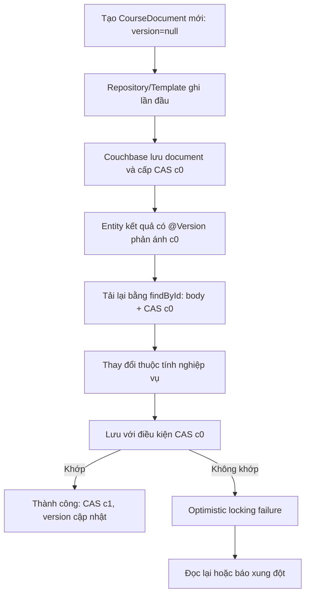

# Ánh xạ CAS vào thuộc tính @Version trong Spring Data Couchbase

## 1. Mục tiêu: dùng phiên bản document để tránh ghi đè dữ liệu mới hơn

Trong Spring Data Couchbase, một entity Java đại diện cho document nằm trong một **bucket/scope/collection**. Trường gắn `@Id` giữ **document ID**, còn trường gắn **`@Version`** cho Spring Data biết rằng entity cần áp dụng **optimistic locking** khi ghi.

Couchbase quản lý **CAS (Compare-And-Swap)** — token của phiên bản document tại thời điểm đọc. Khi Spring Data ánh xạ CAS vào một thuộc tính `@Version`, ứng dụng có thể phát hiện trường hợp:

- Worker A và B cùng đọc một document ở phiên bản cũ.
- A sửa và lưu trước, tạo ra phiên bản mới.
- B vẫn giữ một entity được đọc trước thay đổi của A.
- B cố lưu entity cũ: cập nhật có kiểm tra CAS phải bị từ chối thay vì âm thầm ghi đè A.

Ví dụ một course có tiêu đề và mức học phí:

```text
Document ID: course::acme::java-101

T0: title="Java căn bản", price=499000, CAS=c0
T1: A đổi title="Java cơ bản" và lưu với CAS=c0 -> thành công, CAS=c1
T2: B đổi price=399000 từ bản c0 và lưu với CAS=c0 -> xung đột
```

Nếu B không bị từ chối, body cũ từ B có thể kéo `title` về lại `"Java căn bản"`, gây **lost update**. Việc dùng `@Version` nhằm giúp tầng mapping từ chối tình huống đó và buộc ứng dụng giải quyết xung đột theo nghiệp vụ.

### Kết quả mong đợi sau bài

Người học có thể khai báo `@Version` đúng package, phân biệt CAS với số revision nghiệp vụ, mô tả vòng đời phiên bản khi tải/lưu entity, áp dụng kiểm soát cập nhật từ API có ETag/If-Match, xử lý lỗi optimistic locking, thiết kế retry không gây mất dữ liệu và kiểm thử các thao tác đồng thời bằng repository, `CouchbaseTemplate`, SDK và Reactive API.

## 2. CAS là metadata, không phải số đếm sửa đổi của ứng dụng

**CAS** trong Couchbase là một token **64 bit do server quản lý**, dùng để kiểm tra liệu một phiên bản document còn hiện hành tại thời điểm ghi. Cấu trúc và giá trị số của token không phải hợp đồng nghiệp vụ.

```mermaid
sequenceDiagram
    participant A as Worker A
    participant B as Worker B
    participant C as Couchbase
    A->>C: GET document K
    C-->>A: body v0 + CAS c0
    B->>C: GET document K
    C-->>B: body v0 + CAS c0
    A->>C: REPLACE K, body A, if CAS=c0
    C-->>A: OK, CAS c1
    B->>C: REPLACE K, body B, if CAS=c0
    C-->>B: CAS mismatch; không ghi đè
```

Với Spring Data Couchbase, `@Version` là **đầu mối ánh xạ** giữa token CAS và object Java. Framework đọc token kèm document, đưa token vào thuộc tính version, rồi sử dụng nó khi thực hiện thao tác cập nhật có điều kiện tương ứng.

| Khái niệm | Nằm ở đâu? | Mục đích |
| --- | --- | --- |
| `@Id` | Thuộc tính entity ánh xạ document ID | Xác định document cần truy cập |
| CAS | Metadata phiên bản của document Couchbase | Xác nhận bản đọc vẫn hiện hành |
| `@Version` | Annotation trên thuộc tính entity Spring Data | Kết nối cơ chế optimistic locking với mapping |
| `schemaVersion` | Trường nghiệp vụ tự định nghĩa nếu cần | Quản lý phiên bản cấu trúc JSON |
| `revisionNumber` | Trường nghiệp vụ tự định nghĩa nếu cần | Đếm/sắp xếp lịch sử theo quy ước ứng dụng |
| `updatedAt` | Trường nghiệp vụ | Theo dõi thời gian cập nhật, không thay CAS |

CAS không cần tăng tuần tự từ 1, 2, 3. Không viết `version++`, không dùng `CAS_A > CAS_B` để suy ra dữ liệu nào mới hơn giữa hai document, và không lấy chênh lệch CAS làm số lượt cập nhật.

**Lưu ý về JSON body:** CAS là metadata do Couchbase quản lý, không phải một trường `"version"` mà client có thể tự thêm vào body để kích hoạt optimistic locking. Nếu hệ thống cần query/lưu lịch sử phiên bản theo nghiệp vụ, hãy định nghĩa trường riêng với hợp đồng riêng.

## 3. Import đúng `@Version` và khai báo entity

Sử dụng **`org.springframework.data.annotation.Version`**, không nhầm với annotation JPA hoặc một annotation cùng tên từ thư viện khác.

```java
import java.time.Instant;
import org.springframework.data.annotation.Id;
import org.springframework.data.annotation.Version;
import org.springframework.data.couchbase.core.mapping.Document;

@Document
public class CourseDocument {

    @Id
    private String id;

    @Version
    private Long version;

    private String tenantId;
    private String courseCode;
    private String displayTitle;
    private Instant updatedAt;

    protected CourseDocument() {
        // Dành cho cơ chế ánh xạ.
    }

    public CourseDocument(String id,
                          String tenantId,
                          String courseCode,
                          String displayTitle) {
        this.id = id;
        this.tenantId = tenantId;
        this.courseCode = courseCode;
        this.displayTitle = displayTitle;
        this.updatedAt = Instant.now();
    }

    public String getId() {
        return id;
    }

    public Long getVersion() {
        return version;
    }

    public String getDisplayTitle() {
        return displayTitle;
    }

    public void rename(String nextTitle) {
        if (nextTitle == null || nextTitle.isBlank()) {
            throw new IllegalArgumentException("Tiêu đề không được rỗng");
        }
        this.displayTitle = nextTitle;
        this.updatedAt = Instant.now();
    }
}
```

Các đặc điểm có chủ ý:

1. `id` và `version` không có setter công khai: caller không thể tùy tiện thay danh tính hoặc phiên bản.
2. Thuộc tính `version` có kiểu **`Long`**: một lựa chọn phổ biến để biểu diễn CAS và thể hiện trạng thái chưa có phiên bản bằng `null`.
3. Phương thức `rename` chỉ thay nội dung nghiệp vụ. CAS được framework quản lý; không sửa bằng phép toán Java.
4. `@Version` không tự cấp quyền truy cập tenant. Service phải kiểm tra quyền trước khi sửa.
5. Entity dùng mapping đồng nhất tới **đúng collection**; việc cấu hình bucket/scope/collection ở dự án cụ thể cần phù hợp với môi trường triển khai.

### 3.1. Có dùng `long` nguyên thủy được không?

Những phiên bản Spring Data có thể hỗ trợ kiểu primitive/wrapper phù hợp cho thuộc tính version, nhưng **`Long`** thường rõ ràng hơn về mặt vòng đời:

- Entity mới chưa lưu: `version == null` biểu diễn chưa có token đã đọc.
- Entity sau khi lưu/đọc: có token CAS từ Couchbase.
- Entity được sao chép/tạo lại bằng builder: phải tránh vô tình đặt `version = null` cho một bản cập nhật.

Với kiểu primitive `long`, giá trị mặc định `0` dễ bị hiểu nhầm là “phiên bản đầu tiên” do ứng dụng tự quản. Không nên dựa vào suy đoán; hãy xác nhận hành vi nhận biết entity mới của đúng phiên bản Spring Data đang sử dụng, nhất là khi entity implements `Persistable` hoặc có quy tắc `isNew()` riêng.

### 3.2. Vì sao không dùng `@jakarta.persistence.Version`?

`jakarta.persistence.Version` là annotation thuộc JPA, dùng theo hợp đồng của persistence provider quan hệ. Trong tài liệu này, cần dùng:

```java
import org.springframework.data.annotation.Version;
```

Đồng thời, `@Document` phải đến từ Spring Data Couchbase. Một dự án có cả JPA lẫn Couchbase nên kiểm tra import cụ thể thay vì dựa vào tên annotation.

## 4. Vòng đời ánh xạ CAS ↔ `@Version`

Với một entity được quản lý đúng bằng Spring Data Couchbase, vòng đời tổng quát là:



Cần phân biệt **vòng đời tạo** và **vòng đời cập nhật**:

- **Tạo mới:** chưa có CAS của document vì document chưa được lưu. Framework chọn thao tác tạo dựa trên thông tin mapping và nhận biết entity mới.
- **Đọc:** token CAS của phiên bản document được ánh xạ vào trường `@Version`.
- **Cập nhật:** thao tác ghi sử dụng token đã đọc để bảo đảm phiên bản không bị thay đổi bởi writer khác.
- **Cập nhật thành công:** CAS mới được trả về từ Couchbase và thuộc tính version của entity được đồng bộ theo hợp đồng mapping.
- **Xung đột:** không được âm thầm mất cập nhật. Spring Data báo lỗi optimistic locking; ứng dụng quyết định bước tiếp theo.

Điểm then chốt là **không tự tái dựng entity bằng dữ liệu từ request rồi giả định nó có CAS đúng**. Một entity mới có cùng `@Id` với document đang tồn tại nhưng thiếu `@Version` không phải bản snapshot hợp lệ của document vừa được người dùng xem.

### 4.1. Đừng coi entity đã đọc là một “khóa” được giữ tới khi lưu

CAS không khóa document suốt khoảng thời gian giữa `findById` và `save`. Nếu người dùng mở trang chỉnh sửa trong 15 phút, người khác vẫn có thể cập nhật document. Lệnh ghi của người dùng mở trang cũ sẽ cần token phiên bản thích hợp để phát hiện xung đột.

CAS chỉ được kiểm tra khi thao tác có điều kiện được thực hiện. Điều đó giúp optimistic locking nhẹ hơn cơ chế giữ khóa dài hạn, nhưng buộc ứng dụng chuẩn bị chính sách báo lỗi/merge khi hai người cùng sửa.

### 4.2. Chỉ dùng bản trả về khi tiếp tục làm việc

Khi sử dụng API lưu entity, nên làm việc với **entity được trả về** hoặc tải lại nếu cần token hiện hành:

```java
CourseDocument draft = new CourseDocument(
    "course::acme::java-101",
    "acme",
    "java-101",
    "Java căn bản"
);

CourseDocument saved = courseRepository.save(draft);

Long observedVersion = saved.getVersion();
```

Ví dụ giả định `courseRepository` đã được khởi tạo và ID chưa có trong collection đích. Hợp đồng object mapping cụ thể có thể khác khi dùng entity immutable, constructor mapping hoặc API template; đừng dựa vào việc entity đầu vào **chắc chắn** bị mutate tại chỗ. Sử dụng giá trị trả về và integration test với phiên bản đang triển khai.

**Không cấp CAS bằng UUID hoặc timestamp.** Giá trị trên phải đến từ thao tác lưu/đọc được Couchbase xác nhận.

## 5. Repository: đọc hai bản, chỉ một bản cập nhật được chấp nhận

Khai báo repository:

```java
import org.springframework.data.couchbase.repository.CouchbaseRepository;

public interface CourseRepository
        extends CouchbaseRepository<CourseDocument, String> {
}
```

Để thấy tính năng `@Version`, hãy tưởng tượng hai worker thực hiện đọc **trước khi có cập nhật**:

```java
String key = "course::acme::java-101";

CourseDocument copyA =
    courseRepository.findById(key).orElseThrow();
CourseDocument copyB =
    courseRepository.findById(key).orElseThrow();

// Hai bản đọc cùng một phiên bản CAS c0.
Long versionA = copyA.getVersion();
Long versionB = copyB.getVersion();

copyA.rename("Java cơ bản");
CourseDocument savedA = courseRepository.save(copyA);
// Thao tác của A thành công nếu không có cạnh tranh khác.

copyB.rename("Java nhập môn");
// B dùng phiên bản đã cũ: khi lưu phải xảy ra optimistic lock conflict.
courseRepository.save(copyB);
```

Đây là một **kịch bản minh họa**, không phải hàm test đầy đủ: trong test thật cần bắt ngoại lệ phù hợp và khẳng định document cuối vẫn chứa cập nhật của A.

Ở một phiên bản Spring Data Couchbase được cấu hình đúng, lỗi optimistic locking thông thường thuộc hệ phân cấp **`org.springframework.dao.OptimisticLockingFailureException`**. SDK trực tiếp có thể ném loại lỗi CAS khác như `CasMismatchException`. Tầng service cần phân biệt chúng thay vì bắt `Exception` rồi retry mọi thứ.

### 5.1. Lưu một document mới có phải thao tác `insert-if-absent` không?

Không nên đồng nhất bài toán **tạo document mới** với optimistic locking của document đã có:

- `@Version` giải quyết việc **ghi từ một phiên bản document đã đọc**.
- Tạo một tài nguyên chỉ khi key chưa tồn tại là yêu cầu **insert-if-absent**, vốn cần ngữ nghĩa tạo mới được bảo đảm.
- Idempotency khi một POST bị gửi lại là bài toán **yêu cầu logic**, không chỉ là CAS của document.

Hành vi `save` lúc entity mới phụ thuộc nhận biết entity mới và API mapping; không lấy `save` làm bằng chứng duy nhất cho mọi ràng buộc unique khi có cạnh tranh. Khi cần khẳng định không ghi đè, sử dụng API insert phù hợp và kiểm tra lỗi document đã tồn tại.

## 6. Service: xử lý xung đột thay vì nuốt ngoại lệ

Một service cập nhật tên khóa học:

```java
import java.util.NoSuchElementException;
import org.springframework.dao.OptimisticLockingFailureException;

public final class CourseService {
    private final CourseRepository repository;

    public CourseService(CourseRepository repository) {
        this.repository = repository;
    }

    public CourseDocument rename(String authorizedDocumentId,
                                 String nextTitle) {
        CourseDocument loaded = repository.findById(
            authorizedDocumentId
        ).orElseThrow(() ->
            new NoSuchElementException("Course không tồn tại"));

        loaded.rename(nextTitle);

        try {
            return repository.save(loaded);
        } catch (OptimisticLockingFailureException conflict) {
            // Không tự ghi đè bằng bản đã cũ.
            throw new IllegalStateException(
                "Course đã bị sửa đồng thời; cần tải lại trước khi lưu",
                conflict);
        }
    }
}
```

Ví dụ chỉ tập trung vào cơ chế phiên bản. Trong ứng dụng thực tế:

1. Kiểm tra quyền truy cập tenant và quyền sửa trước khi ghi.
2. Validate nội dung đầu vào.
3. Phân biệt lỗi xung đột CAS với mất document, hết TTL, timeout hoặc validation.
4. Tầng API ánh xạ sang status thích hợp, thường `409 Conflict` khi tài nguyên đã bị sửa đồng thời.
5. Nếu người dùng chỉnh sửa dựa trên một snapshot đã xem trước đó, cần thêm **token phiên bản từ client**; không chỉ đọc bản mới nhất trong service và ghi.

Điểm cuối cùng rất quan trọng: việc mỗi request tự `findById` bản **mới nhất** rồi `save` có thể tránh race giữa **hai thao tác trong cùng request**, nhưng **không** bảo đảm người dùng đang sửa form cũ không ghi đè thay đổi đã xảy ra **trước** khi request bắt đầu.

## 7. Khác biệt giữa hai mẫu cập nhật HTTP

### 7.1. Mẫu A: server tự đọc phiên bản hiện tại

```text
GET /courses/java-101 -> người dùng thấy title cũ vào 09:00
Một người khác sửa title lúc 09:10
PUT /courses/java-101 -> server đọc bản mới lúc 09:20
                      -> tự ghi title của form cũ
```

Nếu controller không gửi bất kỳ thông tin phiên bản nào từ client, server có thể đọc CAS hiện tại ở 09:20 rồi lưu thành công. Lúc này **CAS vẫn hoạt động đúng** về mặt kỹ thuật, nhưng không bảo vệ ý định “chỉ sửa phiên bản tôi đã xem lúc 09:00”.

### 7.2. Mẫu B: client gửi token phiên bản đã xem

Một thiết kế vững hơn:

1. API GET trả body cùng **opaque version token**, chẳng hạn HTTP `ETag`.
2. Client giữ token đó đến khi người dùng bấm Lưu.
3. PUT/PATCH gửi token qua `If-Match` hoặc một trường request tương đương.
4. Server kiểm tra rằng token client cung cấp khớp với bản đang được dùng làm cơ sở.
5. Lệnh ghi vẫn dùng CAS của bản đọc để bảo vệ race xảy ra **sau bước kiểm tra**.
6. Nếu token không khớp, trả lỗi tiền điều kiện, thường `412 Precondition Failed`; nếu thiếu điều kiện khi API yêu cầu, có thể trả `428 Precondition Required`.

```http
GET /api/courses/java-101

HTTP/1.1 200 OK
ETag: "opaque-cas-token"
Content-Type: application/json

{"courseId":"java-101","title":"Java căn bản"}
```

```http
PUT /api/courses/java-101
If-Match: "opaque-cas-token"
Content-Type: application/json

{"title":"Java nâng cao"}
```

Chuỗi `"opaque-cas-token"` ở đây là **placeholder**, không phải mã hóa CAS chuẩn do Spring Data hay Couchbase tự cung cấp. Ứng dụng phải tự quy định định dạng token và cách so khớp an toàn. Không dùng CAS như khóa xác thực hay bí mật; **authorization vẫn bắt buộc**.

### 7.3. Ví dụ pseudocode: so version đã xem, sau đó lưu bằng `@Version`

```java
public CourseDocument renameIfUnchanged(
        String authorizedDocumentId,
        long expectedCasFromIfMatch,
        String nextTitle) {

    CourseDocument loaded =
        courseRepository.findById(authorizedDocumentId).orElseThrow();

    Long currentCas = loaded.getVersion();

    if (currentCas == null ||
        currentCas.longValue() != expectedCasFromIfMatch) {
        // Tầng HTTP có thể trả 412 Precondition Failed.
        throw new IllegalStateException(
            "Phiên bản mà client đã xem không còn hiện hành");
    }

    loaded.rename(nextTitle);

    // Nếu writer khác sửa giữa if và save, @Version/CAS
    // tiếp tục chặn cập nhật từ phiên bản đã cũ.
    return courseRepository.save(loaded);
}
```

Ví dụ giả định token HTTP đã được parse, xác thực cú pháp và giải mã thành 64 bit CAS theo hợp đồng ứng dụng. Vì CAS là bit-pattern 64 bit, có thể cần định dạng unsigned khi truyền qua HTTP; tuyệt đối không chuyển CAS qua số JavaScript có nguy cơ mất chính xác rồi tin rằng giá trị vẫn nguyên vẹn. Chuỗi opaque là lựa chọn dễ kiểm soát hơn.

**Không** đọc lại entity ngay sau khi phát hiện mismatch rồi lẳng lặng dùng version mới để ép lưu payload của client. Điều đó loại bỏ chính mục đích so sánh phiên bản người dùng đã xem.

## 8. Thuộc tính version không phải một trường do client được tùy ý sửa

Một DTO có thể chỉ mô tả ý định đổi dữ liệu:

```java
public record RenameCourseRequest(String title) {
}
```

Version token có thể đi qua header `If-Match` hoặc một trường rõ ràng trong request; không đưa entity `CourseDocument` với `@Version` cho client cập nhật toàn bộ trực tiếp rồi bind lại để `save`.

Các anti-pattern:

```java
// 1. Tạo entity mới từ body PUT nhưng quên CAS.
CourseDocument detached = new CourseDocument(
    incomingId, tenantId, courseCode, incomingTitle);
courseRepository.save(detached);

// 2. Cố tự tăng thuộc tính @Version.
long guessedNext = oldVersion + 1L;

// 3. Lấy CAS của bản mới nhất và bỏ qua token client đã thấy.
CourseDocument latest = courseRepository.findById(id).orElseThrow();
latest.rename(incomingTitle);
courseRepository.save(latest);
```

Lỗi của đoạn 1 là entity mới **không mang snapshot version** của lần GET cũ. Kết quả save có thể rẽ sang logic tạo mới/thay thế hoặc báo lỗi tùy mapping; không dùng cách này như một cập nhật có điều kiện. Đoạn 2 sai vì CAS không phải sequence do ứng dụng tăng. Đoạn 3 có thể hợp lệ cho một command được thiết kế là “áp dụng ngay trên bản mới nhất”, nhưng **sai** nếu API hứa chống ghi đè phiên bản mà client đã xem.

Với các entity bất biến, bản copy của entity phải **giữ nguyên version đang quan sát** nếu mong cập nhật từ snapshot đó. Nếu copy constructor hoặc builder bỏ field version, cơ chế optimistic locking có thể không còn cơ sở phù hợp để bảo vệ bản cũ.

## 9. `@Version` khác cơ chế kiểm soát trạng thái nghiệp vụ

CAS chỉ trả lời câu hỏi:

> Document mà tôi dựa vào để sửa **có bị thay đổi** kể từ khi đọc không?

CAS **không** trả lời các câu hỏi:

- Có được phép chuyển order từ `CANCELLED` sang `PAID` không?
- Số lượng tồn kho sau phép trừ có âm không?
- Event `completedLesson=7` có cũ hơn event `completedLesson=8` không?
- Cùng webhook thanh toán có đã được xử lý trước đó chưa?
- Hai document Order và Inventory có được cập nhật cùng thành công không?

Vì vậy, luồng cập nhật an toàn thường gồm:

```text
Đọc entity + @Version/CAS
     |
Kiểm tra quyền và quy tắc nghiệp vụ trên bản đã đọc
     |
Tính thay đổi có chủ đích
     |
Lưu với CAS
     |-- Thành công: nghiệp vụ hợp lệ tại phiên bản đã kiểm tra
     |-- Conflict: đọc lại và đánh giá lại quy tắc hoặc trả lỗi
```

Nếu muốn tăng `completedLessons` từ 7 lên 8, không được retry bằng cách lấy bản mới nhất và **ghi cứng 8** khi bản mới có thể đang là 9. Có thể áp dụng `max(current, incoming)` nếu đó là quy tắc nghiệp vụ đúng; còn với số dư, điểm thưởng hoặc tồn kho cần kiểm tra bất biến và idempotency riêng.

## 10. Xử lý lỗi optimistic locking đúng loại

Khi thao tác repository trên entity có `@Version` gặp xung đột, Spring Data có thể phát sinh ngoại lệ thuộc họ **`OptimisticLockingFailureException`**. Khi sử dụng Couchbase Java SDK trực tiếp với CAS, lỗi tiêu biểu là **`CasMismatchException`**.

Những lỗi dễ bị nhầm:

| Tình huống | Diễn giải | Cách xử lý |
| --- | --- | --- |
| CAS hiện hành khác token entity đã đọc | Xung đột optimistic locking | Đọc lại/merge hoặc báo 409/412 |
| Document không tồn tại khi cập nhật | Có thể đã bị xóa, hết TTL hoặc sai key/collection | Phân biệt 404 với race hoặc policy TTL |
| Thao tác insert gặp key đã có | Tranh chấp tạo mới | Xác minh identity, không tự ghi đè |
| SDK timeout sau lệnh ghi | **Không rõ** server đã commit hay chưa | Đọc/đối soát trạng thái, tránh ghi mù |
| Payload không hợp lệ | Lỗi validation | Không retry như CAS conflict |
| Sai tenant hoặc thiếu quyền | Lỗi authorization | Không nâng quyền tự động |
| Document khác collection dù ID giống | Sai cấu hình repository/template | Kiểm tra bucket/scope/collection |
| Transaction abort | Có thể do conflict hoặc điều kiện transaction | Xử lý theo API transaction, không tự dùng entity stale |

**Không bắt mọi exception rồi gọi lại `save(staleEntity)`**. Nếu CAS không khớp, cùng object giữ token cũ thường tiếp tục thất bại. Nếu lỗi mạng xảy ra sau khi commit, retry theo kiểu ghi không điều kiện còn có thể ghi đè cập nhật mới hơn.

Khi muốn client giải quyết xung đột, trả một mã lỗi rõ ràng và thông tin tối thiểu, không trả body bí mật của tenant khác.

## 11. Khi nào nên retry, khi nào nên báo conflict?

Chiến lược retry tùy **ý định nghiệp vụ**.

### 11.1. Cập nhật có thể tính lại an toàn

Ví dụ “đặt tên hiển thị thành X” có thể được phép áp dụng lại trên bản mới nếu không có quy tắc kiểm soát khác. Một vòng retry hợp lý:

1. Tải entity mới nhất cùng CAS.
2. Kiểm tra quyền và điều kiện nghiệp vụ.
3. Tính cập nhật trên entity mới.
4. Gọi `save`.
5. Nếu nhận optimistic conflict, thử lại **tối đa** một số lần nhỏ với backoff nếu use case cho phép.
6. Sau ngưỡng retry, trả lỗi để caller quyết định.

```java
import org.springframework.dao.OptimisticLockingFailureException;

public CourseDocument renameWithBoundedRetry(String authorizedDocumentId,
                                             String nextTitle) {
    final int maxAttempts = 3;

    for (int attempt = 1; attempt <= maxAttempts; attempt++) {
        CourseDocument latest =
            courseRepository.findById(authorizedDocumentId).orElseThrow();

        // Phải kiểm tra business invariant trên phiên bản vừa đọc.
        latest.rename(nextTitle);

        try {
            return courseRepository.save(latest);
        } catch (OptimisticLockingFailureException conflict) {
            if (attempt == maxAttempts) {
                throw conflict;
            }
            // Production: backoff/jitter có giới hạn nếu contention cao.
        }
    }

    throw new IllegalStateException("Không thể đạt tới nhánh này");
}
```

**Không dùng hàm retry này nguyên xi** cho request dựa trên ETag cũ, chuyển tiền, trừ tồn kho hoặc một phép biến đổi mà việc tái áp dụng có thể ghi đè ý định của writer khác. Với form chỉnh sửa cần kiểm tra phiên bản client, thường nên **trả 412 thay vì tự vượt qua xung đột**.

### 11.2. Cập nhật không nên tự retry

Những ví dụ phải cân nhắc báo conflict hoặc yêu cầu xác nhận lại:

- Hai quản trị viên sửa **cùng một mức giá** theo hai đề xuất khác nhau.
- Người dùng sửa một bản ghi đã thay đổi điều khoản pháp lý.
- Client gửi một snapshot cũ muốn ghi đè toàn bộ document.
- Một phép trừ tồn kho phụ thuộc giới hạn số lượng; cần kiểm tra lại bản mới và bảo vệ không trừ lặp do retry HTTP.
- Một lệnh ngoài database như gửi email, charge payment hoặc phát sự kiện; chỉ CAS không ngăn side effect lặp.

## 12. `CouchbaseTemplate` và SDK trực tiếp có tự dùng `@Version` không?

Spring Data Couchbase có nhiều API: repository, `CouchbaseTemplate`, các thao tác entity mapping và Couchbase Java SDK. Điều phải bảo toàn là **đường ghi có thật sự chuyển token version thành điều kiện CAS hay không**.

### 12.1. Repository/entity operations

Một repository làm việc trên entity có `@Version` là cách phổ biến để tận dụng optimistic locking từ Spring Data.

Khi dùng `CouchbaseTemplate` hoặc fluent API, nếu thao tác đi qua **cơ chế ánh xạ entity và optimistic locking được hỗ trợ**, nó có thể tận dụng metadata này. Nhưng không nên suy luận **mọi** phương thức template, query/update hoặc thao tác tùy biến đều tự kiểm tra `@Version`. Cần đọc tài liệu API của phiên bản đang dùng và xác nhận bằng integration test.

### 12.2. SDK Java trực tiếp

Couchbase SDK làm việc với key và nội dung; nó không quét annotation `@Version` trên Java class Spring Data. Muốn bảo vệ một `replace`, truyền CAS rõ ràng:

```java
import com.couchbase.client.core.error.CasMismatchException;
import com.couchbase.client.java.Collection;
import com.couchbase.client.java.json.JsonObject;
import com.couchbase.client.java.kv.GetResult;
import com.couchbase.client.java.kv.MutationResult;

import static com.couchbase.client.java.kv.ReplaceOptions.replaceOptions;

public final class DirectCasUpdate {
    private final Collection collection;

    public DirectCasUpdate(Collection collection) {
        this.collection = collection;
    }

    public long changeTitle(String key, String nextTitle) {
        GetResult observed = collection.get(key);
        JsonObject body = observed.contentAsObject();
        body.put("displayTitle", nextTitle);

        try {
            MutationResult result = collection.replace(
                key,
                body,
                replaceOptions().cas(observed.cas()));
            return result.cas(); // CAS mới.
        } catch (CasMismatchException mismatch) {
            throw new IllegalStateException(
                "Document đã thay đổi trước lúc ghi", mismatch);
        }
    }
}
```

Ví dụ SDK độc lập, giả định document là JSON object. Đường SDK trực tiếp **không tự dùng mapping Spring Data**; nếu đồng thời đọc/ghi cùng document bằng repository, phải đảm bảo JSON, metadata kiểu entity, expiry và collection được xử lý tương thích.

### 12.3. SQL++ và các writer khác

Một câu SQL++ `UPDATE`, job ETL, SDK KV hoặc một service khác có thể thay document và làm CAS của document biến đổi. Entity đã tải từ repository trước thay đổi đó sẽ giữ token cũ và phát hiện conflict khi lưu lại qua đường optimistic locking.

Tuy nhiên, điều kiện `@Version` **không tự được chèn** vào mọi câu SQL++ UPDATE do ứng dụng viết. Tương tự, một `collection.upsert(key, body)` không điều kiện có thể ghi đè dữ liệu bất chấp entity Java ở nơi khác có `@Version`.

**Quy tắc vận hành:** ghi rõ inventory các đường ghi vào cùng collection và policy concurrency của từng đường; nếu có nhiều đường ghi, optimistic locking chỉ thực sự hữu ích khi mọi đường quan trọng tôn trọng các bất biến dữ liệu.

## 13. Reactive repository: `@Version` vẫn có nghĩa như nhau

Với `ReactiveCouchbaseRepository`, cách biểu diễn luồng thay đổi nhưng ý tưởng ánh xạ không đổi: phiên bản entity tải lên phản ánh CAS và luồng lưu theo mapping có thể kiểm tra token đó.

```java
import java.util.NoSuchElementException;
import org.springframework.data.couchbase.repository.ReactiveCouchbaseRepository;
import reactor.core.publisher.Mono;

public interface ReactiveCourseRepository
        extends ReactiveCouchbaseRepository<CourseDocument, String> {
}

public final class ReactiveCourseService {
    private final ReactiveCourseRepository repository;

    public ReactiveCourseService(ReactiveCourseRepository repository) {
        this.repository = repository;
    }

    public Mono<CourseDocument> rename(String id, String nextTitle) {
        return repository.findById(id)
            .switchIfEmpty(Mono.error(
                new NoSuchElementException("Course không tồn tại")))
            .flatMap(course -> {
                course.rename(nextTitle);
                return repository.save(course);
            });
    }
}
```

Trong các API thực tế, cần xác thực quyền tenant trước hoặc trong pipeline với ngữ cảnh bảo mật thích hợp. Khi optimistic conflict xảy ra, publisher phát tín hiệu lỗi; tầng HTTP hoặc orchestration phải xử lý có chủ đích.

### 13.1. Rủi ro khi thêm `retryWhen(...)`

Không nên viết một retry vô điều kiện quanh publisher có side effect mà không xác định phần nào sẽ chạy lại:

- Retry chỉ `repository.save(staleEntity)` có thể giữ nguyên token cũ và tiếp tục thất bại.
- Retry **cả bước đọc → kiểm tra → ghi** giúp tải CAS mới, nhưng phải bảo đảm command có thể được tái áp dụng an toàn.
- Nếu code tạo UUID mới, gửi email hay charge trong chuỗi được resubscribe, retry có thể lặp tác dụng ngoài DB.
- Nếu API cần If-Match theo phiên bản user đã xem, đọc lại và “chấp nhận CAS mới” là **sai yêu cầu**.

Reactive không tự mang lại transaction hoặc idempotency; nó chỉ thay đổi cách lập trình bất đồng bộ.

## 14. Entity immutable, constructor binding và mapping phiên bản

Một số dự án dùng entity immutable, Java record hoặc Kotlin data class. Khi đó thuộc tính `@Version` vẫn có vai trò lưu CAS, nhưng mapping có thể cần constructor/copy method phù hợp để framework đưa token mới vào object.

Ví dụ sơ đồ dữ liệu bất biến:

```text
CourseSnapshot {
    id,
    version,
    tenantId,
    title
}

snapshot v0 + change -> snapshot v0' (giữ version v0)
save(snapshot v0')   -> saved snapshot mang CAS v1
```

Những lưu ý:

- Copy entity để sửa title **không được tự reset version** về `null`.
- Không tự sửa token để khiến update “vượt” xung đột.
- Sau save, dùng object kết quả (hoặc đọc lại) để có phiên bản mới.
- Nếu dùng Lombok builder, Jackson, MapStruct, record constructor hoặc Kotlin `copy`, xác định rõ chúng có giữ `@Version` đúng cách không.
- Chỉ triển khai dạng immutable khi đã xác nhận cơ chế mapping và constructor phù hợp với phiên bản Spring Data Couchbase đang sử dụng.

Việc tách **DTO API** khỏi **entity persistence** càng quan trọng khi entity có token CAS; tránh để client được phép bind trường `version` trực tiếp một cách tùy tiện.

## 15. Khi document bị xóa, hết TTL hoặc tạo lại cùng ID

CAS không bảo đảm document tồn tại vĩnh viễn.

Giả sử:

```text
T0: repository.findById(K) -> entity e, version=c0
T1: document K hết hạn TTL hoặc bị xóa
T2: repository.save(e) -> tùy API có thể báo not-found/conflict
```

Nếu sau T1 một process khác tạo lại document cùng key K, đó có thể là **một vòng đời nghiệp vụ mới**. Không được coi CAS cũ như quyền cập nhật vô hạn cho document tái sử dụng ID. Phải xác định chính sách phát hiện đã xóa, đã tạo lại và sự tương ứng của identity.

Ngoài ra, thay đổi body bằng một lệnh KV có thể ảnh hưởng expiry tùy thao tác và tùy chọn. Optimistic locking chỉ bảo vệ **phiên bản**, không tự đảm bảo **TTL** được giữ hoặc được gia hạn đúng như nghiệp vụ muốn.

| Cơ chế | Bảo đảm chính | Không bảo đảm |
| --- | --- | --- |
| `@Version` / CAS | Phát hiện phiên bản document bị thay đổi | Document không bao giờ hết hạn/xóa |
| `@Id` | Xác định document trong một collection | Không bao giờ được tạo lại |
| TTL | Thời gian tồn tại theo policy | Không lặp yêu cầu hoặc giữ bản cập nhật |
| CAS khi `remove` | Chỉ xóa phiên bản phù hợp nếu thao tác hỗ trợ | Giao dịch xóa đa document |
| Insert-if-absent | Không ghi đè ID đã tồn tại tại thời điểm insert | Unique nghiệp vụ xuyên nhiều ID |

**Không dùng CAS làm timestamp hoặc số phiên bản lịch sử**. Nếu cần lưu vết và phục hồi, cần audit/event log hoặc version history riêng.

## 16. Không có transaction đa document chỉ vì dùng `@Version`

Giả sử chuyển điểm thưởng:

```text
wallet-A.balance -= 100
wallet-B.balance += 100
```

Cả hai entity đều có `@Version`. Điều đó **không** bảo đảm hai lần `save` cùng thành công:

```text
save(wallet-A) -> thành công, CAS mới
save(wallet-B) -> conflict/timeout
=> trạng thái liên tài liệu có thể không nhất quán
```

Khi nhiều document phải thay đổi trong cùng một ranh giới nguyên tử, cần cân nhắc **Couchbase distributed transactions** theo API được hỗ trợ hoặc workflow bù trừ/idempotency có trạng thái.

Cũng không suy ra một `@Transactional` của JPA sẽ tự phối hợp các thao tác Couchbase. Khi dùng Spring Data transaction integration, phải kiểm tra transaction manager, scope tham gia và phiên bản thư viện thực tế.

CAS cũng khác **durability**: nó xác định phiên bản có còn đúng để ghi, không tự cam kết số bản sao đã xác nhận ghi hoặc mức chống mất dữ liệu khi node gặp sự cố. Durability cần được cấu hình riêng theo SLA.

## 17. Những lỗi triển khai `@Version` thường gặp

| Triệu chứng | Nguyên nhân khả dĩ | Cách xử lý |
| --- | --- | --- |
| Stale entity vẫn ghi đè dữ liệu | Không dùng `@Version` hoặc đường ghi bypass mapping | Kiểm tra entity và tất cả writer |
| `version` luôn `null` trên DTO trả về | DTO bỏ field hoặc entity được dựng mới | Phân biệt entity snapshot và DTO; dùng token phiên bản có chủ đích |
| `save` của entity dựng từ request tạo/ghi không như kỳ vọng | Mất CAS do mapping hoặc nhận biết entity mới | Tải đúng entity, bảo toàn version hoặc dùng API điều kiện thích hợp |
| Conflict xuất hiện thường xuyên | Document nóng, nhiều writer dùng CAS cũ | Giảm contention, xem lại mô hình dữ liệu, retry có giới hạn |
| Client cũ vẫn sửa đè người khác | Server chỉ đọc latest trước PUT, không so client version | ETag/If-Match hoặc optimistic token theo snapshot đã xem |
| Lệnh SQL++ UPDATE “không thấy @Version” | Annotation thuộc mapping của Spring Data | Tự thiết kế điều kiện đồng thời cho query, kiểm tra CAS |
| SDK `upsert` ghi đè thay đổi repository | Ghi không điều kiện | Dùng replace có CAS hoặc thay đổi đường cập nhật |
| Sau retry version bị lỗi liên tục | Dùng lại entity stale/CAS cũ | Đọc lại rồi kiểm tra lại business intent |
| CAS đọc từ document khác được dùng cho key hiện tại | Nhầm snapshot/key | Không trộn token giữa các document |
| Sau TTL, update thành lỗi not-found | Document đã hết hạn | Phân biệt expiry và conflict |
| Thêm `@Version` nhưng test không tái tạo xung đột | Hai lần đọc không cùng phiên bản hoặc test chạy tuần tự | Đọc cả A/B trước khi ghi A |
| Transaction có update ngoài DB | Nhầm scope transaction | Thiết kế outbox/downstream idempotency |
| Đổi khóa entity rồi save | Nhầm `@Version` với rename | Dùng workflow migration ID thay vì chỉ đổi field |

### 17.1. Khi nào cần nâng mức điều phối?

Nếu một document bị hàng trăm writer tranh chấp mỗi giây, việc thêm `@Version` có thể chỉ khiến nhiều request bị từ chối hơn. Cần phân tích workload:

- Có thể **tách một document nóng** thành nhiều aggregate hay không?
- Thao tác có thể dùng **atomic counter** hoặc mutation theo đường SDK phù hợp không?
- Có thể **gom sự kiện** hoặc xử lý tuần tự theo document ID?
- Có cần transaction hay một coordinator bên ngoài?
- Có thể thay đổi yêu cầu từ “ghi toàn bộ snapshot” sang “ghi event/patch” mà vẫn giữ bất biến?

Mục tiêu không phải buộc mọi update thành công bằng retry, mà là **giữ dữ liệu đúng và hiệu năng chấp nhận được**.

## 18. Kiểm thử tích hợp: chứng minh mapping CAS

Đối với optimistic locking, unit test đơn thuần không đủ xác nhận CAS của Couchbase đã được ánh xạ. Cần ít nhất một integration test thực sự thực hiện hai lần đọc cùng phiên bản và hai lần ghi.

### 18.1. Ví dụ JUnit 5 với repository

```java
import static org.junit.jupiter.api.Assertions.*;

import org.junit.jupiter.api.Test;
import org.springframework.dao.OptimisticLockingFailureException;

class CourseVersionIntegrationTest {

    private final CourseRepository courseRepository;

    CourseVersionIntegrationTest(CourseRepository courseRepository) {
        this.courseRepository = courseRepository;
    }

    @Test
    void staleEntityMustNotOverwriteNewerUpdate() {
        String id = "course::acme::test-cas-001";

        // Arrange trong môi trường test riêng, đảm bảo ID chưa có.
        CourseDocument initial = courseRepository.save(
            new CourseDocument(id, "acme", "test-cas-001", "V0"));

        assertNotNull(initial.getVersion());

        CourseDocument a = courseRepository.findById(id).orElseThrow();
        CourseDocument b = courseRepository.findById(id).orElseThrow();

        assertEquals(a.getVersion(), b.getVersion());

        a.rename("Phiên bản A");
        CourseDocument savedA = courseRepository.save(a);

        assertNotNull(savedA.getVersion());

        b.rename("Phiên bản B");
        assertThrows(
            OptimisticLockingFailureException.class,
            () -> courseRepository.save(b));

        CourseDocument finalState =
            courseRepository.findById(id).orElseThrow();

        assertEquals("Phiên bản A", finalState.getDisplayTitle());
    }
}
```

Đây là **khung minh họa**, không phải test class có thể chạy độc lập ngay: cần cấu hình Spring test, khởi tạo/inject repository, chuẩn bị dữ liệu sạch và cleanup trong fixture thật. Exception cụ thể và cơ chế ánh xạ có thể thay đổi theo phiên bản Spring Data; khi chạy test phải dùng class exception phù hợp.

### 18.2. Test với SDK trực tiếp

Một test độc lập nên:

1. `collection.get(key)` hai lần, nhận CAS `c0` ở cả hai.
2. `replace(key, bodyA, cas=c0)` thành công.
3. `replace(key, bodyB, cas=c0)` phải ném `CasMismatchException`.
4. Đọc document cuối, khẳng định thay đổi A được giữ.
5. Ghi nhận CAS mới khác token cũ, **không** assert phải bằng `c0 + 1`.

Kết hợp test SDK với test repository giúp phát hiện trường hợp một đường ghi không áp dụng CAS hoặc một mapper làm mất version.

### 18.3. Ma trận kiểm thử nên có

| Ca kiểm thử | Kỳ vọng |
| --- | --- |
| Entity mới trước save | Version chưa được nhận từ Couchbase |
| Lưu thành công entity mới | Có version/CAS do mapping trả về |
| Hai bản đọc cùng key trước ghi | Có cùng token phiên bản |
| Save bản A rồi save bản B stale | B bị từ chối, A không mất |
| B đọc lại và merge đúng nghiệp vụ | Có thể ghi bằng CAS mới |
| SDK replace với stale CAS | Nhận CAS mismatch |
| SDK upsert không CAS | Kiểm thử chứng minh có thể phá hợp đồng optimistic locking |
| DTO/ETag cũ gửi lên PUT | Bị từ chối bằng 412/409 theo hợp đồng |
| DTO/ETag mới gửi lên PUT | Thành công nếu không có race khác |
| Document bị xóa giữa đọc và ghi | Xử lý not-found/optimistic failure có chủ đích |
| Document hết TTL | Không tự tái tạo thực thể khi API yêu cầu update-only |
| Nhiều service/collection | Version không bị trộn giữa document/collection |
| Reactive retry | Không lặp side effect, đọc CAS mới khi cần |
| Two-document workflow | Có transaction hoặc policy nhất quán, không chỉ dựa vào hai `@Version` |
| Nhiều writer tranh chấp | Retry có giới hạn và metric về conflict |

## 19. Bài tập tình huống: chỉnh sửa học phí

Một hệ thống đào tạo lưu `CourseDocument` với:

```text
ID:      course::acme::spring-couchbase
Title:   Spring Data Couchbase nâng cao
Price:   990000
Version: CAS c0
```

Hai nhân viên quản trị cùng mở trang chỉnh sửa lúc 09:00.

- A đổi `title` rồi lưu thành công lúc 09:05; document có CAS `c1`.
- B đổi `price` dựa trên form còn chứa thông tin lúc 09:00 và gửi PUT lúc 09:10.
- Một service khác cập nhật metadata course bằng SDK.

**Câu hỏi:**

1. Nếu PUT của B **không gửi token phiên bản**, việc service gọi `findById` mới nhất rồi `save` có bảo vệ đúng snapshot B đã xem không?
2. Nếu B gửi `If-Match` đại diện cho `c0`, server cần xử lý thế nào khi document hiện là `c1`?
3. Nếu A và B sửa **hai field khác nhau**, có nên tự merge mọi trường hợp không?
4. Nếu SDK service dùng `upsert` không điều kiện, nó có tự áp dụng `@Version` của entity Java không?
5. Nếu Course có document học phí khác phải cập nhật cùng lúc, CAS của Course có đảm bảo cả hai cùng thành công không?
6. Nếu Course hết TTL trước khi B lưu, lỗi not-found khác gì CAS mismatch?

**Gợi ý lời giải:** không gửi snapshot version từ B sẽ không bảo vệ bản mà B đã xem từ 09:00. Nếu `If-Match=c0` nhưng document hiện tại là `c1`, từ chối theo tiền điều kiện (ví dụ HTTP 412), không tự dùng c1 ghi payload cũ. Có thể cung cấp giao diện merge nếu nghiệp vụ cho phép, nhưng cần đánh giá conflict và giữ thay đổi của A. SDK upsert không đọc annotation Spring Data. Khi cần cập nhật nhiều document, cân nhắc transaction/workflow phù hợp. TTL có thể làm document biến mất nên phải xử lý not-found.

## 20. Checklist khi dùng `@Version` trong production

1. Đã import đúng `org.springframework.data.annotation.Version`?
2. Entity có một `@Id` ổn định và một thuộc tính version phù hợp, chẳng hạn `Long`?
3. Không tự tăng CAS, không coi CAS là sequence/timestamp?
4. Controller không cho phép client tùy ý bind version vào entity persistence?
5. Với API chỉnh sửa từ form, có token phiên bản khách đã xem, ví dụ ETag/If-Match?
6. Đã so sánh token client với bản hiện tại **trước** khi thay đổi body, đồng thời vẫn dựa vào CAS lúc ghi?
7. Bản entity dùng cập nhật giữ đúng version đọc từ Couchbase; builder/copy không làm rỗng version?
8. Sau save, có dùng entity kết quả hoặc đọc lại để lấy CAS mới?
9. Đã phân biệt lỗi optimistic locking với not-found, TTL, timeout, insert duplicate và permission?
10. Retry có đọc lại, tái kiểm tra nghiệp vụ và giới hạn số lần, không lặp side effect?
11. Có writer nào dùng SDK upsert/SQL++ UPDATE bypass optimistic locking cần kiểm soát?
12. Repository, `CouchbaseTemplate` và Reactive API có cùng cấu hình bucket/scope/collection?
13. Với counter/tồn kho, đã cân nhắc operation atomic và contention thay vì retry vô hạn?
14. Với nhiều document, có transaction hoặc quy trình nhất quán khác?
15. Với event/payment/email, có idempotency/outbox/reconciliation riêng?
16. Có chính sách TTL/expiry và xử lý document bị xóa/tạo lại cùng ID?
17. Có metric cho CAS conflict, retry count và độ trễ ghi ở tài liệu nóng?
18. Có integration test cho hai bản stale, SDK direct CAS và ETag cũ?
19. Có bảo vệ tenant và quyền ghi độc lập với ID hoặc CAS token?
20. Đã kiểm tra hành vi thực tế theo đúng phiên bản Spring Data Couchbase và Couchbase Java SDK đang dùng?

## Tài liệu tham khảo

- [Spring Data Couchbase Reference](https://docs.spring.io/spring-data/couchbase/reference/): tài liệu mapping entity, optimistic locking, repository và template.
- [Spring Data Commons — Optimistic Locking](https://docs.spring.io/spring-data/commons/reference/): mô hình `@Version` và các hợp đồng persistence.
- [Couchbase Java SDK — Key-Value Operations](https://docs.couchbase.com/java-sdk/current/howtos/kv-operations.html): CAS qua `GetResult.cas()`, `replace`, `remove` và các điều kiện ghi.
- [Couchbase Java SDK — Distributed ACID Transactions](https://docs.couchbase.com/java-sdk/current/howtos/distributed-acid-transactions-from-the-sdk.html): ranh giới transaction cho nhiều document.

## Kết luận

Trong Spring Data Couchbase, **`@Version` là cầu nối giữa thuộc tính entity và CAS của document Couchbase**. Khi một entity được đọc, nó mang theo token phiên bản; khi cập nhật bằng đường mapping có optimistic locking, token đó cho phép server phát hiện bản đã cũ và từ chối ghi đè. Cần phân biệt vòng đời tạo với cập nhật, giữ version khi copy entity, xử lý lỗi optimistic locking rõ ràng và dùng token từ **phiên bản client thực sự đã xem** nếu API hứa ngăn mất cập nhật khi chỉnh sửa từ giao diện. Dù `@Version` rất hữu ích, nó chỉ bảo vệ phiên bản **một document**; idempotency tạo mới, transaction đa document, TTL, durability, quyền tenant và side effect ngoài Couchbase vẫn cần thiết kế riêng.
