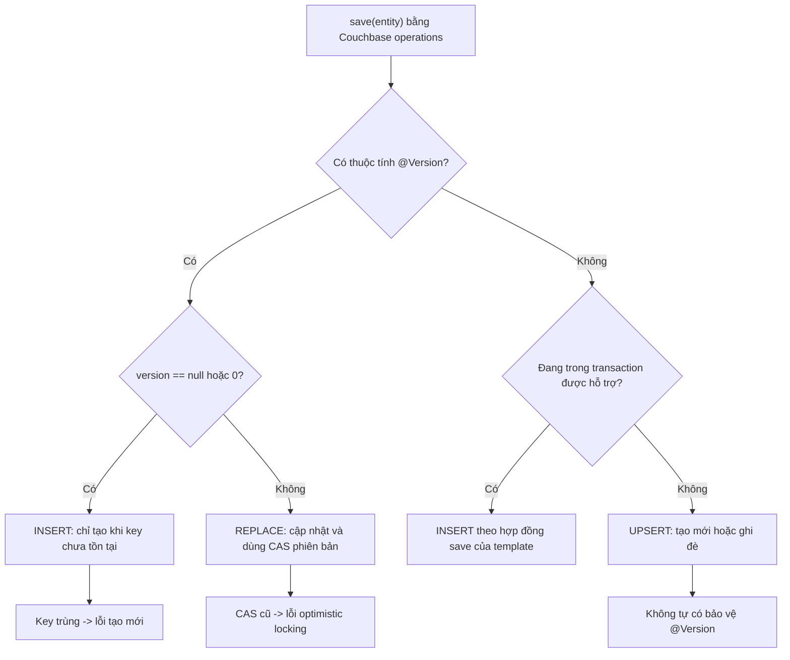
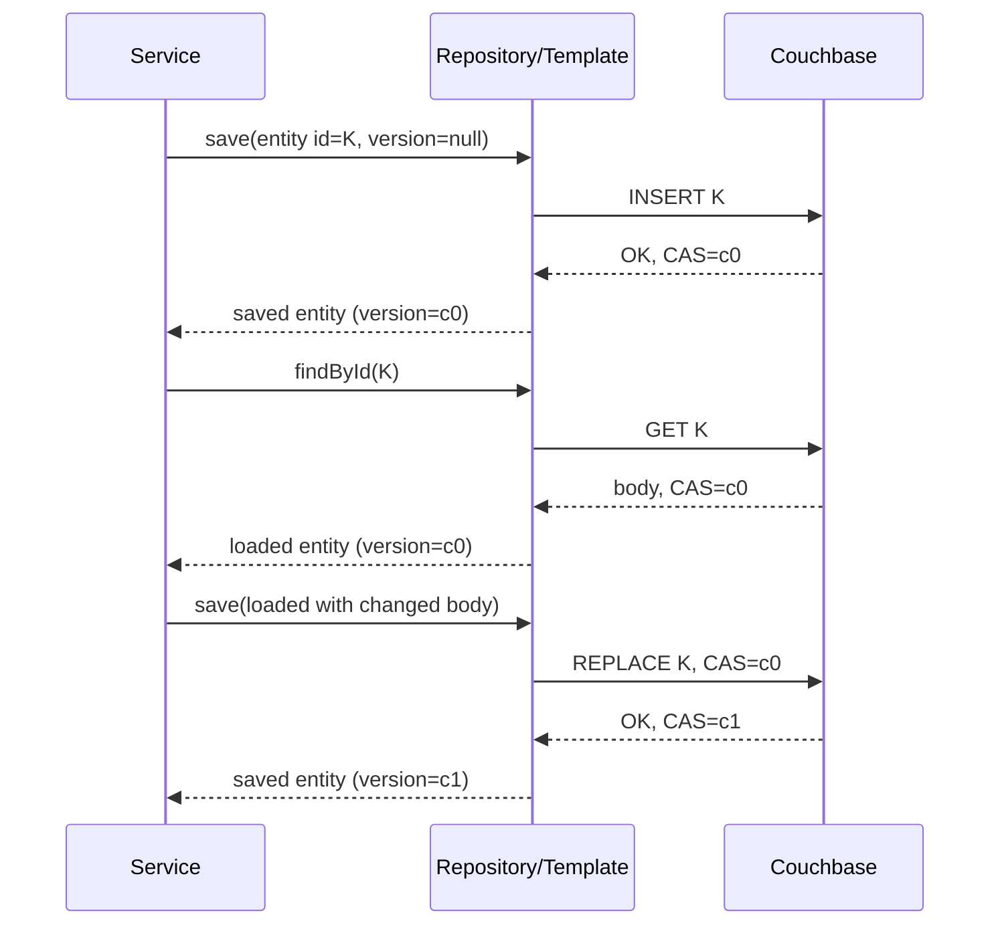

# Nhận biết entity mới và entity đã được lưu trong Spring Data Couchbase

## 1. Bài toán: có ID chưa chắc đã là document tồn tại

Trong ứng dụng Spring Data Couchbase, một đối tượng Java có thể đã mang document ID nhưng **chưa từng được ghi xuống Couchbase**. Ngược lại, một đối tượng vừa được dựng từ HTTP request có thể chứa đúng ID của document đã tồn tại nhưng **không mang CAS của phiên bản đã lưu**.

Hãy xét một nền tảng học trực tuyến lưu tiến độ học tập theo document ID:

```text
progress::acme::learner-17::java-101
```

Hai đoạn code sau đều tạo một đối tượng có cùng ID:

```java
CourseProgressDocument first = new CourseProgressDocument(
    "progress::acme::learner-17::java-101",
    "acme", "learner-17", "java-101"
);

CourseProgressDocument second = new CourseProgressDocument(
    "progress::acme::learner-17::java-101",
    "acme", "learner-17", "java-101"
);
```

Trong Java, `first` và `second` là hai object mới được cấp phát. Nhưng Couchbase chỉ quan tâm **document trong collection đích có ID tương ứng đã tồn tại hay chưa**. Không thể suy ra điều đó chỉ từ việc constructor vừa chạy.

Trong chương **Khóa lạc quan**, việc hiểu cách Spring Data **nhận biết entity mới** quan trọng vì nó ảnh hưởng tới đường đi của thao tác ghi: tạo mới bằng `insert`, cập nhật bằng `replace` có điều kiện CAS, hoặc `upsert` khi mô hình không sử dụng phiên bản.

**Mục tiêu:** phân biệt trạng thái object Java với trạng thái thật trên database; nắm quy tắc kiểm tra `@Id`, `@Version` và `Persistable.isNew()`; hiểu chính xác lựa chọn của `CouchbaseOperations.save(...)`; xử lý ID cấp sẵn, entity detached, dữ liệu cũ, cạnh tranh, transaction và API reactive.

## 2. Ba trạng thái cần phân biệt

Không nên gộp ba khái niệm sau thành một:

| Khái niệm | Câu hỏi | Ai xác định? |
| --- | --- | --- |
| **Object vừa tạo** | Java object có vừa được cấp phát bằng `new`/builder không? | JVM và mã ứng dụng |
| **Entity được xem là mới** | Persistence framework đánh giá `isNew` như thế nào? | Spring Data metadata, `@Id`, `@Version`, `Persistable` |
| **Document thực sự tồn tại** | Có document với key đó trong collection này không? | Couchbase tại thời điểm thao tác |

Ví dụ:

```text
Object Java vừa new:           Có
Entity version=null:          Được xem là chưa có CAS đã lưu
ID="progress::acme::...":     Đã có chuỗi document key
Document key này trong DB:    Có thể có, có thể không
```

Một điểm rất quan trọng: **nhận biết entity mới không phải là câu truy vấn tồn tại**. Trạng thái `isNew` được suy ra từ thông tin trên entity và chiến lược mapping; nó không nhất thiết gọi `existsById(...)` để xác minh Couchbase.

Do đó, có thể xảy ra:

- Entity **được xem là mới**, nhưng ID đã bị một document khác chiếm: `insert` thất bại vì trùng key.
- Entity **được xem là cũ**, nhưng document đã bị xóa hoặc hết TTL: `replace` thất bại vì không tìm thấy.
- Entity không có thuộc tính version, `save` ngoài transaction chọn `upsert`: document có thể bị tạo hoặc thay thế mà không phát hiện lost update.

**Nguồn dữ liệu có thẩm quyền về việc tồn tại là thao tác KV tại thời điểm thực hiện**, không phải giá trị flag trong object hoặc một lần `existsById` trước đó.

## 3. Spring Data nhận biết entity mới như thế nào?

Spring Data Commons hỗ trợ những cơ chế nhận biết trạng thái entity, được các module Spring Data sử dụng tùy thiết kế. Các quy tắc phổ biến là:

1. **Kiểm tra `@Version` nếu entity có khai báo:** version chưa được cấp, thường là `null` hoặc giá trị `0` theo quy tắc tương ứng, được coi là mới.
2. **Nếu không có `@Version`, kiểm tra `@Id`:** ID chưa có, hoặc bằng giá trị khởi tạo mặc định trong trường hợp identifier primitive, thường được coi là mới.
3. **Nếu entity triển khai `Persistable`, dùng `isNew()`:** mã ứng dụng cung cấp chính sách nhận biết trạng thái của entity.

Tuy nhiên, phải tách **cơ chế nhận biết của Spring Data Commons** khỏi **quy tắc chọn thao tác KV cụ thể của Spring Data Couchbase**. Phần 4 sẽ phân tích `CouchbaseOperations.save` theo tài liệu API Couchbase.

### 3.1. Dùng `@Id` khi không có `@Version`

Ví dụ:

```java
import org.springframework.data.annotation.Id;
import org.springframework.data.couchbase.core.mapping.Document;

@Document
public class UnversionedCourse {
    @Id
    private String id;
    private String title;

    // Constructor/getter được lược bớt.
}
```

Theo chiến lược kiểm tra ID của Spring Data Commons:

```text
id = null             -> có thể được phân loại là entity mới
id = "course::acme::1" -> có thể được phân loại là entity đã có ID
```

**Nhưng “đã có ID” không đồng nghĩa “document đang tồn tại”.** Với khóa do ứng dụng tự cấp, ngay từ lúc gọi constructor `id` đã khác `null` dù database chưa có gì.

Đặc biệt, trong Couchbase **không có `@Version`**, thao tác `save` thông thường **ngoài transaction dùng upsert** theo tài liệu API. Vì thế, việc một entity mang ID khác `null` không khiến `save` tự kiểm tra CAS hoặc tự bảo đảm create-if-absent.

### 3.2. Dùng `@Version` để có dấu hiệu phiên bản được lưu

Ví dụ:

```java
import org.springframework.data.annotation.Id;
import org.springframework.data.annotation.Version;
import org.springframework.data.couchbase.core.mapping.Document;

@Document
public class VersionedCourse {
    @Id
    private String id;

    @Version
    private Long version;

    private String title;

    // Constructor/getter được lược bớt.
}
```

Với một entity vừa dựng và `version == null`, chưa có CAS của document mà mapping đã đọc hoặc lưu. Khi entity được đọc từ Couchbase bằng repository/template, CAS được ánh xạ vào thuộc tính `version`.

Điều này phù hợp với câu hỏi “có phải bản snapshot của một document đã lưu hay chưa?”. Dù vậy, **người dùng có thể dựng một object mới với `version = null` và trùng ID đang tồn tại**, nên nó không phải phép chứng minh database chưa có document.

### 3.3. Dùng `Persistable.isNew()` khi ứng dụng kiểm soát trạng thái

Interface của Spring Data:

```java
import org.springframework.data.domain.Persistable;

public interface CustomEntity extends Persistable<String> {
    // getId() và isNew() do class triển khai.
}
```

Khi entity triển khai `Persistable`, Spring Data Commons có thể dựa vào `isNew()` thay vì chỉ xét ID/version. Cơ chế này hữu ích cho một số trường hợp cấp ID thủ công và cần mô tả trạng thái entity một cách tường minh.

**Cảnh báo quan trọng:** `isNew()` là một quyết định của ứng dụng, không phải bằng chứng document tồn tại. Và không được suy ra rằng override `isNew()` sẽ **thay thế mọi quy tắc `CouchbaseTemplate.save`**: API save của Couchbase công bố logic insert/replace/upsert theo thuộc tính version và context transaction. Nếu muốn đổi ngữ nghĩa ghi thực sự, hãy kiểm chứng đường repository/template cụ thể với phiên bản đang dùng.

## 4. Quy tắc chọn thao tác của `CouchbaseOperations.save`

Đây là phần trọng tâm của bài. Tài liệu API Spring Data Couchbase mô tả lựa chọn sau cho `CouchbaseOperations.save` và các implementation như `CouchbaseTemplate`:

| Entity và ngữ cảnh | Thao tác KV được tài liệu hóa | Ý nghĩa |
| --- | --- | --- |
| **Không có thuộc tính `@Version`**, ở ngoài transaction | **`upsert`** | Nếu chưa có thì tạo; nếu đã có có thể thay body |
| **Không có `@Version`**, trong transaction được hỗ trợ | **`insert`** theo hợp đồng save được tài liệu hóa | Không giả định giống hành vi ngoài transaction |
| **Có `@Version`**, giá trị `null` hoặc `0` | **`insert`** | Thử tạo document mới theo ID |
| **Có `@Version`**, giá trị **khác `0`** | **`replace`** | Thử cập nhật document đã được đọc/lưu kèm CAS |

**Tại sao đặc biệt quan trọng?** Một entity có ID được cấp sẵn và `@Version Long version = null` vẫn đi theo hướng **insert**, không tự đổi thành replace chỉ vì ID khác `null`. Nếu document với ID ấy đã tồn tại, thao tác insert phải thất bại thay vì ghi đè.

Ngược lại, một entity không có `@Version` được ghi bằng `save` ngoài transaction có thể **upsert**. Việc đó dễ gây ghi đè nếu ứng dụng tưởng `save` luôn kiểm soát mất cập nhật.

Hai loại ngoại lệ có thể gặp:

- **Trùng ID khi tạo:** Couchbase SDK báo `DocumentExistsException`; Spring Data có thể chuyển đổi sang nhóm exception của Spring, tùy API và phiên bản.
- **CAS không khớp khi replace:** Couchbase SDK có `CasMismatchException`; Spring Data thường báo lỗi optimistic locking như `OptimisticLockingFailureException`.

Không bắt cứng một loại exception ở mọi tầng mà chưa kiểm tra exception translation của phiên bản thư viện thực tế.

### 4.1. Sơ đồ quyết định ở mức cơ chế ghi



Sơ đồ mô tả nhánh `save` trong các tài liệu API Couchbase hiện hành, **không phải lời hứa rằng tất cả các thao tác fluent, query, SDK hoặc mọi phiên bản Spring Data đều dùng cùng cách này**. Trong dự án thực tế cần khóa phiên bản dependency và kiểm thử đường gọi sử dụng.

### 4.2. Vì sao không nên gắn nhãn “save = update”?

Trong JPA, `save` có thể liên quan `persist`/`merge` và quy tắc lifecycle của JPA. Trong Spring Data Couchbase, thao tác lưu được thực thi bằng cơ chế KV của Couchbase, có quy tắc cụ thể liên quan `@Version`.

Không suy luận từ tên phương thức hay kinh nghiệm JPA rằng:

- `save` luôn gọi `replace` khi `id != null`;
- `save` luôn gọi `insert` nếu Java object vừa `new`;
- `save` luôn bảo vệ CAS dù entity không có `@Version`;
- `save` tự động kiểm tra database tồn tại trước khi quyết định ghi.

Hãy đọc đúng hợp đồng API và thiết kế entity để ý nghĩa tạo/cập nhật được thể hiện rõ.

## 5. Entity mẫu: tiến độ khóa học với `@Id` và `@Version`

Giả sử hệ thống có đúng một document tiến độ hiện hành cho mỗi bộ `tenantId + learnerId + courseId`:

```text
progress::acme::learner-17::java-101
```

Entity:

```java
import java.time.Instant;
import org.springframework.data.annotation.Id;
import org.springframework.data.annotation.Version;
import org.springframework.data.couchbase.core.mapping.Document;

@Document
public class CourseProgressDocument {

    @Id
    private String id;

    @Version
    private Long version;

    private String tenantId;
    private String learnerId;
    private String courseId;
    private int completedLessons;
    private Instant updatedAt;

    protected CourseProgressDocument() {
        // Dành cho mapping.
    }

    public CourseProgressDocument(String id, String tenantId,
                                  String learnerId, String courseId) {
        this.id = id;
        this.tenantId = tenantId;
        this.learnerId = learnerId;
        this.courseId = courseId;
        this.completedLessons = 0;
        this.updatedAt = Instant.now();
    }

    public String getId() { return id; }
    public Long getVersion() { return version; }
    public int getCompletedLessons() { return completedLessons; }

    public void recordProgress(int value) {
        if (value < completedLessons) {
            throw new IllegalArgumentException(
                "Không được ghi lùi tiến độ");
        }
        this.completedLessons = value;
        this.updatedAt = Instant.now();
    }
}
```

Từng chi tiết phục vụ vòng đời entity:

- `id` được cấp sẵn theo key nghiệp vụ ổn định.
- `version` là `Long` và ban đầu mặc định `null`; Spring Data sử dụng để quản lý CAS.
- Không có public setter cho `version`. Caller không tự cộng CAS.
- `recordProgress` áp dụng một bất biến nghiệp vụ; CAS không thay thế điều kiện “không ghi lùi”.
- `updatedAt` là timestamp nội dung, **không** phải CAS hay tiêu chí duy nhất để xác nhận entity đã lưu.

Repository:

```java
import org.springframework.data.couchbase.repository.CouchbaseRepository;

public interface CourseProgressRepository
        extends CouchbaseRepository<CourseProgressDocument, String> {
}
```

Repository giả định đã được cấu hình ánh xạ tới đúng bucket/scope/collection chứa tiến độ. Tính duy nhất của document ID chỉ có ý nghĩa trong **collection đích**.

## 6. Tạo document mới: `id != null` nhưng `version == null`

Một service tạo tiến độ lần đầu:

```java
String key = "progress::acme::learner-17::java-101";

CourseProgressDocument draft = new CourseProgressDocument(
    key, "acme", "learner-17", "java-101"
);

System.out.println(draft.getId());      // Key đã có.
System.out.println(draft.getVersion()); // null: chưa có CAS lưu.
```

Khi dùng đường `save` phù hợp với entity versioned:

```java
CourseProgressDocument saved = repository.save(draft);
Long casAfterInsert = saved.getVersion();
```

Theo quy tắc template đã nêu, vì `version == null`, thao tác được chọn là **insert**, không phải replace. Sau khi thành công, kết quả lưu có CAS được ánh xạ vào thuộc tính `@Version`.

**Không giả định object `draft` ban đầu chắc chắn bị sửa tại chỗ.** Với entity mutable/immutable và các API khác nhau, hãy dùng giá trị trả về từ `save` hoặc tải lại khi cần phiên bản mới.

### 6.1. Nếu key đã có một document thì sao?

Giả sử tiến độ đã được tạo trước đó. Một request khác vẫn dựng:

```java
new CourseProgressDocument(
    "progress::acme::learner-17::java-101",
    "acme", "learner-17", "java-101"
);
```

Nó mang ID nhưng vẫn có `version == null`. Với entity có `@Version`, thao tác `save` dự kiến thử **insert** và gặp lỗi document đã tồn tại.

Điều đó có ích cho nghiệp vụ “chỉ một tiến độ hiện hành”, vì tránh ghi đè document cũ bằng bản mới rỗng. Tuy nhiên, handler phải phân loại:

1. Đây là retry của một yêu cầu tạo trước đó?
2. Đây là hai request độc lập cùng tạo một ID nghiệp vụ?
3. Payload có giống nhau và cùng tenant không?
4. Có cần đọc tiến độ hiện tại để phản hồi thay vì báo lỗi?
5. Có side effect nào đã chạy trước khi thao tác thất bại không?

Chỉ nhìn thấy trùng key chưa chứng minh hai request có cùng ý định. Nếu cần chống lặp hoàn chỉnh, dùng idempotency key hoặc business identifier ổn định và quy trình phục hồi phù hợp.

### 6.2. Không dùng `existsById → save` để “chắc chắn”

Mẫu có race:

```java
if (!repository.existsById(key)) {
    repository.save(new CourseProgressDocument(
        key, "acme", "learner-17", "java-101"));
}
```

Hai request có thể đồng thời thấy “chưa tồn tại”. Cơ chế **insert-if-absent** mới quyết định nguyên tử rằng request nào được tạo document; bước `existsById` trước đó không thay thế được thao tác ghi có điều kiện.

Nếu ứng dụng yêu cầu tạo mới có semantics rõ ràng trong mọi hoàn cảnh, hãy dùng API insert có ràng buộc tồn tại và xử lý lỗi, thay vì coi `existsById` là một lock.

## 7. Entity đã lưu: CAS khác 0 và đường `replace`

Khi document có sẵn, repository tải entity cùng token CAS:

```java
CourseProgressDocument current =
    repository.findById(key).orElseThrow();

Long observedCas = current.getVersion();
```

Bởi vì `@Version` đã được ánh xạ từ metadata của document, `observedCas` đại diện cho **phiên bản document mà repository vừa đọc**. Cập nhật:

```java
current.recordProgress(7);
CourseProgressDocument updated = repository.save(current);
Long nextCas = updated.getVersion();
```

Đường `save` versioned có CAS hiện hành sẽ dùng thao tác **replace** có điều kiện. Nếu document chưa bị writer khác thay đổi, update thành công và CAS đổi. Nếu CAS đã cũ, hệ thống từ chối ghi, tránh lost update.

**Không so sánh giá trị số `nextCas > observedCas`**: CAS là token opaque, không phải bộ đếm tuần tự của ứng dụng. Chỉ so phiên bản theo ngữ nghĩa token hiện hành và dùng token đó trong thao tác ghi phù hợp.

### 7.1. Timeline tạo–đọc–cập nhật



Sơ đồ giả định một đường Spring Data thực sự thực hiện optimistic locking theo mapping và không có writer khác xen vào. Nếu có writer thay đổi document trước bước replace, nhánh thành công cuối cùng sẽ trở thành conflict.

## 8. Hai entity cùng ID nhưng khác trạng thái lưu

Một bảng kiểm tra giúp tránh nhầm:

| Entity Java | `id` | `version` | Ý nghĩa đối với save phiên bản |
| --- | --- | --- | --- |
| `new CourseProgressDocument(...)` | Đã cấp | `null` | Thử **insert** |
| Entity vừa `save` thành công | Đã cấp | CAS khác 0 | Được dùng như snapshot đã lưu |
| Entity từ `findById` | Đã cấp | CAS do Couchbase trả | Đường cập nhật có thể dùng **replace** |
| DTO tự dựng lại cùng ID | Đã cấp | `null` | **Không phải** bản cập nhật an toàn; có thể đi vào insert |
| Entity đã đọc nhưng CAS đã cũ | Đã cấp | CAS cũ | Thử replace, có thể bị từ chối |
| Entity phiên bản cũ sau document bị xóa | Đã cấp | CAS cũ | Không được suy ra document vẫn tồn tại |
| Entity mới với `version = 0L` | Đã cấp | `0` | Được xử lý theo nhánh **insert** trong API Couchbase đã nêu |

Trường hợp **`version = 0L`** cần chú ý: theo Javadoc `CouchbaseOperations.save`, `0` hoặc `null` được dùng để chọn insert. Đừng tự đặt version bằng 0 để “reset CAS” cho một document đang có — kết quả có thể là lỗi trùng key thay vì cập nhật.

### 8.1. Với primitive `long` và wrapper `Long`

Hai khai báo:

```java
@Version
private long version; // Mặc định 0 khi tạo object mới.
```

và:

```java
@Version
private Long version; // Mặc định null.
```

đều có thể biểu diễn trạng thái ban đầu cho entity mới theo quy tắc nhận biết version. Tuy nhiên, `Long` thường thể hiện rõ hơn việc **chưa có CAS được cấp**. Đây là lựa chọn thiết kế, không phải yêu cầu mọi entity phải dùng wrapper.

Những class sử dụng builder, Lombok, constructor mapping, record hoặc Kotlin data class cần giữ đúng trường version khi sao chép snapshot. Nếu vô tình làm rỗng version trong một đối tượng đã lưu, code có thể biến yêu cầu update thành yêu cầu insert.

## 9. Không có `@Version`: nhận biết trạng thái và bảo vệ dữ liệu là hai việc khác nhau

Một entity không khai báo version:

```java
import org.springframework.data.annotation.Id;
import org.springframework.data.couchbase.core.mapping.Document;

@Document
public class CourseNoteDocument {
    @Id
    private String id;

    private String content;

    // Constructor/getter được lược bớt.
}
```

Tài liệu API `CouchbaseOperations.save` nêu rằng khi **không có version** và **không ở trong transaction**, thao tác lưu sử dụng **upsert**.

Ví dụ:

```text
Request A đọc note hiện tại
Request B cập nhật note thành nội dung mới
Request A gửi một entity mang body cũ qua save
=> Nếu save dùng upsert không điều kiện, có thể ghi đè B
```

Không nên diễn giải `@Id` khác null là “Spring Data biết record đã có và tự chống xung đột”. ID chỉ xác định **đích**. Thiếu version, tầng ghi có thể không có dấu hiệu snapshot đã cũ.

### 9.1. Trong transaction có gì khác?

Javadoc của `CouchbaseOperations.save` mô tả rằng khi entity **không có version** và thao tác nằm trong transaction được hỗ trợ, `save` dùng **insert**, không phải cùng nhánh upsert ngoài transaction. Vì vậy, không giả định hành vi lưu trong và ngoài transaction luôn giống nhau.

Tuy nhiên, transaction và optimistic locking là hai cơ chế khác nhau. Không thêm `@Transactional` của bất kỳ framework nào rồi mặc định mọi thao tác repository/SDK tự tham gia giao dịch Couchbase.

Cần kiểm tra transaction manager, API tham gia, cấu hình và phiên bản Couchbase/Spring Data thực tế.

### 9.2. Vì sao thêm `@Version` là một thay đổi hành vi?

Chuyển từ:

```java
@Id
private String id;
// Không có @Version.
```

sang:

```java
@Id
private String id;

@Version
private Long version;
```

không chỉ thêm một trường cho đẹp. Nó thay đổi đường quyết định của `save` từ upsert không phiên bản sang **insert hoặc replace có điều kiện**. Đây là thay đổi có thể làm lộ những bug trước đó: entity dựng lại từ DTO thiếu CAS, cập nhật khi document đã bị xóa hoặc các writer dùng cơ chế ghi không đồng nhất.

Một rollout nên có integration test cho create, update, stale entity và những đường ghi khác như SDK/SQL++/worker nền.

## 10. ID tự sinh và trạng thái “new” có thể tương tác thế nào?

Spring Data Couchbase hỗ trợ sinh document ID bằng `@GeneratedValue` cùng chiến lược như `GenerationStrategy.USE_ATTRIBUTES`, hoặc ứng dụng có thể cấp ID UUID trước khi lưu.

Cần phân biệt:

- **Gán document ID:** xác định nơi dữ liệu sẽ được lưu.
- **Xác định trạng thái entity:** quyết định object có mang dấu hiệu một phiên bản đã lưu hay không.
- **Chọn thao tác KV:** chọn insert, replace hay upsert theo hợp đồng API.
- **Xử lý idempotency:** bảo đảm một yêu cầu logic retry không tạo nhiều thực thể.

### 10.1. UUID cấp sẵn không làm object thành “đã lưu”

```java
import java.util.UUID;

String newId = "course::acme::" + UUID.randomUUID();

// newId mới chỉ là chuỗi định danh được cấp trong bộ nhớ.
// Nếu truyền nó vào @Id của entity có @Version Long,
// version vẫn null cho tới khi có kết quả lưu/đọc hợp lệ.
```

Sinh UUID không tự ghi document; chỉ tạo chuỗi ID mới trong bộ nhớ. Ngược lại, nếu request bị retry và lần nào cũng gọi `UUID.randomUUID()`, sẽ có nhiều ID khác nhau, nên optimistic locking không phát hiện hai object là cùng một yêu cầu nghiệp vụ.

### 10.2. Khóa ghép có sẵn cũng không đảm bảo document tồn tại

```text
progress::acme::learner-17::java-101
```

Đây là key xác định theo nghiệp vụ. Nó có thể chưa được tạo hoặc đã có từ một lần gửi trước. Nếu dùng entity versioned mới với `version == null`, insert sẽ kiểm tra tồn tại **ngay tại thời điểm ghi**.

Khi API muốn “lấy hoặc tạo tiến độ”, cần định nghĩa rõ:

1. Nếu insert thành công, trả tiến độ vừa tạo.
2. Nếu key đã có, đọc document cũ và xác minh tenant/identity.
3. Nếu dữ liệu cũ không tương thích hoặc không có quyền, báo lỗi.
4. Nếu luồng tạo có side effect khác, dùng cơ chế idempotency riêng.

Không dùng việc biết key để suy ra entity đã được lưu.

## 11. `Persistable.isNew()`: khi nào cần kiểm soát tường minh?

Spring Data Commons cung cấp:

```java
// Chữ ký rút gọn của org.springframework.data.domain.Persistable.
public interface Persistable<ID> {
    ID getId();
    boolean isNew();
}
```

Đây là hình thức **minh họa chữ ký phương thức**, không phải bản sao đầy đủ của source interface. Khi một domain type triển khai `Persistable`, framework có thể hỏi chính domain type xem nó có được xem là mới hay không.

Ví dụ ý tưởng:

```java
import org.springframework.data.annotation.Id;
import org.springframework.data.annotation.Transient;
import org.springframework.data.domain.Persistable;
import org.springframework.data.couchbase.core.mapping.Document;

@Document
public class ExternallyIdentifiedEntity
        implements Persistable<String> {

    @Id
    private String id;

    @Transient
    private boolean newInstance = true;

    protected ExternallyIdentifiedEntity() {}

    public ExternallyIdentifiedEntity(String id) {
        this.id = id;
    }

    @Override
    public String getId() {
        return id;
    }

    @Override
    public boolean isNew() {
        return newInstance;
    }

    // Phương thức nội bộ dành cho lifecycle callback phù hợp.
    public void markPersisted() {
        this.newInstance = false;
    }
}
```

**Ví dụ trên là một mẫu cơ chế trạng thái, chưa phải entity production hoàn chỉnh.** Một field `@Transient` không được nạp từ database; khi Spring Data dựng entity từ document cũ, constructor/khởi tạo field có thể đặt `newInstance = true` trừ khi có callback phù hợp để đổi lại. Nếu quên xử lý lifecycle này, entity đã đọc từ Couchbase vẫn có thể tự nhận “mới”.

Ngoài ra, một số kiểu property access có thể phát hiện các phương thức của `Persistable` như property; cần `@Transient` đúng chỗ và kiểm tra mapping. Khi đã có `@Version` cho Couchbase, thường **không cần tự duy trì một cờ isNew riêng** nếu mục tiêu chỉ là optimistic locking.

### 11.1. Giới hạn quan trọng trong Spring Data Couchbase

**Không đồng nhất việc `Persistable.isNew()` trả `false` với việc `CouchbaseTemplate.save` chắc chắn dùng `replace` kèm CAS.** Javadoc Couchbase nêu logic ghi theo presence/value của `@Version`, và các API riêng có thể xử lý khác.

Nếu thực sự cần áp đặt “chỉ insert” hoặc “chỉ replace”, dùng API có ngữ nghĩa rõ ràng và integration test thay vì trông chờ một boolean làm điều kiện concurrency ở tầng KV.

### 11.2. Vì sao không tự viết `existsById()` trong `isNew()`?

Đó là một cách thiết kế dễ tạo vấn đề:

- Lời gọi trạng thái entity trở thành thao tác I/O ngoài ý muốn.
- Dễ dẫn tới phụ thuộc vào repository trước khi entity được quản lý.
- Hai request vẫn có race giữa kiểm tra tồn tại và ghi.
- Không giải quyết xung đột do CAS hoặc TTL.
- Khi reactive, một `boolean isNew()` đồng bộ không phù hợp với một I/O async.

Cách đúng là **nhận biết object từ metadata**, còn **kiểm tra tạo/cập nhật thực sự bằng thao tác KV có điều kiện**.

## 12. Detached entity, DTO và cập nhật từ HTTP: lỗi thường gặp

Giả sử API có:

```http
PUT /api/progress/acme/learner-17/java-101
Content-Type: application/json

{"completedLessons":7}
```

Một controller không nên tự dựng entity persistence như sau rồi coi đó là update an toàn:

```java
// Anti-pattern: có ID nhưng không mang CAS đã lưu.
CourseProgressDocument detached = new CourseProgressDocument(
    "progress::acme::learner-17::java-101",
    "acme", "learner-17", "java-101"
);

detached.recordProgress(7);
repository.save(detached);
```

Với entity có `@Version Long version = null`, thao tác có thể đi theo đường **insert**, dù database đã có document ID đó. Nếu controller tự gán version dự đoán cũng không đúng vì CAS do Couchbase quản lý.

Cách ứng dụng cập nhật phụ thuộc vào **hợp đồng đồng thời của API**.

### 12.1. Command áp dụng trên bản hiện tại

Nếu một command được cho phép “áp dụng lên trạng thái mới nhất”, service có thể đọc entity rồi sửa:

```java
public CourseProgressDocument recordCurrent(String id, int lessons) {
    CourseProgressDocument current =
        repository.findById(id).orElseThrow();

    current.recordProgress(lessons);
    return repository.save(current);
}
```

Tuy nhiên, đây **không phải** cách bảo vệ snapshot người dùng đã xem 15 phút trước. Nó chỉ đảm bảo giữa `findById` và `save` không có writer khác sửa document mà không bị phát hiện qua CAS.

### 12.2. Command phải giữ phiên bản client đã xem

Nếu giao diện cho người dùng sửa một snapshot, API nên trả một token phiên bản opaque (ví dụ `ETag`) khi GET và yêu cầu `If-Match` khi PUT.

```http
GET /api/progress/acme/learner-17/java-101
HTTP/1.1 200 OK
ETag: "opaque-version"
Content-Type: application/json

{"completedLessons":6}
```

```http
PUT /api/progress/acme/learner-17/java-101
If-Match: "opaque-version"
Content-Type: application/json

{"completedLessons":7}
```

Server phải:

1. Xác thực và kiểm tra quyền đối với tenant/document.
2. Giải mã/kiểm tra token phiên bản từ client theo định dạng riêng của API.
3. Đọc phiên bản document hiện hành.
4. So với **phiên bản client đã xem**, không bỏ qua token.
5. Nếu không khớp, từ chối theo tiền điều kiện, thường `412 Precondition Failed`.
6. Nếu khớp, sửa entity đã đọc và `save` với CAS để bảo vệ race giữa kiểm tra và ghi.

Chuỗi `opaque-version` là placeholder minh họa, không phải biểu diễn CAS do Couchbase tự phát hành thành HTTP header. Không vận chuyển CAS 64 bit qua một số JavaScript có thể mất độ chính xác; dùng mã hóa chuỗi đã được quy định rõ.

**Không lấy CAS mới nhất rồi im lặng cập nhật payload của form cũ.** Như vậy dễ ghi đè dữ liệu thay đổi từ trước khi request bắt đầu.

## 13. Xung đột, lỗi trùng ID, not-found và timeout phải được phân biệt

Khi Spring Data/Couchbase xác định một entity là mới hay đã lưu, một thao tác ghi còn phụ thuộc **trạng thái database tại thời điểm thực hiện**. Các lỗi vì thế có ý nghĩa khác nhau:

| Trường hợp | Thao tác có thể gặp | Điều cần hiểu | Cách xử lý |
| --- | --- | --- | --- |
| Entity versioned mới, ID chưa tồn tại | Insert | Tạo mới hợp lệ | Trả bản đã lưu và ID |
| Entity versioned mới, ID đã tồn tại | Insert | Key bị chiếm | Xác minh duplicate/retry, báo conflict nếu khác yêu cầu |
| Entity versioned cũ, CAS khớp | Replace | Bản snapshot vẫn còn hiện hành | Ghi thành công, nhận CAS mới |
| Entity versioned cũ, CAS stale | Replace | Writer khác đã đổi document | Optimistic conflict; đọc lại/merge có chủ đích |
| Entity versioned cũ, document bị xóa/hết TTL | Replace | Không còn document ở key này | Phân loại not-found hoặc conflict tùy API |
| Không có version, save ngoài transaction | Upsert | Tạo hoặc thay nội dung | Không tự bảo vệ lost update |
| Lỗi mạng sau ghi | Không biết chắc thao tác đã commit | Không thể suy ra chưa lưu | Đọc lại/đối soát trước khi retry |
| Sai collection | Find/save tại nơi không đúng | ID có thể giống nhưng document khác | Sửa cấu hình bucket/scope/collection |
| Sai quyền tenant | Bị từ chối hoặc nguy cơ rò rỉ | Không phải lỗi new/existing | Kiểm tra authentication/authorization |

### 13.1. CAS conflict không phải bằng chứng “entity không tồn tại”

Khi `replace` với version cũ bị từ chối, điều đó thường có nghĩa document đã **thay đổi**. Có thể document vẫn tồn tại nhưng đang mang body/metadata mới. Không khởi tạo entity mới với cùng key và version null như một “cách sửa”, vì insert sẽ bị trùng hoặc làm sai quy tắc nghiệp vụ.

Ngược lại, document not-found không tự có nghĩa một yêu cầu tạo mới trước đó chưa từng thành công: document có thể đã bị xóa, hết TTL hoặc được chuyển collection.

### 13.2. Timeout có thể xảy ra sau commit

Ví dụ:

```text
T0: save(entity) gửi insert K
T1: Couchbase ghi thành công
T2: Mạng ngắt trước khi client nhận kết quả
T3: Client nghĩ save thất bại và dựng entity khác
```

Nếu T3 dùng UUID mới, có thể tạo trùng thực thể dưới key khác. Nếu cùng key và version null, insert lại có thể bị trùng — đây không nhất thiết là lỗi dữ liệu, mà có thể là dấu hiệu lần đầu đã thành công.

Để xử lý an toàn, dùng key ổn định/idempotency record, tra cứu trạng thái đã lưu, xác minh identity và chỉ thực hiện lại tác dụng nghiệp vụ khi đã biết quy tắc recovery.

## 14. Spring Data Repository, `CouchbaseTemplate` và SDK trực tiếp

Nhiều ứng dụng kết hợp ba tầng API. Chúng có những điểm giao nhau nhưng không nên coi là hoàn toàn thay thế được cho nhau.

### 14.1. Repository

```java
import org.springframework.data.couchbase.repository.CouchbaseRepository;

public interface CourseProgressRepository
        extends CouchbaseRepository<CourseProgressDocument, String> {}
```

Repository thuận tiện cho các thao tác CRUD theo entity và tích hợp mapping/optimistic locking của Spring Data khi cấu hình đúng.

### 14.2. `CouchbaseTemplate`

`CouchbaseTemplate` cung cấp các thao tác ánh xạ entity và fluent operations. Riêng `CouchbaseOperations.save` được tài liệu hóa về hành vi khác nhau tùy có `@Version` và transaction. Hãy đối chiếu **đúng overload** và phiên bản sử dụng, không suy đoán từ tên phương thức.

Một số fluent operation như `insertById`, `replaceById`, `upsertById` biểu đạt ý định rõ hơn; không mặc nhiên cho rằng mọi đường thao tác đều tự áp dụng logic của `save`.

### 14.3. Couchbase Java SDK

SDK KV làm việc với document ID, body và CAS. Nó **không đọc annotation `@Version` trên Java class Spring Data**.

```java
import com.couchbase.client.java.Collection;
import com.couchbase.client.java.json.JsonObject;
import com.couchbase.client.java.kv.GetResult;
import static com.couchbase.client.java.kv.ReplaceOptions.replaceOptions;

public void updateWithCas(Collection collection, String key) {
    GetResult read = collection.get(key);
    JsonObject body = read.contentAsObject();

    body.put("completedLessons", 7);

    // Dùng đúng CAS của body đã đọc.
    collection.replace(
        key, body, replaceOptions().cas(read.cas()));
}
```

Đây là một minh họa KV độc lập, không phải cách thay thế mù mọi logic business. Khi dùng SDK trực tiếp xen kẽ repository, phải bảo đảm body, metadata loại entity, TTL và collection tương thích để mapping hoạt động.

**SDK `upsert(key, body)` không tự bảo vệ lost update** chỉ vì class Java ở một lớp khác có `@Version`.

### 14.4. SQL++ cũng có đường cập nhật riêng

Một câu SQL++ `UPDATE` trực tiếp có thể làm thay đổi document, khiến CAS mà repository đã đọc trở nên stale. Nhưng annotation `@Version` của entity không tự trở thành điều kiện trên mọi câu SQL++ do ứng dụng viết.

Khi dùng SQL++ để lọc theo `tenantId` hoặc `courseId`, cần các trường tương ứng trong body và chỉ mục phù hợp. Truy vấn theo index không thể thay thế việc xác minh tính mới/cũ bằng một token CAS tại thời điểm ghi KV.

## 15. Reactive API: mỗi lần subscription có thể thực hiện lại hành động

Với `ReactiveCouchbaseRepository`, logic nhận biết phiên bản entity vẫn cần được tôn trọng. Một publisher có thể được subscribe lại hoặc retry, nên phải tránh tạo entity với **key khác** cho cùng yêu cầu logic mỗi lần chạy lại.

Ví dụ:

```java
import org.springframework.data.couchbase.repository.ReactiveCouchbaseRepository;
import reactor.core.publisher.Mono;

public interface ReactiveProgressRepository
        extends ReactiveCouchbaseRepository<CourseProgressDocument, String> {
}

public Mono<CourseProgressDocument> recordProgress(
        ReactiveProgressRepository repository,
        String id,
        int completedLessons) {

    return repository.findById(id)
        .switchIfEmpty(Mono.error(
            new IllegalStateException("Tiến độ chưa tồn tại")))
        .flatMap(entity -> {
            entity.recordProgress(completedLessons);
            return repository.save(entity);
        });
}
```

Đây là phác thảo một method service; cần đặt nó trong class/bean thích hợp và thực hiện kiểm tra quyền tenant trước khi thao tác.

Khi gọi `retryWhen(...)`:

- Retry **chỉ bước `save(staleEntity)`** có thể tiếp tục dùng version cũ.
- Retry **cả bước tải → kiểm tra → lưu** có thể tải CAS mới, nhưng chỉ an toàn nếu phép biến đổi có thể được tái áp dụng sau khi kiểm tra điều kiện nghiệp vụ.
- Retry một thao tác **tạo mới** không nên sinh UUID mới mỗi lần subscribe.
- Các side effect như gửi email, charge hoặc publish event có thể bị gọi lại; chúng cần idempotency/outbox riêng.

**Reactive không tự khiến một yêu cầu idempotent hoặc một thao tác đa document thành transaction.**

## 16. TTL và vòng đời entity không phải một thứ

Giả sử một `CourseProgressDocument` có TTL:

```text
T0: Repository đọc K, version=c0
T1: Document K hết hạn
T2: Service gọi save(entity c0)
```

Một entity có `@Version = c0` vẫn được xem là đã mang phiên bản cũ, nhưng **document vật lý đã biến mất**. Thao tác replace có thể thất bại vì not-found. Không được tự sửa version thành null rồi insert mới nếu API chỉ có ý định cập nhật một tiến độ hiện hành.

Nếu nghiệp vụ cho phép tạo lại sau TTL, phải đặt điều kiện rõ: đây là **document mới** hay tiếp tục **cùng thực thể nghiệp vụ**? Cần kiểm tra idempotency, dữ liệu sự kiện cũ và việc tái sử dụng key.

Cũng phải kiểm tra cách lệnh ghi xử lý expiry. CAS bảo vệ phiên bản, không tự bảo đảm TTL được bảo toàn hoặc gia hạn đúng chính sách.

## 17. Transaction và tính nguyên tử nhiều document

Nhận biết entity mới và `@Version` đều không thay thế transaction.

Ví dụ tạo Enrollment và PaymentReservation:

```text
enrollment::acme::e-101
payment-reservation::acme::e-101
```

Hai entity đều có `version == null`. Nếu lưu Enrollment thành công nhưng lưu PaymentReservation thất bại, hệ thống có thể có trạng thái nửa chừng.

Khi cần tất cả thay đổi cùng commit, cân nhắc **distributed ACID transactions** theo khả năng hỗ trợ của Couchbase và Spring Data, hoặc quy trình state machine/outbox/compensation có kiểm soát. Không suy diễn rằng hai lần `save` trong Java tự trở thành atomic chỉ nhờ cả hai có `@Version`.

Một transaction có thể retry callback; không đặt side effect ngoài DB không-idempotent trong callback có thể bị gọi lại.

**Durability** cũng khác optimistic locking: CAS xác nhận token phiên bản còn phù hợp để ghi, còn durability xác định mức cam kết bền vững của mutation. Cả hai phải được chọn theo SLA nghiệp vụ.

## 18. Thêm `@Version` cho entity cũ: kế hoạch chuyển đổi

Một hệ thống legacy có thể đang dùng entity **không version**, và `save` ngoài transaction thực hiện upsert. Sau đó team muốn thêm `@Version Long version` để chống ghi đè.

Cần chuẩn bị:

1. **Khảo sát đường ghi**: repository, template, SDK, SQL++, job nền, listener và các batch update.
2. **Thêm `@Version` đúng package** vào entity và kiểm tra mapping CAS khi đọc document cũ.
3. **Kiểm thử create** với document ID chưa tồn tại: version null và đường insert.
4. **Kiểm thử update** trên document legacy: entity được tải phải có CAS hiện hành để đường replace hoạt động.
5. **Kiểm thử conflict**: hai bản đọc cùng CAS, writer thứ hai không được ghi đè.
6. **Kiểm thử DTO mapping**: builder, copy constructor, serializer và request handler không làm mất version.
7. **Kiểm thử writer còn dùng SDK**: nếu vẫn upsert không CAS, nó có thể phá giả định optimistic locking.
8. **Theo dõi production**: số lỗi trùng key, optimistic conflict, retry, latency, TTL và lỗi not-found tăng bất thường.
9. **Có rollback plan** phù hợp khi các service còn dùng hai phiên bản phần mềm với chính sách ghi khác nhau.

Không cần tự điền số phiên bản lần đầu bằng `1` cho mọi document chỉ vì vừa thêm annotation. CAS đã thuộc metadata của Couchbase; framework đọc và ánh xạ nó khi load theo đường hỗ trợ.

Cũng không cần đổi document ID chỉ để thêm `@Version`. Đây là thay đổi cách quản lý ghi trên **cùng document**, không phải migration namespace trừ khi có ràng buộc khác.

## 19. Test thật để phân biệt new/existing

Tầng unit test có thể xác minh constructor đặt version null và business method hoạt động đúng. Nhưng những điều kiện insert/replace/CAS cần **integration test với Couchbase và đúng phiên bản thư viện**.

### 19.1. Ma trận kiểm thử theo trạng thái

| Ca kiểm thử | Kỳ vọng |
| --- | --- |
| Tạo entity có ID cấp sẵn, `@Version = null` | Insert khi key chưa có |
| Tạo entity mới trùng ID đang có | Không ghi đè, báo lỗi duplicate |
| Đọc entity đã có qua repository | Version nhận CAS của document |
| Save entity đã đọc và chưa bị thay đổi | Replace thành công, version mới |
| Hai entity tải cùng phiên bản, save A rồi B | B bị từ chối do stale CAS |
| Dựng entity mới từ DTO với cùng ID, thiếu version | Không được coi là update an toàn |
| Entity có `@Version = 0` | Nhánh insert theo API Couchbase đã nêu |
| Entity không version, save ngoài transaction | Hành vi upsert được kiểm thử và hiểu rõ |
| Entity không version, save trong transaction | Kiểm tra nhánh insert theo API đang dùng |
| Sau khi document hết TTL | Xử lý not-found, không tự upsert để che lỗi |
| SDK upsert xen kẽ repository | Test phát hiện khả năng lost update |
| Reactive publisher bị subscribe lại | Không sinh bản ghi nghiệp vụ mới ngoài ý định |
| Persistable.isNew() tùy biến | Kiểm tra mapping/callback và hành vi ghi thực tế |
| Hai collection dùng cùng ID | Phân biệt hai document vật lý |
| Mất mạng sau insert | Recovery dùng key ổn định và đối soát trạng thái |

### 19.2. Pseudocode integration test: version null và duplicate insert

```java
import static org.junit.jupiter.api.Assertions.*;
import org.junit.jupiter.api.Test;

class CourseProgressLifecycleTest {

    // Fixture thực tế inject repository và tạo/cleanup test data.
    private CourseProgressRepository repository;

    @Test
    void newEntityWithAssignedIdStartsWithoutCas() {
        String key = "progress::test::learner-a::java-101";
        CourseProgressDocument fresh = new CourseProgressDocument(
            key, "test", "learner-a", "java-101");

        assertEquals(key, fresh.getId());
        assertNull(fresh.getVersion());

        CourseProgressDocument saved = repository.save(fresh);
        assertNotNull(saved.getVersion());
    }
}
```

Mã minh họa trên **chưa chạy độc lập**: test fixture phải cấu hình bean repository và xóa dữ liệu cũ, tránh trùng key giữa lần chạy. Không gọi test thành công nếu chưa có môi trường Couchbase thực tế.

### 19.3. Pseudocode integration test: hai snapshot cùng CAS

```java
import static org.junit.jupiter.api.Assertions.*;
import org.junit.jupiter.api.Test;
import org.springframework.dao.OptimisticLockingFailureException;

class CourseProgressConflictTest {
    private CourseProgressRepository repository;

    @Test
    void staleSnapshotMustNotOverwrite() {
        String id = "progress::test::learner-b::java-101";

        // Arrange: insert mới trong fixture test, dữ liệu phải sạch.
        repository.save(new CourseProgressDocument(
            id, "test", "learner-b", "java-101"));

        CourseProgressDocument a = repository.findById(id).orElseThrow();
        CourseProgressDocument b = repository.findById(id).orElseThrow();

        assertEquals(a.getVersion(), b.getVersion());

        a.recordProgress(5);
        repository.save(a);

        b.recordProgress(3);
        assertThrows(
            OptimisticLockingFailureException.class,
            () -> repository.save(b));

        CourseProgressDocument finalState =
            repository.findById(id).orElseThrow();

        assertEquals(5, finalState.getCompletedLessons());
    }
}
```

Đây là **khung kiểm thử**, không phải class JUnit hoàn chỉnh với dependency injection. Khi triển khai phải phù hợp exception translation và vòng đời version của phiên bản Spring Data Couchbase thực tế. Việc đọc cả `a` và `b` **trước khi A ghi** là điều kiện quan trọng để thật sự tạo stale snapshot.

### 19.4. Test tương tác với `CouchbaseTemplate.save`

Nên có riêng một integration test chứng minh bảng ở phần 4 cho dependency thực tế:

```text
Versioned, version null -> INSERT
Versioned, version CAS  -> REPLACE
Unversioned, no txn     -> UPSERT
Unversioned, in txn     -> kiểm tra INSERT theo hợp đồng version đang dùng
```

Không chỉ assert “save không ném exception”. Hãy assert document tồn tại, body sau thao tác, version được cập nhật và document không bị ghi đè trái phép khi xảy ra tranh chấp.

## 20. Bài tập tình huống: một progress bị tạo nhiều lần

Một hệ thống khóa học có API:

```http
POST /tenants/acme/learners/learner-17/courses/java-101/progress
```

Key của tiến độ là:

```text
progress::acme::learner-17::java-101
```

Có ba luồng thực thi:

- Request A dựng entity mới với ID như trên và `@Version Long version = null`.
- Request B đồng thời dựng entity mới với **cùng ID** và version null.
- Worker C trước đó đã tải document tiến độ cũ, giữ một CAS có thể đã stale.

**Câu hỏi:**

1. Tại sao A và B đều là Java object mới nhưng không thể đều tạo thành công cùng document ID trong một collection?
2. Với `@Version = null`, `save` chọn insert hay replace?
3. Nếu A tạo thành công, B phải xử lý duplicate key như thế nào để không ghi đè A?
4. Worker C phải dùng thông tin nào khi cập nhật để tránh lost update?
5. Nếu document đã hết TTL, C có nên tự reset version rồi gọi save không?
6. Nếu bỏ `@Version` khỏi entity, `save` ngoài transaction còn bảo vệ lost update giống trước không?
7. Nếu API cần chống request lặp sau timeout, tại sao vẫn cần idempotency hoặc business key ổn định?

**Gợi ý giải:** A và B cùng tranh một ID; insert nguyên tử cho một request thành công, request kia nhận lỗi key đã tồn tại. `@Version=null` biểu thị chưa có CAS và đi theo nhánh insert trong Couchbase save. B nên đọc document hiện tại, xác minh tenant/identity và xác định đây là retry hay conflict; không chuyển sang upsert mù. C dùng CAS đã đọc và bị từ chối nếu stale; sau đó đọc lại và đánh giá lại quy tắc nghiệp vụ. TTL có thể làm document biến mất, nên cần policy tái tạo rõ ràng. Nếu bỏ `@Version`, ngoài transaction save dùng upsert và không tự kiểm tra CAS. Retry sau timeout phải giữ cùng request/business identity.

## 21. Checklist trước khi triển khai

1. Đã tách rõ Java object mới, entity `isNew` và document đang tồn tại trong collection?
2. Đã import đúng `org.springframework.data.annotation.Id` và `org.springframework.data.annotation.Version`?
3. Entity có ID ổn định và `@Version` với kiểu phù hợp, chẳng hạn `Long`?
4. Đã hiểu `@Version=null/0` chọn insert và version khác 0 chọn replace trong đường save Couchbase?
5. Đã hiểu entity **không version** dùng upsert ngoài transaction và insert trong transaction theo tài liệu API?
6. Có biết đường repository/template nào đang chạy và version dependency đã được khóa?
7. Có kiểm tra document ID được cấp sẵn nhưng version null không gây ghi đè document cũ?
8. Có xử lý lỗi duplicate khi create và optimistic conflict khi update theo hai chính sách khác nhau?
9. Có phân biệt not-found do xóa/TTL với stale CAS và timeout?
10. Có tránh `existsById → save` như một cơ chế khóa cạnh tranh?
11. Có giữ token CAS khi entity bị copy bởi builder/DTO/mapper hoặc khi gọi save từ API?
12. Nếu dùng `Persistable.isNew()`, đã bảo đảm lifecycle flag và mapping thật đúng?
13. Có tránh tự cộng hoặc gán bừa version trong Java?
14. Controller có dùng ETag/If-Match khi cần bảo vệ phiên bản mà người dùng đã xem?
15. Các writer qua SDK, SQL++ và `CouchbaseTemplate` có tôn trọng chính sách concurrent update?
16. Reactive retry có đọc lại CAS, kiểm tra bất biến và không tạo ID mới khi resubscribe?
17. Với nhiều document, có transaction hoặc workflow nhất quán riêng?
18. Có kiểm tra tenant/authorization độc lập với key và version?
19. Có integration test cho insert, replace, duplicate, stale snapshot và TTL?
20. Có metric cho tỷ lệ insert trùng, CAS conflict, timeout và retry?

## Tài liệu tham khảo

- [Spring Data Couchbase — Core Concepts / Entity State Detection Strategies](https://docs.spring.io/spring-data/couchbase/reference/6.2/repositories/core-concepts.html): mô tả cách nhận biết entity mới qua `@Id`, `@Version` và `Persistable`.
- [Spring Data Couchbase API — CouchbaseOperations.save](https://docs.spring.io/spring-data/couchbase/reference/api/java/org/springframework/data/couchbase/core/CouchbaseOperations.html): hợp đồng lựa chọn `insert`, `replace` hoặc `upsert` phụ thuộc version và transaction.
- [Spring Data Couchbase — Template & direct operations](https://docs.spring.io/spring-data/couchbase/reference/couchbase/template.html): các thao tác template, sub-document và CAS.
- [Spring Data Commons — Persistable](https://docs.spring.io/spring-data/couchbase/reference/data-commons/api/java/org/springframework/data/domain/Persistable.html): giao diện `getId()`/`isNew()` và lưu ý property access.
- [Couchbase Java SDK — Key-Value Operations](https://docs.couchbase.com/java-sdk/current/howtos/kv-operations.html): insert-if-absent, replace, upsert, CAS và lỗi KV.

## Kết luận

**Nhận biết entity mới không phải kiểm tra document đã tồn tại trong Couchbase.** Trong Spring Data Couchbase, `@Id` xác định khóa, còn `@Version` gắn entity với CAS của phiên bản đã lưu. Theo hợp đồng `CouchbaseOperations.save`, một entity có version `null` hoặc `0` đi vào nhánh **insert**, trong khi entity đã có CAS khác `0` đi vào nhánh **replace**; thiếu `@Version`, save ngoài transaction thường dùng **upsert**. Hiểu rõ sự khác biệt này giúp tránh hai lỗi đối nghịch: tưởng object có ID là đã lưu rồi ghi đè dữ liệu cũ, hoặc dựng lại entity thiếu CAS rồi cố cập nhật một document hiện hữu. Hãy dùng version đúng cách, thiết kế create/update/idempotency tách biệt và kiểm chứng đường repository, template, SDK, transaction, reactive qua integration test với Couchbase.
