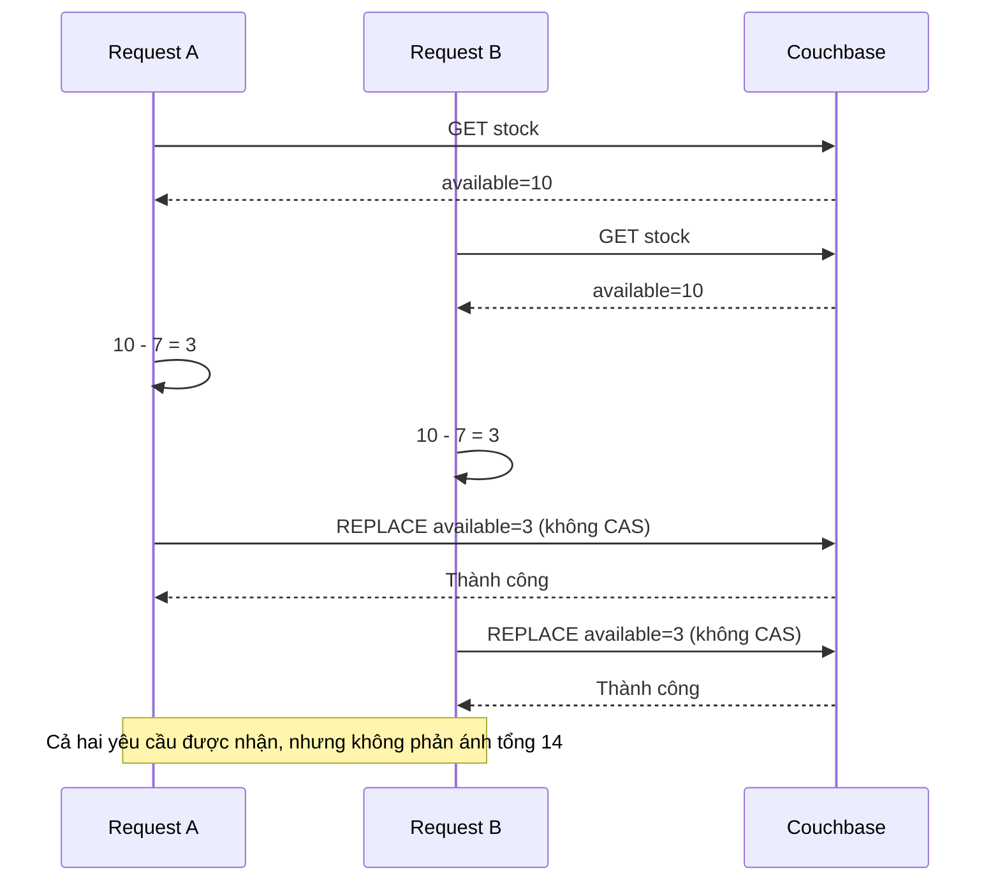

# Chu trình đọc, sửa, ghi và nguy cơ mất cập nhật trong Spring Data Couchbase

## 1. Vì sao một phép cập nhật đơn giản có thể làm sai dữ liệu?

Nhiều ứng dụng cập nhật document Couchbase theo một quy trình quen thuộc:

1. **Đọc** document hiện tại.
2. **Sửa** một hoặc nhiều trường trong bộ nhớ ứng dụng.
3. **Ghi** document đã sửa trở lại Couchbase.

Quy trình này gọi là **read–modify–write (RMW)**. Nó xuất hiện ở các thao tác như trừ tồn kho, đổi trạng thái đơn hàng, tăng điểm thưởng, cập nhật tiến độ khóa học hoặc chỉnh sửa hồ sơ người dùng.

Ví dụ, một cửa hàng có document tồn kho:

```json
{
  "tenantId": "acme",
  "sku": "BOOK-JAVA",
  "available": 10,
  "warehouse": "HCM-01"
}
```

Hai khách hàng cùng đặt mua **7 quyển** khi tồn kho ban đầu là **10**. Nếu hai request đều đọc `available = 10` rồi mỗi request tự tính `10 - 7 = 3`, cả hai có thể thông báo đặt hàng thành công và cùng ghi `available = 3`.

```text
Tồn kho thực: 10
Đã nhận hai đơn: 7 + 7 = 14
Tồn kho cuối trong document: 3

=> Hệ thống đã nhận đặt vượt tồn kho 4 quyển.
```

Giá trị cuối `3` không phản ánh việc đã nhận hai đơn. Một thay đổi đã **bị mất về mặt logic**, dù mọi lời gọi ghi riêng lẻ đều có thể trả về thành công.

Đây là lỗi **lost update (mất cập nhật)**. Nó không đòi hỏi Couchbase bị hỏng, mạng không ổn định hay có trùng document ID: chỉ cần **hai worker cùng dựa trên dữ liệu cũ để ghi lại một document** là đủ.

Trong Spring Data Couchbase, cơ chế quan trọng để kiểm soát nguy cơ này là **CAS (Compare-And-Swap)** và ánh xạ **`@Version`** của Spring Data.

### Sau bài học, bạn sẽ biết

- Xác định chính xác cửa sổ race giữa các bước đọc, xử lý và ghi.
- Mô tả những kịch bản mất cập nhật, kể cả khi hai người sửa **hai trường khác nhau**.
- Phân biệt việc ghi một document nguyên tử với việc **toàn bộ chu trình RMW** có tính nguyên tử.
- Triển khai RMW có CAS bằng Couchbase Java SDK và bằng `CouchbaseRepository` với `@Version`.
- Chọn giữa báo conflict, retry có giới hạn, merge thay đổi và dùng thao tác atomic chuyên dụng.
- Nhận diện ranh giới của CAS đối với transaction đa document, TTL, SQL++, API reactive và request bị gửi lại.

## 2. Chu trình read–modify–write hoạt động thế nào?

Một phép tính dạng:

```java
int next = current - requested;
```

là phép tính trên **giá trị trong bộ nhớ Java**. Trong khoảng từ khi `current` được đọc cho đến lúc `next` được ghi, server vẫn tiếp nhận những mutation từ worker khác.

Một ví dụ tuần tự đơn giản:

```text
T0: Couchbase lưu available = 10
T1: Worker A GET -> 10
T2: Worker A tính 10 - 7 = 3
T3: Worker A REPLACE -> 3
T4: Worker A xác nhận thành công
```

Nếu chỉ có một writer, chu trình này có vẻ đúng. Nhưng khi xảy ra thực thi xen kẽ:



Vấn đề nằm ở chỗ phép **đọc → tính toán → ghi** gồm nhiều thao tác riêng. Mỗi `get` hoặc `replace` có thể được Couchbase xử lý riêng rẽ, nhưng điều đó **không biến toàn bộ ba bước thành một giao dịch nguyên tử**.

### 2.1. Phân biệt các điểm đảm bảo

| Điểm trong quy trình | Điều được đảm bảo | Điều không được đảm bảo |
| --- | --- | --- |
| `get(key)` | Nhận một phiên bản document và metadata tương ứng | Document sẽ đứng yên cho tới lúc ghi |
| Tính toán trong Java | Phép tính đúng với input mà worker đang giữ | Input còn là phiên bản mới nhất |
| `replace(key, body)` không có CAS | Thao tác thay document theo ngữ nghĩa KV | Không ghi đè cập nhật của writer khác |
| `replace(key, body, cas=...)` | Chỉ thay khi phiên bản tại server khớp token đã đọc | Tự xử lý nghiệp vụ khi có xung đột |
| Transaction đa document | Có thể phối hợp các thao tác được hỗ trợ trong cùng transaction | Tự bao trùm email, payment hoặc các tác dụng ngoài Couchbase |

**Điểm mấu chốt:** “một lệnh ghi là nguyên tử” và “cả phép RMW không thể bị chen ngang” là **hai phát biểu khác nhau**.

### 2.2. Vì sao mất cập nhật không nhất thiết làm mất trường?

Nguy cơ không chỉ ở số lượng. Xét một profile:

```json
{
  "displayName": "Lan",
  "phone": "0900000000"
}
```

Worker A đổi `displayName` thành `Lan Anh`. Worker B đổi `phone` thành `0911111111`. Cả hai cùng đọc body cũ; nếu cùng ghi **toàn bộ body**, writer ghi sau có thể kéo trường mà writer trước vừa sửa về giá trị cũ.

```text
A ghi: displayName="Lan Anh", phone="0900000000"
B ghi: displayName="Lan",     phone="0911111111"

Kết quả cuối sau B: mất cập nhật displayName của A.
```

Dù hai writer sửa **hai trường khác nhau**, khi mỗi writer mang một snapshot cũ của cả document, chúng vẫn có thể gây lost update.

## 3. Dùng CAS để bảo vệ cửa sổ giữa đọc và ghi

**CAS** là token phiên bản do Couchbase quản lý, gắn với phiên bản document tại thời điểm đọc. Khi thao tác ghi yêu cầu CAS, Couchbase chỉ chấp nhận mutation nếu token hiện tại vẫn khớp token mà ứng dụng gửi.

Chu trình đúng có thêm điều kiện:

```text
READ:   body v0, CAS c0
MODIFY: tính body mới từ v0
WRITE:  replace(key, body mới, CAS=c0)
        |
        +-- c0 còn khớp: thành công, nhận CAS c1
        |
        +-- CAS đã đổi:  từ chối, không ghi đè
```

Vẫn với ví dụ tồn kho 10 quyển:

```mermaid
sequenceDiagram
    participant A as Request A
    participant B as Request B
    participant C as Couchbase
    A->>C: GET stock
    C-->>A: available=10, CAS=c0
    B->>C: GET stock
    C-->>B: available=10, CAS=c0
    A->>C: REPLACE available=3, CAS=c0
    C-->>A: OK, CAS=c1
    B->>C: REPLACE available=3, CAS=c0
    C-->>B: CAS mismatch
    B->>C: GET stock (nếu retry được phép)
    C-->>B: available=3, CAS=c1
    B->>B: Không đủ 7 quyển; từ chối đặt hàng
```

Kết quả chính xác theo quy tắc tồn kho:

- A đặt 7 quyển thành công, tồn kho còn 3.
- B phát hiện snapshot đã cũ. Sau khi đọc lại, B **không đủ điều kiện đặt thêm 7** và phải trả lỗi nghiệp vụ.
- Không có hai đơn cùng được xác nhận dựa trên một lượng tồn kho 10 quyển.

CAS **không tự viết lại logic tồn kho**. Nó chỉ làm rõ “dữ liệu mà bạn dựa vào đã đổi”. Ứng dụng vẫn phải thực hiện lại phép kiểm tra `available >= requested` trên **phiên bản mới**.

### 3.1. Token CAS là opaque

Không coi CAS là thời gian, số thứ tự nghiệp vụ hoặc bộ đếm tăng 1:

```java
long observedCas = getResult.cas();

// Sai tư duy:
long nextCas = observedCas + 1L;
```

Couchbase quản lý CAS. Ứng dụng chỉ lấy token của phiên bản đã đọc và gửi lại trong thao tác có điều kiện. Khi mutation thành công, kết quả trả về CAS mới nếu API hỗ trợ.

Không dùng CAS của **document A** để bảo vệ **document B**, và không cho rằng một CAS cũ vẫn hợp lệ sau khi document bị xóa, hết hạn hoặc chuyển collection.

## 4. Một ví dụ Couchbase Java SDK đầy đủ cho một lần thử ghi

Giả sử document tồn kho dùng JSON object và có trường số nguyên `available`.

```java
import com.couchbase.client.core.error.CasMismatchException;
import com.couchbase.client.java.Collection;
import com.couchbase.client.java.json.JsonObject;
import com.couchbase.client.java.kv.GetResult;
import com.couchbase.client.java.kv.MutationResult;

import static com.couchbase.client.java.kv.ReplaceOptions.replaceOptions;

public final class StockKvWriter {
    private final Collection stockCollection;

    public StockKvWriter(Collection stockCollection) {
        this.stockCollection = stockCollection;
    }

    public long reserveOnce(String stockKey, int requested) {
        if (requested <= 0) {
            throw new IllegalArgumentException(
                "Số lượng đặt phải lớn hơn 0");
        }

        // Bước 1: đọc body cùng CAS của chính phiên bản đó.
        GetResult observed = stockCollection.get(stockKey);
        JsonObject body = observed.contentAsObject();

        int available = body.getInt("available");

        // Bước 2: kiểm tra bất biến nghiệp vụ trước khi sửa.
        if (available < requested) {
            throw new IllegalStateException(
                "Không đủ hàng tại phiên bản đã đọc");
        }

        body.put("available", available - requested);

        // Bước 3: ghi có điều kiện theo CAS đã đọc.
        MutationResult result = stockCollection.replace(
            stockKey,
            body,
            replaceOptions().cas(observed.cas()));

        return result.cas();
    }
}
```

Các tính chất của ví dụ:

1. Mọi quyết định được tính từ body vừa đọc ở bước 1.
2. `replace` nhận **đúng CAS của cùng lần `get`**.
3. Nếu worker khác sửa document trước bước 3, thao tác có thể báo **`CasMismatchException`**.
4. Sau khi thành công, CAS mới có thể được dùng làm token cho phiên bản vừa ghi.
5. Đây chỉ là **một lần thử**; hàm không tự retry khi xảy ra conflict.

Hàm chưa xử lý authentication/authorization, các quy tắc đặt hàng khác, lỗi timeout, expired document hay idempotency của request. Production phải bổ sung các phần này.

### 4.1. Bắt CAS mismatch ở đâu?

Một tầng application service có thể phân biệt conflict và lỗi nghiệp vụ:

```java
import com.couchbase.client.core.error.CasMismatchException;

public void submitReservation(String stockKey, int requested) {
    try {
        stockKvWriter.reserveOnce(stockKey, requested);
    } catch (CasMismatchException conflict) {
        // Chính sách A: báo dữ liệu đã đổi để caller thử lại.
        // Chính sách B: đọc mới rồi tính lại nếu nghiệp vụ cho phép.
        throw new IllegalStateException(
            "Tồn kho đã thay đổi trong lúc xử lý", conflict);
    }
}
```

Mã trên là phác thảo cho một service có trường `stockKvWriter` đã được inject. **Không** bắt mọi ngoại lệ và chuyển thành CAS mismatch; `DocumentNotFoundException`, lỗi validation, lỗi quyền và timeout không có cùng ý nghĩa.

### 4.2. Tại sao `replace` không có CAS chưa đủ?

```java
// Không có CAS: có nguy cơ ghi đè từ snapshot cũ.
stockCollection.replace(stockKey, staleBody);
```

Thao tác này không mang thông tin “snapshot tôi đã đọc còn hiện hành hay không”. Khi lệnh mutation được chấp nhận, nó có thể thay nội dung do writer khác vừa cập nhật.

Nếu yêu cầu là “tôi chỉ muốn ghi vào phiên bản c0 mà mình đã kiểm tra”, phải truyền CAS qua option tương ứng.

## 5. Spring Data Couchbase: ánh xạ CAS qua `@Version`

Trong Spring Data Couchbase, cơ chế optimistic locking được tích hợp vào tầng ánh xạ entity khi sử dụng **`org.springframework.data.annotation.Version`**.

Ví dụ một aggregate tồn kho:

```java
import java.time.Instant;
import org.springframework.data.annotation.Id;
import org.springframework.data.annotation.Version;
import org.springframework.data.couchbase.core.mapping.Document;

@Document
public class StockDocument {
    @Id
    private String id;

    @Version
    private Long version;

    private String tenantId;
    private String sku;
    private int available;
    private Instant updatedAt;

    protected StockDocument() {
        // Dành cho Spring Data mapping.
    }

    public StockDocument(String id,
                         String tenantId,
                         String sku,
                         int available) {
        if (available < 0) {
            throw new IllegalArgumentException(
                "Tồn kho ban đầu không được âm");
        }
        this.id = id;
        this.tenantId = tenantId;
        this.sku = sku;
        this.available = available;
        this.updatedAt = Instant.now();
    }

    public String getId() { return id; }
    public Long getVersion() { return version; }
    public int getAvailable() { return available; }

    public void reserve(int requested) {
        if (requested <= 0) {
            throw new IllegalArgumentException(
                "Số lượng yêu cầu phải dương");
        }
        if (requested > available) {
            throw new IllegalStateException("Không đủ tồn kho");
        }
        available -= requested;
        updatedAt = Instant.now();
    }
}
```

Repository tương ứng:

```java
import org.springframework.data.couchbase.repository.CouchbaseRepository;

public interface StockRepository
        extends CouchbaseRepository<StockDocument, String> {
}
```

Trong entity này:

- `@Id` xác định document cần đọc/ghi.
- `@Version` giữ CAS của phiên bản document mà Spring Data đã đọc.
- `reserve` chứa quy tắc nghiệp vụ và sửa object trong bộ nhớ.
- `repository.save(entity)` đi qua mapping có hỗ trợ optimistic locking để bảo vệ cập nhật theo CAS của entity đã đọc.
- Khi xung đột, Spring Data có thể phát sinh ngoại lệ thuộc nhóm **`org.springframework.dao.OptimisticLockingFailureException`**.

Một entity mới có `version == null` được xử lý theo nhánh tạo mới trong cơ chế save versioned; entity đã được đọc sẽ mang token CAS để cập nhật. Có ID từ trước không chứng minh document đã tồn tại.

### 5.1. Code dịch vụ đọc–sửa–ghi một lần

```java
import org.springframework.dao.OptimisticLockingFailureException;

public final class StockService {
    private final StockRepository repository;

    public StockService(StockRepository repository) {
        this.repository = repository;
    }

    public StockDocument reserveOnce(
            String authorizedStockId,
            int requested) {

        StockDocument loaded = repository.findById(
            authorizedStockId).orElseThrow();

        // Kiểm tra business rule dựa trên snapshot vừa đọc.
        loaded.reserve(requested);

        // Nếu CAS stale: optimistic locking conflict.
        return repository.save(loaded);
    }
}
```

Giả định `authorizedStockId` đã được xác minh quyền tenant và collection được cấu hình phù hợp. Phương thức không tự retry; tầng HTTP có thể trả `409 Conflict` khi nhận optimistic locking failure và yêu cầu caller tải dữ liệu mới.

Nếu muốn chứng minh hành vi, cần **integration test với Couchbase thật**; chỉ khai báo annotation rồi đọc code không đủ đảm bảo mọi đường ghi trong ứng dụng đều áp dụng CAS.

### 5.2. Phải giữ phiên bản khi sửa entity

Một anti-pattern thường gặp:

```java
// Không phải một snapshot đã lưu: version vẫn null.
StockDocument detached = new StockDocument(
    "stock::acme::BOOK-JAVA", "acme", "BOOK-JAVA", 3);

// Đừng giả định đây là cách update document đang tồn tại.
repository.save(detached);
```

Entity này mang đúng ID nhưng không mang CAS của document người dùng đã đọc. Trong cơ chế lưu entity versioned, `version == null` có thể khiến hệ thống thử **insert**, và phát hiện ID đã có thay vì cập nhật.

Cách thường dùng là tải entity hiện tại qua `findById`, thực hiện domain method rồi `save`, đồng thời kiểm tra token client đã xem nếu cần bảo vệ một giao diện chỉnh sửa đã mở từ lâu.

## 6. Hai thao tác `save` song song: một ví dụ integration test

Để test lost update, phải tạo **hai bản đọc ở cùng một phiên bản trước khi bắt đầu ghi**:

```java
import static org.junit.jupiter.api.Assertions.*;
import org.junit.jupiter.api.Test;
import org.springframework.dao.OptimisticLockingFailureException;

class StockOptimisticLockingIntegrationTest {
    // Fixture test thật cần inject repository và chuẩn bị collection riêng.
    private StockRepository repository;

    @Test
    void staleSnapshotCannotOverwriteNewerStock() {
        String id = "stock::test::BOOK-JAVA";

        repository.save(
            new StockDocument(id, "test", "BOOK-JAVA", 10));

        StockDocument a = repository.findById(id).orElseThrow();
        StockDocument b = repository.findById(id).orElseThrow();

        assertEquals(a.getVersion(), b.getVersion());

        a.reserve(7);
        repository.save(a);

        b.reserve(7); // B vẫn tính từ bản 10 đơn vị đã cũ.

        assertThrows(
            OptimisticLockingFailureException.class,
            () -> repository.save(b));

        StockDocument after = repository.findById(id).orElseThrow();
        assertEquals(3, after.getAvailable());
    }
}
```

Đây là khung **integration test minh họa**, chưa phải test chạy độc lập ngay: fixture phải cấu hình Spring/Couchbase, inject repository, chọn ID không bị trùng giữa các lần test và cleanup đúng cách. Loại exception chi tiết có thể khác theo phiên bản Spring Data và cách translation, nhưng phải chứng minh **snapshot B không ghi đè kết quả của A**.

Nếu sửa test thành “A đọc và ghi xong, rồi B mới đọc”, B sẽ nhận CAS mới và thao tác sau có thể hợp lệ. Test như vậy **không mô phỏng xung đột** cần kiểm tra.

## 7. Một lần ghi thành công không đồng nghĩa cả request HTTP chỉ được thực thi một lần

Giả sử request A trừ 7 quyển thành công nhưng client không nhận được phản hồi do timeout:

```text
T0: A đọc tồn kho 10
T1: A replace có CAS thành công -> tồn kho 3
T2: Mạng đứt trước khi client nhận HTTP 200/201
T3: Client gửi lại cùng yêu cầu đặt 7 quyển
```

CAS không biết T3 là **retry của yêu cầu cũ**. Nếu hệ thống đọc tồn kho mới hoặc chuyển sang một document stock khác, nó có thể thực hiện tác dụng nghiệp vụ thêm lần nữa tùy số lượng còn lại.

Bài toán này đòi **idempotency** ở mức request:

- Client giữ một `Idempotency-Key` ổn định qua các lần gửi lại cùng ý định.
- Server ghi nhận request với business operation ID ổn định.
- Chỉ một logical operation được phép trừ tồn kho hoặc tạo đơn tương ứng.
- Khi timeout, server tra cứu kết quả trước khi thử thực hiện tác dụng lần nữa.

**CAS giải quyết xung đột phiên bản của một document; idempotency giải quyết việc một ý định bị thực thi lặp.** Hai cơ chế bổ sung cho nhau, không thay thế nhau.

### 7.1. Cùng một CAS có thể thất bại nhưng request vẫn đã thành công trước đó

Một request bị timeout sau khi mutation commit có thể được gửi lại **với CAS cũ**. Lần ghi lại bị từ chối vì CAS đã đổi, nhưng đó **không tự chứng minh request ban đầu thất bại**. Cần đọc lại document, đối chiếu business operation ID hoặc idempotency record rồi quyết định phản hồi.

Không nhận `CasMismatchException` rồi mặc định “đơn hàng chắc chắn chưa được tạo”; đó là kết luận không đủ căn cứ trong một hệ thống phân tán.

## 8. Retry an toàn: đọc lại rồi tính lại ý định

Khi gặp CAS mismatch, có ba lựa chọn chính:

1. **Báo xung đột** cho caller, phù hợp với chỉnh sửa từ UI hoặc khi cần con người giải quyết.
2. **Tự đọc lại và áp dụng lại thay đổi** nếu thao tác có thể tái tính trên trạng thái mới một cách an toàn.
3. **Điều phối bằng cơ chế khác** nếu document quá nóng hoặc nghiệp vụ cần tính nguyên tử nhiều document.

Sai lầm phổ biến nhất là retry chỉ `save(staleEntity)` hoặc `replace(staleBody, staleCas)`:

```text
Đã đọc CAS c0
Writer khác ghi -> CAS c1
Lưu với c0 -> conflict
Lưu lại với c0 -> conflict
Lưu lại với c0 -> conflict ...
```

Token và nội dung vẫn là snapshot cũ; thao tác tiếp tục có vấn đề.

### 8.1. Ví dụ retry có giới hạn cho reserve stock

```java
import org.springframework.dao.OptimisticLockingFailureException;

public StockDocument reserveWithBoundedRetry(
        String authorizedStockId,
        int requested) {

    final int maxAttempts = 3;

    for (int attempt = 1; attempt <= maxAttempts; attempt++) {
        StockDocument latest = repository.findById(
            authorizedStockId).orElseThrow();

        // Phải kiểm tra lại trên trạng thái mới nhất của lượt thử.
        latest.reserve(requested);

        try {
            return repository.save(latest);
        } catch (OptimisticLockingFailureException conflict) {
            if (attempt == maxAttempts) {
                throw conflict;
            }
            // Production có thể dùng backoff/jitter có giới hạn.
        }
    }

    throw new IllegalStateException("Nhánh không thể xảy ra");
}
```

Đây là **method minh họa đặt trong service có trường `repository`**, không phải một handler đặt hàng hoàn chỉnh. Nó chỉ an toàn cho **một lời gọi logic chưa được commit** mà tầng orchestration đang quản lý. Nếu caller retry cả HTTP request sau một **timeout không rõ commit**, phải kiểm tra idempotency trước; nếu không, có thể trừ thêm một lần.

Mỗi lượt retry:

- Tải entity và CAS mới.
- Kiểm tra lại `requested <= available`.
- Tính lại body.
- Ghi với phiên bản đang giữ.
- Nếu vẫn xung đột, giới hạn số lần thử, sau đó trả lỗi hoặc chuyển sang cơ chế xử lý phù hợp.

Không đặt gửi email, publish event, tính phí hoặc phát hành coupon **bên trong** vòng retry nếu không có idempotency riêng. Một lượt thử thất bại có thể đã thực hiện side effect ngoài Couchbase trước khi được xác định là conflict.

### 8.2. Khi nào không được tự retry?

Nếu request đến từ giao diện chỉnh sửa document mà người dùng đã xem 30 phút trước, đọc lại rồi ghi lên bản mới nhất có thể **xóa thay đổi mà người khác vừa thực hiện**.

Ví dụ:

```text
09:00: Admin A mở form, title="Java 101"
09:05: Admin B đổi title="Java cơ bản"
09:30: Admin A lưu form cũ với title="Java nâng cao"
```

Nếu server chỉ đọc CAS mới nhất lúc 09:30 rồi ghi nội dung từ form cũ, CAS có thể hợp lệ nhưng vẫn vi phạm hợp đồng “không ghi đè phiên bản mà người dùng chưa xem”.

Với loại API này, cần lưu token phiên bản mà client thực sự đã đọc và yêu cầu client gửi lại.

## 9. Bảo vệ snapshot người dùng bằng ETag/If-Match

Một API chỉnh sửa có thể sử dụng **strong ETag** đại diện cho phiên bản document và điều kiện HTTP `If-Match`:

```http
GET /api/courses/java-101

HTTP/1.1 200 OK
ETag: "opaque-cas-token"
Content-Type: application/json

{"title":"Java 101"}
```

Khi sửa:

```http
PUT /api/courses/java-101
If-Match: "opaque-cas-token"
Content-Type: application/json

{"title":"Java nâng cao"}
```

Chuỗi `opaque-cas-token` chỉ là **minh họa**. Ứng dụng phải quy định cách mã hóa/giải mã token và kiểm tra quyền, không mặc định Spring Data tự cung cấp HTTP header này.

Một quy trình đúng:

1. Xác thực và kiểm tra quyền sửa document.
2. Parse token mà client đã nhận ở GET.
3. Đọc entity hiện hành cùng CAS.
4. So phiên bản hiện hành với **token client đã xem**.
5. Nếu khác, từ chối theo hợp đồng, thường `412 Precondition Failed`.
6. Nếu khớp, áp dụng thay đổi trên entity hiện hành.
7. Ghi bằng CAS/`@Version` để bảo vệ writer chen vào **giữa bước 4 và 7**.

Nếu API bắt buộc `If-Match` nhưng client không gửi, có thể trả `428 Precondition Required`. Nếu domain rule xung đột, có thể trả `409 Conflict`. Nên phân biệt hai tình huống để client biết cần tải lại hay sửa dữ liệu đầu vào.

**Không dùng token CAS như thông tin xác thực.** Biết document key và CAS không đồng nghĩa người dùng có quyền đọc hoặc sửa.

### 9.1. Tại sao so ETag rồi vẫn cần CAS lúc ghi?

Vì có thể xảy ra một race mới:

```text
T0: Server đọc version c0 và so với If-Match c0 -> đúng
T1: Worker khác ghi document -> CAS c1
T2: Server lưu nội dung từ T0 -> phải bị từ chối
```

Điều kiện ở HTTP chỉ kiểm tra tại thời điểm bước T0. CAS ở lệnh ghi bảo vệ cửa sổ race T0–T2.

## 10. Merge có ý nghĩa nghiệp vụ, không phải merge JSON tùy ý

Khi hai writer sửa hai thuộc tính khác nhau, ta có thể muốn giữ cả hai thay đổi. Nhưng việc gộp không đơn giản chỉ là “nối hai JSON”.

### 10.1. Ví dụ có thể gộp

Một hồ sơ course có `displayTitle` và `summary` độc lập. Nếu A sửa tiêu đề, B sửa mô tả, ứng dụng có thể:

1. Đọc bản mới có cập nhật của A.
2. Kiểm tra B chỉ muốn đổi `summary`.
3. Áp dụng riêng thay đổi summary của B.
4. Ghi bằng CAS hiện hành.
5. Nếu có writer khác xen vào, tiếp tục theo chính sách conflict.

Điều kiện là **nghiệp vụ xác nhận hai thay đổi độc lập**. Nếu `summary` phải phù hợp tiêu đề mới, hệ thống không thể tự giả định merge luôn an toàn.

### 10.2. Ví dụ không thể merge mù

Với đơn hàng:

```json
{
  "status": "PENDING",
  "paidAmount": 0,
  "refundableAmount": 0
}
```

Một writer chuyển `status` thành `CANCELLED`, writer khác chuyển thành `PAID` và chỉnh các khoản tiền. Ghép từng field dựa trên hai snapshot có thể tạo ra trạng thái không hợp lệ như `CANCELLED` nhưng `paidAmount > 0` mà không có quy trình hoàn tiền.

Cần kiểm tra **state transition**, bất biến và quan hệ giữa các trường, không chỉ CAS.

### 10.3. Phân biệt update patch với replace toàn bộ body

Một REST PATCH có thể biểu diễn **ý định sửa riêng một field**; một REST PUT thường mang snapshot rộng hơn. Nhưng việc client gửi PATCH **không bảo đảm** tầng lưu trữ sẽ tự merge an toàn: implementation có thể vẫn đọc toàn bộ document rồi replace từ snapshot cũ.

Nếu sử dụng **sub-document operations** của Couchbase, một số thao tác có thể thay đổi path cụ thể mà không cần ghi lại body đầy đủ. Cần phân tích semantics của từng opcode và điều kiện CAS riêng; không coi “chỉ sửa một path” là đảm bảo tất cả quy tắc nghiệp vụ liên quan những path khác vẫn được bảo vệ.

## 11. Tránh document nóng: CAS không phải công cụ duy nhất

Một document bị hàng trăm worker cập nhật liên tục có thể gây nhiều CAS conflict:

```text
Nhiều writer cùng GET document c0
Một writer REPLACE thành công -> c1
Phần lớn writer còn lại REPLACE với c0 -> conflict
Tất cả đồng loạt GET c1 -> lại tranh chấp
```

Điều này tạo **retry storm**, làm tăng latency, request rate và tải lên cluster.

Các hướng thiết kế khác:

| Workload | Lựa chọn cân nhắc | Điều cần xác minh |
| --- | --- | --- |
| Một bộ đếm đơn giản | Atomic counter KV | Có phù hợp mô hình dữ liệu và giới hạn không? |
| Tăng/giảm một trường số | Atomic sub-document counter nếu dùng đúng API | Phép tính và bất biến có được bảo toàn? |
| Cập nhật các path JSON độc lập | Sub-document mutations | Có tranh chấp hoặc phụ thuộc giữa các path không? |
| Hàng nghìn sự kiện vào một aggregate | Queue hoặc serialize theo key | Độ trễ, thứ tự, recovery |
| Lưu lịch sử có thể append | Event log/append-only records | Query tổng hợp và idempotency |
| Một khóa chứa quá nhiều trạng thái không liên quan | Tách aggregate/document hợp lý | Consistency giữa các phần |
| Nhiều document cần cùng cập nhật | Couchbase transactions | Giới hạn transaction và contention |

Không thể chọn “counter atomic” chỉ dựa vào hiệu năng nếu nghiệp vụ cần kiểm tra `available >= requested`. Việc giảm tồn kho phải bảo đảm **không âm và không xử lý trùng đơn**, có thể cần thiết kế riêng để kết hợp atomic mutation với guard hoặc transaction.

### 11.1. Tỷ lệ conflict có ý nghĩa gì?

Một số conflict là tín hiệu cơ chế optimistic locking đang làm đúng nhiệm vụ. Nhưng tỷ lệ conflict cao có thể cho thấy:

- Một document đang gánh quá nhiều trách nhiệm.
- Vòng read–modify–write quá dài do gọi API ngoài.
- Nhiều worker đọc quá sớm rồi giữ snapshot quá lâu.
- Retry không có backoff làm contention trầm trọng hơn.
- Các tác vụ nền upsert document bất chấp CAS, tạo nhiều phiên bản mới.
- Luồng UI dùng snapshot cũ nhưng service cố tự merge mù.

Trước khi tăng số lần retry, hãy xác định **nguyên nhân cạnh tranh** và đặc tính nghiệp vụ.

## 12. SQL++ không tự được bảo vệ bằng `@Version` của entity

Spring Data Couchbase hỗ trợ truy vấn **SQL++** và chỉ mục để tìm document theo điều kiện, bên cạnh đường KV theo document ID.

Giả sử cần tìm các mặt hàng gần hết:

```sql
CREATE INDEX ix_stock_tenant_available
ON `commerce`.`inventory`.`stock`(
    tenantId, available
);
```

```sql
SELECT META(s).id AS documentId, s.sku, s.available
FROM `commerce`.`inventory`.`stock` AS s
WHERE s.tenantId = $tenantId
  AND s.available < $threshold;
```

Các giá trị `$tenantId` và `$threshold` phải được **bind qua query API**. Khi cần hiệu năng, dùng `EXPLAIN`, chỉ mục phù hợp và lựa chọn scan consistency theo yêu cầu nhìn thấy dữ liệu vừa ghi.

Nhưng câu truy vấn để **tìm danh sách** không phải công cụ khóa document. Nếu sau khi query, ứng dụng tải document bằng repository, sửa và lưu, race vẫn xảy ra giữa lần đọc và lần ghi.

Ngoài ra, một câu **SQL++ UPDATE** do ứng dụng tự viết **không tự động thừa hưởng điều kiện `@Version` của một Java entity**. Nó có thể thay đổi document và khiến CAS mà repository đã đọc trước đó trở nên stale. Cần thiết kế concurrency cho từng đường ghi, không chỉ đặt annotation trên một class rồi coi mọi truy cập đã được bảo vệ.

### 12.1. Vì sao `SELECT rồi UPDATE` cũng có race?

```text
T0: SELECT available FROM ... WHERE id=K -> 10
T1: Writer khác cập nhật available -> 3
T2: UPDATE ... SET available=3 WHERE id=K (không guard)
```

SQL++ có cú pháp và cơ chế cập nhật riêng; một chuỗi query rồi update không tự biến thành transaction lạc quan. Khi chỉ biết **một document ID**, đường KV kèm CAS thường đơn giản hơn để xây dựng RMW một document.

Nếu cần ghi có điều kiện bằng query hoặc transaction, phải xem đúng API, điều kiện metadata và kiểm chứng outcome với phiên bản Couchbase đang sử dụng.

## 13. CAS của một document không bao trùm nhiều document

Một đơn hàng thường liên quan ít nhất hai thực thể:

```text
order::acme::o-101
stock::acme::BOOK-JAVA
```

Luồng nghiệp vụ:

1. Kiểm tra tồn kho.
2. Trừ tồn kho.
3. Tạo order.
4. Gửi event xác nhận.

CAS chỉ trên stock bảo vệ cập nhật stock **ở một phiên bản**, nhưng không đảm bảo order được tạo thành công cùng lúc:

```text
Replace stock thành công (available 10 -> 3)
Insert order thất bại do timeout hoặc validation
=> Stock đã giảm nhưng Order không rõ tồn tại hay chưa
```

Cần cân nhắc:

- **Couchbase distributed ACID transactions** nếu các thao tác và collection thuộc phạm vi hỗ trợ và cần commit cùng nhau.
- **Workflow có trạng thái + bù trừ** khi transaction không phù hợp hoặc có hệ thống ngoài.
- **Outbox và downstream idempotency** cho event, payment hoặc email.
- **Business operation ID** ổn định để retry không trừ tồn kho hai lần.

Ngay cả khi hai document đều có `@Version`, hai lần `save` độc lập vẫn **không trở thành một transaction**. Và khi dùng transaction, phải đảm bảo các thao tác thực sự tham gia transaction context; không mặc định một `@Transactional` bất kỳ của JPA sẽ bao trùm Couchbase SDK.

### 13.1. CAS và write skew là hai vấn đề khác nhau

Lost update xảy ra khi một writer **ghi đè phiên bản cũ của cùng document**. Một dạng bất thường khác là **write skew**, khi hai transaction cùng đọc một điều kiện trên nhiều document rồi mỗi bên cập nhật một document khác nhau. CAS của từng document có thể đều khớp mà **bất biến liên document** vẫn bị vi phạm.

Ví dụ có hai nhân viên A và B trực hệ thống, quy tắc yêu cầu luôn có **ít nhất một người trực**:

```text
A.onDuty = true
B.onDuty = true
```

Hai request cùng đọc cả A và B, rồi mỗi request chỉ chuyển mình thành `false`. Nếu chỉ dùng CAS của document A cho request 1 và CAS của B cho request 2, hai mutation có thể thành công và cả hai đều nghỉ. Để bảo vệ bất biến này cần mô hình transaction/điều phối thích hợp, không chỉ CAS của hai document độc lập.

## 14. Reactive: retry và subscription làm gì với RMW?

Với Spring Data Couchbase, bạn có thể dùng `ReactiveCouchbaseRepository` hoặc Reactive API của Couchbase Java SDK để xử lý RMW bất đồng bộ.

Ví dụ một lần thử với repository:

```java
import org.springframework.data.couchbase.repository.ReactiveCouchbaseRepository;
import reactor.core.publisher.Mono;

public interface ReactiveStockRepository
        extends ReactiveCouchbaseRepository<StockDocument, String> {
}

public final class ReactiveStockService {
    private final ReactiveStockRepository repository;

    public ReactiveStockService(ReactiveStockRepository repository) {
        this.repository = repository;
    }

    public Mono<StockDocument> reserveOnce(String id, int requested) {
        return repository.findById(id)
            .switchIfEmpty(Mono.error(
                new IllegalStateException("Không thấy document tồn kho")))
            .flatMap(stock -> {
                stock.reserve(requested);
                return repository.save(stock);
            });
    }
}
```

Một pipeline như vậy không tự retry khi xảy ra optimistic conflict. Khi thêm `retryWhen(...)` cần xác định **operator sẽ resubscribe đoạn nào**:

- Nếu chỉ retry đoạn `save(staleEntity)`, token CAS cũ có thể bị dùng lại.
- Nếu retry **toàn bộ đọc → kiểm tra → ghi**, request có thể đọc CAS mới rồi quyết định lại, nhưng phải bảo đảm command có thể tái áp dụng an toàn.
- Một subscription mới có thể thực thi lại side effect. Không sinh UUID mới cho cùng request logic hoặc gửi payment/email bên trong đường retry mà thiếu idempotency.
- Không trộn gọi blocking `repository.findById` vào event loop của pipeline reactive mà không có lý do và chiến lược scheduler phù hợp.

**Reactive cải thiện mô hình I/O, không làm mất race condition.** Các bất biến và CAS vẫn cần thiết kế như với code blocking.

### 14.1. Timeout trong pipeline có nghĩa gì?

Một publisher kết thúc bằng timeout không chứng minh mutation chưa được Couchbase áp dụng. Nhiều lỗi thời gian có kết quả commit **không xác định** với caller. Không xử lý mọi timeout giống CAS mismatch và không tạo document mới với UUID khác ngay khi retry.

Dùng identity ổn định, idempotency record và bước đối soát trạng thái bền vững trước khi thực hiện lại tác dụng nghiệp vụ.

## 15. TTL, xóa/tạo lại và phiên bản document

Document có TTL có thể hết hạn sau lúc đọc nhưng trước lúc ghi:

```text
T0: GET K -> body, CAS=c0
T1: K hết hạn TTL
T2: REPLACE K với CAS c0 -> document có thể không còn tồn tại
```

Trường hợp này có thể báo **not found**, không nhất thiết là CAS mismatch. Ứng dụng cần xác định:

- “Hết hạn” có nghĩa kết thúc phiên bản của thực thể hay chỉ kết thúc cache?
- API yêu cầu update-only có được phép tạo lại document không?
- Nếu document bị xóa rồi một worker khác tạo mới **cùng key**, đó có phải cùng thực thể nghiệp vụ?
- Có thể xử lý sự kiện cũ gửi muộn trên một document đã được tái tạo hay không?

Không sửa `@Version` về `null` rồi gọi `save` để “né conflict”. Làm vậy có thể biến thao tác cập nhật thành thao tác tạo mới và vi phạm vòng đời thực thể.

### 15.1. CAS không bảo toàn TTL thay cho bạn

Tùy đường ghi và option, một mutation có thể đặt lại hoặc thay đổi expiry. Nếu cần giữ thời điểm hết hạn, phải kiểm tra tùy chọn **preserve expiry** được hỗ trợ trong SDK và kiểm thử với phiên bản thực tế.

CAS trả lời “phiên bản còn đúng để sửa?”; TTL trả lời “document còn hiệu lực đến bao giờ?”. Hai quyết định độc lập.

### 15.2. CAS cũng không phải durability

CAS không tự bảo đảm mutation đã được nhân bản tới mọi node hoặc đáp ứng một mức bền vững cụ thể. Nếu nghiệp vụ cần cam kết dữ liệu tồn kho/đơn hàng dưới sự cố node, hãy cấu hình **durability** phù hợp theo tài liệu SDK và năng lực cluster.

Không xem “CAS hợp lệ” là tương đương “đã có transaction và durability mạnh”.

## 16. Thiết kế API xử lý xung đột theo đúng ý nghĩa

Một API có thể nhận những tình huống sau:

| Tình huống | Phản hồi/hành động khả dĩ | Ghi chú |
| --- | --- | --- |
| Yêu cầu hợp lệ, CAS khớp | Lưu và trả kết quả mới | Có thể trả ETag mới |
| Snapshot người dùng đã xem không còn hiện hành | `412 Precondition Failed` nếu dùng If-Match | Không tự ghi đè form cũ |
| Xung đột optimistic locking giữa hai bước trong service | `409 Conflict` hoặc retry có kiểm soát | Phụ thuộc nghiệp vụ |
| Hết tồn kho khi tính lại | Phản hồi business conflict/validation | Không coi là lỗi CAS |
| Document bị xóa/hết TTL | `404 Not Found` hoặc hợp đồng phù hợp | Không tự upsert khi update-only |
| Client không gửi If-Match dù API yêu cầu | `428 Precondition Required` | Hướng dẫn đọc lại |
| Key mới đã tồn tại khi insert | Duplicate/conflict | Không gọi upsert để che lỗi |
| Timeout không rõ commit | Đối soát state/idempotency | Không khẳng định chưa ghi |
| Không có quyền tenant | `401/403` theo cơ chế xác thực | Không tiết lộ dữ liệu của tenant khác |

Những status trên là **mẫu hợp đồng**, không phải quy tắc cứng cho mọi API. Quan trọng hơn code số là phân loại được **xung đột phiên bản**, **bất biến nghiệp vụ** và **kết quả ghi không xác định**.

### 16.1. Tại sao “last-write-wins” đôi khi được chấp nhận?

Không phải dữ liệu nào cũng cần RMW có CAS. Một trường lưu lựa chọn giao diện ít quan trọng hoặc một giá trị cache có thể cố ý chọn **last-write-wins**.

Nhưng cần xác định có chủ đích:

- Dữ liệu có thể bị ghi đè mà không gây hậu quả nghiêm trọng?
- Có thể dựng lại từ nguồn khác?
- Caller có thật sự mong muốn “phiên bản gửi đến sau ghi đè toàn bộ”?
- Có rủi ro mất thay đổi của người khác hoặc làm sai số tiền/tồn kho/điểm không?

Không nên vô tình chọn last-write-wins chỉ vì dùng `upsert` hoặc `save` không có `@Version`.

## 17. Kiểm thử RMW dưới cạnh tranh

Các test tuần tự bình thường không đủ phát hiện lost update. Phải **chủ động tạo hai snapshot cùng phiên bản** và kiểm tra kết quả.

### 17.1. Test mô phỏng lỗi khi bỏ CAS

Thực hành trong môi trường thử nghiệm riêng:

1. Tạo document stock với `available = 10`.
2. Đọc hai snapshot A/B cùng giá trị 10.
3. Từ A tính và ghi `available = 3` bằng replace không có CAS.
4. Từ B, vẫn dùng snapshot cũ, tính và ghi `available = 3` không có CAS.
5. Chứng minh hai thao tác có thể cùng thành công dù nghiệp vụ đã nhận hai đặt hàng tổng 14.

Mục tiêu không phải khuyến khích bỏ CAS trên production mà là tạo một **test đối chứng** để thấy lỗi gốc.

### 17.2. Test chứng minh CAS chặn stale write

1. Reset document về 10 và lưu CAS c0.
2. Đọc A/B **trước khi ghi** để cùng lấy c0.
3. A ghi với `cas=c0`, thành công, nhận c1.
4. B ghi với `cas=c0`, phải bị từ chối.
5. Đọc lại document, kỳ vọng `available = 3`.
6. B có thể tải lại c1, đánh giá `available=3 < requested=7` và từ chối nghiệp vụ.

Dùng API SDK trực tiếp hoặc Spring Data entity có `@Version`, nhưng phải kiểm tra ngoại lệ phù hợp với API được test.

### 17.3. Ma trận test đề xuất

| Case | Kỳ vọng |
| --- | --- |
| Một writer, không có tranh chấp | RMW thành công, bất biến giữ đúng |
| Hai writer cùng CAS, A lưu trước | B không ghi đè A |
| Retry B sau conflict với snapshot mới | Revalidate và từ chối khi không đủ tồn kho |
| Retry B lặp stale CAS | Bị từ chối; test phát hiện vòng retry sai |
| Hai writer sửa hai field độc lập | Không mất thay đổi do replace toàn body |
| Hai writer sửa cùng field | Không merge tùy tiện, có chính sách conflict |
| Client gửi ETag cũ | Trả lỗi tiền điều kiện, không ghi đè |
| Client không gửi ETag bắt buộc | Trả lỗi thiếu điều kiện |
| Document bị xóa giữa đọc và ghi | Xử lý not-found, không upsert mù |
| Document hết TTL giữa đọc và ghi | Xử lý vòng đời/expiry |
| Timeout sau ghi thực tế thành công | Recovery dùng idempotency/identity ổn định |
| Hai request khác key nhưng cùng order | Ràng buộc nghiệp vụ/idempotency ngăn tạo trùng |
| Writer SDK upsert chen vào | Repository cũ gặp CAS conflict; review đường ghi |
| SQL++ UPDATE không điều kiện | Không tự áp dụng `@Version`, cần policy riêng |
| Hai document trong cùng workflow | Transaction/compensation được kiểm tra |
| Reactive pipeline retry | Không dùng stale entity và không lặp side effect |
| Document nóng, contention cao | Có metric conflict/retry và ngưỡng cảnh báo |

### 17.4. Kiểm tra tính đúng, không chỉ kiểm tra exception

Một test đạt không nên chỉ assert có `OptimisticLockingFailureException`. Cần xác minh **trạng thái cuối trong Couchbase**: tồn kho không âm, tên mới không bị kéo về tên cũ, bản ghi tiến độ không giảm, order không được tạo trùng.

Nếu có nhiều service dùng cùng collection, cần integration test hoặc contract test cho **tất cả đường ghi quan trọng**; một repository có `@Version` không thể tự sửa lỗi của SDK writer đang upsert vô điều kiện.

## 18. Quan sát và vận hành

Khi triển khai optimistic locking, nên theo dõi:

- Tỷ lệ `OptimisticLockingFailureException` và `CasMismatchException` theo operation/document type.
- Số lượt retry, thời gian chờ, tỷ lệ request đạt giới hạn retry.
- P50/P95/P99 latency của chu trình đọc–sửa–ghi.
- Số request nghiệp vụ thất bại sau khi revalidate, ví dụ “không đủ tồn kho”.
- Tỷ lệ timeout/ambiguous mutation và số lần cần reconciliation.
- Mức độ tập trung writer lên một document key nóng.
- Lỗi do TTL/not-found, sai collection hoặc quyền truy cập.
- Số lần request bị phát lại và idempotency-hit rate.
- Tác động của SQL++/batch job đến CAS conflict của repository.

**Không log CAS như một số đếm để đo “đã có bao nhiêu mutation”**. Có thể log correlation ID, operation, loại lỗi và document key đã được xử lý theo chính sách bảo mật, nhưng không ghi thông tin tenant nhạy cảm hoặc raw payload không cần thiết.

Các metric nên giúp phân biệt conflict **được dự kiến** (một số race bình thường) với conflict **bất thường** (hot key hoặc retry storm). Nếu conflict cao, điều chỉnh mô hình dữ liệu hoặc nguyên tắc điều phối có thể tốt hơn tăng retry lên hàng trăm lần.

## 19. Bài tập: quản lý đăng ký lớp học giới hạn chỗ

Một trường học có lớp `java-101` với `remainingSeats = 1`. Hai học viên đăng ký cùng lúc. Document:

```text
ID: course-capacity::acme::java-101
Body: remainingSeats = 1
```

Ứng dụng hiện tại dùng:

```text
GET capacity
if remainingSeats > 0:
    remainingSeats = remainingSeats - 1
    SAVE capacity
    CREATE enrollment
    SEND confirmation email
```

**Yêu cầu:**

1. Vẽ timeline khi hai request cùng đọc `remainingSeats = 1` và đều chạy không có CAS.
2. Giải thích CAS khiến request thứ hai thay đổi hành vi như thế nào.
3. Thiết kế retry an toàn: sau conflict phải đọc lại và kiểm tra điều kiện gì?
4. Vì sao CAS trên capacity **không đủ** để đảm bảo enrollment được tạo thành công cùng lần trừ chỗ?
5. Nếu client gửi lại request sau timeout, cần làm gì để không trừ chỗ hoặc gửi email hai lần?
6. Nếu lớp có lượng request rất lớn, cần cân nhắc mô hình nào thay cho một document nóng?
7. Nếu course-capacity hết TTL trong lúc xử lý, có được tự reset version rồi tạo lại không?

**Gợi ý lời giải:** hai request cùng đọc 1 có thể cùng ghi 0 và đều được xác nhận, dẫn tới overbooking. Với CAS, một writer ghi thành công và writer còn lại nhận conflict. Khi đọc lại `remainingSeats = 0`, request còn lại phải bị từ chối hoặc vào danh sách chờ; không thể tự cộng lại chỗ. Việc tạo enrollment và giảm capacity nên nằm trong transaction phù hợp hoặc workflow nhất quán có bù trừ. Phải có ID đăng ký/idempotency key ổn định để retry không tạo hai enrollment hoặc gửi hai email; email cần cơ chế idempotency/outbox riêng. Không reset version khi document hết hạn nếu nghiệp vụ không cho phép tái tạo sức chứa từ đầu.

## 20. Checklist thực hiện RMW an toàn

1. Đã liệt kê các document/field có thể bị nhiều writer sửa cùng lúc?
2. Có hiểu `get → tính toán → save` **không** tự atomic toàn bộ?
3. Với SDK, đã lấy CAS từ **cùng lần đọc body** và truyền vào `replaceOptions().cas(...)`?
4. Với Spring Data, entity có `@Version` đúng package và được tải qua mapping hỗ trợ?
5. Có đường ghi nào dùng `upsert`, `replace` không CAS, SQL++ UPDATE hoặc batch không điều kiện?
6. Business invariant được kiểm tra trên snapshot vừa đọc và **kiểm tra lại sau conflict**?
7. Retry có giới hạn, backoff hợp lý, không lặp stale entity/CAS?
8. Có phân biệt CAS mismatch, duplicate key, not-found, TTL, validation và timeout?
9. Request HTTP bị retry sau mất phản hồi có idempotency key/operation ID ổn định?
10. Có tránh side effect ngoài DB trong vòng retry không-idempotent?
11. Nếu người dùng sửa form cũ, API có token version đã xem và điều kiện `If-Match`?
12. Không tự lấy CAS mới nhất để ghi đè payload cũ trái với hợp đồng UI?
13. Có phân biệt command merge theo ý nghĩa nghiệp vụ với replace toàn body?
14. Có cân nhắc counter/sub-document atomic hoặc tách hot key nếu contention cao?
15. Nếu workflow liên quan nhiều document, có transaction hoặc compensation phù hợp?
16. Có kiểm soát cùng bucket/scope/collection và quyền tenant của reader/writer?
17. Có hiểu CAS khác TTL, durability và idempotency?
18. Reactive pipeline có retry đúng phạm vi, không phát sinh UUID/side effect mới?
19. Có integration test đọc hai snapshot trước khi ghi và xác minh final state?
20. Có đo tỷ lệ conflict, retry count, hot key và thời gian xử lý?

## Tài liệu tham khảo

- [Spring Data Couchbase Reference](https://docs.spring.io/spring-data/couchbase/reference/): tài liệu mapping entity, repository, template, optimistic locking, reactive operations.
- [Couchbase Java SDK — Key-Value Operations](https://docs.couchbase.com/java-sdk/current/howtos/kv-operations.html): `get`, `replace`, CAS, sub-document operations và xử lý lỗi.
- [Couchbase Java SDK — Distributed ACID Transactions](https://docs.couchbase.com/java-sdk/current/howtos/distributed-acid-transactions-from-the-sdk.html): giao dịch khi cần cập nhật nhiều document trong cùng một quy trình.
- [Couchbase SQL++ Reference](https://docs.couchbase.com/server/current/n1ql/n1ql-language-reference/index.html): truy vấn, mutation và chỉ mục theo collection.

## Kết luận

**Read–modify–write là chu trình nhiều bước, không tự trở thành một cập nhật nguyên tử chỉ vì mỗi thao tác Couchbase riêng lẻ có tính nguyên tử.** Hai worker có thể đọc cùng một phiên bản, tính kết quả từ dữ liệu cũ rồi ghi đè lẫn nhau, làm mất cập nhật hoặc vi phạm bất biến nghiệp vụ. Trong Spring Data Couchbase, hãy dùng CAS của phiên bản đã đọc hoặc `@Version` với đường mapping hỗ trợ để phát hiện stale write. Khi có conflict, **đọc lại và tính lại ý định theo nghiệp vụ**, hoặc trả lỗi cho client thay vì tự ghi mù. Nếu có request retry, nhiều document, TTL, hot key hay side effect ngoài Couchbase, cần thêm idempotency, transaction/workflow thích hợp, cơ chế atomic chuyên dụng, kiểm thử cạnh tranh và quan sát vận hành.
