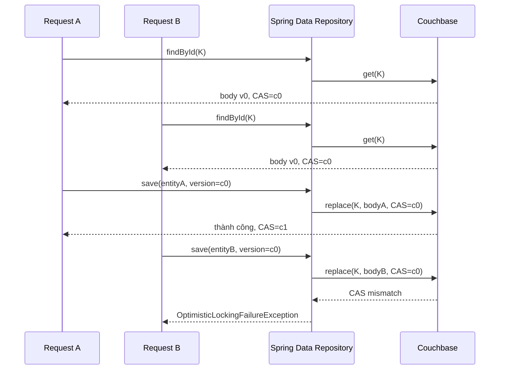

# OptimisticLockingFailureException và cách phản hồi cho bên gọi trong Spring Data Couchbase

## 1. Bối cảnh: xung đột ghi là kết quả cần được xử lý, không chỉ là lỗi kỹ thuật

Trong Spring Data Couchbase, một entity có thể được nhiều request hoặc worker đọc và cập nhật đồng thời. Cơ chế **optimistic locking** dùng **CAS (Compare-And-Swap)** của Couchbase để phát hiện phiên bản mà một writer định ghi đã bị thay đổi.

Khi dùng entity gắn `@Version` qua đường Spring Data hỗ trợ, một phiên bản cũ cố ghi đè phiên bản mới có thể dẫn tới ngoại lệ thuộc nhóm **`org.springframework.dao.OptimisticLockingFailureException`**.

Ví dụ, hai quản trị viên đồng thời sửa khóa học:

```text
09:00   Admin A đọc Course K, version=c0
09:00   Admin B đọc Course K, version=c0
09:02   Admin A đổi tiêu đề và save với c0
        -> thành công; document nhận CAS c1
09:04   Admin B đổi giá từ snapshot c0 rồi save với c0
        -> xung đột: CAS hiện hành đã là c1
```

Nếu hệ thống bỏ qua xung đột rồi dùng `upsert` hoặc nạp version mới để ép lưu bản B, thao tác B có thể ghi đè tiêu đề mà A vừa sửa. Vì thế:

> **Optimistic locking failure là thông tin rằng một giả định về trạng thái dữ liệu không còn đúng.** Ứng dụng phải quyết định người gọi nên đọc lại, hòa giải thay đổi, thử lại có kiểm soát hay nhận một kết quả xung đột.

Bài này tập trung vào **cách phân loại, bắt, chuyển đổi và phản hồi** lỗi optimistic locking trong các tầng repository, service, REST API và reactive; đồng thời làm rõ khi nào chọn HTTP `409 Conflict`, `412 Precondition Failed`, `428 Precondition Required` hoặc lỗi khác.

## 2. Hiểu đúng cơ chế dẫn đến `OptimisticLockingFailureException`

### 2.1. `@Version` liên kết entity với CAS

Couchbase quản lý một token CAS cho phiên bản của mỗi document. Khi Spring Data Couchbase đọc document bằng mapping hỗ trợ, token được gán vào thuộc tính:

```java
import org.springframework.data.annotation.Id;
import org.springframework.data.annotation.Version;
import org.springframework.data.couchbase.core.mapping.Document;

@Document
public class CourseDocument {
    @Id
    private String id;

    @Version
    private Long version;

    private String tenantId;
    private String courseCode;
    private String displayTitle;
    private int tuitionAmount;

    protected CourseDocument() {}

    public CourseDocument(String id, String tenantId,
                          String courseCode, String title, int tuitionAmount) {
        this.id = id;
        this.tenantId = tenantId;
        this.courseCode = courseCode;
        this.displayTitle = title;
        this.tuitionAmount = tuitionAmount;
    }

    public String getId() { return id; }
    public String getTenantId() { return tenantId; }
    public String getDisplayTitle() { return displayTitle; }
    public int getTuitionAmount() { return tuitionAmount; }
    public Long getVersion() { return version; }

    public void rename(String title) {
        if (title == null || title.isBlank()) {
            throw new IllegalArgumentException("Tên khóa học không hợp lệ");
        }
        this.displayTitle = title;
    }

    public void changeTuition(int amount) {
        if (amount < 0) {
            throw new IllegalArgumentException("Học phí không được âm");
        }
        this.tuitionAmount = amount;
    }
}
```

Ở đây, `@Version` phải được import từ **`org.springframework.data.annotation.Version`**. Nó ánh xạ CAS của Couchbase, **không phải số đếm revision do ứng dụng tự tăng** và không phải `@jakarta.persistence.Version` của JPA.

Repository:

```java
import org.springframework.data.couchbase.repository.CouchbaseRepository;

public interface CourseRepository
        extends CouchbaseRepository<CourseDocument, String> {
}
```

Một entity mới với `version == null` chưa mang CAS đã lưu. Một entity tải từ repository có version từ Couchbase. Khi cập nhật entity đã đọc, đường mapping có optimistic locking dùng CAS đó làm điều kiện ghi.

### 2.2. Hai bản cùng CAS: chỉ bản cập nhật hợp lệ trước có thể ghi



Sơ đồ minh họa loại lỗi thường gặp; **exception cụ thể còn tùy API và phiên bản thư viện**. Couchbase Java SDK trực tiếp thường dùng `CasMismatchException` cho mutation CAS không khớp, còn Spring Data có thể chuyển đổi lỗi sang hệ phân cấp exception của Spring.

### 2.3. Tại sao exception này là một cơ chế bảo vệ?

Nếu B không bị từ chối, body từ snapshot cũ có thể làm mất một hoặc nhiều cập nhật của A. Một lỗi optimistic locking được trả đúng thời điểm giúp ứng dụng giữ nguyên phiên bản mới và chuyển quyết định **merge hay ghi đè** cho nơi có đủ ngữ cảnh nghiệp vụ.

Điều quan trọng là phân biệt:

- **Lệnh ghi được từ chối do xung đột phiên bản:** thao tác ghi theo CAS không được áp dụng trên phiên bản hiện hành.
- **Request HTTP có kết quả không xác định do timeout:** không thể suy ra server đã ghi hay chưa.
- **Document bị xóa hoặc hết TTL:** document có thể không còn để thay thế; đây không nhất thiết là lỗi CAS mismatch.
- **Không đủ quyền truy cập:** không phải xung đột phiên bản.

Không gộp mọi trường hợp vào cùng một mã lỗi hoặc cùng một chiến lược retry.

## 3. Phân biệt ba tầng lỗi: Couchbase SDK, Spring Data và API

Một ứng dụng có thể đi qua các tầng:

```text
HTTP Controller
      |
Application Service
      |
Spring Data Repository / CouchbaseTemplate
      |
Couchbase Java SDK và Couchbase Server
```

Lỗi tại mỗi tầng có ý nghĩa gần nhau nhưng không nhất thiết có cùng class.

| Nguồn | Loại lỗi tiêu biểu | Ý nghĩa |
| --- | --- | --- |
| Couchbase Java SDK, mutation có CAS | `CasMismatchException` | Token CAS client gửi không còn khớp |
| Spring Data, optimistic locking | `OptimisticLockingFailureException` hoặc subtype | Entity mang phiên bản cũ không thể lưu hợp lệ |
| Couchbase Java SDK, tạo document | `DocumentExistsException` | Document ID đích đã tồn tại |
| Couchbase Java SDK, cập nhật/xóa | `DocumentNotFoundException` | Document không còn ở key đích |
| API HTTP có điều kiện `If-Match` | `412 Precondition Failed` | Phiên bản mà client dùng làm điều kiện không còn khớp |
| API command không mang điều kiện HTTP | `409 Conflict` | Không thể hoàn tất vì trạng thái hiện hành xung đột với ý định |
| API yêu cầu `If-Match` nhưng bị thiếu | `428 Precondition Required` | Client phải cung cấp điều kiện phiên bản |

**Lưu ý:** Đây là bảng tương quan ngữ nghĩa, **không phải ánh xạ một-một bắt buộc của mọi exception sang status**. Một exception từ repository có thể được application service chuyển thành lỗi domain trước khi tới controller. Việc chọn 409 hay 412 phụ thuộc **hợp đồng HTTP có yêu cầu điều kiện phiên bản cụ thể hay không**.

### 3.1. `OptimisticLockingFailureException` thuộc Spring DAO

Import quan trọng:

```java
import org.springframework.dao.OptimisticLockingFailureException;
```

Đây là exception trong Spring DAO hierarchy. Các phiên bản và đường thao tác khác nhau có thể dùng subtype hoặc chuyển đổi khác nhau. Khi xử lý ở biên service/REST, nên bắt một loại đủ phù hợp với đường thực thi đã chọn, và dùng integration test để xác minh ngoại lệ được ném ra thực tế.

Không giả định mọi lỗi `save` là optimistic locking. Ví dụ cùng `@Id` nhưng `@Version == null` có thể đưa đường save versioned vào **insert**, dẫn tới lỗi key đã tồn tại thay vì stale CAS. Cũng không suy luận rằng SQL++ UPDATE hoặc SDK upsert trực tiếp sẽ đọc annotation `@Version`.

## 4. Chọn mã HTTP nào khi có xung đột?

Một API chất lượng không nên trả chung `500 Internal Server Error` cho mọi optimistic locking conflict. Xung đột xảy ra trong concurrency bình thường, và client có thể có hành động phục hồi rõ ràng.

### 4.1. Bảng quyết định

| Tình huống API | Phản hồi thường phù hợp | Hành động được gợi ý cho bên gọi |
| --- | --- | --- |
| Client gửi `If-Match` đại diện phiên bản cũ | **412 Precondition Failed** | GET lại, so sánh thay đổi rồi gửi điều kiện mới nếu vẫn muốn sửa |
| Client không gửi `If-Match` trong API bắt buộc | **428 Precondition Required** | GET resource và gửi `If-Match` |
| Command nội bộ read–modify–write gặp CAS conflict, không có precondition từ client | **409 Conflict** | Retry an toàn hoặc yêu cầu người dùng giải quyết, tùy nghiệp vụ |
| Hai lệnh tạo cùng key và không được phép ghi đè | **409 Conflict** (hoặc hợp đồng create khác) | Kiểm tra ID/ý định; không tự upsert |
| Không đủ số lượng sau khi tải lại | **409 Conflict** hoặc lỗi domain được công bố | Thay đổi yêu cầu/chọn phương án khác |
| Document đã bị xóa/hết TTL | **404 Not Found** hoặc quy tắc vòng đời riêng | Không tự động tái tạo nếu đang update-only |
| Request sai payload | **400 Bad Request** hoặc **422 Unprocessable Content** theo hợp đồng | Sửa dữ liệu đầu vào |
| Token hoặc quyền truy cập không hợp lệ | **401/403** theo cơ chế xác thực | Xác thực hoặc xin quyền; không tiết lộ dữ liệu |
| Couchbase tạm không khả dụng | **503 Service Unavailable** hoặc lỗi hạ tầng thích hợp | Retry có backoff và idempotency theo chính sách |
| Ghi bị timeout, commit chưa rõ | Mã lỗi tạm thời theo API; **không kết luận chưa commit** | Đối soát bằng operation ID/đọc lại trước khi phát lại tác dụng |

Đây là **gợi ý thiết kế API**, không phải yêu cầu Couchbase bắt buộc trả các status trên. Tầng application cần biết request đang thực hiện command nào, client có gửi điều kiện phiên bản hay không, và có được phép retry tự động không.

### 4.2. `409 Conflict` và `412 Precondition Failed` khác nhau ra sao?

**409 Conflict** mô tả việc request không phù hợp trạng thái hiện tại của resource theo quy tắc ứng dụng. Ví dụ một worker muốn chuyển một enrollment từ `CANCELLED` thành `ACTIVE`, nhưng trạng thái hiện hành không cho phép.

**412 Precondition Failed** là kết quả khi một **điều kiện HTTP** như `If-Match` không được đáp ứng. Ví dụ trình duyệt nói “chỉ sửa nếu resource vẫn là phiên bản tôi thấy khi mở trang”, nhưng resource đã đổi.

Với một endpoint có yêu cầu `If-Match`:

- Không khớp ngay khi kiểm tra: trả **412**.
- Khớp lúc kiểm tra nhưng writer khác chen vào trước lệnh save: **CAS mismatch cũng có thể được dịch thành 412** trong hợp đồng đó, vì điều kiện phiên bản client đã gửi không còn đúng tại thời điểm ghi.
- Nếu điều kiện khớp nhưng nghiệp vụ từ chối vì trạng thái không hợp lệ: có thể trả **409** với mã lỗi domain cụ thể.

Không nên đổi xung đột 412 thành 500 chỉ vì exception xuất phát từ cơ sở dữ liệu.

### 4.3. `428 Precondition Required` dùng khi nào?

Khi endpoint PUT/PATCH muốn buộc client dùng điều kiện phiên bản, thiếu `If-Match` phải được nhận diện rõ:

```http
HTTP/1.1 428 Precondition Required
Content-Type: application/problem+json
```

Điều này giúp ngăn trường hợp client cũ gửi dữ liệu từ một form cũ nhưng không biết phải cung cấp phiên bản. Nếu endpoint cho phép cập nhật vô điều kiện theo thiết kế, không nên tự áp đặt 428 lên mọi request.

## 5. Phản hồi lỗi bằng Problem Details có cấu trúc

Một response chỉ chứa chuỗi `"OptimisticLockingFailureException"` không hữu ích cho người dùng và có thể làm lộ chi tiết nội bộ. Nên trả thông báo ổn định, mã lỗi máy đọc được và hành động phù hợp.

Ví dụ cho `409`:

```http
HTTP/1.1 409 Conflict
Content-Type: application/problem+json
```

```json
{
  "type": "about:blank",
  "title": "Dữ liệu đã thay đổi",
  "status": 409,
  "detail": "Tài liệu đã được cập nhật bởi một yêu cầu khác. Hãy tải lại trước khi thử lưu.",
  "code": "DOCUMENT_VERSION_CONFLICT"
}
```

Ví dụ cho `412`:

```http
HTTP/1.1 412 Precondition Failed
Content-Type: application/problem+json
```

```json
{
  "type": "about:blank",
  "title": "Phiên bản không còn hợp lệ",
  "status": 412,
  "detail": "Phiên bản đã xem không còn là phiên bản hiện tại của tài liệu.",
  "code": "STALE_RESOURCE_VERSION"
}
```

Các trường `type`, `title`, `status`, `detail` thuộc mô hình HTTP Problem Details; `code` là extension do ứng dụng quy định. Không dùng `detail` để trả stack trace, thông tin cluster, bucket/collection bí mật hoặc payload của tenant khác.

### 5.1. Một response tốt nên giúp caller quyết định

Client có thể dựa vào:

- **HTTP status**: phân biệt conflict, điều kiện phiên bản, lỗi xác thực hay hạ tầng.
- **`code` ổn định**: như `STALE_RESOURCE_VERSION` hoặc `OUT_OF_STOCK` để chọn luồng UI.
- **Thông điệp dễ hiểu**: người dùng cần tải lại hoặc so sánh thay đổi.
- **Correlation/request ID**: giúp bộ phận vận hành truy vết; giá trị phải phù hợp quy tắc bảo mật.
- **Thông tin phiên bản mới**: chỉ trả nếu caller có quyền đọc và API thật sự có nhu cầu; không bắt buộc kèm snapshot mới trong error.

Không cần công khai CAS số 64 bit thô trong body lỗi. CAS không phải secret, nhưng công khai mọi thông tin nội bộ khi không cần thiết làm phức tạp hợp đồng và có thể tăng nguy cơ lộ thông tin.

## 6. REST Controller Advice: xử lý lỗi optimistic locking tập trung

Với Spring Framework 6/Spring Boot 3, có thể dùng `ProblemDetail` và `@RestControllerAdvice`. Ví dụ sau tách lỗi optimistic locking thông thường khỏi lỗi tiền điều kiện của API.

```java
import org.springframework.dao.OptimisticLockingFailureException;
import org.springframework.http.HttpStatus;
import org.springframework.http.ProblemDetail;
import org.springframework.http.ResponseEntity;
import org.springframework.web.bind.annotation.ExceptionHandler;
import org.springframework.web.bind.annotation.RestControllerAdvice;

@RestControllerAdvice
public class ApiConflictExceptionHandler {

    @ExceptionHandler(OptimisticLockingFailureException.class)
    public ResponseEntity<ProblemDetail> optimisticConflict(
            OptimisticLockingFailureException ex) {

        ProblemDetail problem = ProblemDetail.forStatusAndDetail(
            HttpStatus.CONFLICT,
            "Tài liệu đã được sửa đồng thời. Hãy tải lại và thử lại khi phù hợp.");
        problem.setTitle("Dữ liệu đã thay đổi");
        problem.setProperty("code", "DOCUMENT_VERSION_CONFLICT");

        return ResponseEntity.status(HttpStatus.CONFLICT).body(problem);
    }

    @ExceptionHandler(StaleResourceVersionException.class)
    public ResponseEntity<ProblemDetail> stalePrecondition(
            StaleResourceVersionException ex) {

        ProblemDetail problem = ProblemDetail.forStatusAndDetail(
            HttpStatus.PRECONDITION_FAILED,
            "Phiên bản tài liệu mà bên gọi cung cấp không còn hợp lệ.");
        problem.setTitle("Điều kiện phiên bản thất bại");
        problem.setProperty("code", "STALE_RESOURCE_VERSION");

        return ResponseEntity.status(HttpStatus.PRECONDITION_FAILED)
            .body(problem);
    }

    @ExceptionHandler(VersionRequiredException.class)
    public ResponseEntity<ProblemDetail> missingPrecondition(
            VersionRequiredException ex) {

        ProblemDetail problem = ProblemDetail.forStatusAndDetail(
            HttpStatus.PRECONDITION_REQUIRED,
            "Yêu cầu cập nhật phải gửi If-Match từ lần đọc trước.");
        problem.setTitle("Thiếu điều kiện phiên bản");
        problem.setProperty("code", "VERSION_PRECONDITION_REQUIRED");

        return ResponseEntity.status(HttpStatus.PRECONDITION_REQUIRED)
            .body(problem);
    }
}

class StaleResourceVersionException extends RuntimeException {
    StaleResourceVersionException() {
        super("Stale version");
    }
}

class VersionRequiredException extends RuntimeException {
    VersionRequiredException() {
        super("Missing If-Match");
    }
}
```

Ví dụ xử lý này cho thấy **hai hướng response khác nhau**:

1. Nếu lỗi `OptimisticLockingFailureException` đi đến handler chung, trả **409**.
2. Nếu service đang thực hiện endpoint yêu cầu `If-Match`, service có thể chuyển lỗi version thành **`StaleResourceVersionException`** để handler trả **412**.

Không nên để một advice chung tự đoán client đã gửi `If-Match` chỉ dựa vào chuỗi thông báo của exception. Tầng ứng dụng phải biết đúng hợp đồng đang được thực thi.

**Các class ngoại lệ domain trong snippet chỉ minh họa.** Ứng dụng có thể tổ chức chúng ở package riêng, bổ sung `requestId`/log đã được kiểm soát và quy tắc mapping cho `404`, `400`, `503`.

### 6.1. Không bắt lỗi quá rộng

Anti-pattern:

```java
try {
    repository.save(entity);
} catch (Exception ex) {
    throw new RuntimeException("Lưu thất bại, vui lòng thử lại");
}
```

Nhánh này đánh đồng xung đột bình thường với lỗi mạng, thiếu quyền, dữ liệu không hợp lệ hoặc lỗi chương trình. Nếu handler phía trên chỉ trả 500, client không biết cần đọc lại hay gửi yêu cầu mới.

Nên:

- Bắt **loại exception dự kiến** tại ranh giới phù hợp.
- Bảo toàn exception nguyên nhân để log nội bộ có thể phân tích.
- Chuyển sang lỗi domain khi cần thêm ngữ cảnh của request.
- Để lỗi chưa biết đi qua chính sách xử lý 5xx/hạ tầng thích hợp.
- Không biến mọi lỗi thành retry tự động.

## 7. Service read–modify–write: chuyển lỗi theo ngữ nghĩa

Một service đơn giản muốn đổi tiêu đề course dựa trên phiên bản mới nhất:

```java
import java.util.NoSuchElementException;
import org.springframework.dao.OptimisticLockingFailureException;

public final class CourseService {
    private final CourseRepository repository;

    public CourseService(CourseRepository repository) {
        this.repository = repository;
    }

    public CourseDocument renameOnLatest(
            String authorizedDocumentId,
            String title) {

        CourseDocument loaded = repository.findById(
            authorizedDocumentId
        ).orElseThrow(() -> new NoSuchElementException("Không tìm thấy course"));

        // Ví dụ giả định tầng gọi đã kiểm tra quyền với tenant của course.
        loaded.rename(title);

        try {
            return repository.save(loaded);
        } catch (OptimisticLockingFailureException conflict) {
            // Với endpoint không dùng If-Match:
            // cho phép advice chung trả 409 Conflict.
            throw conflict;
        }
    }
}
```

Bản thân `catch ... throw conflict` có thể bỏ đi nếu service không cần log/đo lường thêm. Nó được viết ra để chỉ rõ **không dùng một stale entity để ghi đè vô điều kiện**.

Đây là **một lần thử** từ trạng thái mới nhất ngay trong request. Nó phát hiện writer chen vào giữa `findById` và `save`, nhưng **chưa bảo vệ** phiên bản mà người dùng đã mở trên giao diện từ trước.

### 7.1. Vì sao một request có thể “đúng CAS” mà vẫn ghi đè form cũ?

```text
09:00: Client GET Course, nhận bản c0
09:05: Admin khác lưu bản c1
09:30: Client PUT payload dựng từ bản c0
09:30: Service đọc latest c1 rồi ghi với c1
        -> có thể thành công dù người dùng chưa xem c1
```

Ở đây, CAS chỉ bảo vệ cửa sổ **09:30 từ đọc tới ghi**. Vì request không mang token của bản c0 mà người dùng thực sự đã xem, server không biết client đang sửa một snapshot cũ.

Để chống mất cập nhật từ giao diện, API cần một hợp đồng **conditional write**.

## 8. ETag/If-Match: trả 412 cho phiên bản client đã xem

Một API có thể trả **ETag** đại diện cho phiên bản document khi GET, rồi yêu cầu PUT/PATCH gửi lại qua **If-Match**.

```http
GET /api/courses/course::acme::java-101

HTTP/1.1 200 OK
ETag: "cas-2f9a"
Content-Type: application/json

{"courseId":"java-101","displayTitle":"Java căn bản"}
```

Client gửi:

```http
PUT /api/courses/course::acme::java-101/title
If-Match: "cas-2f9a"
Content-Type: application/json

{"displayTitle":"Java cơ bản"}
```

ETag trên là **ví dụ minh họa định dạng**, không phải CAS thật từ cluster. Khi triển khai, nên mã hóa CAS 64 bit thành **chuỗi opaque ổn định**; tránh truyền qua số JavaScript có thể làm mất độ chính xác. Ví dụ URL dùng trực tiếp document ID để khớp với tham số `id` của controller; API production có thể dùng mã public và phân giải sang document ID theo tenant đã xác thực, tránh để caller tự quyết định namespace.

Một trình tự đúng:

1. Xác thực người gọi, xác định tenant và document ID được phép thao tác.
2. Kiểm tra `If-Match` có mặt, đúng cú pháp và được hỗ trợ.
3. Đọc entity hiện hành cùng CAS.
4. So ETag hiện hành với token mà client gửi.
5. Nếu không khớp, trả **412** mà không sửa dữ liệu.
6. Nếu khớp, thực hiện thay đổi nghiệp vụ trên entity vừa đọc.
7. Gọi `save` với CAS từ entity đó.
8. Nếu writer khác chen vào trước bước 7 khiến `OptimisticLockingFailureException`, trả **412** theo cùng hợp đồng.
9. Nếu lưu thành công, trả ETag mới cho phiên bản vừa lưu.

### 8.1. Tại sao phải dùng CAS dù đã kiểm tra If-Match?

Bởi vì vẫn có một cửa sổ race:

```text
T0: Server đọc c0; If-Match của client là c0 -> khớp
T1: Worker khác ghi document -> CAS đổi thành c1
T2: Server save dựa trên c0
```

Nếu bước T2 không dùng CAS, kiểm tra ở T0 sẽ trở nên vô nghĩa: worker có thể chen vào **sau bước so phiên bản nhưng trước bước ghi**. Spring Data `@Version` giúp chặn thao tác này khi đường lưu hỗ trợ optimistic locking.

### 8.2. Một codec ETag giản lược cho CAS 64 bit

Đoạn sau quy định API **chỉ hỗ trợ một strong ETag duy nhất** trong If-Match, không hỗ trợ danh sách tag hoặc ký hiệu `*`. Trong HTTP đầy đủ, `If-Match` có thể mang nhiều giá trị; nếu muốn hỗ trợ, phải dùng parser phù hợp thay vì xử lý chuỗi giản lược.

```java
import java.util.regex.Pattern;

public final class CasEtags {
    private static final Pattern SINGLE_STRONG_TAG =
        Pattern.compile("\"cas-[0-9a-f]{1,16}\"");

    private CasEtags() {}

    public static String encode(Long cas) {
        if (cas == null) {
            throw new IllegalStateException("Document chưa có CAS đã lưu");
        }

        return "\"cas-" + Long.toUnsignedString(cas.longValue(), 16) + "\"";
    }

    public static boolean isSupportedIfMatch(String header) {
        return header != null && SINGLE_STRONG_TAG.matcher(header).matches();
    }

    public static boolean matches(String header, Long currentCas) {
        return isSupportedIfMatch(header)
            && encode(currentCas).equals(header);
    }
}
```

Không cần suy ra CAS tăng hay giảm theo số. `Long.toUnsignedString(...,16)` dùng để giữ nguyên **bit-pattern 64 bit** ở dạng text. Nếu API thay đổi cách biểu diễn response, ETag cũng phải tuân thủ ngữ nghĩa HTTP của phiên bản biểu diễn đã chọn.

**Cảnh báo bảo mật:** ETag không phải thông tin xác thực. Việc biết một ETag không cho phép người dùng sửa tài liệu. Phải kiểm tra quyền tenant/resource trước khi dùng token để đọc/ghi.

### 8.3. Service trả 412 kể cả khi xung đột xảy ra giữa so phiên bản và save

```java
import java.util.NoSuchElementException;
import org.springframework.dao.OptimisticLockingFailureException;

public final class ConditionalCourseService {
    private final CourseRepository repository;

    public ConditionalCourseService(CourseRepository repository) {
        this.repository = repository;
    }

    public CourseDocument renameIfUnchanged(
            String authorizedDocumentId,
            String ifMatch,
            String title) {

        if (ifMatch == null || ifMatch.isBlank()) {
            throw new VersionRequiredException();
        }

        if (!CasEtags.isSupportedIfMatch(ifMatch)) {
            throw new IllegalArgumentException(
                "If-Match không thuộc định dạng được API hỗ trợ");
        }

        CourseDocument current = repository.findById(
            authorizedDocumentId
        ).orElseThrow(() -> new NoSuchElementException("Course không tồn tại"));

        // Quyền thao tác phải được kiểm tra trên tenant của current.
        if (!CasEtags.matches(ifMatch, current.getVersion())) {
            throw new StaleResourceVersionException();
        }

        current.rename(title);

        try {
            return repository.save(current);
        } catch (OptimisticLockingFailureException conflict) {
            // Một writer đã ghi sau khi so If-Match.
            throw new StaleResourceVersionException();
        }
    }
}
```

Service này minh họa concurrency logic và giả định `authorizedDocumentId` đã được cấp sau khi xác thực/ủy quyền; trong ứng dụng thật, nên kiểm tra quyền trước khi đọc/tiết lộ kết quả hoặc dùng chính sách masking phù hợp. Ngoại lệ `IllegalArgumentException` cần một handler lỗi đầu vào như `400 Bad Request`; `NoSuchElementException` cần hợp đồng `404` hoặc xử lý phù hợp.

### 8.4. Controller trả ETag mới sau khi lưu

Một controller tối giản, dùng service đã được khởi tạo:

```java
import org.springframework.http.HttpHeaders;
import org.springframework.http.ResponseEntity;
import org.springframework.web.bind.annotation.*;

@RestController
@RequestMapping("/api/courses")
public class CourseController {
    private final ConditionalCourseService service;

    public CourseController(ConditionalCourseService service) {
        this.service = service;
    }

    @PutMapping("/{id}/title")
    public ResponseEntity<CourseTitleResponse> rename(
            @PathVariable String id,
            @RequestHeader(name = HttpHeaders.IF_MATCH, required = false)
            String ifMatch,
            @RequestBody RenameTitleRequest body) {

        CourseDocument saved =
            service.renameIfUnchanged(id, ifMatch, body.title());

        return ResponseEntity.ok()
            .header(HttpHeaders.ETAG, CasEtags.encode(saved.getVersion()))
            .body(new CourseTitleResponse(
                saved.getId(), saved.getDisplayTitle()));
    }

    public record RenameTitleRequest(String title) {}
    public record CourseTitleResponse(String id, String title) {}
}
```

Đây là **mẫu endpoint điều kiện**; cần bổ sung service load cho GET trả ETag, kiểm soát tenant, validation và handler lỗi đầy đủ. Thay đổi ở code controller không loại bỏ nhu cầu xác minh mapping/version trong integration test.

Việc gửi header `If-Match` trên endpoint chuyên sửa title là lựa chọn hợp đồng; endpoint có thể là PUT/PATCH miễn semantics được xác định rõ.

## 9. Vì sao không thể xử lý mọi optimistic conflict bằng retry?

Một bản cập nhật từ snapshot cũ có thể chứa **ý định không còn hợp lệ**. Sau xung đột, đơn giản đọc lại rồi áp dụng cùng payload có thể phá bất biến.

### 9.1. Trường hợp nên trả conflict cho người dùng

Hai quản trị viên cùng sửa **mức học phí**:

```text
Course hiện tại: tuition = 1.000.000
A đề xuất 900.000
B đề xuất 800.000
A lưu trước -> 900.000
B lưu từ snapshot cũ -> conflict
```

Nếu server tự đọc mức mới rồi ép ghi 800.000, ý định của A bị ghi đè mà B chưa biết. Với UI chỉnh sửa dữ liệu quan trọng, nên **412/409 kèm hướng dẫn tải lại** để B quyết định có muốn thay đổi giá từ 900.000 xuống 800.000 hay không.

### 9.2. Trường hợp có thể retry trong service

Một worker xử lý một lệnh **được định nghĩa là tái áp dụng an toàn** trên trạng thái mới nhất. Ví dụ thêm một tag vào một tập hợp tag, có thể đọc lại rồi chỉ thêm nếu chưa tồn tại, theo quy tắc nghiệp vụ.

Retry đúng:

```text
Đọc phiên bản mới nhất + CAS
   -> kiểm tra lại điều kiện/ủy quyền
   -> tính toán thay đổi từ phiên bản mới
   -> lưu có CAS
   -> nếu conflict, có thể thử lại trong giới hạn
```

Retry sai:

```text
Đọc body v0 + CAS c0
   -> save với c0 -> conflict
   -> save lại chính body v0, CAS c0
   -> conflict / hoặc thay bằng upsert để ép ghi
```

Không tự động thay `save(staleEntity)` bằng `upsert` để “khắc phục lỗi”, vì như vậy vô hiệu hóa optimistic locking.

### 9.3. Retry có giới hạn

```java
import org.springframework.dao.OptimisticLockingFailureException;

public CourseDocument renameWithBoundedRetry(
        String authorizedDocumentId,
        String nextTitle) {

    final int maxAttempts = 3;

    for (int attempt = 1; attempt <= maxAttempts; attempt++) {
        CourseDocument fresh = repository.findById(
            authorizedDocumentId
        ).orElseThrow();

        // Chỉ phù hợp nếu nghiệp vụ cho phép áp dụng lên bản mới nhất.
        fresh.rename(nextTitle);

        try {
            return repository.save(fresh);
        } catch (OptimisticLockingFailureException conflict) {
            if (attempt == maxAttempts) {
                throw conflict;
            }
            // Production: cân nhắc backoff/jitter và giới hạn thời gian.
        }
    }

    throw new IllegalStateException("Nhánh không thể xảy ra");
}
```

Hàm trên giả định nằm trong service có trường `repository`. Nó chỉ là **minh họa retry cho command không dùng If-Match của snapshot cũ**. Không đưa nguyên hàm này vào một API hứa “không ghi đè khi form cũ được lưu”, vì retry sẽ tự vượt qua ý nghĩa của phiên bản mà client đã xem.

Cũng không dùng vòng retry này nguyên xi cho trừ tiền, tăng điểm, gửi email hoặc tạo order. Những use case đó cần quy tắc idempotency và bảo toàn bất biến riêng.

## 10. Retry với timeout khác retry do CAS conflict

Một CAS mismatch cho thấy server đã từ chối thao tác ghi dựa trên một phiên bản không còn khớp. Một **timeout** không luôn cho biết mutation đã thành công hay thất bại:

```text
T0: Client gửi replace với CAS c0
T1: Couchbase có thể ghi thành công, cấp CAS c1
T2: Mất phản hồi trên đường về
T3: Client nhận timeout
```

Nếu client retry ngay với ID mới hoặc thực hiện side effect lần nữa, có thể tạo trùng dữ liệu. Nếu retry cùng CAS c0, nó có thể gặp mismatch vì **chính lần ghi trước đã thành công**.

Cách xử lý khi outcome không xác định:

1. Giữ **business operation ID/idempotency key** ổn định.
2. Tra cứu trạng thái bền vững để xác định mutation trước có được áp dụng chưa.
3. So sánh dữ liệu và marker nghiệp vụ, không chỉ dựa vào giá trị CAS đã đổi.
4. Chỉ thực hiện lại phần chưa hoàn tất nếu đảm bảo an toàn.
5. Với payment/email/event ngoài database, dùng idempotency riêng hoặc outbox/reconciliation.

**Không suy luận “CAS mismatch sau timeout nghĩa là request đã thất bại”**, cũng không suy luận “document hiện giống payload thì chắc chắn request của mình đã ghi” nếu nhiều writer có thể tạo cùng nội dung.

## 11. Tránh nhầm optimistic conflict với các lỗi khác

Một handler nên tách các nguyên nhân:

| Tình huống | Lỗi/biểu hiện có thể gặp | Không nên làm |
| --- | --- | --- |
| Entity có CAS cũ | `OptimisticLockingFailureException` | Upsert mù để ép ghi |
| SDK replace dùng stale CAS | `CasMismatchException` | Retry vô hạn với cũ |
| Document đã bị xóa/hết hạn | `DocumentNotFoundException` hoặc mapping tương ứng | Tự tạo lại khi API chỉ cho update |
| Entity mới nhưng ID đã tồn tại | `DocumentExistsException` hoặc exception Spring tương ứng | Coi là stale update rồi tự replace |
| Timeout không rõ commit | Timeout exception | Tự khẳng định chưa ghi |
| Tenant hoặc scope sai | Permission/not found | Nâng quyền hay dò key khác tenant |
| Business transition không hợp lệ | Lỗi domain như `CANNOT_REOPEN_CANCELLED_ORDER` | Gọi lại save không đổi trạng thái |
| Xung đột transaction | Transaction abort/retry tùy API | Dùng CAS một document để đoán cả transaction |
| Dữ liệu sai định dạng | Validation error | Retry như lỗi concurrency |

**Không chỉ dựa vào exception message** để xác định logic; dùng class exception, contract của tầng truy cập và trạng thái request. Nếu kết hợp Spring Data và SDK trực tiếp, cần có lớp chuyển lỗi phù hợp cho từng đường ghi.

### 11.1. `@Version` không tự bảo vệ mọi writer

Nếu một service khác gọi:

```java
collection.upsert(documentId, jsonBody);
```

thì Couchbase Java SDK trực tiếp không kiểm tra annotation `@Version` trên entity Java ở service này. Nó có thể thay document và tạo CAS mới; request Spring Data đang giữ CAS cũ sẽ gặp optimistic conflict, nhưng bản upsert trực tiếp **không tự bị chặn bởi annotation**.

Tương tự, một câu SQL++ UPDATE không tự động chèn điều kiện version chỉ vì application entity có `@Version`.

Do đó, phải kiểm kê các đường ghi: repository, `CouchbaseTemplate`, SDK KV, SQL++, job nền, migration và API reactive.

## 12. Reactive API: truyền lỗi đến caller mà không che nguyên nhân

Với `ReactiveCouchbaseRepository`, optimistic locking failure được truyền dưới dạng **tín hiệu lỗi** trong publisher, không phải exception ném ngay khi tạo `Mono`.

```java
import org.springframework.data.couchbase.repository.ReactiveCouchbaseRepository;
import reactor.core.publisher.Mono;

public interface ReactiveCourseRepository
        extends ReactiveCouchbaseRepository<CourseDocument, String> {
}

public final class ReactiveCourseService {
    private final ReactiveCourseRepository repository;

    public ReactiveCourseService(ReactiveCourseRepository repository) {
        this.repository = repository;
    }

    public Mono<CourseDocument> renameOnce(String id, String title) {
        return repository.findById(id)
            .switchIfEmpty(Mono.error(
                new IllegalArgumentException("Course không tồn tại")))
            .flatMap(course -> {
                course.rename(title);
                return repository.save(course);
            });
    }
}
```

Ví dụ chỉ tập trung vào pipeline đọc–sửa–ghi; production cần phân biệt not-found với validation và kiểm tra quyền tenant.

### 12.1. Chuyển lỗi theo loại trong Reactor

```java
import org.springframework.dao.OptimisticLockingFailureException;
import reactor.core.publisher.Mono;

public Mono<CourseDocument> renameWithDomainError(
        String id, String title) {

    return repository.findById(id)
        .switchIfEmpty(Mono.error(
            new IllegalArgumentException("Course không tồn tại")))
        .flatMap(course -> {
            course.rename(title);
            return repository.save(course);
        })
        .onErrorMap(
            OptimisticLockingFailureException.class,
            error -> new ConcurrentCourseUpdateException(error));
}

class ConcurrentCourseUpdateException extends RuntimeException {
    ConcurrentCourseUpdateException(Throwable cause) {
        super("Course đã bị sửa đồng thời", cause);
    }
}
```

Một `@RestControllerAdvice` có thể map `ConcurrentCourseUpdateException` sang 409; với API yêu cầu If-Match thì chuyển sang lỗi tiền điều kiện 412 theo hợp đồng.

Không dùng:

```java
.onErrorResume(error -> repository.save(staleEntity))
```

nếu cách đó dùng lại entity/phiên bản đã cũ. Một lần subscribe mới có thể thực thi lại pipeline; cần xác định phần retry và side effect nào có thể được gọi lại.

### 12.2. Phạm vi retry trong reactive rất quan trọng

Một retry chỉ bao quanh `save(staleEntity)` có thể lặp lại cùng CAS cũ. Một retry bao quanh **toàn bộ findById → xử lý → save** có thể đọc CAS mới, nhưng vẫn cần kiểm tra lại điều kiện nghiệp vụ và idempotency.

Nếu API sử dụng If-Match từ người dùng, **không tự retry bằng cách chấp nhận CAS mới**. Client cần biết phiên bản mình đã chỉnh đã bị thay đổi.

## 13. `CouchbaseTemplate` và Spring Data repository: kiểm tra đường exception thực tế

Repository và `CouchbaseTemplate` cùng thuộc hệ sinh thái Spring Data nhưng không phải mọi thao tác template đều có cùng semantics.

- **Repository save trên entity có `@Version`:** đường mapping phù hợp có thể dùng CAS và báo optimistic locking failure khi stale.
- **Entity operations của template:** có thể hỗ trợ CAS/optimistic locking tùy method; phải kiểm tra overload và phiên bản thực tế.
- **SDK trực tiếp `replace(..., cas=...)`:** phản hồi qua exception SDK như `CasMismatchException`.
- **SDK upsert không điều kiện:** không tự kích hoạt optimistic locking của Spring Data.
- **SQL++ UPDATE:** cần chính sách concurrent update riêng, không tự kế thừa `@Version`.

Đặc biệt, entity có `version == null` và entity có CAS cũ **không cùng trạng thái**. Với đường `save` Couchbase được tài liệu hóa, version `null`/`0` thường đi vào nhánh **insert**, còn version đã được cấp đi vào nhánh **replace**. Nếu entity mới trùng key đang tồn tại, lỗi có thể là **duplicate key** chứ không phải optimistic conflict.

Không viết handler đổi mọi lỗi `DocumentExistsException` thành “tài liệu đã bị sửa đồng thời” mà không xét yêu cầu tạo mới.

## 14. CAS, TTL và document không còn tồn tại

Một document có TTL có thể biến mất sau khi service đọc nhưng trước lúc ghi:

```text
T0: findById(K) -> body, CAS=c0
T1: K hết hạn
T2: save(entity c0) -> có thể gặp not-found/optimistic failure theo đường API
```

Cần biết:

1. Đây là document được phép hết hạn hay dữ liệu chính cần lưu vĩnh viễn?
2. API update-only có cho phép tạo lại khi document biến mất không?
3. Nếu document được tạo lại cùng ID, nó có còn cùng identity nghiệp vụ không?
4. Có job hoặc client cũ vẫn gửi mutation đến một document đã hết hạn không?

**Không** tự sửa version thành `null` để chuyển update thành insert, trừ khi có một quy trình tái tạo tài liệu **được nghiệp vụ cho phép** và kiểm soát idempotency.

Khi `replace` với CAS thành công, cũng cần kiểm tra riêng chính sách expiry/durability của thao tác. CAS chỉ bảo vệ phiên bản; nó không tự cam kết TTL được giữ lại hay mutation được sao chép tới mọi node theo mức durability mong muốn.

## 15. Xung đột nhiều document không được giải quyết bằng một exception handler

Giả sử nghiệp vụ tạo đăng ký khóa học cần:

```text
course-capacity::acme::java-101.remainingSeats -= 1
enrollment::acme::enr-901 = created
```

CAS trên document sức chứa có thể bảo vệ việc giảm số chỗ khỏi lost update, nhưng không bảo đảm document enrollment được tạo **cùng commit**. Nếu bước tạo enrollment thất bại, trạng thái có thể nửa chừng.

Khi nhiều document phải có tính nguyên tử, cần cân nhắc **Couchbase distributed ACID transactions** với các thao tác/collection được hỗ trợ hoặc workflow state machine có compensation. Nếu có email hoặc payment, transaction Couchbase **không** tự bao trùm side effect đó.

Một HTTP `409` phù hợp có thể thông báo xung đột, nhưng **không sửa dữ liệu**. Application phải có quy trình bảo toàn dữ liệu đúng trước khi quyết định trả mã lỗi cho caller.

### 15.1. Xung đột không giống deadlock hoặc write skew

- **Lost update:** writer ghi đè phiên bản cũ của cùng document; CAS phát hiện.
- **Write skew:** hai transaction đọc một bất biến trên nhiều document rồi sửa các document khác nhau, có thể vi phạm bất biến dù CAS của từng document khớp.
- **Document quá nóng:** rất nhiều writer cùng tranh một key, gây tỷ lệ CAS conflict cao; có thể cần giảm contention.
- **Lỗi giao dịch đa document:** cần xử lý theo hợp đồng transaction và khả năng retry/commit của API đó.

Đừng giải quyết mọi loại lỗi bằng việc tăng giới hạn retry CAS lên vô hạn.

## 16. Trải nghiệm người dùng khi có xung đột phiên bản

Một lỗi “409” thuần kỹ thuật không đủ. UI nên hỗ trợ luồng phục hồi có chủ đích.

### 16.1. Trang chỉnh sửa tài liệu

Khi nhận 412, giao diện có thể:

1. Giữ lại nội dung người dùng vừa nhập ở bộ nhớ UI.
2. Tải phiên bản mới nhất nếu được phép đọc.
3. Hiển thị khác biệt giữa **bản người dùng đã xem**, **bản hiện tại** và **nội dung họ muốn lưu**.
4. Cho người dùng chọn cập nhật nội dung rồi gửi một yêu cầu mới với ETag mới.
5. Không tự gửi lại cùng payload với ETag mới mà không có sự xác nhận hoặc quy tắc merge rõ ràng.

Ví dụ lời nhắn:

> Khóa học đã được cập nhật bởi một người khác. Nội dung bạn nhập vẫn được giữ lại; hãy xem phiên bản mới nhất trước khi lưu tiếp.

Không cần hiển thị “CAS mismatch” hoặc tên exception Java cho người dùng cuối.

### 16.2. Mobile/offline client

Một ứng dụng offline có thể giữ bản copy nhiều giờ hoặc nhiều ngày. Xung đột có thể là hoạt động bình thường, không phải sự cố hệ thống.

Cần:

- Lưu token phiên bản cùng bản dữ liệu offline.
- Công bố chính sách merge theo loại entity.
- Cho phép xếp hàng các thay đổi riêng lẻ khi an toàn; không gửi snapshot cũ đè toàn bộ.
- Hỗ trợ conflict resolution khi hai người sửa cùng trường.
- Dùng operation ID/idempotency cho các lệnh tạo mới khi client kết nối lại.

### 16.3. Worker backend

Một worker xử lý event có thể không có người dùng để trả lời 409. Khi đó phải:

- Phân loại event có thể tái áp dụng trên trạng thái mới hay không.
- Retry hữu hạn với backoff/jitter nếu hợp lệ.
- Ghi event vào dead-letter queue hoặc hàng đợi xử lý thủ công nếu không thể hòa giải.
- Đảm bảo event cũ không làm lùi trạng thái.
- Phân biệt conflict từ cạnh tranh thường xuyên với lỗi payload/permission.

## 17. Kiểm thử hành vi từ repository tới HTTP

Các bài test tốt phải chứng minh cả **tính đúng của dữ liệu** lẫn **mã phản hồi đúng hợp đồng**.

### 17.1. Integration test stale entity

Test sau chỉ minh họa ý tưởng; fixture thực tế cần inject repository, tạo dữ liệu sạch và cleanup.

```java
import static org.junit.jupiter.api.Assertions.*;
import org.junit.jupiter.api.Test;
import org.springframework.dao.OptimisticLockingFailureException;

class CourseOptimisticLockingTest {

    private CourseRepository repository;

    @Test
    void staleSnapshotMustNotOverwrite() {
        String id = "course::test::java-101";

        repository.save(new CourseDocument(
            id, "test", "java-101", "Java căn bản", 900000));

        CourseDocument a = repository.findById(id).orElseThrow();
        CourseDocument b = repository.findById(id).orElseThrow();

        assertEquals(a.getVersion(), b.getVersion());

        a.rename("Java cơ bản");
        repository.save(a);

        b.changeTuition(800000);

        assertThrows(
            OptimisticLockingFailureException.class,
            () -> repository.save(b));

        CourseDocument current =
            repository.findById(id).orElseThrow();

        assertEquals("Java cơ bản", current.getDisplayTitle());
        assertEquals(900000, current.getTuitionAmount());
    }
}
```

Cần đọc cả A và B **trước** khi A ghi; nếu B đọc sau khi A lưu, B sẽ có CAS mới và test không tạo stale snapshot.

### 17.2. Test response HTTP với If-Match

Một kịch bản test API:

1. GET Course, nhận body và ETag `E0`.
2. Dùng một worker khác cập nhật cùng document, CAS đổi sang `E1`.
3. PUT với `If-Match: E0` và payload cũ.
4. Kỳ vọng **412**, body lỗi có `code=STALE_RESOURCE_VERSION`.
5. GET lại, xác minh dữ liệu từ worker thứ hai **không bị ghi đè**.
6. PUT tiếp với `If-Match: E1` và payload đã được người dùng điều chỉnh.
7. Kỳ vọng thành công và ETag mới.

Nếu thiếu `If-Match` ở endpoint bắt buộc, test **428**. Nếu token sai cú pháp, test **400**. Với endpoint command không dùng If-Match, test optimistic conflict được map **409** theo policy.

### 17.3. Test race sau bước so ETag

Không chỉ test ETag đã cũ trước khi service chạy. Cần một bài test có kiểm soát thời điểm:

```text
Request A: đọc CAS c0, so If-Match=c0 -> đúng
Request B: ghi và commit -> CAS c1
Request A: save entity mang c0 -> OptimisticLockingFailureException
API A: trả 412, không ghi đè B
```

Đây là chứng minh rằng việc so ETag **và** CAS ở mutation cùng bảo vệ request.

### 17.4. Ma trận kiểm thử nên có

| Ca kiểm thử | Kỳ vọng |
| --- | --- |
| Hai repository reader cùng CAS | Writer thứ hai không ghi đè |
| Stale entity `@Version` | Spring optimistic failure được bắt đúng |
| SDK stale CAS | `CasMismatchException` được phân loại phù hợp |
| Không If-Match ở endpoint bắt buộc | 428 |
| If-Match sai cú pháp | 400 hoặc lỗi được công bố |
| If-Match đã cũ | 412, không mutation |
| If-Match đúng nhưng có race sau kiểm tra | 412, không mutation của request stale |
| Xung đột domain dù version vẫn khớp | 409 hoặc lỗi domain phù hợp |
| Entity mới trùng ID | Lỗi duplicate, không chuyển thành update mù |
| Document bị xóa/hết TTL | Not-found/optimistic failure có phân loại |
| Timeout không xác định commit | Có reconciliation/idempotency |
| Retry chỉ `save(staleEntity)` | Test phát hiện sai logic |
| Retry đọc lại nhưng vi phạm bất biến | Phải trả business conflict |
| Reactive error signal | `onErrorMap`/handler giữ nguyên ngữ nghĩa |
| SQL++/SDK writer khác sửa document | Repository snapshot cũ bị từ chối |
| User không có quyền tenant | Không lộ body/ETag của tenant khác |
| Nhiều writer cùng một hot key | Có giới hạn retry và metric |
| Nhiều document trong workflow | Transaction/compensation được kiểm thử |

### 17.5. Test exception handler với Spring MVC

Nếu dùng MockMvc, nên test code và status thay vì so message tiếng Việt chính xác từng ký tự, vì nội dung hiển thị có thể được cải tiến:

```java
// Pseudocode MockMvc, cần controller/service mock và cấu hình test thật.
mockMvc.perform(
        put("/api/courses/course::acme::java-101/title")
            .header("If-Match", "\"cas-1a2b\"")
            .contentType(MediaType.APPLICATION_JSON)
            .content("{\"title\":\"Java cơ bản\"}")
    )
    .andExpect(status().isPreconditionFailed())
    .andExpect(jsonPath("$.code").value("STALE_RESOURCE_VERSION"));
```

Đây là *pseudocode*; token `"cas-1a2b"` chỉ minh họa một ETag **đúng cú pháp** theo codec hex ở phần 8, không phải CAS lấy từ test database. Test thực tế nên lấy ETag cũ bằng một lần GET hợp lệ, cập nhật document bằng writer khác rồi gửi lại token cũ để chứng minh kết quả **412 do stale version**, không phải do token sai cú pháp.

## 18. Quan sát, log và vận hành

Optimistic locking conflict là tình huống bình thường trong hệ thống có concurrency, nhưng tỷ lệ cao bất thường có thể gây suy giảm trải nghiệm và hiệu năng.

Theo dõi tối thiểu:

- Số `OptimisticLockingFailureException` theo operation và document type.
- Số `CasMismatchException` từ các luồng SDK trực tiếp.
- Tỷ lệ HTTP `409`, `412`, `428` theo endpoint.
- Số request retry, số lần thử trung bình và tỷ lệ đạt max retry.
- Thời gian từ read đến write: RMW window càng dài, khả năng xung đột càng cao.
- Số document hot key bị cập nhật tập trung.
- Số timeout/ambiguous mutation cần đối soát.
- Lỗi TTL/not-found và số worker cũ vẫn ghi vào document đã chuyển.
- Tỷ lệ client dùng ETag cũ hoặc thiếu If-Match.
- Số xung đột không thể hòa giải, đưa vào xử lý thủ công.

### 18.1. Log thế nào để vừa hữu ích vừa an toàn?

Log nội bộ có thể lưu:

```text
event=optimistic_lock_conflict
operation=course.rename
errorCode=DOCUMENT_VERSION_CONFLICT
tenantScope=<internal-approved-reference>
requestId=<correlation-id>
attempt=2
```

Không log raw body chứa dữ liệu nhạy cảm, thông tin đăng nhập, payment hoặc stack trace vào response công khai. Tránh đưa cả document ID có chứa email/PII vào log nếu không cần; có thể hash hoặc rút gọn theo chính sách.

Một số xung đột 409 không nhất thiết là lỗi vận hành. Alert nên dựa vào **tỷ lệ bất thường và tác động thực tế**, không chỉ đếm exception đơn lẻ.

### 18.2. Khi conflict quá nhiều, thay thiết kế thay vì retry vô hạn

Nếu nhiều worker liên tục tranh một document:

- Rút ngắn thời gian giữa đọc và ghi.
- Dùng sub-document operation hoặc counter atomic khi ngữ nghĩa phù hợp.
- Tách aggregate/hot key nếu dữ liệu không cần cập nhật trong cùng document.
- Xếp hàng/serialize thay đổi theo document ID khi có thể.
- Xem xét transaction cho bất biến liên document.
- Đưa backoff và jitter vào retry hợp lệ.
- Tránh thực hiện network call ngoài Couchbase giữa bước đọc và ghi nếu không cần.

Không dùng tăng số lần retry như biện pháp duy nhất; nó có thể gây retry storm và khiến contention tệ hơn.

## 19. Bài tập tình huống: chỉnh sửa Course từ web và mobile

Nền tảng đào tạo lưu:

```text
Document ID: course::acme::spring-data-couchbase
Title:       Spring Data Couchbase
Tuition:     990000
CAS:         c0
```

Ba bên cùng thao tác:

- Web Admin A GET lúc 09:00, nhận ETag đại diện `c0`.
- Mobile Admin B GET lúc 09:00, cũng nhận `c0`.
- Worker C cập nhật một trường metadata bằng SDK lúc 09:02.
- Web A gửi PUT title lúc 09:03 với `If-Match=c0`.
- Mobile B gửi PUT tuition lúc 09:05 nhưng **không gửi If-Match**.

**Câu hỏi:**

1. Vì sao request của A không nên được tự động ghi đè metadata từ C chỉ vì A sửa title?
2. Nếu CAS hiện tại không còn `c0`, API có yêu cầu If-Match nên trả mã nào?
3. Nếu endpoint của B bắt buộc If-Match, B nên nhận mã nào?
4. Nếu SDK writer C dùng upsert không điều kiện, annotation `@Version` của Course ở Spring Data có tự bảo vệ bước ghi C không?
5. Nếu A và B sửa hai trường độc lập, có thể merge không? Điều kiện nghiệp vụ cần kiểm tra?
6. Nếu response PUT của A bị timeout sau một mutation thành công, có thể khẳng định A chưa lưu không?
7. Những metric nào cho thấy các client đang sử dụng dữ liệu cũ hoặc một document quá nóng?

**Gợi ý:** A phải so ETag đã xem với CAS hiện hành; khi không khớp trả `412`, giữ nguyên dữ liệu mới. B thiếu điều kiện có thể nhận `428` nếu API yêu cầu. Writer SDK trực tiếp không áp dụng annotation Spring Data nếu không dùng cơ chế CAS tương ứng. Merge chỉ nên làm khi business cho phép, sau khi đọc lại và bảo vệ phiên bản mới tại lệnh ghi. Timeout cần đối soát thay vì đoán. Theo dõi 409/412/428, retry count, RMW window và hot key.

## 20. Checklist phản hồi lỗi optimistic locking trước production

1. Entity dùng đúng `@Version` từ Spring Data và repository/template được cấu hình đúng?
2. Có hiểu `OptimisticLockingFailureException` là xung đột phiên bản, không phải mọi lỗi `save`?
3. Các đường SDK trực tiếp bắt/đối chiếu `CasMismatchException` riêng?
4. Có phân biệt duplicate key, document not found, TTL và timeout không rõ commit?
5. Endpoint đã quyết định rõ **409 hay 412** theo hợp đồng có/không có `If-Match`?
6. API bắt buộc điều kiện có trả `428` nếu client thiếu token?
7. Problem Details có mã lỗi ổn định và thông điệp dễ hành động, không lộ chi tiết nội bộ?
8. Với form UI, client có giữ ETag của **phiên bản thực sự đã xem**?
9. Server có so token client và vẫn dùng CAS ở mutation để chặn race sau so sánh?
10. Nếu request 412, có giữ nội dung người dùng nhập và hỗ trợ tải/merge?
11. Có tránh tự chuyển conflict thành `upsert` hoặc tự sửa `@Version`?
12. Retry chỉ áp dụng cho command an toàn, đọc lại và kiểm tra lại bất biến?
13. Retry có giới hạn, backoff và metric; không lặp side effect ngoài database?
14. POST/command có tác dụng không lặp có idempotency key hoặc operation ID ổn định?
15. Có transaction hoặc workflow nhất quán khi cập nhật nhiều document?
16. Có kiểm tra phân quyền tenant trước khi tiết lộ trạng thái hoặc ETag?
17. Có xử lý reactive error signal và tránh resubscription gây lặp tác dụng?
18. Có integration test hai snapshot cùng CAS và test HTTP 409/412/428?
19. Có test timeout, xóa/TTL, SDK/SQL++ writer xen vào và rollback/reconciliation?
20. Có dashboard conflict rate, latency, hot key và hành vi client retry?

## Tài liệu tham khảo

- [Spring Data Couchbase Reference](https://docs.spring.io/spring-data/couchbase/reference/): ánh xạ `@Version`, repository, template, optimistic locking và reactive operations.
- [Spring Data Commons Reference](https://docs.spring.io/spring-data/commons/reference/): entity lifecycle và optimistic locking.
- [Spring Framework — ProblemDetail](https://docs.spring.io/spring-framework/reference/web/webmvc/mvc-ann-rest-exceptions.html): trả lỗi HTTP theo Problem Details.
- [Couchbase Java SDK — Key-Value Operations](https://docs.couchbase.com/java-sdk/current/howtos/kv-operations.html): CAS, `replace`, mutation errors và điều kiện ghi.
- [Couchbase Java SDK — Distributed ACID Transactions](https://docs.couchbase.com/java-sdk/current/howtos/distributed-acid-transactions-from-the-sdk.html): xử lý tính nguyên tử khi nhiều document có cùng nghiệp vụ.
- [RFC 9110 — HTTP Semantics](https://www.rfc-editor.org/rfc/rfc9110): ngữ nghĩa `409 Conflict`, `412 Precondition Failed` và `If-Match`.
- [RFC 6585 — Additional HTTP Status Codes](https://www.rfc-editor.org/rfc/rfc6585): `428 Precondition Required`.
- [RFC 9457 — Problem Details for HTTP APIs](https://www.rfc-editor.org/rfc/rfc9457): định dạng lỗi có cấu trúc.

## Kết luận

**`OptimisticLockingFailureException` là tín hiệu bảo vệ dữ liệu khỏi việc ghi đè bằng một phiên bản Couchbase đã cũ.** Trong Spring Data Couchbase, `@Version` ánh xạ CAS và cho phép đường lưu entity phát hiện xung đột khi hai writer cùng đọc rồi sửa một document. Cách xử lý đúng không phải nuốt exception, tăng CAS thủ công hay ép ghi bằng upsert, mà là **phản hồi theo hợp đồng của bên gọi**: `409 Conflict` cho xung đột command thông thường, `412 Precondition Failed` khi `If-Match` của client không còn đúng, và `428 Precondition Required` khi API bắt buộc token nhưng client không gửi. Chỉ retry khi nghiệp vụ cho phép, luôn đọc lại và kiểm tra điều kiện trên phiên bản mới, đồng thời bổ sung idempotency, transaction, TTL policy, kiểm thử đồng thời và quan sát vận hành khi cần.
