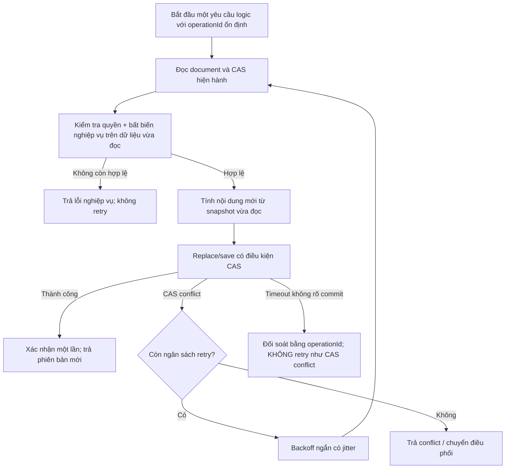
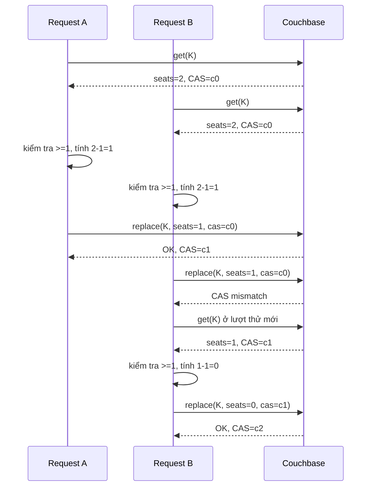

# Thử lại toàn bộ chu trình trên dữ liệu mới nhất trong Spring Data Couchbase

## 1. Tình huống: retry đúng là làm lại quyết định, không chỉ lặp câu lệnh ghi

Một hệ thống đăng ký khóa học lưu số chỗ còn lại trong Couchbase:

```json
{
  "tenantId": "acme",
  "courseId": "java-101",
  "remainingSeats": 2,
  "status": "OPEN"
}
```

Document ID:

```text
course-capacity::acme::java-101
```

Hai request A và B cùng đăng ký một chỗ. Mỗi request đọc `remainingSeats = 2`, kiểm tra đủ chỗ và tính giá trị mới `1`. Nếu hệ thống dùng CAS, một request ghi thành công; request còn lại nhận **optimistic locking conflict** vì document đã thay đổi.

Sai lầm phổ biến là chỉ lặp lại:

```java
repository.save(staleEntity); // Entity vẫn mang CAS cũ.
```

Lệnh ghi lại **không có thông tin mới**. Nó vẫn dựa trên body và token CAS lỗi thời. Cách xử lý đúng, khi nghiệp vụ cho phép tự retry, phải lặp **toàn bộ chu trình đọc → kiểm tra → tính toán → ghi**:



Đây là bài học chuyên sâu về **retry toàn bộ read–modify–write trên dữ liệu mới nhất** trong chương **Khóa lạc quan** của Spring Data Couchbase. Nội dung bao gồm cơ chế CAS/`@Version`, code repository và Java SDK, backoff/retry budget, reactive resubscription, yêu cầu idempotency, HTTP If-Match, transaction, TTL và kiểm thử race.

### 1.1. Định nghĩa hai cụm từ dễ nhầm

**Retry một mutation** nghĩa là gửi lại lệnh ghi, có thể với body và CAS cũ. Với optimistic conflict, việc này thường không giải quyết vấn đề.

**Retry một command nghiệp vụ** nghĩa là tải lại dữ liệu, đánh giá lại yêu cầu trên phiên bản mới và tính lại sự thay đổi. Đây mới là mục tiêu của bài, **nhưng chỉ được phép** nếu command được thiết kế để tái đánh giá an toàn.

> **Quy tắc:** CAS mismatch là lời nhắc rằng giả định về dữ liệu đã sai. Phải kiểm tra lại giả định, không chỉ sửa số lần gọi `save`.

## 2. Nhìn rõ race trong chu trình read–modify–write

Quy trình đọc–sửa–ghi (*read–modify–write*, RMW) là:

```text
READ  -> đọc body của document K cùng CAS c0
CHECK -> kiểm tra điều kiện nghiệp vụ trên body đó
MODIFY-> tạo nội dung mới từ body đó
WRITE -> yêu cầu replace K nếu CAS hiện hành vẫn bằng c0
```

Với hai request:



Ở cuối, hai request hợp lệ đã lấy hết hai chỗ, giá trị lưu bằng `0`. Nếu số chỗ ban đầu là `1` thì khi B đọc lại sẽ thấy `0` và **không được ghi**, dù B còn số lần retry.

### 2.1. Điều gì xảy ra nếu bỏ CAS?

Hai request cùng đọc 2, cùng ghi 1; kết quả cuối có thể là 1 dù hai yêu cầu đã được chấp nhận. Đây là **lost update**. Một lệnh `replace`/`upsert` riêng lẻ có thể được thực thi nguyên tử, nhưng **cả chu trình RMW gồm nhiều bước không tự nguyên tử**.

### 2.2. CAS không khóa document trong khi Java tính toán

Couchbase trả CAS như một **token phiên bản opaque 64 bit**. Nó không phải counter nghiệp vụ hoặc timestamp và không thể tự tạo bằng `cas + 1`. Trong khoảng giữa `get` và `replace`, writer khác vẫn được quyền cập nhật document. Lúc ghi, server so token đã quan sát với token hiện hành và có thể từ chối nếu khác.

| Khái niệm | Trả lời câu hỏi | Không tự bảo đảm |
| --- | --- | --- |
| Document ID / `@Id` | Đang sửa document nào trong collection? | Document không bị thay đổi |
| CAS / `@Version` | Phiên bản được đọc còn hiện hành khi ghi không? | Điều kiện nghiệp vụ vẫn hợp lệ sau conflict |
| Retry toàn chu trình | Có thể tính lại trên phiên bản mới không? | Request chưa từng commit trước timeout |
| Idempotency key | Hai lần gửi có cùng ý định logic không? | Các thao tác của nhiều document cùng atomic |
| Transaction | Nhiều thao tác tham gia cùng một commit không? | Side effect ngoài Couchbase được bao trùm |

## 3. Tại sao lặp `save(staleEntity)` là sai?

Giả sử entity có:

```text
id      = course-capacity::acme::java-101
seats   = 2
version = c0
```

Một writer khác lưu thành công, tạo phiên bản `c1`. Sau đó:

```java
// Anti-pattern: dùng lại snapshot và CAS cũ.
for (int attempt = 0; attempt < 10; attempt++) {
    repository.save(staleEntity);
}
```

Nếu thao tác save dùng optimistic locking, lần thử với CAS `c0` tiếp tục bị từ chối. Nếu mã “sửa lỗi” bằng cách thay `version` hoặc ghi `upsert` không điều kiện, nó có thể **ghi đè dữ liệu mới và đánh bại chính cơ chế khóa lạc quan**.

Ba vấn đề của retry sai:

1. **CAS cũ:** server không chấp nhận lệnh cập nhật có điều kiện.
2. **Body cũ:** dữ liệu có thể thiếu cập nhật của writer khác.
3. **Quy tắc cũ:** việc đặt một chỗ có thể không còn hợp lệ nếu sức chứa đã hết.

Một vòng retry đúng phải có **lần đọc mới và đánh giá lại nghiệp vụ** trước mỗi lần ghi.

### 3.1. Một số phép biến đổi có thể tái áp dụng, một số thì không

| Ý định | Có thể áp dụng lại trên bản mới? | Điều kiện |
| --- | --- | --- |
| Đặt `displayName` thành X | Có thể | Endpoint được phép ghi trên bản mới nhất; không vi phạm If-Match của UI |
| Thêm tag vào một tập tag | Thường có | Kiểm tra tag đã tồn tại; tránh lặp side effect |
| Trừ một chỗ còn lại | Có thể có điều kiện | Kiểm tra lại `remainingSeats >= 1` và idempotency của reservation |
| Tăng `completedLessons` từ event | Chỉ theo chính sách | Không ghi lùi tiến độ; có thể cần sequence/event ID |
| Trừ tiền trong ví | Không tự động | Cần operation ID, kiểm tra số dư, transaction/idempotency |
| Chuyển order `NEW → PAID` | Phụ thuộc trạng thái mới | Không được tự ghi nếu đã `CANCELLED` hoặc event cũ |
| Ghi toàn bộ form từ phiên bản cũ | Thường không | Phải tôn trọng ETag/If-Match mà người dùng đã xem |

**Retry chỉ đúng khi phép biến đổi nghiệp vụ được định nghĩa trên dữ liệu mới nhất và có thể xác minh lại tại mỗi lượt.**

## 4. Mô hình Spring Data Couchbase dùng `@Version`

Ví dụ entity chứa số chỗ còn lại:

```java
import java.time.Instant;
import org.springframework.data.annotation.Id;
import org.springframework.data.annotation.Version;
import org.springframework.data.couchbase.core.mapping.Document;

@Document
public class CourseCapacityDocument {

    @Id
    private String id;

    @Version
    private Long version;

    private String tenantId;
    private String courseId;
    private int remainingSeats;
    private String status;
    private Instant updatedAt;

    protected CourseCapacityDocument() {}

    public CourseCapacityDocument(
            String id, String tenantId, String courseId, int seats) {
        if (seats < 0) {
            throw new IllegalArgumentException("seats phải >= 0");
        }
        this.id = id;
        this.tenantId = tenantId;
        this.courseId = courseId;
        this.remainingSeats = seats;
        this.status = "OPEN";
        this.updatedAt = Instant.now();
    }

    public String getId() { return id; }
    public Long getVersion() { return version; }
    public int getRemainingSeats() { return remainingSeats; }
    public String getStatus() { return status; }

    public void reserve(int units) {
        if (units <= 0) {
            throw new IllegalArgumentException("units phải dương");
        }
        if (!"OPEN".equals(status)) {
            throw new CapacityClosedException();
        }
        if (remainingSeats < units) {
            throw new NotEnoughSeatsException();
        }

        remainingSeats -= units;
        updatedAt = Instant.now();
    }
}

class CapacityClosedException extends RuntimeException {
    CapacityClosedException() {
        super("Đã đóng đăng ký");
    }
}

class NotEnoughSeatsException extends RuntimeException {
    NotEnoughSeatsException() {
        super("Không còn đủ chỗ");
    }
}
```

Repository:

```java
import org.springframework.data.couchbase.repository.CouchbaseRepository;

public interface CourseCapacityRepository
        extends CouchbaseRepository<CourseCapacityDocument, String> {
}
```

**Ý nghĩa các trường:**

- `@Id` là document ID trong collection đích, ví dụ `course-capacity::acme::java-101`.
- `@Version` đến từ `org.springframework.data.annotation.Version`. Với Couchbase, field này được framework dùng để ánh xạ CAS.
- `remainingSeats` và `status` là **trạng thái nghiệp vụ**; chúng phải được kiểm tra lại sau khi đọc phiên bản mới.
- `updatedAt` dùng cho audit/quan sát, **không thay thế CAS**.
- Không có setter công khai để client tự tăng CAS hoặc làm rỗng version.

Entity mới với version chưa có được xử lý khác entity đã tải từ database. Một object vừa tạo với `id` đã được cấp vẫn có thể **chưa có CAS**; không dựng lại entity từ HTTP body rồi gọi `save` để giả định đó là bản cập nhật có điều kiện.

## 5. Vòng retry toàn chu trình bằng repository blocking

Hàm dưới đây thực hiện **một command RMW trên một document**, thử tối đa ba lần, và chỉ retry loại conflict mà optimistic locking nhận diện.

```java
import java.util.NoSuchElementException;
import org.springframework.dao.OptimisticLockingFailureException;

public final class CapacityService {
    private final CourseCapacityRepository repository;

    public CapacityService(CourseCapacityRepository repository) {
        this.repository = repository;
    }

    public CourseCapacityDocument reserveWithRetry(
            String authorizedCapacityId,
            int units) {

        if (units <= 0) {
            throw new IllegalArgumentException("units phải dương");
        }

        final int maxAttempts = 3;

        for (int attempt = 1; attempt <= maxAttempts; attempt++) {
            // Bước 1: GET mới trong MỖI lượt thử.
            CourseCapacityDocument current = repository
                .findById(authorizedCapacityId)
                .orElseThrow(() ->
                    new NoSuchElementException("Không thấy lớp học"));

            // Bước 2: kiểm tra nghiệp vụ và tính lại trên dữ liệu mới.
            // Nếu lớp đóng/không đủ chỗ: lỗi domain, KHÔNG retry CAS.
            current.reserve(units);

            try {
                // Bước 3: lưu với CAS thuộc entity vừa đọc.
                // Chỉ writer thấy phiên bản vẫn đúng mới được ghi.
                return repository.save(current);
            } catch (OptimisticLockingFailureException conflict) {
                if (attempt == maxAttempts) {
                    throw conflict;
                }
                // Production: áp dụng backoff/jitter và giới hạn tổng
                // thời gian; không chèn payment/email ở đây.
            }
        }

        throw new IllegalStateException("Không thể tới nhánh này");
    }
}
```

Giả định `authorizedCapacityId` đã được xác thực, ủy quyền đối với tenant và repository trỏ đúng collection. Ví dụ này cố ý không nhúng toàn bộ hệ thống đặt chỗ/thanh toán để nổi bật **phạm vi retry**.

### 5.1. Tại sao vị trí `findById` quan trọng?

Nếu `findById` nằm **ngoài** vòng `for`, các lượt sau vẫn dùng bản cũ. Ở đây, mỗi lần lặp lại:

1. Tải body cùng CAS mới.
2. Kiểm tra trạng thái `OPEN` và số chỗ còn lại.
3. Tính số chỗ sau khi đặt.
4. `save` có điều kiện CAS.
5. Nếu CAS conflict, bắt đầu lượt khác từ bước 1.

Không dùng `current.setVersion(...)` với một số tự tính hoặc cố tình đặt version `null`. CAS là metadata do Couchbase quản lý; phải lấy từ document thật.

### 5.2. Khi nào vòng lặp dừng?

Có ba nhánh chính:

| Trạng thái sau một lượt | Hành động |
| --- | --- |
| `save` thành công | Trả entity kết quả/CAS mới, **không** chạy tiếp |
| `reserve` phát hiện không đủ chỗ hoặc lớp đóng | Trả lỗi nghiệp vụ; retry CAS không giúp |
| `save` nhận optimistic conflict | Có thể đọc lại nếu còn ngân sách |
| Hết số lần retry | Trả conflict/chuyển xử lý khác, không ghi mù |
| Timeout hoặc lỗi mạng không rõ commit | **Không** xử lý như CAS mismatch; cần đối soát |
| Document bị xóa/hết TTL | Theo policy not-found, không tự reset version rồi insert |

Một thuật toán retry hữu hạn phải có **điểm kết thúc** rõ. Vòng `while(true)` có thể gây starvation khi nhiều writer cập nhật cùng một hot key.

### 5.3. Retry tối đa ba lần nghĩa là gì?

Trong code blocking ở trên, `maxAttempts=3` nghĩa là **nhiều nhất ba lần thử tổng cộng**, bao gồm lần đầu. Với API Reactor `Retry.backoff(2, ...)` ở phần sau, số `2` lại biểu thị **hai lần retry bổ sung**, tức tối đa ba lần subscribe/lượt thử.

Khi cấu hình, phải thống nhất cách đếm để không vô tình mở rộng tải lên Couchbase.

## 6. Cần ngân sách retry, backoff và jitter

Một vòng retry ngay lập tức có thể khiến nhiều worker đồng loạt tranh tiếp cùng document:

```text
100 worker cùng đọc CAS c0
1 worker ghi thành công
99 worker retry đồng thời -> tiếp tục tranh CAS c1
...
```

Hiện tượng này gọi là **retry storm**. Một thiết kế production nên đặt:

- **Giới hạn số lần thử:** ví dụ 2–4 lần tùy workload, không mặc định con số cố định cho mọi thao tác.
- **Giới hạn tổng thời gian:** không tiếp tục retry khi request đã vượt deadline/SLA.
- **Backoff:** chờ ngắn sau conflict thay vì lập tức tấn công lại key nóng.
- **Jitter:** làm lệch thời gian giữa các worker để tránh tất cả tỉnh dậy đồng thời.
- **Chỉ số và cảnh báo:** tỷ lệ conflict, số lượt retry, độ trễ, số yêu cầu vượt ngân sách.

Ví dụ một lịch chờ minh họa:

| Sau lượt thất bại | Thời gian chờ cơ sở | Jitter minh họa |
| --- | ---: | ---: |
| Lượt 1 | 20 ms | 10–30 ms |
| Lượt 2 | 40 ms | 20–60 ms |
| Lượt 3 | 80 ms | 40–120 ms |

**Các số trên chỉ minh họa**, không phải khuyến nghị chung của Couchbase. Phải dựa vào tốc độ ghi, contention, latency và timeout budget thật. Khi code blocking sử dụng sleep/backoff, cũng cần tính tới khả năng giữ thread và lượng request đang đợi; với reactive, dùng operator bất đồng bộ.

### 6.1. Khi nào không nên retry nhiều lần?

Nếu một document chứa trạng thái bị hàng nghìn writer tranh chấp, retry thêm có thể làm hiệu năng tệ hơn. Cân nhắc tách aggregate, serialize theo key, sub-document atomic operation hoặc atomic counter khi ngữ nghĩa phù hợp.

Không dùng counter mù nếu nghiệp vụ yêu cầu điều kiện `remainingSeats >= 0`: thao tác giảm phải giữ bất biến và không xử lý lặp request. CAS có thể bị thay bằng thiết kế atomic phù hợp, nhưng điều kiện nghiệp vụ vẫn phải được bảo đảm.

## 7. Cùng mô hình bằng Couchbase Java SDK

SDK trực tiếp dùng `GetResult.cas()` và `ReplaceOptions.cas(...)`. Khác với repository, SDK không tự đọc annotation `@Version` trên Java class.

```java
import com.couchbase.client.core.error.CasMismatchException;
import com.couchbase.client.java.Collection;
import com.couchbase.client.java.json.JsonObject;
import com.couchbase.client.java.kv.GetResult;
import com.couchbase.client.java.kv.MutationResult;

import static com.couchbase.client.java.kv.ReplaceOptions.replaceOptions;

public final class CapacityKvService {
    private final Collection collection;

    public CapacityKvService(Collection collection) {
        this.collection = collection;
    }

    public long reserveWithCasRetry(String key, int units) {
        if (units <= 0) {
            throw new IllegalArgumentException("units phải dương");
        }

        final int maxAttempts = 3;
        for (int attempt = 1; attempt <= maxAttempts; attempt++) {
            // Lần đọc MỚI của từng lượt, CAS cùng phiên bản với body.
            GetResult observed = collection.get(key);
            JsonObject content = observed.contentAsObject();

            int remaining = content.getInt("remainingSeats");
            String status = content.getString("status");

            if (!"OPEN".equals(status)) {
                throw new CapacityClosedException();
            }
            if (remaining < units) {
                throw new NotEnoughSeatsException();
            }

            content.put("remainingSeats", remaining - units);

            try {
                MutationResult written = collection.replace(
                    key,
                    content,
                    replaceOptions().cas(observed.cas()));

                return written.cas();
            } catch (CasMismatchException conflict) {
                if (attempt == maxAttempts) {
                    throw conflict;
                }
                // Thêm backoff/jitter/deadline phù hợp ở production.
            }
        }

        throw new IllegalStateException("Không thể tới nhánh này");
    }
}
```

Đây là code cho một lần **logical command** chưa commit ở nơi khác. Nó không cung cấp idempotency cho HTTP retry sau timeout và chưa xử lý tất cả lỗi hạ tầng.

### 7.1. Đừng trộn CAS của lần đọc khác vào body đang sửa

Sai:

```java
GetResult oldRead = collection.get(key);
JsonObject oldBody = oldRead.contentAsObject();

// Trong khi đó có writer khác ghi...
GetResult latestRead = collection.get(key);

// Sai: dùng body cũ với CAS mới để hợp thức hóa snapshot cũ.
collection.replace(
    key,
    oldBody,
    replaceOptions().cas(latestRead.cas()));
```

Ở đây, CAS mới không làm nội dung `oldBody` trở thành hiện hành. Nó có thể khiến server chấp nhận ghi đè thay đổi mà `latestRead` đã thấy.

**Mỗi lượt thử phải giữ cùng cặp “body đã đọc + CAS của chính body đó”**, tính toán từ phiên bản ấy và truyền CAS tương ứng.

### 7.2. Không coi `DocumentExistsException` là CAS conflict

- `insert(key, body)` dùng khi cần tạo mới nếu key chưa tồn tại; trùng key dẫn tới lỗi create.
- `replace(key, body, CAS)` dùng khi đã có document và cần sửa đúng phiên bản.
- `upsert` không điều kiện có thể ghi đè và không tự bảo vệ lost update.
- `remove` có thể dùng CAS để chỉ xóa đúng phiên bản đã đọc.

Không thay một `replace` gặp `CasMismatchException` bằng `upsert` để “cố thành công”.

## 8. Reactive: retry phải bao quanh cả chuỗi đọc–sửa–ghi

Với Reactor, điều quan trọng là **vị trí đặt `retryWhen(...)`**. Retry chỉ một publisher `save(staleEntity)` có thể dùng lại entity và CAS cũ. Retry từ đầu chuỗi `findById → reserve → save` khiến mỗi lần subscribe đọc lại dữ liệu.

```java
import java.time.Duration;
import java.util.NoSuchElementException;
import org.springframework.dao.OptimisticLockingFailureException;
import org.springframework.data.couchbase.repository.ReactiveCouchbaseRepository;
import reactor.core.publisher.Mono;
import reactor.util.retry.Retry;

public interface ReactiveCapacityRepository
        extends ReactiveCouchbaseRepository<CourseCapacityDocument, String> {
}

public final class ReactiveCapacityService {
    private final ReactiveCapacityRepository repository;

    public ReactiveCapacityService(ReactiveCapacityRepository repository) {
        this.repository = repository;
    }

    public Mono<CourseCapacityDocument> reserveWithRetry(
            String authorizedCapacityId, int units) {

        if (units <= 0) {
            return Mono.error(
                new IllegalArgumentException("units phải dương"));
        }

        return Mono.defer(() ->
                repository.findById(authorizedCapacityId)
                    .switchIfEmpty(Mono.error(
                        new NoSuchElementException("Không thấy lớp học")))
                    .flatMap(current -> {
                        // Có phiên bản mới sau mỗi subscription.
                        current.reserve(units);
                        return repository.save(current);
                    }))
            .retryWhen(
                Retry.backoff(2, Duration.ofMillis(30))
                    .maxBackoff(Duration.ofMillis(250))
                    .jitter(0.5)
                    .filter(OptimisticLockingFailureException.class::isInstance)
                    .onRetryExhaustedThrow(
                        (spec, signal) -> signal.failure()));
    }
}
```

Ý nghĩa:

- `Mono.defer` tạo luồng thực thi khi có subscription; một lần resubscribe đi vào **`findById` mới**.
- `retryWhen` nằm **bên ngoài toàn bộ luồng**, không chỉ bao quanh `save`.
- `filter` chỉ chọn lỗi optimistic locking để retry; `NotEnoughSeatsException`, lỗi validation, not-found hay timeout không được tự gom chung.
- `Retry.backoff(2,...)` cho tối đa **hai lượt retry sau lượt đầu**.
- `onRetryExhaustedThrow` bảo toàn lỗi cuối để controller phân loại, thay vì không chủ đích nhận một exception bọc khác.
- Không có payment/email/event publish trong nhánh có thể bị subscribe lại.

Đây là ví dụ cho một đường reactive repository đã được cấu hình và authorized. Khi sản xuất, còn phải xét deadline của request, cancellation, metrics, hợp đồng idempotency và khả năng các writer khác không dùng CAS.

### 8.1. Vị trí retry sai

```java
// Anti-pattern: staleEntity được đọc từ trước và giữ CAS cũ.
// Ví dụ là method minh họa trong class có trường repository.
public Mono<CourseCapacityDocument> retryOnlySave(
        CourseCapacityDocument staleEntity) {
    return repository.save(staleEntity)
        .retryWhen(Retry.max(3));
}
```

Đây là anti-pattern về **phạm vi retry**: dù method có thể được gọi, các lần resubscribe không thực hiện `findById` mới hoặc đánh giá lại business rule. Không áp dụng mẫu này khi cần xử lý optimistic locking conflict.

### 8.2. Retry không làm cho subscription “exactly once”

Reactor có thể resubscribe cùng pipeline. Nếu bạn sinh UUID, gọi payment gateway hoặc gửi email bên trong một đoạn được retry, side effect đó có thể chạy nhiều lần.

Do đó:

1. Chọn business operation ID/idempotency key **ổn định** cho cùng logical request.
2. Khi retry CAS, chỉ lặp các thao tác tính toán/đọc/ghi đủ điều kiện.
3. Dời side effect ngoài Couchbase sang giai đoạn sau khi kết quả đã được xác nhận, hoặc dùng outbox/downstream idempotency.
4. Không dùng `retryWhen` làm bằng chứng chỉ một order/enrollment được tạo.

## 9. Spring Retry: retry phương thức chứa toàn bộ chu trình

Một số ứng dụng dùng Spring Retry hoặc AOP. Cơ chế annotation có thể tiện, nhưng phải đặt retry ở **phương thức chứa cả find + validate + save**, không chỉ phương thức `repository.save`.

Ví dụ minh họa khi dự án có Spring Retry và đã bật cơ chế hỗ trợ:

```java
import org.springframework.dao.OptimisticLockingFailureException;
import org.springframework.retry.annotation.Backoff;
import org.springframework.retry.annotation.Retryable;

public class CapacityRetryFacade {
    private final CourseCapacityRepository repository;

    public CapacityRetryFacade(CourseCapacityRepository repository) {
        this.repository = repository;
    }

    @Retryable(
        retryFor = OptimisticLockingFailureException.class,
        maxAttempts = 3,
        backoff = @Backoff(delay = 30, multiplier = 2.0, random = true))
    public CourseCapacityDocument reserve(
            String authorizedCapacityId, int units) {

        CourseCapacityDocument fresh = repository.findById(
            authorizedCapacityId).orElseThrow();

        fresh.reserve(units);
        return repository.save(fresh);
    }
}
```

Ví dụ chỉ minh họa scope. Lớp phải là **bean được Spring quản lý và được gọi qua proxy** thì cơ chế annotation mới có thể hoạt động theo dự kiến. Trên Spring Retry phiên bản cụ thể, hãy xác minh availability/cú pháp `@Retryable` và `@Backoff`, bật retry qua cấu hình phù hợp và kiểm tra độ dài retry trước deadline.

**Hai bẫy AOP quan trọng:**

- **Self-invocation:** gọi một phương thức `@Retryable` từ phương thức khác **trên cùng instance** có thể bypass proxy; annotation không kích hoạt như kỳ vọng.
- **Transaction boundary:** `@Retryable` và `@Transactional` có thứ tự interceptors và scope. Không giả định mỗi lượt thử tự có một transaction mới hợp lệ hoặc transaction đã aborted có thể được reuse. Kiểm thử và cấu hình retry–transaction rõ ràng theo stack đang dùng.

Không thêm annotation rồi coi mọi lỗi là retryable. Lỗi nghiệp vụ, permission, timeout không rõ commit và lỗi không thể phục hồi cần được xử lý riêng.

## 10. Phân loại lỗi trước khi quyết định retry

Cùng một endpoint `save` có thể thất bại bởi nhiều nguyên nhân. Hành vi phù hợp phụ thuộc vào ngữ nghĩa, không chỉ HTTP status:

| Lỗi hoặc tình huống | Có retry toàn RMW tự động không? | Giải thích |
| --- | --- | --- |
| `OptimisticLockingFailureException` do stale CAS | **Có điều kiện** | Đọc lại + tái đánh giá nếu command cho phép |
| SDK `CasMismatchException` | **Có điều kiện** | Chỉ retry khi giữ đúng logical intent |
| Hết chỗ, trạng thái CLOSED | **Không** | Bất biến nghiệp vụ không còn hợp lệ |
| Dữ liệu đầu vào sai | **Không** | Cần caller sửa request |
| Thiếu quyền tenant | **Không** | Retry không cấp quyền |
| Document không còn tồn tại | Thường **không** theo update-only | Cần policy về TTL/xóa/tạo lại |
| Insert trùng key | Không coi là stale CAS | Cần kiểm tra ID/identity, idempotency |
| Timeout không biết mutation đã commit chưa | **Không** retry mù | Cần reconciliation, xem phần 11 |
| Lỗi dịch vụ hạ tầng tạm thời | Theo resilience policy riêng | Không gộp với optimistic retry |
| Transaction abort/conflict | Theo API transaction | Tái chạy transaction theo hướng dẫn, tránh side effect lặp |
| Client `If-Match` đã cũ | **Không vượt điều kiện** | Trả 412 để caller quyết định |
| Worker event cũ nhưng state hiện mới hơn | **Không** | Loại event/gộp theo sequence nghiệp vụ |

### 10.1. Lỗi được kỳ vọng không nên bị che bằng 500

Ở API command không yêu cầu If-Match từ caller, khi hết retry do optimistic conflict, phản hồi `409 Conflict` có mã lỗi ổn định thường hợp lý.

Ở API có `If-Match` của client, stale version là **tiền điều kiện HTTP thất bại**: phản hồi `412 Precondition Failed`, không tự đọc bản mới rồi ghi đè. Nếu endpoint bắt buộc If-Match nhưng caller không gửi, có thể phản hồi `428 Precondition Required`.

Không ngầm chuyển lỗi optimistic conflict thành một chuỗi retry vô tận hoặc một status 500 chung chung.

## 11. Timeout sau mutation: trường hợp nguy hiểm hơn CAS mismatch

CAS mismatch của một `replace` có điều kiện nghĩa là thao tác đó **không thể ghi trên phiên bản đã yêu cầu**. Nhưng timeout có thể xảy ra **sau khi Couchbase đã ghi thành công** và trước khi response tới client.

```text
T0: Worker A GET K -> CAS c0, remaining=2
T1: A REPLACE remaining=1, CAS c0
T2: Server có thể commit; response bị mất
T3: A thấy timeout, không biết đã trừ hay chưa
T4: Nếu A đọc lại K rồi trừ thêm 1 -> có thể trừ hai lần
```

Đây là lý do không được retry mọi exception bằng cùng một thuật toán “đọc mới rồi tính lại”.

### 11.1. Bảo vệ một logical operation qua nhiều lần gửi

Nếu nghiệp vụ là **đặt một chỗ** cho người học, cần identity của chính yêu cầu đặt chỗ:

```text
reservationOperationId = reg-2026-00017
document ID capacity   = course-capacity::acme::java-101
document ID enrollment = enrollment::acme::reg-2026-00017
```

Một workflow có thể:

1. Kiểm tra hoặc claim operation ID bằng document chống lặp.
2. Lưu trạng thái/identity nhất quán với thao tác trừ chỗ và tạo enrollment.
3. Khi timeout, tra cứu kết quả theo operation ID trước khi thử tiếp.
4. Dùng transaction phù hợp nếu hai document cần cập nhật nguyên tử.
5. Phát email/event theo cơ chế outbox hoặc downstream idempotency.

**Không dùng `@Version` làm idempotency key.** CAS thay đổi theo mỗi mutation, còn operation ID phải ổn định qua retry của cùng ý định.

### 11.2. CAS mismatch sau timeout không giải thích được outcome ban đầu

Giả sử A nhận timeout rồi cố lại với CAS c0, lần hai nhận CAS mismatch. Có thể:

- Lần đầu **đã ghi thành công**, CAS đổi sang c1.
- Writer **khác** ghi, CAS đổi sang c1.
- Có nhiều thay đổi đã diễn ra giữa hai lượt.

Chỉ nhìn CAS mismatch không đủ xác định điều nào đã xảy ra. Cần đối soát với business operation ID, record bền vững và các trạng thái liên quan.

## 12. HTTP If-Match: không tự retry bằng cách chấp nhận phiên bản mới

Một endpoint chỉnh sửa course từ giao diện thường yêu cầu client cung cấp phiên bản đã xem:

```http
GET /api/courses/java-101

HTTP/1.1 200 OK
ETag: "opaque-version-c0"
Content-Type: application/json

{"displayTitle":"Java căn bản"}
```

Sau khi người khác sửa course, client gửi:

```http
PUT /api/courses/java-101
If-Match: "opaque-version-c0"
Content-Type: application/json

{"displayTitle":"Java nâng cao"}
```

Nếu CAS hiện hành đã đổi, đúng hợp đồng phải là **từ chối điều kiện** (thường 412), không tự đọc CAS mới rồi lưu `"Java nâng cao"`. Làm vậy có thể ghi đè sửa đổi mà người dùng chưa bao giờ xem.

### 12.1. Phân biệt hai loại command

| Loại command | Mục tiêu | Hành vi khi CAS mismatch |
| --- | --- | --- |
| “Áp dụng thay đổi này lên **trạng thái mới nhất**” | Hợp với worker có quy tắc gộp rõ | Có thể retry full RMW sau khi kiểm tra lại |
| “Chỉ thay **phiên bản tôi đã nhìn thấy**” | Hợp với UI/conditional HTTP | **Không** vượt qua If-Match; trả 412 |
| “Thực hiện operation X **đúng một lần logic**” | Hợp với charge/enrollment | Cần idempotency và transaction/workflow; CAS chỉ là một thành phần |

Không thể quyết định retry chỉ bằng tên exception mà bỏ qua loại command.

### 12.2. Tại sao vẫn dùng CAS ở bước cuối của If-Match?

Ngay cả khi phiên bản client gửi khớp với bản server đọc, writer khác vẫn có thể chen vào giữa bước so version và bước ghi:

```text
T0: server đọc c0, thấy If-Match=c0
T1: worker khác ghi -> CAS c1
T2: server gọi save(entity c0)
```

CAS trong mutation bảo vệ race T0–T2. Nếu thao tác save bị conflict, endpoint có If-Match có thể chuyển sang 412 theo hợp đồng, **không retry trên c1**.

## 13. Retry khi business rule phụ thuộc dữ liệu mới

Một lợi ích của retry toàn chu trình là **quy tắc nghiệp vụ được kiểm tra lại trên dữ liệu hiện hành**. Xét trạng thái đơn hàng:

```text
NEW -> APPROVED -> PAID
NEW -> CANCELLED
CANCELLED không được chuyển thành APPROVED
```

Worker A muốn duyệt đơn, worker B đồng thời hủy. Cả hai đọc `NEW`:

```text
A đọc NEW, c0 -> muốn APPROVED
B đọc NEW, c0 -> muốn CANCELLED
B ghi CANCELLED, c1
A ghi APPROVED bằng c0 -> conflict
```

Nếu A đọc lại và thấy `CANCELLED`, điều kiện “chỉ duyệt khi NEW” không còn đúng, nên phải **từ chối lệnh duyệt**, không ép `APPROVED`.

Ví dụ domain method:

```java
public void approve() {
    if (!"NEW".equals(status)) {
        throw new IllegalStateException(
            "Chỉ được duyệt đơn đang ở NEW");
    }
    status = "APPROVED";
}
```

Ở vòng retry, phải gọi lại domain method trên object đã tải mới. Không lưu một bản snapshot `APPROVED` đã được tính từ `NEW` rồi chỉ cập nhật CAS cho hợp lệ.

### 13.1. Xung đột cùng field và khác field

Nếu hai writer sửa **cùng field**, retry có thể cần con người hoặc quy tắc ưu tiên rõ.

Nếu hai writer sửa **hai field khác nhau**, vẫn có thể lost update nếu mỗi bên ghi lại toàn bộ document từ snapshot cũ. Full RMW retry có thể cho phép gộp có chủ đích: đọc body mới, chỉ thay field thuộc command, rồi ghi với CAS hiện hành.

Nhưng “khác field” **không chứng minh độc lập nghiệp vụ**. Ví dụ đổi currency và amount là hai field khác nhau nhưng liên quan chặt chẽ; không được merge mù.

## 14. Cập nhật với SQL++ và các writer không dùng `@Version`

Spring Data Couchbase hỗ trợ SQL++ để query theo field và chỉ mục. Ví dụ lấy course còn chỗ:

```sql
CREATE INDEX ix_course_capacity_open
ON `learning`.`enrollment`.`capacity`(
    tenantId, status, remainingSeats
);
```

```sql
SELECT META(c).id AS documentId,
       c.courseId,
       c.remainingSeats
FROM `learning`.`enrollment`.`capacity` AS c
WHERE c.tenantId = $tenantId
  AND c.status = "OPEN"
  AND c.remainingSeats > 0;
```

Ứng dụng bind tham số `$tenantId` từ ngữ cảnh đã được ủy quyền. Query và index giúp **tìm candidate**, nhưng không giữ khóa cho tới lúc service ghi. Từ khi query trả kết quả tới khi RMW thực hiện, sức chứa có thể đã thay đổi.

Nếu ứng dụng dùng **SQL++ UPDATE** hoặc SDK `upsert` trực tiếp để ghi, các đường đó **không tự sử dụng `@Version` của Java entity**. Chúng có thể tạo phiên bản CAS mới và khiến repository đang giữ snapshot cũ gặp conflict, nhưng bản thân chúng cần chính sách concurrent update riêng.

**Cách đơn giản khi biết document ID:** tải bằng KV/repository để lấy body + CAS, sau đó thực hiện write có điều kiện. Khi cần update theo tập điều kiện phức tạp, phải kiểm tra semantics của chính API query/transaction đang sử dụng, không giả định một SELECT trước đó sẽ khóa kết quả.

## 15. TTL, xóa/tạo lại và collection là các biến số riêng

Một document có thể hết hạn TTL sau lúc đọc:

```text
T0: GET K -> CAS c0
T1: K hết hạn TTL
T2: REPLACE K, cas=c0 -> có thể document không còn tồn tại
```

Đây là tình huống **not-found**, không nhất thiết là CAS mismatch. Nếu nghiệp vụ yêu cầu update-only, **không** tự tạo entity mới bằng cách đặt `version=null` rồi gọi save. Điều đó có thể làm hồi sinh dữ liệu đã hết hiệu lực.

Tương tự:

- Document bị xóa bởi một worker khác.
- Document được tạo lại với cùng ID sau khi xóa.
- Đường reader/writer đang trỏ tới bucket/scope/collection khác nhau.
- Kết quả ghi thay đổi expiry do option/phương thức được chọn.

CAS xác định phiên bản **của document tại key trong collection hiện hành**. Nó không chứng minh vòng đời thực thể vẫn liên tục, không cam kết TTL được giữ và không cam kết mức durability.

### 15.1. Giữ expiry khi replace

Nếu dùng Couchbase Java SDK để thay body, cần kiểm tra option preserve expiry khi muốn giữ thời điểm hết hạn theo chính sách. Một mutation thành công kèm CAS không tự chứng minh document vẫn có TTL đúng như trước.

Hãy kiểm thử expired document, near-expiry update, create lại cùng key và chính sách stale events trước khi áp dụng retry trên dữ liệu có TTL.

## 16. Transaction: retry toàn RMW một document không đủ cho cả workflow

Giả sử đăng ký khóa học cần:

```text
capacity::acme::java-101.remainingSeats -= 1
enrollment::acme::reg-17 = created
```

Retry RMW trên capacity bằng CAS có thể bảo vệ số chỗ khỏi lost update, nhưng không bảo đảm việc tạo enrollment cùng thành công. Nếu capacity đã giảm mà insert enrollment thất bại, dữ liệu có thể không nhất quán.

Khi cần tính nguyên tử giữa nhiều document:

1. Cân nhắc **Couchbase distributed ACID transactions** và chỉ sử dụng các thao tác được hỗ trợ tham gia transaction.
2. Với hệ thống ngoài hoặc workflow nhiều bước, dùng state machine/saga, compensation và idempotency.
3. Trong callback transaction có thể bị retry, **không** gọi payment/email/event không-idempotent.
4. Không lồng một vòng retry CAS thủ công vào transaction callback theo giả định transaction vẫn có thể commit; xử lý abort/retry theo contract transaction của SDK.
5. Đo contention trên các document chung thay vì mặc định tăng số retry.

### 16.1. Lost update và write skew khác nhau

CAS bảo vệ ghi dựa trên phiên bản cũ của **một document**. Với một bất biến liên quan nhiều document, có thể xảy ra **write skew**: hai luồng cùng đọc một điều kiện chung, mỗi luồng cập nhật document khác nhau và cả hai CAS đều hợp lệ, nhưng điều kiện chung bị vi phạm.

Phải dùng transaction/thiết kế aggregate phù hợp để bảo vệ bất biến liên document. Retry từng document riêng lẻ không đủ.

## 17. Thiết kế trả kết quả sau khi hết ngân sách retry

Khi một command đã thử lại an toàn nhưng vẫn liên tục gặp optimistic conflict, ứng dụng cần trả một kết quả có nghĩa:

| Ngữ cảnh | Gợi ý xử lý |
| --- | --- |
| API command không yêu cầu client version | Trả `409 Conflict` cùng mã `CONCURRENT_MODIFICATION` hoặc đặt vào hàng đợi nếu hợp đồng cho phép |
| API yêu cầu `If-Match` | Trả `412 Precondition Failed` ngay khi token đã cũ, **không** tự lấy token mới |
| Thiếu `If-Match` bắt buộc | Trả `428 Precondition Required` |
| Business invariant không hợp lệ sau đọc lại | Trả lỗi domain (ví dụ không đủ chỗ), không gán nhãn CAS conflict |
| Document không tồn tại | Trả 404 hoặc xử lý policy xóa/TTL |
| Worker backend không có caller chờ | Retry hữu hạn, sau đó dead-letter/reconcile hoặc can thiệp theo SLA |
| Timeout kết quả commit không rõ | Tra cứu/đối soát theo operation ID, tránh tạo request logic mới |

Ví dụ HTTP Problem Details:

```http
HTTP/1.1 409 Conflict
Content-Type: application/problem+json
```

```json
{
  "type": "about:blank",
  "title": "Tài liệu đang bị cập nhật",
  "status": 409,
  "detail": "Không thể ghi sau số lần thử giới hạn. Hãy tải lại và thử khi phù hợp.",
  "code": "CONCURRENT_MODIFICATION"
}
```

Không trả stack trace, CAS thô, body chứa PII hoặc thông tin quyền truy cập nội bộ cho người không có quyền. Cần có `requestId`/correlation ID để chẩn đoán nhưng không tiết lộ bí mật.

## 18. Kiểm thử đúng retry toàn chu trình

Một test đơn giản chạy một request tuần tự không thể chứng minh vòng retry hoạt động. Phải **chủ động gây conflict** giữa read và save.

### 18.1. Integration test với hai snapshot cùng CAS

1. Tạo document có `remainingSeats = 2`.
2. Đọc bản A và bản B **trước khi ghi** để cả hai có cùng CAS `c0`.
3. A gọi `reserve(1)` và save thành công; document còn 1, CAS c1.
4. B gọi `reserve(1)` trên bản c0 rồi save, kỳ vọng `OptimisticLockingFailureException`.
5. B **đọc lại** từ repository, nhận remaining=1 và CAS c1.
6. B `reserve(1)` lại, save thành công; document còn 0.
7. Kiểm tra giá trị cuối và số lượt ghi thành công. Không assert CAS phải tăng đúng 1.

```java
import static org.junit.jupiter.api.Assertions.*;
import org.junit.jupiter.api.Test;
import org.springframework.dao.OptimisticLockingFailureException;

class CapacityConflictIntegrationTest {
    // Repository được inject trong fixture test thực tế.
    private CourseCapacityRepository repository;

    @Test
    void staleWriterMustReloadBeforeRetry() {
        String id = "capacity::test::java-101";

        repository.save(
            new CourseCapacityDocument(id, "test", "java-101", 2));

        CourseCapacityDocument a =
            repository.findById(id).orElseThrow();
        CourseCapacityDocument b =
            repository.findById(id).orElseThrow();

        assertEquals(a.getVersion(), b.getVersion());

        a.reserve(1);
        repository.save(a);

        b.reserve(1);
        assertThrows(
            OptimisticLockingFailureException.class,
            () -> repository.save(b));

        CourseCapacityDocument fresh =
            repository.findById(id).orElseThrow();
        assertEquals(1, fresh.getRemainingSeats());

        fresh.reserve(1);
        repository.save(fresh);

        assertEquals(
            0,
            repository.findById(id).orElseThrow().getRemainingSeats());
    }
}
```

Đây là **khung integration test**, chưa chạy độc lập: test fixture cần Couchbase, repository bean, ID dữ liệu sạch và cleanup, cũng như xác nhận exception translation theo đúng phiên bản Spring Data được sử dụng.

### 18.2. Kiểm thử tự động retry trong service

Đối với hàm `CapacityService.reserveWithRetry`, có thể dùng mock repository hoặc fixture điều phối concurrency:

- Lượt 1: `findById` trả snapshot c0.
- `save` lượt 1 bị giả lập `OptimisticLockingFailureException`.
- Lượt 2: `findById` bắt buộc trả snapshot c1 có giá trị mới.
- Khẳng định business method tính trên c1, không dùng lại object c0.
- Khẳng định sau thành công service **dừng** và trả entity/CAS mới.
- Khẳng định không retry với `NotEnoughSeatsException`, `NoSuchElementException` hoặc timeout.
- Khẳng định `maxAttempts=3` chỉ cho tối đa ba lần ghi.

Nếu dùng mock, cần bảo đảm mock phản ánh **hai snapshot độc lập**, không phải cùng object mutable rồi vô tình làm cả hai cùng thay đổi.

### 18.3. Kiểm thử reactive với StepVerifier

Các trường hợp đáng kiểm tra:

1. Mock `findById` trả snapshot mới theo **mỗi subscription**.
2. `repository.save` thất bại bằng `OptimisticLockingFailureException` ở lượt đầu, thành công ở lượt sau.
3. `StepVerifier` xác minh publisher thành công và `findById` được thực thi lại.
4. `NotEnoughSeatsException` không được retry.
5. Vượt retry budget thì publisher phát lỗi cuối, không nuốt thành thành công.
6. Có test timeout không rõ commit riêng, không để `retryWhen` xử lý như CAS mismatch.

Đừng chỉ test số lần gọi `save`; phải test việc **đọc lại và tính lại nghiệp vụ**.

### 18.4. Ma trận lỗi cần có

| Trường hợp | Kỳ vọng |
| --- | --- |
| Conflict duy nhất, đọc lại đủ chỗ | Retry thành công trên CAS mới |
| Conflict, đọc lại hết chỗ | Dừng với lỗi nghiệp vụ |
| Liên tục conflict | Dừng khi hết số lượt/deadline |
| Retry cùng stale entity | Test phát hiện không làm fresh read |
| Writer khác sửa field không liên quan | Giữ cập nhật writer khác |
| Writer khác đóng đăng ký | Không tự mở lại bằng snapshot cũ |
| Timeout sau ghi thành công | Recovery theo operation ID, không trừ tiếp |
| Chạy lại cùng HTTP request | Một logical reservation, không hai lần trừ |
| Document hết TTL giữa đọc/ghi | Xử lý policy, không reset version mù |
| Hai collection có cùng ID | Dùng đúng collection trong toàn bộ chu trình |
| Multi-document enrollment | Transaction/compensation bảo vệ bất biến |
| SQL++/SDK upsert writer | Phát hiện writer không dùng policy CAS chung |
| Client If-Match cũ | 412, không vượt điều kiện bằng retry |
| Reactive resubscription | Không tạo ID mới/side effect thêm |
| Contention cao | Đo conflict/retry/latency và không retry storm |

## 19. Quan sát, giới hạn tài nguyên và hiệu năng

Một retry strategy đúng về logic vẫn có thể gây hại nếu không quan sát được:

- **Conflict rate:** số optimistic locking failures theo operation/document type.
- **Retry count:** số lần thử và tỷ lệ đạt giới hạn.
- **Total request duration:** thời gian từ lúc nhận command tới lúc hoàn thành hoặc dừng.
- **Read–write window:** thời gian giữ snapshot trước khi ghi; càng dài càng dễ conflict.
- **Hot key distribution:** document nào tập trung nhiều writer.
- **Business rejection after retry:** ví dụ không đủ chỗ sau khi đọc lại.
- **Ambiguous timeout/reconciliation:** bao nhiêu request không xác định commit.
- **Idempotency hit rate:** bao nhiêu request trùng được nhận diện và phát lại đúng outcome.
- **Data correctness:** không âm số chỗ, không duplicate enrollment, không ghi lùi trạng thái.
- **Downstream side effects:** email/payment/event có bị lặp khi retry không?

Có thể log nội bộ theo dạng:

```text
event=optimistic_retry
operation=capacity.reserve
requestId=<correlation-id>
attempt=2
failure=CAS_CONFLICT
decision=RELOAD_AND_REVALIDATE
```

Không log raw body chứa thông tin nhạy cảm, không xem giá trị CAS số như metric số lần cập nhật. Metric phải phân biệt lỗi CAS bình thường với sự cố hot key và retry storm.

### 19.1. Khi nào nên thay đổi mô hình dữ liệu?

Nếu quá nhiều request cùng tranh một document duy nhất:

- Rút ngắn khoảng từ đọc đến ghi, không gọi API ngoài trong lúc giữ snapshot.
- Dùng atomic counter/sub-document mutation **khi bất biến nghiệp vụ cho phép**.
- Chia các trạng thái độc lập thành aggregate riêng thay vì cập nhật cả document lớn.
- Xếp hàng/sắp thứ tự command theo document ID.
- Dùng transaction hoặc state machine khi bất biến liên document cần được bảo vệ.
- Giới hạn đồng thời ở tầng application để tránh mọi worker cùng tranh một hot key.

Không tiếp tục tăng `maxAttempts` vô hạn khi mô hình đang tạo xung đột mang tính cấu trúc.

## 20. Bài tập tình huống: hai học viên tranh chỗ cuối cùng

Document:

```text
ID: course-capacity::acme::spring-couchbase
status: OPEN
remainingSeats: 1
CAS: c0
```

Request A và B cùng gọi API đặt một chỗ. A có operation ID `reg-A`, B có `reg-B`. Cả hai đọc c0. A lưu thành công và nhận c1; B nhận optimistic conflict. Trong lúc đó, một worker nền có thể đóng đăng ký.

**Yêu cầu:**

1. Vẽ timeline của A/B từ `get` tới `replace`.
2. Nêu chính xác vòng retry của B phải bắt đầu từ bước nào.
3. Nếu B đọc lại `remainingSeats=0` thì phải trả gì? Có được tự tăng số chỗ để hoàn tất request không?
4. Nếu worker đóng đăng ký trước khi B đọc lại, B phải kiểm tra những trường nào?
5. Nếu A bị timeout sau khi giảm chỗ nhưng trước khi client nhận response, tại sao không được chạy lại cả nghiệp vụ một lần nữa mà không có idempotency?
6. Nếu việc giảm chỗ và tạo enrollment là hai document, cần điều phối chúng như thế nào?
7. Nếu client PUT từ một form cũ có `If-Match=c0`, có được tự retry với c1 không?
8. Viết các test cần có để chứng minh không overbooking và không duplicate enrollment.

**Gợi ý lời giải:** A commit và giảm về 0. B bắt đầu lại từ `get`, đọc body/CAS mới, kiểm tra `OPEN` và `remainingSeats >= 1` rồi dừng với lỗi không đủ chỗ. Không tự cộng chỗ hoặc bỏ kiểm tra. A phải dùng `reg-A` để đối soát lần tạo trước khi retry HTTP. Tạo enrollment và giảm capacity cần transaction phù hợp hoặc workflow bù trừ/idempotency. Endpoint có If-Match stale nên trả 412, không tự đổi sang c1.

## 21. Checklist triển khai retry toàn read–modify–write

1. Đã định nghĩa rõ **command nào được phép tái áp dụng trên dữ liệu mới**?
2. Vòng retry có bao gồm `findById/get` **trong mỗi lượt**?
3. Mỗi lượt có **kiểm tra lại quyền, trạng thái và bất biến nghiệp vụ**?
4. Mỗi lượt có tính body mới từ **chính snapshot và CAS của lượt ấy**?
5. `save` dùng entity có `@Version` hoặc SDK `replace` có `cas(...)` thực sự?
6. Không tăng CAS bằng tay, reset version, upsert để né conflict?
7. Chỉ retry lỗi optimistic locking dự kiến, không bắt mọi `Exception`?
8. Không retry `NotEnoughSeatsException`, validation hoặc permission?
9. Có retry budget gồm max attempts, deadline, backoff/jitter?
10. Hết budget có trả conflict/điều phối rõ ràng, không treo vô hạn?
11. Không giữ side effect ngoài DB trong vòng retry mà thiếu idempotency?
12. Nếu request bị gửi lại sau timeout, có operation ID/idempotency key bền vững?
13. Có phân biệt CAS conflict với timeout **không rõ commit**?
14. Nếu API có `If-Match`, có **không** tự vượt qua phiên bản người dùng đã xem?
15. Entity detached/builder có giữ đúng `@Version`, không dựng lại để update mù?
16. Spring Retry/AOP có chạy qua proxy và bao phủ đúng scope method?
17. Reactive `retryWhen` có resubscribe **cả find → validate → save**?
18. Repository, template, SDK, SQL++ writer có cùng concurrency policy?
19. Document TTL/xóa/tạo lại có chính sách xử lý riêng?
20. Multi-document workflow có transaction hoặc workflow nhất quán?
21. Có test concurrency, CAS stale, business invalid sau reload, timeout và reactive resubscribe?
22. Có metric conflict, hot key, retry count, deadline và idempotency outcome?

## Tài liệu tham khảo

- [Spring Data Couchbase Reference](https://docs.spring.io/spring-data/couchbase/reference/): entity mapping, optimistic locking, repository và reactive operations.
- [Spring Data Commons Reference](https://docs.spring.io/spring-data/commons/reference/): phiên bản entity và nguyên tắc nhận biết/ghi đồng thời.
- [Couchbase Java SDK — Key-Value Operations](https://docs.couchbase.com/java-sdk/current/howtos/kv-operations.html): `get`, `replace`, CAS, lỗi KV và expiry.
- [Couchbase Java SDK — Distributed ACID Transactions](https://docs.couchbase.com/java-sdk/current/howtos/distributed-acid-transactions-from-the-sdk.html): transaction khi phải thay đổi nhiều document.
- [Project Reactor — Retry](https://projectreactor.io/docs/core/release/reference/coreFeatures/error-handling.html): cơ chế retry/resubscribe và tác động đến publisher.
- [Spring Retry Reference](https://docs.spring.io/spring-retry/reference/): chính sách retry và cấu hình annotation khi dự án dùng Spring Retry.

## Kết luận

**“Thử lại toàn bộ chu trình trên dữ liệu mới nhất” nghĩa là sau optimistic conflict phải đọc lại document, lấy CAS hiện hành, kiểm tra lại business invariant, tính lại thay đổi và chỉ ghi nếu CAS của chính phiên bản đó vẫn khớp.** Trong Spring Data Couchbase, có thể thực hiện bằng vòng retry quanh `findById → domain method → save` với `@Version`, bằng `get → replace(cas=...)` ở Java SDK, hoặc bằng Reactor `retryWhen` bao quanh toàn bộ publisher. Luôn giới hạn số lần thử và thời gian, phân biệt conflict với timeout commit không rõ, không lặp side effect hoặc ghi đè snapshot của người dùng có If-Match cũ. CAS, idempotency, transaction và kiểm tra bất biến cùng nhau tạo nên tính đúng của hệ thống; retry một mình không thể thay thế các cơ chế đó.
