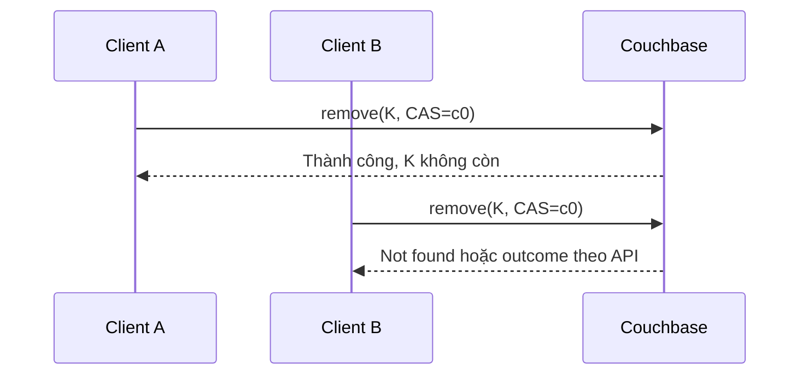

# Kiểm soát xóa theo phiên bản và xác minh ngữ nghĩa API sử dụng trong Spring Data Couchbase

## 1. Vấn đề: một lệnh xóa có thể xóa nhầm phiên bản mà người gọi chưa thấy

Giả sử một hệ thống quản lý đào tạo lưu cấu hình khóa học dưới document ID:

```text
course::acme::java-101
```

Nội dung ở thời điểm người quản trị A mở trang:

```json
{
  "tenantId": "acme",
  "courseCode": "java-101",
  "title": "Java căn bản",
  "registrationOpen": false
}
```

Trong khi A đang xem nút **Xóa khóa học**, quản trị viên B sửa tài liệu để bổ sung cấu hình mở đăng ký. A vẫn nhìn bản cũ và nhấn Xóa. Nếu API chỉ nhận một ID rồi xóa document mới nhất tại ID đó, thay đổi mà B vừa lưu có thể bị xóa **mà A không hề biết**.

```text
T0  A đọc Course K: version=c0
T1  B sửa Course K và lưu: version=c1
T2  A bấm DELETE K dựa trên c0
T3  Server xóa theo key K, không so CAS
    -> phiên bản c1 vừa được B cập nhật bị xóa
```

Đây là một dạng **stale delete**: người gọi yêu cầu xóa dựa trên một phiên bản đã cũ, nhưng hệ thống lại xóa phiên bản mới. Trong chương **Khóa lạc quan**, đây là bài toán đối xứng với lost update khi `replace`.

Mục tiêu của bài là hiểu **xóa có điều kiện theo CAS**, phân biệt rõ các đường gọi `delete(entity)`, `deleteById(id)`, `CouchbaseTemplate`, Java SDK và SQL++, sau đó **xác minh ngữ nghĩa xóa thực tế của từng API/phiên bản** thay vì suy diễn từ annotation `@Version`.

> **Thông điệp chính:** nếu hợp đồng là “chỉ xóa đúng phiên bản mà người dùng đã xem”, điều kiện CAS phải được áp dụng tại **chính thao tác xóa**. Chỉ kiểm tra phiên bản trước đó nhưng xóa vô điều kiện về sau là chưa đủ.

## 2. Phân biệt ID, CAS, quyền xóa và trạng thái nghiệp vụ

Bốn khía cạnh thường bị gộp làm một:

| Thành phần | Câu hỏi | Tự bảo vệ điều gì? |
| --- | --- | --- |
| **Document ID / `@Id`** | Cần xóa document nào? | Định danh một key trong collection |
| **CAS / `@Version`** | Phiên bản mà caller đã đọc còn hiện hành không? | Có thể ngăn mutation dựa trên bản cũ |
| **Authorization** | Caller có quyền xóa resource của tenant này không? | Chặn thao tác trái quyền |
| **Business rule** | Resource đã được phép xóa theo nghiệp vụ chưa? | Chặn xóa khi có enrollment/order/phụ thuộc |

Ví dụ, `course::acme::java-101` vẫn là cùng **key** sau khi B chỉnh sửa. Nhưng CAS đã đổi. Xóa chỉ theo key không phân biệt A đã nhìn thấy phiên bản nào.

Một thao tác xóa an toàn có thể phải thỏa cả ba điều kiện:

1. Người gọi được xác thực và có quyền xóa tài nguyên trong tenant được ủy quyền.
2. Tài nguyên ở trạng thái nghiệp vụ cho phép xóa, ví dụ không có đăng ký đang hoạt động.
3. Phiên bản hiện hành vẫn chính là phiên bản mà người gọi đã đồng ý xóa.

**CAS không phải token cấp quyền.** Dù caller biết cả ID và CAS, server vẫn phải kiểm tra authorization. Và CAS của một document không chứng minh các document phụ thuộc đều thỏa điều kiện nghiệp vụ.

### 2.1. “Có thể xóa theo ID” khác “chỉ xóa bản đã xem”

Các hợp đồng API xóa có thể khác nhau:

- **Delete by identity:** “Hãy bảo đảm tài nguyên tại key này không còn tồn tại.” API có thể chọn xóa theo ID, không cần phiên bản do người dùng cung cấp.
- **Delete observed version:** “Chỉ xóa nếu resource vẫn là phiên bản tôi vừa xem.” API cần điều kiện phiên bản, ví dụ CAS hoặc `If-Match`.
- **Business cancellation:** “Hủy khóa học nếu chưa có học viên đăng ký.” API cần kiểm tra trạng thái/phụ thuộc và có thể cần transaction.
- **Soft delete:** “Đánh dấu đã xóa nhưng giữ lịch sử, audit và khả năng phục hồi.” Đây là một mutation cập nhật trạng thái, không phải xóa vật lý document.

Không có một chính sách xóa phù hợp mọi use case. Lựa chọn phải xuất phát từ **hợp đồng nghiệp vụ và API**, không chỉ từ tên phương thức repository.

## 3. CAS hoạt động với thao tác xóa như thế nào?

Couchbase quản lý một CAS 64 bit cho phiên bản của document. CAS là **token opaque**, không phải timestamp hoặc counter do ứng dụng tự tăng.

Với Java SDK, một quy trình xóa có điều kiện gồm:

```text
READ:  get(key) -> body v0, CAS c0
CHECK: xác minh quyền + điều kiện nghiệp vụ
DELETE: remove(key, cas=c0)
        |
        +-- CAS vẫn là c0 --> xóa thành công
        |
        +-- CAS đã là c1 --> CAS mismatch, không xóa v1
        |
        +-- key biến mất --> not found hoặc lỗi phù hợp
```

```mermaid
sequenceDiagram
    participant A as Admin A
    participant B as Admin B
    participant S as Service
    participant C as Couchbase KV
    A->>S: Yêu cầu xóa dựa trên phiên bản c0
    S->>C: get(K)
    C-->>S: body và CAS c0
    B->>C: replace(K, bodyB, CAS=c0)
    C-->>B: Thành công, CAS c1
    S->>C: remove(K, CAS=c0)
    C-->>S: CAS mismatch
    S-->>A: Từ chối xóa; cần tải lại
    Note over C: Body c1 của B vẫn được giữ
```

Đây là **kiểm tra nguyên tử tại thao tác remove** cho một document. Nó bảo vệ khỏi writer xen vào giữa đọc và xóa.

### 3.1. Sai lầm: kiểm tra phiên bản trước rồi xóa không điều kiện

```text
T0: GET K, CAS=c0
T1: Server so với token client: khớp
T2: Worker khác sửa K, CAS=c1
T3: Server DELETE K không gửi CAS
T4: Bản c1 của worker bị xóa
```

Bước T1 chỉ xác minh **ở thời điểm đã đọc**. Giữa T1 và T3 còn một cửa sổ race.

Vì vậy, câu “tôi đã so version trước khi delete” **không đủ** nếu thao tác cuối không mang điều kiện CAS.

### 3.2. CAS có thể báo lỗi gì?

Khi dùng Couchbase Java SDK:

- `CasMismatchException`: điều kiện CAS cho mutation không còn khớp, thường do document bị thay đổi.
- `DocumentNotFoundException`: key không còn ở thời điểm thao tác (có thể đã bị xóa/hết TTL hoặc đang nhầm collection).
- Timeout/lỗi kết nối: caller có thể **không biết chắc** server đã xóa hay chưa.
- Lỗi quyền/validation: không phải xung đột phiên bản.

Tên ngoại lệ cụ thể của Spring Data có thể khác SDK trực tiếp do exception translation. Không áp cùng một catch block cho mọi lớp API mà chưa kiểm thử.

## 4. Java SDK: xóa đúng phiên bản đã đọc bằng `RemoveOptions.cas`

Couchbase Java SDK cung cấp thao tác xóa document với tùy chọn CAS. Đây là ví dụ có thể dùng làm chuẩn đối chiếu cho các API tầng cao hơn.

```java
import com.couchbase.client.core.error.CasMismatchException;
import com.couchbase.client.core.error.DocumentNotFoundException;
import com.couchbase.client.java.Collection;
import com.couchbase.client.java.json.JsonObject;
import com.couchbase.client.java.kv.GetResult;
import com.couchbase.client.java.kv.MutationResult;

import static com.couchbase.client.java.kv.RemoveOptions.removeOptions;

public final class CourseDeleteKvService {
    private final Collection courses;

    public CourseDeleteKvService(Collection courses) {
        this.courses = courses;
    }

    public long deleteObservedVersion(
            String documentId,
            String authorizedTenantId) {

        GetResult observed = courses.get(documentId);
        JsonObject body = observed.contentAsObject();

        // Kiểm tra bảo vệ dữ liệu trong cùng tenant.
        if (!authorizedTenantId.equals(body.getString("tenantId"))) {
            throw new SecurityException("Không có quyền với tài liệu");
        }

        // Ví dụ domain rule; policy thực tế có thể phức tạp hơn.
        if (Boolean.TRUE.equals(body.getBoolean("registrationOpen"))) {
            throw new IllegalStateException(
                "Phải đóng đăng ký trước khi xóa khóa học");
        }

        try {
            MutationResult deleted = courses.remove(
                documentId,
                removeOptions().cas(observed.cas()));

            return deleted.cas(); // Token của mutation trả về; không phải ID.
        } catch (CasMismatchException conflict) {
            throw new IllegalStateException(
                "Khóa học đã thay đổi trước khi được xóa",
                conflict);
        } catch (DocumentNotFoundException missing) {
            throw new IllegalStateException(
                "Khóa học không còn tồn tại tại thời điểm xóa",
                missing);
        }
    }
}
```

**Phạm vi của code:** minh họa xóa theo **snapshot mà service vừa đọc**, không phải xóa dựa trên version từ một trang web mở trước đó. Nếu yêu cầu là bảo vệ đúng **phiên bản client đã xem**, cần thêm bước so `If-Match` với CAS hiện tại, rồi vẫn truyền CAS vào `remove`. Phần 8 sẽ triển khai hợp đồng đó.

Một số chi tiết:

1. `GetResult.cas()` lấy token cùng phiên bản với body vừa kiểm tra.
2. `removeOptions().cas(observed.cas())` đặt điều kiện CAS **ngay tại lệnh xóa**.
3. Nếu writer khác thay đổi document sau bước đọc, `remove` phải không xóa phiên bản mới.
4. Nếu document không tồn tại, policy cần phân biệt xóa lặp, TTL và sai ID/collection.
5. `MutationResult.cas()` là metadata của mutation, không được sử dụng như “phiên bản tài liệu còn tồn tại” sau xóa.

### 4.1. Không dùng CAS của lần đọc khác với body đã kiểm tra

Anti-pattern:

```java
GetResult checked = courses.get(key);
validateBusinessRules(checked.contentAsObject());

// Có thể có writer thay đổi dữ liệu tại đây.
GetResult latest = courses.get(key);

// Sai: dùng CAS mới để cho phép xóa nội dung đã kiểm tra ở lần cũ.
courses.remove(key, removeOptions().cas(latest.cas()));
```

Nếu `latest` là phiên bản mới, các điều kiện nghiệp vụ đã kiểm tra trên `checked` không còn đủ. Server có thể xóa phiên bản mới vì CAS mới khớp, dù rule chưa được đánh giá trên body mới.

**Nguyên tắc:** body dùng để quyết định xóa và CAS dùng để xóa phải thuộc **cùng phiên bản đã được kiểm tra**.

### 4.2. Không truyền CAS bằng suy đoán

```java
long guessedCas = 1L;

// Không phải cách dùng CAS hợp lệ:
courses.remove(key, removeOptions().cas(guessedCas));
```

Couchbase tự cấp token. Không dùng CAS như số thứ tự, không lấy `cas + 1`, không chia sẻ CAS của document khác. Với Java SDK, token thường biểu diễn qua `long`; khi truyền qua JSON/JavaScript phải chú ý rủi ro mất chính xác của số 64 bit.

## 5. Xóa không điều kiện theo ID là một hợp đồng khác

Couchbase Java SDK cũng có thể xóa không kèm CAS:

```java
courses.remove(documentId);
```

Về mặt hợp đồng, đây là yêu cầu xóa **document hiện hành tại ID**; nó không diễn đạt “chỉ xóa nếu document vẫn là bản c0 tôi đã đọc”.

Trong một số use case, xóa theo ID là chủ đích:

- Dọn document cache có thể tạo lại.
- Cleanup bản ghi staging mà caller có quyền toàn phần.
- Thực thi chính sách “bảo đảm key không còn tồn tại” trong một công việc đã có điều phối và phân quyền thích hợp.

Nhưng nếu resource có người khác sửa đồng thời, xóa theo ID có thể xóa dữ liệu mới hơn. Hãy ghi rõ **xóa không điều kiện là một quyết định thiết kế**, không phải hành vi tình cờ do chọn nhầm method.

### 5.1. `existsById → deleteById` không đóng cửa sổ race

```java
if (repository.existsById(id)) {
    repository.deleteById(id);
}
```

Hai lệnh trên không tự tạo transaction hoặc CAS condition. Giữa `existsById` và `deleteById`, writer khác có thể thay đổi resource. Bước `existsById` chỉ nói document tồn tại **ở thời điểm kiểm tra**.

Khi cần xóa bản đã xem, không thay CAS bằng kiểm tra tồn tại.

### 5.2. `findById → deleteById` cũng có thể chưa đủ

```java
CourseDocument loaded = repository.findById(id).orElseThrow();

// Giả sử ở đây đã kiểm tra quyền và nghiệp vụ.
repository.deleteById(id);
```

Dù `loaded` mang `@Version`, method `deleteById(id)` chỉ nhận ID; từ chữ ký này **không có token CAS do caller truyền**. Cần xác minh xem implementation có tự truy xuất và dùng phiên bản như thế nào. Không được suy diễn rằng một `@Version` vừa đọc ở biến `loaded` chắc chắn được `deleteById` sử dụng.

Nếu policy bắt buộc bảo vệ **đúng phiên bản**, chọn API được xác nhận có thao tác remove kèm CAS hoặc thiết kế wrapper KV rõ ràng.

## 6. Spring Data Couchbase: `@Version` có tự bảo vệ `delete(entity)` không?

Spring Data Couchbase cho phép ánh xạ CAS vào field:

```java
import org.springframework.data.annotation.Id;
import org.springframework.data.annotation.Version;
import org.springframework.data.couchbase.core.mapping.Document;

@Document
public class CourseDocument {
    @Id
    private String id;

    @Version
    private Long version;

    private String tenantId;
    private String courseCode;
    private String title;
    private boolean registrationOpen;
    private boolean deleted;

    protected CourseDocument() {}

    public String getId() { return id; }
    public Long getVersion() { return version; }
    public String getTenantId() { return tenantId; }
    public boolean isRegistrationOpen() { return registrationOpen; }
    public boolean isDeleted() { return deleted; }

    public void rename(String nextTitle) {
        if (nextTitle == null || nextTitle.isBlank()) {
            throw new IllegalArgumentException("Tiêu đề không hợp lệ");
        }
        this.title = nextTitle;
    }

    public void markDeleted() {
        this.deleted = true;
    }
}
```

Repository:

```java
import org.springframework.data.couchbase.repository.CouchbaseRepository;

public interface CourseRepository
        extends CouchbaseRepository<CourseDocument, String> {
}
```

Ở đường `save` được ánh xạ hỗ trợ optimistic locking, Spring Data sử dụng `@Version` để kiểm soát stale update. **Nhưng từ đó không được tự kết luận mọi overload xóa cũng dùng CAS như nhau**.

Các API thường được cân nhắc:

```java
repository.delete(entity);    // Có một entity, có thể chứa version.
repository.deleteById(id);    // Chỉ cung cấp ID.
repository.deleteAll(entities);
repository.deleteAllById(ids);
```

**Câu hỏi cần xác minh với đúng phiên bản đang chạy:** method nào thực hiện `remove` kèm CAS, method nào xóa theo ID, và method nào dùng một luồng/đường mutation khác? Không coi sự có mặt của `@Version` trong class là bằng chứng đủ.

Một số tài liệu Spring Data về optimistic locking có nêu hành vi của việc xóa entity có version, nhưng **hợp đồng cụ thể của Spring Data Couchbase và đường implementation được dùng mới quyết định**. Hãy kiểm tra API/Javadoc của phiên bản phụ thuộc và dùng **integration test thực hiện xóa trên một phiên bản stale** như phần 14, thay vì dựa vào giả định.

### 6.1. Bảng so sánh ngữ nghĩa cần kiểm chứng

| Đường gọi | Thông tin caller truyền | Có thể kỳ vọng điều gì? | Cách xác minh |
| --- | --- | --- | --- |
| `repository.delete(entity)` | ID và entity có thể mang `@Version` | Có thể có optimistic locking, nhưng phải xác minh ở module/version cụ thể | Tải hai bản, thay đổi bằng writer khác, thử xóa entity stale |
| `repository.deleteById(id)` | ID | Không biểu lộ CAS đã thấy trong signature; không được giả định xóa có điều kiện | Thử stale-delete race, kiểm tra document còn không |
| `repository.deleteAll(entities)` | Tập entity | Có thể có chính sách mỗi entity khác nhau | Kiểm tra partial failure và stale entity |
| `repository.deleteAllById(ids)` | Tập ID | Thường không truyền CAS từng bản đã xem | Test danh sách có một document được sửa đồng thời |
| `CouchbaseTemplate` remove/entity operations | Tùy overload | Tùy đường gọi, mapping và version SDK | Đọc Javadoc overload thực dùng + integration test |
| `collection.remove(key)` | ID | Xóa theo ID, không so observed CAS | Test writer thay body trước lệnh remove |
| `collection.remove(key, removeOptions().cas(c0))` | ID + CAS | Xóa có điều kiện trên c0 | Test CAS cũ phải thất bại |
| SQL++ `DELETE` | Keyspace + điều kiện query | Không tự đọc Java `@Version` | Test query mutation và CAS outcome |

**Bảng này là kế hoạch xác minh**, không tuyên bố mọi phiên bản repository hoạt động giống nhau. Khi yêu cầu xóa có điều kiện quan trọng, tốt hơn một **kiểm thử có thể lặp lại** so với suy luận dựa trên tên method.

### 6.2. Lỗi cần bắt ở tầng Spring Data

Trong đường mapping có hỗ trợ optimistic locking, một thao tác trên stale entity có thể phát sinh ngoại lệ thuộc họ:

```java
import org.springframework.dao.OptimisticLockingFailureException;
```

Nhưng nếu xóa theo ID, một số đường gọi có thể không thực hiện kiểm tra CAS của entity. Với SDK, `CasMismatchException` và `DocumentNotFoundException` có ý nghĩa khác nhau. Phải kiểm tra exception translation theo phiên bản.

Không định nghĩa một handler chung “mọi lỗi xóa là optimistic conflict”. Duplicate key, lỗi không tìm thấy, lỗi quyền, validation và timeout đều cần phân loại riêng.

## 7. `CouchbaseTemplate`, repository, SDK và SQL++ có thể khác nhau

Module Spring Data Couchbase có nhiều API thao tác document:

- `CouchbaseRepository`: CRUD dựa trên entity mapping.
- `CouchbaseTemplate` / `CouchbaseOperations`: thao tác entity, fluent API, điều kiện và mapping.
- Couchbase Java SDK KV: thao tác trực tiếp trên `Collection` và key.
- SQL++: thao tác theo keyspace/query với điều kiện riêng.
- Reactive API: tương đương bất đồng bộ, nhưng không tự thay đổi quy tắc concurrent delete.

Điểm dễ mắc lỗi là **trộn các API mà không thống nhất hợp đồng xóa**. Một API controller có thể đọc entity bằng repository rồi gọi SDK `remove(key)` không CAS, khiến `@Version` bị bỏ qua ở bước cuối.

### 7.1. Không suy diễn từ thao tác save sang thao tác delete

Một quy tắc `save` theo version không chứng minh một phương thức `deleteById` có điều kiện. Tương tự, một phương thức template có tên `remove` không chắc áp dụng CAS nếu overload không mang hoặc không đọc token version.

Mọi đường xóa trong hệ thống nên được ghi lại thành một **bảng contract**:

```text
Operation: course.deleteIfUnchanged
Entry:     DELETE /api/courses/{courseCode}
Auth:      tenant + permission DELETE_COURSE
Precond:   strong If-Match của phiên bản GET trước
Store:     collection.remove(key, CAS)
Success:   204 No Content
Stale:     412 Precondition Failed
Missing:   404 Not Found (theo policy minh họa)
Retry:     không tự lấy CAS mới để ép xóa
```

Nếu một batch job có quyền xóa không điều kiện, hãy đặt tên và điều kiện khác hẳn, ví dụ `purgeExpiredStagingById`, để tránh bị sử dụng cho endpoint an toàn phiên bản.

### 7.2. SQL++ `DELETE` không tự kế thừa `@Version`

Ví dụ minh họa câu xóa theo điều kiện:

```sql
DELETE FROM `commerce`.`catalog`.`courses` AS c
WHERE c.tenantId = $tenantId
  AND c.courseCode = $courseCode
  AND c.archived = TRUE;
```

Các tham số phải được bind đúng cách, nhất là tenant lấy từ ngữ cảnh đã được ủy quyền. Nhưng câu SQL++ trên **không chứa CAS của phiên bản client đã đọc**. Nó không tự đưa `@Version` từ Java entity vào điều kiện.

Nếu dùng SQL++ update/delete theo điều kiện, phải xác nhận khả năng expression, CAS metadata, scan consistency và mutation semantics của phiên bản Couchbase thực tế. Với một key đã biết và cần CAS, SDK KV `remove(key, cas=...)` là cách thể hiện ý định rõ ràng hơn.

Một câu SQL++ query để tìm document chờ dọn dẹp cũng không phải lock: từ lúc query ra kết quả tới lúc delete, trạng thái có thể thay đổi.

## 8. HTTP `If-Match` và DELETE: bảo vệ phiên bản client thực sự đã xem

Một trang quản trị GET course, server trả ETag đại diện phiên bản body:

```http
GET /api/courses/java-101

HTTP/1.1 200 OK
ETag: "cas-2f9a"
Content-Type: application/json

{"courseCode":"java-101","title":"Java căn bản"}
```

Client giữ ETag và gửi khi xóa:

```http
DELETE /api/courses/java-101
If-Match: "cas-2f9a"
```

Nếu document vẫn là phiên bản đó, server có thể xóa. Nếu server đã đổi sang CAS khác, request không được xóa phiên bản mới và nên nhận **412 Precondition Failed** theo hợp đồng HTTP có điều kiện.

### 8.1. Tại sao không chỉ GET lại ở server rồi xóa?

Xét trường hợp:

```text
GET lúc 09:00 -> client thấy CAS c0
B sửa lúc 09:05 -> CAS c1
DELETE lúc 09:10 -> server đọc latest c1
                    rồi xóa theo c1
```

Nếu server **bỏ qua** ETag mà client gửi, hoặc API không yêu cầu token, nó có thể xóa bản c1 dù người dùng chỉ xác nhận xóa c0.

Cần **so token phiên bản của client với phiên bản hiện tại**. Sau đó vẫn phải dùng CAS ở lệnh remove để ngăn race phát sinh **sau bước so**.

### 8.2. Mã phản hồi cần phân biệt

| Tình huống | Kết quả minh họa | Giải thích |
| --- | --- | --- |
| CAS/If-Match khớp và xóa thành công | `204 No Content` | Không còn body trả về |
| If-Match đúng cú pháp nhưng không còn khớp | `412 Precondition Failed` | Bản mà client đã thấy không còn hiện hành |
| API bắt buộc If-Match nhưng thiếu | `428 Precondition Required` | Client phải đọc phiên bản trước |
| If-Match không thuộc định dạng API hỗ trợ | `400 Bad Request` | Lỗi cú pháp/contract |
| Resource không còn tồn tại | `404 Not Found` hoặc policy lặp xóa | Có thể đã xóa/hết TTL; không giả định lỗi CAS |
| Business rule cấm xóa | `409 Conflict` hoặc lỗi domain | Ví dụ còn enrollment |
| Caller không được truy cập tenant | `403` hoặc `404` theo security policy | Không tiết lộ dữ liệu của tenant khác |
| Mutation timeout, outcome không rõ | Lỗi tạm thời theo contract | Phải đối soát trước khi kết luận |
| Xóa theo ID được chủ đích idempotent | Có thể luôn trả `204` sau khi bảo đảm resource vắng mặt | Cần định nghĩa chính sách tài nguyên đã vắng mặt |

**Không có quy tắc cứng** rằng `deleteById` phải trả 204, repository phải ném 409 hoặc mọi not-found đều phải báo 404. Các lựa chọn trên phải được chuẩn hóa ở **contract của API**.

### 8.3. Strong ETag, weak ETag và ký hiệu `*`

HTTP `If-Match` sử dụng **so sánh strong**. Một ETag yếu dạng `W/"..."` không nên được chấp nhận như một strong match.

HTTP còn cho phép:

- Danh sách nhiều ETag trong `If-Match`.
- Giá trị `If-Match: *` với ngữ nghĩa tiền điều kiện tồn tại.

Một demo đơn giản có thể **chỉ hỗ trợ một strong ETag duy nhất** và từ chối các dạng khác một cách có chủ đích. Nhưng không gọi parser giản lược là implementation đầy đủ của toàn bộ chuẩn HTTP.

`If-Match: *` chỉ thể hiện điều kiện tồn tại, **không bảo vệ phiên bản người dùng đã xem**. Nếu mục tiêu là version-specific delete, yêu cầu token strong cụ thể.

### 8.4. CAS là 64 bit; không chuyển qua JavaScript Number

CAS thường được SDK Java biểu diễn dưới dạng `long`. Một giá trị 64 bit có thể vượt vùng số nguyên biểu diễn chính xác của JavaScript. Khi đưa qua HTTP, hãy mã hóa thành **chuỗi opaque**, không ép qua JSON number.

Hơn nữa, ETag cần mô tả phiên bản **representation** mà API trả về. Nếu response kết hợp dữ liệu từ nhiều nguồn hoặc có nội dung biến đổi ngoài Couchbase, không tự khẳng định CAS của một document là strong validator hợp lệ cho mọi representation. Thiết kế validator phải nhất quán với nội dung mà GET thực sự phục vụ.

## 9. Ví dụ codec ETag cho CAS: chỉ một strong token

Ví dụ sau giả định API dùng mẫu `"cas-<hex>"`, không hỗ trợ danh sách hoặc wildcard. Nó giúp giao tiếp bit-pattern của CAS mà không mất chính xác.

```java
import java.util.regex.Pattern;

public final class CasEtagCodec {
    private static final Pattern SINGLE_STRONG_ETAG =
        Pattern.compile("\"cas-[0-9a-f]{1,16}\"");

    private CasEtagCodec() {}

    public static String encode(long cas) {
        return "\"cas-" + Long.toUnsignedString(cas, 16) + "\"";
    }

    public static boolean supported(String ifMatch) {
        return ifMatch != null
            && SINGLE_STRONG_ETAG.matcher(ifMatch).matches();
    }

    public static long decode(String ifMatch) {
        if (!supported(ifMatch)) {
            throw new IllegalArgumentException(
                "If-Match phải là một strong CAS ETag được API hỗ trợ");
        }

        // Chuỗi dạng: "cas-<hex>"
        String hex = ifMatch.substring(5, ifMatch.length() - 1);
        return Long.parseUnsignedLong(hex, 16);
    }

    public static boolean matches(String ifMatch, long currentCas) {
        return supported(ifMatch)
            && decode(ifMatch) == currentCas;
    }
}
```

Bộ codec này chỉ dành cho **hợp đồng minh họa đã được công bố**, không phải API tự sinh của Couchbase. Ký hiệu ETag là value header nguyên dạng bao gồm dấu ngoặc kép.

**Không được suy đoán CAS bằng phép cộng hoặc so lớn/nhỏ.** Mọi phép so dùng đẳng thức trên bit-pattern. Token không thay thế authorization.

## 10. Service xóa theo phiên bản client và CAS tại bước cuối

Một service REST có thể nhận tenant **đã xác thực**, mã course đã validate và header If-Match. Sau đó nó:

1. Kiểm tra sự tồn tại/cú pháp If-Match.
2. Xây dựng document key an toàn trong tenant được ủy quyền.
3. Đọc document hiện hành.
4. Kiểm tra quyền và business rule.
5. So CAS hiện tại với If-Match client gửi.
6. Gọi `remove` cùng CAS vừa kiểm tra.
7. Chuyển CAS conflict phát sinh sau bước kiểm tra thành lỗi tiền điều kiện.

### 10.1. Các loại lỗi domain được ứng dụng định nghĩa

```java
public class StaleDeletePrecondition extends RuntimeException {
    public StaleDeletePrecondition() {
        super("Phiên bản tài liệu không còn khớp");
    }
}

public class IfMatchRequired extends RuntimeException {
    public IfMatchRequired() {
        super("DELETE yêu cầu If-Match");
    }
}

public class InvalidIfMatch extends RuntimeException {
    public InvalidIfMatch() {
        super("Định dạng If-Match không hợp lệ");
    }
}

public class CourseMissing extends RuntimeException {
    public CourseMissing() {
        super("Không tìm thấy khóa học");
    }
}

public class CourseCannotBeDeleted extends RuntimeException {
    public CourseCannotBeDeleted() {
        super("Khóa học chưa đủ điều kiện xóa");
    }
}
```

Đây là các exception ứng dụng để định nghĩa hợp đồng HTTP. Chúng không phải class SDK hoặc Spring Data có sẵn.

### 10.2. Ví dụ service dùng KV CAS có điều kiện

```java
import java.util.regex.Pattern;

import com.couchbase.client.core.error.CasMismatchException;
import com.couchbase.client.core.error.DocumentNotFoundException;
import com.couchbase.client.java.Collection;
import com.couchbase.client.java.json.JsonObject;
import com.couchbase.client.java.kv.GetResult;

import static com.couchbase.client.java.kv.RemoveOptions.removeOptions;

public final class ConditionalCourseDeleteService {
    private static final Pattern COURSE_CODE =
        Pattern.compile("[a-z0-9][a-z0-9-]{0,63}");

    private final Collection courses;

    public ConditionalCourseDeleteService(Collection courses) {
        this.courses = courses;
    }

    public void deleteIfUnchanged(
            String trustedTenantId,
            String courseCode,
            String ifMatch) {

        if (ifMatch == null || ifMatch.isBlank()) {
            throw new IfMatchRequired();
        }
        if (!CasEtagCodec.supported(ifMatch)) {
            throw new InvalidIfMatch();
        }
        if (!COURSE_CODE.matcher(courseCode).matches()) {
            throw new IllegalArgumentException("Course code không hợp lệ");
        }

        // trustedTenantId phải đến từ auth context, không từ header tùy ý.
        String documentId =
            "course::" + trustedTenantId + "::" + courseCode;

        GetResult found;
        try {
            found = courses.get(documentId);
        } catch (DocumentNotFoundException missing) {
            throw new CourseMissing();
        }

        JsonObject body = found.contentAsObject();

        if (!trustedTenantId.equals(body.getString("tenantId"))) {
            // Không được cho caller sửa tenantId để vượt quyền.
            throw new SecurityException("Không có quyền xóa tài liệu");
        }

        // Trong production, quyền DELETE_COURSE phải được kiểm tra riêng.
        if (!CasEtagCodec.matches(ifMatch, found.cas())) {
            throw new StaleDeletePrecondition();
        }

        if (Boolean.TRUE.equals(body.getBoolean("registrationOpen"))) {
            throw new CourseCannotBeDeleted();
        }

        try {
            courses.remove(
                documentId,
                removeOptions().cas(found.cas()));
        } catch (CasMismatchException changedAfterRead) {
            // Writer khác đã sửa sau khi so If-Match.
            throw new StaleDeletePrecondition();
        } catch (DocumentNotFoundException goneAfterRead) {
            // Policy minh họa: resource đã biến mất.
            throw new CourseMissing();
        }
    }
}
```

Mã minh họa chỉ giải quyết **xóa một document**. Trong một hệ thống thật, kiểm tra business rule “không còn enrollment” có thể nằm ở **document khác**; CAS của Course không tự bảo vệ điều kiện liên document đó. Cần transaction hoặc quy trình điều phối riêng.

Cũng cần xác thực và authorize caller **trước** khi đọc/tiết lộ resource. Ví dụ dùng `trustedTenantId` để cho thấy namespace phải đến từ ngữ cảnh được tin cậy, nhưng việc xác định quyền xóa cụ thể là trách nhiệm tầng security/application.

### 10.3. Tại sao catch `CasMismatchException` chuyển thành `412`?

Vì đây là endpoint cam kết:

> “Chỉ xóa phiên bản mà client đã chỉ định trong If-Match.”

Nếu CAS khớp lúc `get` nhưng writer khác thay đổi trước `remove`, tiền điều kiện không còn đúng tại **thời điểm xóa**, nên trả lỗi tiền điều kiện là phù hợp. Không tự đọc CAS mới rồi xóa bản mới để làm request “thành công”.

Khi endpoint **không dùng If-Match** mà thực hiện một command xóa theo quy tắc nghiệp vụ trên dữ liệu mới nhất, lỗi CAS trong service có thể được biểu diễn thành `409 Conflict` hoặc được retry có kiểm soát. **Quyết định phụ thuộc hợp đồng**, không chỉ class exception.

## 11. Controller và Problem Details: phản hồi có thể hành động

Với Spring Framework 6/Spring Boot 3, có thể dùng `ProblemDetail` trong `@RestControllerAdvice`.

### 11.1. Controller minh họa

```java
import org.springframework.http.HttpHeaders;
import org.springframework.http.ResponseEntity;
import org.springframework.web.bind.annotation.DeleteMapping;
import org.springframework.web.bind.annotation.PathVariable;
import org.springframework.web.bind.annotation.RequestHeader;
import org.springframework.web.bind.annotation.RequestMapping;
import org.springframework.web.bind.annotation.RestController;

@RestController
@RequestMapping("/api/courses")
public class CourseDeleteController {
    private final ConditionalCourseDeleteService service;

    public CourseDeleteController(ConditionalCourseDeleteService service) {
        this.service = service;
    }

    @DeleteMapping("/{courseCode}")
    public ResponseEntity<Void> delete(
            @PathVariable String courseCode,
            @RequestHeader(
                name = HttpHeaders.IF_MATCH,
                required = false) String ifMatch) {

        // Chỉ minh họa: triển khai thật lấy tenant từ authenticated principal.
        String authorizedTenantId = trustedTenantFromSecurityContext();

        service.deleteIfUnchanged(
            authorizedTenantId, courseCode, ifMatch);

        return ResponseEntity.noContent().build();
    }

    private String trustedTenantFromSecurityContext() {
        throw new UnsupportedOperationException(
            "Ứng dụng phải tích hợp SecurityContext thực tế");
    }
}
```

Controller này là **khung hướng dẫn**, không chạy độc lập: cần tích hợp phương thức lấy tenant từ security context thật và triển khai authorization. Hàm ném `UnsupportedOperationException` cố ý tránh đưa ra một tenant giả mà người học có thể copy vào production.

### 11.2. Exception handler nhất quán

```java
import org.springframework.http.HttpStatus;
import org.springframework.http.ProblemDetail;
import org.springframework.http.ResponseEntity;
import org.springframework.web.bind.annotation.ExceptionHandler;
import org.springframework.web.bind.annotation.RestControllerAdvice;

@RestControllerAdvice
public class DeleteErrorAdvice {

    @ExceptionHandler(StaleDeletePrecondition.class)
    ResponseEntity<ProblemDetail> stale(StaleDeletePrecondition ex) {
        ProblemDetail p = ProblemDetail.forStatusAndDetail(
            HttpStatus.PRECONDITION_FAILED,
            "Khóa học đã thay đổi. Hãy tải lại trước khi xóa.");
        p.setTitle("Phiên bản không còn hợp lệ");
        p.setProperty("code", "STALE_DELETE_VERSION");

        return ResponseEntity.status(HttpStatus.PRECONDITION_FAILED)
            .body(p);
    }

    @ExceptionHandler(IfMatchRequired.class)
    ResponseEntity<ProblemDetail> missingHeader(IfMatchRequired ex) {
        ProblemDetail p = ProblemDetail.forStatusAndDetail(
            HttpStatus.PRECONDITION_REQUIRED,
            "Yêu cầu phải gửi một strong If-Match hợp lệ.");
        p.setProperty("code", "IF_MATCH_REQUIRED");

        return ResponseEntity.status(HttpStatus.PRECONDITION_REQUIRED)
            .body(p);
    }

    @ExceptionHandler(InvalidIfMatch.class)
    ResponseEntity<ProblemDetail> invalidHeader(InvalidIfMatch ex) {
        ProblemDetail p = ProblemDetail.forStatusAndDetail(
            HttpStatus.BAD_REQUEST,
            "If-Match không đúng định dạng API hỗ trợ.");
        p.setProperty("code", "INVALID_IF_MATCH");

        return ResponseEntity.badRequest().body(p);
    }

    @ExceptionHandler(CourseMissing.class)
    ResponseEntity<ProblemDetail> notFound(CourseMissing ex) {
        ProblemDetail p = ProblemDetail.forStatusAndDetail(
            HttpStatus.NOT_FOUND, "Khóa học không còn tồn tại.");
        p.setProperty("code", "COURSE_NOT_FOUND");

        return ResponseEntity.status(HttpStatus.NOT_FOUND).body(p);
    }

    @ExceptionHandler(CourseCannotBeDeleted.class)
    ResponseEntity<ProblemDetail> businessConflict(
            CourseCannotBeDeleted ex) {
        ProblemDetail p = ProblemDetail.forStatusAndDetail(
            HttpStatus.CONFLICT,
            "Khóa học chưa đủ điều kiện để xóa.");
        p.setProperty("code", "COURSE_DELETE_NOT_ALLOWED");

        return ResponseEntity.status(HttpStatus.CONFLICT).body(p);
    }
}
```

Hệ thống thật cần bổ sung xử lý validation, authorization và exception hạ tầng; `ProblemDetail` không nên chứa stack trace, thông tin cluster, payload nhạy cảm hoặc document của tenant khác.

Ví dụ response `412`:

```http
HTTP/1.1 412 Precondition Failed
Content-Type: application/problem+json
```

```json
{
  "type": "about:blank",
  "title": "Phiên bản không còn hợp lệ",
  "status": 412,
  "detail": "Khóa học đã thay đổi. Hãy tải lại trước khi xóa.",
  "code": "STALE_DELETE_VERSION"
}
```

### 11.3. Không làm lộ tài nguyên của tenant khác

Một API có thể chủ động trả `404` thay cho `403` trong những trường hợp cần tránh xác nhận resource của người khác tồn tại. Dù chọn policy nào, việc biết `If-Match` không được cho phép caller bỏ qua authorization.

Không log raw body nhạy cảm hoặc trả thông tin chi tiết về phiên bản của document ngoài tenant.

## 12. Hai thao tác DELETE đồng thời và xóa lặp

Giả sử hai người cùng đọc `CAS=c0` rồi cùng gọi xóa có điều kiện:



Sau khi A xóa, B không còn document để xóa. Điều này khác trường hợp B sửa document rồi A xóa stale CAS, nơi xung đột thường là **CAS mismatch**.

### 12.1. DELETE có idempotent theo HTTP không?

Trong HTTP, DELETE có ngữ nghĩa idempotent đối với **tác dụng dự định lên trạng thái resource**: gửi nhiều lần cùng lệnh xóa có thể dẫn đến cùng trạng thái cuối “resource không còn tồn tại”.

Điều đó **không** buộc mọi response đều giống nhau. Ví dụ:

```text
DELETE K lần 1 -> 204 No Content
DELETE K lần 2 -> 404 Not Found
```

có thể là một hợp đồng hợp lệ. Hoặc API có thể chọn phản hồi 204 cho cả hai khi bảo đảm tài nguyên vắng mặt, tùy policy.

Tuy nhiên, DELETE **không tự đảm bảo “đúng một lần”** đối với email, payment, sự kiện audit hoặc side effect ngoài Couchbase. Lệnh xóa lặp có thể kích hoạt tác vụ ngoài nếu thiết kế không có idempotency.

### 12.2. Có nên retry khi không biết xóa đã thành công?

Timeout sau `remove` là trường hợp **commit outcome chưa rõ**:

```text
T0: Client gửi remove(K, CAS=c0)
T1: Server có thể xóa thành công
T2: Response bị mất
T3: Client nhận timeout
```

Nếu lần tiếp theo `get(K)` trả not-found, có thể document đã bị xóa bởi request trước, bởi worker khác hoặc do TTL. **Không thể tự kết luận chính request này đã xóa** chỉ từ not-found, nhất là khi còn side effect hoặc quy trình audit.

Một API chỉ cần “resource absent” có thể coi not-found là trạng thái mục tiêu, nhưng workflow quan trọng cần operation ID, audit marker/tombstone hoặc reconciliation để biết ai đã làm gì.

### 12.3. Không tái tạo document để “khắc phục” xóa lặp

Sau khi xóa, việc gán CAS cũ vào entity mới không làm sống lại phiên bản cũ. Nếu nghiệp vụ cho phép tạo lại cùng ID, đó là **một vòng đời mới**. Phải có quy tắc chống sự kiện cũ quay lại xóa document được tạo sau.

## 13. Xóa cứng, xóa mềm và tombstone

**Hard delete** là xóa document vật lý khỏi collection theo API KV/query. **Soft delete** thường là cập nhật một field như `deleted = true` hoặc `status = ARCHIVED`. **Tombstone** theo nghiệp vụ là record đánh dấu tài nguyên từng tồn tại/đã bị xóa để hỗ trợ audit, đồng bộ hoặc ngăn tái tạo không mong muốn.

| Phương án | Lợi ích | Giới hạn |
| --- | --- | --- |
| Hard delete | Giải phóng tài nguyên, key không còn truy xuất | Khó audit/recovery nếu không lưu lịch sử riêng |
| Soft delete | Có thể phục hồi, giữ khóa và lịch sử trong body | Query phải lọc đúng, TTL/index phải quản lý |
| Tombstone riêng | Hỗ trợ phát hiện duplicate/late event và retention | Tốn thêm document, cần chính sách TTL/transaction |
| Archive collection | Tách dữ liệu đang hoạt động và dữ liệu cũ | Di chuyển cần workflow nhất quán, không atomic mặc định |

### 13.1. Soft delete cũng cần CAS

Ví dụ:

```java
CourseDocument course = repository.findById(key).orElseThrow();

// Domain method có thể đặt status=DELETED trên entity versioned.
course.markDeleted();

repository.save(course); // Cần @Version/CAS theo đường mapping hỗ trợ.
```

Entity minh họa ở phần 6 có trường `deleted` và domain method `markDeleted()`. Đây vẫn là **pseudocode về quy trình**; ứng dụng thật phải định nghĩa cách query loại bỏ bản đã xóa mềm, kiểm tra quyền và các điều kiện liên quan.

Nếu không dùng CAS, soft delete có thể ghi đè thay đổi mới của người khác giống bất kỳ phép update nào. Đồng thời, nếu query vẫn trả bản mềm đã xóa, API phải quyết định có cho sửa hay không.

### 13.2. Xóa cứng kèm tạo tombstone không tự atomic

Ví dụ quy trình:

```text
remove(course K)
insert(tombstone::K)
```

Nếu lệnh đầu thành công và lệnh sau thất bại, hệ thống không có tombstone dù đã xóa. Khi cần atomic giữa nhiều document, cân nhắc Couchbase transaction được hỗ trợ hoặc một workflow có thể phục hồi. Không tuyên bố CAS của course tự bảo đảm tombstone được ghi.

### 13.3. TTL và key được tái sử dụng

Document có TTL có thể hết hạn giữa GET và remove. Một job cũng có thể xóa rồi tạo lại cùng ID. CAS đã đọc thuộc về một phiên bản/cycle đã quan sát; **không được dùng nó như quyền xóa mọi vòng đời tương lai của key**.

Nếu nghiệp vụ cấm tái sử dụng mã course, cần một ràng buộc durable riêng. TTL của tombstone hoặc idempotency record cũng phải được chọn theo cửa sổ retry/late-event thực tế.

## 14. Kiểm thử tích hợp: không đoán `delete(entity)` và `deleteById(id)`

Vì mục tiêu bài là **xác minh ngữ nghĩa API được sử dụng**, cần thiết kế test phân biệt xóa có điều kiện với xóa theo ID. Bài test phải chạy trên **đúng Spring Data Couchbase/SDK và cấu hình production tương ứng**.

### 14.1. Test chuẩn KV có CAS: stale delete không được thành công

Test setup:

1. Tạo document K với body `v0`.
2. `get(K)` lấy CAS c0.
3. Một writer khác thực hiện `replace(K, v1, cas=c0)` thành công, nhận c1.
4. Gọi `remove(K, cas=c0)`.
5. Kỳ vọng `CasMismatchException`.
6. `get(K)` lại, xác minh **v1 vẫn tồn tại**, không bị xóa.

Code minh họa:

```java
import static org.junit.jupiter.api.Assertions.*;
import com.couchbase.client.core.error.CasMismatchException;
import com.couchbase.client.java.Collection;
import com.couchbase.client.java.json.JsonObject;
import com.couchbase.client.java.kv.GetResult;
import org.junit.jupiter.api.Test;

import static com.couchbase.client.java.kv.ReplaceOptions.replaceOptions;
import static com.couchbase.client.java.kv.RemoveOptions.removeOptions;

class ConditionalDeleteKvIntegrationTest {
    private Collection courses; // Inject từ fixture test.

    @Test
    void staleCasMustNotDeleteNewerDocument() {
        String key = "course::test::delete-race-001";

        courses.insert(
            key,
            JsonObject.create()
                .put("tenantId", "test")
                .put("title", "V0"));

        GetResult before = courses.get(key);

        JsonObject changed = before.contentAsObject();
        changed.put("title", "V1");

        courses.replace(
            key,
            changed,
            replaceOptions().cas(before.cas()));

        assertThrows(
            CasMismatchException.class,
            () -> courses.remove(
                key,
                removeOptions().cas(before.cas())));

        assertEquals(
            "V1",
            courses.get(key).contentAsObject().getString("title"));
    }
}
```

Đây là **khung integration test**: phải inject `Collection` đúng và dùng ID riêng, cleanup an toàn, xử lý setup teardown. Chỉ chạy trên collection test, **không thử xóa một document production**.

### 14.2. Test `repository.delete(entity)` với entity stale

Đây là test phân biệt semantics quan trọng nhất:

```java
// Pseudocode: phải dùng repository và fixture Couchbase thật.
CourseDocument stale = repository.findById(key).orElseThrow();

CourseDocument newest = repository.findById(key).orElseThrow();
// Worker khác thay đổi newest rồi save thành công:
newest.rename("Tiêu đề mới");
repository.save(newest);

// Bây giờ stale giữ CAS cũ.
repository.delete(stale);

// Sau lời gọi, đọc lại key để biết chính xác điều gì đã xảy ra.
```

Hai outcome cần phân biệt:

- Nếu thao tác từ chối và giữ body mới: đường `delete(entity)` đang bảo vệ phiên bản theo cơ chế được hỗ trợ.
- Nếu document bị xóa thành công: đường gọi này **không được dùng như version-specific delete** theo giả định hiện có (hoặc cấu hình/annotation khác dự kiến).

Bài test **không nên assert một kết quả được đoán trước khi chưa xác minh phiên bản**. Sau khi có kết quả, khóa dependency, ghi contract vào test và chọn API phù hợp với yêu cầu.

Entity `CourseDocument` minh họa ở phần 6 có domain method `rename`. Khi triển khai integration test, vẫn phải chuẩn bị document ban đầu, inject repository, cleanup và kiểm tra exception thực tế.

### 14.3. Test `repository.deleteById(id)` sau một mutation

Các bước:

1. Tạo document K, đọc snapshot c0 cho client.
2. Writer khác thay body thành v1.
3. Service gọi `deleteById(K)` mà không cung cấp token client.
4. Xác định document v1 **còn hay mất**.
5. Nếu v1 bị xóa, xác nhận đây là hành vi xóa không điều kiện cần policy riêng.
6. Dù outcome thế nào, test không được mặc định method dùng CAS c0 vì **method chỉ nhận ID**.

Bước quan trọng là **đặt một writer thay đổi document giữa lần đọc và lệnh xóa**. Nếu test chỉ tạo rồi delete tuần tự, nó không kiểm chứng version protection.

### 14.4. Ma trận API cần ghi vào suite

| API | Test không cạnh tranh | Test stale version | Test key đã bị xóa | Test timeout |
| --- | --- | --- | --- | --- |
| SDK `remove(key, cas)` | Xóa đúng bản | Phải không xóa bản mới | Not found theo SDK | Outcome có thể không rõ |
| SDK `remove(key)` | Xóa theo ID | Quan sát có thể xóa bản mới | Not found theo policy | Không đoán commit |
| `repository.delete(entity)` | Xóa entity được tải | **Xác minh** stale-delete behavior | **Xác minh** exception | Reconciliation |
| `repository.deleteById(id)` | Xóa theo ID | **Xác minh**, không suy CAS từ snapshot ngoài | **Xác minh** | Reconciliation |
| `CouchbaseTemplate` remove overload | Theo contract overload | **Xác minh CAS có áp dụng không** | **Xác minh** | Reconciliation |
| Reactive delete | Theo publisher | **Xác minh cùng đường API** | Error signal | Cancellation/timeout |
| SQL++ DELETE | Theo điều kiện query | **Không tự dùng Java @Version** | Rows affected/query outcome | Query retry policy |

Nếu code thật có method xóa theo batch, test thêm tình huống **một entity stale trong tập**: cả batch fail, partial delete hay mỗi entity xử lý độc lập? Không tự tuyên bố thao tác batch có tính nguyên tử.

### 14.5. Test HTTP DELETE với If-Match

Một integration test hoàn chỉnh nên:

1. GET course và lưu ETag E0.
2. Gửi DELETE E0 khi document chưa đổi, kỳ vọng 204 và resource biến mất.
3. Reset test data.
4. GET nhận E0, cho writer khác sửa để nhận E1.
5. Gửi DELETE với E0, kỳ vọng **412**; document E1 phải **còn nguyên**.
6. Gửi DELETE thiếu If-Match khi endpoint bắt buộc, kỳ vọng **428**.
7. Gửi weak ETag hoặc token sai định dạng, kỳ vọng lỗi cú pháp/contract.
8. Test race: writer sửa **sau lúc server so ETag nhưng trước remove**; CAS phải chặn.
9. Test resource bị xóa giữa GET và remove: phản hồi not-found theo policy, không lộ dữ liệu.
10. Test tenant khác không thể xóa bằng cách đoán key + ETag.

**Assertion quan trọng nhất không phải status code đơn lẻ, mà là document mới vẫn tồn tại khi stale delete bị từ chối.**

## 15. Reactive API: kiểm soát phiên bản tại mutation, không chỉ trong pipeline

Với Reactive Couchbase Java SDK, ý tưởng tương tự:

```java
import com.couchbase.client.java.Collection;
import com.couchbase.client.java.json.JsonObject;
import reactor.core.publisher.Mono;

import static com.couchbase.client.java.kv.RemoveOptions.removeOptions;

public final class ReactiveCourseDeleteKvService {
    private final Collection courses;

    public ReactiveCourseDeleteKvService(Collection courses) {
        this.courses = courses;
    }

    public Mono<Void> removeIfNotChanged(
            String documentId,
            String authorizedTenantId,
            String ifMatch) {

        if (!CasEtagCodec.supported(ifMatch)) {
            return Mono.error(new InvalidIfMatch());
        }

        return courses.reactive().get(documentId)
            .flatMap(found -> {
                JsonObject body = found.contentAsObject();

                if (!authorizedTenantId.equals(
                        body.getString("tenantId"))) {
                    return Mono.error(
                        new SecurityException("Sai tenant"));
                }

                if (!CasEtagCodec.matches(ifMatch, found.cas())) {
                    return Mono.error(
                        new StaleDeletePrecondition());
                }

                if (Boolean.TRUE.equals(
                        body.getBoolean("registrationOpen"))) {
                    return Mono.error(
                        new CourseCannotBeDeleted());
                }

                return courses.reactive().remove(
                        documentId,
                        removeOptions().cas(found.cas()))
                    .then();
            });
    }
}
```

Ví dụ này trả `Mono<Void>`, giả định auth đã được kiểm tra ở tầng trên. Tín hiệu lỗi có thể được `onErrorMap` sang lỗi domain; cần xử lý `CasMismatchException` như stale precondition và `DocumentNotFoundException` theo policy, thay vì gửi tất cả thành 500.

### 15.1. Vì sao không tự động `retryWhen` khi DELETE stale?

Một publisher có thể được subscribe lại. Nếu request có `If-Match=c0` và document đã là c1, **không được tự tải c1 rồi xóa c1** để ép thành công. Điều đó vi phạm ý định “chỉ xóa bản c0”.

Với một command nội bộ “xóa bản hiện hành nếu vẫn thỏa điều kiện”, có thể cho phép retry **toàn bộ get → check → remove(CAS)** sau conflict, nhưng phải xác minh lại authorization/domain rule trên body mới mỗi lượt. Điều này khác với endpoint conditional DELETE có ETag của client.

### 15.2. Timeout và cancellation của reactive publisher

Timeout hoặc cancellation không chứng minh mutation chưa tới server. Không retry mù bằng cách dùng CAS mới nhất để xóa. Nếu có audit, event hoặc side effect quan trọng, dùng operation ID/idempotency và reconciliation.

## 16. Xóa liên quan nhiều document và giao dịch

Một khóa học có thể có:

```text
course::acme::java-101
enrollment::acme::enr-001
enrollment::acme::enr-002
course-index::acme::java-101
```

Bất biến nghiệp vụ: **không xóa course nếu còn enrollment đang hoạt động**.

Service thực hiện:

```text
T0: Query xem còn enrollment không -> không thấy
T1: Một request khác tạo enrollment mới
T2: Service xóa course với CAS hợp lệ
```

CAS của Course vẫn có thể khớp, vì **document enrollment** được tạo độc lập. Kết quả: Course bị xóa nhưng còn enrollment tham chiếu đến nó.

Đây không còn là bài toán stale delete của **một document**; đây là một **bất biến liên document**. Cần thiết kế:

- Transaction phù hợp cho các thao tác Couchbase hỗ trợ trong cùng ranh giới.
- Cơ chế reservation/lock logic theo aggregate để ngăn tạo enrollment đồng thời.
- State machine: chuyển Course sang `DELETING` bằng CAS, chặn tạo enrollment mới, sau đó dọn quan hệ và hoàn tất.
- Saga/compensation nếu workflow liên quan hệ thống ngoài.
- Outbox cho event hậu xóa và downstream idempotency.

**Không** cho rằng chỉ cần `@Version` trên Course là bảo vệ được mọi query hoặc thao tác trên Enrollment.

### 16.1. Một transaction không bao trùm dịch vụ ngoài Couchbase

Nếu xóa course cần:

1. Xóa document Couchbase.
2. Gỡ file khỏi object storage.
3. Gửi email thông báo.
4. Publish message.

Không có một CAS hay một transaction Couchbase đơn lẻ nào tự bảo đảm các thao tác ngoài hệ thống cùng commit. Cần workflow có khả năng retry/compensate, audit và idempotency downstream.

### 16.2. Batch delete và consistency

Nếu xóa một tập document qua `deleteAll` hoặc SQL++ DELETE, **không suy ra cả tập được xóa nguyên tử** trừ khi chúng thực sự tham gia transaction được hỗ trợ. Khi một item bị stale, cần định nghĩa policy: rollback toàn bộ, bỏ qua item đó, hoặc ghi kết quả từng item.

## 17. Retry, recovery và late event sau xóa

Một thao tác xóa có thể thành công nhưng client mất kết nối trước khi nhận 204. Khi retry, document không còn; nếu có thao tác side effect ngoài Couchbase, thực hiện lần nữa có thể không an toàn.

### 17.1. Phân biệt hai ý định retry

**Idempotent absence:** mục tiêu chỉ là bảo đảm document không tồn tại. Việc lần hai thấy not-found có thể được coi là mục tiêu đạt, theo hợp đồng.

**Version-specific delete:** mục tiêu là chỉ xóa **phiên bản cụ thể**. Sau khi bản đó đã bị xóa, caller không được mặc định xóa document được tạo lại ở cùng ID.

Ví dụ:

```text
T0: Document K, CAS c0
T1: DELETE K với c0 thành công
T2: Worker tạo lại document K theo vòng đời mới
T3: Retry DELETE cũ đến
```

Một lệnh xóa **theo ID không CAS** tại T3 có thể xóa nhầm phiên bản mới. Ngược lại, lệnh có CAS cũ sẽ không có quyền mặc nhiên xóa vòng đời mới.

### 17.2. Tombstone để xử lý event đến muộn

Nếu hệ thống nhận event xóa qua queue có thể trễ hoặc gửi lại, nên cân nhắc lưu:

```json
{
  "operationId": "delete-course-2026-17",
  "resourceId": "course::acme::java-101",
  "tenantId": "acme",
  "state": "COMPLETED",
  "deletedAt": "2026-11-25T09:00:00Z"
}
```

Record này là **dữ liệu nghiệp vụ riêng**, không phải CAS hay metadata Couchbase tự cấp. Nó giúp nhận biết operation đã hoàn tất, hỗ trợ audit và tránh lặp side effect. Nhưng việc lưu tombstone cũng phải được điều phối với hard delete nếu muốn guarantee nhất quán.

Retention/TTL của tombstone cần dài hơn cửa sổ retry và trễ sự kiện theo yêu cầu nghiệp vụ.

## 18. Quan sát và bảo vệ vận hành

Một hệ thống có nhiều luồng xóa nên có metrics riêng:

- Số DELETE theo ID không điều kiện và số DELETE kèm CAS.
- Số `CasMismatchException`/optimistic conflict trong thao tác xóa.
- Tỷ lệ HTTP 204/404/409/412/428 theo endpoint.
- Số event xóa lặp/idempotency hit.
- Số timeout sau mutation cần reconciliation.
- Số lần resource được tạo lại cùng ID và event đến muộn.
- Số lần document có TTL hết hạn trong cửa sổ update/delete.
- Số lần batch delete partial failure.
- Tỷ lệ conflict từ SQL++/SDK/job nền.
- Số yêu cầu bị từ chối vì authorization hoặc business rule.

### 18.1. Log nên chứa gì?

Ví dụ log có thể có:

```text
event=conditional_delete_conflict
operation=course.delete
tenantScope=<approved-internal-ref>
requestId=<correlation-id>
errorCode=STALE_DELETE_VERSION
api=kv_remove_with_cas
```

Không log dữ liệu nhạy cảm, không trả stack trace hay đường dẫn cluster ở response. Có thể rút gọn hoặc hash document ID nếu ID chứa PII; ưu tiên correlation ID để điều tra.

### 18.2. Chính sách đặc biệt cho xóa phá hủy

Với document quan trọng như hợp đồng, tài khoản thanh toán hoặc chứng chỉ, ngoài CAS nên xem xét:

- Kiểm tra quyền ở mức tài nguyên, audit và xác thực lại hành động nếu phù hợp.
- Soft delete/retention thay vì hard delete ngay.
- Cơ chế phê duyệt hoặc trạng thái `DELETING`.
- Chính sách khôi phục và backup/point-in-time theo khả năng hạ tầng.
- Lưu operation ID giúp đối soát và giảm nguy cơ xóa nhầm sau retry.

CAS **bảo vệ phiên bản**, không tự thay thế chính sách bảo vệ dữ liệu khỏi xóa sai nghiệp vụ.

## 19. Bài tập: xóa tài khoản học viên khi hồ sơ vừa được sửa

Một hệ thống SaaS lưu:

```text
ID: learner::acme::learner-17
CAS ban đầu: c0
Body: { active: false, certificates: [] }
```

Quản trị viên A mở trang và dự định xóa tài khoản. Trong lúc đó:

- Worker B cấp chứng chỉ mới, cập nhật body và tạo CAS c1.
- Một event cũ mang lệnh DELETE c0 đến trễ.
- Một job dọn dữ liệu khác gọi `repository.deleteById(id)`.
- Một service SDK có quyền gọi `collection.remove(id)`.

**Yêu cầu:**

1. Vẽ timeline trong đó A/B cùng thao tác và cho biết lệnh `remove(id, cas=c0)` sẽ làm gì khi CAS hiện hành là c1.
2. Giải thích vì sao `repository.deleteById(id)` không được mặc định coi là xóa đúng phiên bản mà A đã thấy.
3. Thiết kế một integration test xác minh `repository.delete(entity)` ở đúng version Spring Data đang dùng.
4. Nếu client gửi `If-Match=c0`, API cần trả mã gì khi document đã c1?
5. Nếu DELETE đầu thành công nhưng phản hồi bị mất, retry phải tránh xóa nhầm một document được tạo lại cùng ID ra sao?
6. Nếu quy tắc “không xóa khi learner có chứng chỉ” cần đọc thêm document chứng chỉ riêng, CAS của Learner có đủ không?
7. Nếu muốn giữ lịch sử và phục hồi, chọn soft delete hay tombstone thế nào?
8. Nêu test và metrics cần có trước production.

**Gợi ý lời giải:** stale CAS không được xóa phiên bản c1; endpoint có If-Match sẽ trả 412. `deleteById(id)` không truyền CAS cũ từ client nên phải được kiểm tra hành vi; không suy diễn từ `@Version`. Với phụ thuộc liên document, cần transaction/điều phối. Retry an toàn cần giữ operation ID và tránh xóa vòng đời key mới. Soft delete/tombstone giúp audit và xử lý sự kiện đến muộn nhưng cũng cần policy retention/TTL.

## 20. Checklist trước khi triển khai conditional delete

1. Đã mô tả rõ **xóa theo ID** hay **chỉ xóa bản đã xem**?
2. Có phân biệt document ID, CAS, authorization và business rule?
3. Endpoint có yêu cầu `If-Match` khi cần bảo vệ phiên bản client đã xem?
4. Có kiểm tra strong ETag và không coi `If-Match: *` là version-specific?
5. ETag có được mã hóa an toàn từ CAS 64 bit, không làm mất độ chính xác?
6. Sau khi so ETag, mutation cuối có thực sự truyền CAS?
7. Với SDK, đã dùng `removeOptions().cas(observed.cas())` khi cần?
8. Không lấy CAS của lần đọc mới để xóa body đã kiểm tra từ lần đọc cũ?
9. Repository `delete(entity)` đã được integration test với stale entity?
10. Repository `deleteById(id)` đã được kiểm thử với writer chen giữa đọc và xóa?
11. Template remove overload đã được đối chiếu Javadoc/version cụ thể?
12. SQL++ DELETE có policy concurrency riêng, không giả định kế thừa `@Version`?
13. Có phân biệt CAS mismatch, not-found, TTL, permission, business conflict và timeout?
14. API có thống nhất 204/404/409/412/428 và Problem Details?
15. Có tránh tự retry DELETE If-Match cũ bằng CAS mới nhất?
16. Có idempotency hoặc operation ID cho side effect/event xóa lặp?
17. Có chặn event xóa cũ tác động tới document tạo lại cùng ID?
18. Có transaction/state machine khi việc xóa phụ thuộc nhiều document?
19. Có chính sách soft delete, tombstone, retention và restore nếu dữ liệu quan trọng?
20. Có integration test kiểm tra **document phiên bản mới còn nguyên** sau stale delete?
21. Reactive delete có xử lý error signal/cancellation/timeout phù hợp?
22. Có dashboard stale delete, not-found, timeout, duplicate và hot key?
23. Có khóa dependency và ghi contract xóa thực tế vào test suite?
24. Có kiểm tra quyền tenant trước mọi truy cập hoặc phản hồi về resource?

## Tài liệu tham khảo

- [Couchbase Java SDK — Key-Value Operations](https://docs.couchbase.com/java-sdk/current/howtos/kv-operations.html): các thao tác `get`, `remove`, CAS và mutation options.
- [Spring Data Couchbase Reference](https://docs.spring.io/spring-data/couchbase/reference/): entity `@Id`, `@Version`, repository, template và optimistic locking.
- [Spring Data Couchbase API Documentation](https://docs.spring.io/spring-data/couchbase/reference/api/java/): tra cứu chính xác overload `delete`/`remove` của dependency được triển khai.
- [Couchbase SQL++ Reference](https://docs.couchbase.com/server/current/n1ql/n1ql-language-reference/index.html): câu lệnh DELETE, query predicates và metadata.
- [Couchbase Java SDK — Distributed ACID Transactions](https://docs.couchbase.com/java-sdk/current/howtos/distributed-acid-transactions-from-the-sdk.html): tính nguyên tử khi xóa/cập nhật liên quan nhiều document.
- [RFC 9110 — HTTP Semantics](https://www.rfc-editor.org/rfc/rfc9110): `DELETE`, strong `If-Match`, ETag, `412` và idempotency.
- [RFC 6585 — Additional HTTP Status Codes](https://www.rfc-editor.org/rfc/rfc6585): `428 Precondition Required`.
- [RFC 9457 — Problem Details for HTTP APIs](https://www.rfc-editor.org/rfc/rfc9457): phản hồi lỗi có cấu trúc.

## Kết luận

**Xóa theo document ID và xóa đúng phiên bản đã xem là hai hợp đồng khác nhau.** Trong Spring Data Couchbase, `@Version` ánh xạ CAS cho các đường entity hỗ trợ optimistic locking, nhưng **không được suy diễn mọi overload delete hoặc mọi SDK/SQL++ mutation đều kiểm tra CAS giống nhau**. Muốn bảo vệ người dùng khỏi stale delete, API phải giữ phiên bản client đã thấy, kiểm tra `If-Match` và thực hiện **remove có điều kiện CAS ngay tại server**. Đối với `repository.delete(entity)`, `deleteById(id)`, `CouchbaseTemplate` hoặc batch delete, hãy đọc đúng API contract và **chứng minh hành vi bằng integration test có writer thay đổi document giữa đọc và xóa**. Đồng thời xử lý rõ 204/404/409/412/428, timeout không rõ commit, TTL, tái sử dụng key, authorization, transaction nhiều document và idempotency cho side effect để lệnh xóa không gây mất dữ liệu mới hơn.
