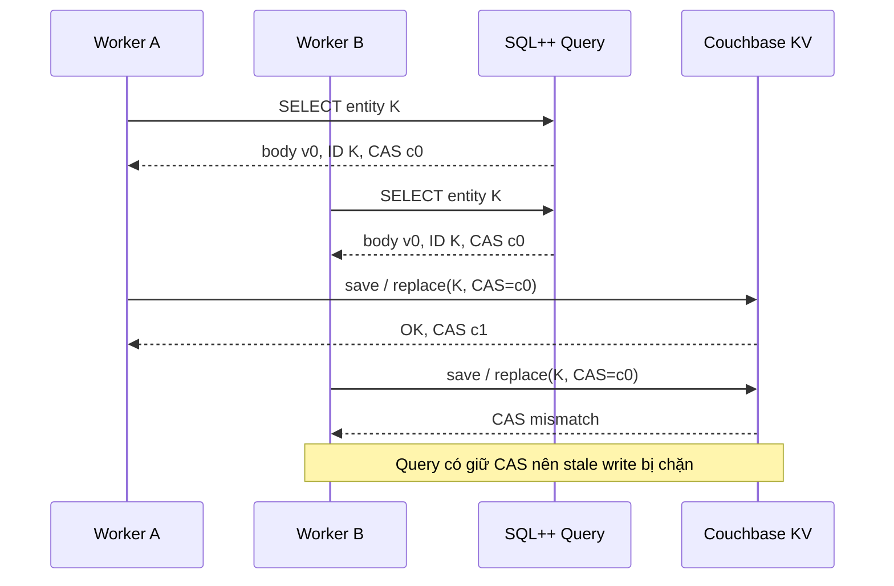
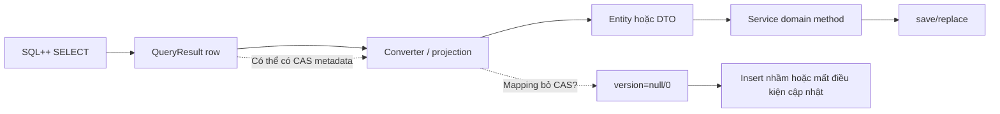

# Giữ CAS trong kết quả truy vấn dùng để cập nhật trong Spring Data Couchbase

## 1. Bài toán: truy vấn thấy document nhưng đánh mất phiên bản dùng để ghi

Một ứng dụng đào tạo lưu document sức chứa khóa học:

```json
{
  "tenantId": "acme",
  "courseCode": "java-101",
  "status": "OPEN",
  "remainingSeats": 2,
  "published": true,
  "updatedBy": "admin-7"
}
```

ID của document:

```text
course-capacity::acme::java-101
```

Ứng dụng dùng SQL++ để tìm các lớp còn chỗ, cho quản trị viên chọn một lớp rồi ghi cập nhật. Một truy vấn chỉ lấy các trường hiển thị có thể trả:

```json
{
  "courseCode": "java-101",
  "remainingSeats": 2
}
```

Nhìn qua, kết quả này đủ để tính `remainingSeats - 1`. Nhưng còn thiếu **document ID thực tế**, các trường nghiệp vụ khác và **CAS (Compare-And-Swap)** của phiên bản đã đọc. Nếu lập trình viên dựng entity từ kết quả ấy rồi `save`, có thể xảy ra hai kiểu lỗi:

1. **Mất CAS:** persistence layer không còn token phiên bản để phát hiện một writer khác đã thay document.
2. **Mất dữ liệu:** kết quả chỉ chứa một vài thuộc tính nhưng lại được ghi thay toàn bộ body; các trường không được SELECT có nguy cơ bị xóa/đưa về giá trị mặc định.

Trong Spring Data Couchbase, `@Version` ánh xạ CAS vào entity khi đường đọc có đủ metadata. Điều đó cho phép một entity được đọc qua query trở thành **snapshot đủ cơ sở cho optimistic locking** khi sau này cập nhật.

> **Nguyên tắc:** nếu định dùng kết quả truy vấn để cập nhật một document, phải biết rõ kết quả có mang **đúng ID, đúng CAS và đúng nội dung cần bảo toàn** hay không. Không suy luận điều đó chỉ từ việc một câu SQL++ trả được vài trường của document.

Bài thuộc chương **Khóa lạc quan** của module `SPRING_DATA_COUCHBASE`, đặt trong quy trình xây dựng tầng truy cập Couchbase bằng Spring Data với document mapping, repository, `CouchbaseTemplate`, SQL++, TTL, CAS, transaction và API reactive.

## 2. Phân biệt nội dung JSON, document ID và metadata CAS

Couchbase lưu một document theo một **key** trong bucket/scope/collection, kèm metadata của phiên bản. Những thành phần liên quan đến cập nhật là:

| Thành phần | Ví dụ | Công dụng |
| --- | --- | --- |
| Document ID | `course-capacity::acme::java-101` | Chọn document đích |
| JSON body | `status`, `remainingSeats`, `published` | Trạng thái nghiệp vụ |
| CAS | Token 64 bit server quản lý | Kiểm tra phiên bản đã đọc còn hiện hành khi ghi |
| Expiry/TTL | Thời gian hết hạn | Kiểm soát vòng đời document, không thay CAS |
| Entity `@Version` | Trường `Long version` | Cầu nối CAS của Couchbase và Spring Data mapping |

CAS là một **token opaque**. Không được tự gán `version++` hay so `casA > casB` để xác định tài liệu nào “mới hơn”. Khi document thay đổi, server cấp phiên bản mới; ứng dụng giữ CAS của **chính bản đã đọc** và dùng nó làm điều kiện cho mutation.

### 2.1. KV GET thường trả body và CAS cùng nhau

Ví dụ Couchbase Java SDK:

```java
import com.couchbase.client.java.Collection;
import com.couchbase.client.java.kv.GetResult;
import com.couchbase.client.java.json.JsonObject;

public final class CapacityKvReader {
    private final Collection collection;

    public CapacityKvReader(Collection collection) {
        this.collection = collection;
    }

    public void inspect(String key) {
        GetResult result = collection.get(key);
        JsonObject body = result.contentAsObject();
        long cas = result.cas();

        System.out.println(body.getInt("remainingSeats"));
        System.out.println(Long.toUnsignedString(cas));
    }
}
```

Kết quả `GetResult` cung cấp **body và CAS quan sát cùng phiên bản**. Khi dùng `replaceOptions().cas(result.cas())`, ứng dụng có thể yêu cầu Couchbase chỉ ghi nếu document chưa bị thay đổi.

### 2.2. SQL++ là một đường đọc khác

SQL++ trả **các trường mà SELECT yêu cầu**. Nó không tự biến mọi kết quả SQL++ thành entity đầy đủ có CAS để cập nhật. Đặc biệt, query dạng projection, `SELECT RAW`, DTO, count, aggregate hoặc custom row có thể hoàn toàn không mang metadata phiên bản.

Couchbase SQL++ cung cấp hàm `META(alias)` để truy cập metadata, gồm ID và CAS trong ngữ cảnh document có hỗ trợ:

```sql
SELECT
    META(c).id  AS documentId,
    META(c).cas AS cas,
    c.courseCode,
    c.remainingSeats
FROM `learning`.`training`.`course_capacity` AS c
WHERE c.tenantId = $tenantId
  AND c.status = "OPEN";
```

Truy vấn trên **có chọn** CAS nhưng trả về một row tùy biến; điều đó không có nghĩa Spring Data tự ánh xạ trường `cas` vào `@Version` của bất kỳ entity nào. Để ánh xạ entity đúng, phải tuân thủ **quy ước metadata của Spring Data Couchbase** hoặc để framework tạo phần SELECT phù hợp.

## 3. Ba dạng kết quả SQL++ và mức độ sẵn sàng để cập nhật

| Dạng đọc | Ví dụ | Có sẵn CAS cho update? | Rủi ro |
| --- | --- | --- | --- |
| KV `get(key)` | `GetResult` | Có, qua `cas()` | Phải truyền CAS vào mutation |
| Spring Data entity query đúng mapping | `@Query` với `#{#n1ql.selectEntity}` | Có thể được ánh xạ vào `@Version` khi dùng đúng contract | Cần integration test theo version |
| SQL++ row trả `META(c).cas` | `SELECT META(c).cas AS cas` | Có metadata trong row, nhưng **tự xử lý** | Không tự gắn thành `@Version` |
| Projection một phần | `SELECT c.courseCode, c.remainingSeats` | Không, trừ khi chọn thêm CAS | Body không đầy đủ |
| DTO summary | `CourseSummary` | Tùy định nghĩa DTO | Không được coi là persistence entity |
| `SELECT RAW` | `SELECT RAW META(c).id` | Chỉ ID nếu đó là biểu thức được chọn | Phải GET lại để lấy body + CAS |
| Aggregate | `COUNT(*)` | Không có phiên bản một document đích | Không thể save như entity |

**Hệ quả:** kết quả truy vấn phục vụ **hiển thị/tìm kiếm** và kết quả truy vấn phục vụ **đọc–sửa–ghi (read–modify–write)** có yêu cầu khác nhau.

Một DTO search nhẹ là thiết kế tốt để hiển thị danh sách. Nhưng không nên nạp DTO ấy vào entity persistence, gán ID rồi gọi `save` với giả định tất cả metadata được bảo toàn.

## 4. Entity Spring Data Couchbase có `@Version`

Entity mẫu:

```java
import java.time.Instant;

import org.springframework.data.annotation.Id;
import org.springframework.data.annotation.Version;
import org.springframework.data.couchbase.core.mapping.Document;

@Document
public class CourseCapacityDocument {

    @Id
    private String id;

    @Version
    private Long version;

    private String tenantId;
    private String courseCode;
    private String status;
    private int remainingSeats;
    private boolean published;
    private String updatedBy;
    private Instant updatedAt;

    protected CourseCapacityDocument() {
        // Dành cho Spring Data mapping.
    }

    public CourseCapacityDocument(
            String id, String tenantId, String courseCode, int seats) {

        if (seats < 0) {
            throw new IllegalArgumentException("Số chỗ ban đầu phải >= 0");
        }
        this.id = id;
        this.tenantId = tenantId;
        this.courseCode = courseCode;
        this.status = "OPEN";
        this.remainingSeats = seats;
        this.published = true;
        this.updatedAt = Instant.now();
    }

    public String getId() { return id; }
    public Long getVersion() { return version; }
    public String getTenantId() { return tenantId; }
    public String getCourseCode() { return courseCode; }
    public String getStatus() { return status; }
    public int getRemainingSeats() { return remainingSeats; }
    public boolean isPublished() { return published; }
    public String getUpdatedBy() { return updatedBy; }

    public void reserve(int units, String actor) {
        if (units <= 0) {
            throw new IllegalArgumentException("units phải dương");
        }
        if (!"OPEN".equals(status) || !published) {
            throw new IllegalStateException("Khóa học không nhận đăng ký");
        }
        if (remainingSeats < units) {
            throw new IllegalStateException("Không đủ chỗ");
        }

        remainingSeats -= units;
        updatedBy = actor;
        updatedAt = Instant.now();
    }
}
```

Lưu ý:

- `@Id` dùng `org.springframework.data.annotation.Id`; key xác định document trong collection được cấu hình.
- `@Version` dùng **`org.springframework.data.annotation.Version`**, không phải JPA.
- `Long version` là nơi Spring Data Couchbase quản lý CAS của entity khi qua đường mapping hỗ trợ.
- Entity mới trước khi lưu có thể có `version == null`; entity đã đọc đúng mapping phải nhận CAS hiện hành.
- Không có setter công khai cho CAS; caller không tự sửa version để ép ghi.
- Domain method `reserve` kiểm tra bất biến trên phiên bản đang giữ; sau conflict, điều kiện phải được kiểm tra lại.

### 4.1. CAS là metadata, không phải JSON field buộc phải có

Không cần tự ghi:

```json
{
  "id": "course-capacity::acme::java-101",
  "version": 42
}
```

rồi mong Couchbase kiểm tra version khi `upsert`. CAS nằm ở metadata của document; một field JSON tên `version` không tự kích hoạt atomic compare-and-swap.

Với Spring Data, hãy để `@Version` và mapping lấy token từ kết quả đọc. Nếu vừa dùng repository vừa dùng SDK để ghi cùng collection, cần hiểu **đường SDK trực tiếp không đọc annotation Spring Data**.

## 5. Repository query trả entity: ưu tiên `#{#n1ql.selectEntity}`

Spring Data Couchbase có các biểu thức SpEL đặc thù cho N1QL/SQL++ để xây dựng truy vấn entity, trong đó `#{#n1ql.selectEntity}` được dùng nhằm chọn các trường và metadata cần thiết cho entity mapping.

Repository minh họa:

```java
import java.util.List;

import org.springframework.data.couchbase.repository.CouchbaseRepository;
import org.springframework.data.couchbase.repository.Query;

public interface CourseCapacityRepository
        extends CouchbaseRepository<CourseCapacityDocument, String> {

    @Query(
        "#{#n1ql.selectEntity} WHERE #{#n1ql.filter} " +
        "AND tenantId = $1 AND status = $2")
    List<CourseCapacityDocument> findByTenantAndStatus(
        String tenantId, String status);
}
```

Ý tưởng của ví dụ là **truy vấn entity đầy đủ**, không phải một phép chiếu chỉ lấy vài field. Với các phiên bản Spring Data Couchbase hỗ trợ biểu thức này, `selectEntity` xây dựng phần SELECT phù hợp với mapping (bao gồm metadata thiết yếu như document ID và CAS theo convention của phiên bản), còn `filter` áp dụng bộ lọc mapping như phân loại entity khi cần.

**Không hard-code giả định về cú pháp mở rộng của SpEL qua mọi release.** Khi thay dependency, phải chạy integration test kiểm tra ID và `@Version` của entity trả về, đồng thời đối chiếu SQL++ cuối cùng nếu có vấn đề.

### 5.1. Điểm kiểm tra bắt buộc sau query

```java
List<CourseCapacityDocument> rows =
    repository.findByTenantAndStatus("acme", "OPEN");

for (CourseCapacityDocument row : rows) {
    if (row.getId() == null || row.getId().isBlank()) {
        throw new IllegalStateException(
            "Query thiếu document ID cho entity update");
    }

    if (row.getVersion() == null ||
        row.getVersion().longValue() == 0L) {
        throw new IllegalStateException(
            "Query không cung cấp CAS hợp lệ cho update");
    }
}
```

Phần kiểm tra này nhằm **fail fast** nếu query hoặc converter trả entity thiếu metadata. Trong Couchbase entity lifecycle, `null`/`0` có thể được xem là trạng thái chưa có version, không thích hợp để diễn giải là snapshot update của một document đã tồn tại.

Đây là một **điểm kiểm tra logic**, không thay thế integration test. Cũng không nên để client tự gửi một `version` bất kỳ để vượt qua kiểm tra.

### 5.2. Spring Data query và metadata alias

Một số phiên bản/quy ước ánh xạ entity dùng các alias metadata nội bộ, thường được thấy dưới dạng gần như:

```sql
SELECT c.*,
       META(c).id  AS __id,
       META(c).cas AS __cas
FROM `learning`.`training`.`course_capacity` AS c
WHERE c.tenantId = $tenantId;
```

Đây là **mẫu SQL++ giải thích ý tưởng**, không phải câu lệnh được hứa tương thích trực tiếp với mọi phiên bản mapping. Alias, chọn type discriminator, cách định danh keyspace và phần SELECT được Spring Data sinh ra có thể khác. Trong code repository, ưu tiên SpEL entity-selection được framework cung cấp; khi tự viết SELECT, phải kiểm tra **đúng tên alias metadata mà converter của dependency đang chờ**.

Đặc biệt, nếu viết:

```sql
SELECT c.courseCode, c.remainingSeats
FROM `learning`.`training`.`course_capacity` AS c
WHERE c.status = "OPEN";
```

thì **không có** metadata CAS hay phần lớn body. Nó phù hợp làm projection cho danh sách, **không phù hợp mặc định** làm persistence entity để `save`.

## 6. Quy trình đọc entity qua query rồi cập nhật có CAS

Một service có thể gọi repository query, tìm đúng course rồi áp dụng một command:

```java
import java.util.List;
import java.util.NoSuchElementException;

import org.springframework.dao.OptimisticLockingFailureException;

public final class CapacityRepositoryService {
    private final CourseCapacityRepository repository;

    public CapacityRepositoryService(CourseCapacityRepository repository) {
        this.repository = repository;
    }

    public CourseCapacityDocument reserveFromEntityQuery(
            String trustedTenantId,
            String courseCode,
            int units,
            String actor) {

        List<CourseCapacityDocument> candidates =
            repository.findByTenantAndStatus(trustedTenantId, "OPEN");

        CourseCapacityDocument selected = candidates.stream()
            .filter(item -> courseCode.equals(item.getCourseCode()))
            .findFirst()
            .orElseThrow(() ->
                new NoSuchElementException("Không thấy course OPEN"));

        if (!trustedTenantId.equals(selected.getTenantId())) {
            throw new SecurityException("Sai tenant");
        }

        if (selected.getId() == null ||
            selected.getVersion() == null ||
            selected.getVersion().longValue() == 0L) {
            throw new IllegalStateException(
                "Query không ánh xạ đầy đủ ID/CAS");
        }

        selected.reserve(units, actor);

        // save sẽ dùng @Version/CAS khi đường mapping hỗ trợ.
        return repository.save(selected);
    }
}
```

Ví dụ chỉ minh họa luồng **query entity → kiểm tra ID/CAS → domain method → save**. Nó cố tình tách validation metadata để người học nhận diện lỗi query mapping. Với production, không nên tải **toàn bộ course OPEN của tenant** rồi lọc trong Java; hãy thêm điều kiện courseCode trong query, phân trang hoặc dùng trực tiếp `findById` khi đã biết ID. Phần sau sẽ trình bày một hướng an toàn và hiệu quả hơn.

**Không tự retry** trong hàm trên. Nếu một writer khác sửa document sau lúc query nhưng trước lúc save, Spring Data có thể báo `OptimisticLockingFailureException`. Đây là hành vi bảo vệ, không phải dấu hiệu để bỏ CAS hoặc dùng upsert.

### 6.1. Timeline hai reader cùng lấy CAS qua query



Giả sử cả hai câu query trả cùng snapshot và đường mapping thực sự mang CAS vào entity. B phải đọc lại/giải quyết conflict theo quy tắc nghiệp vụ, không tự đặt version thành c1 mà vẫn giữ body cũ.

### 6.2. CAS cần được giữ đến đúng bước ghi

```text
Query entity -> entity.id + entity.version + full body
             -> chỉnh sửa entity đó
             -> repository.save(entity)
             -> KV write kiểm tra CAS c0
```

Không phải chỉ **SELECT được CAS** là đủ: nếu trong quá trình qua DTO, mapper, JSON serializer hoặc builder, thông tin phiên bản bị bỏ, bước save cuối vẫn có thể mất cơ chế optimistic locking.

## 7. Lỗi nguy hiểm: SELECT một phần rồi `save` nguyên entity

Giả sử bản gốc là:

```json
{
  "tenantId": "acme",
  "courseCode": "java-101",
  "status": "OPEN",
  "remainingSeats": 2,
  "published": true,
  "updatedBy": "admin-7"
}
```

Nhưng SELECT chỉ lấy:

```sql
SELECT
    META(c).id  AS __id,
    META(c).cas AS __cas,
    c.courseCode,
    c.remainingSeats
FROM `learning`.`training`.`course_capacity` AS c
WHERE c.courseCode = $courseCode;
```

Giả sử mapping đặt `id` và `version` đúng. Các thuộc tính `tenantId`, `status`, `published`, `updatedBy` **không xuất hiện trong row**. Nếu mapper nạp chúng thành `null`/`false`/mặc định rồi application gọi `save` theo kiểu thay toàn body:

```json
{
  "courseCode": "java-101",
  "remainingSeats": 1,
  "tenantId": null,
  "status": null,
  "published": false,
  "updatedBy": null
}
```

Document có thể bị mất thông tin, **ngay cả khi CAS khớp và lệnh ghi thành công**.

### 7.1. CAS không đảm bảo payload đủ dữ liệu

CAS bảo đảm:

> Không ai thay phiên bản document giữa lúc snapshot được đọc và lúc mutation có điều kiện được thực hiện.

CAS **không** bảo đảm:

- Query đã chọn đầy đủ mọi field.
- Mapper đã phân biệt field không được chọn với field thật sự bằng `null`.
- Các default của Java là dữ liệu hợp lệ để ghi.
- Lệnh save ghi patch thay vì replace body.
- Quy tắc merge giữa các field luôn đúng.

**Giữ CAS là điều kiện cần cho optimistic update, nhưng chưa đủ để bảo toàn một document được SELECT thiếu field.**

### 7.2. Khi cần projection, hãy trả DTO chứ không phải entity để save

Ví dụ DTO chỉ dùng cho màn hình danh sách:

```java
public record CourseCapacitySummary(
    String documentId,
    String courseCode,
    int remainingSeats
) {}
```

Định nghĩa DTO **không** tự sinh optimistic locking. Một API đọc có thể dùng summary để hiển thị, nhưng khi người dùng thực hiện lệnh cập nhật, service phải:

1. Xác định document ID hợp lệ và tenant đã xác thực.
2. Đọc lại entity đầy đủ bằng repository/SDK KV.
3. Kiểm tra lại nghiệp vụ trên phiên bản hiện tại.
4. Áp dụng thay đổi có chủ đích.
5. Ghi bằng CAS.

Nếu API bảo vệ **phiên bản người dùng đã thấy trước đó**, phải giữ và kiểm tra thêm version token từ client; không được tự lấy version mới nhất rồi coi như client đã đồng ý với mọi thay đổi.

### 7.3. Không lấy một DTO rồi ép thành entity đã lưu

Anti-pattern:

```java
CourseCapacitySummary summary = getSummaryFromQuery();

// Sai về tư duy: dựng một persistence entity mới chỉ từ projection.
CourseCapacityDocument detached = new CourseCapacityDocument(
    summary.documentId(),
    "acme",
    summary.courseCode(),
    summary.remainingSeats());

// detached.version vẫn null; trạng thái khác chưa chắc đúng.
repository.save(detached);
```

Trong Spring Data Couchbase, một entity versioned với `@Version == null` có thể đi theo **nhánh insert** chứ không phải cập nhật đã có CAS. Nếu thay bằng một API upsert không điều kiện thì rủi ro lost update còn rõ hơn.

Không “sửa nhanh” bằng cách gán một CAS mới cho entity bị thiếu nội dung, vì phiên bản mới không chứng minh các field trong payload đã được nạp đúng.

## 8. Mẫu an toàn: query chỉ tìm ID, sau đó KV GET trước khi cập nhật

Trong nhiều hệ thống, SQL++ phù hợp nhất để **tìm document ứng viên**; KV `get` phù hợp hơn để **lấy snapshot cập nhật**. Mẫu:

```text
SQL++ query -> danh sách document ID ứng viên
   |
   v
KV get(ID) -> body đầy đủ + CAS mới
   |
   v
Kiểm tra tenant/điều kiện trên body MỚI
   |
   v
Tính thay đổi từ body mới
   |
   v
KV replace(ID, body mới, CAS vừa đọc)
```

Ưu điểm:

- Query có thể chỉ trả ID, giảm kích thước row và không phụ thuộc mapping CAS từ SQL++.
- Không biến partial projection thành full entity.
- KV `get` cung cấp body và CAS cùng phiên bản.
- Nếu điều kiện tìm kiếm đã thay đổi sau query, service nhận ra khi **kiểm tra lại trên body mới**.
- Mutation cuối vẫn bảo vệ race giữa GET và REPLACE.

### 8.1. Ví dụ Couchbase Java SDK: tìm ID qua SQL++

Giả sử tên bucket/scope/collection được cấu hình cố định (không lấy từ input client). Từ service đã có `Cluster` và `Collection` đúng keyspace:

```java
import java.util.List;

import com.couchbase.client.java.Cluster;
import com.couchbase.client.java.Collection;
import com.couchbase.client.java.json.JsonObject;
import com.couchbase.client.java.query.QueryResult;

import static com.couchbase.client.java.query.QueryOptions.queryOptions;

public final class CapacitySearch {
    private final Cluster cluster;

    public CapacitySearch(Cluster cluster) {
        this.cluster = cluster;
    }

    public List<String> findOpenCourseIds(String trustedTenantId) {
        String statement = """
            SELECT RAW META(c).id
            FROM `learning`.`training`.`course_capacity` AS c
            WHERE c.tenantId = $tenant
              AND c.status = "OPEN"
              AND c.remainingSeats > 0
            """;

        QueryResult result = cluster.query(
            statement,
            queryOptions().parameters(
                JsonObject.create().put("tenant", trustedTenantId)));

        return result.rowsAs(String.class);
    }
}
```

`SELECT RAW META(c).id` chọn ID trực tiếp, không ngụ ý đã trả full entity hoặc CAS. `rowsAs(String.class)` minh họa cách đọc các row string từ SDK. Nếu query/mapping/version đang dùng có ràng buộc khác, hãy xác nhận bằng integration test.

### 8.2. Sau khi tìm ID, cập nhật qua KV có CAS

```java
import com.couchbase.client.core.error.CasMismatchException;
import com.couchbase.client.java.Collection;
import com.couchbase.client.java.json.JsonObject;
import com.couchbase.client.java.kv.GetResult;
import com.couchbase.client.java.kv.MutationResult;

import static com.couchbase.client.java.kv.ReplaceOptions.replaceOptions;

public final class CapacityKvUpdater {
    private final Collection collection;

    public CapacityKvUpdater(Collection collection) {
        this.collection = collection;
    }

    public long reserveCandidate(
            String key, String trustedTenantId, int units) {

        if (units <= 0) {
            throw new IllegalArgumentException("units phải dương");
        }

        GetResult loaded = collection.get(key);
        JsonObject body = loaded.contentAsObject();

        // Không tin kết quả query ứng viên đã còn đúng.
        if (!trustedTenantId.equals(body.getString("tenantId"))) {
            throw new SecurityException("Sai tenant");
        }
        if (!"OPEN".equals(body.getString("status"))) {
            throw new IllegalStateException("Lớp đã đóng đăng ký");
        }

        int remaining = body.getInt("remainingSeats");
        if (remaining < units) {
            throw new IllegalStateException("Không đủ chỗ");
        }

        body.put("remainingSeats", remaining - units);

        MutationResult written = collection.replace(
            key, body, replaceOptions().cas(loaded.cas()));

        return written.cas();
    }
}
```

Khi CAS mismatch, **đừng đổi ngay sang upsert**. Nếu command cho phép retry, phải tải lại body/CAS và đánh giá lại điều kiện; nếu API yêu cầu If-Match của một snapshot cụ thể, cần trả conflict theo hợp đồng.

### 8.3. Đường Spring Data tương tự: query ID rồi `findById`

Nếu `CourseCapacityRepository` có thể trả danh sách ID bằng một projection hợp lệ, service có thể:

```java
public CourseCapacityDocument reserveByKnownId(
        String id, String trustedTenantId, int units, String actor) {

    CourseCapacityDocument fresh = repository
        .findById(id)
        .orElseThrow();

    if (!trustedTenantId.equals(fresh.getTenantId())) {
        throw new SecurityException("Sai tenant");
    }
    if (fresh.getVersion() == null) {
        throw new IllegalStateException("Entity thiếu CAS");
    }

    fresh.reserve(units, actor);
    return repository.save(fresh);
}
```

Đây là phương thức minh họa trong service có trường `repository`. Dù query ứng viên từng xác nhận course OPEN, điều kiện vẫn phải được kiểm tra lại trong `fresh.reserve(...)`.

**Khi đã biết ID, thường không cần SQL++ để tìm lại chính document đó.** Truy cập KV theo ID thường đơn giản hơn, tránh phụ thuộc chỉ mục và giảm số bước không cần thiết.

## 9. Truy vấn SQL++ trả cả ID và CAS nhưng mapping bị mất ở đâu?

Một pipeline điển hình:



Có ít nhất bốn điểm dễ làm mất thông tin:

1. **SELECT không lấy CAS:** row chưa từng chứa metadata.
2. **Alias không đúng quy ước:** có `META(c).cas AS cas` nhưng mapper không biết field nào là metadata `@Version`.
3. **Projection/DTO bỏ version:** query có CAS nhưng object trả về không giữ lại token.
4. **Copy/serialization bỏ version:** entity ban đầu có CAS nhưng được dựng lại bằng constructor/builder trước khi save.

### 9.1. Dùng alias tùy ý không tương đương gắn `@Version`

Ví dụ:

```sql
SELECT META(c).cas AS version,
       c.courseCode,
       c.remainingSeats
FROM `learning`.`training`.`course_capacity` AS c;
```

Đây là **row SQL++ có thuộc tính `version`**. Không mặc định Spring Data hiểu đó là metadata phiên bản của `CourseCapacityDocument` chỉ vì tên giống field Java.

Entity converter của Spring Data Couchbase có những quy ước metadata riêng. Trong các query entity thông thường, nên dùng phần SELECT do `#{#n1ql.selectEntity}` sinh ra hoặc kiểm tra chính xác alias bắt buộc khi tự viết query.

### 9.2. Nếu muốn tự xử lý row SQL++ với CAS, phải kiểm soát kiểu dữ liệu

Ví dụ SDK có thể dùng:

```sql
SELECT META(c).id  AS documentId,
       META(c).cas AS observedCas,
       c.remainingSeats
FROM `learning`.`training`.`course_capacity` AS c
WHERE c.courseCode = $courseCode;
```

Khi lấy `observedCas`, không đưa qua JSON number trong trình duyệt vì 64 bit có thể vượt giới hạn số nguyên chính xác của JavaScript. Trong Java, nếu tự đọc JSON query row rồi đổi sang `long`, cần xác minh representation/decoder theo SDK/version được dùng, tránh `double`.

Quan trọng hơn: **CAS thu được từ row chưa đủ để đưa một partial row vào replace toàn document**. Nếu cần update, ưu tiên GET theo ID để có full body + CAS, hoặc dùng đúng API thao tác một field và kiểm soát điều kiện thích hợp.

### 9.3. Một quy trình kiểm chứng metadata mapping

Khi thêm một custom repository query trả entity:

1. Tạo document test bằng SDK/repository.
2. GET document bằng SDK, lưu `GetResult.cas()` làm nguồn đối chiếu.
3. Chạy query entity.
4. Assert entity có `@Id` đúng key và `@Version` không null.
5. Nếu không có writer nào xen vào, đối chiếu bit-pattern CAS entity với CAS của cùng phiên bản SDK đọc.
6. Sửa document bằng writer khác.
7. Lưu lại entity đã query và assert stale update bị từ chối.
8. Đọc lại document để bảo đảm thay đổi của writer mới **không mất**.

So sánh CAS ở bước 5 chỉ có nghĩa khi test kiểm soát không có mutation chen giữa hai lần đọc.

## 10. Query consistency không thay thế CAS

SQL++ sử dụng chỉ mục để tìm các document phù hợp. Tùy cấu hình và lựa chọn scan consistency, một query có thể không nhìn thấy ngay mutation mới nhất qua chỉ mục.

Ví dụ:

```text
T0: Query index ghi nhận status=OPEN
T1: Writer khác đổi status=CLOSED
T2: Query tìm status=OPEN có thể gặp tình huống visibility khác kỳ vọng
T3: Service dựa vào kết quả query rồi cố reserve
```

Hai vấn đề cần xử lý **độc lập**:

- **Query visibility / scan consistency:** query có nhìn thấy các cập nhật cần thiết qua chỉ mục hay không?
- **Write concurrency / CAS:** document còn đúng phiên bản đã đọc ở thời điểm mutation không?

Ngay cả khi chọn scan consistency mạnh hơn, một writer vẫn có thể cập nhật **sau khi query trả kết quả nhưng trước khi service save**. CAS ở bước ghi vẫn cần thiết.

### 10.1. `REQUEST_PLUS` giải quyết điều gì?

Trong Couchbase Java SDK, `QueryScanConsistency.REQUEST_PLUS` có thể được sử dụng cho một số truy vấn SQL++ khi cần chờ chỉ mục bắt kịp các mutation trước thời điểm query theo ngữ nghĩa của chế độ đó.

Ví dụ:

```java
import com.couchbase.client.java.query.QueryScanConsistency;
import static com.couchbase.client.java.query.QueryOptions.queryOptions;

var result = cluster.query(
    statement,
    queryOptions()
        .scanConsistency(QueryScanConsistency.REQUEST_PLUS)
        .parameters(params));
```

Snippet giả định `cluster`, `statement`, `params` đã được chuẩn bị trong service. Cấu hình scan consistency có thể tăng latency; chỉ dùng khi cần read-after-write visibility và hiểu trade-off.

**Không hiểu nhầm `REQUEST_PLUS` là khóa dữ liệu hoặc transaction**. Nó không bảo đảm document đứng yên sau khi query trả kết quả và không thay thế CAS.

### 10.2. Nút thắt từ khóa nghiệp vụ

Nếu dùng query để tìm “lớp còn chỗ”, kết quả đó chỉ là **danh sách ứng viên tại một thời điểm**. Khi thực hiện reserve, phải GET lại và kiểm tra:

```text
tenantId đúng?
status vẫn OPEN?
published vẫn true?
remainingSeats vẫn >= requested?
CAS của snapshot này còn khớp khi ghi?
```

Nếu một điều kiện không còn đúng, trả lỗi nghiệp vụ hoặc chọn ứng viên khác theo policy; không dùng CAS mới để hợp thức hóa phép tính từ row cũ.

## 11. Kết quả query đi qua DTO, event hoặc HTTP: giữ ý nghĩa phiên bản

Một API GET có thể trả dữ liệu để người dùng chỉnh sửa:

```http
GET /api/courses/java-101

HTTP/1.1 200 OK
ETag: "opaque-cas-token"
Content-Type: application/json

{"courseCode":"java-101","remainingSeats":2}
```

Khi PUT/PATCH, client gửi:

```http
PATCH /api/courses/java-101
If-Match: "opaque-cas-token"
Content-Type: application/json

{"remainingSeats":1}
```

Chuỗi `opaque-cas-token` chỉ là placeholder; API cần quy định cách mã hóa/giải mã CAS an toàn. Khi client dùng JavaScript, nên giữ token dưới dạng chuỗi thay vì đưa qua JSON number 64 bit.

Tuy nhiên, có **hai hợp đồng** cần phân biệt.

### 11.1. Command áp dụng lên dữ liệu mới nhất

Ví dụ worker nói “đặt thêm một chỗ nếu còn chỗ”. Service có thể GET document mới nhất, kiểm tra điều kiện, tính lại và save với CAS. Nếu CAS mismatch có thể retry toàn chu trình với giới hạn và idempotency thích hợp.

Lúc này query result ban đầu chỉ dùng để **tìm ứng viên**; không nhất thiết cần chuyển CAS cũ qua client.

### 11.2. Command chỉ sửa phiên bản người dùng đã xem

Một form quản trị nói “chỉ lưu nếu document vẫn giống khi tôi mở trang”. Service phải kiểm tra token mà client đã nhận ở GET:

1. Nhận `If-Match` từ client.
2. Đọc entity hiện hành và CAS.
3. Kiểm tra CAS hiện hành khớp token client.
4. Áp dụng thay đổi trên entity đầy đủ vừa đọc.
5. Save với CAS để bảo vệ writer xen vào giữa kiểm tra và ghi.
6. Nếu token khác hoặc save báo CAS conflict, trả lỗi tiền điều kiện, thường `412 Precondition Failed`.

**Sai lầm:** bỏ qua ETag client, gọi `findById` lấy CAS mới nhất rồi ghi payload từ form cũ. CAS có thể hợp lệ về mặt kỹ thuật nhưng vẫn ghi đè phiên bản mà người dùng chưa xem.

### 11.3. Một summary DTO có cần CAS không?

Nếu DTO **chỉ hiển thị thông tin** và command luôn được tính lại trên snapshot hiện tại, không nhất thiết phải mang CAS.

Nếu DTO dùng làm cơ sở cho **chỉnh sửa có điều kiện**, cần một version token rõ ràng (thường qua ETag) và hợp đồng so khớp. Dù token được gắn trong response, **không** dựng persistence entity trực tiếp từ DTO rồi save; service nên tải entity đầy đủ, so token client và ghi có CAS.

## 12. Tránh mất CAS khi dùng mapper, builder và immutable entity

Những thao tác tưởng như vô hại có thể bỏ `@Version`:

```java
// Entity đã đọc có version c0.
CourseCapacityDocument loaded =
    repository.findById(id).orElseThrow();

// Anti-pattern: dựng object mới chỉ từ vài field.
CourseCapacityDocument copy = new CourseCapacityDocument(
    loaded.getId(),
    loaded.getTenantId(),
    loaded.getCourseCode(),
    loaded.getRemainingSeats());

// copy.getVersion() == null, không còn snapshot c0.
repository.save(copy);
```

Với entity versioned, `save` có thể chọn đường **insert** khi version null/0, hoặc báo lỗi do document đã tồn tại. Nếu đường ghi khác dùng upsert, có thể gây lost update và mất các field không được sao chép.

### 12.1. Cần kiểm soát mapping ở ranh giới persistence

| Cách biến đổi | Rủi ro | Chính sách đề xuất |
| --- | --- | --- |
| Entity → DTO → entity | Mất ID/CAS/field không có trong DTO | Không dùng DTO làm entity save |
| MapStruct map mới object | Không copy `@Version` | Dùng update-in-place có kiểm soát |
| Lombok builder/copy | Bỏ version hoặc gán null | Test snapshot copy, dùng object trả về sau save |
| Java record/immutable copy | Không giữ CAS trong constructor copy | Chỉ dùng với mapping được xác nhận |
| JSON serialization rồi deserialize | Version metadata không nằm trong JSON body | Không coi JSON round-trip là snapshot persistence |
| Query projection interface | Chỉ có field được yêu cầu | Không gán projection là full entity |
| SDK JSON object từ SELECT | Thiếu metadata điều kiện ghi | GET lại hoặc dùng CAS được xử lý rõ |

### 12.2. Dùng domain method trên entity đã tải

Ưu tiên:

```java
CourseCapacityDocument current =
    repository.findById(id).orElseThrow();

current.reserve(1, "admin-7");

CourseCapacityDocument saved = repository.save(current);
```

Nếu cần entity immutable, hãy bảo toàn version theo cách mà Spring Data Couchbase hỗ trợ và dùng **object kết quả** của `save`, vì framework có thể trả một instance với CAS mới. Không tự tăng version.

## 13. Khi query trả nhiều kết quả: nhất quán từng document, không phải cả tập

Một query có thể trả 100 document:

```sql
SELECT META(c).id AS documentId, c.courseCode
FROM `learning`.`training`.`course_capacity` AS c
WHERE c.tenantId = $tenantId
  AND c.status = "OPEN";
```

Không tồn tại một CAS duy nhất bảo vệ **toàn bộ 100 document**. Mỗi document có token phiên bản riêng, và các writer có thể thay đổi từng document sau khi query trả về.

Nếu ứng dụng lặp qua các entity và gọi `save`:

```text
Entity 1 -> cập nhật thành công
Entity 2 -> cập nhật thành công
Entity 3 -> CAS mismatch
Entity 4 ... 100 -> chưa xử lý
```

Không thể kết luận các cập nhật 1–2 tự rollback khi 3 thất bại. Một vòng xử lý batch độc lập cần policy partial success, retry từng item và idempotency. Khi **tất cả** phải commit cùng nhau, hãy cân nhắc Couchbase distributed transactions theo API được hỗ trợ.

### 13.1. CAS không bảo vệ điều kiện toàn cục của query

Giả sử yêu cầu “giữ tổng số chỗ được cấp trên tất cả lớp không vượt 100”. Hai worker có thể cùng query toàn tập, mỗi worker cập nhật một document riêng, và **CAS từng document đều khớp**, nhưng bất biến tổng có thể sai.

Đây là một dạng bất thường liên document như **write skew**. Cần transaction, dữ liệu aggregate điều phối hoặc mô hình khác, không chỉ CAS trên từng row query.

### 13.2. Không giữ query result quá lâu

Một batch đọc 10.000 row rồi xử lý lần lượt có thể khiến CAS của các row cuối trở nên stale trước khi writer tới chúng.

Các cách giảm xung đột:

- Phân trang hoặc xử lý theo nhóm nhỏ.
- Rút ngắn khoảng từ GET tới mutation.
- Dùng query chỉ lấy ID, sau đó KV GET gần thời điểm ghi.
- Không gọi API ngoài hoặc xử lý CPU lâu giữa read và write nếu không cần.
- Giới hạn retry và đo tỷ lệ conflict/hot key.

**Giảm thời gian giữ snapshot không thay thế CAS**, nhưng giúp tỷ lệ conflict dễ kiểm soát hơn.

## 14. `CouchbaseTemplate` và native SQL++: xác minh đường ánh xạ

Repository là một cách viết. Dự án có thể sử dụng:

- `CouchbaseTemplate` hoặc fluent entity operations.
- `@Query` trên repository.
- Native SQL++ qua `Cluster.query(...)`.
- Couchbase Java SDK `Collection.get(...)`.
- Reactive repository và Reactive SDK.

Không phải đường nào cũng áp dụng metadata và `@Version` theo cách giống nhau.

### 14.1. Các câu hỏi phải trả lời cho một query tùy biến

1. Row có document ID thực tế không?
2. Row có CAS metadata không?
3. Converter nhận CAS vào trường `@Version` hay chỉ vào một property DTO?
4. Row chứa full document hay chỉ projection?
5. Có type discriminator cần thiết để ánh xạ đúng class không?
6. Query chạy trên bucket/scope/collection nào?
7. Entity ghi trở lại cùng collection đó không?
8. `save` thực sự dùng optimistic locking hay một API ghi không điều kiện?
9. Sau lần ghi thành công, CAS mới được truyền trở lại service ra sao?
10. Các writer ngoài mapping (SDK, SQL++ UPDATE, job) có tôn trọng policy không?

### 14.2. Bảng contract nên lưu trong test suite

| Đường đọc | Đường ghi | Điều phải xác nhận |
| --- | --- | --- |
| Repository `findById` | Repository `save` | `@Version` được dùng cho CAS |
| Repository `@Query(selectEntity)` | Repository `save` | Query trả đúng ID và CAS |
| Query projection DTO | KV GET rồi replace | GET lấy full body/CAS, kiểm tra lại predicate |
| Native SQL++ row có `META().cas` | SDK replace có `cas(...)` | Chuyển kiểu CAS đúng và không ghi partial body |
| `CouchbaseTemplate` entity query | Template entity write | Mapper và overload có optimistic locking thật |
| Reactive repository query | Reactive save | Có version trong publisher, retry đọc lại |
| SQL++ UPDATE trực tiếp | Không qua entity mapping | Cần concurrency policy riêng |

Khi một query tự viết thay `#{#n1ql.selectEntity}`, **đây phải được xem là thay đổi cần test**, không phải tối ưu vô hại.

## 15. Reactive query và pipeline cập nhật

Trong Reactive API, CAS vẫn có cùng vai trò. Một publisher trả entity có `@Version`, còn `save` áp dụng optimistic locking nếu mapping và đường ghi hỗ trợ.

Ví dụ repository reactive:

```java
import org.springframework.data.couchbase.repository.ReactiveCouchbaseRepository;
import reactor.core.publisher.Mono;

public interface ReactiveCapacityRepository
        extends ReactiveCouchbaseRepository<CourseCapacityDocument, String> {
}

public final class ReactiveCapacityService {
    private final ReactiveCapacityRepository repository;

    public ReactiveCapacityService(ReactiveCapacityRepository repository) {
        this.repository = repository;
    }

    public Mono<CourseCapacityDocument> reserveById(
            String documentId,
            String trustedTenantId,
            int units,
            String actor) {

        return repository.findById(documentId)
            .switchIfEmpty(Mono.error(
                new IllegalStateException("Document không tồn tại")))
            .flatMap(entity -> {
                if (!trustedTenantId.equals(entity.getTenantId())) {
                    return Mono.error(
                        new SecurityException("Sai tenant"));
                }
                if (entity.getVersion() == null) {
                    return Mono.error(
                        new IllegalStateException("Thiếu CAS"));
                }

                entity.reserve(units, actor);
                return repository.save(entity);
            });
    }
}
```

Mẫu này GET theo ID, thuận tiện để chứng minh body/version cùng được giữ trong một entity. Nếu query reactive trả `Flux<CourseCapacityDocument>`, vẫn phải xác nhận metadata CAS được ánh xạ cho **mỗi phần tử**.

### 15.1. `retryWhen` phải bao quanh đọc mới, không chỉ save cũ

```java
import java.time.Duration;
import org.springframework.dao.OptimisticLockingFailureException;
import reactor.core.publisher.Mono;
import reactor.util.retry.Retry;

public Mono<CourseCapacityDocument> reserveWithRetry(
        String id, String tenant, int units, String actor) {

    return Mono.defer(() ->
            reserveById(id, tenant, units, actor))
        .retryWhen(
            Retry.backoff(2, Duration.ofMillis(20))
                .filter(OptimisticLockingFailureException.class::isInstance)
                .onRetryExhaustedThrow(
                    (spec, signal) -> signal.failure()));
}
```

Đây là method minh họa trong service có method `reserveById` ở trên. Lượt resubscribe chạy lại toàn bộ GET–validate–modify–save. Không đặt retry **chỉ** quanh `repository.save(staleEntity)`.

Nếu API dùng `If-Match` từ client, **không tự chấp nhận CAS mới để vượt qua phiên bản người dùng đã xem**. Với request idempotency quan trọng, timeout có outcome chưa rõ cũng không được retry mù.

### 15.2. Query result publisher có thể được subscribe lại

Một pipeline reactive có thể chạy lại SQL++ query và tạo ra tập candidate khác. Không đặt việc sinh operation ID mới, tạo order hoặc gửi email trong nhánh có thể resubscribe nếu không có idempotency.

Một kết quả query có CAS không tự làm mọi subscription “exactly once”; nó chỉ bảo vệ mutation có điều kiện trên phiên bản được đọc ở subscription cụ thể.

## 16. SQL++ UPDATE trực tiếp không tự kế thừa `@Version`

Một đoạn SQL++:

```sql
UPDATE `learning`.`training`.`course_capacity` AS c
SET c.remainingSeats = c.remainingSeats - 1
WHERE c.tenantId = $tenantId
  AND c.courseCode = $courseCode;
```

là một **đường mutation riêng**. Annotation `@Version` của một Java entity ở tầng Spring Data **không tự được chèn** vào mọi query UPDATE.

Những câu hỏi cần xem:

- Câu UPDATE có kiểm tra `remainingSeats >= 1` và `status = "OPEN"` không?
- Có kiểm soát stale version mà client đã xem không?
- Số document được cập nhật là bao nhiêu?
- Có tránh cập nhật trùng một business operation khi request retry không?
- Query/index/transaction semantics có đúng với mức nhất quán mong muốn không?

Không suy luận rằng chỉ vì câu lệnh SQL++ tự cập nhật một trường, toàn bộ nghiệp vụ đã an toàn dưới concurrency.

### 16.1. Khi cần conditional mutation theo CAS, KV thường rõ ràng hơn

Với một document ID đã biết:

```java
GetResult observed = collection.get(key);
JsonObject body = observed.contentAsObject();

validateBusinessRules(body);

JsonObject updated = computeUpdatedBody(body);

collection.replace(
    key,
    updated,
    replaceOptions().cas(observed.cas()));
```

Đây là pseudocode thể hiện luồng KV; các helper và biến được giả định tồn tại. Cách dùng `CAS của đúng body đã kiểm tra` trực quan hơn việc tự thiết kế một UPDATE SQL++ phức tạp.

Nếu bắt buộc mutation theo query, cần đối chiếu chính xác hợp đồng query, điều kiện metadata, consistency và kết quả ghi của phiên bản Couchbase đang dùng; nên kiểm chứng bằng integration test thay vì đoán.

## 17. TTL, xóa/tạo lại và kết quả query đã cũ

Một document có thể có TTL. Từ lúc query trả về cho đến lúc service save:

```text
T0: SQL++ query trả K với CAS c0
T1: K hết hạn TTL hoặc bị xóa
T2: Service muốn cập nhật K dựa trên c0
```

Lệnh `replace` có CAS có thể báo **document không tồn tại**, chứ không nhất thiết chỉ là CAS mismatch.

Nếu document được tạo lại với cùng ID, đó có thể là một **vòng đời nghiệp vụ mới**. Không được dùng snapshot cũ từ query để tự cập nhật vào vòng đời mới bằng cách bỏ CAS, đặt version null hoặc upsert.

Tương tự, query có thể trả ID của document đã được chuyển collection hoặc migration. Vì CAS thuộc phiên bản document trong keyspace cụ thể, phải bảo đảm reader/writer dùng đúng bucket/scope/collection.

### 17.1. Version không thay thế expiry

- CAS: kiểm tra phiên bản còn hiện hành khi ghi.
- TTL: xác định khi nào document hết hiệu lực.
- Durability: mức bền vững được yêu cầu ở mutation.

Một `save`/`replace` hợp lệ về CAS **không tự đảm bảo** expiry được giữ nguyên đúng nghiệp vụ; kiểm tra API/tùy chọn preserve expiry thích hợp trong SDK hay mapping.

## 18. Kiểm thử tích hợp: chứng minh CAS đi từ SQL++ tới save

Muốn biết custom query có thật sự giữ CAS hay không, phải test với Couchbase thật và dependency đang dùng. Unit test chỉ mock `repository.find...` không chứng minh converter ánh xạ metadata đúng.

### 18.1. Test 1 — query entity phải có ID và CAS

Khung JUnit 5:

```java
import static org.junit.jupiter.api.Assertions.*;

import org.junit.jupiter.api.Test;

class CapacityQueryVersionIntegrationTest {

    // Fixture thực tế inject repository vào class test.
    private CourseCapacityRepository repository;

    @Test
    void queryEntityMustContainIdAndCas() {
        String key = "course-capacity::test::query-cas-001";

        repository.save(
            new CourseCapacityDocument(
                key, "test", "query-cas-001", 2));

        CourseCapacityDocument item = repository
            .findByTenantAndStatus("test", "OPEN")
            .stream()
            .filter(c -> key.equals(c.getId()))
            .findFirst()
            .orElseThrow();

        assertEquals(key, item.getId());
        assertNotNull(item.getVersion());
        assertNotEquals(0L, item.getVersion().longValue());
    }
}
```

Đây là **khung test minh họa**, chưa chạy độc lập: cần cấu hình Spring, collection, chỉ mục, repository bean và cleanup. Nếu test dùng SQL++ ngay sau insert, phải kiểm soát **scan consistency/index visibility**; không được nhầm “query chưa nhìn thấy document” với “CAS không được map”.

### 18.2. Test 2 — query entity stale phải bị từ chối khi save

Các bước:

1. Tạo K.
2. Query entity K, lưu object A có CAS c0.
3. Dùng một writer khác (KV hoặc repository) đổi K thành c1.
4. Từ object A cũ, thực hiện một domain method.
5. Gọi `save(A)`, kỳ vọng optimistic locking failure.
6. GET lại, xác minh body c1 vẫn tồn tại và không bị A ghi đè.

```java
import static org.junit.jupiter.api.Assertions.*;

import org.junit.jupiter.api.Test;
import org.springframework.dao.OptimisticLockingFailureException;

class StaleQueryEntityIntegrationTest {
    private CourseCapacityRepository repository;

    @Test
    void staleEntityFromQueryMustNotOverwrite() {
        String id = "course-capacity::test::query-stale-001";

        repository.save(
            new CourseCapacityDocument(
                id, "test", "query-stale-001", 2));

        CourseCapacityDocument fromQuery = repository
            .findByTenantAndStatus("test", "OPEN")
            .stream()
            .filter(item -> id.equals(item.getId()))
            .findFirst()
            .orElseThrow();

        CourseCapacityDocument other =
            repository.findById(id).orElseThrow();

        other.reserve(1, "worker-B");
        repository.save(other); // CAS mới, còn 1 chỗ.

        fromQuery.reserve(1, "worker-A");

        assertThrows(
            OptimisticLockingFailureException.class,
            () -> repository.save(fromQuery));

        CourseCapacityDocument finalState =
            repository.findById(id).orElseThrow();

        assertEquals(1, finalState.getRemainingSeats());
        assertEquals("worker-B", finalState.getUpdatedBy());
    }
}
```

Phần test phải đọc query entity **trước** khi writer B ghi. Nếu A query sau B thì A có CAS mới và không tái tạo stale snapshot.

### 18.3. Test 3 — projection không được thay full body

1. Tạo document có `status`, `published`, `updatedBy` và các field bắt buộc.
2. Chạy query partial chỉ lấy `courseCode` và `remainingSeats`.
3. Assert DTO chứa đúng thông tin để hiển thị.
4. Command cập nhật phải GET full entity/JSON body mới, **không** save DTO như entity.
5. Sau write, assert các trường không sửa vẫn được giữ nguyên.
6. Bổ sung writer cạnh tranh và kiểm tra không mất thay đổi.

### 18.4. Test 4 — metadata alias và converter

Nếu project tự viết `SELECT META(c).id AS __id, META(c).cas AS __cas, c.*`:

- Assert `@Id` và `@Version` được nạp.
- Assert type discriminator/field mapping không lỗi.
- Assert CAS từ query khớp CAS KV của cùng phiên bản khi không có race.
- Assert một stale write bị từ chối.
- Test tương thích sau khi nâng phiên bản Spring Data.

Không nên chỉ assert `query chạy không lỗi`; một query có thể trả row đầy đủ về mặt SQL nhưng **converter không nhận được CAS**.

### 18.5. Ma trận kiểm thử bắt buộc

| Trường hợp | Kết quả kỳ vọng |
| --- | --- |
| `findById` entity versioned | ID và CAS đúng |
| `@Query(selectEntity)` entity | ID và CAS đúng |
| Custom SELECT thiếu CAS | Test fail fast hoặc dùng DTO, không save |
| Custom SELECT alias sai | Test phát hiện converter không nạp version |
| Partial projection thành DTO | Không có đường lưu trực tiếp DTO |
| Full entity query rồi writer khác sửa | Save stale bị từ chối |
| Query chỉ ID → KV GET → replace CAS | Cập nhật được bảo vệ |
| Query candidate bị thay status sau query | Revalidation chặn command sai |
| Query index chưa cập nhật | Visibility được kiểm soát bằng policy riêng |
| CAS 64 bit qua HTTP | Không mất precision |
| Builder/copy bỏ version | Test phát hiện, không save mù |
| SQL++ UPDATE bên ngoài repository | Repository cũ phát hiện stale CAS |
| Document hết TTL | Not-found được xử lý rõ |
| Multi-document batch | Partial success/transaction được xử lý |
| Reactive publisher resubscribe | Không lặp side effect, có fresh CAS nếu retry |
| Wrong tenant/collection | Không ghi nhầm data |
| Outcome mutation timeout | Reconciliation/idempotency, không tự kết luận |

## 19. Quan sát và vận hành

Khi dữ liệu được tìm qua SQL++ rồi ghi qua repository/KV, cần giám sát cả đường query và đường ghi:

- **Query mapping failures:** entity thiếu ID hoặc CAS sau custom SELECT.
- **Optimistic conflict rate:** `OptimisticLockingFailureException`/`CasMismatchException` theo use case.
- **Read-to-write latency:** thời gian giữ snapshot query trước lúc save.
- **Query consistency latency:** thời gian do chế độ scan consistency và chỉ mục.
- **Index staleness symptoms:** tỷ lệ ứng viên tìm thấy nhưng không còn thỏa điều kiện khi KV GET lại.
- **Retry count:** số lượt retry có kiểm tra lại nghiệp vụ, số lần vượt budget.
- **Partial projection writes:** kiểm tra/đánh giá code path có thể ghi từ DTO.
- **Hot document keys:** tần suất nhiều worker cùng sửa một key.
- **TTL/not-found:** document biến mất sau query.
- **Idempotency outcomes:** request trùng hoặc timeout được đối soát thế nào.
- **Data invariants:** không âm số chỗ, không ghi lùi trạng thái, không mất field bắt buộc.

Ví dụ event log nội bộ:

```text
event=query_entity_metadata_missing
operation=capacity.reserve
mapping=SpringDataCouchbaseEntity
hasDocumentId=true
hasCas=false
requestId=<correlation-id>
```

Không log raw payload nhạy cảm, token có thể tiết lộ thông tin nội bộ hoặc ID chứa PII nếu policy không cho phép. Quan sát nên giúp tìm **lỗi mapping** khác với **conflict hợp lệ**.

### 19.1. Khi nào nên thay kiến trúc?

Nếu query ra hàng nghìn entity rồi giữ CAS lâu trước khi save, tỷ lệ conflict cao có thể là tín hiệu cần thay đổi:

- Dùng query lấy ID, KV GET ngay sát lúc mutation.
- Tách xử lý thành batch nhỏ.
- Giảm việc serialize nguyên document lớn khi chỉ cần một thao tác phù hợp sub-document API.
- Dùng thao tác atomic counter khi có thể bảo vệ bất biến.
- Dùng transaction/aggregate phù hợp nếu điều kiện liên nhiều document.
- Dùng queue/điều phối theo key khi document nóng.

Không giải quyết bằng cách bỏ CAS hoặc tự nạp version mới vào object dữ liệu cũ.

## 20. Bài tập tình huống: danh sách khóa học còn chỗ

Một trang quản trị hiển thị các lớp:

```text
Course A: remainingSeats=2, status=OPEN
Course B: remainingSeats=1, status=OPEN
Course C: remainingSeats=0, status=CLOSED
```

Hệ thống hiện dùng custom query:

```sql
SELECT c.courseCode, c.remainingSeats
FROM `learning`.`training`.`course_capacity` AS c
WHERE c.tenantId = $tenantId
  AND c.remainingSeats > 0;
```

Sau khi admin chọn A, controller dựng entity mới từ row này và gọi repository save. Trong lúc đó một worker khác đã đặt chỗ cuối của A.

**Câu hỏi:**

1. Truy vấn hiện tại có trả document ID và CAS không?
2. Vì sao dù row `remainingSeats=2` chính xác tại thời điểm query, save sau đó vẫn có thể mất cập nhật?
3. Nếu thêm `META(c).cas AS cas`, đã chắc chắn Spring Data `@Version` được ánh xạ đúng chưa?
4. Nếu row chỉ chứa hai field, hậu quả nào xảy ra khi save như full entity?
5. Nếu dùng `#{#n1ql.selectEntity}`, cần integration test những điều gì trước khi coi kết quả là entity update hợp lệ?
6. Nếu dùng `SELECT RAW META(c).id` rồi `findById`, cần revalidate những điều kiện nào?
7. Nếu query dùng `REQUEST_PLUS`, có còn cần CAS ở bước write không?
8. Nếu client mang ETag cũ, server có được lấy CAS mới nhất rồi lưu payload cũ không?
9. Nếu document hết TTL sau query, lỗi not-found khác gì CAS mismatch?
10. Nếu cần cập nhật nhiều lớp trong một lần, CAS của từng lớp có tạo transaction toàn tập không?

**Gợi ý:** query ban đầu không mang ID/CAS; projection partial không được coi là entity persistence đầy đủ. Thêm CAS dưới một alias bất kỳ không bảo đảm converter nhận metadata. Ưu tiên entity-selection được mapping hỗ trợ hoặc query ID rồi KV GET. Dù có scan consistency mạnh hơn, vẫn có race sau read; CAS cần được kiểm tra ở mutation. API If-Match phải tôn trọng phiên bản client đã xem. TTL và multi-document cần chính sách riêng.

## 21. Checklist trước khi dùng kết quả query để update

1. Đã xác định query trả **full entity** hay chỉ projection/DTO?
2. Query trả document ID thực tế đúng collection?
3. Query trả CAS và Spring Data converter ánh xạ được vào `@Version`?
4. Có kiểm tra `version != null`/khác 0 cho entity đã lưu?
5. Nếu tự viết SQL++, đã đối chiếu metadata alias với **đúng phiên bản dependency**?
6. Với repository `@Query`, đã cân nhắc dùng `#{#n1ql.selectEntity}` và `#{#n1ql.filter}`?
7. Có type mapping/discriminator và keyspace đúng với entity?
8. Không đưa DTO partial trực tiếp vào repository save?
9. Mapper, builder, serialization hoặc copy có giữ CAS và full body khi cần?
10. Nếu query chỉ dùng tìm ứng viên, có KV GET trước write và revalidate predicate?
11. CAS dùng ở mutation có thuộc **cùng snapshot** với body/điều kiện đã kiểm tra?
12. Không lấy CAS mới nhất rồi dùng payload cũ để ép write?
13. Với SDK, đã truyền `replaceOptions().cas(observed.cas())`?
14. Với Spring Data, entity thực sự dùng `@Version` và save qua đường mapping hỗ trợ?
15. Query scan consistency được chọn theo yêu cầu đọc, **không bị nhầm với locking**?
16. API chỉnh sửa có bảo toàn token phiên bản client đã xem bằng If-Match khi cần?
17. Có phân biệt CAS conflict với not-found, TTL, duplicate key và timeout không rõ commit?
18. Command có idempotency khi retry HTTP có thể lặp nghiệp vụ?
19. Batch nhiều entity có policy partial success hoặc transaction?
20. Reactive retry có đọc lại + kiểm tra lại thay vì save stale entity?
21. Có integration test query entity ID/CAS và stale update?
22. Có test bảo toàn field không được sửa khi chuyển từ projection sang update?
23. Có metrics query mapping failure, conflict rate và read-to-write window?
24. Có xác minh mọi đường writer SDK/SQL++/repository dùng concurrency policy thống nhất?

## Tài liệu tham khảo

- [Spring Data Couchbase Reference](https://docs.spring.io/spring-data/couchbase/reference/): repository, truy vấn SQL++, SpEL entity selection, metadata mapping và optimistic locking.
- [Spring Data Couchbase — Querying](https://docs.spring.io/spring-data/couchbase/reference/couchbase/repository-queries.html): derived queries, `@Query` và kết quả entity/projection.
- [Spring Data Couchbase — Template Operations](https://docs.spring.io/spring-data/couchbase/reference/couchbase/template.html): `CouchbaseTemplate`, entity operations và quy ước mapping.
- [Couchbase Java SDK — Key-Value Operations](https://docs.couchbase.com/java-sdk/current/howtos/kv-operations.html): body/CAS của `GetResult` và mutation có điều kiện.
- [Couchbase Java SDK — SQL++ Queries](https://docs.couchbase.com/java-sdk/current/howtos/n1ql-queries-with-sdk.html): query parameters, result rows và scan consistency.
- [Couchbase SQL++ Reference](https://docs.couchbase.com/server/current/n1ql/n1ql-language-reference/index.html): `META()`, `SELECT`, `UPDATE` và semantics truy vấn.
- [Couchbase Java SDK — Distributed ACID Transactions](https://docs.couchbase.com/java-sdk/current/howtos/distributed-acid-transactions-from-the-sdk.html): tính nguyên tử khi cập nhật nhiều document.

## Kết luận

**Khi dùng kết quả SQL++ để cập nhật document Couchbase, phải bảo toàn cả định danh, CAS và dữ liệu cần giữ nguyên.** Một query chỉ trả `courseCode` và `remainingSeats` có thể đủ để hiển thị danh sách, nhưng không phải snapshot an toàn để `save`. Trong Spring Data Couchbase, `@Version` cần được ánh xạ từ CAS của kết quả entity query; với repository `@Query`, ưu tiên cơ chế chọn entity như `#{#n1ql.selectEntity}` và kiểm thử rằng `@Id`/`@Version` có mặt. Khi chỉ cần query để tìm ứng viên, mô hình rõ ràng hơn là **SQL++ lấy ID → KV GET full body + CAS → kiểm tra lại nghiệp vụ → replace/save có điều kiện**. Scan consistency không thay CAS; token có đúng nhưng payload partial vẫn có thể mất field; và mọi conflict, TTL, HTTP If-Match, retry, idempotency hoặc transaction đa document đều cần chính sách riêng. Điều quan trọng nhất là **chứng minh bằng integration test rằng CAS đã đi nguyên vẹn từ lần đọc tới chính mutation cập nhật**.
