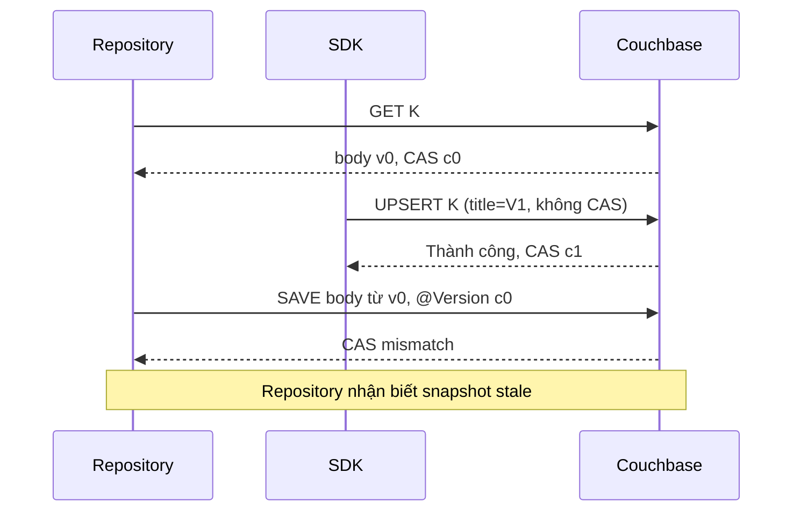
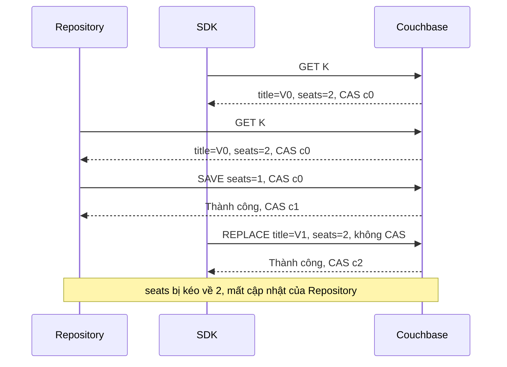
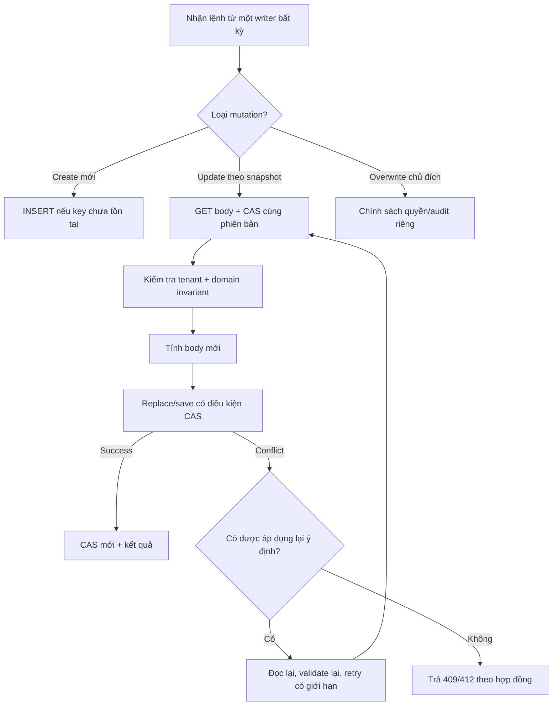

# Cập nhật đồng thời giữa Repository, Template và mã SDK trong Spring Data Couchbase

## 1. Bài toán: ba đường ghi cùng chạm một document

Một ứng dụng Spring Data Couchbase thường có nhiều đường truy cập dữ liệu. REST service gọi `CouchbaseRepository`; một job nội bộ dùng `CouchbaseTemplate`; trong khi worker hiệu năng cao sử dụng Couchbase Java SDK trực tiếp. Nếu tất cả cùng cập nhật một document, chúng có thể tranh cùng một phiên bản dữ liệu.

Ví dụ document sức chứa khóa học:

```text
Bucket:      learning
Scope:       training
Collection:  capacity
Document ID: capacity::acme::java-101
```

Nội dung ban đầu:

```json
{
  "tenantId": "acme",
  "courseCode": "java-101",
  "title": "Java căn bản",
  "status": "OPEN",
  "remainingSeats": 2,
  "updatedBy": "system"
}
```

Ba công việc đồng thời:

- **A — Repository:** trừ một chỗ khi học viên đăng ký.
- **B — Template:** đóng đăng ký của khóa học.
- **C — SDK:** thay tiêu đề khóa học.

Nếu mỗi worker đọc phiên bản cũ, sửa một thuộc tính và ghi **toàn bộ JSON**, người ghi sau có thể kéo các thuộc tính mà người khác vừa sửa trở lại giá trị cũ. Đó là **lost update**.

Điểm mấu chốt:

> CAS là token phiên bản chung do Couchbase quản lý. Spring Data dùng `@Version` để ánh xạ CAS vào entity, nhưng **mã SDK không tự đọc annotation đó**. Chính mỗi đường ghi phải chọn có áp dụng điều kiện CAS hay không.

Một Repository có `@Version` không thể ngăn một SDK writer dùng `upsert` không điều kiện ghi đè sau đó. Ngược lại, Repository vẫn có thể phát hiện dữ liệu đã thay đổi bởi SDK khi cố lưu một entity stale.

### Sau bài học, người học có thể

1. Mô tả tác động qua lại của Repository, Template, SDK và SQL++.
2. Dùng CAS cho một document qua Spring Data và Couchbase Java SDK.
3. Phân biệt `replace` có CAS, `replace` không CAS và `upsert`.
4. Tránh làm mất các field/metadata khi SDK thay toàn bộ JSON.
5. Kiểm tra cùng bucket/scope/collection, ánh xạ entity, TTL và lỗi.
6. Thiết kế retry, reactive, transaction, idempotency và integration test cho các writer hỗn hợp.

## 2. Trước hết phải xác định đúng document vật lý

Cùng một chuỗi ID ở hai collection không phải là cùng document. Về mặt định danh, cần xét:

```text
cluster + bucket + scope + collection + document ID
```

Ví dụ SDK mở collection:

```java
import com.couchbase.client.java.Bucket;
import com.couchbase.client.java.Cluster;
import com.couchbase.client.java.Collection;
import com.couchbase.client.java.Scope;

public final class CapacityCollectionProvider {
    private final Cluster cluster;

    public CapacityCollectionProvider(Cluster cluster) {
        this.cluster = cluster;
    }

    public Collection get() {
        Bucket bucket = cluster.bucket("learning");
        Scope scope = bucket.scope("training");
        return scope.collection("capacity");
    }
}
```

Repository có thể dùng cấu hình mặc định hoặc annotation/chỉ định collection; Template cũng có lựa chọn keyspace theo API và cấu hình. Vì vậy phải kiểm tra:

| Reader/Writer | Keyspace | Có cùng document K? |
| --- | --- | --- |
| Repository | `learning.training.capacity` | Có nếu ID=K |
| Template | `learning.training.capacity` | Có nếu ID=K |
| SDK | `learning.training.capacity` | Có nếu ID=K |
| SDK | `learning.training.audit` | Không, khác collection |
| SDK | `learning._default._default` | Không, khác scope/collection |
| SQL++ | Trỏ nhầm bucket khác | Không, dù ID giống nhau |

Tên keyspace trong ví dụ là cố định theo cấu hình, không lấy trực tiếp từ chuỗi client cung cấp. Việc cùng tenant cũng cần kiểm tra độc lập với ID.

### 2.1. CAS không phải khóa toàn cục

Couchbase quản lý CAS cho **mỗi phiên bản document ở collection đích**. Token CAS không phải transaction ID toàn cluster hay giá trị có thể dùng thay thế giữa hai key khác nhau.

Không dùng CAS của document A để cập nhật B, không tự cộng CAS và không suy ra thời gian hoặc số lượng mutation từ giá trị số CAS.

## 3. Bản chất CAS và `@Version`

Khi GET một document:

```text
GET K -> JSON body phiên bản v0 + CAS c0
```

Một mutation có điều kiện:

```text
REPLACE K, body mới, CAS=c0
     ├─ server vẫn giữ c0 -> thành công, cấp CAS c1
     └─ server đã đổi CAS -> từ chối, không ghi đè bản mới
```

Trong entity Spring Data:

```java
import org.springframework.data.annotation.Version;

@Version
private Long version;
```

Framework đọc CAS metadata và ánh xạ vào trường version qua đường hỗ trợ. Khi lưu entity đã có version, optimistic locking có thể dùng token đó làm điều kiện ghi.

Trong SDK trực tiếp:

```java
GetResult observed = collection.get(key);
long observedCas = observed.cas();
```

SDK chỉ có token khi code chủ động lấy nó. Để dùng token, cần truyền CAS vào option của mutation, ví dụ `replaceOptions().cas(observedCas)`.

| Đường ghi | CAS đến từ đâu? | Tự bảo vệ stale write? |
| --- | --- | --- |
| Repository save entity có `@Version` | Metadata đã map vào entity | Có theo đường mapping hỗ trợ |
| Template entity save có `@Version` | Metadata entity nếu mapping áp dụng | Phải xác minh overload/version thực tế |
| SDK replace với `cas(...)` | `GetResult.cas()` | Có cho document đó |
| SDK replace không CAS | Không gửi CAS | Không |
| SDK upsert | Không gửi CAS | Không |
| SQL++ UPDATE tự viết | Điều kiện query | Không tự kế thừa `@Version` Java |

**Một writer dùng CAS chỉ bảo vệ mutation của chính mình.** Nó không bắt các writer khác phải tuân theo cùng quy tắc.

## 4. Entity Spring Data có phiên bản

Ví dụ entity hoàn chỉnh cho các luồng cập nhật:

```java
import java.time.Instant;

import org.springframework.data.annotation.Id;
import org.springframework.data.annotation.Version;
import org.springframework.data.couchbase.core.mapping.Document;

@Document
public class CourseCapacityDocument {
    @Id
    private String id;

    @Version
    private Long version;

    private String tenantId;
    private String courseCode;
    private String title;
    private String status;
    private int remainingSeats;
    private Instant updatedAt;

    protected CourseCapacityDocument() {
        // Dành cho cơ chế mapping.
    }

    public CourseCapacityDocument(
            String id, String tenantId, String courseCode,
            String title, int initialSeats) {
        if (initialSeats < 0) {
            throw new IllegalArgumentException("initialSeats phải >= 0");
        }

        this.id = id;
        this.tenantId = tenantId;
        this.courseCode = courseCode;
        this.title = title;
        this.status = "OPEN";
        this.remainingSeats = initialSeats;
        this.updatedAt = Instant.now();
    }

    public String getId() { return id; }
    public Long getVersion() { return version; }
    public String getTenantId() { return tenantId; }
    public String getCourseCode() { return courseCode; }
    public String getTitle() { return title; }
    public String getStatus() { return status; }
    public int getRemainingSeats() { return remainingSeats; }

    public void rename(String title) {
        if (title == null || title.isBlank()) {
            throw new IllegalArgumentException("Title không hợp lệ");
        }
        this.title = title;
        this.updatedAt = Instant.now();
    }

    public void closeRegistration() {
        this.status = "CLOSED";
        this.updatedAt = Instant.now();
    }

    public void reserve(int units) {
        if (units <= 0) {
            throw new IllegalArgumentException("units phải dương");
        }
        if (!"OPEN".equals(status)) {
            throw new IllegalStateException("Đã đóng đăng ký");
        }
        if (remainingSeats < units) {
            throw new IllegalStateException("Không đủ chỗ");
        }

        remainingSeats -= units;
        updatedAt = Instant.now();
    }
}
```

Các trường `@Id` và `@Version` được import từ Spring Data Commons. `@Document` được import từ Spring Data Couchbase. Không dùng `@jakarta.persistence.Version` khi muốn mapping CAS của Couchbase.

Domain method bảo vệ điều kiện nghiệp vụ; CAS bảo vệ **phiên bản được dùng để kiểm tra**. Hai cơ chế bổ sung cho nhau.

### 4.1. CAS nằm ở metadata, không phải field body

Không thêm field JSON:

```json
{"version": 12}
```

rồi cho rằng SDK `upsert` sẽ tự kiểm tra version ấy. Couchbase quản lý CAS ở metadata. Spring Data có cơ chế ánh xạ metadata vào entity, khác với một trường nghiệp vụ trong JSON.

### 4.2. Entity mới với version rỗng

Theo hợp đồng của đường save entity versioned trong Spring Data Couchbase, version `null` hoặc `0` là trạng thái dùng cho nhánh insert, còn entity đã có token phiên bản đi theo nhánh replace. Vì vậy một entity mới dựng từ HTTP body, có ID đúng nhưng thiếu CAS **không phải** snapshot an toàn để update.

Không giải quyết conflict bằng cách gán version null rồi save lại.

## 5. Repository: đọc–sửa–ghi theo `@Version`

Repository:

```java
import org.springframework.data.couchbase.repository.CouchbaseRepository;

public interface CourseCapacityRepository
        extends CouchbaseRepository<CourseCapacityDocument, String> {
}
```

Ví dụ method service:

```java
public CourseCapacityDocument reserveOnce(
        String authorizedId, int units) {
    CourseCapacityDocument current =
        repository.findById(authorizedId).orElseThrow();

    current.reserve(units);
    return repository.save(current);
}
```

Code giả định `repository` đã được inject, caller được authorize đối với tenant và đường mapping trỏ đúng collection. Trong một lần save versioned, nếu document đã thay đổi từ khi GET, Spring Data có thể báo `org.springframework.dao.OptimisticLockingFailureException`.

### 5.1. Không dựng lại persistence entity từ DTO

```java
// Anti-pattern: đây là object mới, chưa mang CAS đã lưu.
CourseCapacityDocument detached = new CourseCapacityDocument(
    id, "acme", "java-101", "Java nâng cao", 2);

repository.save(detached);
```

Dù `id` trùng document đang tồn tại, `version` vẫn null. Không coi save detached như cập nhật theo phiên bản cũ.

### 5.2. Dùng entity kết quả sau save

```java
CourseCapacityDocument before =
    repository.findById(id).orElseThrow();

before.rename("Java cơ bản");

CourseCapacityDocument saved = repository.save(before);
Long currentVersion = saved.getVersion();
```

Đừng giả định mọi loại entity immutable đều được mutate trực tiếp tại chỗ; hãy dùng kết quả lưu hoặc GET lại để có token mới.

## 6. Template: cùng mapping nhưng phải kiểm chứng đường operation

`CouchbaseTemplate` và `CouchbaseOperations` cho phép thao tác qua entity mapping. Ví dụ:

```java
import org.springframework.data.couchbase.core.CouchbaseTemplate;

public final class TemplateCourseWriter {
    private final CouchbaseTemplate template;

    public TemplateCourseWriter(CouchbaseTemplate template) {
        this.template = template;
    }

    public CourseCapacityDocument closeLoaded(
            CourseCapacityDocument loaded) {
        if (loaded.getVersion() == null) {
            throw new IllegalArgumentException(
                "Entity đã lưu phải có token CAS");
        }

        loaded.closeRegistration();
        return template.save(loaded);
    }
}
```

Khi Template đi qua đường entity save có optimistic locking, metadata `@Version` có thể được dùng để bảo vệ bản đã đọc. **Nhưng Template có nhiều overload và đường fluent**, không được mặc định tất cả đều kiểm tra CAS.

Một phép query/update tùy biến, partial mutation hoặc đường upsert của template có thể có semantics khác save entity. Cần kiểm tra Javadoc của overload và dependency thực tế, rồi chứng minh bằng integration test.

### 6.1. Repository GET rồi Template SAVE có được không?

```java
CourseCapacityDocument loaded =
    repository.findById(id).orElseThrow();

loaded.closeRegistration();

CourseCapacityDocument saved = template.save(loaded);
```

Về ý tưởng, hai API có thể làm việc với cùng entity/cùng CAS nếu cùng mapping và collection. Nhưng cần kiểm chứng:

1. Repository tải ID và CAS đúng.
2. SDK writer khác đổi document và cấp CAS mới.
3. Template save entity stale.
4. Kỳ vọng không ghi đè thay đổi mới.
5. Kiểm tra ngoại lệ thật và body cuối.

Nếu test thất bại, xem lại overload, converter, version type, template config, scope/collection và entity materialization.

### 6.2. Không suy luận mọi thao tác Template đều giống save

| Đường Template | Điều phải hỏi |
| --- | --- |
| `save(entity)` | Có áp dụng `@Version` và đúng nhánh insert/replace không? |
| Fluent insert/upsert/replace | Có nhận CAS? Điều kiện tồn tại thế nào? |
| Query update | Query có điều kiện phiên bản không? |
| Sub-document operation | Path và CAS được bảo vệ ra sao? |
| Batch write | Partial failure hay atomic transaction? |
| Remove/delete | Xóa theo ID hay đúng phiên bản đã quan sát? |

Tên phương thức không thay thế một hợp đồng đã được kiểm chứng.

## 7. SDK: truyền CAS trực tiếp vào replace

Couchbase Java SDK không biết class Spring Data có annotation gì. Mã SDK muốn optimistic locking phải dùng CAS tường minh:

```java
import com.couchbase.client.core.error.CasMismatchException;
import com.couchbase.client.java.Collection;
import com.couchbase.client.java.json.JsonObject;
import com.couchbase.client.java.kv.GetResult;
import com.couchbase.client.java.kv.MutationResult;

import static com.couchbase.client.java.kv.ReplaceOptions.replaceOptions;

public final class SdkCourseWriter {
    private final Collection collection;

    public SdkCourseWriter(Collection collection) {
        this.collection = collection;
    }

    public long renameOnce(String key, String title) {
        if (title == null || title.isBlank()) {
            throw new IllegalArgumentException("Title không hợp lệ");
        }

        GetResult observed = collection.get(key);
        JsonObject body = observed.contentAsObject();
        body.put("title", title);

        try {
            MutationResult result = collection.replace(
                key, body,
                replaceOptions().cas(observed.cas()));

            return result.cas();
        } catch (CasMismatchException conflict) {
            throw new IllegalStateException(
                "Course đã thay đổi trong khi cập nhật",
                conflict);
        }
    }
}
```

Ở đây `GetResult.cas()` và body được lấy từ **cùng một phiên bản**. Khi một writer Repository/Template cập nhật sau GET nhưng trước replace, CAS không khớp và SDK không ghi đè.

### 7.1. `upsert` không điều kiện là một contract khác

```java
GetResult stale = collection.get(key);
JsonObject body = stale.contentAsObject();

// Worker khác có thể ghi tại đây.
body.put("title", "Java nâng cao");

// Không gửi observed CAS:
collection.upsert(key, body);
```

Lệnh này có thể thay body hiện tại mà không quan tâm snapshot đã cũ. Nó không tự áp dụng `@Version` của Spring Data.

Tương tự:

```java
collection.replace(key, body);
```

thay thế document đang tồn tại **không có CAS check**. Điều kiện “document tồn tại” khác điều kiện “version không thay đổi”.

### 7.2. Sai lầm: body cũ với CAS mới

```java
GetResult first = collection.get(key);
JsonObject bodyOld = first.contentAsObject();

// Trong khi đó có writer khác cập nhật document.
GetResult latest = collection.get(key);

// Sai: CAS mới không biến body cũ thành bản hiện hành.
collection.replace(
    key, bodyOld,
    replaceOptions().cas(latest.cas()));
```

Dù CAS mới hợp lệ, nó đang bảo vệ **một body không được kiểm tra theo phiên bản mới**. Khi server chấp nhận, thay đổi của writer kia có thể bị mất.

**Quy tắc:** body đã đọc, business validation và CAS ở mutation phải tương ứng cùng một snapshot.

## 8. Ba lịch trình quan trọng giữa các writer

### 8.1. SDK upsert trước, Repository save sau



Repository có thể bị từ chối và giữ lại bản cập nhật của SDK. Tuy vậy, điều này **không chứng minh SDK đã được bảo vệ**. Nó chỉ cho thấy Repository dùng CAS.

### 8.2. Repository save trước, SDK replace không CAS sau



**Đây là kịch bản nguy hiểm nhất:** Repository đã làm đúng, nhưng writer SDK vẫn có thể làm mất cập nhật vì không áp CAS.

Nếu SDK replace có CAS c0, mutation cuối phải thất bại sau khi Repository tạo c1. SDK sẽ đọc lại và tính lại theo business intent.

### 8.3. Repository đọc, SDK chen giữa, Template ghi

```text
T0  Repository findById(K)        -> entity version=c0
T1  SDK replace(K, cas=c0)       -> thành công, CAS=c1
T2  Template save(entity c0)     -> cần bị từ chối nếu operation dùng CAS
```

Đây là test tối thiểu để chứng minh Template và Repository dùng chung optimistic locking contract. Nếu Template ghi đè được bản SDK mới, phải điều tra đường operation và cấu hình.

## 9. Ghi whole-document JSON có thể làm mất field và metadata

Một Spring Data entity thường có nhiều field và có thể dùng metadata kiểu entity trong JSON body tùy mapping. Nếu SDK chỉ dựng JSON mới:

```java
JsonObject replacement = JsonObject.create()
    .put("title", "Java cơ bản")
    .put("remainingSeats", 1);

collection.replace(key, replacement);
```

các field `tenantId`, `courseCode`, `status`, `updatedAt` hoặc type discriminator có thể biến mất. **Ngay cả khi có CAS hợp lệ**, payload thiếu field vẫn có thể làm hỏng dữ liệu.

### 9.1. SDK lấy body thật rồi chỉ sửa field cần thiết

```java
GetResult observed = collection.get(key);
JsonObject fullBody = observed.contentAsObject();

fullBody.put("title", "Java nâng cao");

collection.replace(
    key, fullBody,
    replaceOptions().cas(observed.cas()));
```

Mẫu này giữ các field có sẵn tốt hơn việc dựng một JSON object mới. Tuy nhiên, phải kiểm tra quyền, domain invariant, expiry và những field mà SDK không được phép sửa.

### 9.2. Query projection cũng có nguy cơ tương tự

Nếu một custom SQL++/Repository query chỉ SELECT một vài trường, kết quả đó không phải snapshot đầy đủ để whole-document save. Giữ CAS thôi vẫn **không bảo đảm body đủ field**.

Với entity query Spring Data, có thể dùng cơ chế SELECT dành cho mapping như `#{#n1ql.selectEntity}` theo version đang dùng và test `@Id`/`@Version`. Nếu query chỉ phục vụ tìm ứng viên, cách rõ hơn là query ID → KV GET body/CAS mới → revalidate → mutation.

## 10. Quy tắc nghiệp vụ phải được áp dụng đồng nhất

CAS trả lời câu hỏi **phiên bản đã đọc có còn hiện hành khi ghi không?** Nó không biết việc giảm số chỗ xuống âm hoặc mở lại lớp đã đóng là sai.

Ví dụ Repository dùng `current.reserve(1)` kiểm tra:

```java
if (!"OPEN".equals(status)) {
    throw new IllegalStateException("Đã đóng đăng ký");
}
if (remainingSeats < units) {
    throw new IllegalStateException("Không đủ chỗ");
}
```

SDK writer không thể bỏ qua hai điều kiện này chỉ vì dùng CAS đúng. Nếu SDK chỉ trừ field số mà không kiểm tra `status`, nó có thể thực hiện lệnh sai nghiệp vụ trên một snapshot hoàn toàn hiện hành.

| Rule | Repository | Template | SDK |
| --- | --- | --- | --- |
| Chỉ đặt chỗ khi OPEN | Domain method | Phải dùng domain rule tương đương | Phải kiểm tra tương đương |
| Không âm số chỗ | Trong entity | Tùy path | Trong KV handler |
| Check tenant | Service/security | Service/security | Service/security |
| Bảo vệ CAS | `@Version` khi mapping áp dụng | Phụ thuộc operation | `cas(...)` rõ ràng |
| Chống request lặp | Cần idempotency riêng | Cần idempotency riêng | Cần idempotency riêng |

Các writer nên dùng chung application/domain policy hoặc một contract có thể test, thay vì mỗi service tự suy diễn điều kiện.

## 11. Hợp đồng mutation cần phân loại rõ

Một hệ thống hỗn hợp nên phân biệt:

1. **Create-if-absent:** chỉ tạo nếu key chưa tồn tại; dùng insert thích hợp, xử lý duplicate.
2. **Update-if-version-matches:** cập nhật snapshot đã đọc; dùng CAS ở mutation.
3. **Apply-on-latest:** đọc mới, đánh giá lại, ghi CAS; có thể retry toàn chu trình khi nghiệp vụ cho phép.
4. **Unconditional overwrite:** last-write-wins có chủ đích; chỉ dùng nơi tác động đã được chấp nhận và audit.

Không dùng một phương thức `upsert` chung cho mọi loại command. Không sử dụng detached entity có version null để giả làm bản cập nhật.

### 11.1. Các câu hỏi khi thêm writer mới

- Có đúng keyspace và key không?
- Đây là insert, replace có điều kiện hay overwrite?
- Caller dựa trên snapshot nào?
- CAS được đọc và kiểm tra ở đâu?
- Body có giữ các field/metadata mà writer khác cần không?
- Mutation có ảnh hưởng TTL không?
- Lỗi conflict, duplicate, not-found, timeout được xử lý khác nhau thế nào?
- Retry có giữ logical operation ID không?
- Có nhiều document hoặc side effect ngoài Couchbase không?

## 12. Tóm tắt chính sách chung



Trên thực tế, mỗi adapter có cách biểu diễn API khác nhau. Cần **giữ nguyên semantics** giữa các adapter, không nhất thiết viết chúng bằng cùng một công nghệ.

## 13. Phân loại lỗi ở ranh giới các adapter

Một optimistic conflict có thể xuất hiện dưới nhiều class ngoại lệ tùy API:

| Đường gọi | Lỗi tiêu biểu | Ý nghĩa thường gặp | Hướng xử lý |
| --- | --- | --- | --- |
| Repository save entity versioned | `OptimisticLockingFailureException` hoặc subtype | Entity đã đọc từ phiên bản cũ | Đọc lại/merge hoặc trả conflict |
| Template entity save có optimistic locking | Spring DAO exception theo đường translation | Phiên bản không còn khớp | Xác minh exception cụ thể và giữ nguyên dữ liệu mới |
| SDK replace dùng CAS | `CasMismatchException` | CAS gửi không còn khớp | Tái đánh giá trên bản mới hoặc trả conflict |
| SDK insert trùng key | `DocumentExistsException` | Tranh chấp tạo mới | Kiểm tra identity/idempotency |
| SDK replace khi key biến mất | `DocumentNotFoundException` | Document bị xóa, hết TTL hoặc sai keyspace | Policy not-found/expiry |
| SDK mutation timeout | Timeout có thể không rõ đã commit | Không thể suy ra thao tác chưa ghi | Reconciliation |
| SQL++ query/update lỗi | Query-specific exception | Có thể là cú pháp, index, quyền, timeout | Không coi mọi lỗi là CAS conflict |
| Business rule không hợp lệ | Domain exception | Lệnh không được phép trên trạng thái hiện hành | Không retry như optimistic conflict |

Import Spring:

```java
import org.springframework.dao.OptimisticLockingFailureException;
```

Import SDK:

```java
import com.couchbase.client.core.error.CasMismatchException;
import com.couchbase.client.core.error.DocumentExistsException;
import com.couchbase.client.core.error.DocumentNotFoundException;
```

Không bắt `Exception` rồi tự retry hoặc chuyển thành upsert. Một lỗi timeout, lỗi quyền hoặc lỗi nghiệp vụ không được xử lý giống stale CAS.

### 13.1. Chuẩn hóa lỗi ở tầng application

Một ứng dụng có thể tạo lỗi miền chung:

```java
public final class ConcurrentDocumentChange
        extends RuntimeException {
    public ConcurrentDocumentChange(String operation, Throwable cause) {
        super("Document bị thay đổi trong lúc " + operation, cause);
    }
}
```

Các adapter riêng có thể chuyển `OptimisticLockingFailureException` hoặc `CasMismatchException` sang lỗi này, nhưng đừng làm mất nguyên nhân hoặc gộp sai `DocumentNotFoundException`.

### 13.2. Có nên báo 409 hay 412?

Phụ thuộc hợp đồng của người gọi:

- **409 Conflict:** command thông thường bị từ chối do trạng thái bị thay đổi, hoặc hết retry hợp lệ.
- **412 Precondition Failed:** client gửi `If-Match` cũ cho một conditional update.
- **428 Precondition Required:** endpoint bắt buộc `If-Match` nhưng client không gửi.
- **404 Not Found:** document không còn tồn tại theo contract API.
- **403 Forbidden** hoặc chính sách che giấu phù hợp: không có quyền tenant.

Spring Data hoặc Couchbase SDK không tự đưa ra HTTP status; controller/application phải dịch lỗi theo ngữ nghĩa request.

## 14. Retry phải làm lại toàn bộ read–validate–modify–write

Khi Repository hoặc SDK nhận CAS conflict, việc lặp lại **chỉ câu lệnh ghi với entity cũ** thường không giải quyết được. Đúng hơn là:

```text
read mới (body + CAS)
  -> kiểm tra quyền + domain invariant
  -> tính thay đổi từ body mới
  -> ghi có CAS vừa đọc
  -> conflict?
       |-- còn budget và command có thể tái áp dụng -> quay lại read
       |-- không -> trả lỗi/điều phối
```

Ví dụ blocking repository (đặt trong service có trường `repository`):

```java
import org.springframework.dao.OptimisticLockingFailureException;

public CourseCapacityDocument reserveWithRetry(
        String authorizedId, int units) {

    final int maxAttempts = 3;

    for (int attempt = 1; attempt <= maxAttempts; attempt++) {
        CourseCapacityDocument current =
            repository.findById(authorizedId).orElseThrow();

        // Rule được kiểm tra lại ở MỖI lượt.
        current.reserve(units);

        try {
            return repository.save(current);
        } catch (OptimisticLockingFailureException conflict) {
            if (attempt == maxAttempts) {
                throw conflict;
            }
            // Production: backoff/jitter và giới hạn tổng deadline.
        }
    }

    throw new IllegalStateException("Không thể tới nhánh này");
}
```

SDK tương ứng phải GET lại và tính lại nội dung với CAS mới. Không áp CAS mới vào body cũ chỉ để làm lệnh ghi thành công.

### 14.1. Trường hợp không nên tự retry

Ví dụ hai quản trị viên sửa cùng mức giá hoặc tiêu đề từ một form đã mở trước. Nếu server tự đọc CAS mới rồi ghi payload từ form cũ, nó có thể ghi đè thay đổi mà user chưa hề thấy.

Với command **“chỉ sửa phiên bản tôi đã xem”**, nên từ chối và yêu cầu caller đối chiếu. Với command **“áp dụng thay đổi trên trạng thái mới nhất”**, có thể retry khi domain invariant cho phép.

### 14.2. Retry budget

Một document nóng có thể khiến hàng trăm worker liên tục tranh CAS:

- Giới hạn số lượt thử (bao gồm lần đầu).
- Có tổng deadline theo SLA.
- Backoff/jitter để tránh retry storm.
- Dừng khi business rule không còn hợp lệ.
- Theo dõi tỷ lệ optimistic conflict và số lần hết budget.

Không biến conflict thành vòng `while(true)` hoặc tăng retry vô hạn. Có thể phải tách aggregate, điều phối theo key hoặc dùng thao tác atomic chuyên biệt nếu workload phù hợp.

## 15. HTTP ETag/If-Match: phải giữ phiên bản mà client đã thấy

Ngay cả khi Repository đọc và save đúng CAS trong **một HTTP request**, nó vẫn có thể ghi đè ý định của người dùng nếu bỏ qua version client đã xem từ trước.

```text
09:00 Client GET Course -> phiên bản c0
09:05 SDK worker đổi Course -> phiên bản c1
09:10 Client PUT payload từ c0
09:10 Server đọc Course c1 rồi save với c1 -> có thể thành công
```

Lệnh cuối an toàn với race **trong request**, nhưng không an toàn với hợp đồng **“không thay bản đã sửa sau khi user mở form”**.

API nên trả strong ETag khi GET:

```http
GET /api/courses/java-101
HTTP/1.1 200 OK
ETag: "opaque-cas-token"
Content-Type: application/json

{"courseCode":"java-101","title":"Java căn bản"}
```

Và yêu cầu client gửi:

```http
PATCH /api/courses/java-101
If-Match: "opaque-cas-token"
Content-Type: application/json

{"title":"Java nâng cao"}
```

ETag trong ví dụ là placeholder. API cần mã hóa CAS 64 bit thành chuỗi opaque, không ép qua JSON number hoặc JavaScript Number có thể mất độ chính xác.

Quy trình:

1. Xác thực và kiểm tra quyền tenant.
2. Kiểm tra token từ `If-Match`.
3. Đọc entity hiện hành kèm CAS.
4. So phiên bản hiện hành với token client đã xem.
5. Không khớp: trả 412, **không tự lấy CAS mới để ghi đè**.
6. Khớp: áp dụng domain command, save có CAS.
7. Nếu writer chen vào giữa so version và save, cũng trả stale precondition theo contract.

CAS/ETag không phải credential. Caller biết token vẫn phải được authorize.

## 16. Reactive Repository và Reactive SDK

Trong Reactive API, race vẫn tồn tại; khác biệt là publisher biểu diễn thao tác bất đồng bộ và lỗi xuất hiện dưới dạng error signal.

### 16.1. Reactive Repository

```java
import org.springframework.data.couchbase.repository.ReactiveCouchbaseRepository;
import reactor.core.publisher.Mono;

public interface ReactiveCapacityRepository
        extends ReactiveCouchbaseRepository<CourseCapacityDocument, String> {
}

public final class ReactiveCapacityService {
    private final ReactiveCapacityRepository repository;

    public ReactiveCapacityService(ReactiveCapacityRepository repository) {
        this.repository = repository;
    }

    public Mono<CourseCapacityDocument> reserveOnce(String id, int units) {
        return repository.findById(id)
            .switchIfEmpty(Mono.error(
                new IllegalStateException("Document không tồn tại")))
            .flatMap(current -> {
                current.reserve(units);
                return repository.save(current);
            });
    }
}
```

Nếu mapping/operation hỗ trợ `@Version`, publisher save có thể báo optimistic conflict khi CAS stale.

### 16.2. Reactive SDK KV có CAS

```java
import com.couchbase.client.java.Collection;
import com.couchbase.client.java.json.JsonObject;
import reactor.core.publisher.Mono;

import static com.couchbase.client.java.kv.ReplaceOptions.replaceOptions;

public final class ReactiveSdkRenameService {
    private final Collection collection;

    public ReactiveSdkRenameService(Collection collection) {
        this.collection = collection;
    }

    public Mono<Long> renameOnce(String id, String title) {
        return collection.reactive().get(id)
            .flatMap(observed -> {
                JsonObject body = observed.contentAsObject();
                body.put("title", title);

                return collection.reactive().replace(
                        id, body,
                        replaceOptions().cas(observed.cas()))
                    .map(result -> result.cas());
            });
    }
}
```

Đường SDK reactive không biết `@Version`; việc truyền CAS vào option vẫn là trách nhiệm của code.

### 16.3. Retry phải resubscribe cả GET–CHECK–SAVE

Ví dụ minh họa trong `ReactiveCapacityService`:

```java
import java.time.Duration;
import org.springframework.dao.OptimisticLockingFailureException;
import reactor.core.publisher.Mono;
import reactor.util.retry.Retry;

public Mono<CourseCapacityDocument> reserveWithRetry(
        String id, int units) {

    return Mono.defer(() -> reserveOnce(id, units))
        .retryWhen(
            Retry.backoff(2, Duration.ofMillis(25))
                .filter(OptimisticLockingFailureException.class::isInstance)
                .onRetryExhaustedThrow(
                    (spec, signal) -> signal.failure()));
}
```

Trong ví dụ, hai retry bổ sung cho tối đa ba subscription. Retry toàn luồng giúp đọc lại snapshot. **Không** chỉ retry `repository.save(staleEntity)`.

Với SDK reactive, filter `CasMismatchException` thay vì Spring DAO exception; hoặc để adapter chuẩn hóa lỗi rồi orchestration dùng contract chung.

Không đặt gửi email, tạo ID nghiệp vụ mới hoặc charge payment trong một publisher có thể bị subscribe lại nếu không có idempotency.

## 17. SQL++ UPDATE và index: writer thứ tư không tự kế thừa `@Version`

Một batch job có thể ghi qua SQL++:

```sql
UPDATE `learning`.`training`.`capacity` AS c
SET c.status = "CLOSED"
WHERE c.tenantId = $tenantId
  AND c.courseCode = $courseCode;
```

Đây là một **đường mutation riêng**. Annotation `@Version` trong class Java không tự động chèn điều kiện CAS vào mọi SQL++ UPDATE.

Nếu query cập nhật document giữa lúc Repository GET và SAVE, CAS mà Repository giữ có thể bị stale. Nhưng SQL++ writer cần kiểm tra riêng:

- Có áp dụng predicate business đủ chặt không?
- Đang tác động bao nhiêu document?
- Có cần điều kiện version-specific hoặc transaction không?
- Có idempotent khi request/job retry không?
- Có cùng keyspace với Repository/Template không?

### 17.1. Query consistency không phải khóa

SQL++ query sử dụng chỉ mục và có lựa chọn scan consistency. Ngay cả khi dùng chế độ giúp query nhìn thấy các mutation trước đó, writer khác vẫn có thể thay document **sau khi query trả kết quả**.

Không coi `SELECT rồi UPDATE` hoặc `REQUEST_PLUS` là cơ chế thay thế CAS. Nếu biết ID và cần optimistic locking một document, đường KV GET + replace(cas) thường rõ hơn.

### 17.2. Projection thiếu CAS hoặc field

Custom query chỉ SELECT một vài thuộc tính thích hợp để hiển thị DTO, nhưng không nên coi kết quả là entity persistence đầy đủ để whole-document save. Khi dùng repository `@Query` trả entity, cần đảm bảo ID/CAS được map qua convention như `#{#n1ql.selectEntity}` theo version đang chạy, và xác minh bằng integration test.

Một body partial được save thành whole document có thể làm mất field **dù CAS khớp**.

## 18. TTL, expiry và durability khi trộn đường ghi

Một document có TTL có thể hết hạn giữa GET và SAVE:

```text
T0 Repository GET K -> CAS c0
T1 K hết hạn TTL
T2 SDK/Template/Repository REPLACE K -> not found hoặc lỗi phù hợp
```

Không sửa `version=null` rồi save để tự tạo lại khi command là update-only. Document bị xóa rồi tạo lại cùng ID có thể là một vòng đời nghiệp vụ khác.

CAS chỉ giải quyết **phiên bản**, không tự giữ expiry. Tùy method/options, SDK replacement có thể thay đổi hoặc đặt lại TTL; khi cần giữ nguyên hãy kiểm tra tính năng **preserve expiry** theo API và phiên bản. Đường Spring Data cần được kiểm thử riêng.

Durability cũng độc lập với CAS. Một CAS match không tự đảm bảo mức nhân bản/độ bền đã chọn, và không tạo transaction đa document.

## 19. Transaction: nhiều document không được bảo vệ bởi một CAS

Một lần đăng ký có thể cần:

```text
capacity::acme::java-101.remainingSeats -= 1
enrollment::acme::reg-101 = CREATED
outbox::acme::reg-101 = PENDING
```

Nếu Repository save capacity thành công nhưng SDK insert enrollment thất bại, trạng thái có thể nửa chừng. Dù mỗi document có CAS, **hai hoặc ba mutation độc lập không tự atomic**.

Khi cần commit đồng thời, cân nhắc Couchbase distributed ACID transactions với API/collection được hỗ trợ. Đừng giả định mọi lệnh SDK tự tham gia transaction chỉ vì được gọi trong cùng method có `@Transactional`.

Nếu nghiệp vụ đi qua payment/email/object storage ngoài Couchbase, dùng workflow state machine, outbox, compensation và downstream idempotency. CAS một document không thể bảo vệ write skew hoặc bất biến đọc từ nhiều document khác nhau.

## 20. Timeout không rõ commit: retry có thể gây tác dụng kép

Giả sử một SDK writer trừ một chỗ bằng CAS và server ghi thành công, nhưng phản hồi bị mất:

```text
T0 SDK GET K -> seats=2, CAS c0
T1 SDK REPLACE seats=1, CAS c0
T2 Server có thể commit, cấp CAS c1
T3 Response bị mất, SDK thấy timeout
T4 SDK đọc lại K và trừ thêm 1 -> có thể trừ hai lần
```

Khác với CAS mismatch đã được xác định, **timeout không chứng minh thao tác chưa commit**. Một CAS mismatch khi retry với c0 cũng không chứng minh chính writer này đã thành công, vì writer khác có thể đã sửa.

Cần identity bền vững của logical operation, ví dụ:

```text
reservationId = reg-2026-00091
capacityId    = capacity::acme::java-101
enrollmentId  = enrollment::acme::reg-2026-00091
```

Ứng dụng phải tra cứu kết quả theo reservation ID/idempotency record, đối soát rồi mới quyết định thực hiện tiếp. Không tạo một UUID mới mỗi lần retry HTTP cho cùng ý định.

**CAS giải quyết stale document version; idempotency giải quyết request lặp; transaction giải quyết commit liên document.** Không cơ chế nào tự thay thế hai cơ chế còn lại.

## 21. Integration test: ba đường ghi phải chứng minh cùng contract

Mock unit test giúp kiểm tra logic Java, nhưng không chứng minh Couchbase đã nhận CAS hoặc Template mapping đúng. Cần integration test thật trên cluster/collection thử nghiệm tương thích dependency production.

### 21.1. Test A — Repository ghi trước, SDK CAS cũ phải bị từ chối

```java
import static org.junit.jupiter.api.Assertions.*;

import com.couchbase.client.core.error.CasMismatchException;
import com.couchbase.client.java.Collection;
import com.couchbase.client.java.json.JsonObject;
import com.couchbase.client.java.kv.GetResult;
import org.junit.jupiter.api.Test;

import static com.couchbase.client.java.kv.ReplaceOptions.replaceOptions;

class RepositoryAndSdkContractTest {
    // Fixture thực tế phải inject repository, SDK Collection và cleanup.
    private CourseCapacityRepository repository;
    private Collection sdkCollection;

    @Test
    void sdkStaleCasCannotOverwriteRepository() {
        String key = "capacity::test::cross-a";

        repository.save(new CourseCapacityDocument(
            key, "test", "cross-a", "V0", 2));

        GetResult sdkObserved = sdkCollection.get(key);
        CourseCapacityDocument fromRepository =
            repository.findById(key).orElseThrow();

        fromRepository.reserve(1);
        repository.save(fromRepository);

        JsonObject oldBody = sdkObserved.contentAsObject();
        oldBody.put("title", "V1");

        assertThrows(CasMismatchException.class,
            () -> sdkCollection.replace(
                key, oldBody,
                replaceOptions().cas(sdkObserved.cas())));

        assertEquals(1,
            sdkCollection.get(key)
                .contentAsObject().getInt("remainingSeats"));
    }
}
```

Đây là **khung integration test**, không chạy độc lập: cần fixture Spring/Couchbase, cleanup và ID sạch. Điểm chính là SDK giữ CAS cũ, Repository ghi trước, SDK không được ghi đè body mới.

### 21.2. Test B — SDK ghi trước, Repository stale phải bị từ chối

```java
import static org.junit.jupiter.api.Assertions.*;
import org.junit.jupiter.api.Test;
import org.springframework.dao.OptimisticLockingFailureException;

import static com.couchbase.client.java.kv.ReplaceOptions.replaceOptions;

class SdkThenRepositoryContractTest {
    private CourseCapacityRepository repository;
    private com.couchbase.client.java.Collection sdkCollection;

    @Test
    void repositoryStaleVersionCannotOverwriteSdk() {
        String key = "capacity::test::cross-b";

        repository.save(new CourseCapacityDocument(
            key, "test", "cross-b", "V0", 2));

        CourseCapacityDocument stale =
            repository.findById(key).orElseThrow();

        var sdkRead = sdkCollection.get(key);
        var body = sdkRead.contentAsObject();
        body.put("title", "V1");

        sdkCollection.replace(key, body,
            replaceOptions().cas(sdkRead.cas()));

        stale.reserve(1);

        assertThrows(OptimisticLockingFailureException.class,
            () -> repository.save(stale));

        var current = sdkCollection.get(key).contentAsObject();
        assertEquals("V1", current.getString("title"));
        assertEquals(2, current.getInt("remainingSeats"));
    }
}
```

Khi Spring Data thực sự áp dụng CAS, Repository nhận optimistic conflict và body từ SDK được giữ. Exception có thể được chuyển thành subtype cụ thể; kiểm tra trên dependency thực tế.

### 21.3. Test C — Repository read, SDK update, Template stale save

Một fixture thứ ba cần:

1. Tạo K.
2. Repository GET entity version c0.
3. SDK GET và replace K có CAS c0, thành công c1.
4. Template `save(entity c0)`.
5. Khi operation Template có optimistic locking, stale write phải bị từ chối.
6. GET K lại, xác minh body c1 giữ nguyên.

Assertion minh họa:

```java
assertThrows(
    OptimisticLockingFailureException.class,
    () -> template.save(staleEntity));
```

Hai biến trên phải được chuẩn bị trong fixture. Nếu test không cho ra kết quả mong đợi, **đừng lập tức bỏ assertion**; điều tra Template overload, version mapping, keyspace, converter và exception translation.

### 21.4. Test D — SDK không CAS thực sự có thể ghi đè

Chỉ trên **collection thử nghiệm**, cố ý tạo đối chứng:

1. SDK GET K -> body v0.
2. Repository GET K -> entity v0.
3. Repository update và save thành v1.
4. SDK dùng `replace(key, bodyV0)` không CAS.
5. GET K và quan sát các field có thể bị kéo về v0.

Mục tiêu test này là chứng minh một writer không CAS phá hợp đồng chung, **không phải** mẫu mã nên dùng production.

### 21.5. Ma trận regression test

| Reader | Writer chen vào | Writer cuối | Điều cần kiểm chứng |
| --- | --- | --- | --- |
| Repository c0 | SDK có CAS → c1 | Repository save c0 | Stale bị chặn |
| SDK c0 | Repository → c1 | SDK replace(cas c0) | SDK mismatch |
| Repository c0 | SDK → c1 | Template save entity c0 | Template stale bị chặn nếu operation hỗ trợ |
| Template entity c0 | Repository → c1 | Template save c0 | Không ghi đè |
| SDK c0 | Repository → c1 | SDK replace không CAS | Test đối chứng lost update |
| Repository c0 | SQL++ UPDATE | Repository save c0 | Version stale bị chặn |
| Query projection DTO | SDK update | DTO dựng thành entity | Không được whole-document save |
| SDK c0 | TTL hết hạn | SDK replace CAS | Not-found/policy expiry |
| Same ID, different collection | Writer ở A | Reader ở B | Không coi là cùng document |
| Reactive Repository c0 | SDK update c1 | Reactive save c0 | Error signal |
| HTTP timeout sau mutation | Có thể đã commit | Client retry | Không lặp business effect |
| Nhiều document | Một bước thất bại | Bước khác thành công | Có transaction/reconciliation |

**Không chỉ assert exception.** Phải đọc document cuối để chắc chắn các field của writer mới hơn không bị mất.

## 22. Quan sát và vận hành

Theo dõi cả hành vi ghi và tác động nghiệp vụ:

- Số `OptimisticLockingFailureException` theo Repository/Template operation.
- Số `CasMismatchException` theo SDK writer.
- Số writer dùng upsert/replace không CAS trên collection nhạy cảm.
- Read-to-write latency và số hot document key.
- Retry count, retry exhaustion, backoff duration và timeout.
- Số lỗi thiếu metadata phiên bản khi dùng custom query/entity mapping.
- Số document sai collection/tenant hoặc mất field sau SDK replace.
- Lỗi TTL, expiry, not-found và ambiguous outcome.
- Tỷ lệ idempotency hit và duplicate logical operations.
- Business invariant: số chỗ không âm, không ghi lùi trạng thái, không mất enrollment.

Ví dụ log nội bộ:

```text
event=optimistic_conflict
writer=capacity-sdk
operation=capacity.rename
errorCode=CONCURRENT_DOCUMENT_CHANGE
collection=training.capacity
attempt=2
requestId=<correlation-id>
```

Không log raw body chứa PII/credential; không dùng số CAS như số lượng mutation hay timestamp.

Nếu conflict tăng mạnh, trước hết kiểm tra SDK writer có upsert không CAS, job batch có replace toàn body từ snapshot cũ, hoặc vòng read–write quá dài. Khi contention cao, cân nhắc rút ngắn cửa sổ, giảm concurrency, tách aggregate hoặc dùng cơ chế atomic chuyên biệt đúng nghiệp vụ.

## 23. Bài tập tình huống: Repository, Template và SDK cùng thay Course

Document ban đầu:

```text
ID:             capacity::acme::java-101
title:          Java căn bản
status:         OPEN
remainingSeats: 2
CAS:            c0
```

Ba công việc:

- A: Repository giữ entity c0 rồi reserve một chỗ.
- B: Template giữ entity c0 rồi đóng đăng ký.
- C: SDK giữ JSON body c0 rồi sửa title.

**Câu hỏi:**

1. Nếu A lưu thành công trước, B save với version c0 cần có kết quả gì khi Template hỗ trợ CAS?
2. Nếu C dùng `upsert` không điều kiện sau A, chỗ còn lại có nguy cơ sai thế nào?
3. Nếu C chuyển sang `replace(cas=c0)`, nó có thể ngăn ghi đè A không?
4. Có được lấy CAS c1 từ lần đọc mới rồi dùng JSON body c0 của C không?
5. Nếu C dựng JSON mới chỉ có `title`, điều gì có thể xảy ra với `status` và Spring Data metadata?
6. Cùng document ID nhưng khác collection có cùng CAS không?
7. Nếu request reserve A timeout sau khi commit, retry có thể làm gì sai?
8. Nếu giảm capacity và tạo enrollment là hai document, CAS một document có đủ không?
9. Nếu PUT từ form cũ dùng If-Match c0, server có được tự đổi sang c1 để ghi không?
10. Cần những integration test nào để khóa contract giữa cả ba writer?

**Gợi ý:** Template save entity c0 phải không ghi đè khi CAS đã thành c1 nếu đường operation có optimistic locking. SDK upsert không CAS có thể kéo remainingSeats về 2, làm mất cập nhật A. SDK replace với CAS c0 sẽ bị từ chối. Body cũ với CAS mới vẫn nguy hiểm. SDK raw replace cần bảo toàn field/type metadata. Timeout cần idempotency, còn workflow capacity–enrollment cần transaction hoặc điều phối nhất quán.

## 24. Checklist production

1. Đã liệt kê đầy đủ Repository, Template, SDK, SQL++ và worker reactive ghi vào collection?
2. Các writer trỏ đúng bucket/scope/collection/ID và tenant?
3. Entity có `@Version` đúng package, không tự cộng CAS?
4. Repository query/load giữ được ID và CAS trước save?
5. Template save/version đã được chứng minh bằng integration test?
6. Đã phân biệt Template entity save với fluent upsert/replace/query?
7. SDK GET và replace có truyền `replaceOptions().cas(observed.cas())`?
8. Không còn SDK upsert/replace không CAS ngoài các overwrite có chủ đích?
9. Body và CAS đến từ cùng snapshot đã kiểm tra?
10. SDK writer có giữ các field và type metadata cần cho Spring Data?
11. Domain rule/authorization được áp dụng thống nhất?
12. Có phân loại create-if-absent, update-if-version và overwrite?
13. Có phân biệt Spring optimistic failure và SDK CAS mismatch?
14. Có tách duplicate, not-found, TTL, permission, business error và timeout?
15. Retry có đọc lại toàn chu trình và kiểm tra lại bất biến?
16. Retry có budget, deadline, backoff và jitter?
17. API từ form cũ có If-Match và không vượt stale client version?
18. Logical operation có idempotency key ổn định qua retry?
19. Side effect không bị lặp trong reactive/transaction retry?
20. Có chính sách expiry và durability riêng cho mỗi đường ghi?
21. Nhiều document cần transaction/workflow nhất quán?
22. SQL++ UPDATE writer có concurrency predicate và affected-row checks phù hợp?
23. Có integration test các lịch trình R→SDK, SDK→R và R→Template?
24. Có test cho SDK JSON partial, wrong collection, TTL và ambiguous timeout?
25. Có dashboard conflict, hot key, retry và business invariant?
26. Có tài liệu mutation contract để writer mới không phá writer cũ?

## Tài liệu tham khảo

- [Spring Data Couchbase Reference](https://docs.spring.io/spring-data/couchbase/reference/): entity mapping, repository, template, optimistic locking và reactive.
- [Spring Data Couchbase — Template Operations](https://docs.spring.io/spring-data/couchbase/reference/couchbase/template.html): entity operations và các đường Template.
- [Spring Data Couchbase — Repository Queries](https://docs.spring.io/spring-data/couchbase/reference/couchbase/repository-queries.html): custom queries, mapping và projections.
- [Couchbase Java SDK — Key-Value Operations](https://docs.couchbase.com/java-sdk/current/howtos/kv-operations.html): GetResult.cas(), replace có CAS, upsert, exception và expiry.
- [Couchbase Java SDK — Sub-Document Operations](https://docs.couchbase.com/java-sdk/current/howtos/subdocument-operations.html): partial mutation và các lựa chọn điều kiện.
- [Couchbase Java SDK — Distributed ACID Transactions](https://docs.couchbase.com/java-sdk/current/howtos/distributed-acid-transactions-from-the-sdk.html): tính nguyên tử liên document.
- [Couchbase SQL++ Reference](https://docs.couchbase.com/server/current/n1ql/n1ql-language-reference/index.html): SELECT/UPDATE, query predicates và keyspace.

## Kết luận

**CAS là metadata phiên bản chung của Couchbase; `@Version` là cách Spring Data ánh xạ token đó vào entity.** Khi Repository, `CouchbaseTemplate` và SDK cùng cập nhật một document, hệ thống chỉ bảo vệ lost update thực sự khi **mọi đường ghi quan trọng đều tôn trọng cùng hợp đồng cập nhật có điều kiện**. Repository có thể phát hiện SDK đã thay phiên bản, nhưng SDK không CAS vẫn có thể ghi đè Repository nếu chạy sau. Hãy thống nhất keyspace, business invariant, body/CAS cùng snapshot, optimistic locking tại mutation cuối, phân loại lỗi và policy retry. Đồng thời thiết kế idempotency, TTL, transaction, reactive và bảo toàn metadata riêng theo từng đường API. **Integration test các lịch trình cạnh tranh giữa cả ba writer là bằng chứng thực tế quan trọng nhất rằng hợp đồng đồng thời đang được thực thi đúng.**
