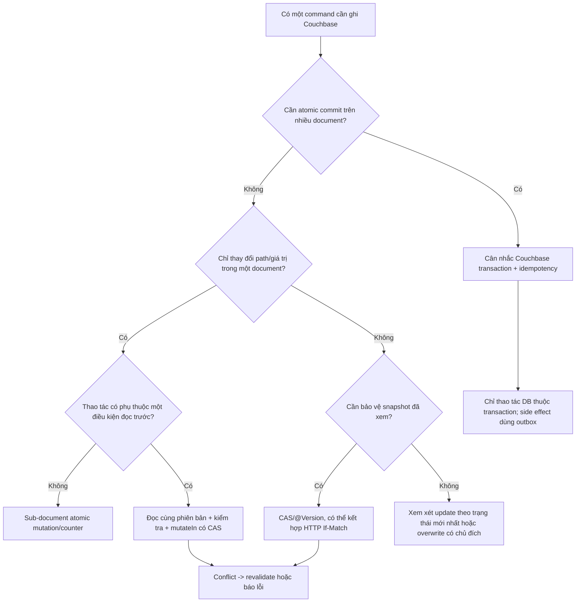
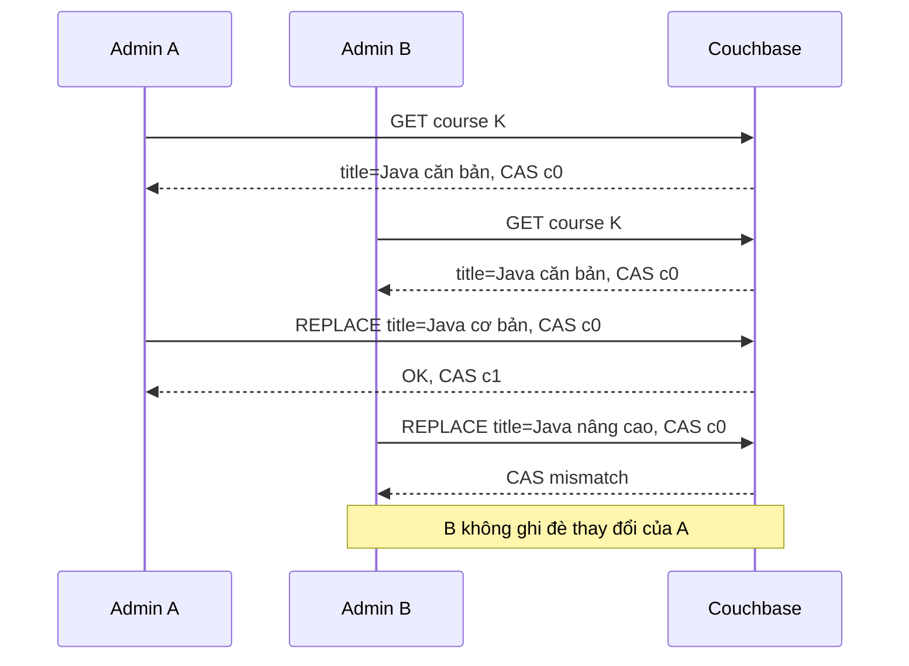
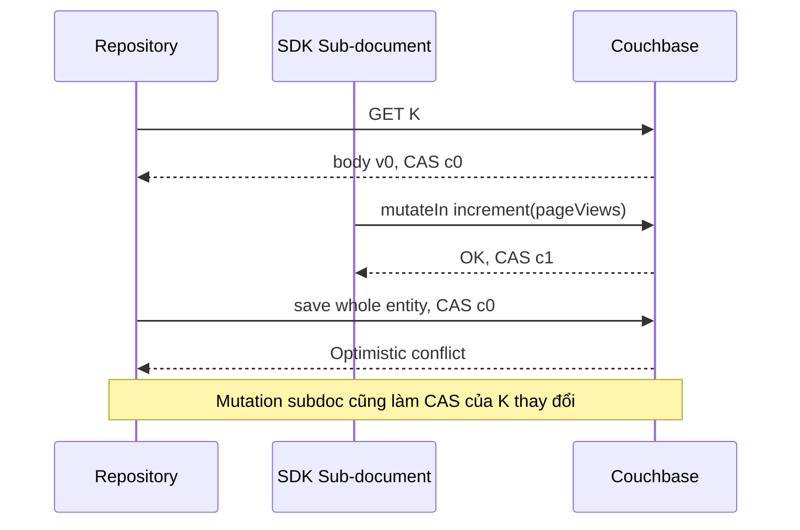
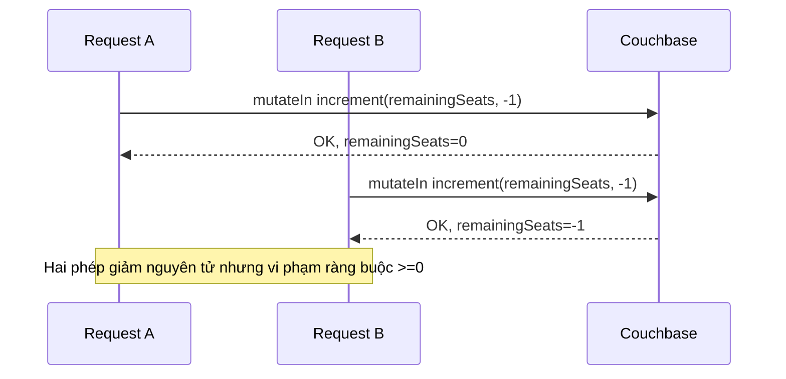
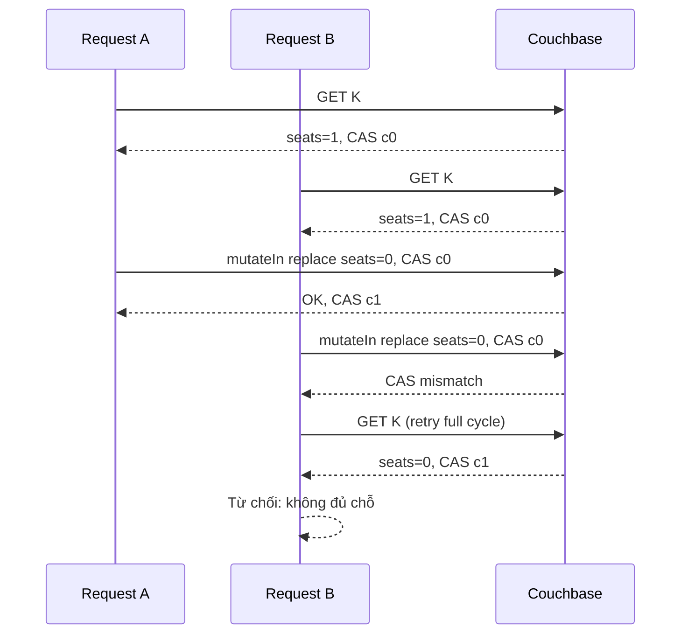
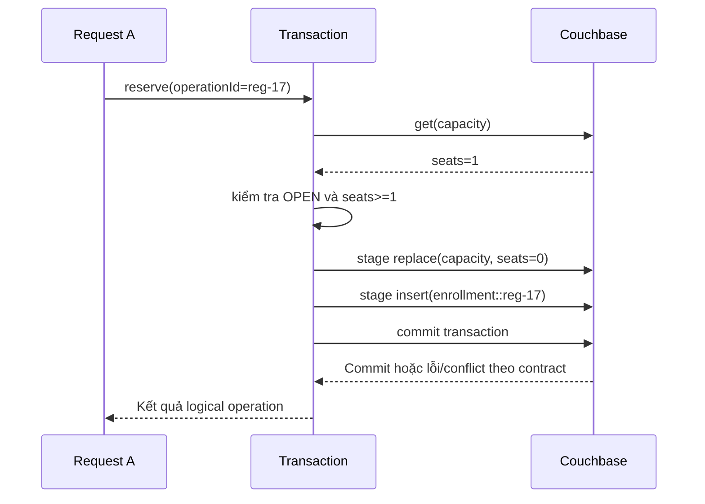

# Lựa chọn CAS, thao tác sub-document hoặc giao dịch theo ràng buộc trong Spring Data Couchbase

## 1. Bài toán thiết kế: cùng là cập nhật dữ liệu, nhưng cần ba mức bảo vệ khác nhau

Trong một hệ thống đào tạo dùng Spring Data Couchbase, có ba yêu cầu tưởng giống nhau:

1. **Sửa tiêu đề khóa học** mà không ghi đè bản cập nhật của quản trị viên khác.
2. **Tăng số lượt xem khóa học** từ nhiều request mà không cần đọc và thay toàn bộ JSON.
3. **Giữ một chỗ học và tạo bản ghi đăng ký** sao cho không xảy ra tình trạng đã trừ chỗ nhưng chưa có enrollment.

Cả ba đều ghi dữ liệu Couchbase, nhưng các ràng buộc về đồng thời và nguyên tử khác nhau. Vì vậy không nên chọn một API duy nhất cho mọi thao tác.

| Yêu cầu | Ranh giới cần bảo vệ | Lựa chọn thường hợp lý |
| --- | --- | --- |
| Sửa đúng phiên bản đã đọc của **một document** | Phiên bản document ở mutation | **CAS** / Spring Data `@Version` |
| Cập nhật một path hoặc nhiều path **trong cùng document**, tránh ghi toàn body | Atomic mutation ở mức document/path | **Sub-document operations**, kèm CAS nếu cần điều kiện phiên bản |
| Một thao tác nghiệp vụ cần thay đổi **nhiều document** cùng commit | Ranh giới transaction nhiều document | **Couchbase transactions** |
| Tăng bộ đếm không phụ thuộc snapshot | Phép tăng nguyên tử trên một giá trị | **Sub-document counter** hoặc KV counter phù hợp |
| Trừ tồn kho phải không âm | Đọc và kiểm tra điều kiện trước khi ghi | **CAS + tính lại**, hoặc transaction khi đi kèm bản ghi khác |
| Gửi email sau cập nhật database | Side effect ngoài Couchbase | **Outbox/idempotency**, không được giải quyết chỉ bằng CAS hay transaction |

**Nguyên tắc quan trọng:** CAS, sub-document và transaction **không phải ba mức “mạnh dần” của cùng một tính năng**. Chúng giải quyết những chiều khác nhau:

- **CAS** là một điều kiện phiên bản tại một mutation.
- **Sub-document** là cách đọc/ghi một phần document với tính nguyên tử của thao tác trên document đó.
- **Transaction** là cách phối hợp các thay đổi có tính nguyên tử trên nhiều document trong phạm vi được hỗ trợ.

Chúng có thể **kết hợp**. Một lệnh `mutateIn` có thể mang CAS; một transaction có thể đọc rồi thay đổi nhiều document; và một workflow transaction vẫn cần idempotency để chống request bị phát lại.

### Mục tiêu bài học

Sau bài, người học có thể xác định ràng buộc nghiệp vụ và chọn API phù hợp; triển khai ví dụ bằng `CouchbaseRepository`, `CouchbaseTemplate` và Couchbase Java SDK; hiểu giới hạn của atomic sub-document counter; sử dụng transaction khi bất biến liên document đòi hỏi; thiết kế retry, idempotency, TTL/durability và kiểm thử đồng thời trước production.

## 2. Xác định ràng buộc trước khi chọn công nghệ

Trước khi hỏi “nên dùng CAS hay transaction?”, hãy trả lời bảy câu hỏi:

1. **Có bao nhiêu document cần thay đổi?** Một document hay nhiều document?
2. **Bất biến nghiệp vụ nằm ở đâu?** Trong một field, nhiều field của một document, hay trên nhiều document?
3. **Thao tác là phép biến đổi nào?** Tăng/giảm, đặt giá trị, sửa path, chuyển state hay tạo/xóa resource?
4. **Có phải dựa trên bản người dùng đã xem?** Nếu có, cần điều kiện phiên bản từ client, không chỉ đọc mới ở server.
5. **Mỗi lần request chỉ được áp dụng một lần logic?** Nếu có, cần operation ID/idempotency.
6. **Khả năng tranh chấp và độ trễ ra sao?** Hot key với hàng nghìn writer hay form được sửa thỉnh thoảng?
7. **Có side effect ngoài Couchbase?** Email, payment, message broker hay object storage?

Ví dụ document sức chứa:

```text
Bucket:      learning
Scope:       training
Collection:  capacity
ID:          course-capacity::acme::java-101
```

```json
{
  "tenantId": "acme",
  "courseCode": "java-101",
  "status": "OPEN",
  "remainingSeats": 2,
  "reservedSeats": 0,
  "pageViews": 120,
  "title": "Java căn bản"
}
```

Các thao tác cần thiết:

- Tăng `pageViews` từ 120 lên 121: không cần tải `title` và `remainingSeats` để ghi lại toàn bộ.
- Đặt `title = "Java cơ bản"` khi admin đang sửa: có thể cần `@Version` và `If-Match`.
- Đặt một chỗ: phải kiểm tra `status == OPEN` và `remainingSeats >= 1`.
- Đặt chỗ và tạo `enrollment::acme::reg-17`: bất biến nằm trên **hai document**.
- Gửi email xác nhận đăng ký: nằm **ngoài database**, cần cơ chế phát event và chống lặp riêng.

Không được chọn sub-document counter chỉ vì phép giảm số học ngắn gọn nếu nghiệp vụ yêu cầu không overbooking.

## 3. Cây quyết định lựa chọn



Cây trên đưa ra **điểm khởi đầu**, không thay việc đánh giá workload và tính năng được hỗ trợ trong phiên bản Couchbase/Spring Data/SDK đang dùng.

### 3.1. Bảng so sánh theo tính chất

| Tiêu chí | CAS + whole-document replace | Sub-document mutation | Couchbase transaction |
| --- | --- | --- | --- |
| Phạm vi chính | Một document | Một document, một/nhiều path | Nhiều document |
| Đọc full body trước mutation | Thường có cho RMW | Không bắt buộc với counter/patch đơn giản | Tùy logic và thao tác |
| Có thể kèm CAS | Có | Có, ở API hỗ trợ option | Transaction tự quản lý ranh giới và conflict |
| Atomic sửa nhiều path trong cùng document | Có nếu replace toàn body thành công | Có với một request multi-spec hợp lệ | Có, nhưng thường không cần transaction cho chỉ một document |
| Bảo vệ stale snapshot tự động | Khi **thực sự gửi CAS** | Chỉ khi dùng CAS hoặc phép atomic tự có semantics phù hợp | Theo contract transaction |
| Điều kiện kiểm tra nhiều document | Không | Không | Có thể phối hợp nếu mọi thao tác cần thiết tham gia transaction |
| Ghi JSON full body | Có | Không nhất thiết | Tùy mutation |
| Rủi ro retry trùng nghiệp vụ | Có | Có | Vẫn có ở ranh giới request/side effect |
| Chi phí ở hot key | CAS conflict có thể cao | Counter/patch có thể phù hợp hơn | Transaction contention/overhead có thể cao |
| Thay thế idempotency? | Không | Không | Không |
| Thay thế TTL/durability policy? | Không | Không | Không |

## 4. Hiểu CAS: điều kiện phiên bản, không phải khóa lâu dài

Couchbase lưu một token **CAS (Compare-And-Swap)** cho phiên bản document. Khi GET, SDK trả body và CAS tương ứng. Ở mutation có điều kiện, server so CAS mà caller gửi với CAS hiện hành.

```text
GET K -> body v0, CAS=c0
REPLACE K, body v1, CAS=c0
        |
        +-- vẫn c0 --> thành công, nhận CAS=c1
        |
        +-- đã đổi  --> CAS mismatch, không ghi đè bản mới
```

CAS là token opaque 64 bit: **không tự tăng `cas+1`, không coi là số thứ tự nghiệp vụ hoặc timestamp**. Nó gắn với document ở đúng bucket/scope/collection. CAS của key A không dùng để ghi key B.



**CAS không giữ document đứng yên sau GET**. Mọi writer có thể ghi giữa lần đọc và lúc sửa. CAS chỉ giúp mutation cuối nhận biết snapshot đã stale.

### 4.1. CAS không tự bảo toàn nghiệp vụ

Nếu code tính `remainingSeats - 7` từ giá trị 2, CAS vẫn có thể khớp và mutation không bị lỗi phiên bản, nhưng tồn kho thành -5 — sai quy tắc nghiệp vụ. Phải kiểm tra `remainingSeats >= requested` **trước** khi ghi, và sau conflict phải kiểm tra lại trên bản mới.

### 4.2. CAS khác commit của nhiều document

Một mutation CAS trên K không đảm bảo mutation trên K2 đã thành công. Hai lần `save` độc lập không tạo transaction, dù cả hai entity đều có `@Version`.

## 5. Spring Data Couchbase: entity versioned dùng CAS

Tạo entity cho ví dụ:

```java
import java.time.Instant;
import org.springframework.data.annotation.Id;
import org.springframework.data.annotation.Version;
import org.springframework.data.couchbase.core.mapping.Document;

@Document
public class CourseCapacityDocument {
    @Id
    private String id;

    @Version
    private Long version;

    private String tenantId;
    private String courseCode;
    private String title;
    private String status;
    private int remainingSeats;
    private long pageViews;
    private Instant updatedAt;

    protected CourseCapacityDocument() {
        // Dành cho Spring Data mapping.
    }

    public CourseCapacityDocument(
            String id, String tenantId, String courseCode,
            String title, int seats) {
        if (seats < 0) {
            throw new IllegalArgumentException("Số chỗ phải >= 0");
        }
        this.id = id;
        this.tenantId = tenantId;
        this.courseCode = courseCode;
        this.title = title;
        this.status = "OPEN";
        this.remainingSeats = seats;
        this.updatedAt = Instant.now();
    }

    public String getId() { return id; }
    public Long getVersion() { return version; }
    public String getTenantId() { return tenantId; }
    public int getRemainingSeats() { return remainingSeats; }
    public String getTitle() { return title; }

    public void rename(String nextTitle) {
        if (nextTitle == null || nextTitle.isBlank()) {
            throw new IllegalArgumentException("Tiêu đề không hợp lệ");
        }
        this.title = nextTitle;
        this.updatedAt = Instant.now();
    }

    public void reserve(int units) {
        if (units <= 0) {
            throw new IllegalArgumentException("Số chỗ yêu cầu phải dương");
        }
        if (!"OPEN".equals(status)) {
            throw new IllegalStateException("Khóa học đã đóng đăng ký");
        }
        if (remainingSeats < units) {
            throw new IllegalStateException("Không đủ chỗ");
        }
        remainingSeats -= units;
        updatedAt = Instant.now();
    }
}
```

Lưu ý:

- `@Version` từ **`org.springframework.data.annotation.Version`**, không phải annotation JPA.
- Field `Long version` được mapping vào CAS khi dùng đường Spring Data Couchbase hỗ trợ.
- CAS là metadata, **không phải field JSON `version` mà SDK tự kiểm tra**.
- Entity mới có version null không phải snapshot của document đã tồn tại.
- Một entity đã được đọc đúng mapping có version hiện hành dùng cho optimistic save.
- Không cho phép client tự tăng, gán hoặc reset version nhằm né conflict.

Repository:

```java
import org.springframework.data.couchbase.repository.CouchbaseRepository;

public interface CourseCapacityRepository
        extends CouchbaseRepository<CourseCapacityDocument, String> {
}
```

### 5.1. Sửa một document bằng Repository

```java
import org.springframework.dao.OptimisticLockingFailureException;

public final class CourseEditorService {
    private final CourseCapacityRepository repository;

    public CourseEditorService(CourseCapacityRepository repository) {
        this.repository = repository;
    }

    public CourseCapacityDocument renameOnce(String authorizedId,
                                             String title) {
        CourseCapacityDocument current =
            repository.findById(authorizedId).orElseThrow();

        current.rename(title);

        // Nếu entity đã stale, save có thể phát sinh
        // OptimisticLockingFailureException theo Spring Data.
        return repository.save(current);
    }
}
```

Trên đường mapping versioned, `save` sử dụng CAS từ entity để bảo vệ update. Trong app thật, ID phải được ủy quyền với tenant và kiểm soát đúng collection.

### 5.2. Khi nào Repository save là lựa chọn tốt?

- Aggregate đơn giản, thường được tải và lưu qua Spring Data.
- Cần domain method, validation và mapping Java rõ ràng.
- Muốn dùng optimistic locking từ `@Version`.
- Cần cập nhật nhiều field của **một document** như một trạng thái đầy đủ.

Nhược điểm khi chỉ tăng một field nhỏ: đọc và ghi toàn body có thể không cần thiết; một sub-document mutation phù hợp có thể giảm lượng dữ liệu truyền và tránh ghi đè field không liên quan.

### 5.3. Không tự dựng entity mới từ DTO rồi gọi save

```java
// Anti-pattern: id trùng nhưng version null.
CourseCapacityDocument detached = new CourseCapacityDocument(
    "course-capacity::acme::java-101",
    "acme", "java-101", "Java nâng cao", 2);

repository.save(detached);
```

Entity này không mang CAS của document đã đọc. Với đường save versioned, version null/0 thường đi vào nhánh **insert** và có thể bị lỗi trùng key, không phải một update an toàn. Đừng dùng upsert mù để che lỗi.

## 6. SDK KV: compare-and-replace trực tiếp

Với Java SDK, có thể viết optimistic update rõ ràng:

```java
import com.couchbase.client.core.error.CasMismatchException;
import com.couchbase.client.java.Collection;
import com.couchbase.client.java.json.JsonObject;
import com.couchbase.client.java.kv.GetResult;
import com.couchbase.client.java.kv.MutationResult;

import static com.couchbase.client.java.kv.ReplaceOptions.replaceOptions;

public final class CourseKvEditor {
    private final Collection collection;

    public CourseKvEditor(Collection collection) {
        this.collection = collection;
    }

    public long renameOnce(String key, String title) {
        if (title == null || title.isBlank()) {
            throw new IllegalArgumentException("Tiêu đề không hợp lệ");
        }

        GetResult observed = collection.get(key);
        JsonObject body = observed.contentAsObject();

        body.put("title", title);

        MutationResult result = collection.replace(
            key, body,
            replaceOptions().cas(observed.cas()));

        return result.cas();
    }
}
```

`GetResult.cas()` phải đi cùng body đã được kiểm tra. Nếu SDK thay body từ lần GET cũ nhưng lấy CAS từ lần GET mới, nó có thể được server chấp nhận và ghi đè dữ liệu mới — một anti-pattern nguy hiểm.

### 6.1. Không có CAS thì sao?

```java
collection.replace(key, staleJsonBody);
collection.upsert(key, staleJsonBody);
```

Hai thao tác trên, khi không truyền điều kiện CAS, **không bảo vệ stale snapshot**. `replace` yêu cầu document tồn tại, còn `upsert` có thể tạo hoặc ghi đè; đây là các hợp đồng khác update-if-version-matches.

### 6.2. Chọn CAS khi business rule phải được đánh giá trên một snapshot

Với việc giữ chỗ:

```java
public long reserveOnce(String key, int requested) {
    if (requested <= 0) {
        throw new IllegalArgumentException("requested phải dương");
    }

    GetResult observed = collection.get(key);
    JsonObject body = observed.contentAsObject();

    if (!"OPEN".equals(body.getString("status"))) {
        throw new IllegalStateException("Đã đóng đăng ký");
    }

    int remaining = body.getInt("remainingSeats");
    if (remaining < requested) {
        throw new IllegalStateException("Không đủ chỗ");
    }

    body.put("remainingSeats", remaining - requested);

    return collection.replace(
        key, body,
        replaceOptions().cas(observed.cas())).cas();
}
```

Method giả định nằm trong service có trường `collection`. Nếu writer khác xen vào, SDK có thể ném `CasMismatchException`. Với command cho phép retry, phải **đọc lại, kiểm tra lại điều kiện và tính lại**, không chỉ gửi lại body stale.

### 6.3. CAS có thể tạo conflict dù hai worker sửa field khác nhau

Một worker chỉ đổi title, worker khác chỉ tăng pageViews nhưng đều dùng whole-document replace. Dù các field có vẻ độc lập, CAS của **toàn document** thay đổi sau bất kỳ mutation nào, khiến một worker bị conflict.

Đây là lý do sub-document operations đáng cân nhắc cho các field được cập nhật thường xuyên, **nhưng phải phân biệt tính nguyên tử path với kiểm tra business invariant**.

## 7. Sub-document operations là gì?

Couchbase Java SDK hỗ trợ thao tác **một hoặc nhiều path trong JSON document** mà không cần client phải đọc/ghi toàn bộ body:

- `lookupIn`: đọc path được chỉ định.
- `mutateIn`: thực hiện các thao tác như `upsert`, `replace`, `insert`, `remove`, `increment` trên path.
- Một request `mutateIn` có nhiều specs được thực thi như một **mutation nguyên tử trên một document** trong phạm vi API hỗ trợ: không để lại nửa chừng các path của cùng request khi một spec thất bại.

Đây là tính nguyên tử của một thao tác trên **một document**, không phải transaction trên nhiều key.

### 7.1. Ví dụ tăng `pageViews` không cần whole-document replace

```java
import java.util.List;
import com.couchbase.client.java.Collection;
import com.couchbase.client.java.kv.MutateInResult;
import com.couchbase.client.java.kv.MutateInSpec;

public final class ViewCounterService {
    private final Collection collection;

    public ViewCounterService(Collection collection) {
        this.collection = collection;
    }

    public long incrementViews(String documentId) {
        MutateInResult result = collection.mutateIn(
            documentId,
            List.of(MutateInSpec.increment("pageViews", 1)));

        return result.cas();
    }
}
```

Ở đây thao tác increment trên path số được thực hiện tại server. Hai request đồng thời tăng cùng path không nhất thiết phải đọc giá trị cũ ở client rồi whole-document replace.

**Nhưng:** nếu client/network gửi lại cùng một event “view” sau timeout, phép tăng có thể bị thực hiện hai lần. Tính nguyên tử của counter **không tạo idempotency**.

### 7.2. Điều kiện cần kiểm tra cho counter

- Path `pageViews` có tồn tại và có kiểu số phù hợp không?
- Nếu path thiếu/sai kiểu, SDK trả loại lỗi sub-document nào?
- Quy tắc tạo giá trị khởi đầu và migration schema là gì?
- Có giới hạn/overflow cần kiểm soát không?
- Có yêu cầu chống event trùng không?
- TTL/expiry có cần được giữ sau mutation không?
- Các writer khác có thay toàn body và làm mất counter vừa tăng không?

Không suy diễn một phép increment đơn giản đã bảo vệ toàn bộ aggregate khỏi một worker khác dùng `replace` không CAS.

## 8. Sub-document có CAS: cập nhật phần nhỏ nhưng vẫn bảo vệ điều kiện

Nếu việc thay đổi các path phụ thuộc vào một điều kiện đã đọc, ta có thể:

1. GET snapshot và CAS.
2. Kiểm tra điều kiện trên snapshot.
3. Gửi **một `mutateIn` chứa nhiều path operations**, kèm CAS của snapshot đó.
4. Nếu CAS mismatch, đọc lại rồi kiểm tra lại theo policy.

Ví dụ đặt một chỗ và cập nhật audit field trong **cùng document**:

```java
import java.util.List;
import com.couchbase.client.java.Collection;
import com.couchbase.client.java.json.JsonObject;
import com.couchbase.client.java.kv.GetResult;
import com.couchbase.client.java.kv.MutateInResult;
import com.couchbase.client.java.kv.MutateInSpec;

import static com.couchbase.client.java.kv.MutateInOptions.mutateInOptions;

public final class CapacitySubdocService {
    private final Collection collection;

    public CapacitySubdocService(Collection collection) {
        this.collection = collection;
    }

    public long reserveOnce(
            String key, int requested, String authorizedActor) {

        if (requested <= 0) {
            throw new IllegalArgumentException("Số lượng phải dương");
        }

        GetResult observed = collection.get(key);
        JsonObject body = observed.contentAsObject();

        if (!"OPEN".equals(body.getString("status"))) {
            throw new IllegalStateException("Đã đóng đăng ký");
        }

        int remaining = body.getInt("remainingSeats");
        if (remaining < requested) {
            throw new IllegalStateException("Không đủ chỗ");
        }

        MutateInResult result = collection.mutateIn(
            key,
            List.of(
                MutateInSpec.replace(
                    "remainingSeats", remaining - requested),
                MutateInSpec.upsert(
                    "updatedBy", authorizedActor)
            ),
            mutateInOptions().cas(observed.cas()));

        return result.cas();
    }
}
```

Ý nghĩa:

- Hai path được thay đổi trong **một mutation nguyên tử** trên document K.
- `remainingSeats` được tính từ body đã đọc và đã được kiểm tra.
- CAS đặt vào chính `mutateIn`, chặn writer thay đổi document sau GET.
- Một CAS conflict có thể khiến service phải đọc lại và tính toán lại toàn chu trình.
- Điều kiện nghiệp vụ vẫn do application thực hiện, không phải `mutateIn` tự hiểu “không được âm”.

### 8.1. Tại sao không chỉ gọi `increment("remainingSeats", -1)`?

```java
collection.mutateIn(
    key,
    List.of(MutateInSpec.increment("remainingSeats", -1)));
```

Phép trừ nguyên tử này có thể tránh **lost increment/decrement** trên riêng field số. Nhưng nếu remainingSeats ban đầu bằng 0, phép trừ vẫn có thể đưa nó xuống -1 theo semantics giá trị số; nó **không tự hiểu luật “không được bán quá chỗ”**.

Nếu điều kiện cần kiểm tra là:

```text
status == OPEN
remainingSeats >= requested
```

thì phải có cơ chế điều kiện đáng tin cậy như đọc/kiểm tra rồi `mutateIn(cas)`, hoặc một thiết kế transaction/atomic predicate được kiểm chứng khác. Đừng đánh đồng **atomic arithmetic** với **atomic check-and-act**.

### 8.2. Multi-spec atomic không phải cross-document transaction

Nếu một `mutateIn` có:

```java
List.of(
    MutateInSpec.increment("pageViews", 1),
    MutateInSpec.upsert("updatedBy", "worker-17")
);
```

thì hai spec có thể được áp dụng nguyên tử **trên một document**. Không thể thêm một spec để tạo `enrollment::acme::reg-17` ở document khác vào cùng atomic operation này.

### 8.3. Khi nào sub-document đơn giản hơn CAS whole-body?

- Tăng pageViews hoặc một bộ đếm với semantics phù hợp.
- Thay một path không phụ thuộc trạng thái của các path khác.
- Cập nhật hai/ba field thuộc cùng document trong một mutation.
- Tránh client tải/serialize JSON lớn.
- Giảm va chạm do các writer chỉ cần atomic path operation thay vì đọc rồi replace toàn body.

Không chọn chỉ dựa trên kích thước payload: phải kiểm tra tính đúng của business rule, concurrency với các writer khác, expiry và idempotency.

## 9. Cả CAS và sub-document đều có thể tranh chấp toàn document

Một hiểu lầm: “Sub-document chỉ sửa path A nên không liên quan phiên bản của path B.”

Thực tế, mutation sub-document vẫn thay đổi **phiên bản document**. Nếu một Repository giữ CAS c0 rồi worker SDK dùng `mutateIn` thay path `pageViews`, CAS có thể đổi sang c1; Repository save theo c0 sau đó bị optimistic conflict. Đây thường là **hành vi đúng**: Spring Data không ghi đè snapshot đã cũ.



### 9.1. Hai writer sub-document không CAS có luôn an toàn?

Không. Điều đó phụ thuộc vào **phép biến đổi**:

- Hai phép tăng trên cùng counter có thể được server thực hiện nguyên tử và tích lũy được cả hai.
- Hai phép `upsert("title", ...)` vẫn có thể last-write-wins.
- Một phép đổi trạng thái CLOSED và một phép trừ chỗ không bảo vệ bất biến nếu không có điều kiện chung.
- Một worker whole-document replace không CAS vẫn có thể ghi đè thay đổi sub-document trước đó.

Do vậy, “sub-document” không đồng nghĩa “mọi cập nhật đồng thời đều an toàn”.

## 10. Phân biệt atomic counter với snapshot-based arithmetic

Xét hai phép toán:

**Phép 1:**

```text
pageViews := pageViews + 1
```

Nếu mỗi sự kiện độc lập, phép cộng có thể được biểu diễn bằng counter atomic. Không cần biết số cũ để tính ra số mới ở client.

**Phép 2:**

```text
nếu remainingSeats >= requested và status=OPEN
    remainingSeats := remainingSeats - requested
ngược lại từ chối
```

Ở đây kết quả phụ thuộc **điều kiện trên nhiều field**. Một phép increment âm không tự bảo vệ điều kiện đó.

| Đặc tính | pageViews | remainingSeats |
| --- | --- | --- |
| Có thể tăng/giảm vô điều kiện? | Thường có theo nghiệp vụ đo lường | Không |
| Có guard từ field khác? | Thường không | `status=OPEN` |
| Có giới hạn không âm? | Không trong ví dụ | Có |
| Cần idempotency nếu event phát lại? | Có nếu muốn mỗi lượt xem chỉ đếm một lần | Có với mỗi lần đặt chỗ |
| Chỉ subdoc counter đủ? | Có thể | Không nếu thiếu guard |
| CAS+revalidate phù hợp? | Có thể nhưng không cần cho phép cộng đơn giản | Có |

Một **KV binary counter** cũng có thể là lựa chọn cho bộ đếm độc lập, nhưng đó là kiểu lưu và API khác JSON sub-document. Không thay ngầm sang binary counter nếu còn cần document JSON với các field business khác.

## 11. So sánh hiệu năng và contention

CAS RMW thường có ít nhất một GET và một mutation. Sub-document update đơn giản có thể chỉ cần một mutation; transaction thường có thêm metadata/phối hợp và yêu cầu retry theo cơ chế transaction.

Nhưng **ít round-trip hơn không bảo đảm hệ thống đúng hơn**.

| Tình huống | Rủi ro chi phí | Cách đánh giá |
| --- | --- | --- |
| Whole-document replace một JSON lớn | Chuyển nhiều byte và serialize body | Sub-document nếu semantics phù hợp |
| Nhiều writer cùng giữ CAS một key | CAS mismatch, retry storm | Giảm read-write window, subdoc counter hoặc serialize command |
| Multi-spec subdocument | Mỗi spec có path/type constraints | Test atomicity khi một spec lỗi |
| Transaction liên document | Overhead phối hợp, conflict, retry | Chỉ dùng khi invariant cần cross-document commit |
| Workflow qua email/payment | Transaction DB không bao trùm side effect | Outbox, saga, idempotency |
| Batch nhiều document | Partial success và dữ liệu stale | Chunk nhỏ hoặc transaction khi cần atomic |

### 11.1. Đừng so latency chỉ bằng số lệnh

Để chọn phương án, đo cả:

- P50/P95/P99 latency và tỷ lệ timeout.
- Số document mỗi transaction/mutation.
- Tỷ lệ CAS mismatch hoặc transaction conflict.
- Byte read/write và chi phí query/index.
- Số lượt retry trung bình.
- Hot key và thời gian giữa read và write.
- Tính đúng nghiệp vụ trong test đồng thời.
- Chi phí cleanup/reconciliation khi có partial failure.

Nếu một design sub-document nhanh hơn nhưng gây overbooking, đó là design sai chứ không phải tối ưu.

## 12. Khi cần transaction: một command cập nhật nhiều document

Giả sử một lần đăng ký khóa học cần **đồng thời**:

1. Giảm `remainingSeats` của document capacity.
2. Tạo document enrollment với ID ổn định.
3. Có thể ghi thêm một outbox event để worker gửi email sau commit.

```text
capacity::acme::java-101
enrollment::acme::reg-17
outbox::acme::reg-17
```

Với CAS chỉ trên capacity, có thể xảy ra:

```text
T0: CAS replace capacity thành công, seats 2 -> 1
T1: SDK insert enrollment thất bại
T2: Hệ thống đã trừ chỗ nhưng enrollment chưa có
```

CAS của một document **không bao trùm** mutation trên document khác. Một sub-document operation cũng chỉ cập nhật các path của **một key**.

Khi bất biến cần hai hoặc ba document cùng commit, cân nhắc **Couchbase distributed ACID transactions**.

### 12.1. Cấu trúc transaction minh họa bằng Java SDK

Ví dụ minh họa cho Couchbase Java SDK giao dịch, giả định các collection đã được cấu hình và tham gia transaction trong phạm vi được hỗ trợ:

```java
import com.couchbase.client.java.Cluster;
import com.couchbase.client.java.Collection;
import com.couchbase.client.java.json.JsonObject;

public final class EnrollmentTransactionService {
    private final Cluster cluster;
    private final Collection capacities;
    private final Collection enrollments;

    public EnrollmentTransactionService(
            Cluster cluster,
            Collection capacities,
            Collection enrollments) {
        this.cluster = cluster;
        this.capacities = capacities;
        this.enrollments = enrollments;
    }

    public void reserveAndCreateEnrollment(
            String capacityId,
            String enrollmentId,
            String trustedTenantId,
            String learnerId) {

        // enrollmentId/operationId được xác định ổn định bên ngoài.
        cluster.transactions().run(ctx -> {
            var observed = ctx.get(capacities, capacityId);
            JsonObject capacity = observed.contentAsObject();

            if (!trustedTenantId.equals(
                    capacity.getString("tenantId"))) {
                throw new SecurityException("Sai tenant");
            }
            if (!"OPEN".equals(capacity.getString("status"))) {
                throw new IllegalStateException("Đã đóng đăng ký");
            }

            int remaining = capacity.getInt("remainingSeats");
            if (remaining < 1) {
                throw new IllegalStateException("Không đủ chỗ");
            }

            capacity.put("remainingSeats", remaining - 1);
            ctx.replace(observed, capacity);

            JsonObject enrollment = JsonObject.create()
                .put("tenantId", trustedTenantId)
                .put("learnerId", learnerId)
                .put("status", "CREATED");

            ctx.insert(enrollments, enrollmentId, enrollment);
        });
    }
}
```

**Giới hạn của snippet:** đây là ví dụ transaction đồng bộ để giải thích ranh giới atomicity; cần xác minh method/exception và cấu hình theo SDK đang dùng, transaction metadata/ATR, durability và phạm vi collection trên cluster thật. Nó chưa xử lý trường hợp enrollment đã tồn tại do request cũ được replay; cần đối soát/idempotency trước khi quyết định tạo mới.

Khi transaction commit thành công, các thay đổi tham gia transaction được cam kết cùng nhau theo hợp đồng transaction, thay vì “đã trừ chỗ nhưng insert enrollment fail” của hai mutation rời rạc.

### 12.2. Transaction callback có thể chạy lại

Trong cơ chế transaction có hỗ trợ retry khi conflict/transient error, callback có thể được thực thi nhiều lần. Vì vậy:

- **Không gửi email bên trong callback.**
- **Không gọi payment gateway bên trong callback** trừ khi có thiết kế idempotency riêng.
- **Không sinh một enrollment ID mới trong mỗi lần callback** cho cùng logical request.
- **Không ghi vào hệ thống ngoài transaction một cách vô điều kiện**.
- Kiểm tra lại mọi bất biến dựa trên document trong transaction attempt hiện hành.

Operation ID nên ổn định ngay từ trước khi vào transaction, ví dụ `enrollment::acme::reg-17`; nhưng key ổn định **không tự trả về kết quả cũ khi request retry**. Cần phân biệt duplicate do request trước thành công với một request khác tranh cùng key.

### 12.3. Transaction không biến mọi lệnh thành transaction-aware

Một lệnh như:

```java
collection.upsert(key, body);
```

được gọi tùy tiện bên trong hoặc xung quanh transaction callback **không tự tham gia** transaction. Các thao tác cần atomic phải dùng đúng API transaction/context hoặc transaction manager thực sự hỗ trợ. Không gắn `@Transactional` của một stack khác rồi mặc định các lệnh SDK được bao trùm.

### 12.4. Transaction không bao trùm hệ thống ngoài

Nếu sau commit cần:

```text
send email
publish Kafka message
charge payment
delete object in storage
```

thì transaction Couchbase không tự commit/rollback cùng các hệ thống đó. Một **outbox record** nằm trong transaction có thể giúp worker xử lý sau commit, kết hợp downstream idempotency và retry có kiểm soát.

## 13. Transaction so với CAS khi một document duy nhất

Dùng transaction cho một document đơn giản có thể tăng overhead mà không tạo giá trị tương xứng.

Ví dụ đổi title:

```text
GET K
Kiểm tra version/permission
REPLACE K nếu CAS khớp
```

CAS hoặc Repository `@Version` thường biểu đạt rõ ràng hơn một transaction chỉ để đổi title.

Với multi-field update trong **cùng document**:

```text
remainingSeats -= 1
reservedSeats += 1
updatedBy = admin
```

một request `mutateIn` multi-spec có CAS có thể đủ nếu các bất biến đều nằm trong document và được kiểm tra đúng. Không cần transaction đa document chỉ vì sửa **ba field**.

Tuy nhiên, nếu còn phải tạo enrollment hoặc kiểm tra điều kiện trên document khác, ranh giới nghiệp vụ đã rộng hơn một document.

### 13.1. Transaction không miễn trừ thiết kế dữ liệu

Một transaction giúp phối hợp commit, nhưng dữ liệu vẫn phải có invariant chính xác:

- Không trừ chỗ nếu lớp CLOSED.
- Không tạo hai enrollment cùng logical operation.
- Không vượt quyền tenant.
- Không dùng key sai scope/collection.
- Không để side effect chạy trong callback retry.

Cần đánh giá isolation và collision behavior theo phiên bản Couchbase thực tế. Đừng coi transaction là giải pháp thay thế thiết kế domain hoặc idempotency.

## 14. Lịch trình cạnh tranh: chọn sai cơ chế gây overbooking

Xét document lớp chỉ còn một chỗ:

```text
K: course-capacity::acme::java-101
status: OPEN
remainingSeats: 1
CAS: c0
```

Hai request A và B cùng đăng ký một chỗ.

### 14.1. Chỉ dùng sub-document decrement không guard



Hai mutation đều nguyên tử về số học. Tuy vậy, kết quả âm vì **không ai bảo vệ điều kiện remainingSeats >= requested**. Đây là ví dụ cho thấy atomic mutation không đồng nghĩa atomic business decision.

### 14.2. Dùng GET + CAS + revalidate



Kết quả: không overbooking. Nhưng nếu việc đăng ký còn yêu cầu tạo document enrollment, CAS ở capacity vẫn **chưa đủ để đảm bảo hai document cùng commit**.

### 14.3. Transaction: capacity và enrollment cùng commit



Trong transaction, các thao tác tham gia được phối hợp theo ranh giới commit. Client vẫn cần đối soát nếu không rõ response sau commit, đồng thời cần tránh phát lại cùng business operation.

## 15. Chọn công nghệ khi có nhiều writer dùng Repository, Template và SDK

Một ứng dụng thực tế có thể có:

- Service A dùng `CouchbaseRepository.save(entity)`.
- Job B dùng `CouchbaseTemplate.save(entity)`.
- Service C dùng SDK `collection.mutateIn(...)`.
- Service D chạy SQL++ UPDATE.

Dù mỗi SDK subdoc mutation chỉ sửa một path, nó vẫn thay đổi CAS document. Một Repository đang giữ snapshot cũ sẽ có thể gặp optimistic locking conflict khi save.

### 15.1. CAS của toàn document không chia theo path

```text
T0 Repository GET K -> body v0, CAS c0
T1 SDK mutateIn(pageViews += 1) -> CAS c1
T2 Repository SAVE K với @Version c0 -> conflict
```

Đây là hành vi đúng: Repository không ghi đè counter mới bằng body snapshot cũ. Nếu Repository tắt CAS hoặc SDK upsert body cũ sau đó, counter có thể bị mất.

### 15.2. Template có nhiều đường operation

Một thao tác `CouchbaseTemplate.save(entity)` với `@Version` có thể đi qua entity mapping và optimistic locking. Nhưng không mặc định các overload fluent insert/upsert/replace/remove hoặc custom SQL++ của Template có cùng semantics. Cần xác minh:

| Đường ghi | Câu hỏi kiểm tra |
| --- | --- |
| Repository save versioned entity | Entity giữ CAS và method áp dụng CAS chưa? |
| Template save versioned entity | Overload và converter sử dụng `@Version` như mong muốn chưa? |
| SDK `replace(cas)` | CAS thuộc đúng GET/body đã kiểm tra chưa? |
| SDK `mutateIn` | Có cần CAS không? Spec nào atomic, predicate nào được kiểm tra? |
| SDK `upsert` | Đây có thực sự là overwrite có chủ đích không? |
| SQL++ UPDATE | Có điều kiện nghiệp vụ/phiên bản và affected-row policy không? |

Nên có một **mutation contract** cho mỗi command quan trọng, không chỉ một lời tuyên bố “ứng dụng có optimistic locking”.

### 15.3. Cần kiểm tra body/type metadata

SDK raw replace toàn document có thể làm mất:

- Field domain mà SDK không biết.
- Metadata kiểu entity của Spring Data theo cấu hình mapping.
- Timestamp, auditing field, versioning business riêng.
- Giá trị TTL khi phương thức/options ảnh hưởng expiry.

Sub-document operation giữ các path khác nguyên vẹn theo semantics, nhưng vẫn có thể thay đổi path mà domain rule không cho phép. CAS bảo vệ phiên bản, **không xác nhận mọi field của JSON hợp lệ**.

## 16. Xử lý conflict và retry tùy theo lựa chọn

CAS mismatch, lỗi path sub-document và transaction conflict không giống nhau:

| Loại lỗi | Nguyên nhân điển hình | Quyết định |
| --- | --- | --- |
| Spring `OptimisticLockingFailureException` | Entity version stale | Đọc lại hoặc trả conflict |
| SDK `CasMismatchException` | CAS của mutation stale | Đọc/kiểm tra/tính lại nếu command cho phép |
| Sub-document path không tồn tại | Sai schema/path, cần migration hoặc default | Không retry CAS mù |
| Sub-document type mismatch | Path không phải kiểu mong đợi | Điều tra dữ liệu/schema |
| Sub-document path đã tồn tại khi insert | Vi phạm điều kiện tạo path | Xử lý duplicate/path rule |
| Transaction conflict/abort | Các attempt tranh chấp hoặc điều kiện khác | Retry theo contract transaction |
| Timeout không rõ commit | Request có thể đã áp dụng | Reconciliation/idempotency |
| Domain invariant không hợp lệ | Không đủ chỗ, trạng thái CLOSED | Từ chối nghiệp vụ, không retry để ép thành công |

### 16.1. Retry CAS phải làm lại toàn bộ chu trình

```java
import org.springframework.dao.OptimisticLockingFailureException;

public CourseCapacityDocument reserveWithBoundedRetry(
        String authorizedId, int units) {

    final int maxAttempts = 3;

    for (int attempt = 1; attempt <= maxAttempts; attempt++) {
        CourseCapacityDocument current =
            repository.findById(authorizedId).orElseThrow();

        // Kiểm tra lại OPEN và số chỗ ở MỖI lượt.
        current.reserve(units);

        try {
            return repository.save(current);
        } catch (OptimisticLockingFailureException conflict) {
            if (attempt == maxAttempts) {
                throw conflict;
            }
            // Production: backoff, jitter và deadline.
        }
    }
    throw new IllegalStateException("Không thể tới nhánh này");
}
```

Đoạn method giả định nằm trong service có trường `repository`. Mẫu retry chỉ phù hợp khi logical command được phép áp dụng lại trên trạng thái mới. Không xử lý timeout không rõ commit bằng cùng nhánh retry này.

### 16.2. Retry subdoc increment có thể lặp business effect

Giả sử `increment(pageViews, 1)` đã thành công nhưng client mất response. Client gửi lại request; server có thể tăng thêm một lần. Tính nguyên tử ở lần tăng đầu **không biết lần tăng thứ hai là phát lại**.

Nếu thống kê được phép *at-least-once*, có thể chấp nhận. Nếu mỗi event chỉ được tính một lần, cần event ID/idempotency hoặc thiết kế counter aggregation phù hợp.

### 16.3. Transaction retry callback có thể tái thực thi logic

Một transaction có thể cần chạy lại attempt khi gặp lỗi có thể retry, tùy SDK. Đặt hành vi ngoài Couchbase (email/payment/event) trong callback có thể gây tác dụng kép. Thay vào đó, ghi outbox record trong transaction rồi xử lý riêng sau commit.

### 16.4. Khi nào dừng retry?

- Điều kiện nghiệp vụ đã không còn đúng.
- Hết số lượt thử hoặc tổng thời gian.
- Lỗi không retryable như permission, bad input, sai schema.
- Client yêu cầu giữ đúng phiên bản đã xem bằng `If-Match`.
- Không rõ mutation trước đã commit và chưa đối soát operation ID.

## 17. HTTP ETag/If-Match: CAS của snapshot người dùng đã xem

Một API chỉnh sửa title phải phân biệt hai phiên bản:

- **Phiên bản người dùng đã xem** khi mở form.
- **Phiên bản server vừa GET** lúc nhận PUT/PATCH.

Nếu server chỉ GET mới lúc ghi, dù CAS hợp lệ, nó vẫn có thể ghi đè nội dung từ form cũ mà user chưa nhận thấy người khác sửa.

```http
GET /api/courses/java-101
HTTP/1.1 200 OK
ETag: "opaque-version"
Content-Type: application/json

{"title":"Java căn bản"}
```

Client gửi:

```http
PATCH /api/courses/java-101
If-Match: "opaque-version"
Content-Type: application/json

{"title":"Java nâng cao"}
```

Quy trình:

1. Xác thực, xác định tenant/resource.
2. Parse strong ETag từ client theo hợp đồng.
3. GET entity và CAS hiện hành.
4. So token client với version hiện hành.
5. Nếu khác: trả `412 Precondition Failed`, không tự ghi đè.
6. Nếu khớp: áp dụng domain change.
7. Ghi có CAS để chặn writer chen vào **sau khi so ETag**.
8. Nếu CAS mismatch tại bước 7, trả 412 theo hợp đồng conditional update.

Nếu endpoint bắt buộc `If-Match` mà client không gửi, có thể trả `428 Precondition Required`. Với command không có HTTP precondition, CAS conflict có thể được biểu diễn bằng `409 Conflict`.

**ETag không phải authorization token.** CAS 64 bit nên được mã hóa thành chuỗi opaque để tránh mất chính xác khi đi qua JavaScript Number.

### 17.1. Có nên dùng transaction cho một PATCH UI?

Thông thường không cần nếu chỉ sửa một document, vì CAS/`@Version` đã bảo vệ snapshot theo yêu cầu. Nếu PATCH phải đồng thời sửa các document liên quan và giữ một bất biến chung, transaction mới có thể cần thiết.

## 18. Reactive API: lựa chọn vẫn như blocking

Reactive thay đổi mô hình I/O và cách xử lý lỗi, nhưng không thay đổi ranh giới nguyên tử.

### 18.1. Reactive Repository có `@Version`

```java
import org.springframework.data.couchbase.repository.ReactiveCouchbaseRepository;
import reactor.core.publisher.Mono;

public interface ReactiveCapacityRepository
        extends ReactiveCouchbaseRepository<CourseCapacityDocument, String> {
}

public final class ReactiveCapacityService {
    private final ReactiveCapacityRepository repository;

    public ReactiveCapacityService(ReactiveCapacityRepository repository) {
        this.repository = repository;
    }

    public Mono<CourseCapacityDocument> reserveOnce(
            String id, int units) {

        return repository.findById(id)
            .switchIfEmpty(Mono.error(
                new IllegalStateException("Không thấy capacity")))
            .flatMap(current -> {
                current.reserve(units);
                return repository.save(current);
            });
    }
}
```

Publisher có thể phát `OptimisticLockingFailureException` khi CAS stale.

### 18.2. Reactive SDK sub-document

```java
import java.util.List;
import com.couchbase.client.java.Collection;
import com.couchbase.client.java.kv.MutateInSpec;
import reactor.core.publisher.Mono;

public final class ReactiveCounterService {
    private final Collection collection;

    public ReactiveCounterService(Collection collection) {
        this.collection = collection;
    }

    public Mono<Long> incrementViews(String key) {
        return collection.reactive().mutateIn(
                key,
                List.of(MutateInSpec.increment("pageViews", 1)))
            .map(result -> result.cas());
    }
}
```

Ví dụ này phù hợp cho một phép tăng không cần check snapshot. Nếu cần `status=OPEN` và `remainingSeats>=1`, không dùng y nguyên mà thiếu điều kiện CAS.

### 18.3. Retry đúng phạm vi trong Reactor

```java
import java.time.Duration;
import org.springframework.dao.OptimisticLockingFailureException;
import reactor.core.publisher.Mono;
import reactor.util.retry.Retry;

public Mono<CourseCapacityDocument> reserveWithRetry(
        String id, int units) {

    return Mono.defer(() -> reserveOnce(id, units))
        .retryWhen(
            Retry.backoff(2, Duration.ofMillis(30))
                .filter(OptimisticLockingFailureException.class::isInstance)
                .onRetryExhaustedThrow(
                    (spec, signal) -> signal.failure()));
}
```

Method giả định nằm trong service có `reserveOnce`. Retry nằm ngoài GET–validate–save nên resubscribe toàn chu trình. Không chỉ retry `save(staleEntity)`.

Cũng không được dùng `retryWhen` để phát lại mutation sau timeout không rõ commit mà không có idempotency/reconciliation.

### 18.4. Transaction reactive

Nếu SDK/stack cung cấp API transaction reactive, các thao tác phải dùng **đúng transaction-aware context**, không trộn publisher hoặc KV call ngoài transaction và mặc định nó cùng commit. Chọn API transaction phù hợp phiên bản, kiểm thử retry callback/side effect như với blocking.

## 19. SQL++ UPDATE và query consistency không thay thế CAS

Couchbase hỗ trợ SQL++ để tìm document theo field và index, hoặc thực hiện mutation:

```sql
UPDATE `learning`.`training`.`capacity` AS c
SET c.status = "CLOSED"
WHERE c.tenantId = $tenantId
  AND c.courseCode = $courseCode;
```

Annotation `@Version` trên Java entity không tự chèn một CAS condition vào câu UPDATE do ứng dụng tự viết. Nếu SQL++ writer sửa document, các Repository entity đã đọc trước đó có thể trở nên stale; nhưng SQL++ writer vẫn cần concurrency policy riêng.

### 19.1. Query chỉ tìm ứng viên, không khóa trạng thái

```sql
SELECT RAW META(c).id
FROM `learning`.`training`.`capacity` AS c
WHERE c.tenantId = $tenantId
  AND c.status = "OPEN"
  AND c.remainingSeats > 0;
```

Kết quả chỉ là candidate. Từ khi query trả ID đến lúc service cập nhật, trạng thái có thể đã đổi. Nên KV GET để đọc body + CAS gần thời điểm ghi, rồi kiểm tra lại điều kiện.

`QueryScanConsistency.REQUEST_PLUS` giúp giải quyết một số nhu cầu visibility qua index, nhưng **không khóa document sau query** và không tạo transaction.

### 19.2. SQL++ conditional mutation cần kiểm chứng riêng

Nếu muốn cập nhật theo điều kiện SQL++, phải hiểu rõ semantics của query, index consistency, số document được tác động, concurrency predicate và quy trình retry của phiên bản Couchbase đang chạy. Không tự suy luận rằng một câu UPDATE với `WHERE remainingSeats > 0` có cùng semantics với bất kỳ workflow transaction nào liên quan enrollment.

Khi chỉ biết một document ID và cần optimistic locking, đường KV + CAS thường dễ diễn giải và kiểm thử hơn.

## 20. TTL, expiry và durability là trục quyết định độc lập

Một document có thể có TTL. Sau GET nhưng trước mutation:

```text
T0 GET K -> CAS c0, expiry sắp đến
T1 TTL hết hạn, document không còn
T2 REPLACE K (CAS c0) -> not found hoặc lỗi theo API
```

Không tự reset `@Version` thành null để insert lại trừ khi business cho phép tạo một lifecycle mới.

### 20.1. Preserve expiry

Tùy SDK operation và options, một mutation có thể đặt lại hoặc thay đổi expiry. Khi nghiệp vụ cần giữ TTL:

- Kiểm tra tùy chọn preserve expiry trên `replace`/`mutateIn`.
- Đối chiếu semantics Spring Data mapping và template.
- Test mutation gần thời điểm hết hạn.
- Xác định transaction có cần duy trì expiry như một phần business rule không.

CAS đúng **không chứng minh TTL đúng**.

### 20.2. Durability

Durability là mức xác nhận dữ liệu được lưu/nhân bản theo yêu cầu, độc lập với CAS và sub-document path atomicity. Khi thao tác liên quan thanh toán, enrollment hoặc dữ liệu lâu dài, cần chọn durability theo khả năng cluster và API thực tế.

Một CAS match không đồng nghĩa mọi replica đã xác nhận mutation; một transaction cũng phải có cấu hình durability phù hợp, chứ không phải miễn phí mọi đảm bảo.

### 20.3. Delete và tạo lại cùng key

Nếu K bị xóa rồi tạo mới cùng ID, business identity có thể khác dù key trùng. Một request cũ không được phép dùng CAS cũ hoặc tự upsert để “tiếp tục cập nhật” lifecycle mới. Event đến muộn có thể cần tombstone, operation ID hoặc state machine.

## 21. Idempotency và ambiguous commit: cả ba giải pháp đều cần

Một request có thể thành công ở Couchbase nhưng client không nhận được response. Tình huống này có thể xảy ra với CAS replace, sub-document mutation hoặc transaction commit.

```text
Client -> Couchbase: mutation
Couchbase: có thể commit thành công
Network: mất response
Client: timeout và không biết kết quả
```

Nếu client gửi lại:

- **CAS replace**: CAS cũ có thể mismatch, nhưng không đủ chứng minh ai đã thay document.
- **Subdoc increment**: có thể tăng thêm lần nữa.
- **Transaction**: có thể gặp duplicate enrollment ID hoặc trạng thái đã đổi; cần xác minh logical outcome.
- **Email/payment**: có thể bị thực hiện hai lần nếu không có idempotency.

### 21.1. Operation ID phải ổn định

```text
operationId  = register-2026-00017
capacityId   = course-capacity::acme::java-101
enrollmentId = enrollment::acme::register-2026-00017
```

Operation ID giúp truy cứu một logical registration qua các lần gửi lại. Nhưng việc dùng ID ổn định chỉ là một phần: server vẫn cần ghi nhận trạng thái/kết quả của operation và đối soát trước khi phát lại side effect.

### 21.2. Outbox và event downstream

Một transaction có thể ghi `outbox::...` cùng với enrollment, rồi worker bên ngoài phát email/event dựa trên outbox. Worker phải hỗ trợ retry và chống xử lý trùng. Không gửi email trực tiếp trong callback transaction có thể retry.

## 22. Kiểm thử CAS: hai snapshot và một stale write

Một integration test phải tạo hai bản đọc **trước khi writer đầu tiên lưu**.

```java
import static org.junit.jupiter.api.Assertions.*;
import org.junit.jupiter.api.Test;
import org.springframework.dao.OptimisticLockingFailureException;

class CapacityCasIntegrationTest {
    // Fixture test thật cần inject repository, tạo key sạch, cleanup.
    private CourseCapacityRepository repository;

    @Test
    void staleSaveCannotOverrideCurrentState() {
        String id = "capacity::test::cas-001";
        repository.save(new CourseCapacityDocument(
            id, "test", "cas-001", "Java căn bản", 2));

        CourseCapacityDocument a =
            repository.findById(id).orElseThrow();
        CourseCapacityDocument b =
            repository.findById(id).orElseThrow();

        assertEquals(a.getVersion(), b.getVersion());

        a.reserve(1);
        repository.save(a);

        b.rename("Java nâng cao");

        assertThrows(
            OptimisticLockingFailureException.class,
            () -> repository.save(b));

        CourseCapacityDocument latest =
            repository.findById(id).orElseThrow();
        assertEquals(1, latest.getRemainingSeats());
        assertEquals("Java căn bản", latest.getTitle());
    }
}
```

Đây là khung test, cần collection test riêng. Assert **trạng thái cuối** chứ không chỉ exception. Đừng dựa vào CAS tăng đúng 1; CAS là opaque.

### 22.1. Test cho sub-document atomic multi-spec

Một bộ test riêng nên:

1. Tạo document với `remainingSeats=2`, `updatedBy` hợp lệ.
2. GET body + CAS c0.
3. `mutateIn` gồm hai spec có CAS c0; kiểm tra cả hai path cùng đổi.
4. Đưa một spec với path/type sai để quan sát toàn mutation thất bại; không có nửa cập nhật.
5. Cho writer khác đổi CAS trước mutation; kiểm tra stale CAS không thay đổi path.
6. Kiểm tra expiry khi dùng policy preserve expiry.
7. Gửi hai increment đồng thời; xác minh counter tăng đủ hai lần nếu không timeout/replay.
8. Test yêu cầu giảm từ remainingSeats=0: **domain validation phải từ chối**, không thể trông cậy decrement atomic tự kiểm tra.

### 22.2. Test minh họa sub-document CAS race

```java
import static org.junit.jupiter.api.Assertions.*;
import java.util.List;
import org.junit.jupiter.api.Test;

import com.couchbase.client.core.error.CasMismatchException;
import com.couchbase.client.java.Collection;
import com.couchbase.client.java.kv.MutateInSpec;

import static com.couchbase.client.java.kv.MutateInOptions.mutateInOptions;

class SubdocCasIntegrationTest {
    private Collection capacityCollection;

    @Test
    void staleSubdocMutationMustBeRejected() {
        String key = "capacity::test::subdoc-race-001";
        // Fixture thực tế tạo document với pageViews=0.

        var oldRead = capacityCollection.get(key);

        // Writer khác tăng counter và làm CAS của K thay đổi.
        capacityCollection.mutateIn(
            key, List.of(MutateInSpec.increment("pageViews", 1)));

        assertThrows(
            CasMismatchException.class,
            () -> capacityCollection.mutateIn(
                key,
                List.of(MutateInSpec.upsert("updatedBy", "worker-A")),
                mutateInOptions().cas(oldRead.cas())));
    }
}
```

Test này cần setup document và cleanup riêng; không chạy độc lập như đang trình bày. Mục tiêu là chứng minh `mutateIn` có CAS cũng có thể bảo vệ stale snapshot ở mức document.

### 22.3. Test transaction: atomic enrollment

Các ca quan trọng:

- Capacity còn 2: transaction trừ 1 và insert enrollment thành công.
- Capacity còn 0: transaction không tạo enrollment và không làm âm.
- Transaction insert enrollment thất bại (duplicate/business condition): capacity không bị trừ dở theo contract.
- Hai transaction đồng thời tranh chỗ cuối: không có hai enrollment hợp lệ cho cùng một chỗ.
- Retry cùng operation ID: không tạo thêm enrollment/trừ thêm chỗ.
- Callback được chạy lại: không gửi email/payment hai lần.
- Transaction bị lỗi/timeout không rõ kết quả: server đối soát operation record.
- Một SDK KV call ngoài transaction xen vào: test xem hợp đồng data visibility/consistency của cluster xử lý ra sao.
- Transaction nhiều collection: kiểm tra cấu hình, quyền và giới hạn thực tế.

**Test correctness dưới concurrency là bắt buộc**. Một unit test mock transaction context không đủ chứng minh commit nhiều document có tính nguyên tử.

## 23. Ma trận lựa chọn qua các use case

| Use case | Lựa chọn ưu tiên | Lý do | Bẫy cần tránh |
| --- | --- | --- | --- |
| Đổi title Course | Repository `@Version` hoặc SDK CAS | Một document, cần tránh stale overwrite | Không bỏ If-Match của UI |
| Tăng pageViews | Subdoc increment | Phép cộng atomic trên một field | Replay có thể tăng kép |
| Ghi `lastViewedAt` | Subdoc upsert theo policy | Sửa một path | Có thể last-write-wins, cần xác định chính sách |
| Đóng đăng ký và cập nhật `updatedBy` | Multi-spec subdoc + CAS hoặc entity save | Các field cùng document | Không để writer chen giữa check và mutation |
| Trừ chỗ khi còn đủ | CAS + revalidate | Guard status và giới hạn | Subdoc decrement mù có thể âm |
| Trừ chỗ + tạo enrollment | Transaction | Hai document phải cùng commit | Transaction không giải quyết request replay |
| Xóa course khi còn enrollment khác | Transaction hoặc state machine có điều phối | Bất biến liên document | CAS course không bảo vệ enrollment được tạo mới |
| Đồng bộ metadata batch | CAS/conditional patch theo policy | Nhiều writer cạnh tranh | Upsert body cũ làm mất field |
| User sửa form từ hôm trước | If-Match + CAS | Bảo vệ phiên bản user đã xem | Không auto retry với CAS mới |
| Cập nhật một bộ đếm cực nóng | Counter/subdoc hoặc mô hình phân mảnh | Giảm RMW contention | Kiểm tra idempotency/overflow |
| Gửi xác nhận học phí | Transaction DB + outbox/downstream dedupe | DB và side effect ngoài khác ranh giới | Không email trong callback retry |

## 24. Quan sát vận hành và hiệu năng

Những metrics nên thu thập:

- Tỷ lệ `OptimisticLockingFailureException` và `CasMismatchException`.
- Số lỗi sub-document path-not-found/type mismatch.
- Số transaction conflict, abort, retry và timeout.
- P50/P95/P99 của CAS RMW, subdoc mutation và transaction.
- Read-to-write window.
- Hot key distribution.
- Tỷ lệ lệnh upsert/replace không CAS trên collection nhạy cảm.
- Tỷ lệ replay/idempotency hit và reconciliation success.
- Các lỗi TTL/not-found gần thời gian expiry.
- Bất biến nghiệp vụ: số chỗ không âm, enrollment không trùng, không mất field.

Ví dụ log an toàn:

```text
event=capacity_mutation
strategy=subdoc_with_cas
operation=capacity.reserve
requestId=<correlation-id>
attempt=2
outcome=CAS_MISMATCH
```

Không log payload chứa PII hoặc credential. CAS có thể được log trong môi trường nội bộ theo chính sách, nhưng không dùng giá trị CAS làm số đếm hay timestamp. Khi conflict cao, tìm hot key, writer không CAS và read-write window trước khi tăng số retry.

## 25. Chẩn đoán khi chọn phương án sai

| Triệu chứng | Nguyên nhân thường gặp | Hướng điều tra |
| --- | --- | --- |
| Số chỗ âm dù mutation atomic | Subdoc decrement thiếu guard | Kiểm tra domain invariant và CAS/transaction |
| Repository liên tục optimistic conflict sau counter increment | CAS của document đổi bởi subdoc writer | Xem tần suất counter, tách document nếu cần |
| SDK upsert không báo lỗi nhưng mất thay đổi | Không có CAS | Thống nhất policy update-if-version |
| MutateIn thất bại vì path/type | JSON schema không như code giả định | Inspect dữ liệu test/contract mapping |
| Đã trừ capacity nhưng chưa có enrollment | Hai mutation độc lập, không có transaction | Transaction/workflow bù trừ |
| Email gửi hai lần | Side effect trong callback/retry | Outbox và idempotency |
| If-Match cũ vẫn ghi thành công | Server bỏ token user hoặc ghi lại với CAS mới | Kiểm tra conditional API |
| Không tìm thấy document sau GET | TTL/xóa hoặc sai keyspace | Kiểm tra lifecycle và collection |
| Transaction retry gây đổi UUID nhiều lần | Sinh ID trong callback | Cấp stable operation ID trước transaction |
| Query thấy OPEN nhưng mutation thất bại | Index visibility/race hoặc CAS conflict | Revalidate khi KV GET, không bỏ CAS |
| Giữ TTL không đúng sau update | Option/semantics của mutation | Test preserve expiry |
| Transaction chạy nhưng KV ngoài vẫn ghi riêng | Không dùng transaction-aware API | Sửa phạm vi transaction và integration test |

## 26. Bài tập tình huống: thiết kế đăng ký lớp học

Ứng dụng có:

```text
capacity::acme::spring-data-couchbase
  status=OPEN
  remainingSeats=1
  pageViews=500

enrollment::acme::reg-101  (chưa có)
enrollment::acme::reg-102  (chưa có)
```

Request A (reg-101) và B (reg-102) cùng đăng ký chỗ cuối; cùng lúc request C tăng pageViews và admin D đổi title.

**Câu hỏi:**

1. Nên dùng cơ chế nào cho C tăng `pageViews`? Nó có bảo đảm không đếm trùng khi client retry không?
2. A và B có thể chỉ gọi `MutateInSpec.increment("remainingSeats",-1)` không? Vì sao?
3. Nếu chỉ giữ capacity trong một document và chưa tạo enrollment, CAS + revalidate ngăn overbooking thế nào?
4. Khi phải tạo enrollment cùng commit, nên chọn gì?
5. Nếu transaction A đã commit nhưng response mất, làm sao request replay xác định operation đã hoàn thành?
6. Nếu admin D sửa từ form cũ, cần điều kiện nào ngoài CAS lấy ở server lúc PUT?
7. Nếu SDK subdoc increment pageViews giữa GET và save của Repository, điều gì xảy ra với CAS?
8. Nếu worker SDK replace body cũ không CAS sau transaction, điều gì có thể bị mất?
9. Khi sửa cả `remainingSeats` và `updatedBy` trong cùng document, một multi-spec `mutateIn` có CAS hữu ích ra sao?
10. Nếu TTL của document capacity có thể hết giữa read và mutation, cần policy thế nào?
11. Nêu ít nhất ba integration tests chứng minh không trừ chỗ hai lần và không tạo enrollment trùng.
12. Vì sao gửi email ngay trong transaction callback là nguy hiểm?

**Gợi ý:** pageViews phù hợp atomic counter khi chấp nhận semantics đếm event; remainingSeats cần guard không âm. CAS bảo vệ một document, transaction cần cho capacity+enrollment. Stable operation ID/outbox hỗ trợ retry, If-Match bảo vệ phiên bản đã xem, và CAS của document đổi sau subdoc mutation. Kiểm thử concurrency phải assert trạng thái cuối, không chỉ assert exception.

## 27. Checklist quyết định trước production

1. Đã mô tả rõ bất biến nghiệp vụ cần bảo vệ?
2. Bất biến nằm ở một path, một document hay nhiều document?
3. Thao tác là increment/decrement, patch path, replace body hay insert/delete?
4. Chỉ sửa một document thì đã cân nhắc CAS hoặc sub-document trước khi dùng transaction?
5. Atomic counter có thật sự đủ, hay cần điều kiện không âm/trạng thái?
6. Multi-spec sub-document có đảm bảo atomicity trong cùng document theo API đang dùng?
7. Nếu dùng `mutateIn` sau một lần GET/validate, CAS có được truyền vào mutation không?
8. Nếu dùng Repository, `@Version` đúng package và được mapping từ CAS thật?
9. Nếu dùng Template, overload có optimistic locking đã được integration test?
10. Nếu dùng SDK, body/CAS thuộc cùng snapshot và không có upsert mù?
11. Với nhiều writer, có thống nhất concurrency contract cho từng operation?
12. CAS có thực sự được áp dụng ở mutation cuối, không chỉ được kiểm tra trước?
13. Nếu form người dùng mở lâu, API có strong ETag/If-Match?
14. Retry CAS có đọc lại, kiểm tra lại và tính lại nghiệp vụ?
15. Retry subdoc counter có tránh lặp logical event khi timeout?
16. Transaction callback có thể retry và không chứa side effect ngoài DB?
17. Operation ID/idempotency key có ổn định qua retry?
18. Transaction thực sự bao trùm mọi document cần atomic commit?
19. Có dùng API transaction-aware, không trộn KV ngoài context?
20. Có transaction/workflow cho enrollment, order, payment state hoặc tombstone liên document?
21. Nếu có email/payment, đã có outbox/compensation và downstream idempotency?
22. TTL/preserve expiry đã được kiểm tra cho đường mutation?
23. Durability được cấu hình theo SLA và cluster thực tế?
24. Không tự reset CAS để “cứu” một document expired/stale?
25. SQL++ UPDATE writer có policy concurrency riêng, không giả định kế thừa `@Version`?
26. Reactive retry bao quanh toàn luồng cần đọc lại, không chỉ save stale entity?
27. Có test hai snapshot gây CAS conflict đúng cách?
28. Có test subdoc atomic multi-spec, schema/path errors và giá trị không âm?
29. Có test transaction commit/abort, duplicate request và outcome timeout?
30. Có test Repository/Template/SDK cùng ghi và không làm mất metadata?
31. Có metrics latency, hot key, retries, error classes và business invariant?
32. Có ghi mutation contract để người viết service mới chọn đúng API?

## Tài liệu tham khảo

- [Spring Data Couchbase Reference](https://docs.spring.io/spring-data/couchbase/reference/): ánh xạ entity, `@Version`, repository, template, transaction và reactive operations.
- [Couchbase Java SDK — Key-Value Operations](https://docs.couchbase.com/java-sdk/current/howtos/kv-operations.html): get, replace, CAS, mutation options và lỗi SDK.
- [Couchbase Java SDK — Sub-Document Operations](https://docs.couchbase.com/java-sdk/current/howtos/subdocument-operations.html): `lookupIn`, `mutateIn`, multi-spec, path mutation và counters.
- [Couchbase Java SDK — Distributed ACID Transactions](https://docs.couchbase.com/java-sdk/current/howtos/distributed-acid-transactions-from-the-sdk.html): transaction context, commit, retry và giới hạn.
- [Couchbase SQL++ Reference](https://docs.couchbase.com/server/current/n1ql/n1ql-language-reference/index.html): SQL++ SELECT/UPDATE và semantics query.
- [Project Reactor — Error Handling](https://projectreactor.io/docs/core/release/reference/coreFeatures/error-handling.html): error signal, retry và resubscription.
- [RFC 9110 — HTTP Semantics](https://www.rfc-editor.org/rfc/rfc9110): ETag, If-Match, 409/412 và conditional requests.

## Kết luận

**Chọn CAS, sub-document hay transaction theo ranh giới bất biến, không theo thói quen sử dụng API.** Với một document cần tránh stale overwrite, dùng CAS/`@Version` và kiểm tra lại nghiệp vụ; với các field/path trong cùng document, sub-document mutation giúp giảm whole-body update và có thể kết hợp CAS; với các thay đổi cần cùng commit trên nhiều document, dùng Couchbase transaction phù hợp. Một phép counter atomic không tự đảm bảo sức chứa không âm; một transaction không tự đảm bảo request chỉ được thực thi một lần; và CAS không bảo vệ side effect ngoài Couchbase. Trước production, phải thống nhất policy giữa Repository, Template và SDK, kiểm tra TTL/durability, xử lý ambiguous timeout/idempotency và **chứng minh tính đúng bằng integration test cạnh tranh trên dữ liệu thật**.
