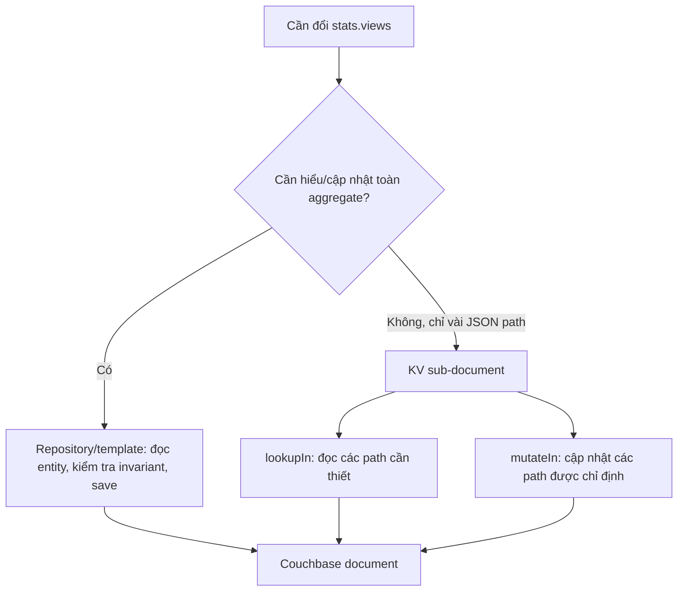

# Đọc hoặc sửa một phần tài liệu thay vì truyền toàn bộ JSON

## 1. Vì sao cần thao tác Sub-document?

Trong module **SPRING_DATA_COUCHBASE**, ứng dụng xây dựng tầng truy cập Couchbase bằng Spring Data: ánh xạ entity sang JSON document, dùng repository hoặc `CouchbaseTemplate`, truy vấn SQL++, thiết kế bucket/scope/collection, chỉ mục, TTL, CAS, giao dịch và API reactive. Cách làm quen thuộc khi sửa một thuộc tính là:

1. Đọc toàn bộ document thành entity.
2. Thay đổi một field trong Java.
3. Ghi lại toàn bộ document bằng `save` hoặc `replace`.

Đó là cách hợp lý khi cần kiểm tra, thay đổi hoặc xác thực **toàn bộ aggregate**. Tuy nhiên, với một document JSON lớn, đôi khi ứng dụng chỉ cần đọc `profile.display_name`, tăng `stats.views` hoặc thêm một nhãn vào `tags`. Việc truyền toàn bộ body cho một thay đổi nhỏ có thể gây tốn băng thông, serialization, cấp phát bộ nhớ và tăng nguy cơ ghi đè các field ngoài phạm vi nếu không quản lý concurrency đúng cách.

Couchbase cung cấp **Sub-document API** qua Key-Value (KV) để đọc hoặc biến đổi **một hay nhiều đường dẫn bên trong một document**:

- `lookupIn`: đọc các giá trị/path cụ thể mà không yêu cầu trả toàn bộ body.
- `mutateIn`: thực hiện các thao tác thêm, thay thế, xóa, tăng bộ đếm hoặc chỉnh array tại các path được chỉ định.

Sub-document không tạo ra một "document con" độc lập; tất cả path vẫn thuộc **cùng document key** trong một collection.

### Mục tiêu

Sau bài học, bạn có thể:

1. Phân biệt `get/replace` toàn document với `lookupIn/mutateIn` theo path.
2. Sử dụng Couchbase Java SDK để đọc/ghi một phần JSON mà không phải truyền lại toàn bộ body.
3. Hiểu `get`, `exists`, `count` và các thao tác `insert`, `upsert`, `replace`, `remove`, array operations, counter.
4. Đánh giá tính nguyên tử trong **một document**, giới hạn đối với nhiều document và điều kiện CAS.
5. Hiểu ảnh hưởng của TTL, durability, annotation Spring Data, `@Version`, `@Field` và custom conversions.
6. Chọn đúng giữa SDK sub-document, repository/template và SQL++.
7. Thiết kế lỗi, migration, kiểm thử và quan sát hiệu năng khi triển khai thực tế.

## 2. Document mẫu xuyên suốt

Giả sử collection `shop`.`app`.`users` có document key `user::42`. Body:

```json
{
  "_class": "com.example.UserDocument",
  "profile": {
    "display_name": "Lan",
    "city": "Da Nang",
    "email": "lan@example.test"
  },
  "stats": {
    "views": 17,
    "likes": 3
  },
  "tags": ["new", "member"],
  "preferences": {
    "locale": "vi-VN",
    "notifications": true
  },
  "schema_version": 1
}
```

Nếu chỉ muốn đọc tên hiển thị, tăng views và thêm tag `"vip"`, ta không cần thiết phải tải cả `profile`, `preferences` và các field khác chỉ để chỉnh một giá trị.

### 2.1. So sánh luồng thao tác



Không nên diễn giải sơ đồ thành "sub-document luôn nhanh hơn". Lợi ích phụ thuộc kích thước document, số field cần truy cập, tải mạng, độ phức tạp của thao tác và số lượt gọi KV. Một thao tác xử lý nhiều invariant phức tạp có thể phù hợp hơn khi đọc đầy đủ entity và ghi có CAS.

## 3. Sub-document khác gì với full-document API?

| Tiêu chí | `get`/`replace` toàn document | `lookupIn`/`mutateIn` |
| --- | --- | --- |
| Dữ liệu trả về khi đọc | Body đầy đủ | Chỉ các path được yêu cầu |
| Payload khi sửa | Thường gửi body mới đầy đủ | Gửi danh sách thao tác/path/giá trị |
| Lập mô hình Java | Có thể ánh xạ entity qua Spring Data | Thao tác trực tiếp lên JSON path qua SDK |
| Kiểm soát nhiều field | Toàn body, dễ chạy validator domain | Các path/spec được khai báo, cần tự bảo vệ invariant |
| Tính nguyên tử | Một mutation toàn document là atomic | Một `mutateIn` với nhiều specs áp dụng atomic trên **cùng** document |
| CAS | Có thể ghi với điều kiện CAS | Có thể dùng CAS trong `MutateInOptions` |
| TTL | Phải thiết kế theo loại mutation và options | Cũng phải chỉ rõ policy expiry/preserve expiry phù hợp |
| Chỉ mục SQL++ | GSI phản ánh dữ liệu sau mutation | GSI vẫn phải được cập nhật cho field/index liên quan |
| Giao dịch nhiều document | Không được đảm bảo chỉ vì `replace` | Không được đảm bảo chỉ vì `mutateIn` |

Sub-document thuộc **Key-Value access**. Không phải truy vấn `SELECT`/`UPDATE` SQL++ và thường không phải phương thức tự động của `CouchbaseRepository`. Spring Data repository hỗ trợ ánh xạ Java entity rất tốt, nhưng để dùng các thao tác cụ thể của Sub-document API, ứng dụng thường gọi **Couchbase Java SDK Collection**.

### 3.1. Những điều sub-document không tự làm

- Không tự chạy `MappingCouchbaseConverter` cho toàn entity.
- Không tự hiểu `@Field` hay gọi converter của `CouchbaseCustomConversions` khi bạn truyền raw JSON path/value.
- Không tự kiểm tra invariant domain của object chứa field vừa đổi.
- Không tự áp dụng chính sách `@Version` ở entity đã đọc trước đó nếu bạn không truyền CAS.
- Không tự chia một phép mutation thành transaction qua nhiều key.
- Không tự tạo chỉ mục, đảm bảo SQL++ read-after-write hoặc sinh audit event ở tầng ứng dụng.
- Không tự gia hạn/giữ TTL theo ý muốn nghiệp vụ; chính sách expiry phải được thiết lập/kiểm tra.

## 4. Chuẩn bị Couchbase Java SDK `Collection`

Các ví dụ Java dưới đây giả định ứng dụng đã khởi tạo được `Cluster` từ cấu hình an toàn (ví dụ bean Spring đã kết nối Couchbase). Không hard-code credential vào code.

```java
import com.couchbase.client.java.Cluster;
import com.couchbase.client.java.Collection;

// cluster là bean/client đã được tạo và quản lý lifecycle.
Collection users = cluster
    .bucket("shop")
    .scope("app")
    .collection("users");

String id = "user::42";
```

- `shop` là bucket.
- `app` là scope.
- `users` là collection.
- `user::42` là document key.

Nếu ứng dụng dùng default scope/collection, đường lấy collection có thể khác. Dù vậy, **document key vẫn là điểm truy cập trực tiếp của KV**; một điều kiện SQL++ tùy ý trên mọi document không phải lookup theo key.

Trong Spring Data Couchbase, có thể sử dụng cùng cấu hình kết nối và collection đã quản lý, nhưng phải kiểm tra chính xác cơ chế chọn scope/collection theo ứng dụng. Không tự suy rằng repository đang làm việc trên `shop.app.users` chỉ vì SDK code đã chọn collection đó.

## 5. Đọc một phần với `lookupIn`

Java SDK cung cấp các spec để yêu cầu các phần của body. Ba thao tác thường dùng:

- `LookupInSpec.get(path)`: lấy giá trị tại path.
- `LookupInSpec.exists(path)`: kiểm tra path có tồn tại.
- `LookupInSpec.count(path)`: đếm phần tử tại một array hoặc object theo khả năng API và kiểu dữ liệu.

### 5.1. Đọc nhiều path trong một lần gọi

```java
import java.util.List;
import com.couchbase.client.java.kv.LookupInResult;
import com.couchbase.client.java.kv.LookupInSpec;

LookupInResult result = users.lookupIn(
    "user::42",
    List.of(
        LookupInSpec.get("profile.display_name"),
        LookupInSpec.exists("profile.phone"),
        LookupInSpec.get("stats.views"),
        LookupInSpec.count("tags")
    )
);

String displayName = result.contentAs(0, String.class);
boolean phoneExists = result.exists(1);
long views = result.contentAs(2, Long.class);
int tagCount = result.contentAs(3, Integer.class);
```

**Chỉ số kết quả theo đúng vị trí spec trong danh sách**, bắt đầu từ 0. Nếu đổi thứ tự specs mà quên đổi chỉ số `contentAs`, code có thể đọc nhầm field hoặc lỗi kiểu. Hãy đóng gói các index thành constant hoặc tách logic parse rõ ràng trong code production.

`exists` trả về thông tin tồn tại của path, không thay thế quy tắc validation nghiệp vụ. Cần phân biệt một path không tồn tại với path tồn tại nhưng chứa JSON `null` trong những nghiệp vụ yêu cầu.

### 5.2. Chỉ đọc một path

```java
LookupInResult result = users.lookupIn(
    "user::42",
    List.of(LookupInSpec.get("preferences.locale"))
);

String locale = result.contentAs(0, String.class);
```

Đây là cách hợp lý nếu chỉ cần locale mà body chứa nhiều field không liên quan. Tuy nhiên, mỗi lần gọi KV vẫn có overhead mạng; nếu cùng request cần mười field, nên cân nhắc **gom nhiều specs trong một `lookupIn`** thay vì mười network round trips.

### 5.3. Không có path thì sao?

Nếu `LookupInSpec.get("profile.phone")` gặp path chưa tồn tại, SDK có thể báo lỗi path hoặc trả trạng thái spec không thành công tùy kiểu thao tác và API kết quả. Không nên viết code dựa trên giả định mọi `get` của path thiếu sẽ trả `null`.

Với field optional, sử dụng `exists` hoặc cơ chế kiểm tra lỗi/trạng thái spec phù hợp; với field bắt buộc, chuyển lỗi thành kết quả domain có ngữ cảnh. Hãy test riêng:

- Document key không tồn tại.
- Document tồn tại nhưng object `profile` không tồn tại.
- `profile` tồn tại nhưng `phone` thiếu.
- `profile.phone` là JSON null.
- `profile.phone` là object trong khi Java kỳ vọng string.

## 6. Sửa một phần với `mutateIn`

`MutateInSpec` định nghĩa từng thao tác trên path. Các phép thường gặp:

| Spec | Ý nghĩa | Điều cần chú ý |
| --- | --- | --- |
| `insert(path,value)` | Thêm field/path mới nếu chưa có | Path đã tồn tại có thể báo lỗi; document cần tồn tại nếu không đặt store semantics tương ứng. |
| `upsert(path,value)` | Tạo hoặc thay thế value tại path | Khác với upsert **toàn document**; thiếu parent path có thể cần `createPath()`. |
| `replace(path,value)` | Thay một path đang tồn tại | Path thiếu bị lỗi, thích hợp khi không muốn vô tình tạo field. |
| `remove(path)` | Xóa field/path | Nếu path không có, xử lý theo lỗi thay vì xem là update thành công. |
| `arrayAppend(path,value)` | Thêm phần tử cuối array | Có thể tạo phần tử trùng, cần policy về duplicate. |
| `arrayPrepend(path,value)` | Thêm phần tử đầu array | Làm thay đổi index của các phần tử khác. |
| `arrayInsert(path,value)` | Chèn vào vị trí array được chỉ định | Dễ race nếu nhiều writer sửa vị trí. |
| `arrayAddUnique(path,value)` | Thêm vào array với quy tắc không trùng được hỗ trợ | Không thay thế kiểm tra uniqueness nghiệp vụ cho mọi loại JSON phức tạp. |
| `increment/decrement(path,delta)` | Cập nhật counter số nguyên | Không tự kiểm chứng các invariant về số dư hoặc số tiền. |

Mỗi spec có hợp đồng đối với sự tồn tại/kiểu JSON của path; một spec sai có thể làm cả mutation request thất bại. Tránh chạy nhiều thao tác rồi giả định một số spec trước đó đã được commit nếu request không thành công.

### 6.1. Sửa tên hiển thị và tăng lượt xem trong một request

```java
import java.util.List;
import com.couchbase.client.java.kv.MutateInResult;
import com.couchbase.client.java.kv.MutateInSpec;

MutateInResult changed = users.mutateIn(
    "user::42",
    List.of(
        MutateInSpec.replace(
            "profile.display_name", "Lan Nguyen"),
        MutateInSpec.increment(
            "stats.views", 1)
    )
);

long newCas = changed.cas();
```

Hai thay đổi cùng nằm trong document `user::42`. Nếu cả request thành công, chúng được áp dụng cùng nhau ở mức document. Nếu một spec không hợp lệ, ứng dụng cần xử lý lỗi thay vì báo đã đổi tên/tăng lượt xem.

**Điều cần phân biệt:** thao tác `increment` trên một field số nguyên có semantics khác với `get`, cộng trong Java rồi `upsert`. Phép increment thực hiện tại server giúp tránh race của phép read-modify-write đơn giản; tuy vậy, nó không tự kiểm soát toàn bộ workflow nghiệp vụ như giới hạn số dư hay điều kiện chuyển trạng thái.

### 6.2. `upsert` một field không phải `upsert` document mới

```java
users.mutateIn(
    "user::42",
    List.of(
        MutateInSpec.upsert(
            "preferences.locale", "en-US")
    )
);
```

Spec `upsert` ở đây nói về **JSON path**; mặc định document key `user::42` vẫn phải tồn tại. Nếu muốn tạo document khi key chưa có, SDK có tùy chọn store semantics cho mutate-in ở các phiên bản hỗ trợ. Khi dùng lựa chọn đó, cần cân nhắc type hint, required fields và entity contract, vì một document chỉ chứa `preferences.locale` có thể không hợp lệ cho repository.

### 6.3. Parent path chưa tồn tại

Giả sử document chưa có `preferences`. Upsert `preferences.locale` có thể lỗi do parent path không tồn tại. Với SDK hỗ trợ tùy chọn tạo intermediate path:

```java
users.mutateIn(
    "user::42",
    List.of(
        MutateInSpec.upsert(
            "preferences.locale", "vi-VN")
            .createPath()
    )
);
```

`createPath()` giúp tạo object trung gian khi cần. Nó **không biến một parent có kiểu sai** (ví dụ `preferences` đang là string) thành object an toàn; trước khi dựa vào tính năng này, hãy quyết định chính sách đối với schema cũ/sai.

### 6.4. Xóa field optional

```java
users.mutateIn(
    "user::42",
    List.of(
        MutateInSpec.remove("profile.email")
    )
);
```

Xóa field khác với đặt field thành JSON `null`. Trong SQL++, `profile.email IS MISSING` và `profile.email IS NULL` là hai điều kiện khác nhau. Nếu mô hình Spring Data dùng record có email bắt buộc, xóa trực tiếp bằng SDK có thể khiến lần `repository.findById` tiếp theo lỗi hoặc trả entity thiếu dữ liệu.

## 7. Đường dẫn JSON: tên thật, nesting và array index

Sub-document path dựa trên **tên field trong JSON được lưu**, không phải tên property Java hoặc tên getter. Ví dụ:

```java
@Field("display_name")
private String displayName;
```

Spring Data map Java `displayName` thành JSON `display_name`. SDK subdoc muốn truy cập cùng field phải dùng path `profile.display_name` chứ không phải `profile.displayName`.

### 7.1. Nested path

| JSON | Path |
| --- | --- |
| `{"profile":{"display_name":"Lan"}}` | `profile.display_name` |
| `{"stats":{"views":17}}` | `stats.views` |
| `{"preferences":{"notifications":true}}` | `preferences.notifications` |
| `{"items":[{"sku":"A","qty":2}]}` | `items[0].qty` |

Array index truy cập **vị trí hiện tại**, không phải ID ổn định của phần tử. Khi nhiều writer thêm/xóa/chèn vào array, index có thể đổi ngay trước khi mutation được áp dụng. Với danh sách có phần tử mang business ID, không nên dùng vị trí array như identity bền vững.

### 7.2. Tên field chứa dấu chấm hoặc ký tự đặc biệt

Nếu một key JSON thực sự tên là `"billing.address"`, đó là **một field name** khác với object lồng nhau `{"billing":{"address":...}}`. Sub-document path có cú pháp escape/quote dành cho field name chứa dấu chấm hoặc ký tự đặc biệt. Tránh tự nối raw user input thành path; dùng cách escape theo tài liệu SDK và whitelist path được phép sửa.

Quy tắc tốt là chuẩn hóa JSON field name dễ dùng như `billing_address` hoặc `billing.address` chỉ khi cần nested object theo chủ đích. Đừng phụ thuộc vào việc SDK tự "đoán" liệu dấu chấm là separator hay một phần của key.

### 7.3. Document key không phải Sub-document path

`META().id` là document key ở metadata server, không nhất thiết có field `id` bên trong JSON. Không dùng `MutateInSpec.upsert("id", ...)` để đổi document key. Nếu cần đổi key, đó là migration về định danh/lưu trữ, có ảnh hưởng đến uniqueness, liên kết và concurrency.

## 8. Array operations: khi nào an toàn và khi nào dễ sai?

Với document:

```json
{
  "tags": ["new", "member"]
}
```

Thêm tag vào cuối:

```java
users.mutateIn(
    "user::42",
    List.of(
        MutateInSpec.arrayAppend("tags", "vip")
    )
);
```

Sau khi thành công, array có thể thành `["new","member","vip"]`. Phép `arrayAppend` không tự bảo đảm không trùng; hai request cùng append `"vip"` có thể tạo hai entry. Nếu cần không trùng theo primitive JSON value, đánh giá `arrayAddUnique` và giới hạn của nó; nếu tag là cấu trúc phức tạp hay uniqueness phụ thuộc nhiều field, hãy thiết kế riêng.

### 8.1. Chèn theo vị trí có rủi ro concurrency

`arrayInsert` ở `items[0]` có thể làm dịch toàn bộ vị trí. Nếu một request khác sửa `items[1]` dựa trên array cũ, vị trí logic có thể thay đổi. Có thể kết hợp CAS nếu cần bảo đảm array không bị thay đổi giữa lúc đọc và ghi, hoặc dùng document ID riêng cho mỗi item khi domain cần cập nhật độc lập.

### 8.2. Không dùng array làm sổ cái tăng trưởng vô hạn

Sub-document giúp append một event dễ dàng, nhưng document vẫn có giới hạn kích thước và có thể trở thành điểm nóng ghi. Với log sự kiện không giới hạn, audit hoặc lịch sử giao dịch, hãy cân nhắc **mỗi event một document** hoặc mô hình chia lô thay vì append tất cả vào một array lớn.

## 9. Counter: atomic increment không đồng nghĩa kiểm tra invariant

Tăng `stats.views` là một dạng counter:

```java
users.mutateIn(
    "user::42",
    List.of(
        MutateInSpec.increment("stats.views", 1)
    )
);
```

Nhiều request tăng một counter có thể được server xử lý mà không cần ứng dụng tự `get` → `views + 1` → `replace` toàn body. Đây là ứng dụng phù hợp của subdoc counter.

Nhưng nếu field đại diện `balance_minor`, vấn đề khác hẳn:

- Phép `decrement(balance_minor, amount)` không tự kiểm tra số dư không âm.
- Không tự ghi đồng thời một ledger event ở document khác.
- Không tự đảm bảo idempotency khi client retry sau timeout.
- Không tự phát hiện currency/scale bị đổi.
- Không tự bảo vệ ràng buộc nghiệp vụ giữa các tài khoản.

Với nghiệp vụ tiền, cần transaction/conditional update/ledger, CAS và idempotency theo mô hình cụ thể. Đừng dùng counter subdoc như phép thay thế mặc định cho logic thanh toán.

## 10. Tính nguyên tử của `mutateIn`

Một mutation request có thể chứa nhiều specs trên **cùng document**:

```java
users.mutateIn(
    "user::42",
    List.of(
        MutateInSpec.replace("profile.city", "Ha Noi"),
        MutateInSpec.upsert(
            "preferences.notifications", false),
        MutateInSpec.increment("stats.views", 1)
    )
);
```

Khi request thành công, các specs được áp dụng như một mutation atomic ở mức document. Nếu một spec thất bại, không nên giả định các spec khác trong cùng request đã được commit riêng lẻ.

Điều này khác **ba request mutateIn độc lập**: giữa các request riêng biệt có thể có writer khác sửa document, một request có thể thành công trong khi request sau thất bại, và ứng dụng cần thiết kế retry/rollback riêng.

### 10.1. Giới hạn quy mô một request

Sub-document API có giới hạn số specs/path và giới hạn kích thước request theo server/SDK version. Không nên đóng gói tùy ý hàng trăm chỉnh sửa vào một `mutateIn` rồi kỳ vọng SDK tự chia nhỏ mà vẫn giữ atomicity. Kiểm tra giới hạn chính thức của phiên bản Couchbase đang triển khai và thiết kế batch/transaction nếu vượt quá.

### 10.2. Atomicity không tự mở rộng qua hai keys

Giả sử cần đổi:

- `user::42`: tăng số lượt xem.
- `userStats::42`: cập nhật thống kê tổng.

Hai mutation trên hai key khác nhau **không trở thành atomic chỉ vì cùng Java method**. Nếu cần bảo đảm hoặc bù trừ nhất quán giữa nhiều document, xem xét Couchbase transactions hoặc mô hình eventual consistency/idempotency và reconciliation theo yêu cầu.

## 11. CAS: cập nhật có điều kiện khi logic phụ thuộc giá trị đã đọc

CAS (Compare-And-Swap) là metadata phiên bản mutation do Couchbase quản lý. Khi client đọc document, nó nhận CAS; khi ghi với điều kiện CAS đó, server chỉ chấp nhận nếu document chưa bị mutation khác thay đổi.

Với subdoc, có thể đọc một phần cùng CAS rồi mutation có điều kiện:

```java
import java.util.List;
import com.couchbase.client.java.kv.LookupInResult;
import com.couchbase.client.java.kv.LookupInSpec;
import com.couchbase.client.java.kv.MutateInSpec;
import com.couchbase.client.java.kv.MutateInOptions;

LookupInResult current = users.lookupIn(
    "user::42",
    List.of(LookupInSpec.get("profile.city"))
);

String city = current.contentAs(0, String.class);
long expectedCas = current.cas();

if ("Da Nang".equals(city)) {
    users.mutateIn(
        "user::42",
        List.of(
            MutateInSpec.replace(
                "profile.city", "Ha Noi")
        ),
        MutateInOptions.mutateInOptions()
            .cas(expectedCas)
    );
}
```

Nếu một writer khác đã sửa document sau `lookupIn`, mutation CAS có thể bị từ chối. Khi xử lý conflict:

1. Đọc lại giá trị và CAS mới.
2. Đánh giá lại điều kiện nghiệp vụ.
3. Retry có giới hạn và backoff nếu trường hợp cho phép.
4. Trả conflict nếu user cần quyết định, tránh ghi đè mù.

**CAS không phải `schema_version`**: schema version là field nghiệp vụ có thể nằm trong body; CAS do server thay đổi mỗi lần mutation và bảo vệ concurrency.

### 11.1. Vì sao `@Version` trên Spring Data entity có thể liên quan?

Khi repository sử dụng `@Version` và optimistic locking, entity cũ giữ CAS/version mà nó đọc trước đó. Một subdoc mutation qua SDK làm CAS của document thay đổi. Lần `save` tiếp theo của entity cũ **có thể gặp conflict** — đó là tín hiệu bảo vệ cập nhật đồng thời, không phải lỗi conversion.

Ngược lại, nếu repository ghi toàn body mà **không có kiểm tra CAS/optimistic locking thích hợp**, nó có thể ghi đè thay đổi subdoc mới dù code chỉ cố sửa một property không liên quan. Trong hệ thống trộn repository với SDK sub-document, phải thống nhất chiến lược CAS/version.

## 12. TTL/expiry: không đánh mất vòng đời document

TTL là metadata của document. Một số mutation hoặc API có thể dùng tùy chọn expiry/preserve expiry; hành vi mặc định và lựa chọn cụ thể cần kiểm tra theo phiên bản SDK/server.

Nếu yêu cầu "thay display name nhưng không làm đổi thời điểm hết hạn của session", nên chỉ định rõ chính sách bảo toàn expiry khi API hỗ trợ:

```java
import com.couchbase.client.java.kv.MutateInOptions;

users.mutateIn(
    "user::42",
    List.of(
        MutateInSpec.replace(
            "profile.display_name", "Lan Nguyen")
    ),
    MutateInOptions.mutateInOptions()
        .preserveExpiry(true)
);
```

Khi API/phiên bản hỗ trợ `preserveExpiry(true)`, tùy chọn này biểu đạt ý định không reset expiry đã tồn tại. Nhưng phải **kiểm tra trong integration test**: không xem mọi mutation type hoặc phiên bản đều có cùng default TTL behavior.

Một case khác: lượt truy cập có thể **gia hạn phiên hoạt động**. Khi đó chính sách expiry có thể chủ động thay đổi, nhưng phải có lý do nghiệp vụ và test rõ ràng. Việc dùng subdoc thay full-document không tự quyết định chính sách sliding expiration.

### 12.1. Durability

Một mutation KV có thể hỗ trợ durability option phù hợp với yêu cầu; tăng durability thường có chi phí độ trễ. Cần phân biệt:

- **Atomicity trong một document:** các specs trong cùng `mutateIn` được áp dụng cùng nhau.
- **Durability:** mức đảm bảo mutation đã được lưu/replicate theo chính sách.
- **Consistency của query SQL++:** thời điểm GSI nhìn thấy mutation.

Ba khái niệm này không thay thế nhau. Một mutation atomic vẫn có thể không xuất hiện ngay trong một SQL++ query dùng mức scan consistency thấp.

## 13. Đường đi Spring Data và SDK raw: ranh giới quan trọng

Một entity Spring Data có thể khai báo:

```java
import org.springframework.data.annotation.Id;
import org.springframework.data.annotation.Version;
import org.springframework.data.couchbase.core.mapping.Document;
import org.springframework.data.couchbase.core.mapping.Field;

@Document
public class UserDocument {
    @Id
    private String id;

    @Field("profile")
    private Profile profile;

    @Field("stats")
    private UserStats stats;

    @Version
    private Long version;

    // Constructor và accessor được định nghĩa trong ứng dụng.
}
```

Trong repository, metadata `@Id`, `@Field`, `@Version` và custom converters được áp dụng theo pipeline mapping Spring Data.

Trong SDK subdoc:

```java
users.mutateIn(
    "user::42",
    List.of(
        MutateInSpec.replace(
            "profile.display_name", "Lan Nguyen")
    )
);
```

SDK nhận **document key + JSON path + JSON value**, không nhận entity `UserDocument`. Nó không tự chạy setter, Java Bean Validation, entity callbacks, auditing listener hay converter `SkuCode → String` của Spring Data.

### 13.1. Nếu field có `@Field` khác tên Java

Giả sử `Profile` có:

```java
@Field("display_name")
private String displayName;
```

Path SDK phải dùng `profile.display_name`. Nếu code refactor annotation thành `@Field("name")` nhưng SDK vẫn sửa `profile.display_name`, application có thể xuất hiện hai field hoặc cập nhật "đúng code nhưng sai schema". Mỗi thay đổi field mapping cần đi qua contract tests cho SDK subdoc và SQL++.

### 13.2. Nếu field có custom converter

Giả sử `Money` được ghi thành `{"amountMinor":1999,"currency":"USD"}` qua mapping. Nếu SDK subdoc sửa `order.total`, phải gửi **JSON có đúng format**:

```json
{
  "amountMinor": 1999,
  "currency": "USD"
}
```

SDK không tự gọi `CouchbaseCustomConversions` của Spring Data để tạo JSON đúng. Nếu chuyển custom converter mới sang string mà SDK vẫn gửi object, cùng collection sẽ có mixed schema. Cần chia sẻ một mapper/contract hoặc ưu tiên đường repository khi phần cập nhật đòi logic miền phức tạp.

### 13.3. Audit, callback và validation

Nếu repository `save` kích hoạt callbacks hoặc audit như `modifiedAt`, một SDK `mutateIn` trực tiếp **không tự áp dụng các quy tắc Spring Data đó**. Khi cần audit:

- Bổ sung path cập nhật timestamp trong **cùng** mutation nếu hợp đồng cho phép.
- Hoặc gọi một service thống nhất validate và ghi event.
- Với ràng buộc phức tạp, dùng entity aggregate và persistence adapter được thiết kế riêng.

Đừng chỉ nhìn JSON value cập nhật đúng mà bỏ qua audit, authorization và business invariant.

## 14. Sub-document so với SQL++ UPDATE

Cả Sub-document API và SQL++ đều có thể cập nhật một phần dữ liệu nhưng cơ chế khác nhau.

### 14.1. KV sub-document: khi biết document key

```java
users.mutateIn(
    "user::42",
    List.of(
        MutateInSpec.upsert("profile.city", "Ha Noi")
    )
);
```

Thường phù hợp khi:

- Đã biết key `user::42`.
- Chỉ cần vài path trong document đó.
- Cần độ trễ KV thấp và không cần query tìm nhiều documents.
- Muốn cập nhật atomic nhiều path trên **một** document.

### 14.2. SQL++ UPDATE: khi cần predicate trên tập documents

```sql
UPDATE `shop`.`app`.`users` AS u
SET u.profile.city = "Ha Noi"
WHERE META(u).id = "user::42"
RETURNING META(u).id AS userId, u.profile.city;
```

SQL++ thích hợp khi cần xác định documents bằng predicate/query hoặc thao tác có điều kiện trên nhiều records. Nhưng nó sử dụng Query service, có kế hoạch thực thi, index và semantics riêng. Nếu đã biết key, KV sub-document thường là đường tự nhiên hơn cho cập nhật đơn giản.

**Không đánh đồng** SQL++ UPDATE với transaction nhiều document. Một statement có thể ảnh hưởng nhiều document nhưng muốn đảm bảo invariant đa document vẫn cần đánh giá transaction và độ nhất quán theo nghiệp vụ. Tương tự, một SQL++ query ngay sau KV mutation có thể chưa thấy update trong GSI vì scan consistency.

### 14.3. Kết hợp repository, subdoc và SQL++

| Nhu cầu | Lựa chọn khởi đầu |
| --- | --- |
| Đọc/sửa toàn aggregate, validation phức tạp | Repository hoặc `CouchbaseTemplate` và entity mapper |
| Đọc vài field theo document key | `lookupIn` |
| Sửa vài field theo document key | `mutateIn` |
| Atomic tăng counter đơn giản trong một document | Subdoc increment hoặc counter API phù hợp |
| Tìm/sửa documents theo điều kiện không biết key | SQL++ SELECT/UPDATE |
| Đổi nhiều document theo một invariant mạnh | Transaction/thiết kế nhất quán phù hợp |
| Dữ liệu cần xử lý qua converter phức tạp | Domain mapper/repository hoặc adapter riêng nhất quán schema |

## 15. LookupIn và MutateIn có giới hạn và lỗi riêng

Các lỗi thường gặp:

| Loại | Ví dụ | Cách xử lý |
| --- | --- | --- |
| Document key không tồn tại | `user::404` | Phân biệt not found với path missing; 404 nghiệp vụ nếu phù hợp. |
| Path không tồn tại | `profile.phone` chưa được ghi | Dùng `exists`, `upsert` hoặc compatible reader theo contract. |
| Path đã tồn tại | `insert("profile.city", ...)` khi đã có city | Sử dụng `replace` nếu cập nhật field, `upsert` nếu cho phép cả hai. |
| Parent sai kiểu | `profile` là string nhưng sửa `profile.city` | Kiểm kê schema, không tự phá dữ liệu để tạo object. |
| Array sai kiểu | `tags` là object nhưng dùng `arrayAppend` | Validation/migration, báo lỗi rõ. |
| Counter sai kiểu | `stats.views` là string | Không tự chuyển bằng cách đoán khi dữ liệu lịch sử sai format. |
| Index array đã đổi | Writer chèn/xóa phần tử khác | Dùng CAS hoặc model keyed documents cho phần tử độc lập. |
| CAS mismatch | Document bị writer khác sửa | Đọc lại, đánh giá nghiệp vụ, retry có giới hạn. |
| Timeout/network | Không biết mutation đã được áp dụng hay chưa | Kiểm tra lại state/idempotency trước khi retry side effect. |
| Không có quyền | Role thiếu quyền KV cho collection | Kiểm tra RBAC, không retry vô hạn. |
| Quá nhiều specs | Vượt giới hạn SDK/server | Chia workflow, không đánh mất yêu cầu atomicity. |
| JSON value không được serializer hỗ trợ | Object Java tùy ý | Chuẩn hóa thành JSON-compatible value bằng serializer/mapper đã kiểm chứng. |

Không cố bắt mọi exception rồi gọi `upsert` để "sửa lỗi". Điều đó có thể che giấu schema drift, bypass validation hoặc tạo dữ liệu không hợp lệ.

### 15.1. Phân biệt `insert`, `replace` và `upsert`

- **insert**: cần field chưa tồn tại. Phù hợp khi tạo lần đầu và muốn phát hiện ghi trùng.
- **replace**: cần field đã tồn tại. Phù hợp khi update field bắt buộc và muốn fail nếu schema khác kỳ vọng.
- **upsert**: linh hoạt hơn, nhưng cũng có thể che giấu một field đang bị thiếu ngoài ý muốn.

Chọn spec dựa trên **hợp đồng dữ liệu**, không chỉ dựa trên phương thức nào ít gây exception nhất.

## 16. Đảm bảo đúng business invariant trước khi chỉnh một field

Một Sub-document mutation nhỏ vẫn có thể phá logic domain. Ví dụ document đơn hàng:

```json
{
  "status": "SHIPPED",
  "amount_minor": 1999,
  "currency": "USD",
  "lines": [
    { "sku": "BOOK-01", "qty": 1 }
  ]
}
```

Nếu SDK cho phép sửa `amount_minor` thành `1` mà không cập nhật lines, tổng tiền không còn khớp. Nếu sửa `status` từ `SHIPPED` về `CREATED` mà không có state machine, quy trình nghiệp vụ bị phá.

Có ba hướng:

1. **KV subdoc với logic kiểm tra và CAS:** đọc các field cần thiết qua `lookupIn`; validation trong service; ghi với CAS; tái đánh giá khi conflict.
2. **Repository với aggregate đầy đủ:** lấy entity, chạy domain methods, save với optimistic locking.
3. **Transaction/ledger/event:** khi invariant trải qua nhiều documents hay thao tác bên ngoài.

Subdoc phù hợp khi số field liên quan ít và logic có thể kiểm soát rõ ràng; đừng dùng nó để bypass domain rules chỉ vì payload nhỏ.

## 17. Một mẫu service thao tác sub-document có kiểm soát

Có thể tạo một persistence adapter riêng cho thao tác thay tên hiển thị. Pseudocode Java dưới đây minh họa trình tự, không bao gồm toàn bộ dependency injection/retry:

```java
import java.util.List;
import com.couchbase.client.java.Collection;
import com.couchbase.client.java.kv.LookupInResult;
import com.couchbase.client.java.kv.LookupInSpec;
import com.couchbase.client.java.kv.MutateInSpec;
import com.couchbase.client.java.kv.MutateInOptions;

public final class UserProfilePatchStore {
    private final Collection users;

    public UserProfilePatchStore(Collection users) {
        this.users = users;
    }

    public void changeNameIfCurrent(
            String id, String expectedName, String newName) {

        if (newName == null || newName.isBlank()) {
            throw new IllegalArgumentException("Invalid name");
        }

        LookupInResult before = users.lookupIn(
            id,
            List.of(LookupInSpec.get("profile.display_name"))
        );
        String actual = before.contentAs(0, String.class);

        if (!expectedName.equals(actual)) {
            throw new IllegalStateException("Name changed");
        }

        users.mutateIn(
            id,
            List.of(MutateInSpec.replace(
                "profile.display_name", newName)),
            MutateInOptions.mutateInOptions()
                .cas(before.cas())
                .preserveExpiry(true)
        );
    }
}
```

Phương thức này minh họa:

- Validate giá trị trước khi ghi.
- Đọc duy nhất field cần thiết.
- Dùng CAS từ `lookupIn`.
- Chỉ sửa path được phép.
- Bảo toàn expiry theo ý định khi tùy chọn được hỗ trợ.

Trong ứng dụng thực tế, hãy ánh xạ CAS conflict thành lỗi/domain response rõ, bảo vệ authorization, quyết định retry, audit và test version SDK. Nếu có nhiều hành động nghiệp vụ trong transaction, mẫu này chưa đủ.

## 18. Reactive Sub-document operations

Khi ứng dụng dùng WebFlux/reactive repository, Couchbase Java SDK cũng có các API reactive cho KV/subdoc. Mục tiêu vẫn là không tải toàn body khi chỉ cần vài path.

Ví dụ dạng API reactive SDK (giả sử `users` là `Collection` đã được khởi tạo):

```java
import java.util.List;
import reactor.core.publisher.Mono;
import com.couchbase.client.java.kv.LookupInResult;
import com.couchbase.client.java.kv.LookupInSpec;

Mono<LookupInResult> resultMono =
    users.reactive().lookupIn(
        "user::42",
        List.of(
            LookupInSpec.get("profile.display_name")
        )
    );

Mono<String> nameMono = resultMono.map(
    result -> result.contentAs(0, String.class)
);
```

Publisher thường chỉ thực thi khi được subscribe. Trong test, dùng `StepVerifier` hoặc cơ chế test tương đương để xác minh value, completion/error signal; không xem việc tạo `Mono` là một KV read đã hoàn thành.

### 18.1. Tránh block trong pipeline reactive

Không gọi `users.lookupIn(...)` blocking ngay trong luồng event-loop chỉ để lấy một field. Nếu API reactive phù hợp có sẵn, dùng nó và bảo toàn reactive flow. Việc trộn blocking/nonblocking sai chỗ có thể làm giảm throughput dù payload subdocument nhỏ.

### 18.2. Dù reactive, conversion vẫn không tự chạy

`users.reactive().mutateIn(...)` dùng SDK raw JSON path, không phải pipeline entity của Spring Data reactive repository. Muốn cập nhật một domain value object, phải chuyển value sang JSON tương thích và đảm bảo field path đúng. Chỉ đổi loại publisher không tự đưa `@Field`, `@TypeAlias` hay validation vào SDK call.

## 19. GSI, SQL++ query và khả năng quan sát sau mutation

Subdoc `mutateIn` thay đổi document KV. Các index SQL++ liên quan đến field đã sửa được Couchbase duy trì theo cơ chế index, nhưng việc một `SELECT` ngay sau mutate có nhìn thấy update phụ thuộc query consistency.

Ví dụ:

```sql
SELECT META(u).id AS userId,
       u.profile.city
FROM `shop`.`app`.`users` AS u
WHERE u.profile.city = "Ha Noi";
```

Nếu vừa đổi city qua KV, một query dùng secondary index có thể chưa thấy mutation ngay trong một số mức consistency. Để kiểm tra tính đúng, so sánh:

1. `lookupIn` trực tiếp theo key `user::42`.
2. `SELECT` với query consistency phù hợp khi yêu cầu read-after-write.
3. `EXPLAIN` của query để biết index nào phục vụ predicate.

### 19.1. Subdoc không giảm chi phí duy trì index xuống bằng không

Nếu update `profile.city` và GSI có index trên `profile.city`, server vẫn phải cập nhật những entry index liên quan. Lợi ích của payload nhỏ hơn **không loại bỏ chi phí index maintenance**.

Một index ví dụ:

```sql
CREATE INDEX ix_users_city
ON `shop`.`app`.`users`(profile.city);
```

Nếu mapping đổi tên path thành `profile.city_name`, cả `mutateIn`, `SELECT` và index expression cần chuyển theo. Không dùng Java property name thay cho JSON path.

### 19.2. Đừng so sánh hiệu năng từ một request duy nhất

Khi benchmark subdoc và full document:

- So sánh document có kích thước tương đương, cả payload nhỏ lẫn lớn.
- Đo p50/p95/p99 latency, không chỉ trung bình.
- Kiểm tra tỉ lệ CAS conflict, retries, kích thước request/response.
- Đo ảnh hưởng từ GSI, durability và expiry policy.
- Tính cả số lượt round trip: một `lookupIn` + một `mutateIn` có thể tốn nhiều hơn một `replace` trong vài workload.
- Đánh giá CPU/GC do materialize entity, serialization và số lượng request đồng thời.
- Kiểm tra giới hạn document size và hot-key contention.

Chọn API theo **mẫu truy cập và invariant**, không mặc định subdoc luôn là tối ưu tuyệt đối.

## 20. Schema evolution và thao tác với path lịch sử

Giả sử V1 lưu:

```json
{
  "profile": {
    "displayName": "Lan"
  }
}
```

V2 lưu:

```json
{
  "profile": {
    "display_name": "Lan"
  },
  "schema_version": 2
}
```

Nếu SDK subdoc chỉ dùng `profile.display_name`, document V1 có thể không chứa path đó. Một `upsert` sẽ tạo field mới, nhưng giữ lại `profile.displayName` cũ nếu không có bước migration, khiến hai giá trị cùng tồn tại và reader khác nhau thấy kết quả khác nhau.

Chiến lược:

1. Kiểm kê JSON V1/V2 bằng SQL++ hoặc raw KV sample.
2. Quy định tên field đích và version.
3. Triển khai compatible reader/adapter với path cũ và mới trong thời gian chuyển tiếp.
4. Khi migrate, thay path cũ sang mới theo CAS và cập nhật `schema_version` trong cùng mutation nếu phù hợp.
5. Kiểm tra cả hai path sau migration; không giữ dữ liệu mâu thuẫn.
6. Cập nhật Spring Data `@Field`, repository query, SQL++ index và SDK code cùng lúc theo kế hoạch rollout.
7. Chỉ bỏ hỗ trợ V1 sau khi mọi producer/consumer đã chuyển.

Một `createPath()` không thay thế migration: nó tạo cấu trúc nếu thiếu, nhưng không biết field cũ cần được chuyển hay xóa, không chuyển đổi enum hay bảo toàn domain validation.

### 20.1. Null, MISSING và JSON type

`{"profile":{"city":null}}` khác `{"profile":{}}`. Khi query:

```sql
SELECT META(u).id AS userId,
       u.profile.city
FROM `shop`.`app`.`users` AS u
WHERE u.profile.city IS NULL
   OR u.profile.city IS MISSING;
```

Dùng `lookupIn` để phân biệt path tồn tại và giá trị null theo semantics của SDK/operation; kiểm thử đặc biệt với required fields. Nếu parent `profile` không tồn tại hoặc đang là scalar, thao tác đọc/sửa nested path phải có chính sách lỗi/migration, không tự suy thành JSON object.

## 21. Sub-document và XATTR: một khả năng nâng cao

Couchbase còn hỗ trợ thao tác Sub-document trên **extended attributes (XATTRs)** với tùy chọn/flag phù hợp. XATTRs có mục đích và ràng buộc riêng, không phải mọi path trong body JSON đều tương đương với metadata server hay XATTR.

Đối với bài này, các ví dụ tập trung vào **body JSON**. Khi làm việc với XATTR, phải dùng đúng API, quyền truy cập và chính sách hệ thống; không suy rằng một spec `upsert("meta.key", ...)` trên body sẽ tự ghi vào XATTR. CAS, expiry, ID và type mapper của Spring Data không tự trở thành field body qua subdoc.

## 22. Bảo mật: không nhận JSON path bất kỳ từ client

Một endpoint kiểu `PATCH /users/{id}` rất dễ bị viết thành:

```java
// Không an toàn nếu path lấy trực tiếp từ client tùy ý:
users.mutateIn(
    id,
    List.of(MutateInSpec.upsert(
        userSuppliedPath, userSuppliedValue))
);
```

Nếu client được chọn path không giới hạn, họ có thể sửa `_class`, `schema_version`, `roles`, `balance_minor` hoặc field bảo mật khác. Ngay cả khi Couchbase RBAC chỉ cho phép collection, **authorization ở cấp nghiệp vụ vẫn phải quy định field nào người dùng được sửa**.

Một chiến lược đúng hơn:

- Dùng API typed như `changeDisplayName(id,newName)` thay vì nhận path tự do.
- Whitelist những path được phép sửa.
- Validate value, độ dài, kiểu JSON, quan hệ giữa các field.
- Kiểm tra caller có quyền với document key và đối tượng nghiệp vụ đó.
- Không dùng arbitrary Java class/type hint từ input.
- Audit ai sửa field gì, nhưng tránh log secret/PII trong plaintext.
- Chặn thao tác phá vỡ invariant của domain model.

Bảo mật và validation không tự có chỉ vì Sub-document API thao tác được với một path.

## 23. Kiểm thử đầy đủ: từ path đến persistence contract

### 23.1. Unit test cho adapter

Có thể test phần xây specs/path và validation với mock/fake adapter, nhưng unit test không chứng minh SDK/server chấp nhận path. Cần kiểm tra:

- Path đúng tên JSON, không phải tên Java.
- Không chấp nhận path từ input chưa whitelist.
- Giá trị gửi đi thuộc kiểu JSON hỗ trợ.
- Logic quyết định `insert`/`replace`/`upsert` đúng hợp đồng.
- CAS mismatch và path errors được ánh xạ thành lỗi nghiệp vụ có ý nghĩa.
- Không tự retry vô hạn khi gặp timeout hoặc conflict.

### 23.2. Integration test trên collection tách biệt

Tạo dữ liệu test qua SDK với key riêng:

```java
import com.couchbase.client.java.json.JsonObject;
import com.couchbase.client.java.json.JsonArray;

JsonObject initial = JsonObject.create()
    .put("profile", JsonObject.create()
        .put("display_name", "Lan")
        .put("city", "Da Nang"))
    .put("stats", JsonObject.create()
        .put("views", 17))
    .put("tags", JsonArray.from("new", "member"));

users.insert("user::subdoc::test-1", initial);
```

Kiểm tra đọc/ghi:

```java
String testId = "user::subdoc::test-1";

LookupInResult read = users.lookupIn(
    testId,
    List.of(
        LookupInSpec.get("profile.display_name"),
        LookupInSpec.get("stats.views")
    )
);

assert "Lan".equals(read.contentAs(0, String.class));

users.mutateIn(
    testId,
    List.of(
        MutateInSpec.replace(
            "profile.display_name", "Lan Nguyen"),
        MutateInSpec.increment("stats.views", 1),
        MutateInSpec.arrayAppend("tags", "vip")
    )
);

LookupInResult after = users.lookupIn(
    testId,
    List.of(
        LookupInSpec.get("profile.display_name"),
        LookupInSpec.get("stats.views"),
        LookupInSpec.count("tags")
    )
);

assert "Lan Nguyen".equals(
    after.contentAs(0, String.class));
assert after.contentAs(1, Long.class) == 18L;
assert after.contentAs(2, Integer.class) == 3;
```

Các đoạn trên giả định import đầy đủ các class được dùng ở các mục trước, test collection đã được tạo và key không tồn tại trước khi `insert`. Cleanup document test sau khi hoàn tất bằng quy trình test của ứng dụng; không thử trên document production. Nên thêm kiểm tra body raw trước/sau để xác nhận **các field ngoài phạm vi được giữ nguyên**.

### 23.3. Ma trận kiểm thử quan trọng

| Nhóm | Kịch bản | Kết quả mong đợi |
| --- | --- | --- |
| Lookup | Đọc một path tồn tại | Giá trị và kiểu JSON đúng. |
| Lookup | Đọc nhiều paths | Index kết quả khớp thứ tự specs. |
| Lookup | Path optional không tồn tại | Policy exists/error rõ ràng. |
| Mutation | `replace` field tồn tại | Chỉ path đó đổi, các field khác giữ nguyên. |
| Mutation | `insert` trùng field | Báo lỗi, không tự overwrite. |
| Mutation | `upsert` field mới | Tạo field theo hợp đồng. |
| Parent path | Thiếu parent hoặc parent là scalar | Kiểm tra `createPath` và lỗi mismatch. |
| Array | Append/prepend/insert | Thứ tự/phần tử đúng, policy duplicate được kiểm tra. |
| Counter | Concurrent increments | Giá trị đúng, không làm mất update. |
| CAS | Writer khác sửa giữa read và mutate | Conflict được phát hiện. |
| Atomicity | Một spec trong multi-spec mutation lỗi | Không có trạng thái cập nhật từng phần trái hợp đồng. |
| TTL | Mutation giữ/thay expiry | Đúng policy và không mất session expiry. |
| Schema V1/V2 | `displayName` vs `display_name` | Reader/migration không tạo hai nguồn sự thật. |
| Mapping | SDK mutateIn rồi repository đọc | Entity không lỗi và field/`@Version` đúng. |
| Query | SQL++ ngay sau KV mutation | Consistency phù hợp, phân biệt index lag. |
| Reactive | Publisher hoàn thành hoặc lỗi | Test subscribe và verify signals. |
| Authorization | Client cố sửa `roles`/`balance_minor` | Bị chặn trước SDK mutation. |

### 23.4. Test concurrency với hai clients

Mô phỏng:

1. Client A gọi `lookupIn`, nhận CAS `A`.
2. Client B gọi `mutateIn` sửa một path, CAS document thay đổi.
3. Client A gọi `mutateIn` kèm CAS `A`.
4. Xác nhận Client A gặp conflict và không ghi đè dữ liệu Client B.
5. Client A đọc lại, đánh giá nghiệp vụ, rồi quyết định retry hoặc trả lỗi.

Kiểm thử này đặc biệt cần thiết khi repository `save` và SDK `mutateIn` cùng sửa một document. Nếu logic của A chỉ tăng counter độc lập và không dựa trên state đã đọc, server-side increment có thể phù hợp hơn so với đọc CAS rồi ghi.

## 24. Checklist lựa chọn Sub-document API trong hệ thống thực tế

Trước khi dùng `lookupIn` hoặc `mutateIn`, hãy trả lời:

1. Đã biết chính xác **document key và collection** chưa?
2. Chỉ cần đọc/ghi vài JSON paths hay cần toàn aggregate?
3. Có validator/domain method/audit callback nào sẽ bị bỏ qua không?
4. JSON path có ổn định với `@Field` và schema version hiện tại không?
5. Có thể gặp document V1, path MISSING, NULL hoặc sai kiểu không?
6. Mutation có cần **điều kiện theo giá trị đã đọc** và CAS không?
7. Có nhiều specs cần atomic trên **một** document hay nhiều documents?
8. Mục tiêu của TTL là giữ nguyên, gia hạn hay thay đổi?
9. Có cần durability đặc biệt hoặc query read-after-write consistency không?
10. Có field nào được GSI đánh index và cần `EXPLAIN`/benchmark không?
11. API reactive có đang bị gọi blocking ở luồng event-loop không?
12. Nếu request timeout, thao tác có idempotent hoặc cơ chế đối chiếu không?
13. Có một API boundary whitelist paths/authorization không?
14. Test có kiểm tra body raw, repository readback và các field không thay đổi không?

Nếu nhiều câu trả lời yêu cầu hiểu toàn bộ aggregate hoặc nhiều document, cân nhắc repository/template + CAS hoặc transaction/thiết kế domain thay vì cố ép mọi logic thành subdoc path operations.

## 25. Bài thực hành

### Bài 1 — Giảm dữ liệu đọc qua mạng

Tạo document có các field `profile`, `stats`, `preferences` và một array dài. So sánh `collection.get(id)` với `lookupIn` chỉ lấy `profile.display_name`. Đo response size, latency p50/p95, CPU và số lần gọi KV; giải thích khi nào subdoc mang lợi ích rõ.

### Bài 2 — Multi-spec mutation atomic

Dùng một `mutateIn` để đổi display name, tăng views và append tag. Cố ý thêm một spec `replace` trên path không tồn tại. Ghi nhận lỗi và xác minh document không rơi vào trạng thái nửa cập nhật. Lặp lại khi tách thành nhiều mutate-in requests, giải thích khác biệt về atomicity.

### Bài 3 — CAS và stale Spring Data entity

Đọc entity `UserDocument` qua repository có `@Version`. Sửa `profile.city` bằng SDK subdoc. Thử `save` entity cũ. Quan sát optimistic locking, sau đó xây chính sách refresh/retry. Giải thích nguy cơ lost update nếu bỏ CAS.

### Bài 4 — TTL và query consistency

Tạo một document có expiry ngắn trong collection test. Gọi `mutateIn` với và không với tùy chọn preserve expiry theo SDK version đang dùng, kiểm tra TTL thực tế. Sau đó query theo `profile.city` ngay sau mutation, so sánh KV get và SQL++ theo mức scan consistency khác nhau.

### Bài 5 — Schema migration và custom conversion

V1 lưu `profile.displayName`; V2 lưu `profile.display_name`. Dùng `lookupIn` phát hiện path đang tồn tại, viết migration có CAS, xóa path cũ, đặt `schema_version` trong một mutation phù hợp. Đọc document sau đó qua Spring Data repository để kiểm tra `@Field` khớp tên mới.

### Bài 6 — Security và reactive

Thiết kế endpoint chỉ được sửa `profile.display_name` và `preferences.locale`, không cho sửa `roles` hoặc `_class`. Kiểm thử whitelist và validation, rồi viết phiên bản reactive bằng SDK reactive API và xác minh publisher phát ra kết quả/lỗi đúng.

### Câu hỏi tự kiểm tra

1. Vì sao `lookupIn` thường truyền ít dữ liệu hơn `get` toàn document?
2. `mutateIn` khác `replace` toàn body ở những điểm nào?
3. `upsert` một path có tự tạo document key chưa tồn tại không?
4. `createPath()` giải quyết được điều gì, và không giải quyết được điều gì?
5. Vì sao kết quả `contentAs(index, type)` phụ thuộc thứ tự specs?
6. Khi nào dùng `exists` thay vì `get` cho field optional?
7. `insert`, `replace` và `upsert` khác nhau thế nào về path tồn tại?
8. Vì sao `arrayAppend` không đảm bảo danh sách không trùng?
9. Tại sao update `items[0]` có thể sai khi nhiều writer thay đổi array?
10. Multi-spec `mutateIn` có atomic qua nhiều document keys không?
11. CAS giúp gì khi logic cập nhật phụ thuộc giá trị đọc trước đó?
12. Vì sao `@Version` trên entity có thể conflict sau SDK subdoc mutation?
13. Subdoc có tự chạy `@Field` và `CouchbaseCustomConversions` không?
14. Vì sao cần xác minh expiry sau một thao tác `mutateIn`?
15. TTL, durability và SQL++ query consistency khác nhau như thế nào?
16. Một SQL++ `UPDATE` khác KV `mutateIn` ở mô hình truy cập nào?
17. Vì sao query GSI có thể chưa thấy mutation KV vừa thành công?
18. Tại sao counter increment không nên được dùng tùy tiện cho balance tiền?
19. Khi nào một request gồm nhiều specs tốt hơn nhiều requests độc lập?
20. Vì sao cần chặn client chọn JSON path tùy ý?
21. Khi refactor `@Field`, cần kiểm tra những đường truy cập nào?
22. Khi nào nên dùng repository/template thay vì sub-document operations?

## Tài liệu tham khảo

- [Couchbase Java SDK — Sub-Document Operations](https://docs.couchbase.com/java-sdk/current/howtos/subdocument-operations.html): `lookupIn`, `mutateIn`, path specs và options.
- [Couchbase Java SDK — KV Operations](https://docs.couchbase.com/java-sdk/current/howtos/kv-operations.html): get/insert/upsert/replace/remove và CAS.
- [Couchbase Java SDK — Concurrent Document Mutations](https://docs.couchbase.com/java-sdk/current/howtos/concurrent-document-mutations.html): concurrency và CAS trong KV.
- [Couchbase Java SDK — Durability](https://docs.couchbase.com/java-sdk/current/howtos/durability.html): các mức durability của mutation.
- [Couchbase Java SDK — Reactive API](https://docs.couchbase.com/java-sdk/current/howtos/concurrent-async-apis.html): API bất đồng bộ/reactive và lifecycle request.
- [Spring Data Couchbase — Modeling Entities](https://docs.spring.io/spring-data/couchbase/reference/couchbase/entity.html): `@Document`, `@Id`, `@Field`, `@Version` và quy tắc mapping.
- [Spring Data Couchbase — Custom Conversions](https://docs.spring.io/spring-data/couchbase/reference/data-commons/custom-conversions.html): ranh giới giữa mapping values và raw SDK access.
- [Couchbase Server — SQL++ UPDATE](https://docs.couchbase.com/server/current/n1ql/n1ql-language-reference/update.html): sửa document theo query.
- [Couchbase Server — CREATE INDEX](https://docs.couchbase.com/server/current/n1ql/n1ql-language-reference/createindex.html): GSI và expression indexes.

> **Kết luận:** Sub-document là công cụ KV để **đọc hoặc sửa các JSON path cụ thể** mà không cần gửi lại toàn bộ body. `lookupIn` và `mutateIn` đặc biệt hữu ích khi đã biết document key và thay đổi nhỏ, nhưng vẫn phải kiểm soát **schema, CAS, TTL, atomicity, validation, query consistency và ranh giới Spring Data mapping**. Chọn phương thức dựa trên invariant nghiệp vụ và dữ liệu thực, không chỉ dựa vào việc payload nhỏ.

