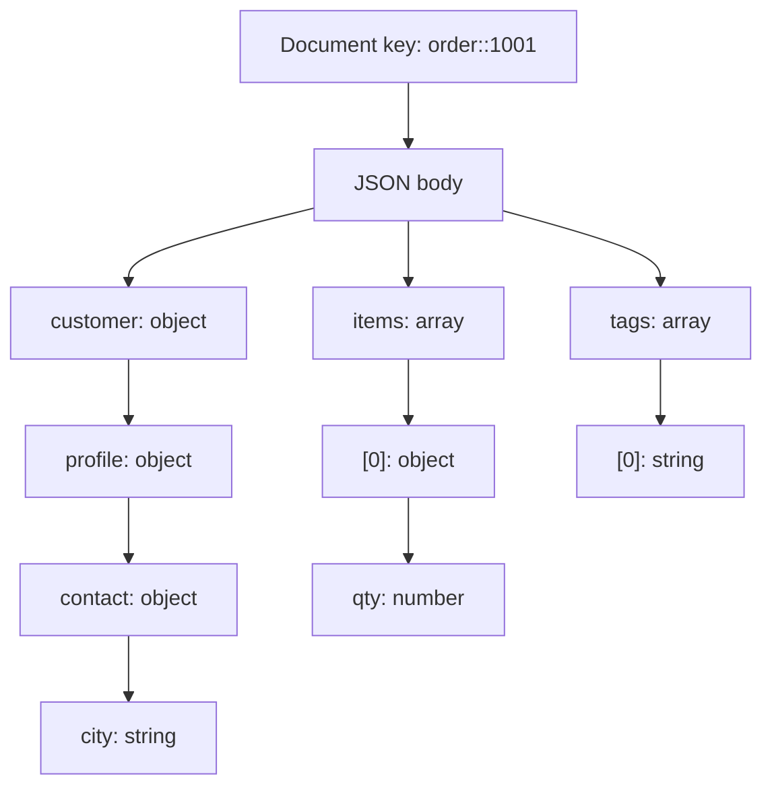

# Đường dẫn trường, đối tượng lồng nhau và phần tử mảng

## 1. Vì sao cần hiểu đúng đường dẫn Sub-document?

Trong **SPRING_DATA_COUCHBASE**, tài liệu JSON thường được ánh xạ thành entity Java thông qua Spring Data Couchbase, truy cập bằng repository, `CouchbaseTemplate`, SQL++ hoặc Couchbase Java SDK. Khi chỉ cần đọc hay sửa một phần document, Sub-document API của Couchbase cho phép chỉ định một **đường dẫn (path)** vào body JSON thay vì truyền toàn bộ JSON qua mạng.

Cú pháp path là hợp đồng rất cụ thể:

- `profile.address.city` trỏ vào field `city` bên trong object `address` của object `profile`.
- `items[0].sku` trỏ vào field `sku` của **phần tử thứ nhất** trong array `items`.
- `tags[1]` trỏ vào **phần tử thứ hai** của array `tags`.
- `stats.views` trỏ vào bộ đếm `views` trong object `stats`.

Nếu sai một dấu chấm, dấu ngoặc vuông, tên field hay index mảng, thao tác có thể thất bại hoặc cập nhật sai vị trí mà không phản ánh đúng ý định nghiệp vụ. Việc dùng `@Field` trong Spring Data hay custom conversion còn có thể khiến tên/type trên JSON khác với tên/type Java.

Bài này tập trung vào **đường dẫn trường, đối tượng lồng nhau và phần tử mảng**, đi từ cú pháp và thao tác SDK đến tính đúng, concurrency, schema evolution, SQL++ và kiểm thử.

### Sau bài học, bạn có thể

1. Phân tích JSON body thành các path hợp lệ cho `lookupIn` và `mutateIn`.
2. Phân biệt **object key**, **array index**, field name đặc biệt và document key.
3. Chọn `get`, `exists`, `count`, `insert`, `replace`, `upsert`, `remove`, `arrayAppend`, `arrayInsert` và `arrayAddUnique` đúng ngữ cảnh.
4. Hiểu khi nào cần `createPath()` và vì sao nó không sửa được mọi schema sai.
5. Tránh lost update khi nhiều client sửa nested object/array; dùng CAS khi thao tác phụ thuộc snapshot.
6. Phối hợp path của SDK với entity mapping Spring Data, SQL++, index, TTL, reactive và migration.
7. Viết test kiểm tra boundary, missing/null, index dịch chuyển, concurrency và dữ liệu từ nhiều phiên bản.

## 2. JSON mẫu xuyên suốt

Giả sử ứng dụng quản lý đơn hàng tại bucket `shop`, scope `sales`, collection `orders`. Document key ngoài body là `order::1001`; body JSON như sau:

```json
{
  "_class": "order-document",
  "schema_version": 2,
  "customer": {
    "id": "customer::42",
    "profile": {
      "display_name": "Lan",
      "contact": {
        "city": "Da Nang",
        "email": "lan@example.test"
      }
    }
  },
  "shipping": {
    "address": {
      "city": "Da Nang",
      "postal_code": "550000"
    },
    "status": "PREPARING"
  },
  "items": [
    {
      "line_id": "L1",
      "sku": "BOOK-01",
      "qty": 2,
      "price_minor": 150000
    },
    {
      "line_id": "L2",
      "sku": "PEN-02",
      "qty": 3,
      "price_minor": 10000
    }
  ],
  "tags": ["online", "priority"],
  "stats": {
    "views": 12
  },
  "note": null
}
```

Các path tương ứng:

| Path | Giá trị ở document mẫu | Kiểu JSON |
| --- | --- | --- |
| `customer.id` | `"customer::42"` | string |
| `customer.profile.display_name` | `"Lan"` | string |
| `customer.profile.contact.city` | `"Da Nang"` | string |
| `shipping.address.postal_code` | `"550000"` | string |
| `shipping.status` | `"PREPARING"` | string |
| `items` | Hai line items | array |
| `items[0]` | Object có `line_id="L1"` | object |
| `items[0].qty` | `2` | number |
| `items[1].sku` | `"PEN-02"` | string |
| `tags[0]` | `"online"` | string |
| `stats.views` | `12` | number |
| `note` | `null` | null |

Tên field và path là **case-sensitive**: `shipping.address.city` không trùng `shipping.Address.City`. Các chuỗi `postal_code` và `display_name` được lưu theo quy ước JSON, không nhất thiết là Java property names.

## 3. Sơ đồ ba loại vị trí trong document



Có ba mức cần phân biệt:

1. **Document key** `order::1001`: định danh document trong collection. Nó không phải JSON path. Để đổi key phải thiết kế migration/copy/delete có điều kiện và kiểm tra liên kết, không `upsert("id", ...)`.
2. **Object field** như `customer.profile.contact.city`: dùng dấu chấm `.` để đi qua object con.
3. **Array element** như `items[0].qty`: dùng dấu ngoặc vuông `[index]` để chọn phần tử theo **vị trí** hiện tại rồi tiếp tục đi vào object.

Một Sub-document request chỉ nhắm tới **một document key**, dù bên trong có nhiều path. Không phải một query tìm document theo điều kiện `WHERE`.

## 4. Cú pháp path cơ bản: dấu chấm và ngoặc vuông

### 4.1. Object field

Đường dẫn `shipping.address.city` tương ứng các cấp:

```text
shipping (object)
  └── address (object)
        └── city (string)
```

Ví dụ dùng Couchbase Java SDK:

```java
import java.util.List;
import com.couchbase.client.java.Collection;
import com.couchbase.client.java.kv.LookupInSpec;
import com.couchbase.client.java.kv.LookupInResult;

// orders là Collection đã được cấu hình tới shop.sales.orders.
LookupInResult result = orders.lookupIn(
    "order::1001",
    List.of(LookupInSpec.get("shipping.address.city"))
);

String city = result.contentAs(0, String.class);
```

Trong đoạn này, `"order::1001"` là key, còn `"shipping.address.city"` là path trong body. `contentAs(0, String.class)` đọc **kết quả spec thứ nhất**, không phải phần tử mảng thứ nhất của JSON.

### 4.2. Array index

Path `items[0].sku` gồm:

1. Chọn field `items` là array.
2. Lấy phần tử có index `0` (phần tử thứ nhất).
3. Lấy property `sku` của object đó.

```java
LookupInResult result = orders.lookupIn(
    "order::1001",
    List.of(
        LookupInSpec.get("items[0].sku"),
        LookupInSpec.get("items[1].qty")
    )
);

String firstSku = result.contentAs(0, String.class);
long secondQty = result.contentAs(1, Long.class);
```

**Array index bắt đầu từ 0**, không bắt đầu từ 1. `items[1]` là dòng đơn hàng thứ hai. Các biểu diễn `items.0.sku` và `items[1]` không đồng nghĩa; array element phải dùng cú pháp ngoặc vuông đúng SDK.

### 4.3. Chọn toàn object hoặc toàn array

Bạn không buộc phải xuống đến scalar leaf:

```java
LookupInResult result = orders.lookupIn(
    "order::1001",
    List.of(
        LookupInSpec.get("shipping.address"),
        LookupInSpec.get("tags")
    )
);

// Có thể giải giá trị JSON thành JsonObject/JsonArray hoặc
// lớp tương thích với serializer và SDK đang dùng.
```

Khi lấy cả `items` với nhiều ngàn phần tử, phản hồi lại lớn dù gọi `lookupIn`. Sub-document chỉ tiết kiệm payload khi bạn **chọn phạm vi nhỏ hơn đáng kể** so với body.

### 4.4. Đường dẫn phải trỏ đến dữ liệu thật

Ví dụ:

- `shipping.address.city`: hợp lệ trong document mẫu.
- `shipping.city`: không tồn tại, vì `city` nằm dưới `address`.
- `items[2].sku`: ngoài phạm vi khi array chỉ có 2 phần tử.
- `items[0].price_minor.amount`: không phù hợp vì `price_minor` là number.
- `tags[0].name`: không phù hợp vì `tags[0]` là string.

Một path **có cú pháp đúng** vẫn có thể **không hợp lệ đối với JSON thực**.

## 5. Phân biệt path literal với dấu chấm trong tên field

JSON cho phép object key chứa dấu chấm. Hai body sau khác nhau:

```json
{
  "settings": {
    "display.name": "Lan"
  }
}
```

```json
{
  "settings": {
    "display": {
      "name": "Lan"
    }
  }
}
```

Trong body thứ nhất, `display.name` là **một tên field literal**. Trong body thứ hai, đó là **hai cấp object**. Nếu gửi `settings.display.name`, SDK diễn giải dấu chấm như path separator, không tự biết rằng body có field tên `display.name`.

Couchbase Sub-document path hỗ trợ **bao field name bằng backticks** khi chứa dấu chấm hoặc ký tự đặc biệt. Ví dụ trong đoạn text sau, hai backticks bao quanh tên field `display.name`:

```text
settings.`display.name`
`billing.info`.region
```

Trong Java, path tương ứng là chuỗi chứa ký tự backtick thật:

```java
String path = "settings.`display.name`";

LookupInResult result = orders.lookupIn(
    "order::1001",
    List.of(LookupInSpec.get(path))
);
```

Khi tên field có cả dấu backtick hoặc ký tự đặc biệt phức tạp, phải áp dụng quy tắc escape của **Sub-document path grammar** theo phiên bản SDK; không tự ghép nguyên chuỗi tên field từ dữ liệu người dùng.

**Khuyến nghị thiết kế schema:** ưu tiên tên JSON đơn giản như `display_name`. Dùng nested object khi thực sự có quan hệ cấu trúc, không dùng dấu chấm trong literal key trừ khi đã có contract/bộ công cụ xử lý thống nhất.

### 5.1. Path injection là một rủi ro thật

Một endpoint nhận `path` tự do từ request có thể cho phép sửa `roles`, `_class`, `schema_version` hoặc `amount_minor` nếu không whitelist. Đây không chỉ là lỗi cú pháp mà còn là **lỗi phân quyền cấp field**.

Chọn typed operations:

```java
public void updateShippingCity(
        String orderId, String newCity) {
    // Chỉ cho phép path shipping.address.city cố định,
    // kiểm tra authorization và validate newCity trước SDK.
}
```

Không biến HTTP input thành raw Sub-document path có thể điều khiển bởi client mà không kiểm tra.

## 6. Đọc nhiều đường dẫn trong một `lookupIn`

Một request có thể chứa nhiều lookup specs nhằm giảm số lần round-trip KV:

```java
import java.util.List;
import com.couchbase.client.java.kv.LookupInSpec;
import com.couchbase.client.java.kv.LookupInResult;

List<LookupInSpec> specs = List.of(
    LookupInSpec.get("customer.id"),
    LookupInSpec.get("shipping.status"),
    LookupInSpec.get("items[0].qty"),
    LookupInSpec.count("items"),
    LookupInSpec.exists("shipping.tracking_code")
);

LookupInResult result = orders.lookupIn(
    "order::1001", specs
);

String customerId = result.contentAs(0, String.class);
String status = result.contentAs(1, String.class);
long firstQty = result.contentAs(2, Long.class);
int numberOfLines = result.contentAs(3, Integer.class);
boolean hasTrackingCode = result.exists(4);
```

**Hai hệ thống chỉ số khác nhau:**

- `items[0]` là chỉ số trong JSON array.
- `contentAs(2, Long.class)` là vị trí spec thứ ba trong request.

Đổi thứ tự specs nhưng không đổi chỉ số khi đọc result là lỗi thường gặp. Cách giảm lỗi là khai báo constant cho vị trí, đặt tên phương thức đọc rõ ràng và test cấu trúc kết quả.

### 6.1. Đọc nhiều path có phải snapshot nhất quán không?

Các lookup specs cùng request được xử lý trên **một document** theo semantics Sub-document của Couchbase, giúp tránh tình huống mỗi path được đọc ở một network round-trip và xen giữa là update khác. Tuy nhiên, sau khi `lookupIn` trả về, writer khác vẫn có thể cập nhật document trước khi ứng dụng thực hiện `mutateIn`. Khi quyết định ghi phụ thuộc những giá trị vừa đọc, hãy lấy và dùng CAS.

### 6.2. Không dùng `get` mù cho optional path

Với `shipping.tracking_code` chưa tồn tại:

- `LookupInSpec.exists(...)` hữu ích khi chỉ cần biết path có hiện diện không.
- `LookupInSpec.get(...)` có thể trả trạng thái path không tìm thấy hoặc gây lỗi khi giải content tùy API/spec.
- `LookupInSpec.count(...)` không thay thế existence check nếu path đang là scalar hoặc thiếu.

Đừng mặc định path MISSING sẽ được `contentAs` chuyển thành Java `null`.

## 7. Khác biệt giữa MISSING, NULL, sai kiểu và index ngoài mảng

Bốn trạng thái cần được kiểm thử riêng.

### 7.1. Field MISSING

```json
{
  "shipping": {
    "address": {
      "city": "Da Nang"
    }
  }
}
```

Path `shipping.address.postal_code` không tồn tại. Có thể là field optional, schema V1 hoặc lỗi producer. Nếu business yêu cầu bắt buộc, trả lỗi/đánh dấu migration; đừng tự tạo default mơ hồ.

### 7.2. Field tồn tại nhưng là NULL

```json
{
  "shipping": {
    "address": {
      "city": null
    }
  }
}
```

Path `shipping.address.city` tồn tại, nhưng value JSON là `null`. Đây khác với MISSING; `exists` và `get` cần được diễn giải theo spec/result, test cụ thể SDK version.

### 7.3. Parent là scalar thay vì object

```json
{
  "shipping": "Da Nang"
}
```

`shipping.address.city` không thể đi qua `shipping` như một object. `createPath()` không được coi là công cụ tự thay đổi string thành object rồi xóa dữ liệu cũ: đây là **schema conflict**, cần migration/validation.

### 7.4. Array index ngoài giới hạn

```json
{
  "items": [
    {"line_id": "L1", "qty": 2}
  ]
}
```

`items[0].qty` tồn tại; `items[1].qty` không tồn tại vì array có một phần tử. `items[100].qty` không được tự tạo đủ 100 phần tử trống chỉ vì một subdoc spec cần sửa. Array insertion có semantics vị trí riêng; kiểm tra range và mục tiêu trước khi chọn spec.

### 7.5. So với SQL++

SQL++ có cú pháp truy vấn cùng JSON shape:

```sql
SELECT META(o).id AS orderId,
       o.shipping.address.city AS city
FROM `shop`.`sales`.`orders` AS o
WHERE o.shipping.address.city IS MISSING
   OR o.shipping.address.city IS NULL;
```

Lưu ý: Sub-document API thực hiện KV access **theo một document key**, SQL++ có thể tìm **nhiều documents** bằng predicate và cần query planning/index/consistency thích hợp.

## 8. Thay một leaf field: `replace` và `upsert`

Khi path đã tồn tại và business không muốn tạo field mới:

```java
import java.util.List;
import com.couchbase.client.java.kv.MutateInSpec;

orders.mutateIn(
    "order::1001",
    List.of(
        MutateInSpec.replace(
            "shipping.address.city", "Ha Noi")
    )
);
```

`replace` yêu cầu target path tồn tại; đây là lợi thế khi schema mới kỳ vọng sẵn `shipping.address.city`. Nếu path thiếu, error có thể phát hiện document bị sai schema.

Nếu field optional có thể chưa tồn tại:

```java
orders.mutateIn(
    "order::1001",
    List.of(
        MutateInSpec.upsert(
            "shipping.tracking_code", "TRACK-1001")
    )
);
```

`upsert` là thao tác **path-level**: tạo field nếu chưa có hoặc thay giá trị hiện có. Nó **không** đồng nghĩa tạo toàn bộ document key mới nếu key `order::1001` không tồn tại.

### 8.1. Vì sao không dùng `upsert` cho mọi trường hợp?

Nếu schema yêu cầu mọi order V2 phải có `shipping.status`, nhưng document thực tế thiếu field này, dùng `upsert` sẽ khiến update có vẻ thành công dù bản ghi trước đó không hợp lệ. Với các invariant quan trọng, `replace` giúp fail fast khi cấu trúc không đúng kỳ vọng.

Chọn spec theo ý nghĩa:

| Ý định | Lựa chọn |
| --- | --- |
| Đổi field đã tồn tại, phát hiện sai schema | `replace` |
| Thêm field mới nhưng muốn phát hiện ghi trùng | `insert` |
| Tạo hoặc cập nhật field optional | `upsert` |
| Xóa field không còn dùng | `remove` |
| Đổi nguyên object có chủ đích | `replace` trên object path, kiểm soát mất field con |

### 8.2. Cập nhật hai leaf fields trong một request

```java
orders.mutateIn(
    "order::1001",
    List.of(
        MutateInSpec.replace(
            "shipping.address.city", "Ha Noi"),
        MutateInSpec.replace(
            "shipping.status", "IN_TRANSIT")
    )
);
```

Các specs trong **cùng một `mutateIn`** được áp dụng atomic ở mức document nếu request thành công; nếu một spec lỗi, request không nên để lại trạng thái chỉ cập nhật một phần. Điều đó không tự tạo transaction cho nhiều document keys.

## 9. Tạo nested object khi thiếu `createPath()`

Giả sử document V1 chỉ có:

```json
{
  "shipping": {
    "status": "PREPARING"
  }
}
```

Bạn muốn bổ sung `shipping.address.city`:

```java
orders.mutateIn(
    "order::1001",
    List.of(
        MutateInSpec.upsert(
            "shipping.address.city", "Ha Noi")
            .createPath()
    )
);
```

Khi parent object hợp lệ có thể tạo được, `createPath()` cho phép tạo các object trung gian cần thiết. Nhưng cần phân biệt:

- **Thiếu parent**: có thể tạo khi spec/SDK hỗ trợ.
- **Parent đã là object**: cập nhật field con phù hợp.
- **Parent là string/number/array sai cấu trúc**: không mặc định `createPath()` sửa được.
- **Cần tạo array rỗng hoặc nhiều phần tử**: không coi `createPath()` như cơ chế mở rộng array tùy ý; hãy chọn đúng array operation hoặc khởi tạo structure hợp lệ trước.
- **Parent mang dữ liệu V1 cần migrate**: không tự tạo thêm field mới mà bỏ dữ liệu cũ mâu thuẫn.

Dùng `createPath()` là quyết định về schema, không chỉ cách bỏ qua lỗi `PathNotFound`.

### 9.1. Khởi tạo một object có kiểm soát

Nếu logic cần tạo cả cấu trúc `shipping.address`, có thể xây một JSON object tường minh:

```java
import com.couchbase.client.java.json.JsonObject;

JsonObject address = JsonObject.create()
    .put("city", "Ha Noi")
    .put("postal_code", "100000");

orders.mutateIn(
    "order::1001",
    List.of(
        MutateInSpec.upsert("shipping.address", address)
    )
);
```

**Cảnh báo:** `upsert("shipping.address", address)` thay **giá trị của cả object `address`**, không chỉ thêm `postal_code`. Nếu address trước đó có `street`, `district` hoặc fields của producer khác, các fields đó có thể bị mất. Khi chỉ cần sửa một leaf, ưu tiên leaf path.

## 10. Xóa field và phần tử mảng bằng `remove`

Xóa field object:

```java
orders.mutateIn(
    "order::1001",
    List.of(
        MutateInSpec.remove("shipping.tracking_code")
    )
);
```

Sau khi xóa, `shipping.tracking_code` trở thành MISSING, không phải JSON null.

Xóa một phần tử trong array:

```java
orders.mutateIn(
    "order::1001",
    List.of(
        MutateInSpec.remove("tags[0]")
    )
);
```

Với `tags=["online","priority"]`, xóa index 0 khiến `"priority"` dịch sang index 0. Nếu code khác giữ index 1 từ trước, nó có thể đọc/sửa nhầm sau khi array thay đổi. Đây là lý do **array index không phải business identifier ổn định**.

### 10.1. Khi nào không nên xóa bằng index?

Với `items` trong đơn hàng, mỗi phần tử có `line_id`. Nếu muốn xóa line `L2`, thao tác `remove("items[1]")` chỉ đúng khi bạn biết chắc dòng `L2` vẫn đang ở vị trí 1. Trong môi trường nhiều writer, cần:

1. Đọc array/line IDs.
2. Xác định vị trí hiện tại.
3. Lấy CAS của document ở cùng lần đọc.
4. Xóa với CAS tương ứng.
5. Khi conflict, đọc lại và tìm lại theo `line_id`.

Nếu mỗi line item cần lifecycle hoặc update độc lập ở tần suất cao, cân nhắc tách thành document riêng hoặc cấu trúc keyed-object thay vì array dài.

## 11. Thêm vào array: append, prepend, insert

Giả sử `tags`:

```json
{
  "tags": ["online", "priority"]
}
```

### 11.1. Thêm cuối mảng — `arrayAppend`

```java
orders.mutateIn(
    "order::1001",
    List.of(
        MutateInSpec.arrayAppend("tags", "fragile")
    )
);
```

Sau mutation thành công, array minh họa:

```json
{
  "tags": ["online", "priority", "fragile"]
}
```

Thêm cuối không yêu cầu biết length/index trước, thuận tiện hơn tự đọc array rồi tính `tags[2]`.

### 11.2. Thêm đầu mảng — `arrayPrepend`

```java
orders.mutateIn(
    "order::1001",
    List.of(
        MutateInSpec.arrayPrepend("tags", "new")
    )
);
```

Sau khi prepend, mọi index cũ dịch thêm một vị trí. Nếu client dùng index 0 làm "tag quan trọng", cần định nghĩa rõ thứ tự và sự thay đổi vị trí.

### 11.3. Chèn vào vị trí — `arrayInsert`

```java
orders.mutateIn(
    "order::1001",
    List.of(
        MutateInSpec.arrayInsert(
            "tags[1]", "gift")
    )
);
```

`tags[1]` ở đây là **vị trí muốn chèn**, không phải path của field con. Sau insert, các phần tử từ vị trí đó trở đi dịch sang phải. Hãy dùng vị trí chỉ khi ý nghĩa thứ tự thật sự quan trọng và có chiến lược concurrency phù hợp.

### 11.4. Thêm object vào array

```java
import com.couchbase.client.java.json.JsonObject;

JsonObject newLine = JsonObject.create()
    .put("line_id", "L3")
    .put("sku", "ERASER-03")
    .put("qty", 1)
    .put("price_minor", 5000);

orders.mutateIn(
    "order::1001",
    List.of(
        MutateInSpec.arrayAppend("items", newLine)
    )
);
```

Lưu ý: SDK xử lý `JsonObject` ở đây **không tự chạy custom conversions** trên class Java domain, không tự kiểm tra tổng tiền đơn hàng hoặc trạng thái `SHIPPED`. Với aggregate có invariant về lines, amount và stock, cần service/transaction/mapper có kiểm soát.

## 12. Tính duy nhất của phần tử với `arrayAddUnique`

Nếu `tags` là array primitive và yêu cầu không trùng:

```java
orders.mutateIn(
    "order::1001",
    List.of(
        MutateInSpec.arrayAddUnique("tags", "fragile")
    )
);
```

Khi value đã có trong array, thao tác có thể báo lỗi "path/value exists" theo semantics của SDK thay vì âm thầm thêm bản sao. Không coi phương thức này là giải pháp chung cho mọi kiểu object, nested arrays hoặc quy tắc uniqueness nghiệp vụ phức tạp.

**Ví dụ sai về kỳ vọng:** hai object line item có cùng `line_id` nhưng khác `qty`. `arrayAddUnique` không tự hiểu rằng `line_id` là khóa nghiệp vụ, cũng không bảo đảm unique constraint của `line_id` trong mảng object theo ý muốn.

Muốn uniqueness theo business ID:

- Dùng keyed object: `lines_by_id.L1` (cần escape nếu ID chứa ký tự đặc biệt).
- Hoặc thiết kế mỗi line item thành một document có key ổn định.
- Hoặc đọc/validate toàn aggregate và ghi có CAS/transaction.
- Hoặc áp dụng constraint ở persistence/application layer theo mô hình dữ liệu.

Không dùng mảng như một bảng quan hệ có unique index tự động trên field con.

## 13. Sửa một field nằm trong phần tử mảng

Để đổi quantity của dòng đầu tiên:

```java
orders.mutateIn(
    "order::1001",
    List.of(
        MutateInSpec.replace("items[0].qty", 4)
    )
);
```

Điều kiện ngầm của ví dụ:

- `items` tồn tại và là array.
- `items[0]` tồn tại và là object.
- `qty` tồn tại và là JSON number theo hợp đồng.
- Dòng thứ nhất đúng là dòng mà nghiệp vụ cần sửa.
- Sửa `qty` không vi phạm total, stock, discount hoặc trạng thái order.

Nếu cần sửa dòng có `line_id="L2"`, Sub-document path **không phải SQL++ predicate**: nó không cung cấp cách viết tương đương `items[?line_id="L2"].qty` bằng cách tự suy index. Hãy đọc các line IDs, xác định index và dùng CAS; hoặc chọn mô hình keyed object/document cho workload cập nhật theo ID.

### 13.1. Vì sao index mảng dễ bị stale?

Một luồng thao tác có thể diễn ra:

1. Request A đọc `items`; thấy `L2` ở index 1.
2. Request B chèn một line mới tại index 0.
3. Request A gửi `replace("items[1].qty", 10)`.
4. Index 1 giờ là `L1`; Request A có thể cập nhật **sai line item** nếu không có CAS.

Đây là **semantic race**. Ngay cả khi riêng mutation `replace` có tính atomic trên document, nó vẫn có thể atomic **ở sai vị trí** so với ý định ban đầu. CAS giúp bắt document đã thay đổi từ lúc A đọc.

### 13.2. Mẫu đọc-và-ghi với CAS

```java
import java.util.List;
import com.couchbase.client.java.kv.LookupInResult;
import com.couchbase.client.java.kv.LookupInSpec;
import com.couchbase.client.java.kv.MutateInSpec;
import com.couchbase.client.java.kv.MutateInOptions;

LookupInResult snapshot = orders.lookupIn(
    "order::1001",
    List.of(
        LookupInSpec.get("items")
    )
);

long cas = snapshot.cas();
// Ở đây parse items, tìm line_id="L2" và xác định currentIndex.
// currentIndex phải được xác định từ chính snapshot.

// Ví dụ sau khi xác minh L2 đang ở index 1:
int currentIndex = 1;
String qtyPath = "items[" + currentIndex + "].qty";

orders.mutateIn(
    "order::1001",
    List.of(MutateInSpec.replace(qtyPath, 5)),
    MutateInOptions.mutateInOptions().cas(cas)
);
```

Đoạn trên minh họa cách truyền CAS, chưa cung cấp hàm parse/lookup `line_id` đầy đủ; trong hệ thống thật **không hard-code index 1** nếu chưa đối chiếu snapshot. Nếu CAS conflict, phải đọc lại và xác định lại index, không retry cùng path cũ một cách mù quáng.

## 14. Bảng chọn thao tác theo loại path

| Mục tiêu | Path/ví dụ | Spec gợi ý | Rủi ro |
| --- | --- | --- | --- |
| Đọc scalar nested | `shipping.status` | `LookupInSpec.get` | Path thiếu/sai kiểu |
| Kiểm tra field optional | `shipping.tracking_code` | `LookupInSpec.exists` | MISSING khác NULL |
| Đếm line items | `items` | `LookupInSpec.count` | Path phải là array/object phù hợp |
| Đổi leaf có sẵn | `shipping.address.city` | `MutateInSpec.replace` | Schema V1 khác path |
| Tạo leaf optional | `shipping.tracking_code` | `MutateInSpec.upsert` | Có thể che dấu field bắt buộc thiếu |
| Tạo nested object | `shipping.address.city` | `upsert(...).createPath()` | Không sửa parent sai kiểu |
| Xóa optional field | `shipping.tracking_code` | `remove` | Thành MISSING, không phải null |
| Đổi phần tử array | `tags[0]` | `replace` | Index có thể dịch chuyển |
| Xóa phần tử array | `tags[1]` | `remove` | Các phần tử sau bị đổi index |
| Thêm cuối mảng | `tags` | `arrayAppend` | Có thể tạo duplicate |
| Thêm đầu mảng | `tags` | `arrayPrepend` | Index cũ dịch chuyển |
| Chèn giữa mảng | `tags[1]` | `arrayInsert` | Race về vị trí |
| Thêm primitive không trùng | `tags` | `arrayAddUnique` | Không hiểu business uniqueness của object |
| Tăng bộ đếm | `stats.views` | `increment` | Không tự kiểm tra domain invariant |

Các API cụ thể và phương thức fluent như `createPath()` cần được kiểm tra ở **SDK version** đang dùng. Bảng thể hiện ý nghĩa, không phải lời hứa rằng mọi spec hợp lệ với mọi JSON shape.

## 15. Multi-spec request và giới hạn tính nguyên tử

Một `mutateIn` có thể gửi nhiều specs trên cùng document:

```java
orders.mutateIn(
    "order::1001",
    List.of(
        MutateInSpec.replace(
            "shipping.status", "IN_TRANSIT"),
        MutateInSpec.upsert(
            "shipping.tracking_code", "TRACK-42"),
        MutateInSpec.increment(
            "stats.views", 1)
    )
);
```

Với request thành công, các thay đổi thuộc **một mutation atomic trên document key `order::1001`**. Nếu một spec thất bại, không được giả định các spec khác đã được commit độc lập. Một request không phải ba lời gọi mạng tách rời.

Ngược lại, ba lần gọi `mutateIn` riêng biệt không có atomicity chung: request đầu có thể thành công, request hai thất bại, request ba vẫn chưa chạy.

### 15.1. Có những giới hạn nào?

Sub-document API có giới hạn số specs/độ dài path/request theo server/SDK, và document vẫn có giới hạn kích thước. Không gom tùy ý hàng trăm thao tác vào một request rồi mong SDK tự tách mà vẫn giữ transaction semantics. Khi vượt giới hạn, phải chia nghiệp vụ hoặc dùng kỹ thuật khác theo đúng yêu cầu consistency.

### 15.2. Các specs phụ thuộc nhau

Nếu thao tác thứ hai phụ thuộc cấu trúc vừa được spec thứ nhất tạo, cần test chính xác semantics **thứ tự và kết quả** của request trên phiên bản SDK/server đang chạy. Không dùng một multi-spec mutation để tái cấu trúc JSON phức tạp mà không có integration test, đặc biệt khi cùng request vừa xóa parent vừa sửa child path.

## 16. Array index và mô hình dữ liệu: khi nào nên đổi sang keyed object?

Giả sử đơn hàng có 500 line items, thường xuyên cập nhật theo `line_id`.

**Array model:**

```json
{
  "items": [
    {"line_id":"L1","qty":2},
    {"line_id":"L2","qty":3}
  ]
}
```

Ưu điểm: giữ thứ tự tự nhiên, dễ serialize danh sách, phù hợp khi thường đọc cùng nhau. Nhược: cập nhật theo ID phải tìm index hiện tại; insert/remove làm dịch vị trí.

**Keyed-object model:**

```json
{
  "items_by_id": {
    "L1": {"qty":2},
    "L2": {"qty":3}
  },
  "item_order": ["L1", "L2"]
}
```

Ưu: có thể nhắm trực tiếp path `items_by_id.L2.qty` khi ID là key an toàn cho path. Nhược: cần quản lý thứ tự riêng, quy tắc escape cho ID, xử lý schema và tính nhất quán giữa `items_by_id` và `item_order`.

**Document-per-line model:**

- `order::1001` giữ header.
- `order::1001::line::L1` giữ dòng L1.
- `order::1001::line::L2` giữ dòng L2.

Ưu: cập nhật độc lập theo key. Nhược: nhiều documents, cần query/index và có thể cần transaction hoặc reconciliation cho invariant tổng đơn hàng.

Không có mô hình duy nhất tốt cho mọi workload. Phải cân nhắc tần suất cập nhật độc lập, kích thước document, query theo line, hot-key contention và yêu cầu atomicity.

## 17. Ranh giới với Spring Data Couchbase mapping

Trong Spring Data, một entity có thể là:

```java
import org.springframework.data.annotation.Id;
import org.springframework.data.annotation.Version;
import org.springframework.data.couchbase.core.mapping.Document;
import org.springframework.data.couchbase.core.mapping.Field;

@Document
public class OrderDocument {
    @Id
    private String id;

    @Field("shipping")
    private Shipping shipping;

    @Field("items")
    private List<OrderLine> items;

    @Version
    private Long version;

    // Constructors, validation và accessors của ứng dụng.
}
```

`Shipping` có thể khai báo Java property `postalCode` nhưng được ghi thành `postal_code` bằng `@Field`. SDK Sub-document **không đọc annotation đó**. Cú pháp path phải theo **field JSON thực tế**: `shipping.address.postal_code`.

### 17.1. Custom conversions không tự áp dụng ở SDK raw

Giả sử Java domain có `SkuCode`, `Money` hoặc `Instant`. `CouchbaseCustomConversions` có thể ghi những kiểu này thành string, object hoặc number khi entity đi qua `MappingCouchbaseConverter`. Nhưng `orders.mutateIn(...)` chỉ nhận path và giá trị JSON-compatible; nó không tự hỏi Spring Data phải convert object Java như thế nào.

Sai lầm:

```java
// Không giả định một domain object bất kỳ luôn được SDK
// serialize giống Spring Data @WritingConverter.
MutateInSpec.upsert("items[0].price", domainMoney);
```

Tốt hơn: chuyển `domainMoney` sang đúng JSON representation đã công bố, ví dụ `price_minor` number và `currency` string, rồi gửi các path cụ thể — hoặc để repository/mapper xử lý nếu business invariant phức tạp.

### 17.2. Spring Data save sau SDK mutation

Giả sử request A đọc entity qua repository, request B dùng SDK `mutateIn` sửa `shipping.status`. Nếu A sau đó `save` entity cũ mà không có optimistic locking phù hợp, dữ liệu từ B có thể bị ghi đè.

`@Version`/CAS giúp phát hiện cập nhật đồng thời. Trước khi triển khai hai đường truy cập trên cùng document, kiểm thử:

- Entity CAS/version trước và sau `mutateIn`.
- `save` entity stale có báo conflict không?
- Retry có đọc lại các field và đánh giá lại rule nghiệp vụ không?
- TTL/expiry có được bảo toàn theo policy không?
- Auditing/callback Spring Data có bị bỏ qua khi SDK update trực tiếp không?

## 18. Khi nào cần CAS cho nested path và array?

Một `mutateIn` độc lập như `increment("stats.views",1)` có thể thực hiện cập nhật số nguyên tại server mà không cần Java đọc giá trị trước. Nhưng khi quyết định phụ thuộc snapshot (ví dụ "nếu status còn PREPARING thì đổi thành IN_TRANSIT", "nếu L2 ở index 1 thì cập nhật qty"), cần kiểm tra concurrency.

```java
LookupInResult before = orders.lookupIn(
    "order::1001",
    List.of(
        LookupInSpec.get("shipping.status")
    )
);

String status = before.contentAs(0, String.class);

if ("PREPARING".equals(status)) {
    orders.mutateIn(
        "order::1001",
        List.of(
            MutateInSpec.replace(
                "shipping.status", "IN_TRANSIT")
        ),
        MutateInOptions.mutateInOptions()
            .cas(before.cas())
    );
}
```

CAS áp dụng cho **document**, không phải chỉ field `shipping.status`. Nếu writer khác sửa `stats.views` giữa hai lần gọi, CAS cũng có thể thay đổi và request trên bị từ chối. Đây là trade-off: đảm bảo tính đúng với snapshot nhưng có thể tăng conflict trên document nóng.

### 18.1. Retry có ý nghĩa

Khi CAS mismatch:

1. Đọc lại thông tin cần thiết.
2. Kiểm tra lại trạng thái, line IDs hoặc rule.
3. Xác định lại array index nếu array có thể đổi.
4. Ghi với CAS mới nếu vẫn hợp lệ.
5. Dừng sau giới hạn retry/backoff, trả conflict nếu cần người dùng giải quyết.

Không chỉ cập nhật biến `cas` rồi retry **cùng array path cũ** mà không xem xét nội dung; đó có thể biến conflict thành cập nhật sai line.

### 18.2. Atomicity không đồng nghĩa transaction nhiều document

Nhiều paths trong `order::1001` có thể atomic qua một `mutateIn`. Nhưng sửa `order::1001` và `inventory::BOOK-01` cần cơ chế consistency cho **hai documents** (Couchbase transaction hoặc thiết kế idempotent/outbox/reconciliation). Sub-document path không cho phép "đi xuyên" sang key khác.

## 19. TTL/expiry, durability và consistency của query

Khi sửa nested field bằng KV, expiry/TTL là metadata do Couchbase quản lý, không phải một JSON path dưới `shipping`. Nếu muốn bảo toàn expiry khi mutation, dùng tùy chọn SDK tương ứng khi hỗ trợ:

```java
orders.mutateIn(
    "order::1001",
    List.of(
        MutateInSpec.replace(
            "shipping.address.city", "Ha Noi")
    ),
    MutateInOptions.mutateInOptions()
        .preserveExpiry(true)
);
```

Kiểm tra hành vi thực trên phiên bản SDK/server đang dùng; đừng dựa vào giả định mọi mutation luôn giữ hoặc luôn reset TTL. Với dữ liệu thanh toán/đối soát, TTL phải theo chính sách lưu trữ riêng.

Durability quy định mức bảo đảm mutation đã được lưu/replicate, **khác** với tính atomic multi-spec. SQL++ query consistency quy định mức dữ liệu qua index có thể quan sát sau KV mutation, **khác** với cả hai khái niệm trên.

Một `lookupIn` theo key có thể thấy dữ liệu KV vừa sửa trong khi một SQL++ query qua GSI chưa thấy vì index visibility. Không kết luận path sai chỉ từ kết quả query chưa đồng bộ theo mức nhất quán đã chọn.

## 20. Đường dẫn trong SQL++ và Sub-document giống nhau đến mức nào?

Cả hai đều nhắm vào cấu trúc JSON, nhưng **khác cú pháp/khả năng diễn đạt**:

| Nhu cầu | Sub-document KV | SQL++ |
| --- | --- | --- |
| Đọc `shipping.address.city` theo ID | `lookupIn(key, get(path))` | `SELECT o.shipping.address.city ... WHERE META(o).id=...` |
| Đọc line đầu tiên | `get("items[0]")` | `SELECT o.items[0] ...` |
| Đọc mọi item thỏa `sku="BOOK-01"` | Không hỗ trợ predicate truy tìm array element tùy ý ngay trong path | `ANY item IN o.items SATISFIES ... END` hoặc `UNNEST` |
| Sửa một line khi đã biết index | `replace("items[1].qty", ...)` | SQL++ UPDATE theo cú pháp/condition phù hợp |
| Tìm tất cả orders theo city | Cần biết keys từ trước | `WHERE shipping.address.city = ...` + index |
| Sửa một document theo key | KV rất trực tiếp | Query service có overhead/kế hoạch riêng |
| Tính aggregate nhiều orders | Không phải nhiệm vụ KV subdoc | SQL++ `COUNT`, `SUM`, `GROUP BY` |

Ví dụ SQL++ lấy order chứa dòng `BOOK-01`:

```sql
SELECT META(o).id AS orderId
FROM `shop`.`sales`.`orders` AS o
WHERE ANY item IN o.items
      SATISFIES item.sku = "BOOK-01"
      END;
```

Đừng cố đặt `items[?sku="BOOK-01"]` trong Sub-document path. Nếu cần find-by-property, hãy dùng SQL++ hoặc mô hình data theo key phù hợp.

### 20.1. Index dựa trên đường dẫn JSON

Một index cho city:

```sql
CREATE INDEX ix_orders_city
ON `shop`.`sales`.`orders`(
    shipping.address.city
);
```

Array index cho SKU từng dòng:

```sql
CREATE INDEX ix_orders_item_sku
ON `shop`.`sales`.`orders`(
    DISTINCT ARRAY item.sku FOR item IN items END
);
```

Đổi `@Field` hoặc custom mapping khiến field JSON/path thay đổi thì phải cập nhật **Sub-document path, SQL++ predicate và index expression** cùng nhau. SDK mutation không tự thiết kế lại index; Couchbase chỉ duy trì các index đã khai báo theo dữ liệu thực.

### 20.2. Dùng `EXPLAIN` và đánh giá hiệu năng

```sql
EXPLAIN
SELECT META(o).id AS orderId
FROM `shop`.`sales`.`orders` AS o
WHERE o.shipping.address.city = "Ha Noi";
```

Quan sát index được chọn, spans và các fetch/filter/sort cần thiết. Không suy rằng có index `ix_orders_city` thì query chắc chắn luôn dùng nó; optimizer phụ thuộc statistics, predicate, selectivity và định nghĩa index.

## 21. Schema evolution: từ nested field cũ sang path mới

Giả sử V1:

```json
{
  "shipping": {
    "city": "Da Nang"
  }
}
```

V2:

```json
{
  "shipping": {
    "address": {
      "city": "Da Nang"
    }
  },
  "schema_version": 2
}
```

Một `MutateInSpec.upsert("shipping.address.city", ...)` trên V1 có thể tạo field mới, nhưng **không tự xóa** `shipping.city`. Hai nguồn sự thật sẽ cùng tồn tại nếu bạn không migrate đúng.

Quy trình:

1. Kiểm kê số documents theo `shipping.city` và `shipping.address.city` bằng SQL++.
2. Quy định field đích và schema version.
3. Triển khai reader/adapter hiểu V1/V2 khi cần.
4. Với mỗi V1, đọc giá trị cũ và CAS.
5. Dùng một mutation phù hợp để tạo path mới, xóa field cũ và cập nhật `schema_version`, có CAS để tránh ghi đè.
6. Kiểm tra readback JSON và repository entity mapping.
7. Cập nhật SQL++ query/index và SDK code; theo dõi V1 còn lại.
8. Chỉ bỏ đường đọc V1 sau khi mọi producer/consumer đều dùng V2.

Đừng assume `createPath()` là migration engine. Nó không hiểu ý nghĩa hai field cùng chỉ city, không tự resolve dữ liệu mâu thuẫn hay xác thực postal code.

### 21.1. SQL++ audit mixed schema

```sql
SELECT META(o).id AS orderId,
       o.shipping.city AS oldCity,
       o.shipping.address.city AS newCity,
       o.schema_version AS schemaVersion
FROM `shop`.`sales`.`orders` AS o
WHERE o.shipping.city IS NOT MISSING
   OR o.shipping.address.city IS MISSING;
```

Một query audit có thể cần primary/secondary index thích hợp và có thể chạy tốn tài nguyên trên collection lớn. Đừng chạy DML backfill toàn bucket chỉ vì thấy một số document V1; cần batching, CAS, monitoring và rollback plan.

### 21.2. Không xóa dữ liệu chưa được nhận diện

Nếu `shipping.city="Da Nang"` nhưng `shipping.address.city="Ha Noi"` cùng tồn tại, không tự chọn một field mà không rõ thứ tự cập nhật và nguồn authoritative. Phải có conflict resolution/audit để tránh mất thông tin.

## 22. Reactive Sub-document operations

Couchbase Java SDK có reactive interface để thao tác KV/subdoc, phù hợp khi ứng dụng dùng WebFlux hoặc Spring Data reactive repository.

```java
import reactor.core.publisher.Mono;
import java.util.List;
import com.couchbase.client.java.kv.LookupInResult;
import com.couchbase.client.java.kv.LookupInSpec;

// orders là synchronous SDK Collection.
Mono<LookupInResult> response = orders.reactive().lookupIn(
    "order::1001",
    List.of(
        LookupInSpec.get("shipping.address.city"),
        LookupInSpec.get("items[0].qty")
    )
);

Mono<String> cityMono = response.map(
    r -> r.contentAs(0, String.class)
);
```

Publisher cần được subscribe/verify để có I/O. Trong test, dùng `StepVerifier` khi dự án có `reactor-test`; không dùng blocking `orders.lookupIn(...)` ngay trong event-loop chỉ để đọc một scalar.

Reactive SDK subdoc vẫn dùng **JSON paths**, không tự thông qua `MappingCouchbaseConverter` và không tự sinh index. Quy tắc CAS, missing/null, array index và schema vẫn như đường KV tương ứng.

## 23. Bảo mật, validation và observability

Không expose endpoint `PATCH /orders/{id}?path=...` cho client tự gửi arbitrary path. Những path nguy hiểm gồm:

- `_class` hoặc `schema_version`: thay đổi type/schema metadata trong body.
- `customer.id`: thay đổi quan hệ sở hữu đơn hàng.
- `shipping.status`: bypass state machine.
- `items[0].price_minor`: thay đổi giá trị tiền đã chốt.
- `roles` hoặc các field phân quyền nếu có.
- `audit.createdBy` hoặc trường lưu vết.

Thiết kế API typed như `updateAddressCity(orderId,newCity)`, `appendAllowedTag(orderId,tag)`. Whitelist path, kiểm tra caller có quyền với document key, validate kiểu/value và dùng CAS khi trạng thái liên quan.

Log lỗi nên ghi document key/correlation ID, **path đã whitelist**, loại lỗi và schema version. Không log email, địa chỉ hoặc thông tin cá nhân/secret không cần thiết. Cần metric cho:

- Path not found / mismatch / invalid array index.
- CAS conflict và số retry.
- Tỷ lệ V1/V2 và lỗi schema.
- Latency `lookupIn`/`mutateIn` và số specs.
- Query latency/consistency khi kiểm tra read-after-write.
- Field updates thất bại do authorization hoặc validation.

## 24. Những lỗi thường gặp và cách xử lý

| Triệu chứng | Nguyên nhân khả dĩ | Cách kiểm tra |
| --- | --- | --- |
| `get("shipping.city")` lỗi | City nằm ở `shipping.address.city` | Đọc JSON raw và đối chiếu path. |
| `get("items[1].sku")` lỗi | Array chỉ có một phần tử | `count("items")` và xem index 0-based. |
| `replace` lỗi khi field optional chưa có | Target path phải tồn tại | Dùng `upsert` nếu contract cho phép. |
| `upsert` nested field lỗi | Parent object chưa tồn tại | Xem `createPath()` và parent type. |
| `createPath()` không giúp | Parent đang là scalar/array sai kiểu | Migration, không ép đổi kiểu. |
| Tên field chứa dấu chấm bị hiểu thành nesting | Chưa escape literal key | Backtick-quote field name. |
| Cập nhật sai line item | Index mảng đã dịch do writer khác | Đọc lại line ID và CAS. |
| `arrayAppend` tạo tag trùng | Append không kiểm uniqueness | `arrayAddUnique` cho primitive phù hợp hoặc logic riêng. |
| `arrayAddUnique` không đảm bảo unique theo `line_id` | Không áp dụng business-key uniqueness của object | Dùng keyed-object hoặc document keys. |
| Đổi `shipping.address` làm mất `street` | Replace cả object thay vì leaf | Sửa leaf path khi chỉ đổi một giá trị. |
| SDK mutation thành công nhưng repository read sai | Không qua Spring Data mapping, schema/validation lệch | Kiểm tra JSON, `@Field` và converters. |
| `@Version` conflict sau SDK mutation | CAS document thay đổi | Refresh entity, retry có điều kiện. |
| SQL++ chưa thấy field mới sau mutate | GSI/query consistency | KV lookupIn và scan consistency phù hợp. |
| Document hết hạn bất ngờ | Expiry policy của mutation chưa rõ | Test TTL với options phù hợp. |
| Path được user tự chọn sửa field nhạy cảm | Thiếu whitelist và authorization | API typed, validate path/value. |

## 25. Chiến lược kiểm thử cho nested objects và arrays

### 25.1. Khởi tạo dữ liệu test qua SDK

Trong collection test cô lập:

```java
import com.couchbase.client.java.json.JsonObject;
import com.couchbase.client.java.json.JsonArray;

JsonObject initial = JsonObject.create()
    .put("shipping", JsonObject.create()
        .put("address", JsonObject.create()
            .put("city", "Da Nang"))
        .put("status", "PREPARING"))
    .put("items", JsonArray.from(
        JsonObject.create().put("line_id","L1").put("qty",2),
        JsonObject.create().put("line_id","L2").put("qty",3)
    ))
    .put("tags", JsonArray.from("online","priority"))
    .put("stats", JsonObject.create().put("views",12));

orders.insert("order::subdoc::test-2", initial);
```

Ví dụ dùng key test riêng. Trong ứng dụng thực tế cần đảm bảo key chưa tồn tại trước `insert` và dọn dữ liệu sau test; không làm trên collection production.

### 25.2. Kiểm tra lookup nested và array

```java
String testId = "order::subdoc::test-2";

LookupInResult before = orders.lookupIn(
    testId,
    List.of(
        LookupInSpec.get("shipping.address.city"),
        LookupInSpec.get("items[0].qty"),
        LookupInSpec.count("items")
    )
);

assert "Da Nang".equals(
    before.contentAs(0, String.class));
assert before.contentAs(1, Integer.class) == 2;
assert before.contentAs(2, Integer.class) == 2;
```

Phép assert `contentAs(1)` đọc spec thứ hai, tương ứng path `items[0].qty`. Để test hoạt động trên SDK/JSON codec cụ thể, chọn numeric target class phù hợp với kiểu được deserialize thực tế.

### 25.3. Kiểm tra mutation nhiều path

```java
orders.mutateIn(
    testId,
    List.of(
        MutateInSpec.replace(
            "shipping.address.city", "Ha Noi"),
        MutateInSpec.replace(
            "items[0].qty", 4),
        MutateInSpec.arrayAppend(
            "tags", "gift")
    )
);

LookupInResult after = orders.lookupIn(
    testId,
    List.of(
        LookupInSpec.get("shipping.address.city"),
        LookupInSpec.get("items[0].qty"),
        LookupInSpec.count("tags")
    )
);

assert "Ha Noi".equals(
    after.contentAs(0, String.class));
assert after.contentAs(1, Integer.class) == 4;
assert after.contentAs(2, Integer.class) == 3;
```

Kiểm tra thêm rằng `items[1]` còn nguyên, không mất `line_id` hay fields khác. Nếu mutation trên `items[0].qty` có ảnh hưởng tới tổng tiền, cần xác minh domain invariant ở service, không chỉ kiểm tra giá trị qty.

### 25.4. Ma trận test lỗi và cạnh tranh

| Ca test | Kỳ vọng |
| --- | --- |
| Đọc `items[0]` và `items[1]` | Đúng hai phần tử; thứ tự spec độc lập index array. |
| Đọc `items[2]` khi array có 2 phần tử | Lỗi/trạng thái path missing rõ. |
| Đọc field MISSING | Không âm thầm coi là giá trị hợp lệ. |
| Đọc JSON null | Phân biệt với field missing. |
| `replace` trên missing field | Thất bại theo contract. |
| `upsert(...).createPath()` với thiếu parent object | Tạo object trung gian nếu được hỗ trợ. |
| `createPath()` với parent string | Không phá schema để thay bằng object. |
| Xóa `tags[0]` | Phần tử sau dịch index. |
| Chèn `tags[1]` | Thứ tự mới đúng. |
| Append cùng tag hai lần | Xác nhận duplicate policy. |
| `arrayAddUnique` với duplicate primitive | Phát hiện trùng theo semantics SDK. |
| Hai client cùng thay array, một client giữ index cũ | CAS conflict hoặc tái tính index. |
| Multi-spec trong đó một path sai | Không có commit một phần trái atomicity. |
| Stale entity `@Version` sau `mutateIn` | Optimistic locking phát hiện nếu cấu hình. |
| Query ngay sau KV mutation | Phân biệt consistency và query path. |
| SDK raw rồi repository đọc | `@Field`/type mapping/validation tương thích. |
| Reactive lookup/mutation | Publisher được subscribe và verify completion/error. |
| Path client tự do sửa field nhạy cảm | Bị từ chối tại application boundary. |

### 25.5. Vì sao cần integration test?

Unit test của một hàm tạo chuỗi `"items[0].qty"` không chứng minh server chấp nhận path, array chứa đúng kiểu hay CAS hoạt động. Integration test trên Couchbase thật cần cho:

- Cú pháp path và escaping.
- JSON type mismatch, nested object, index boundary.
- Multi-spec atomicity.
- CAS/version và TTL behavior.
- SQL++/GSI visibility và index.
- Spring Data mapping khi SDK subdoc sửa body trực tiếp.

Không cần chạy full build/production deployment để chứng minh một bài Markdown đã được soạn; các test trong bài là **mẫu để người học triển khai** trong dự án phù hợp.

## 26. Bài thực hành

### Bài 1 — Đọc cây JSON bằng path

Tạo document mẫu `order::1001`. Gọi `lookupIn` cho `customer.profile.contact.city`, `items[0].sku`, `items[1].price_minor` và `tags[0]`. Vẽ cây JSON và ghi lại kiểu giá trị của từng path. Thử `items[2].sku`, giải thích lý do không tồn tại.

### Bài 2 — Tên field đặc biệt

Tạo object có literal key `"display.name"` bên cạnh nested object `display.name`. Viết path có backtick quoting và path không quoting, so sánh kết quả. Không dùng raw input user làm path.

### Bài 3 — Bổ sung địa chỉ lồng nhau

Tạo V1 chỉ có `shipping.status`, thiếu `shipping.address`. Thử `upsert("shipping.address.city",...)` không tạo parent rồi thử phiên bản `createPath()`. Tiếp theo thay `shipping` thành scalar trong test và quan sát vì sao `createPath()` không phải migration an toàn.

### Bài 4 — Chỉnh array và quan sát index dịch chuyển

Với `tags=["online","priority"]`, thực hiện append, prepend, insert, remove. Sau mỗi thao tác dùng `lookupIn` đọc các phần tử và `count`. Giải thích vì sao index mảng không nên được cache như business ID.

### Bài 5 — Concurrent writers và CAS

Request A đọc array chứa line `L2` tại index 1; request B chèn line mới tại index 0. Yêu cầu A sửa đúng `L2.qty`. Trình bày kết quả khi A ghi không dùng CAS và khi dùng CAS; cài đặt retry đọc lại array và xác định index mới.

### Bài 6 — SQL++ và index

Tạo truy vấn tìm orders có item `sku="BOOK-01"` bằng `ANY`, tạo index array phù hợp và xem `EXPLAIN`. So sánh với `lookupIn("items[0].sku")` khi đã biết key. Nêu rõ query theo nội dung array khác path theo vị trí.

### Bài 7 — Spring Data và SDK interoperability

Định nghĩa entity với `@Field("postal_code")` ở nested address. Ghi entity qua repository, sửa `shipping.address.postal_code` bằng SDK `mutateIn` rồi đọc lại entity. Kiểm tra `@Version`/CAS và validation; xác minh SDK không tự gọi custom converter của entity.

### Câu hỏi tự kiểm tra

1. `shipping.address.city` đi qua những cấp JSON nào?
2. `items[0].sku` và `contentAs(0, String.class)` có cùng ý nghĩa chỉ số không?
3. Vì sao `items[1]` là phần tử thứ hai?
4. Path nào dùng cho literal field name `"display.name"`?
5. Vì sao không ghép raw field name do client gửi vào path?
6. `get`, `exists` và `count` giải quyết ba câu hỏi khác nhau gì?
7. Field MISSING, JSON null và parent sai kiểu khác nhau thế nào?
8. `replace` khác `upsert` khi field chưa tồn tại ra sao?
9. `createPath()` giúp trường hợp nào; trường hợp nào phải migration?
10. Vì sao `upsert("shipping.address", object)` có thể làm mất field con?
11. Xóa `tags[0]` tác động gì đến `tags[1]` cũ?
12. `arrayAppend` khác `arrayInsert` thế nào?
13. `arrayAddUnique` có bảo vệ business uniqueness của `line_id` không?
14. Vì sao `items[?line_id="L2"]` không phải path hợp lệ cho Sub-document KV?
15. Khi nhiều writers cùng sửa array, CAS hỗ trợ phát hiện race gì?
16. Một `mutateIn` nhiều specs có atomic trên hai document keys không?
17. Thay đổi `@Field` của Java có tự đổi SDK path không?
18. Vì sao custom converter của Spring Data không tự áp dụng khi SDK gửi `JsonObject`?
19. Tại sao index SQL++ phải theo JSON path thực tế?
20. Tại sao KV mutation thành công không chứng minh GSI query thấy dữ liệu ngay?
21. `schema_version` khác CAS ở điểm nào?
22. Khi nào array dài nên đổi sang keyed-object hoặc document-per-line?
23. Những test nào cần Couchbase server thực thay vì chỉ unit test?
24. Vì sao một thao tác sub-document nhỏ vẫn có thể phá domain invariant?

## Tài liệu tham khảo

- [Couchbase Java SDK — Sub-Document Operations](https://docs.couchbase.com/java-sdk/current/howtos/subdocument-operations.html): cú pháp path, lookup/mutation specs, nested structures và array operations.
- [Couchbase Java SDK — KV Operations](https://docs.couchbase.com/java-sdk/current/howtos/kv-operations.html): truy cập theo document key, CAS và vòng đời mutation.
- [Couchbase Java SDK — Concurrent Document Mutations](https://docs.couchbase.com/java-sdk/current/howtos/concurrent-document-mutations.html): optimistic concurrency với CAS.
- [Couchbase Server — Sub-Document API](https://docs.couchbase.com/server/current/learn/data/sub-document-operations.html): mô hình path, nguyên tử thao tác và giới hạn.
- [Spring Data Couchbase — Modeling Entities](https://docs.spring.io/spring-data/couchbase/reference/couchbase/entity.html): `@Document`, `@Id`, `@Field`, `@Version` và entity mapping.
- [Spring Data Couchbase — Custom Conversions](https://docs.spring.io/spring-data/couchbase/reference/data-commons/custom-conversions.html): ranh giới của mapping converter với raw SDK values.
- [Couchbase Server — SQL++ Array Indexing](https://docs.couchbase.com/server/current/n1ql/n1ql-language-reference/indexing-arrays.html): `ANY`, `UNNEST` và array index.
- [Couchbase Server — CREATE INDEX](https://docs.couchbase.com/server/current/n1ql/n1ql-language-reference/createindex.html): GSI theo JSON paths.
- [Couchbase Server — SQL++ Data Types](https://docs.couchbase.com/server/current/n1ql/n1ql-language-reference/datatypes.html): array, object, number, string, `NULL` và `MISSING`.

> **Kết luận:** Với Couchbase Sub-document, **dấu chấm chọn field của object**, **ngoặc vuông chọn phần tử array theo vị trí**, và **document key chọn document nằm ngoài body**. Cú pháp path chỉ là bước đầu: để cập nhật đúng, phải hiểu schema JSON thực, optional/missing paths, vị trí mảng có thể dịch chuyển, CAS, ranh giới Spring Data mapping và điều kiện nghiệp vụ. Khi thao tác theo business ID hoặc cần invariant qua nhiều documents, hãy chọn mô hình dữ liệu và cơ chế concurrency phù hợp thay vì xem array index như ID ổn định.

