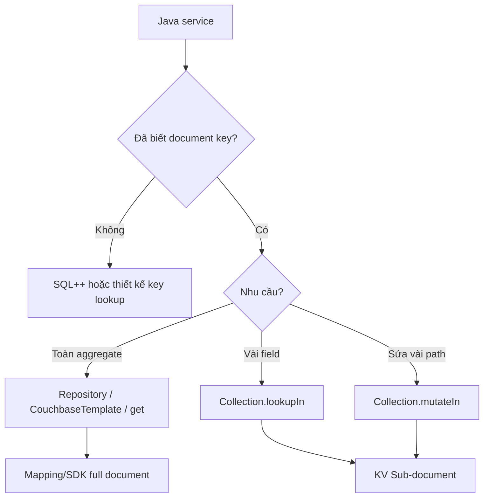

# lookupIn và mutateIn tại lớp Java SDK

## 1. Vì sao cần thao tác trực tiếp bằng Couchbase Java SDK?

Trong module **SPRING_DATA_COUCHBASE**, người học xây dựng tầng truy cập dữ liệu Couchbase qua entity mapping, repository, `CouchbaseTemplate`, truy vấn SQL++, quản lý bucket/scope/collection, chỉ mục, TTL, CAS, giao dịch và API reactive. Những cách này bổ trợ cho nhau; không phải thao tác nào cũng nên lấy cả một Java entity rồi `save` toàn bộ JSON.

Giả sử document hồ sơ người dùng dài hàng chục kilobyte nhưng ứng dụng chỉ muốn:

- Lấy `profile.display_name` để hiển thị.
- Xem `profile.phone` có tồn tại không.
- Tăng `stats.views` lên một đơn vị.
- Gắn thêm một tag vào `tags`.
- Cập nhật `preferences.locale` mà giữ nguyên những field khác.

Couchbase Java SDK cung cấp hai phương thức **Key-Value Sub-document**:

- `Collection.lookupIn(id, specs)`: đọc một hay nhiều JSON paths.
- `Collection.mutateIn(id, specs)`: biến đổi một hay nhiều JSON paths trong **cùng document**.

Ứng dụng gửi **document key, danh sách thao tác và đường dẫn JSON**, không phải tải body đầy đủ để chỉnh một property. Điều này có thể giảm lượng dữ liệu truyền qua mạng và chi phí serialization khi chỉ truy cập một phần nhỏ của document.

**Sub-document không tạo document con độc lập.** Toàn bộ các path vẫn nằm trong cùng một Couchbase document, chia sẻ document key, CAS và expiry/TTL. `lookupIn` và `mutateIn` ở đây thuộc KV service, **khác** với SQL++ `SELECT`/`UPDATE` và không phải những phương thức tự động của `CouchbaseRepository`.

### Mục tiêu bài học

Sau bài này, bạn có thể:

1. Lấy đúng `Collection` Java SDK từ bucket/scope/collection và chọn phương thức sync/async/reactive.
2. Viết `LookupInSpec.get/exists/count`, đọc `LookupInResult` và xử lý lỗi từng spec.
3. Viết `MutateInSpec` cho object, array và counter; hiểu `MutateInResult`.
4. Dùng `MutateInOptions` cho CAS, expiry, durability, timeout và store semantics có chủ đích.
5. Phân biệt atomicity của nhiều specs trong **một request** với nhiều requests hoặc nhiều documents.
6. Xử lý JSON path MISSING/NULL/sai kiểu, schema cũ, serializer và exception.
7. Thiết kế integration test, quan sát hiệu năng và phối hợp an toàn với Spring Data.

## 2. Mô hình dữ liệu và luồng xử lý

Giả sử ứng dụng dùng document key `user::42` trong collection `shop`.`app`.`users`:

```json
{
  "_class": "user-document",
  "schema_version": 2,
  "profile": {
    "display_name": "Lan",
    "city": "Da Nang"
  },
  "stats": {
    "views": 17,
    "likes": 3
  },
  "tags": ["member", "new"],
  "preferences": {
    "locale": "vi-VN",
    "notifications": true
  }
}
```

Nếu cần lấy `display_name` và `views`, `get(id)` có thể trả cả body; `lookupIn` chỉ yêu cầu hai path. Nếu cần tăng `views`, `mutateIn` có thể dùng server-side counter mà không gửi body thay thế.



Điểm khác biệt cần nhớ:

| Khái niệm | Vai trò |
| --- | --- |
| Document key `user::42` | Chọn một document trong collection. |
| JSON path `profile.display_name` | Chọn một phần trong body. |
| `LookupInSpec` | Mô tả thao tác đọc; không thay đổi body. |
| `MutateInSpec` | Mô tả thao tác sửa; có thể thay đổi CAS. |
| `LookupInResult` | Trả nội dung/trạng thái theo vị trí spec và CAS. |
| `MutateInResult` | Trả CAS/mutation metadata và output của một số specs như counter. |
| SQL++ | Truy vấn trên tập documents, có query planning/index và consistency riêng. |
| Spring Data mapping | Chuyển Java entity ↔ JSON; không tự được gọi bởi raw SDK subdoc. |

## 3. Lấy đúng `Collection` trong Java SDK

Các đoạn code sử dụng Couchbase Java SDK 3.x (chính xác tên method/options cần đối chiếu với dependency thực tế của ứng dụng). Giả sử `Cluster` được quản lý bởi cấu hình an toàn hoặc bean của Spring và ứng dụng có quyền vào collection đích.

```java
import com.couchbase.client.java.Cluster;
import com.couchbase.client.java.Collection;

// cluster đã được thiết lập bởi ứng dụng, không hard-code credential.
Collection users = cluster.bucket("shop")
    .scope("app")
    .collection("users");

String key = "user::42";
```

Đây là **Couchbase SDK Collection**, không phải `java.util.Collection`.

- `shop`: bucket chứa dữ liệu.
- `app`: scope.
- `users`: collection.
- `key`: document ID, ví dụ `user::42`.

Trước khi thao tác, xác minh môi trường, RBAC, nơi khởi tạo `Cluster` và lifecycle của SDK client. Không tạo/đóng `Cluster` ở mỗi request HTTP. Nếu Spring Data repository đang trỏ collection khác, `users.lookupIn(...)` sẽ **không** tự chuyển sang collection của repository.

### 3.1. Chuẩn bị imports thông dụng

```java
import java.time.Duration;
import java.util.List;

import com.couchbase.client.java.Collection;
import com.couchbase.client.java.json.JsonArray;
import com.couchbase.client.java.json.JsonObject;
import com.couchbase.client.java.kv.LookupInOptions;
import com.couchbase.client.java.kv.LookupInResult;
import com.couchbase.client.java.kv.LookupInSpec;
import com.couchbase.client.java.kv.MutateInOptions;
import com.couchbase.client.java.kv.MutateInResult;
import com.couchbase.client.java.kv.MutateInSpec;
```

Các ví dụ tiếp theo giả định `users` là biến `Collection` đã khởi tạo. Một số đoạn là **thân phương thức** để tập trung vào API, không phải file Java tự chạy nếu thiếu class, dependency injection và imports.

## 4. `lookupIn`: API, specs và kết quả

Hình dạng API chính:

```java
LookupInResult result =
    users.lookupIn(key, List.of(
        LookupInSpec.get("profile.display_name")
    ));
```

Hoặc truyền `LookupInOptions`:

```java
LookupInResult result = users.lookupIn(
    key,
    List.of(LookupInSpec.get("profile.display_name")),
    LookupInOptions.lookupInOptions()
        .timeout(Duration.ofSeconds(2))
);
```

`LookupInOptions` là cách cấu hình riêng cho lần gọi lookup; không nhầm với `MutateInOptions` vốn dành cho ghi.

### 4.1. Ba specs đọc cơ bản

| `LookupInSpec` | Kết quả cần quan tâm | Trường hợp phù hợp |
| --- | --- | --- |
| `get(path)` | Giá trị JSON tại path | Cần nội dung field/nested object/array. |
| `exists(path)` | Boolean thể hiện path tồn tại hay không | Chỉ cần biết có field, tiết kiệm payload. |
| `count(path)` | Số phần tử trong array/object tương ứng | Cần count mà không tải toàn bộ array/object. |

Ví dụ:

```java
LookupInResult result = users.lookupIn(
    "user::42",
    List.of(
        LookupInSpec.get("profile.display_name"),
        LookupInSpec.exists("profile.phone"),
        LookupInSpec.count("tags")
    )
);

String name = result.contentAs(0, String.class);
boolean hasPhone = result.exists(1);
int tagCount = result.contentAs(2, Integer.class);
```

**Chỉ số 0, 1, 2 là vị trí spec trong request**, không phải vị trí của JSON array `tags`. `result.contentAs(0, String.class)` đọc kết quả của `get` đầu tiên; `result.exists(1)` đọc kết quả của `exists` thứ hai.

### 4.2. Đọc đúng kiểu JSON

Nếu JSON body có:

```json
{
  "stats": {"views": 17},
  "profile": {"display_name": "Lan"}
}
```

có thể đọc:

```java
LookupInResult result = users.lookupIn(
    "user::42",
    List.of(
        LookupInSpec.get("stats.views"),
        LookupInSpec.get("profile")
    )
);

long views = result.contentAs(0, Long.class);
JsonObject profile = result.contentAsObject(1);
String name = profile.getString("display_name");
```

`contentAs(index, Class<T>)` giải mã theo serializer và kiểu đích được chọn. `contentAsObject(index)` thuận tiện khi path trỏ object; `contentAsArray(index)` thích hợp với array; `contentAsBytes(index)` trả raw JSON bytes của một path.

Không giả định serializer đọc number thành cùng wrapper type trên mọi pipeline. Chọn `Long.class`/`Integer.class` theo giá trị thực, miền số và codec của dự án; bổ sung test các giá trị biên. Với tiền tệ, không chuyển ngầm qua `double` nếu cần độ chính xác.

### 4.3. Đọc array hoặc element

```java
LookupInResult result = users.lookupIn(
    "user::42",
    List.of(
        LookupInSpec.get("tags"),
        LookupInSpec.get("tags[0]")
    )
);

JsonArray tags = result.contentAsArray(0);
String firstTag = result.contentAs(1, String.class);
```

Trong path `tags[0]`, index 0 chọn **phần tử đầu tiên của array**; nó không liên quan đến spec index 1 dùng để giải mã.

### 4.4. Nhiều lookup specs cùng request

Couchbase thực hiện các specs đọc trong một `lookupIn` dựa trên **cùng phiên bản document**, thay vì mỗi path được đọc ở một KV round-trip riêng. Đây là đặc điểm hữu ích khi cần ghép nhiều giá trị nhất quán tại thời điểm lookup. Nhưng **sau khi lookup trả về**, writer khác vẫn có thể sửa document; nếu bước sau là mutation phụ thuộc snapshot, cần CAS.

Tài liệu Sub-document hiện hành nêu giới hạn **tối đa 16 specs** trong một request. Không chia một phép kiểm tra atomic qua nhiều requests mà vẫn cho rằng tất cả đọc trên cùng snapshot.

## 5. Lookup không thành công: lỗi từng spec khác lỗi cả request

`lookupIn` có semantics quan trọng: các specs trong cùng request **độc lập về trạng thái thành công/thất bại**, dù cùng đọc một version của document.

Ví dụ:

```java
LookupInResult result = users.lookupIn(
    "user::42",
    List.of(
        LookupInSpec.get("profile.display_name"),
        LookupInSpec.get("profile.unknown_field"),
        LookupInSpec.exists("profile.unknown_field")
    )
);

String name = result.contentAs(0, String.class);
boolean found = result.exists(2); // false

// contentAs(1, String.class) cho path không tồn tại
// có thể ném PathNotFoundException khi truy xuất content.
```

Điều cần hiểu:

- Một `get` path thiếu không làm mọi spec đọc khác tự trở thành thất bại.
- `exists` thích hợp khi muốn kiểm tra path optional mà không đọc value.
- Kiểm tra kết quả/thao tác giải mã riêng ở những vị trí có thể thất bại.
- Document key không tồn tại là một lỗi **cấp document**, khác với một JSON path thiếu.

Mẫu xử lý hẹp:

```java
import com.couchbase.client.core.error.subdoc.PathNotFoundException;

LookupInResult result = users.lookupIn(
    "user::42",
    List.of(LookupInSpec.get("profile.phone"))
);

try {
    String phone = result.contentAs(0, String.class);
    // Sử dụng khi field có giá trị hợp lệ.
} catch (PathNotFoundException e) {
    // Xử lý theo hợp đồng optional field, không tạo default bừa.
}
```

### 5.1. MISSING, NULL và sai kiểu

Ba JSON body dưới đây có ngữ nghĩa khác:

```json
{"profile": {}}
```

```json
{"profile": {"phone": null}}
```

```json
{"profile": {"phone": {"country_code": "+84"}}}
```

Lần lượt: `phone` MISSING; `phone` tồn tại nhưng là JSON null; `phone` là JSON object (không phải string). Không xây chính sách data quality dựa trên việc mọi trường hợp đều thành Java `null`.

Một `get("profile.phone")` có thể trả null ở dạng thứ hai; một lần đọc `String.class` đối với dạng thứ ba có thể không đúng contract. Test riêng và phân biệt lỗi truy cập path với lỗi deserialize/validate.

### 5.2. Đọc từ replica là một lựa chọn nhất quán khác

Với Couchbase Server **7.6 trở lên**, Java SDK hỗ trợ `lookupInAnyReplica`/`lookupInAllReplicas` theo khả năng phiên bản:

```java
LookupInResult fromReplica = users.lookupInAnyReplica(
    "user::42",
    List.of(
        LookupInSpec.get("stats.views")
    )
);
```

Đọc replica có thể trả một **phiên bản ít mới hơn** active copy tùy tình trạng replication. `lookupInAnyReplica` không mặc nhiên thay thế yêu cầu đọc trạng thái mới nhất để cập nhật có điều kiện. Không dùng bản đọc từ replica làm cơ sở trực tiếp cho quyết định tài chính/stock nhạy cảm nếu chưa đánh giá tính nhất quán.

## 6. `mutateIn`: API sửa một hoặc nhiều path

Hình dạng API chính:

```java
MutateInResult result = users.mutateIn(
    "user::42",
    List.of(
        MutateInSpec.replace(
            "profile.city", "Ha Noi")
    )
);
long casAfter = result.cas();
```

`MutateInSpec` mô tả từng thay đổi, `MutateInResult` trả metadata của mutation thành công. Có thể thêm `MutateInOptions` khi cần CAS, durability, expiry, timeout và outer document store semantics.

### 6.1. Các specs mutation trên object

| Spec | Ý nghĩa | Khi nào thất bại? |
| --- | --- | --- |
| `insert(path,value)` | Chỉ thêm field **chưa tồn tại** | Field đã có; thiếu parent; sai path/type. |
| `upsert(path,value)` | Thêm field nếu chưa có hoặc thay nếu có | Parent thiếu khi không bật tạo path; sai type/path. |
| `replace(path,value)` | Thay field **đã tồn tại** | Field thiếu; path mismatch; document không tồn tại. |
| `remove(path)` | Xóa field/path | Path không tồn tại hoặc thao tác không hợp lệ. |

Ví dụ thêm locale phụ:

```java
users.mutateIn(
    "user::42",
    List.of(
        MutateInSpec.insert(
            "preferences.timezone", "Asia/Ho_Chi_Minh")
    )
);
```

Nếu `preferences.timezone` đã tồn tại, `insert` báo lỗi, không ghi đè. Nếu muốn cho phép thay hoặc tạo field thì dùng `upsert`:

```java
users.mutateIn(
    "user::42",
    List.of(
        MutateInSpec.upsert(
            "preferences.locale", "en-US")
    )
);
```

`upsert` **ở path level** khác với `Collection.upsert(id, body)` ở document level. Mặc định outer document cần tồn tại trong `mutateIn`; tạo document mới là một tùy chọn **riêng** của `MutateInOptions`.

### 6.2. Vì sao không dùng `upsert` thay cho mọi spec?

Đối với field bắt buộc như `profile.display_name`, việc `upsert` thành công khi field đang thiếu có thể che dấu schema bị hỏng. `replace` hữu ích vì buộc field phải tồn tại đúng chỗ. Với field được thiết kế optional, `upsert` phù hợp hơn.

Trong domain nhạy cảm, chọn spec dựa trên **hợp đồng dữ liệu và sự tồn tại mong đợi**, không chỉ để giảm số exception.

## 7. Tạo nested path bằng `createPath()`

Giả sử document hiện tại thiếu object `preferences.accessibility`:

```json
{
  "preferences": {
    "locale": "vi-VN"
  }
}
```

Một thao tác `upsert("preferences.accessibility.large_text", true)` có thể báo lỗi vì parent `preferences.accessibility` chưa tồn tại.

Trong SDK 3.x, có thể dùng:

```java
users.mutateIn(
    "user::42",
    List.of(
        MutateInSpec.upsert(
            "preferences.accessibility.large_text", true)
            .createPath()
    )
);
```

Tác dụng: cho phép tạo các object trung gian cần thiết khi có thể. **Không phải migration tự động**:

- Nếu `preferences` là string, không tự biến nó thành object mà không mất dữ liệu.
- Nếu schema cũ dùng tên khác như `pref`, `createPath` không biết phải chuyển giá trị cũ.
- Nếu là field bắt buộc mà thiếu do dữ liệu bị lỗi, việc tạo mới không giải thích nguồn gốc vấn đề.
- Nếu nested JSON cần thêm audit, schema version hay ràng buộc nghiệp vụ, vẫn phải thực thi ở application layer.

Không bật tạo parent cho mọi mutation mù quáng; một typo trong path có thể sinh ra cây JSON ngoài dự kiến.

## 8. Sửa nhiều path atomic bằng một `mutateIn`

Ví dụ cần đổi locale và tăng lượt xem:

```java
MutateInResult result = users.mutateIn(
    "user::42",
    List.of(
        MutateInSpec.replace(
            "preferences.locale", "en-US"),
        MutateInSpec.increment(
            "stats.views", 1)
    )
);
```

Với **cùng một document key**, các specs trong request mutation được áp dụng theo tính **nguyên tử (atomicity)**: nếu một mutation spec thất bại, toàn request không để lại trạng thái chỉ cập nhật một phần.

Cần phân biệt:

| Trường hợp | Có atomicity chung? |
| --- | --- |
| Hai specs trong một `mutateIn(id,List.of(...))` | Có, trên một document. |
| Hai lần gọi `mutateIn` tuần tự với cùng ID | Không có atomicity chung giữa hai requests. |
| `mutateIn("user::42",...)` và `mutateIn("user::43",...)` | Không tự trở thành một transaction nhiều documents. |
| Một `lookupIn` rồi một `mutateIn` | Hai requests; writer khác có thể xen giữa. |
| Hai document có giao dịch nghiệp vụ chung | Cần transaction/thiết kế nhất quán riêng. |

**Giới hạn:** mỗi `lookupIn` hoặc `mutateIn` có thể chứa tối đa **16 specs** theo tài liệu Sub-document SDK hiện hành. Nếu cần nhiều hơn, tách thao tác nhưng phải ý thức rằng atomicity ban đầu không còn bao phủ tất cả requests.

### 8.1. Một spec lỗi thì xử lý thế nào?

Giả sử:

```java
users.mutateIn(
    "user::42",
    List.of(
        MutateInSpec.replace(
            "profile.city", "Ha Noi"),
        MutateInSpec.insert(
            "profile.display_name", "Tên trùng")
    )
);
```

Nếu `display_name` đã tồn tại, `insert` có thể lỗi `PathExistsException` (đôi khi được bao gói như lỗi multi-mutation theo SDK/protocol). Đừng coi `profile.city` đã được commit chỉ vì spec đó đứng trước. Trong một request `mutateIn` thất bại, phải đối chiếu lỗi và document state theo atomicity của request; không ghi audit "đổi city thành công" một cách độc lập.

## 9. `MutateInResult`, CAS và kết quả bộ đếm

Một số specs mutation như `increment`/`decrement` trả về **giá trị counter mới**:

```java
MutateInResult result = users.mutateIn(
    "user::42",
    List.of(
        MutateInSpec.increment(
            "stats.views", 1)
    )
);

long viewsNow = result.contentAs(0, Long.class);
long casAfter = result.cas();
```

Các chỉ số trong `MutateInResult.contentAs(index,...)` cũng gắn với vị trí spec trong request. Không kỳ vọng `replace` thông thường sẽ trả lại giá trị field đã thay như một `lookupIn`; nếu cần biết giá trị sau ghi, bạn đã có value gửi đi hoặc có thể đọc lại.

`cas()` là **CAS của document sau mutation thành công**. Đây không phải body field `schema_version` và cũng không phải document key.

### 9.1. Sub-document counter không phải số thực tổng quát

`increment("stats.views",1)` và `decrement("stats.views",1)` phục vụ **số nguyên** theo semantics counter của Couchbase. Không dùng chúng như phép tính `BigDecimal` để quản lý tiền hoặc tỷ giá.

Tài liệu Couchbase nêu subdoc counter có kiểm soát overflow/underflow theo miền số nguyên có dấu được hỗ trợ. Khi counter field chưa tồn tại, server có thể tạo giá trị theo semantics counter; với parent path còn thiếu có thể cần `createPath()`. Kiểm tra miền giá trị và hành vi lỗi thực tế trong SDK/server đang chạy.

## 10. Array operations: lưu ý chữ ký của Java SDK

Các thao tác array thường gặp trong `MutateInSpec`:

- `arrayAppend(path, List<?> values)`: nối **một hay nhiều giá trị** vào cuối array.
- `arrayPrepend(path, List<?> values)`: thêm một hay nhiều giá trị vào đầu.
- `arrayInsert(pathWithIndex, List<?> values)`: chèn tại vị trí array.
- `arrayAddUnique(path, Object value)`: thử thêm một giá trị không trùng với semantics được SDK hỗ trợ.

**Lưu ý chữ ký quan trọng:** trong Java SDK hiện hành, `arrayAppend`/`arrayPrepend`/`arrayInsert` nhận `List<?>`. Để thêm **một** string, truyền `List.of("vip")`, không giả định overload nhận trực tiếp `"vip"`.

### 10.1. Append và prepend

```java
users.mutateIn(
    "user::42",
    List.of(
        MutateInSpec.arrayAppend(
            "tags", List.of("vip"))
    )
);

users.mutateIn(
    "user::42",
    List.of(
        MutateInSpec.arrayPrepend(
            "tags", List.of("featured"))
    )
);
```

Nếu array trước đó là `["member","new"]`, append thêm `"vip"` vào cuối; prepend thêm `"featured"` vào đầu. Không tự bảo đảm array không chứa duplicate.

### 10.2. Insert ở vị trí array

```java
users.mutateIn(
    "user::42",
    List.of(
        MutateInSpec.arrayInsert(
            "tags[1]", List.of("trial"))
    )
);
```

Path `tags[1]` chọn **vị trí chèn**. Với array có hai phần tử, index 1 là vị trí giữa hai phần tử. Không dùng `arrayInsert("tags",...)` để chỉ định vị trí vì spec này đòi phần kết path là array index.

### 10.3. Thêm giá trị không trùng

```java
users.mutateIn(
    "user::42",
    List.of(
        MutateInSpec.arrayAddUnique(
            "tags", "vip")
    )
);
```

Nếu `"vip"` đã có, thao tác có thể báo `PathExistsException`. Theo tài liệu hiện hành, `arrayAddUnique` có giới hạn: có thể báo `PathMismatchException` nếu array chứa JSON floats/objects/arrays; thêm chính các loại giá trị này có thể báo lỗi tương ứng. Vị trí phần tử được thêm **không được đảm bảo**; đừng coi array như sorted set.

### 10.4. Mảng object và business uniqueness

Nếu `items` gồm:

```json
{
  "items": [
    {"line_id": "L1", "sku": "BOOK-01", "qty": 2},
    {"line_id": "L2", "sku": "PEN-02", "qty": 3}
  ]
}
```

Để đổi `items[1].qty`, có thể dùng:

```java
users.mutateIn(
    "user::42",
    List.of(
        MutateInSpec.replace("items[1].qty", 5)
    )
);
```

Đoạn trên chỉ đúng nếu document `user::42` thực sự có `items` với hình dạng đó, và `L2` vẫn ở index 1. Trong môi trường nhiều writer, array index có thể bị dịch khi insert/remove. Khi cập nhật theo `line_id`, hãy đọc array/ID, xác định index, rồi ghi có CAS; hoặc dùng keyed object/document-per-line phù hợp hơn.

**Sub-document path không phải SQL++ predicate**: không có cú pháp tự tìm `items[?line_id="L2"]` theo business key.

## 11. Đọc một snapshot rồi cập nhật với CAS

Giả sử yêu cầu nghiệp vụ: chỉ cho đổi `preferences.locale` khi giá trị hiện tại là `vi-VN`.

```java
import java.util.List;
import com.couchbase.client.java.kv.LookupInResult;
import com.couchbase.client.java.kv.LookupInSpec;
import com.couchbase.client.java.kv.MutateInSpec;
import com.couchbase.client.java.kv.MutateInOptions;

LookupInResult snapshot = users.lookupIn(
    "user::42",
    List.of(
        LookupInSpec.get("preferences.locale")
    )
);

String locale = snapshot.contentAs(0, String.class);
long observedCas = snapshot.cas();

if ("vi-VN".equals(locale)) {
    users.mutateIn(
        "user::42",
        List.of(
            MutateInSpec.replace(
                "preferences.locale", "en-US")
        ),
        MutateInOptions.mutateInOptions()
            .cas(observedCas)
    );
}
```

CAS là một token liên quan **toàn document**: nếu writer khác thay bất kỳ phần nào của document sau khi lookup, CAS có thể đổi và mutation có điều kiện bị từ chối bằng `CasMismatchException`.

### 11.1. Khi nào không cần CAS?

Một phép `increment("stats.views",1)` độc lập hoặc hai `arrayAppend` có thể thực hiện trực tiếp ở server mà không cần client đọc trước; với các thao tác này SDK/server bảo vệ mutation của một document mà không phải đưa vòng read-modify-write về ứng dụng.

Ngược lại, dùng CAS khi:

- Điều kiện mutation phụ thuộc giá trị vừa đọc.
- Cần bảo đảm array index vẫn trỏ cùng phần tử.
- Cần tương thích với một entity stale đã được Spring Data repository đọc.
- Cần tránh ghi đè thay đổi từ một writer khác.

**Không có nghĩa** mọi thay đổi cùng document phải conflict nếu không truyền CAS. Couchbase có thể xử lý nhiều subdoc mutations trực tiếp một cách an toàn ở mức phép toán; CAS là công cụ kiểm soát **ý định dựa vào snapshot**.

### 11.2. Retry đúng khi CAS mismatch

Không retry mù cùng path nếu document đã đổi. Thay vào đó:

1. Bắt `CasMismatchException`.
2. Đọc lại field hoặc array đang quyết định logic.
3. Kiểm tra lại invariant và xác định lại index nếu cần.
4. Lặp với CAS mới trong giới hạn retry/backoff.
5. Trả conflict cho nghiệp vụ nếu trạng thái đã không còn phù hợp.

Ví dụ sửa một line item theo index cũ mà không đọc lại array có thể ghi vào **sai line** sau khi writer khác chèn phần tử ở đầu.

## 12. `MutateInOptions`: nhiều chính sách nằm ở request, không nằm ở spec

`MutateInSpec` mô tả phần nào của JSON được sửa. `MutateInOptions` điều khiển các điều kiện áp dụng lên request/document:

| Tùy chọn | Ý nghĩa | Điều cần nhớ |
| --- | --- | --- |
| `cas(long)` | Ghi có điều kiện theo CAS hiện tại | Bảo vệ vòng đọc–đánh giá–ghi. |
| `expiry(Duration/Instant)` | Đặt thời gian hết hạn document | Là metadata, không phải JSON field. |
| `preserveExpiry(true)` | Yêu cầu giữ expiry hiện có | Không đồng thời đặt expiry mới cho cùng ý định. |
| `durability(...)` | Đặt mức durable write | Có thể tăng latency, phụ thuộc cluster/server. |
| `timeout(Duration)` | Đặt giới hạn thời gian client cho thao tác | Timeout không chứng minh mutation chưa xảy ra. |
| `storeSemantics(StoreSemantics)` | Kiểm soát outer document phải có/được tạo | Khác với `upsert` một JSON path. |
| `serializer(JsonSerializer)` | Dùng serializer đã chỉ định cho values | Không đồng nghĩa Spring Data custom conversions. |

Ví dụ ghép CAS, TTL policy và timeout:

```java
MutateInOptions options = MutateInOptions.mutateInOptions()
    .cas(observedCas)
    .preserveExpiry(true)
    .timeout(Duration.ofSeconds(2));

users.mutateIn(
    "user::42",
    List.of(
        MutateInSpec.replace(
            "preferences.locale", "en-US")
    ),
    options
);
```

Đoạn code minh họa trường hợp `observedCas` lấy từ một `lookupIn` trước đó, và nhu cầu nghiệp vụ thực sự là **giữ expiry cũ**. Nếu một thao tác muốn gia hạn session, hãy chủ động đặt expiry policy mới thay vì copy tùy chọn trên.

## 13. `storeSemantics`: phân biệt document-level và path-level upsert

Mặc định outer document của `mutateIn` phải tồn tại (semantics thay thế/update). Nếu muốn một request có thể **tạo document mới** hoặc **thất bại khi document đã tồn tại**, SDK cung cấp `StoreSemantics` trong options:

```java
import com.couchbase.client.java.kv.StoreSemantics;

users.mutateIn(
    "user::new-42",
    List.of(
        MutateInSpec.upsert("profile.display_name", "Mai")
            .createPath()
    ),
    MutateInOptions.mutateInOptions()
        .storeSemantics(StoreSemantics.INSERT)
);
```

`StoreSemantics.INSERT`: tạo outer document, nhưng thất bại nếu key đã tồn tại. `StoreSemantics.UPSERT`: tạo hoặc sửa outer document. `StoreSemantics.REPLACE`: chỉ sửa document đã tồn tại (mặc định). Chúng **không** thay thế ý nghĩa của `MutateInSpec.insert/upsert/replace` tại JSON path.

**Cảnh báo thiết kế:** tạo document mới chỉ gồm `profile.display_name` có thể không phù hợp entity `UserDocument` nếu ứng dụng yêu cầu `_class`, `status`, `schema_version`, email hoặc những field bắt buộc. Với nghiệp vụ có aggregate invariant, nên tạo full entity hợp lệ qua repository/template hoặc một payload JSON chuẩn đã được validate.

## 14. Expiry/TTL: dùng `expiry` hay `preserveExpiry`?

Giả sử document session có TTL. Nếu bạn chỉ muốn thay `preferences.locale` nhưng **không thay thời điểm hết hạn**, cần xem xét:

```java
users.mutateIn(
    "user::42",
    List.of(
        MutateInSpec.replace(
            "preferences.locale", "en-US")
    ),
    MutateInOptions.mutateInOptions()
        .preserveExpiry(true)
);
```

Nếu yêu cầu là đặt session còn sống thêm 30 phút, đó là **chính sách khác**:

```java
users.mutateIn(
    "user::42",
    List.of(
        MutateInSpec.upsert(
            "preferences.locale", "en-US")
    ),
    MutateInOptions.mutateInOptions()
        .expiry(Duration.ofMinutes(30))
);
```

Không dùng hai chính sách khác nhau mà không hiểu precedence. Theo API, `preserveExpiry(true)` biểu đạt ý định giữ expiry đã có; `expiry(Duration)` đặt expiry mới. Hành vi mặc định và chi tiết tương thích của server/SDK cần được kiểm tra trong integration test, nhất là với bucket có max TTL.

TTL **không phải** một field `expires_at` trong JSON; subdoc `upsert("expires_at",...)` không đồng nghĩa chỉnh metadata expiry.

## 15. Durability không đồng nghĩa atomicity hoặc query consistency

Mỗi `mutateIn` thành công trên một document áp dụng specs atomic, nhưng điều đó là khái niệm khác với **durability**: mutation được lưu/replicate đến mức nào trước khi báo thành công.

Ví dụ với Couchbase Server hỗ trợ durable writes:

```java
import com.couchbase.client.core.msg.kv.DurabilityLevel;

users.mutateIn(
    "user::42",
    List.of(
        MutateInSpec.replace(
            "preferences.locale", "en-US")
    ),
    MutateInOptions.mutateInOptions()
        .durability(DurabilityLevel.MAJORITY)
);
```

Durability level mạnh hơn có thể tăng độ trễ hoặc không đáp ứng được nếu topology không phù hợp. Cần đánh giá availability/latency theo yêu cầu vận hành.

Ba khái niệm cần tách:

1. **Atomicity:** các specs trong một `mutateIn` có cùng kết quả thành công hoặc thất bại trên một document.
2. **Durability:** mutation được lưu/replicate theo mức cam kết.
3. **SQL++ query consistency:** secondary indexes/query thấy mutation ở thời điểm nào.

Một KV `lookupIn` theo key có thể thấy giá trị vừa cập nhật trong khi SQL++ qua GSI vẫn chưa thấy nó do index visibility/scan consistency. Không suy rằng converter hoặc path sai chỉ vì SQL++ `SELECT` ngay sau mutation trả 0 rows.

## 16. Async API: `Collection.async().lookupIn/mutateIn`

Couchbase Java SDK cung cấp asynchronous facade bằng `CompletableFuture`. Ví dụ lookup:

```java
import java.util.List;
import java.util.concurrent.CompletableFuture;
import com.couchbase.client.java.kv.LookupInResult;
import com.couchbase.client.java.kv.LookupInSpec;

CompletableFuture<LookupInResult> future = users
    .async()
    .lookupIn(
        "user::42",
        List.of(
            LookupInSpec.get("profile.display_name")
        )
    );

CompletableFuture<String> nameFuture = future.thenApply(
    result -> result.contentAs(0, String.class)
);
```

Chỉ gọi `thenApply` tạo pipeline xử lý kết quả; quan sát exception và completion bằng các API `CompletableFuture` thích hợp, tránh gọi `future.get()` rồi block trong executor không dành cho I/O.

### 16.1. Async mutation

```java
import java.util.concurrent.CompletableFuture;
import com.couchbase.client.java.kv.MutateInResult;

CompletableFuture<MutateInResult> changed = users.async()
    .mutateIn(
        "user::42",
        List.of(
            MutateInSpec.increment("stats.views", 1)
        )
    );

CompletableFuture<Long> viewsFuture = changed.thenApply(
    result -> result.contentAs(0, Long.class)
);
```

Async không làm thao tác tự có transaction hay validation. Bắt `CompletionException`/cause phù hợp với API khi xử lý error; phải phân biệt timeout, CAS mismatch và path mismatch trước khi retry.

## 17. Reactive API: `Collection.reactive().lookupIn/mutateIn`

Với WebFlux và các API reactive, SDK cung cấp `ReactiveCollection` dựa trên Project Reactor:

```java
import reactor.core.publisher.Mono;

Mono<String> nameMono = users.reactive().lookupIn(
    "user::42",
    List.of(
        LookupInSpec.get("profile.display_name")
    )
).map(result ->
    result.contentAs(0, String.class)
);
```

Mutation:

```java
Mono<Long> viewsMono = users.reactive().mutateIn(
    "user::42",
    List.of(
        MutateInSpec.increment("stats.views", 1)
    )
).map(result ->
    result.contentAs(0, Long.class)
);
```

Các `Mono` là publisher: cần subscribe hoặc verify trong test thì thao tác mới thực sự được thực thi theo lifecycle reactive. Không tự gọi `block()` trong event-loop production chỉ để lấy value.

### 17.1. Test reactive đúng cách

Khi dự án có dependency `reactor-test`:

```java
import reactor.test.StepVerifier;

StepVerifier.create(nameMono)
    .expectNext("Lan")
    .verifyComplete();
```

Với negative test, dùng `expectErrorMatches` hoặc `expectErrorSatisfies` để xác minh **loại lỗi và ngữ cảnh**, không coi việc publisher được tạo không lỗi là test đã pass.

### 17.2. Chọn API thế nào?

| API | Kiểu trả về | Khi phù hợp |
| --- | --- | --- |
| `users.lookupIn(...)` | `LookupInResult` | Service blocking, batch đơn giản, ứng dụng imperative. |
| `users.async().lookupIn(...)` | `CompletableFuture<LookupInResult>` | Tích hợp async Java API hoặc compose futures. |
| `users.reactive().lookupIn(...)` | `Mono<LookupInResult>` | Reactive service, WebFlux, Reactor composition. |

Tất cả vẫn dùng **cùng semantics KV JSON path và CAS**. Không nên nghĩ rằng reactive SDK tự gọi Spring Data `MappingCouchbaseConverter` hoặc quản lý Spring transactions của repository.

## 18. Lỗi Sub-document: phân biệt nhiều tầng

Sub-document có lỗi ngoài các lỗi KV thông thường. Một số lớp lỗi thường được dùng trong Couchbase Java SDK:

| Loại lỗi | Nguyên nhân điển hình | Gợi ý xử lý |
| --- | --- | --- |
| `DocumentDoesNotExistException` | Document key không tồn tại | Xác định not found hay retry/migration hợp lệ. |
| `PathNotFoundException` | JSON path thiếu; parent thiếu khi chèn | Xác minh JSON, chọn đúng `insert/upsert/createPath`. |
| `PathExistsException` | `insert` trên field đã có, hoặc `arrayAddUnique` gặp duplicate | Không coi là thành công; xem idempotency contract. |
| `PathMismatchException` | Cú pháp path kỳ vọng object nhưng JSON thực là array/scalar hoặc type không hợp | Data quality/schema migration. |
| `PathInvalidException` | Cú pháp path không phù hợp spec, ví dụ arrayInsert sai đích | Sửa path và thêm test. |
| `DocumentNotJsonException` | Thao tác Sub-document trên binary document | Không tự parse dữ liệu phi JSON. |
| `CasMismatchException` | CAS đã thay đổi trước mutation | Đọc lại, đánh giá lại rule, retry có giới hạn. |
| `MultiMutationException` hoặc lỗi bao gói khác | Một spec trong request mutation thất bại | Xem context/cause và spec liên quan, không báo partial success. |
| Timeout / availability / durability exception | Hạ tầng hoặc đáp ứng SLA không đủ | Phân biệt kết quả chưa chắc chắn với validation error. |

Tên exception và cơ chế bao gói có thể khác giữa SDK versions, response types và hoàn cảnh; **test bằng dependency thực tế** trước khi viết error classifier cố định. Thông tin chi tiết error context của SDK hữu ích để xác định failed spec, path và request ID khi có.

### 18.1. Không bắt chung rồi upsert bừa

Một cách xử lý nguy hiểm:

```java
// Anti-pattern: nuốt mọi lỗi rồi ghi đè path bằng upsert.
try {
    users.mutateIn(
        "user::42",
        List.of(
            MutateInSpec.replace("profile.city", "Ha Noi")
        )
    );
} catch (RuntimeException ignored) {
    users.mutateIn(
        "user::42",
        List.of(
            MutateInSpec.upsert("profile.city", "Ha Noi")
                .createPath()
        )
    );
}
```

Nếu lỗi thực sự là permission, timeout, CAS conflict hoặc schema hỏng, đoạn fallback này không xử lý đúng nguyên nhân; thậm chí có thể tạo cấu trúc ngoài ý định. Hãy phân loại theo exception/cause và hợp đồng dữ liệu.

### 18.2. Timeout có thể không nói được mutation đã commit hay chưa

Khi client timeout sau khi gửi request, server **có thể đã áp dụng** mutation nhưng client chưa nhận kết quả. Retry một `arrayAppend("events",...)` không có idempotency có thể thêm sự kiện hai lần; retry một lệnh thanh toán ngoài hệ thống có thể nguy hiểm hơn.

Giải pháp: đọc/đối chiếu lại trạng thái hoặc dùng business idempotency key/document key ổn định, không retry mù các mutation không idempotent.

## 19. Xử lý JSON path đúng tại lớp SDK

Sub-document path nhắm vào field **đã lưu**:

```json
{
  "profile": {
    "display_name": "Lan"
  },
  "tags": ["member", "new"]
}
```

- `profile.display_name`: một field nested.
- `tags[0]`: phần tử đầu array.
- `tags[-1]`: cú pháp mở rộng cho phần tử cuối theo tài liệu path hiện hành.
- `profile`: trả cả object.
- Path rỗng `""` trong một số specs áp dụng ở **root document**, không chỉ định một field.

Tên path nhạy với cấu trúc JSON, không phải tên getter Java. Với literal field name chứa dấu chấm hoặc ngoặc vuông, Sub-document path hỗ trợ quoting/escaping theo quy tắc tương thích SQL++.

Ví dụ JSON:

```json
{
  "settings": {
    "display.name": "Lan"
  }
}
```

Cần quote literal key `display.name` thay vì diễn giải thành hai nested keys. Trong văn bản path:

```text
settings.`display.name`
```

Trong Java:

```java
String literalKeyPath = "settings.`display.name`";
```

Trong hai ví dụ trên, tên field đặc biệt được bao bởi dấu backtick. Với key chứa dấu quote, backslash hoặc backtick, cần áp dụng đúng quy tắc escape của JSON string và Sub-document path grammar; không ghép path trực tiếp từ request HTTP.

### 19.1. Giới hạn đường dẫn và số specs

Theo tài liệu Sub-document hiện hành, path có giới hạn độ dài và độ sâu (ví dụ 1.024 ký tự và tối đa 32 cấp), cùng giới hạn **16 operations mỗi request**. Các ràng buộc này phụ thuộc server/protocol/SDK version và cần test với phiên bản đang chạy.

Không thiết kế domain document với nesting cực sâu rồi dựa vào việc Sub-document API sẽ xử lý mọi cấp.

## 20. Chèn/xóa XATTR và metadata: phạm vi nâng cao

Couchbase còn hỗ trợ **Extended Attributes (XATTRs)** qua một số Sub-document specs với `xattr()`, dành cho metadata ứng dụng/hệ thống theo chính sách riêng. XATTR **không phải** JSON field thường trong body và cũng không đồng nghĩa CAS/TTL server.

Ví dụ khái niệm:

```java
users.mutateIn(
    "user::42",
    List.of(
        MutateInSpec.upsert(
            "app_meta.last_patch_by", "profile-service")
            .xattr()
            .createPath()
    )
);
```

Khi áp dụng XATTR:

- Kiểm tra quyền truy cập và phiên bản server/SDK.
- Không dùng XATTR để lách validation hoặc lưu secret không được quản trị.
- Không trộn lẫn path body với path XATTR nếu schema cần đọc từ SQL++/Search/SDK khác.
- Không suy rằng `@TypeAlias`/`@Version` của Spring Data đã tự chuyển thành XATTR.

Đối với bài này, trọng tâm vẫn là `lookupIn`/`mutateIn` trên **body JSON**; XATTR chỉ nhằm nhận diện một điểm mở rộng SDK.

## 21. Ranh giới quan trọng với Spring Data repository và `CouchbaseTemplate`

Một entity Spring Data có thể dùng:

```java
import org.springframework.data.annotation.Id;
import org.springframework.data.annotation.Version;
import org.springframework.data.couchbase.core.mapping.Document;
import org.springframework.data.couchbase.core.mapping.Field;

@Document
public class UserDocument {
    @Id
    private String id;

    @Field("profile")
    private Profile profile;

    @Field("stats")
    private UserStats stats;

    @Version
    private Long version;

    // Constructors, getters và validation thuộc ứng dụng.
}
```

Spring Data mapping có thể dùng `@Field("display_name")` ở field bên trong `Profile` hoặc custom `CouchbaseCustomConversions` cho value object. Raw `users.mutateIn(...)` **không tự gọi** các converter, entity callbacks, auditing listeners, domain methods hay Bean Validation của Spring Data.

Ví dụ:

```java
users.mutateIn(
    "user::42",
    List.of(
        MutateInSpec.replace(
            "profile.display_name", "Lan Nguyen")
    )
);
```

Path `profile.display_name` phải đúng **tên JSON**. Nếu Java property tên `displayName` mà annotation `@Field("display_name")`, SDK không biết alias đó trừ khi người viết truyền đúng path.

### 21.1. Khi nào nên dùng repository/template?

Dùng entity mapping nếu phải:

- Materialize và validate toàn aggregate.
- Thực thi business method/state machine.
- Sử dụng entity callbacks/auditing của Spring Data.
- Đảm bảo custom conversions được dùng nhất quán cho nhiều properties.
- Quản lý optimistic locking qua entity `@Version`.

Dùng SDK Sub-document nếu đã biết key, thao tác nhỏ, JSON contract ổn định và business invariant có thể kiểm soát bằng một vài path/CAS.

### 21.2. Phối hợp cả hai đường cần bảo vệ CAS

Nếu một Java entity được repository đọc tại CAS cũ, sau đó raw SDK `mutateIn` chỉnh `stats.views`, CAS document thay đổi. Một `repository.save` sau đó trên entity stale có thể bị optimistic locking từ chối nếu `@Version` được cấu hình đúng. Đây là cơ chế chống lost update đáng mong muốn.

Nếu bỏ locking hoặc ghi full document không có CAS, có nguy cơ writer sau ghi đè thay đổi vừa thực hiện qua Sub-document API. Cần test kịch bản xung đột này khi hai đường truy cập cùng ghi một collection.

## 22. `lookupIn`/`mutateIn` không phải SQL++ và không tự sửa index

Ví dụ SQL++ tìm nhiều users theo city:

```sql
SELECT META(u).id AS userId,
       u.profile.city
FROM `shop`.`app`.`users` AS u
WHERE u.profile.city = "Ha Noi";
```

Một index có thể cần để phục vụ workload:

```sql
CREATE INDEX ix_users_profile_city
ON `shop`.`app`.`users`(
    profile.city
);
```

`users.lookupIn("user::42",...)` và `users.mutateIn("user::42",...)` không dùng index để tìm document, vì đã biết **document key**. Nhưng khi một mutation sửa `profile.city`, GSI liên quan vẫn cần được cập nhật theo cơ chế của Couchbase. Query SQL++ ngay sau KV mutation có thể chưa thấy dữ liệu khi scan consistency chưa yêu cầu read-after-write.

Khi kiểm tra:

1. Đọc `lookupIn` theo key để xác nhận KV mutation.
2. Đọc SQL++ với query consistency phù hợp nếu cần thấy mutation ngay.
3. Dùng `EXPLAIN` nếu query theo field không dùng index mong đợi.

Không coi một kết quả SQL++ thiếu document mới là bằng chứng SDK Sub-document cập nhật sai path.

## 23. Một adapter typed ở tầng persistence

Thay vì để controller truyền path string tự do, có thể đóng gói thao tác SDK trong một adapter. Ví dụ đổi locale theo điều kiện CAS:

```java
import java.util.List;
import java.util.Objects;
import com.couchbase.client.java.Collection;
import com.couchbase.client.java.kv.LookupInResult;
import com.couchbase.client.java.kv.LookupInSpec;
import com.couchbase.client.java.kv.MutateInSpec;
import com.couchbase.client.java.kv.MutateInOptions;

public final class UserPreferencePatchStore {
    private final Collection users;

    public UserPreferencePatchStore(Collection users) {
        this.users = Objects.requireNonNull(users);
    }

    public void changeLocaleIfMatches(
            String id, String expectedLocale,
            String newLocale) {

        if (newLocale == null || newLocale.isBlank()) {
            throw new IllegalArgumentException("Invalid locale");
        }

        LookupInResult before = users.lookupIn(
            id,
            List.of(
                LookupInSpec.get("preferences.locale")
            )
        );

        String current =
            before.contentAs(0, String.class);

        if (!Objects.equals(current, expectedLocale)) {
            throw new IllegalStateException(
                "Locale was changed");
        }

        users.mutateIn(
            id,
            List.of(
                MutateInSpec.replace(
                    "preferences.locale", newLocale)
            ),
            MutateInOptions.mutateInOptions()
                .cas(before.cas())
                .preserveExpiry(true)
        );
    }
}
```

Mẫu có ba lớp bảo vệ: **whitelist path cố định**, **validation giá trị** và **CAS theo snapshot**. Chưa có authorization theo ID người dùng, audit, structured retry hay phân loại exception; đó là phần ứng dụng phải bổ sung trước production.

**Không trả raw exception/payload nhạy cảm trực tiếp qua HTTP**. API service nên ánh xạ thành lỗi nghiệp vụ cụ thể như not found, conflicting update, invalid field hoặc service unavailable.

## 24. Kiểm thử với Couchbase thật: ví dụ JUnit minh họa

Unit test có thể xác nhận code xây specs đúng nhưng không chứng minh server chấp nhận path, array mutation và CAS. Integration test cần một collection/key test cô lập.

### 24.1. Tạo document kiểm thử

```java
import java.util.List;
import com.couchbase.client.java.json.JsonArray;
import com.couchbase.client.java.json.JsonObject;

String id = "user::subdoc::test-003";

JsonObject original = JsonObject.create()
    .put("profile", JsonObject.create()
        .put("display_name", "Lan")
        .put("city", "Da Nang"))
    .put("stats", JsonObject.create()
        .put("views", 17))
    .put("tags", JsonArray.from("member", "new"))
    .put("preferences", JsonObject.create()
        .put("locale", "vi-VN"));

users.insert(id, original);
```

Dùng ID test riêng và cleanup theo quy trình test. `insert` sẽ lỗi nếu key đã tồn tại, vì vậy test setup phải bảo đảm fixture mới và không ghi đè production.

### 24.2. Assert lookup specs

```java
LookupInResult before = users.lookupIn(
    id,
    List.of(
        LookupInSpec.get("profile.display_name"),
        LookupInSpec.exists("profile.phone"),
        LookupInSpec.count("tags")
    )
);

assert "Lan".equals(
    before.contentAs(0, String.class));
assert !before.exists(1);
assert before.contentAs(2, Integer.class) == 2;
```

### 24.3. Assert atomic mutation và counter result

```java
MutateInResult changed = users.mutateIn(
    id,
    List.of(
        MutateInSpec.replace(
            "profile.display_name", "Lan Nguyen"),
        MutateInSpec.increment(
            "stats.views", 1),
        MutateInSpec.arrayAppend(
            "tags", List.of("vip"))
    )
);

long viewsNow = changed.contentAs(1, Long.class);
assert viewsNow == 18L;

LookupInResult after = users.lookupIn(
    id,
    List.of(
        LookupInSpec.get("profile.display_name"),
        LookupInSpec.get("stats.views"),
        LookupInSpec.count("tags")
    )
);

assert "Lan Nguyen".equals(
    after.contentAs(0, String.class));
assert after.contentAs(1, Long.class) == 18L;
assert after.contentAs(2, Integer.class) == 3;
```

Counter ở đây là **spec thứ hai**, nên `changed.contentAs(1,Long.class)` mới là vị trí phù hợp. Test thêm rằng `profile.city` vẫn `Da Nang` và các field khác không bị ghi đè.

### 24.4. Verify atomic failure

Tạo một `mutateIn` gồm:

- `replace("profile.city","Ha Noi")` — hợp lệ.
- `insert("profile.display_name","Duplicate")` — thất bại vì field đã tồn tại.

Sau exception, đọc lại `profile.city` để bảo đảm nó **không bị đổi thành `Ha Noi`** do request có atomicity trên cùng document. Đừng test bằng hai calls `mutateIn` riêng; chúng không có atomicity chung.

### 24.5. Verify CAS conflict

1. Client A gọi `lookupIn`, lưu `casA`.
2. Client B gọi `mutateIn` tăng `stats.views`.
3. Client A thử `mutateIn` với `.cas(casA)`.
4. Kỳ vọng CAS conflict; đọc lại và đánh giá rule trước khi retry.

Chỉ khẳng định loại exception cụ thể sau khi test với SDK dependency trong ứng dụng; error wrapping có thể khác với một thao tác async/reactive.

## 25. Ma trận kiểm thử trước production

| Nhóm | Tình huống | Kỳ vọng |
| --- | --- | --- |
| Collection/key | Key đúng, collection đúng | Không vô tình sửa document ở scope khác. |
| Lookup | Một path string hợp lệ | `contentAs` trả đúng giá trị. |
| Lookup | Nhiều specs | Vị trí index trùng với thứ tự specs. |
| Lookup | `exists` trên missing path | Trả false, không coi cả request là thất bại. |
| Lookup | `get` trên missing path | Lỗi ở spec khi đọc content theo semantics SDK. |
| Lookup | Object/array | `contentAsObject/Array` khớp JSON shape. |
| Mutation | `insert` trên field chưa có | Thêm field đúng. |
| Mutation | `insert` trên field đã có | Báo PathExists/mutation error, không overwrite. |
| Mutation | `replace` trên missing path | Thất bại, không tạo field ngoài hợp đồng. |
| Mutation | `upsert(...).createPath()` | Tạo parent object khi phù hợp. |
| Mutation | Parent là string/array sai kiểu | Phát hiện PathMismatch, không tự phá schema. |
| Array | Append/prepend bằng `List.of` | Thứ tự đúng, duplicate policy rõ. |
| Array | `arrayAddUnique` với primitive duplicate | Lỗi giá trị trùng theo SDK semantics. |
| Counter | Nhiều increment đồng thời | Không mất tăng và không tràn miền hỗ trợ. |
| Atomicity | Multi-spec có một spec lỗi | Body không bị commit một phần. |
| CAS | Stale snapshot | Conflict được nhận diện. |
| Expiry | `preserveExpiry(true)` | TTL còn theo ý định đã test. |
| Durability | `MAJORITY` nếu yêu cầu | Behavior/latency theo topology. |
| Async | `CompletableFuture` success/error | Không swallow exception. |
| Reactive | `Mono` success/error | Publisher được subscribe và verify. |
| Replica | Đọc replica `7.6+` | Không dựa vào đó như nguồn latest chắc chắn. |
| Raw SDK vs Spring | SDK mutate rồi repository đọc | JSON hợp đồng và mapping nhất quán. |
| SQL++ | KV mutation rồi SELECT | Kiểm tra scan consistency và index. |
| Authorization | Client cố sửa path nhạy cảm | Bị chặn ở application service. |
| Idempotency | Timeout sau append/increment | Không retry mù gây duplicate/double effect. |

## 26. Thiết kế hiệu năng: nhỏ payload không đủ để thắng mọi workload

Sub-document có thể giảm payload so với full `get/replace`, nhưng cần đo:

- Kích thước JSON document và tỷ lệ field thực sự cần dùng.
- Số specs trong một `lookupIn`/`mutateIn` (tối đa 16).
- Số KV round trips: một `lookupIn` + một `mutateIn` có thể đắt hơn một thao tác đơn trong workload nhỏ.
- CAS conflict rate nếu document nóng, vì mọi mutation đổi CAS toàn document.
- Chi phí index maintenance khi field được đánh index.
- Chi phí durability, timeout và retry.
- Năng lực event-loop, cách chọn blocking/async/reactive và thời gian chờ.
- Nhu cầu audit/validation mà Sub-document bỏ qua so với repository.
- Tỷ lệ bản ghi schema V1/V2, lỗi path và dữ liệu không đúng contract.

Hãy benchmark với kích thước và mức đồng thời đại diện production (p50/p95/p99). Không chỉ so sánh một response sample rồi kết luận `mutateIn` luôn nhanh hơn `save`.

## 27. Quy trình debug thực tế

Khi SDK trả lỗi hoặc update không phản ánh như kỳ vọng:

1. **Xác minh bucket, scope, collection và key**; phân biệt not found với sai path.
2. **Đọc body raw theo key** hoặc dùng `lookupIn` lấy parent object để xem JSON type/name thật.
3. **Kiểm tra spec và index**: `LookupInSpec` thứ mấy, `MutateInSpec` thứ mấy, array index/`List.of` có đúng không?
4. **Đối chiếu path grammar**: dấu chấm, brackets, literal key quoting, case sensitivity.
5. **Kiểm tra MISSING/NULL/type mismatch** thay vì đoán default.
6. **Kiểm tra mutation error/cause**: PathNotFound, PathExists, PathMismatch, MultiMutation, CasMismatch, timeout.
7. **Đọc lại CAS và expiry**; nếu có concurrency, tái kiểm tra intent nghiệp vụ.
8. **Đối chiếu Spring Data mapping**: `@Field`, custom conversions, entity `@Version` và callbacks không tự được gọi.
9. **Nếu SQL++ chưa thấy giá trị**: đối chiếu KV lookup, scan consistency và index.
10. **Thêm regression test** cho fixture JSON và cách xử lý lỗi, không chỉ sửa một dòng path.

### Bảng triệu chứng thường gặp

| Triệu chứng | Khả năng cao | Hành động |
| --- | --- | --- |
| `lookupIn` đọc path khác dự kiến | Nhầm spec index hoặc JSON path | Kiểm tra thứ tự `List.of`, raw parent JSON. |
| `exists` false nhưng get parent được | Field con MISSING | Phân biệt parent và child. |
| `mutateIn` insert lỗi | Field đã tồn tại | Chọn replace/upsert đúng contract. |
| `createPath` không giúp | Parent tồn tại nhưng sai JSON type | Migration/schema validation. |
| Array append không compile | Truyền String thay vì `List<?>` | Dùng `List.of("value")`. |
| Counter overflow | Giá trị vượt miền signed integer | Validate range và thiết kế counter phù hợp. |
| Multi-spec thất bại | Một spec lỗi kéo theo toàn mutation | Kiểm tra failed spec/cause, không báo partial success. |
| CAS mismatch sau lookup | Writer khác đã sửa document | Đọc lại, đánh giá lại rule. |
| TTL không đúng | Expiry policy/default không được kiểm tra | Test `expiry`/`preserveExpiry`. |
| Repository đọc sai sau SDK mutate | Bypass Spring converters/validation | Đồng bộ JSON schema hoặc dùng mapper. |
| Query không thấy update | GSI consistency hoặc index path khác | KV lookup, query consistency, `EXPLAIN`. |
| Reactive không thực thi | Chưa subscribe/verify publisher | `StepVerifier` hoặc consumer thích hợp. |
| Timeout rồi duplicate event | Retry thao tác non-idempotent | State check/idempotency key. |

## 28. Bài thực hành

### Bài 1 — Một `lookupIn` nhiều specs

Chuẩn bị document `user::42` với profile, stats, tags. Gọi `get` hai fields, `exists` một path optional và `count` cho array. Giải thích index của `LookupInResult` và cố tình đảo thứ tự specs để quan sát tác động.

### Bài 2 — Insert, replace và upsert

Thử `insert` một field mới, `insert` lại cùng field, `replace` field tồn tại, `replace` field missing, rồi `upsert` field optional. Ghi rõ loại lỗi và JSON trước/sau. Không dùng `upsert` chỉ để che lỗi schema.

### Bài 3 — Multi-spec atomicity và counter result

Trong một `mutateIn`, cập nhật locale, tăng views và append một tag. Đọc `MutateInResult.contentAs(...)` để lấy counter mới. Tạo một spec thứ ba sai path, xác minh toàn request thất bại nguyên tử và không ghi nửa dữ liệu.

### Bài 4 — CAS với hai client

Client A đọc `preferences.locale` và CAS; client B sửa `stats.likes`; A cố update locale với CAS cũ. Tạo retry có đọc lại/validate giá trị. Giải thích tại sao CAS conflict dù hai field khác nhau.

### Bài 5 — Durability và expiry

Tạo document trong test collection có TTL ngắn. Thử mutation `preserveExpiry(true)` và mutation `expiry(Duration.ofMinutes(...))` ở hai test độc lập. Kiểm tra thời gian hết hạn được server ghi nhận. Nếu môi trường hỗ trợ, thử `DurabilityLevel.MAJORITY` và đo latency.

### Bài 6 — So sánh sync/async/reactive

Viết cùng một lookup với `Collection.lookupIn`, `Collection.async().lookupIn` và `Collection.reactive().lookupIn`. Kiểm tra giá trị và lỗi giống nhau; không block trong luồng reactive. Với Reactor, dùng `StepVerifier`.

### Bài 7 — Spring Data interoperability

Ghi `UserDocument` với `@Field("display_name")` bằng repository, sửa `profile.display_name` bằng raw SDK rồi đọc entity lại. Kiểm tra CAS/`@Version`, auditing và custom conversion. Ghi rõ phần nào SDK tự thực hiện và phần nào do application chịu trách nhiệm.

### Bài 8 — Debug path, security và mixed schema

Tạo fixture V1 lưu `profile.displayName` và V2 lưu `profile.display_name`. Viết adapter typed đọc được hai dạng có chủ đích, migrate bằng CAS và test key/path whitelist. Chặn request cố sửa `_class`, `roles` hoặc `balance_minor` từ client.

### Câu hỏi tự kiểm tra

1. `Collection.lookupIn` và `Collection.mutateIn` khác nhau ở mục tiêu nào?
2. Vì sao Sub-document KV cần document key mà không dùng SQL++ predicate tìm toàn collection?
3. `LookupInSpec.get`, `exists`, `count` trả thông tin khác nhau thế nào?
4. `result.contentAs(2, Long.class)` dùng index nào: JSON array hay vị trí spec?
5. Các lookup specs trong cùng request có cùng snapshot document không?
6. Nếu một `get` spec không tìm thấy path, các spec đọc khác có nhất thiết thất bại không?
7. `MutateInSpec.insert` và `upsert` khác nhau khi field đã tồn tại ra sao?
8. `createPath()` giúp gì khi parent object chưa có và không giúp gì khi parent là string?
9. Một `mutateIn` với ba specs có thể commit một spec nếu spec khác lỗi không?
10. Giới hạn số specs mỗi request là bao nhiêu theo tài liệu SDK hiện hành?
11. `MutateInResult.contentAs` hữu ích cho loại spec nào?
12. Vì sao `arrayAppend` trong Java SDK cần `List.of("vip")`?
13. `arrayAddUnique` có phải unique constraint cho mọi JSON object không?
14. CAS dùng để bảo vệ phần nào: một path riêng hay toàn document?
15. Khi `CasMismatchException` xảy ra, vì sao phải đọc lại state trước retry?
16. `storeSemantics(UPSERT)` khác `MutateInSpec.upsert(path,value)` ở đâu?
17. `preserveExpiry` và `expiry` thể hiện hai chính sách TTL khác nhau thế nào?
18. Durability có tự đảm bảo SQL++ query thấy mutation ngay không?
19. `async().lookupIn` trả `CompletableFuture` hay `Mono`?
20. Trong reactive pipeline, tại sao tạo publisher chưa có nghĩa mutation đã xong?
21. Khi nào `lookupInAnyReplica` có thể trả dữ liệu cũ hơn active copy?
22. Vì sao raw SDK Sub-document không tự dùng `@Field` hoặc `CouchbaseCustomConversions` của Spring Data?
23. Tại sao repository `save` một entity stale có thể conflict sau SDK `mutateIn`?
24. Vì sao không được nhận JSON path tùy ý từ người dùng?
25. Timeout sau một `arrayAppend` có thể gây nguy cơ gì nếu retry ngay?
26. Dùng công cụ gì để phân biệt lỗi query index visibility với lỗi KV mutation?
27. XATTR khác JSON body path và TTL metadata thế nào?
28. Khi nào nên dùng full entity/repository thay vì Sub-document?

## 29. Tài liệu tham khảo

- [Couchbase Java SDK — Sub-Document Operations](https://docs.couchbase.com/java-sdk/current/howtos/subdocument-operations.html): `lookupIn`, `mutateIn`, specs, atomicity, paths, errors, async/reactive và replica reads.
- [Couchbase Java SDK — Collection API](https://docs.couchbase.com/sdk-api/couchbase-java-client/com/couchbase/client/java/Collection.html): chữ ký các phương thức `Collection.lookupIn/mutateIn`.
- [Couchbase Java SDK — LookupInSpec API](https://docs.couchbase.com/sdk-api/couchbase-java-client/com/couchbase/client/java/kv/LookupInSpec.html): `get`, `exists`, `count`.
- [Couchbase Java SDK — MutateInSpec API](https://docs.couchbase.com/sdk-api/couchbase-java-client/com/couchbase/client/java/kv/MutateInSpec.html): các specs object, array, counter và root body.
- [Couchbase Java SDK — LookupInResult API](https://docs.couchbase.com/sdk-api/couchbase-java-client/com/couchbase/client/java/kv/LookupInResult.html): `contentAs`, `exists`, `cas`.
- [Couchbase Java SDK — MutateInResult API](https://docs.couchbase.com/sdk-api/couchbase-java-client/com/couchbase/client/java/kv/MutateInResult.html): kết quả counter và mutation metadata.
- [Couchbase Java SDK — MutateInOptions API](https://docs.couchbase.com/sdk-api/couchbase-java-client/com/couchbase/client/java/kv/MutateInOptions.html): CAS, expiry, durability và store semantics.
- [Couchbase Java SDK — StoreSemantics API](https://docs.couchbase.com/sdk-api/couchbase-java-client/com/couchbase/client/java/kv/StoreSemantics.html): outer document `INSERT`, `UPSERT`, `REPLACE`.
- [Couchbase Java SDK — KV Operations](https://docs.couchbase.com/java-sdk/current/howtos/kv-operations.html): key-value operations và concurrency.
- [Spring Data Couchbase — Modeling Entities](https://docs.spring.io/spring-data/couchbase/reference/couchbase/entity.html): entity mapping và `@Version`.
- [Spring Data Couchbase — Custom Conversions](https://docs.spring.io/spring-data/couchbase/reference/data-commons/custom-conversions.html): conversion của Spring Data, độc lập raw SDK access.
- [Couchbase Server — SQL++ CREATE INDEX](https://docs.couchbase.com/server/current/n1ql/n1ql-language-reference/createindex.html): index trên JSON paths và truy vấn.

> **Kết luận:** `lookupIn` là **đọc chọn lọc theo JSON path**; `mutateIn` là **sửa nhiều path trong một mutation atomic trên một document**. Lớp Java SDK làm việc trực tiếp với **key, specs, result, CAS và options**, không tự gọi Spring Data mapping hay domain validation. Để ứng dụng đúng, hãy phân biệt lỗi từng lookup spec với mutation failure, chọn path/spec đúng kiểu JSON, bảo vệ snapshot bằng CAS khi cần, kiểm soát TTL/durability/idempotency và kiểm thử trên dữ liệu Couchbase thật.

