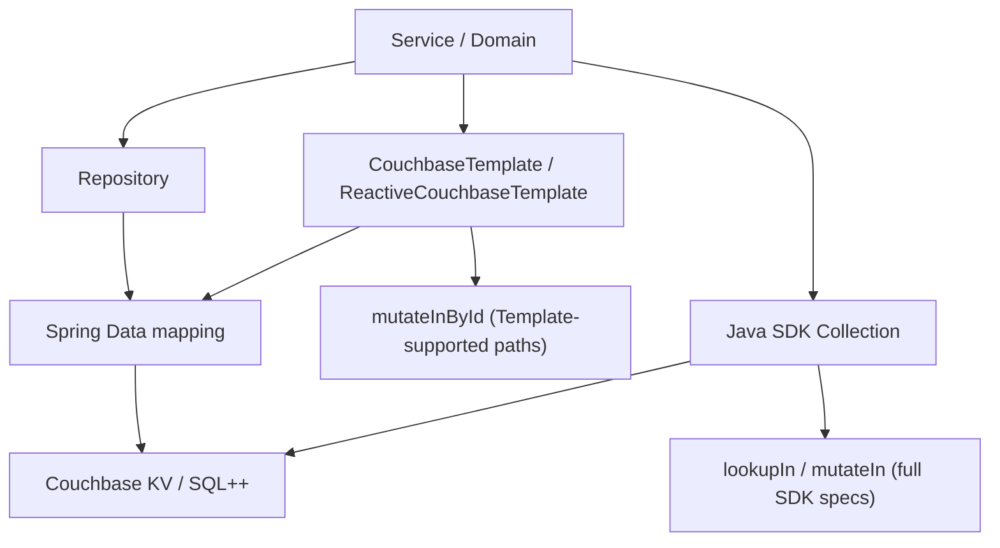

# Phạm vi API sub-document của Template theo phiên bản sử dụng

## 1. Câu hỏi đúng không phải “Couchbase có Sub-document không?”

Trong module **SPRING_DATA_COUCHBASE**, tầng dữ liệu được xây dựng bằng Spring Data với document mapping, repository, `CouchbaseTemplate`, SQL++, thiết kế bucket/scope/collection, chỉ mục, TTL, CAS, giao dịch và API reactive. Couchbase Server và Java SDK có hỗ trợ Sub-document, nhưng điều đó **không đồng nghĩa** mọi phiên bản `CouchbaseTemplate` đều cung cấp toàn bộ API `lookupIn`/`mutateIn` của SDK.

Đây là điểm cần kiểm chứng theo **phiên bản thực tế**:

- Couchbase **Java SDK** cung cấp các phương thức KV `Collection.lookupIn(...)` và `Collection.mutateIn(...)` với những spec đọc/ghi phong phú.
- Spring Data Couchbase **5.1 trở lên**, theo tài liệu/Javadoc của các dòng hiện có, cung cấp fluent API `mutateInById(Class<T>)` ở `CouchbaseTemplate` và `ReactiveCouchbaseTemplate`.
- Tài liệu Spring Data Couchbase 5.5 và 6.2 mô tả tầng Template hỗ trợ **bốn loại Sub-document mutation**: `insert`, `upsert`, `replace`, `remove`.
- Không nên tự giả định có fluent method `lookupInById(...)`, `withArrayAppendPaths(...)` hoặc `withIncrementPaths(...)` của Template chỉ vì SDK có khả năng tương đương.
- Với lookup, counter, array, XATTR hoặc tùy chọn chuyên biệt không được bản Spring Data đang dùng expose, có thể gọi **Java SDK Collection** một cách có kiểm soát.

Bài này giải thích cách chọn giữa Template và SDK **theo dependency đã khóa**, tránh hai sai lầm đối lập: “Template không có bất kỳ Sub-document API nào” và “Template có đủ mọi Sub-document operation của SDK”.

### Kết quả học tập

Sau bài học, bạn có thể:

1. Xác định **đúng version** Spring Data Couchbase và Java SDK đang chạy, không dựa vào câu trả lời chung chung trên mạng.
2. Đọc tài liệu/Javadoc đúng version để nhận diện `mutateInById`, phương thức fluent, cách kết thúc `one(entity)` và reactive `Mono<T>`.
3. Sử dụng các mutation paths `withInsertPaths`, `withUpsertPaths`, `withReplacePaths`, `withRemovePaths` đúng ngữ cảnh.
4. Hiểu giới hạn của Template so với `LookupInSpec`/`MutateInSpec` ở Java SDK.
5. Chọn API phù hợp với ánh xạ entity, `@Field`, `@Version`, custom conversion, CAS, TTL và collection routing.
6. Thiết kế một adapter kết hợp Template và SDK mà không phá business invariant, transaction hoặc reactive flow.
7. Viết test và checklist nâng cấp để phát hiện thay đổi signature/behavior giữa các phiên bản.

## 2. Phân biệt ba lớp API



| Lớp | Đầu vào thường dùng | Điểm mạnh | Giới hạn cần kiểm tra |
| --- | --- | --- | --- |
| `CouchbaseRepository` | Entity, ID, query method | Ánh xạ aggregate và repository conventions | Không xem repository là giao diện Sub-document tổng quát. |
| `CouchbaseTemplate` | Entity type, entity value, fluent options | Mapping entity và KV/query operations linh hoạt | Chỉ các mutation paths được phiên bản API công bố; không mặc nhiên có `lookupIn`. |
| `ReactiveCouchbaseTemplate` | Entity type, entity value, Reactor publisher | Ghép nghiệp vụ không chặn trong reactive stack | Phạm vi fluent mutation cũng cần kiểm chứng; publisher phải được subscribe. |
| Java SDK `Collection` | Document key, JSON path/spec, options | Truy cập đầy đủ KV Sub-document operations | Không tự chạy Spring Data mapping, callbacks, validation hay custom converters. |
| SQL++ qua template/SDK | Query predicate và JSON fields | Tìm/sửa theo điều kiện trên nhiều documents | Khác mô hình KV path; có query planning, GSI và consistency riêng. |

Đặc biệt, `CouchbaseTemplate` không phải một tên gọi khác của `com.couchbase.client.java.Collection`. Hai abstraction có mục đích khác nhau và có thể cùng tồn tại trong một ứng dụng.

## 3. Kiểm tra phiên bản trước khi viết code

### 3.1. Ba thành phần version khác nhau

Cần xác định riêng:

1. **Spring Data Couchbase**: quyết định class, interface và fluent methods của `CouchbaseTemplate`.
2. **Couchbase Java SDK**: quyết định `Collection.lookupIn`/`mutateIn`, loại specs, options, exceptions và asynchronous/reactive interfaces.
3. **Couchbase Server**: quyết định khả năng server thực thi từng tính năng (ví dụ một số kiểu replica sub-document lookup yêu cầu version server đủ mới).

Một ví dụ sử dụng Java SDK 3.x không chứng minh ứng dụng Spring Data 4.x có fluent `mutateInById`. Ngược lại, nâng Spring Data không tự đổi version Couchbase Server trên cluster.

### 3.2. Spring Boot có thể quản lý phiên bản thay cho khai báo trực tiếp

Khi dự án dùng Spring Boot dependency management hoặc BOM, version thực tế có thể **khác** version tác giả nghĩ do không khai báo số trong dependency. Ví dụ khai báo:

```xml
<dependency>
    <groupId>org.springframework.boot</groupId>
    <artifactId>spring-boot-starter-data-couchbase</artifactId>
</dependency>
```

Đoạn XML này không cho biết trực tiếp version Spring Data Couchbase. Phải kiểm tra resolved dependencies/lockfile thực tế.

Với Maven, chạy trong **dự án học hoặc môi trường development**:

```bash
mvn dependency:tree -Dincludes=org.springframework.data:spring-data-couchbase
mvn dependency:tree -Dincludes=com.couchbase.client:java-client
```

Với Gradle (tên configuration có thể phụ thuộc dự án):

```bash
./gradlew dependencyInsight --dependency spring-data-couchbase --configuration runtimeClasspath
./gradlew dependencyInsight --dependency java-client --configuration runtimeClasspath
```

Đây là **lệnh hướng dẫn cho người học**, không phải yêu cầu bài viết tự chạy build. Kết quả cần đối chiếu với Javadoc của version **đã resolve**, không phải trang "current" có thể chuyển sang version mới.

### 3.3. Ma trận theo tài liệu API

| Version / nguồn kiểm chứng | `mutateInById` ở Template | `lookupIn` trực tiếp trên Template | Cách làm |
| --- | --- | --- | --- |
| Spring Data Couchbase trước 5.1 | Chưa dựa vào signature `mutateInById` xuất hiện từ 5.1 | Không giả định | Kiểm tra Javadoc đúng version; dùng SDK nếu cần Sub-document. |
| Spring Data Couchbase 5.1+ | `ExecutableMutateInByIdOperation` và bản reactive được đánh dấu `Since: 5.1` | Không thuộc API được phần Sub-document Template hiện hành mô tả | Dùng fluent mutation paths nếu chúng đáp ứng nhu cầu. |
| Tài liệu Spring Data Couchbase 5.5 | Có ví dụ `mutateInById` và bốn operation `insert/upsert/replace/remove` | Không có ví dụ Template `lookupInById` | Dùng SDK cho `lookupIn` và array/counter. |
| Tài liệu Spring Data Couchbase 6.2 | Tiếp tục mô tả `mutateInById`/bốn mutation paths | Không quảng bá fluent lookup trên Template | Kiểm chứng interface/Javadoc trước khi dùng API ngoài phạm vi. |
| Couchbase Java SDK 3.x tương thích | `Collection.mutateIn(...)` là **SDK API**, độc lập với tên Template | `Collection.lookupIn(...)` là SDK API | Dùng trực tiếp khi cần tính năng cấp KV đầy đủ. |

**Giới hạn hiểu biết:** Module đang học không cung cấp version resolved trong đề bài này. Vì vậy bài không khẳng định dự án cụ thể đang chạy 5.5, 6.1 hay 6.2. Trên hệ thống thật, version hiện tại phải được lấy từ dependency resolution/Javadoc chứ không suy từ tên module.

## 4. API Template có gì từ Spring Data Couchbase 5.1?

Javadoc của `ExecutableMutateInByIdOperation` ghi `Since: 5.1`. Phương thức mở đầu:

```java
couchbaseTemplate.mutateInById(UserDocument.class)
```

trả một fluent operation để tiếp tục thêm path, scope/collection và options, rồi kết thúc bằng `one(entity)` hoặc `all(entities)`.

Các fluent methods cần biết:

| Phương thức | Ý nghĩa theo hợp đồng |
| --- | --- |
| `mutateInById(Class<T>)` | Bắt đầu một mutation KV cho entity type `T`. |
| `withInsertPaths(String...)` | Thêm các property paths sẽ insert. |
| `withUpsertPaths(String...)` | Thêm các property paths sẽ upsert. |
| `withReplacePaths(String...)` | Thêm các property paths sẽ replace. |
| `withRemovePaths(String...)` | Thêm các property paths sẽ remove. |
| `withCasProvided()` | Yêu cầu truyền CAS từ entity/`@Version` khi mutation. |
| `inScope(String)` | Chọn scope nếu API/version cho phép. |
| `inCollection(String)` | Chọn collection đích theo fluent routing. |
| `withDurability(...)` | Chọn durability policy theo overload được hỗ trợ. |
| `withExpiry(Duration)` | Chọn expiry policy theo method hiện có. |
| `withOptions(MutateInOptions)` | Truyền SDK mutate options theo API đã xác minh. |
| `one(T)` | Thực thi với một entity có ID. |
| `all(Collection<? extends T>)` | Xử lý một tập entity theo contract API; không coi là transaction đa document. |

Đây là **method surface** được mô tả ở Javadoc tương ứng, không phải lời khẳng định mọi overload/dạng chaining đều giống nhau giữa các phiên bản. Một số method trả type trung gian trong fluent chain, nên cần kiểm tra chữ ký thực khi đổi thứ tự.

### 4.1. Bốn operation được tài liệu Template mô tả

- **Insert path**: chỉ thêm khi path chưa tồn tại.
- **Upsert path**: tạo hoặc ghi đè giá trị tại path theo điều kiện JSON tree hợp lệ.
- **Replace path**: chỉ thay path đã tồn tại.
- **Remove path**: xóa path được chỉ định.

Không nhầm `withUpsertPaths("address.city")` với `upsertById(UserDocument.class).one(user)`:

- Câu đầu có ý định sửa **đường dẫn con**.
- Câu thứ hai có ý định upsert **document** bằng entity mapping.

## 5. Ví dụ thực tế: cập nhật địa chỉ qua `CouchbaseTemplate`

Một entity tối giản:

```java
package com.example.users;

import org.springframework.data.annotation.Id;
import org.springframework.data.annotation.Version;
import org.springframework.data.couchbase.core.mapping.Document;
import org.springframework.data.couchbase.core.mapping.Field;

@Document
public class UserDocument {

    @Id
    private String id;

    @Field("address")
    private Address address;

    @Version
    private Long version;

    public String getId() { return id; }
    public void setId(String id) { this.id = id; }

    public Address getAddress() { return address; }
    public void setAddress(Address address) {
        this.address = address;
    }

    public Long getVersion() { return version; }
    public void setVersion(Long version) {
        this.version = version;
    }
}
```

`Address` là một Java bean đơn giản:

```java
package com.example.users;

public class Address {
    private String city;
    private String street;

    public String getCity() { return city; }
    public void setCity(String city) {
        this.city = city;
    }

    public String getStreet() { return street; }
    public void setStreet(String street) {
        this.street = street;
    }
}
```

Document JSON tương ứng (minh họa):

```json
{
  "_class": "com.example.users.UserDocument",
  "address": {
    "city": "Da Nang",
    "street": "Hai Chau"
  },
  "preferences": {
    "locale": "vi-VN"
  }
}
```

Document key `user::42` nằm ngoài JSON body.

### 5.1. Upsert một path mà không gửi toàn bộ body

```java
UserDocument patch = new UserDocument();
patch.setId("user::42");

Address newAddress = new Address();
newAddress.setCity("Ha Noi");
patch.setAddress(newAddress);

// couchbaseTemplate: bean Spring Data đã inject.
couchbaseTemplate.mutateInById(UserDocument.class)
    .withUpsertPaths("address.city")
    .one(patch);
```

Kết quả mong muốn: chỉ `address.city` đổi thành `"Ha Noi"`; `address.street` và `preferences.locale` không bị thay đổi vì chúng không có trong danh sách mutation paths. **Phải kiểm chứng raw JSON trong integration test** trước khi dựa vào điều này với các custom converters/nested mapping phức tạp.

Ví dụ không sử dụng SDK `MutateInSpec.upsert(...)`. Giá trị được lấy từ entity `patch` và được Spring Data xử lý theo đường template của version tương ứng.

### 5.2. Dùng `withReplacePaths` khi field bắt buộc phải tồn tại

```java
couchbaseTemplate.mutateInById(UserDocument.class)
    .withReplacePaths("address.city")
    .one(patch);
```

`replace` khác `upsert`: nếu path chưa có, thao tác không được âm thầm tạo field mới. Đây là lựa chọn tốt khi ứng dụng muốn phát hiện document sai schema.

### 5.3. Insert path mới và remove path cũ

Ví dụ riêng biệt:

```java
couchbaseTemplate.mutateInById(UserDocument.class)
    .withInsertPaths("address.street")
    .one(patch);
```

Để xóa:

```java
couchbaseTemplate.mutateInById(UserDocument.class)
    .withRemovePaths("address.street")
    .one(patch);
```

Điều kiện của `insert`: path chưa tồn tại và entity mang value muốn insert. Điều kiện của `remove`: path phù hợp tồn tại trong document. Không dùng một `patch` thiếu property/value rồi kỳ vọng mọi field tự được điền từ server.

## 6. Nhiều mutation paths trong một lần gọi Template

Javadoc và reference guide cho phép chain nhiều loại path:

```java
couchbaseTemplate.mutateInById(UserDocument.class)
    .withUpsertPaths("address.city")
    .withReplacePaths("address.street")
    .one(patch);
```

Lưu ý trong ví dụ này, `patch.address.street` cần có value nếu `withReplacePaths("address.street")` được áp dụng; mẫu từ mục 5 mới chỉ gán `city`. Bổ sung street trước khi thực thi:

```java
patch.getAddress().setStreet("Ba Dinh");

couchbaseTemplate.mutateInById(UserDocument.class)
    .withReplacePaths("address.city", "address.street")
    .one(patch);
```

Khi các specs được gửi trong **một** `mutateIn` KV, Couchbase thực hiện mutation atomic ở cấp **một document**. Nếu một spec không hợp lệ và toàn request thất bại, không được ghi nhận những path khác đã commit thành công riêng lẻ.

**Đừng nhầm** `all(List.of(user1,user2))` với giao dịch atomic xuyên nhiều documents. Đó là API xử lý nhiều entities theo contract; nếu nghiệp vụ yêu cầu "hai documents cùng thành công hoặc cùng thất bại", phải thiết kế transaction hoặc reconciliation riêng.

### 6.1. Không thao tác trái ngược trên cùng path tùy tiện

Một chain chứa cả `withRemovePaths("address.city")` và `withReplacePaths("address.city")` dễ gây lỗi/thứ tự khó hiểu. Trong migration, chia rõ schema và chuỗi thao tác; chỉ tổ hợp nhiều specs khi chúng không xung đột và hành vi đã được test trên version SDK/server thực tế.

## 7. Reactive Template có API tương ứng

Javadoc của `ReactiveMutateInByIdOperation` cũng ghi `Since: 5.1`. `ReactiveCouchbaseTemplate.mutateInById(Class<T>)` trả operation theo phong cách reactive.

Ví dụ:

```java
import reactor.core.publisher.Mono;

UserDocument patch = new UserDocument();
patch.setId("user::42");

Address address = new Address();
address.setCity("Ha Noi");
patch.setAddress(address);

Mono<UserDocument> changed =
    reactiveCouchbaseTemplate.mutateInById(UserDocument.class)
        .withUpsertPaths("address.city")
        .one(patch);
```

Phương thức kết thúc `one(T)` của reactive fluent operation trả `Mono<T>` theo Javadoc. Publisher có thể emit một object sau khi mutation hoàn thành; **không suy rằng đây là một lần đọc lại toàn bộ document từ server**. Nếu cần kiểm tra field khác sau mutation, hãy dùng một thao tác đọc riêng.

### 7.1. Test một mutation reactive

Với `reactor-test`:

```java
import reactor.test.StepVerifier;

StepVerifier.create(changed)
    .expectNextCount(1)
    .verifyComplete();
```

Đây chỉ là kiểm tra completion. Cần thêm readback raw JSON hoặc repository find để xác nhận field được cập nhật đúng và field không liên quan vẫn giữ nguyên.

### 7.2. Không biến reactive thành blocking

Không gọi `changed.block()` trong event-loop WebFlux production để lấy kết quả. Hãy compose `Mono`, xử lý error signal và timeout; không gọi blocking `couchbaseTemplate` từ reactive controller khi `reactiveCouchbaseTemplate`/SDK reactive đáp ứng nhu cầu.

Tuy nhiên, `ReactiveCouchbaseTemplate` không tự cung cấp các SDK specs không được fluent API công bố. **Reactive** nói về mô hình thực thi I/O; không đồng nghĩa **mở rộng bộ operations**.

## 8. Template có `lookupInById` không?

Cần trả lời bằng cách kiểm tra **Javadoc cho đúng phiên bản**. Với các tài liệu 5.5 và 6.2 dùng trong bài này, phần Sub-document Template giới hạn ở **mutation**; trong method surface đang được mô tả không có fluent `lookupInById(Class<T>)` tương ứng.

Vì vậy, khi chỉ muốn lấy vài JSON fields theo key, đường rõ ràng là Java SDK:

```java
import java.util.List;
import com.couchbase.client.java.Collection;
import com.couchbase.client.java.kv.LookupInResult;
import com.couchbase.client.java.kv.LookupInSpec;

// users là SDK Collection shop.app.users, không phải java.util.Collection.
LookupInResult result = users.lookupIn(
    "user::42",
    List.of(
        LookupInSpec.get("address.city"),
        LookupInSpec.exists("address.postal_code")
    )
);

String city = result.contentAs(0, String.class);
boolean hasPostalCode = result.exists(1);
```

Nếu chỉ cần một entity hợp lệ đầy đủ, Template:

```java
UserDocument user = couchbaseTemplate
    .findById(UserDocument.class)
    .one("user::42");
```

Nhưng `findById` của Template không phải Sub-document `lookupIn`. Nó có ý định materialize entity, có thể cần body nhiều field. **Không tuyên bố rằng một projection/findByQuery đồng nghĩa KV subdoc lookup**: Query service, index và kết quả mapping có semantics khác.

### 8.1. Vì sao không tự tạo tên method từ SDK?

Không viết code như:

```java
// Minh họa API KHÔNG được xác nhận trong Spring Data Template:
// couchbaseTemplate.lookupInById(UserDocument.class)
//     .withGetPaths("address.city")
//     .one("user::42");
```

Đó chỉ là sự tưởng tượng từ `mutateInById`, không phải bằng chứng API tồn tại. Nếu code không compile, hãy kiểm tra Javadoc/resolved version, không tự gắn thêm dependency khác để chữa một phương thức không được thiết kế.

## 9. Phần còn lại của Sub-document API nằm ở SDK

Java SDK có phạm vi rộng hơn bốn mutation paths của Template:

| Nhu cầu | Template documented API (5.5/6.2) | Java SDK |
| --- | --- | --- |
| Insert JSON path | `withInsertPaths(...)` | `MutateInSpec.insert(...)` |
| Upsert JSON path | `withUpsertPaths(...)` | `MutateInSpec.upsert(...)` |
| Replace JSON path | `withReplacePaths(...)` | `MutateInSpec.replace(...)` |
| Remove JSON path | `withRemovePaths(...)` | `MutateInSpec.remove(...)` |
| Đọc một phần JSON | Không có fluent lookup trong phần Template được mô tả | `LookupInSpec.get(...)` |
| Kiểm tra path tồn tại | Không có fluent exists subdoc được mô tả | `LookupInSpec.exists(...)` |
| Đếm phần tử array/object | Không có fluent count subdoc được mô tả | `LookupInSpec.count(...)` |
| Tăng/giảm counter bên trong body | Không được liệt kê là Template path operation | `MutateInSpec.increment/decrement(...)` |
| Append/prepend/chèn vào array | Không được liệt kê là Template path operation | `MutateInSpec.arrayAppend/arrayPrepend/arrayInsert(...)` |
| Thêm phần tử primitive không trùng | Không được liệt kê | `MutateInSpec.arrayAddUnique(...)` |
| XATTR flags và thao tác SDK chuyên biệt | Không giả định có fluent tương ứng | SDK specs với options/xattr được hỗ trợ |
| CAS khi mutation | `withCasProvided()` | `MutateInOptions.cas(cas)` |
| Expiry/durability tùy chỉnh | Fluent `withExpiry/withDurability/withOptions` tùy version | SDK `MutateInOptions` |

Không dùng ma trận này như lời tuyên bố "Template sẽ không bao giờ có operation khác". Nó là **hình ảnh tại các phiên bản đã kiểm chứng**. Khi nâng cấp, tài liệu đúng dependency vẫn là nguồn quyết định.

## 10. Ví dụ Java SDK cho một thao tác Template chưa hỗ trợ trực tiếp

### 10.1. Đọc vài paths

```java
import java.util.List;
import com.couchbase.client.java.kv.LookupInResult;
import com.couchbase.client.java.kv.LookupInSpec;

LookupInResult result = users.lookupIn(
    "user::42",
    List.of(
        LookupInSpec.get("address.city"),
        LookupInSpec.count("tags")
    )
);

String city = result.contentAs(0, String.class);
int tagCount = result.contentAs(1, Integer.class);
```

Đây là thao tác KV theo document ID, không cần SQL++ hoặc GSI index.

### 10.2. Tăng một counter bên trong document

```java
import com.couchbase.client.java.kv.MutateInResult;
import com.couchbase.client.java.kv.MutateInSpec;

MutateInResult changed = users.mutateIn(
    "user::42",
    List.of(
        MutateInSpec.increment("stats.views", 1)
    )
);

long currentViews = changed.contentAs(0, Long.class);
long updatedCas = changed.cas();
```

Counter tăng tại server; không phải đọc bằng Java, cộng một rồi ghi lại body. Phép increment không tự bảo vệ bất biến như "balance tiền không được âm", không mở transaction đa document hay tự tạo audit event nghiệp vụ.

### 10.3. Append một phần tử vào array

```java
users.mutateIn(
    "user::42",
    List.of(
        MutateInSpec.arrayAppend(
            "tags", List.of("vip"))
    )
);
```

Trong Couchbase Java SDK 3.x, các thao tác append/prepend/insert array có dạng nhận `List<?>` values. Chú ý `List.of("vip")` thay vì tự đoán một overload nhận scalar string. Với array duplicate, cần quyết định riêng có dùng `arrayAddUnique` hay domain validation.

### 10.4. Reactive SDK lookup

```java
import reactor.core.publisher.Mono;

Mono<String> cityMono = users.reactive()
    .lookupIn(
        "user::42",
        List.of(
            LookupInSpec.get("address.city")
        )
    )
    .map(r -> r.contentAs(0, String.class));
```

`Collection.reactive().lookupIn` khác `ReactiveCouchbaseTemplate.mutateInById`: cả hai có thể dùng Reactor, nhưng **đầu vào, mapping và capabilities** không giống nhau.

## 11. Lấy Java SDK Collection từ cấu hình Spring

Spring Data Template được xây trên Couchbase SDK. Tài liệu Spring Data hướng dẫn có thể đi xuống SDK trực tiếp qua bean được expose bởi `AbstractCouchbaseConfiguration`/client factory.

Một cách minh họa khi ứng dụng quản lý `Cluster` bean:

```java
import com.couchbase.client.java.Cluster;
import com.couchbase.client.java.Collection;

public final class UserSubdocGateway {
    private final Collection users;

    public UserSubdocGateway(Cluster cluster) {
        this.users = cluster.bucket("shop")
            .scope("app")
            .collection("users");
    }
}
```

Không tạo kết nối mới hay đóng `Cluster` trong mỗi phương thức service. Trong dự án thực tế có thể inject `CouchbaseClientFactory` hoặc SDK Collection đã được cấu hình thay vì mở đường mới. Cách lấy bean phải theo **Spring configuration version** đang dùng và routing policy của ứng dụng.

### 11.1. Đừng trộn nhầm scope/collection

Nếu repository `UserDocument` được cấu hình sang `shop.app.users` còn SDK Collection trỏ `shop._default.users`, hai đường có thể sửa/đọc **hai bộ dữ liệu khác nhau** dù key giống nhau.

Khi chuyển giữa Template và SDK, test:

- Bucket, scope, collection có giống nhau không?
- Document ID được ánh xạ ra key nào?
- Field JSON thực tế là `address.city` hay `address.city_name`?
- Có khác môi trường/stage/tenant không?
- RBAC có cấp quyền đúng trên collection không?

Một adapter nên nhận cấu hình routing từ cùng nguồn quản lý, tránh hard-code bất nhất giữa service.

## 12. Property paths của Template và raw paths của SDK

Javadoc `withUpsertPaths(String...)` mô tả đầu vào là **property paths**. Spring Data dùng thông tin entity type để thực thi mutation. Trong khi đó, Java SDK `MutateInSpec` dùng **JSON path theo body lưu trữ**.

Giả sử Java entity:

```java
public class Address {
    @org.springframework.data.couchbase.core.mapping.Field("city_name")
    private String city;

    // Accessors của ứng dụng...
}
```

JSON trên server có thể là:

```json
{
  "address": {
    "city_name": "Ha Noi"
  }
}
```

Khi xây code:

- Với **Template**, dùng property paths theo contract và kiểm chứng cơ chế mapping của version (đừng tự kết luận path nào được nhận khi có annotation/converter phức tạp).
- Với **SDK raw**, path phải là `address.city_name` nếu field JSON thực sự tên như vậy.
- Với **SQL++**, predicate/index cũng nhắm tới `address.city_name` trong JSON thực.

Điểm thực hành quan trọng: tạo integration test gửi Template mutation, đọc **raw body bằng SDK**, xác nhận tên field và kiểu giá trị. Không chỉ test `repository.findById` vì cùng converter đọc/ghi có thể che giấu một sai lệch storage contract.

### 12.1. Custom conversion có thể đổi cả cấu trúc lưu trữ

Nếu `Money` được converter thành string `"1999|USD"`, đường `order.total.amountMinor` không còn là nested JSON path hợp lệ. Một `withReplacePaths("total.amountMinor")` hoặc `MutateInSpec.replace("total.amountMinor",...)` có thể lỗi.

Đây là schema/representation conflict, không phải lỗi Sub-document API. Giải pháp: chốt contract JSON, dùng DTO/mapper tường minh, và đảm bảo Template/SDK/SQL++ cùng hiểu biểu diễn đó.

## 13. CAS ở Template khác CAS trực tiếp ở SDK như thế nào?

### 13.1. `withCasProvided()` ở Template

Theo reference guide, Template mutation **không gửi CAS theo mặc định**. Nếu muốn bảo vệ phiên bản đã đọc:

```java
UserDocument patch = new UserDocument();
patch.setId("user::42");
patch.setVersion(previousCas); // @Version field mang CAS đã đọc trước
patch.setAddress(newAddress);

couchbaseTemplate.mutateInById(UserDocument.class)
    .withUpsertPaths("address.city")
    .withCasProvided()
    .one(patch);
```

`previousCas` cần đến từ một lần đọc thật của cùng document. Không tự đặt `0L` hoặc dùng `schema_version` làm CAS. Khi một writer khác sửa document giữa read và mutate, có thể xảy ra CAS conflict.

### 13.2. `MutateInOptions.cas(cas)` ở SDK

```java
import com.couchbase.client.java.kv.MutateInOptions;

users.mutateIn(
    "user::42",
    List.of(
        MutateInSpec.replace("address.city", "Ha Noi")
    ),
    MutateInOptions.mutateInOptions()
        .cas(previousCas)
);
```

Đường SDK nhận CAS trực tiếp trong options. Nó không biết Java entity có `@Version` hay không; giá trị CAS phải do application cung cấp.

### 13.3. Vì sao cần CAS trong hệ thống kết hợp?

Giả sử:

1. Request A đọc một `UserDocument` thành entity có `@Version`.
2. Request B dùng SDK `mutateIn` chỉnh `stats.views`.
3. Request A `save` entity cũ.

Nếu optimistic locking đúng, bước 3 có thể bị từ chối vì CAS document đã đổi. Nếu app ghi full body không dùng CAS, request A có thể ghi đè thay đổi B.

CAS thuộc **document**, không thuộc riêng path. Một thay đổi field khác cũng có thể làm CAS mismatch; retry phải đọc lại và tái đánh giá domain intent. Với counter tăng độc lập, mutation tại server thường có thể giảm rủi ro read-modify-write mà không nhất thiết cần CAS ở mỗi lần tăng.

## 14. TTL/expiry và durability không được suy từ đường API

Template có fluent `withExpiry(Duration)` và `withDurability(...)` trong các version đã nêu; SDK có `MutateInOptions` tương ứng.

Ví dụ ý định đặt expiry qua Template:

```java
import java.time.Duration;

couchbaseTemplate.mutateInById(UserDocument.class)
    .withUpsertPaths("address.city")
    .withExpiry(Duration.ofMinutes(30))
    .one(patch);
```

**Chỉ dùng khi nghiệp vụ thực sự cần thay expiry.** Nếu mục tiêu là bảo toàn expiry đã có, cần kiểm tra API/`MutateInOptions` phù hợp trong version đang dùng (chẳng hạn cơ chế preserve expiry ở SDK) rồi test thực tế. Không mặc định một lần `mutateIn` luôn giữ hoặc luôn reset TTL ở mọi cấu hình.

Durability là mức đảm bảo ghi đã được lưu/replicate, khác với:

- **Atomicity:** các specs của một `mutateIn` thành công/thất bại cùng nhau trên một document.
- **CAS:** ngăn thao tác dựa trên snapshot cũ ghi khi document đã thay đổi.
- **SQL++ query consistency:** mức mà GSI/index query có thể quan sát mutation.
- **Transactions:** cơ chế phối hợp nhiều documents khi cần invariant mạnh.

Không thiết kế một abstraction "patch" rồi tuyên bố nó tự giải quyết cả bốn bài toán trên.

## 15. Java SDK có thể có Sub-document feature mà Template không expose

Các khác biệt phổ biến:

### 15.1. `lookupIn` chỉ đọc một phần

SDK cho phép `get`, `exists`, `count` trên nhiều path trong một KV request. Nếu chỉ cần field và không muốn đọc body đầy đủ, gọi SDK hoặc thiết kế một adapter read-only dùng SDK. Không gọi Template `findById` rồi tuyên bố đã tối ưu payload theo path.

### 15.2. Counter

SDK `increment` thao tác trực tiếp tại server. Nếu dùng Template `findById` → `entity.setViews(entity.getViews()+1)` → `save`, đó là **một chiến lược khác**: phải quản lý CAS để tránh lost update. Không tự tạo `withIncrementPaths` chỉ vì API Template có `withUpsertPaths`.

### 15.3. Array operations

SDK `arrayAppend/arrayPrepend/arrayInsert/arrayAddUnique` có semantics riêng cho array, path và index. Template `withReplacePaths("tags")` có thể ghi lại **toàn array field**, nhưng không tương đương với server-side append atomic vào cuối array mà không gửi toàn array.

### 15.4. XATTR và các flags đặc biệt

SDK specs có thể hỗ trợ `xattr()` và options phục vụ XATTR. Không giả định Template path method tự chuyển sang XATTR khi path bắt đầu bằng một tên gợi ý `metadata`. XATTR là vùng dữ liệu khác với JSON body; cần bảo mật và version compatibility riêng.

### 15.5. Replica lookup

Couchbase Java SDK hỗ trợ Sub-document replica reads ở các version server nhất định (ví dụ từ Couchbase Server 7.6). Đây là **SDK capability có điều kiện server**; không phải vì có `ReactiveCouchbaseTemplate` mà tự suy có `lookupInAnyReplica` ở fluent Template.

## 16. Một mẫu thiết kế adapter tránh phụ thuộc nhầm API

Một cách tổ chức:

```text
UserService
  |
  +-- UserRepository / CouchbaseTemplate
  |     -> đọc/ghi full entity hoặc Template mutateInById
  |
  +-- UserSubdocumentGateway
        -> SDK Collection.lookupIn/mutateIn
        -> JSON path whitelist, CAS, error translation
```

Interface domain không nên expose mọi chi tiết Java SDK:

```java
public interface UserPatchPort {
    String readDisplayName(String userId);

    void replaceCity(String userId, String newCity);

    long incrementViews(String userId);
}
```

Một adapter có thể chọn:

- `readDisplayName` → SDK `lookupIn` vì Template chưa có fluent lookup theo path trong bản được mô tả.
- `replaceCity` → Template `mutateInById` nếu entity mapping và converter phù hợp; hoặc SDK nếu cần raw path/options.
- `incrementViews` → SDK `MutateInSpec.increment`.
- Nếu chuyển cả aggregate/phải chạy domain validation: repository/template full entity với concurrency control.

Từ góc nhìn service, tất cả là **typed operations** thay vì cho controller truyền path tự do. Adapter giúp thay đổi implementation sau khi nâng version mà không thay đổi business logic.

## 17. Ví dụ adapter đọc SDK, ghi Template

Ví dụ minh họa trong một ứng dụng Spring đã inject đúng beans:

```java
import java.util.List;
import java.util.Objects;
import org.springframework.data.couchbase.core.CouchbaseTemplate;
import com.couchbase.client.java.Collection;
import com.couchbase.client.java.kv.LookupInSpec;

public final class UserPartialStore {

    private final CouchbaseTemplate template;
    private final Collection users;

    public UserPartialStore(
            CouchbaseTemplate template, Collection users) {
        this.template = Objects.requireNonNull(template);
        this.users = Objects.requireNonNull(users);
    }

    public String displayName(String id) {
        return users.lookupIn(
            id,
            List.of(LookupInSpec.get("profile.display_name"))
        ).contentAs(0, String.class);
    }

    public void changeAddressCity(
            String id, String newCity) {

        if (newCity == null || newCity.isBlank()) {
            throw new IllegalArgumentException("City is required");
        }

        UserDocument patch = new UserDocument();
        patch.setId(id);
        Address address = new Address();
        address.setCity(newCity);
        patch.setAddress(address);

        template.mutateInById(UserDocument.class)
            .withReplacePaths("address.city")
            .one(patch);
    }
}
```

Giới hạn của ví dụ:

- `users` và Template phải truy cập cùng bucket/scope/collection.
- `UserDocument`, `Address` theo ví dụ ở mục 5.
- `profile.display_name` chỉ hợp lệ nếu body thực có path đó, không phải thuộc tính đã được định nghĩa trong `UserDocument` tối giản; cần mô hình đầy đủ hoặc fixture phù hợp.
- `changeAddressCity` chưa có CAS/authorization/audit; chỉ phù hợp khi business chấp nhận mutation trực tiếp theo một field.
- Nếu muốn CAS, cần lấy phiên bản hiện tại và thêm `withCasProvided()` như mục 13.
- Nếu deployment dùng reactive stack, phải sử dụng adapter không chặn.

Đối với các ứng dụng yêu cầu business invariant phức tạp, hãy xây persistence adapter riêng có khả năng validate trước mutation thay vì để mọi use case tự chọn path và options.

## 18. Tối thiểu phải kiểm thử các biến thể API theo version

Một API xuất hiện trong Javadoc không có nghĩa mọi mẫu code trên mạng đều compile trong dự án. Cần kiểm chứng **hai tầng**:

1. **Compile-time:** phương thức, parameter type, return type và thứ tự fluent chain tồn tại trong resolved dependencies.
2. **Runtime:** JSON path, converter, CAS, TTL, collection routing và behavior của SDK/server đúng với contract.

### 18.1. Compile-time smoke test

Với version 5.1+ đã được kiểm chứng:

```java
void compileTemplateMutation(
        CouchbaseTemplate template,
        UserDocument patch) {

    template.mutateInById(UserDocument.class)
        .withUpsertPaths("address.city")
        .one(patch);
}
```

Với reactive:

```java
Mono<UserDocument> compileReactiveMutation(
        ReactiveCouchbaseTemplate template,
        UserDocument patch) {

    return template.mutateInById(UserDocument.class)
        .withUpsertPaths("address.city")
        .one(patch);
}
```

Đây là minh họa method bodies; class/test phải thêm imports đúng và cấu hình beans tương ứng. Nếu compile không thấy method, đầu tiên phải đọc actual dependency tree và đúng Javadoc, không thay thế bằng reflection hoặc tạo extension mơ hồ che API không tương thích.

### 18.2. Không dùng runtime reflection để đoán nghiệp vụ

Có thể xem method signatures qua IDE/Javadoc/bytecode, nhưng không thiết kế code production kiểu “nếu có `mutateInById` thì gọi reflection, nếu không có thì âm thầm full save” mà không kiểm chứng schema. Hai đường ghi có semantics CAS, callbacks và payload khác nhau; fallback không được biến đổi tính đúng nghiệp vụ.

### 18.3. Contract test với raw JSON

Test phải xác minh:

- Chỉ field `address.city` đổi khi Template `withUpsertPaths` hoặc `withReplacePaths`.
- `address.street` và các field không thuộc patch giữ nguyên.
- JSON field name/shape khớp `@Field` và custom conversions.
- `_class`/type alias, schema version và required fields không bị mất.
- SDK `lookupIn` đọc lại đúng field vừa ghi.
- Entity repository đọc lại được document sau raw SDK mutation.

## 19. Xử lý dữ liệu sai và lỗi phát sinh

| Tình huống | Lớp dễ phát hiện | Cách xử lý |
| --- | --- | --- |
| Entity `patch` thiếu `@Id` | Template | Validate ID trước khi `one(entity)`. |
| Document key không tồn tại | Template/SDK KV | Phân biệt not found với tạo document mới có chủ đích. |
| `replace` path thiếu | KV subdoc | Fail fast, kiểm kê schema V1/V2. |
| `insert` path đã có | KV subdoc | Không tự upsert lại nếu uniqueness có ý nghĩa. |
| Parent sai JSON type | KV subdoc | Migration/validation, không tạo object tùy tiện. |
| `@Field` đổi tên nhưng SDK path cũ | SDK raw/SQL++ | Hợp đồng JSON, test đường đọc/ghi. |
| Template converter ghi string, SDK mong object | Cả hai | Thống nhất representation hoặc dùng mapper tường minh. |
| `@Version` stale | Template với CAS | Đọc lại/tái đánh giá nghiệp vụ, retry có giới hạn. |
| TTL thay đổi ngoài ý định | Cả hai | Set expiry/preserveExpiry policy phù hợp và test metadata. |
| GSI query chưa thấy mutation KV | SQL++ | Xem query consistency, không quy ngay lỗi cho mapping. |
| `lookupIn` path MISSING/NULL | SDK | Tách exists, nullability và JSON type. |
| Reactive publisher không được subscribe | Reactive API | Xác minh completion/error signal. |
| Timeout sau array append | SDK KV | Xác minh kết quả/idempotency trước retry. |

Spring Data Couchbase hỗ trợ chuyển exception sang hierarchy `DataAccessException` trong nhiều đường truy cập; SDK raw có exception classes và error context riêng. Không gom mọi lỗi thành `RuntimeException` rồi chuyển qua `upsert`: sẽ che mất nguyên nhân CAS conflict, permissions hoặc data corruption.

## 20. Tối ưu hiệu năng và tránh hiểu sai "partial" operation

Lý do chính để dùng sub-document là giảm payload khi chỉ sửa/đọc một phần nhỏ. Nhưng không có bảo đảm rằng mọi Template `mutateInById` đều nhanh hơn mọi SDK `replace` hoặc repository `save` trong mọi workload.

Cần đo:

- Kích thước document và tỷ lệ field cần sửa.
- Số Sub-document specs/path; Java SDK Sub-document có giới hạn số specs theo protocol/version (ví dụ tối đa 16 trong một request).
- Số lượt KV round trips; một `lookupIn` rồi một `mutateIn` là hai request.
- Chi phí mapping Java, serialize JSON, callbacks và validation.
- CAS conflict/retry khi document nóng.
- Durability và TTL policy.
- GSI maintenance nếu field thay đổi có index.
- Query consistency khi kiểm tra kết quả bằng SQL++.
- p50/p95/p99 latency và băng thông dưới tải đồng thời.

Nếu logic cần đọc đủ 90% document, chạy domain methods phức tạp và kiểm tra nhiều invariant, full entity mapping có thể đơn giản và đáng tin cậy hơn. Nếu chỉ tăng counter theo key, SDK server-side increment thường phù hợp hơn vòng get → cộng trong Java → save.

## 21. Kiểm thử thực hành: Template, SDK và reactive

### 21.1. Fixture JSON dùng chung

Trong test collection cô lập, tạo:

```json
{
  "_class": "com.example.users.UserDocument",
  "address": {
    "city": "Da Nang",
    "street": "Hai Chau"
  },
  "stats": {
    "views": 7
  },
  "tags": ["member"],
  "schema_version": 2
}
```

Key: `user::test::004`. Không dùng test này trên collection production.

### 21.2. Template mutation đúng một path

Tạo entity `patch` với ID `user::test::004`, `address.city = "Ha Noi"`; gọi:

```java
couchbaseTemplate.mutateInById(UserDocument.class)
    .withReplacePaths("address.city")
    .one(patch);
```

Đọc raw body bằng SDK:

```java
var body = users.get("user::test::004")
    .contentAsObject();

assert "Ha Noi".equals(
    body.getObject("address").getString("city"));

assert "Hai Chau".equals(
    body.getObject("address").getString("street"));
```

Đây là ví dụ trong test method; cần setup collection, cleanup và imports. Nếu có custom converters, bổ sung assert kiểu/nesting chính xác.

### 21.3. SDK lookup và counter

```java
var before = users.lookupIn(
    "user::test::004",
    List.of(
        LookupInSpec.get("stats.views")
    )
);

long oldViews = before.contentAs(0, Long.class);

var changed = users.mutateIn(
    "user::test::004",
    List.of(
        MutateInSpec.increment("stats.views", 1)
    )
);

long newViews = changed.contentAs(0, Long.class);
assert newViews == oldViews + 1;
```

### 21.4. Reactive Template mutation

```java
Mono<UserDocument> mutation =
    reactiveCouchbaseTemplate.mutateInById(
            UserDocument.class)
        .withUpsertPaths("address.city")
        .one(patch);

StepVerifier.create(mutation)
    .expectNextCount(1)
    .verifyComplete();
```

Sau khi publisher hoàn thành, đọc raw JSON để bảo đảm mutation thực sự sửa path, không làm mất dữ liệu.

### 21.5. Trường hợp negative test

- `withReplacePaths("address.postal_code")` khi field chưa tồn tại: kỳ vọng fail.
- `withInsertPaths("address.city")` khi field đã tồn tại: kỳ vọng fail.
- `withCasProvided()` với CAS cũ: kỳ vọng conflict.
- Dùng wrong scope/collection: phân biệt document missing với query sai.
- `@Field("city_name")` nhưng SDK dùng `address.city`: phát hiện contract mismatch.
- Dùng raw SDK array append rồi đọc entity: xác minh kiểu array và required fields không bị phá.
- Reactive `Mono` có lỗi path: kiểm tra `onError`/`StepVerifier`.
- SQL++ ngay sau KV mutation: kiểm tra scan consistency trước khi quy lỗi cho converter.

## 22. Quy trình nâng cấp phiên bản mà không vỡ API

Một kế hoạch nâng Spring Boot/Spring Data Couchbase:

1. **Đóng băng hợp đồng dữ liệu:** JSON path, ID, collection, CAS, TTL, type hints và format.
2. **Xác nhận resolved versions:** Spring Data Couchbase, Java SDK và server.
3. **Kiểm tra Javadoc đúng version:** `ExecutableMutateInByIdOperation`, `ReactiveMutateInByIdOperation`, fluent paths, options, return type.
4. **Kiểm tra API chưa được hỗ trợ:** không viết code dùng `lookupInById`/array/counter tại Template nếu không tìm thấy trong Javadoc.
5. **Compile smoke tests:** Template, Reactive Template và SDK adapters.
6. **Integration tests với server:** actual JSON path, CAS, TTL, durability, exception mapping, scope/collection routing.
7. **Kiểm tra read-after-write:** KV và SQL++ GSI với consistency phù hợp.
8. **Chạy canary/benchmark:** độ trễ và tỷ lệ lỗi trước/sau nâng version.
9. **Chuẩn bị rollback:** code cũ có đọc được document mới không, schema có đổi không.
10. **Dọn compatibility code** khi toàn bộ producer/consumer đã chuyển và kiểm chứng.

**Đừng** xem nâng version framework là lý do tự chuyển toàn bộ operations sang Template. Giữ SDK khi nó cung cấp capability cần thiết và đường mapping/validation đã được adapter bảo vệ.

## 23. Các hiểu lầm cần tránh

| Hiểu lầm | Điều đúng |
| --- | --- |
| "Spring Data Couchbase không hỗ trợ sub-document." | Các dòng từ 5.1 có documented `mutateInById` cho bốn mutation paths; không phải toàn bộ SDK subdoc. |
| "Có `mutateInById` thì chắc cũng có `lookupInById`." | Không suy tên API; tra Javadoc đúng version. |
| "Template luôn hỗ trợ increment và append array." | Các capability đó thuộc Java SDK; chỉ dùng ở Template nếu version công bố API tương ứng. |
| "Template `withUpsertPaths` giống `upsertById`." | Một cái sửa path, một cái làm upsert document. |
| "Template method nhận document key + raw JSON value giống SDK." | Fluent Template nhận entity type/`one(entity)`, SDK nhận key/spec/value. |
| "Property Java và JSON path luôn giống nhau." | `@Field` và custom converters có thể thay tên/shape. |
| "Spring Data sẽ gọi auditing callback cho mọi SDK `mutateIn`." | Raw SDK bypasses Spring Data entity pipeline. |
| "Template mặc định gửi CAS của `@Version` khi patch." | Tài liệu mô tả `withCasProvided()` để yêu cầu CAS; mặc định không cung cấp. |
| "`all(entities)` là transaction toàn bộ entities." | Không tự đảm bảo atomicity nhiều documents. |
| "Đọc bằng SQL++ giống `lookupIn` KV." | Query service/GSI khác KV Sub-document lookup. |
| "Reactive Template có hết tính năng SDK." | Reactive thay đổi execution model, không tự mở rộng method surface. |
| "Chạy một ví dụ ở dependency mới chứng minh code trên dependency cũ sẽ compile." | Version của ứng dụng và tài liệu phải trùng khớp. |

## 24. Bài thực hành

### Bài 1 — Xác minh dependency và Javadoc

Trong dự án mẫu, tìm version `spring-data-couchbase`/`java-client` thực sự được resolve, mở Javadoc đúng version. Lập bảng có/không có `mutateInById`, `withInsertPaths`, `withUpsertPaths`, `withCasProvided` và `lookupIn` trên SDK `Collection`. Không suy kết quả từ bản "current".

### Bài 2 — Template sửa một field

Tạo entity `UserDocument` với `address.city` và `address.street`. Ghi document đầy đủ qua repository, sau đó dùng `couchbaseTemplate.mutateInById` sửa duy nhất city. Đọc raw JSON và xác minh street giữ nguyên.

### Bài 3 — Insert/replace/remove và lỗi kỳ vọng

Dùng `withInsertPaths` để tạo field mới, dùng lại khi field đã tồn tại, rồi dùng `withReplacePaths` và `withRemovePaths`. Ghi nhận kiểu lỗi theo version đang chạy; giải thích khi nào chọn insert hay upsert.

### Bài 4 — Template CAS

Đọc entity cùng `@Version`, để một client khác sửa document, rồi dùng `withCasProvided()` trên entity stale. Quan sát conflict, đọc lại và xét lại điều kiện nghiệp vụ. So sánh với SDK `MutateInOptions.cas(...)`.

### Bài 5 — SDK lookup/counter/array

Viết adapter SDK đọc `address.city`, tăng `stats.views` và append `tags`. Giải thích vì sao các spec đó không được thay thế bằng một fluent method Template tưởng tượng.

### Bài 6 — Reactive và collection routing

Tạo hai test paths: một dùng `ReactiveCouchbaseTemplate.mutateInById` và một dùng `Collection.reactive().lookupIn`. Dùng `StepVerifier` và test completion/error. Cố tình chọn sai collection trên một adapter để thấy khác biệt khi đọc theo key.

### Bài 7 — Nâng cấp/rollback

Giả định ứng dụng đang dùng một Spring Data version không có method `mutateInById` theo Javadoc của version đó. Xây adapter dựa trên SDK để vẫn có Sub-document, sau đó thử version 5.1+ và quyết định có nên chuyển một số mutation sang Template không. Giữ nguyên JSON contract và các test CAS/TTL trước/sau.

### Câu hỏi tự kiểm tra

1. Tại sao không thể suy API của `CouchbaseTemplate` từ API của Couchbase Java SDK?
2. `ExecutableMutateInByIdOperation` được Javadoc đánh dấu `Since` phiên bản nào?
3. Bốn loại Sub-document mutation được Template reference guide mô tả là gì?
4. `mutateInById(Class<T>)` nhận Java entity type hay JSON key?
5. Vì sao `one(patch)` cần có entity ID?
6. `withUpsertPaths` khác `upsertById` ở phạm vi thay đổi nào?
7. `withInsertPaths` và `withReplacePaths` khác gì khi field tồn tại?
8. `withRemovePaths` có đồng nghĩa đặt field thành JSON null không?
9. Một chain nhiều mutation paths trên cùng document có atomicity không?
10. `all(List.of(user1,user2))` có tự tạo multi-document transaction không?
11. Vì sao `withCasProvided()` quan trọng khi update phụ thuộc snapshot?
12. CAS nằm ở `@Version` hay `schema_version`?
13. Vì sao SDK `MutateInOptions.cas(cas)` không tự lấy CAS từ Spring entity?
14. Template có documented fluent `lookupInById` trong dòng tài liệu 5.5/6.2 không?
15. Khi nào nên dùng `LookupInSpec.exists/count` thay vì đọc whole entity?
16. Vì sao `MutateInSpec.increment` và `arrayAppend` không thể được thay thế tùy tiện bằng field `replace`?
17. Java property name và JSON field name có thể khác vì những cơ chế nào?
18. Vì sao raw SDK `mutateIn` không tự gọi auditing callbacks của Spring Data?
19. `Mono<T>` từ Reactive Template cần được xác minh như thế nào?
20. Vì sao không được block trên event-loop WebFlux?
21. TTL, durability, CAS và SQL++ query consistency khác nhau ra sao?
22. Nếu SQL++ không thấy document ngay sau SDK mutation, phải kiểm tra gì?
23. Spring Boot BOM có thể ảnh hưởng version thực tế như thế nào?
24. Những test nào cần chạy trước khi đổi version của Spring Data?
25. Trong trường hợp nào nên giữ SDK adapter thay vì chuyển sang Template?

## 25. Tài liệu tham khảo và cách tự xác minh

- [Spring Data Couchbase — Template & direct operations (current)](https://docs.spring.io/spring-data/couchbase/reference/couchbase/template.html): fluent Template, `mutateInById`, bốn mutation path operations, CAS và exception translation.
- [Spring Data Couchbase — Template & direct operations (5.5)](https://docs.spring.io/spring-data/couchbase/reference/5.5/couchbase/template.html): kiểm tra API theo một dòng release cụ thể.
- [Spring Data Couchbase — CouchbaseTemplate Javadoc](https://docs.spring.io/spring-data/couchbase/reference/api/java/org/springframework/data/couchbase/core/CouchbaseTemplate.html): phương thức `mutateInById`, API mappings và operations.
- [Spring Data Couchbase — ExecutableMutateInByIdOperation](https://docs.spring.io/spring-data/couchbase/reference/api/java/org/springframework/data/couchbase/core/ExecutableMutateInByIdOperation.html): `Since: 5.1`, fluent operation.
- [Spring Data Couchbase — MutateInByIdWithPaths](https://docs.spring.io/spring-data/couchbase/reference/api/java/org/springframework/data/couchbase/core/ExecutableMutateInByIdOperation.MutateInByIdWithPaths.html): `withInsertPaths`, `withUpsertPaths`, `withReplacePaths`, `withRemovePaths`, `withCasProvided`.
- [Spring Data Couchbase — ReactiveCouchbaseTemplate](https://docs.spring.io/spring-data/couchbase/reference/api/java/org/springframework/data/couchbase/core/ReactiveCouchbaseTemplate.html): reactive `mutateInById`.
- [Spring Data Couchbase — ReactiveMutateInByIdOperation](https://docs.spring.io/spring-data/couchbase/reference/api/java/org/springframework/data/couchbase/core/ReactiveMutateInByIdOperation.html): fluent reactive và return type.
- [Couchbase Java SDK — Sub-Document Operations](https://docs.couchbase.com/java-sdk/current/howtos/subdocument-operations.html): `lookupIn`, `mutateIn`, array/counter, replica, XATTR, CAS và error behavior.
- [Couchbase Java SDK — Collection API](https://docs.couchbase.com/sdk-api/couchbase-java-client/com/couchbase/client/java/Collection.html): chữ ký SDK `lookupIn/mutateIn`.
- [Spring Data Couchbase — Modeling Entities](https://docs.spring.io/spring-data/couchbase/reference/couchbase/entity.html): `@Document`, `@Id`, `@Field`, `@Version` và mapping metadata.
- [Couchbase Server — SQL++ CREATE INDEX](https://docs.couchbase.com/server/current/n1ql/n1ql-language-reference/createindex.html): chỉ mục theo JSON path.

> **Kết luận:** **Template hỗ trợ một tập con Sub-document có phụ thuộc phiên bản.** Với Spring Data Couchbase từ 5.1, `mutateInById` được tài liệu hóa cho `insert/upsert/replace/remove` và CAS tùy chọn; với `lookupIn`, counter, array hoặc các SDK specs khác, hãy dùng `Collection` khi Template version hiện tại không cung cấp API tương ứng. Mọi quyết định phải dựa trên **resolved dependencies + Javadoc cùng version + integration tests trên raw JSON**, đồng thời bảo vệ routing, CAS, TTL và tính đúng nghiệp vụ.

