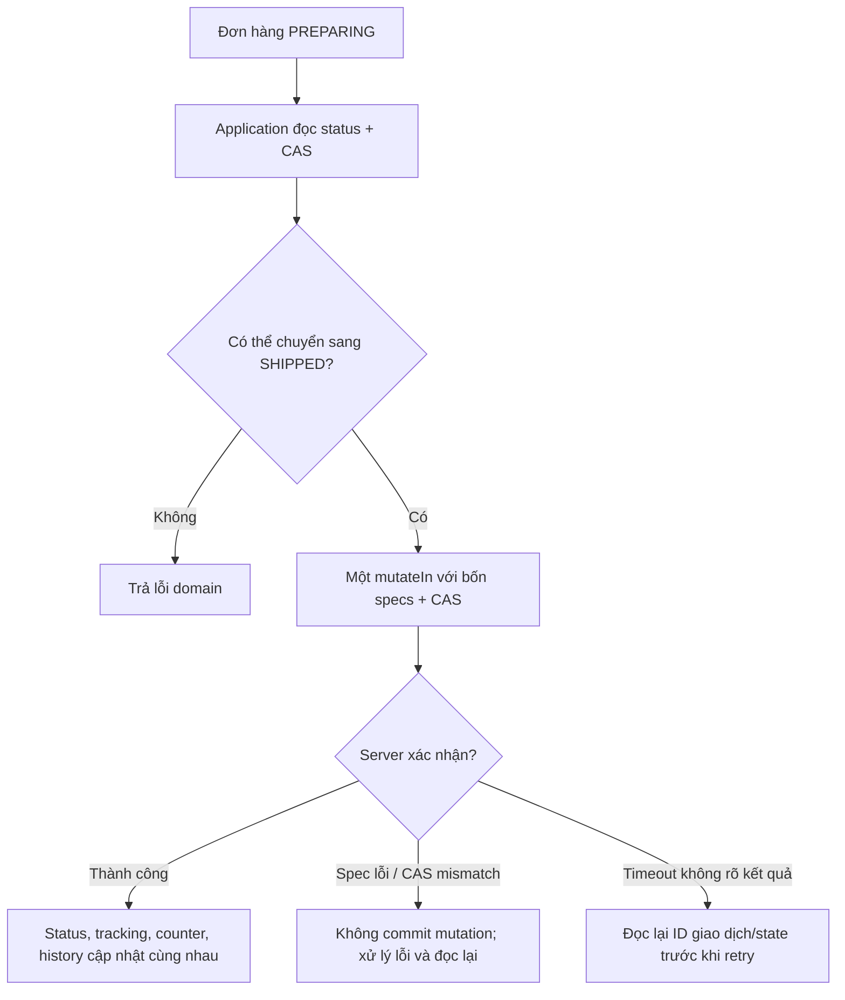

# Gộp nhiều thay đổi nguyên tử trên cùng một tài liệu

## 1. Vấn đề: một hành động nghiệp vụ thường thay đổi nhiều trường

Trong module **SPRING_DATA_COUCHBASE**, ứng dụng quản lý dữ liệu Couchbase thông qua Spring Data document mapping, repository, `CouchbaseTemplate`, truy vấn SQL++, bucket/scope/collection, chỉ mục, TTL, CAS, giao dịch và API reactive. Khi chỉ cần chỉnh một phần JSON, Sub-document API cho phép gửi những thao tác nhỏ theo path. Nhưng sức mạnh quan trọng hơn việc giảm payload là khả năng **gộp nhiều thao tác thành một mutation nguyên tử trên cùng document**.

Ví dụ khi chuyển đơn hàng sang trạng thái đã giao cho đơn vị vận chuyển, hệ thống phải thực hiện đồng thời:

1. Đổi `shipping.status` từ `PREPARING` thành `SHIPPED`.
2. Ghi `shipping.tracking_code`.
3. Tăng `stats.status_transitions`.
4. Thêm một sự kiện vào `history`.

Nếu gửi bốn lệnh ghi **riêng biệt**, ứng dụng có thể bị lỗi sau thao tác thứ hai: trạng thái đã thành `SHIPPED` và có mã vận đơn nhưng bộ đếm/lịch sử chưa cập nhật. Một client khác còn có thể đọc document ở giữa các lần ghi.

Với một lời gọi `Collection.mutateIn(id, specs)`, Couchbase có thể thực hiện **tất cả các specs trong cùng mutation nguyên tử ở phạm vi một document key**. Khi request thành công, các thay đổi được commit cùng nhau. Nếu một mutation spec thất bại, request không commit phần đã sửa trước đó.

**Tuy nhiên, cần phân biệt bốn bảo đảm khác nhau:**

- **Atomicity:** một `mutateIn` với nhiều specs thành công hoặc thất bại như một mutation trên cùng document.
- **CAS/conditional update:** phát hiện document đã thay đổi kể từ lúc ứng dụng đọc và kiểm tra điều kiện.
- **Durability:** mức đảm bảo mutation được lưu/replicate trước khi báo thành công.
- **Multi-document transaction:** phối hợp thay đổi trên nhiều document keys, không tự có chỉ vì dùng `mutateIn`.

Bài học làm rõ cách triển khai, kiểm thử và vận hành những bảo đảm này mà không gán cho Sub-document API những khả năng nó không có.

### Mục tiêu học tập

Sau bài này, bạn có thể:

1. Viết một `mutateIn` có nhiều `MutateInSpec` tác động đến các JSON paths khác nhau.
2. Giải thích atomicity của một request và các giới hạn tối đa số specs.
3. Dùng kết quả `MutateInResult`, CAS và error context để hiểu mutation đã xảy ra hay chưa.
4. Thiết kế cập nhật có điều kiện bằng `lookupIn` + CAS mà không nhầm với transaction.
5. Phân biệt thao tác idempotent với `increment`/`arrayAppend` có thể gây tác dụng kép sau retry.
6. Áp dụng expiry/durability, xử lý errors và bảo vệ invariants.
7. Chọn giữa Java SDK, Spring Data `CouchbaseTemplate`, repository và multi-document transactions.
8. Viết integration tests có cả success, failure, concurrent writers và timeout ambiguity.

## 2. Document mẫu và invariant nghiệp vụ

Giả sử bucket `shop`, scope `sales`, collection `orders` chứa document key `order::1001`:

```json
{
  "_class": "order-document",
  "schema_version": 2,
  "customer_id": "customer::42",
  "shipping": {
    "status": "PREPARING",
    "carrier": "VN-EXPRESS"
  },
  "stats": {
    "status_transitions": 1,
    "views": 24
  },
  "history": [
    {
      "event_id": "evt::created::1001",
      "status": "CREATED",
      "at": "2026-11-20T08:00:00Z"
    }
  ],
  "items": [
    {
      "line_id": "L1",
      "sku": "BOOK-01",
      "qty": 2
    }
  ],
  "currency": "VND",
  "total_minor": 150000
}
```

Trong ví dụ, invariant của workflow vận chuyển là:

> Đơn hàng chỉ được chuyển từ `PREPARING` sang `SHIPPED` nếu đã có mã vận đơn hợp lệ; sau khi thành công phải có một record lịch sử tương ứng và số chuyển trạng thái được tăng đúng một lần.

Bốn thay đổi trong body nên được coi là **một hành động nghiệp vụ**. Tuy nhiên, không phải mọi điều kiện trên đều được Couchbase tự kiểm tra: application phải xác minh trạng thái trước khi ghi, các field bắt buộc và quyền của người gọi.

### 2.1. Một mutation thay vì nhiều mutations



Điểm mấu chốt: `mutateIn` giải quyết **tính nguyên tử của bản ghi một document**, còn xác minh trạng thái và idempotency vẫn là trách nhiệm của ứng dụng.

## 3. Chuẩn bị Couchbase Java SDK Collection

Các ví dụ dùng Couchbase Java SDK 3.x. Giả sử `Cluster` được tạo bởi cấu hình ứng dụng Spring, có RBAC thích hợp và được quản lý lifecycle.

```java
import com.couchbase.client.java.Cluster;
import com.couchbase.client.java.Collection;

Collection orders = cluster.bucket("shop")
    .scope("sales")
    .collection("orders");

String orderId = "order::1001";
```

`orders` là `com.couchbase.client.java.Collection`, không phải `java.util.Collection`.

- Key `order::1001` chọn document cụ thể.
- `shipping.status` và `history` là JSON paths trong body.
- `Collection.mutateIn(...)` là KV operation, không phải query `UPDATE`.
- SDK không tự dùng `@Field` hoặc `CouchbaseCustomConversions` của Spring Data.

Không tạo một `Cluster` mới cho từng request, không đặt credentials trong source code và không tự giả định SDK trỏ cùng collection với một Spring Data repository khác.

### 3.1. Imports cho các ví dụ

```java
import java.time.Duration;
import java.time.Instant;
import java.util.List;

import com.couchbase.client.java.Collection;
import com.couchbase.client.java.json.JsonObject;
import com.couchbase.client.java.kv.LookupInResult;
import com.couchbase.client.java.kv.LookupInSpec;
import com.couchbase.client.java.kv.MutateInOptions;
import com.couchbase.client.java.kv.MutateInResult;
import com.couchbase.client.java.kv.MutateInSpec;
```

Một số đoạn code dưới đây là **nội dung phương thức** có sẵn biến `orders`/`orderId`. Để chạy độc lập, cần thêm class, dependency injection, test setup và cleanup phù hợp.

## 4. Một `mutateIn` gộp bốn thay đổi

Giả sử ứng dụng đã kiểm tra rằng:

- Document tồn tại, đang ở trạng thái `PREPARING`.
- Người gọi được quyền thực hiện lệnh chuyển trạng thái.
- Mã vận đơn `VN123456` và event ID `ship::1001::v1` hợp lệ.
- Array `history` tồn tại.
- Counter `stats.status_transitions` là số nguyên.
- Chưa có sự kiện chuyển trạng thái cùng ID.

Sau khi validation, có thể gửi:

```java
JsonObject shippedEvent = JsonObject.create()
    .put("event_id", "ship::1001::v1")
    .put("status", "SHIPPED")
    .put("tracking_code", "VN123456")
    .put("at", "2026-11-25T09:00:00Z");

MutateInResult result = orders.mutateIn(
    "order::1001",
    List.of(
        MutateInSpec.replace(
            "shipping.status", "SHIPPED"),
        MutateInSpec.upsert(
            "shipping.tracking_code", "VN123456"),
        MutateInSpec.increment(
            "stats.status_transitions", 1),
        MutateInSpec.arrayAppend(
            "history", List.of(shippedEvent))
    )
);

long casAfter = result.cas();
```

Đoạn code gửi **một** mutation request chứa **bốn specs**.

### 4.1. Ý nghĩa từng spec

| Spec | Hành động | Vì sao chọn? |
| --- | --- | --- |
| `replace("shipping.status", "SHIPPED")` | Thay field đã tồn tại | Phát hiện schema lỗi nếu `shipping.status` thiếu. |
| `upsert("shipping.tracking_code", "VN123456")` | Tạo hoặc thay field mã vận đơn | Cho phép mã vận đơn chưa có từ trước. |
| `increment("stats.status_transitions", 1)` | Tăng counter server-side | Không tự read + cộng + full replace body. |
| `arrayAppend("history", List.of(event))` | Thêm một object vào lịch sử | Không phải tải cả array về để append. |

Lưu ý chữ ký Java SDK 3.x: thao tác `arrayAppend`/`arrayPrepend`/`arrayInsert` dùng danh sách values (`List<?>`), nên truyền `List.of(shippedEvent)`, không tự suy đoán overload scalar.

### 4.2. Kết quả sau thành công

Ví dụ các field liên quan trở thành:

```json
{
  "shipping": {
    "status": "SHIPPED",
    "carrier": "VN-EXPRESS",
    "tracking_code": "VN123456"
  },
  "stats": {
    "status_transitions": 2,
    "views": 24
  },
  "history": [
    {
      "event_id": "evt::created::1001",
      "status": "CREATED",
      "at": "2026-11-20T08:00:00Z"
    },
    {
      "event_id": "ship::1001::v1",
      "status": "SHIPPED",
      "tracking_code": "VN123456",
      "at": "2026-11-25T09:00:00Z"
    }
  ]
}
```

Các field `stats.views`, `shipping.carrier` và `items` không bị gửi lại như một body đầy đủ. Tuy nhiên, application vẫn cần bảo vệ schema và những client khác có thể ghi cùng document.

**Điều chưa được đoạn code trên bảo đảm:** nếu hai request cùng thử chuyển `PREPARING` → `SHIPPED`, cả hai có thể tạo sự kiện và tăng counter hai lần khi không có kiểm tra CAS/idempotency phù hợp. Atomicity **không đồng nghĩa** mỗi nghiệp vụ chỉ được thực hiện một lần.

## 5. Vì sao atomicity của một request quan trọng?

### 5.1. Kịch bản nguy hiểm với bốn lời gọi riêng

```java
orders.mutateIn(
    orderId,
    List.of(MutateInSpec.replace(
        "shipping.status", "SHIPPED"))
);

orders.mutateIn(
    orderId,
    List.of(MutateInSpec.upsert(
        "shipping.tracking_code", "VN123456"))
);

orders.mutateIn(
    orderId,
    List.of(MutateInSpec.increment(
        "stats.status_transitions", 1))
);

orders.mutateIn(
    orderId,
    List.of(MutateInSpec.arrayAppend(
        "history", List.of(shippedEvent)))
);
```

Nếu lỗi mạng xảy ra sau lời gọi thứ hai, document có thể mang `SHIPPED` và mã vận đơn nhưng chưa có counter/lịch sử. Những request khác cũng có cơ hội quan sát trạng thái trung gian giữa các lượt ghi.

### 5.2. Một request nhiều specs

```java
orders.mutateIn(orderId, List.of(
    MutateInSpec.replace("shipping.status", "SHIPPED"),
    MutateInSpec.upsert(
        "shipping.tracking_code", "VN123456"),
    MutateInSpec.increment(
        "stats.status_transitions", 1),
    MutateInSpec.arrayAppend(
        "history", List.of(shippedEvent))
));
```

Với request thành công, các specs được áp dụng **cùng nhau** lên một document. Nếu một spec thất bại do path không tồn tại, sai kiểu hoặc giá trị đã tồn tại ngoài dự kiến, **không commit một phần** request đó.

Không đánh đồng atomicity với "không thể có bất kỳ lỗi nào": application vẫn có thể nhận exception; server vẫn có thể không thực hiện mutation nếu điều kiện không thỏa hoặc backend không đáp ứng. Với timeout, cần phân biệt **kết quả không rõ** với một failure được server xác nhận.

## 6. Multi-spec mutation áp dụng nguyên tử, không phải một transaction nhiều documents

Couchbase Sub-document cho phép gửi nhiều specs nhưng tất cả thuộc cùng:

- Document key.
- Bucket, scope và collection được xác định ở SDK `Collection`.
- CAS/expiry của document.
- Một mutation KV nguyên tử.

| Cách làm | Phạm vi atomicity |
| --- | --- |
| Một `mutateIn("order::1001", List.of(a,b,c))` | Một document `order::1001`. |
| Hai `mutateIn` liên tiếp cùng key | Hai mutation độc lập; không có atomicity giữa hai requests. |
| Một `mutateIn` + một `repository.save` sau đó | Hai mutations riêng; phải xử lý concurrency. |
| Hai `mutateIn` trên `order::1001` và `inventory::BOOK-01` | Hai documents; không có transaction tự động. |
| Transaction Couchbase có hai mutations phù hợp | Có thể có atomicity đa document theo transaction contract được triển khai. |
| Một SQL++ UPDATE ảnh hưởng nhiều rows | Không tự đồng nghĩa giao dịch mạnh cho mọi invariant đa document. |

Sub-document API không có cú pháp "trong một `mutateIn` hãy sửa `order::1001` và `inventory::BOOK-01`". Nếu một hành động phải trừ tồn kho và sửa đơn hàng như một invariant liên document, phải cân nhắc Couchbase transaction, lock/conditional update hoặc thiết kế event-driven với reconciliation.

### 6.1. Giới hạn specs

Theo tài liệu Couchbase Sub-document API/Java SDK 3.x, một request cho phép tối đa **16 specs**. Không gom 50 thao tác vào một `mutateIn` và mong SDK tự chia thành nhiều requests vẫn đảm bảo atomicity. Nếu vượt giới hạn:

1. Xem có thể thiết kế lại document/schema hoặc gom một object update có chủ đích hay không.
2. Chia thành các thao tác độc lập **chỉ khi** nghiệp vụ cho phép partial progress.
3. Nếu không thể partial progress, cân nhắc một chiến lược consistency/transaction khác thay vì giả định các requests tách rời vẫn atomic.

Giới hạn path length, depth, body size và type compatibility cũng cần được xác minh theo SDK/server đang triển khai.

## 7. Một spec lỗi sẽ ảnh hưởng toàn bộ mutation

Ví dụ cố ý gửi một spec chắc chắn thất bại: `shipping.status` đã tồn tại nhưng lại dùng `insert`.

```java
orders.mutateIn(
    orderId,
    List.of(
        MutateInSpec.upsert(
            "shipping.tracking_code", "VN123456"),
        MutateInSpec.insert(
            "shipping.status", "SHIPPED"),
        MutateInSpec.increment(
            "stats.status_transitions", 1)
    )
);
```

`insert("shipping.status", ...)` có thể trả lỗi vì path đã tồn tại. Dù `upsert` đứng trước trong danh sách, server **không commit riêng** tracking code nếu multi-spec mutation bị từ chối.

### 7.1. Các nguyên nhân lỗi thường gặp

| Lỗi | Ví dụ | Kỳ vọng |
| --- | --- | --- |
| `PathExists` | `insert` field đã có | Multi-spec request thất bại, không tự overwrite. |
| `PathNotFound` | `replace` field thiếu | Không tạo field nếu contract yêu cầu phải có. |
| `PathMismatch` | `history` là object nhưng dùng `arrayAppend` | Phát hiện schema sai kiểu. |
| Path invalid | Path sai cú pháp, array index không hợp lệ | Không commit mutation. |
| Counter type mismatch | `stats.status_transitions` là string | Không ép kiểu number từ string tùy tiện. |
| CAS mismatch | Document đã đổi sau khi client đọc | Không commit mutation dựa trên phiên bản cũ. |
| Missing document | Key `order::404` không tồn tại | Xử lý not found hoặc store semantics có chủ đích. |
| Unsupported JSON value | Một object Java không serialize được | Sửa serializer/contract, không ghi dữ liệu đoán. |
| Durability unavailable | Cluster không đáp ứng mức durability yêu cầu | Phân biệt với lỗi validation/path. |

Tên exception/cause cụ thể phụ thuộc SDK version và cách unwrap từ sync, async hoặc reactive; nên test bằng dependency thực tế. `MultiMutationException` hoặc error context có thể cho biết spec thất bại, nhưng application không nên hard-code tên exception duy nhất cho mọi tình huống.

### 7.2. Cách kiểm tra atomic failure

Integration test nên:

1. Ghi document fixture ban đầu.
2. Chụp các field sẽ bị thay đổi.
3. Gửi multi-spec mutation với một spec sai.
4. Xác nhận API báo lỗi.
5. Đọc lại document bằng KV get/lookupIn.
6. Assert **không có một phần** thay đổi được commit.

Kiểm tra kết quả sau lỗi mạnh hơn việc chỉ assert `assertThrows(...)`, vì nó trực tiếp kiểm chứng invariant quan trọng nhất của bài học.

## 8. Thứ tự specs và path giao nhau

Multi-spec có danh sách **có thứ tự**, nhưng không nên biến nó thành một chương trình migration phức tạp có phụ thuộc khó hiểu. Ví dụ:

```java
orders.mutateIn(
    orderId,
    List.of(
        MutateInSpec.remove("shipping"),
        MutateInSpec.replace(
            "shipping.status", "SHIPPED")
    )
);
```

Trong ví dụ, spec sau còn phụ thuộc một parent vừa bị xóa. Request có nguy cơ thất bại do path mismatch/not found. Đối với cấu trúc sâu, thứ tự hoặc spec áp dụng trên parent/child có thể ảnh hưởng ý nghĩa và lỗi nhận được, nhưng **không nên dựa vào một giả định chưa test** về cách server tự tái cấu trúc JSON.

Khuyến nghị:

- Ưu tiên các specs trên **các leaf paths không xung đột** khi có thể.
- Nếu cần đổi cả object, chọn một `replace` object duy nhất đã validate, không đồng thời sửa chính các child của object đó một cách mâu thuẫn.
- Không dùng nhiều thao tác trái ngược trên cùng path (`insert` rồi `remove`; `remove` parent rồi `upsert` child) chỉ để tiết kiệm một request.
- Với migration schema, xác minh JSON trước/sau bằng integration test và bảo vệ CAS.

### 8.1. Tạo parent path khi cần

Nếu `shipping.tracking` chưa tồn tại, việc ghi `shipping.tracking.code` có thể cần:

```java
orders.mutateIn(
    orderId,
    List.of(
        MutateInSpec.upsert(
            "shipping.tracking.code", "VN123456")
            .createPath()
    )
);
```

`createPath()` cho phép tạo intermediate JSON object khi phù hợp. Nó **không** tự đổi parent đang là string/number sang object, và không phải công cụ giải quyết mọi khác biệt schema V1/V2.

Không bật `createPath()` mù quáng: typo như `shipping.trakcing.code` có thể tạo nhánh JSON sai mà request vẫn thành công.

## 9. Dùng `MutateInResult` đúng cách

Sau mutation thành công:

```java
MutateInResult result = orders.mutateIn(
    orderId,
    List.of(
        MutateInSpec.replace(
            "shipping.status", "SHIPPED"),
        MutateInSpec.increment(
            "stats.status_transitions", 1)
    )
);

long newTransitions = result.contentAs(1, Long.class);
long newCas = result.cas();
```

Ở đây counter là **spec thứ hai**, nên `contentAs(1, Long.class)` nhận kết quả counter sau increment.

`MutateInResult.contentAs(index, type)` dùng **chỉ số spec**, không phải JSON array index. Không kỳ vọng `replace` thông thường trả lại giá trị field tương ứng như `lookupIn`.

`result.cas()` là CAS của document **sau mutation**, dùng cho những thao tác sau nếu cần điều kiện theo version đó. Nó không phải schema version của ứng dụng. Một mutation kế tiếp có thể khiến CAS đổi nữa.

### 9.1. Kiểm tra giá trị nào cần đọc lại?

- Nếu giá trị là literal vừa gửi và request trả thành công, application đã biết ý định ghi.
- Nếu cần count mới, counter spec có thể trả giá trị sau mutation.
- Nếu phải xác nhận các field không liên quan vẫn giữ nguyên, đọc raw JSON trong test.
- Nếu muốn dùng trạng thái mới cho quyết định nghiệp vụ khác, hãy cân nhắc đọc lại theo key/CAS và tránh giả định không có writer xen giữa.

## 10. Atomicity không tự xác minh điều kiện nghiệp vụ

Một request multi-spec đúng cú pháp vẫn có thể vi phạm business rule:

```java
orders.mutateIn(
    orderId,
    List.of(
        MutateInSpec.replace(
            "shipping.status", "DELIVERED"),
        MutateInSpec.upsert(
            "shipping.tracking_code", "")
    )
);
```

Couchbase có thể cập nhật hai JSON paths **atomic** nhưng không tự biết rằng `DELIVERED` cần tracking code không rỗng hay yêu cầu trạng thái trước đó phải là `SHIPPED`.

### 10.1. Ba lớp cần có trong use case

1. **Authorization:** actor có quyền cập nhật đơn hàng và đúng tenant/collection không?
2. **Domain validation:** trạng thái cũ, trạng thái mới, tracking code, event ID và các invariant hợp lệ không?
3. **Atomic persistence:** gửi những thay đổi liên quan trong một `mutateIn`, kèm CAS nếu validation dựa trên snapshot.

Nếu không kiểm tra lớp thứ hai, atomicity chỉ đảm bảo rằng **nhiều thay đổi sai** được commit cùng nhau.

### 10.2. Không biến Sub-document thành lối tắt bỏ qua entity callbacks

Spring Data repository có thể dùng domain methods, Bean Validation hoặc entity callbacks/auditing. Raw Java SDK `mutateIn` **không tự gọi** những cơ chế đó. Nếu workflow cần audit ở tầng domain, service phải bổ sung chúng rõ ràng, hoặc chọn repository/template với behavior phù hợp.

## 11. `lookupIn` + CAS: cập nhật có điều kiện an toàn

Để chỉ chuyển `PREPARING` → `SHIPPED`, ứng dụng phải biết trạng thái hiện tại. `lookupIn` giúp lấy một field và CAS mà không tải toàn bộ body.

```java
LookupInResult before = orders.lookupIn(
    orderId,
    List.of(
        LookupInSpec.get("shipping.status")
    )
);

String currentStatus =
    before.contentAs(0, String.class);

if (!"PREPARING".equals(currentStatus)) {
    throw new IllegalStateException(
        "Order is not ready to ship");
}

long expectedCas = before.cas();
```

Sau đó gửi **toàn bộ specs** với CAS:

```java
JsonObject event = JsonObject.create()
    .put("event_id", "ship::1001::v1")
    .put("status", "SHIPPED")
    .put("tracking_code", "VN123456")
    .put("at", "2026-11-25T09:00:00Z");

MutateInResult result = orders.mutateIn(
    orderId,
    List.of(
        MutateInSpec.replace(
            "shipping.status", "SHIPPED"),
        MutateInSpec.upsert(
            "shipping.tracking_code", "VN123456"),
        MutateInSpec.increment(
            "stats.status_transitions", 1),
        MutateInSpec.arrayAppend(
            "history", List.of(event))
    ),
    MutateInOptions.mutateInOptions()
        .cas(expectedCas)
);
```

Nếu một writer khác cập nhật document sau `lookupIn`, CAS mismatch khiến request bị từ chối, không áp dụng mutation dựa trên trạng thái cũ.

### 11.1. CAS thuộc toàn document, không phải riêng `shipping.status`

Writer khác chỉ cần tăng `stats.views` cũng có thể làm CAS đổi và khiến chuyển trạng thái bị conflict. Đây là trade-off của optimistic concurrency: bảo vệ **snapshot toàn document**, đôi khi cần retry khi dữ liệu có hot-key contention.

Nếu workflow có thể dùng một counter độc lập mà không dựa trên trạng thái trước đó, có thể không cần vòng đọc + CAS cho counter. Nhưng chuyển trạng thái có điều kiện thì CAS giúp không ghi lên snapshot cũ.

### 11.2. Retry CAS phải kiểm tra lại domain

Cách retry đúng:

1. Nhận `CasMismatchException` hoặc lỗi tương ứng.
2. `lookupIn` lại trạng thái và các field cần cho quyết định.
3. Kiểm tra `status` còn `PREPARING` hay đã `SHIPPED`.
4. Kiểm tra event ID có được áp dụng hay chưa.
5. Nếu vẫn hợp lệ, tạo yêu cầu mới với CAS mới.
6. Dừng sau giới hạn retry/backoff; trả conflict khi state không còn phù hợp.

Đừng chỉ thay CAS cũ bằng CAS mới rồi gửi lại một `arrayAppend`, `increment` **mà không xem xét xem mutation đã được thực hiện bởi request trước hoặc writer khác**.

## 12. Tránh cập nhật lặp lại khi request timeout

Đây là lỗi khó hơn một `PathNotFound`.

Giả sử client gửi multi-spec mutation, server đã áp dụng thành công nhưng phản hồi mạng bị mất. Client thấy timeout và không biết:

- Mutation chưa tới server.
- Mutation đã được xử lý rồi thất bại.
- Mutation đã commit thành công, chỉ response bị mất.

Nếu retry ngay **cùng specs**:

- `replace("shipping.status","SHIPPED")` có thể chạy lại, thường giữ giá trị như cũ.
- `increment("stats.status_transitions",1)` có thể **tăng lần thứ hai**.
- `arrayAppend("history",List.of(event))` có thể **thêm sự kiện trùng**.

Một request atomic không đồng nghĩa retry request đó có hiệu ứng exactly-once.

### 12.1. Phân loại tính idempotent

| Operation | Retry cùng input có thể idempotent? | Cảnh báo |
| --- | --- | --- |
| `replace("shipping.status","SHIPPED")` | Thường có cùng value sau mỗi lần ghi | CAS, callbacks, auditing và side effects vẫn cần xét. |
| `upsert("shipping.tracking_code","VN123456")` | Thường cùng JSON value | Không tự đảm bảo application workflow chỉ chạy một lần. |
| `remove("shipping.optional_field")` | Không mặc nhiên idempotent | Lần hai có thể `PathNotFound`; cần xử lý theo contract. |
| `insert("shipping.tracking_code",...)` | Lần hai thường thất bại do tồn tại | Có thể dùng như guard trong thiết kế nhất quán, nhưng cần xác minh nội dung. |
| `increment("stats.status_transitions",1)` | **Không** | Retry thành công hai lần tăng hai đơn vị. |
| `arrayAppend("history",List.of(event))` | **Không** | Retry có thể thêm trùng event. |
| `arrayAddUnique("tags",tag)` | Hạn chế duplicate primitive theo semantics SDK | Không giải quyết exactly-once của các specs khác. |

### 12.2. Dùng operation ID và kiểm tra cùng document

Một mẫu đơn giản là đặt `shipping.last_transition_id` trong **cùng multi-spec mutation**:

```java
String operationId = "ship::1001::v1";

orders.mutateIn(
    orderId,
    List.of(
        MutateInSpec.replace(
            "shipping.status", "SHIPPED"),
        MutateInSpec.upsert(
            "shipping.last_transition_id", operationId),
        MutateInSpec.increment(
            "stats.status_transitions", 1),
        MutateInSpec.arrayAppend(
            "history", List.of(event))
    ),
    MutateInOptions.mutateInOptions()
        .cas(expectedCas)
);
```

Vì `last_transition_id` và counter/history ở **cùng mutation atomic**, sau một timeout, application có thể đọc trạng thái và marker để biết operation có vẻ đã được áp dụng. Tuy nhiên, marker đơn lẻ **không đủ** cho toàn bộ mọi trường hợp:

- Nếu các operation tiếp theo ghi đè `last_transition_id`, marker cũ mất.
- Nếu hai request cùng operation ID kiểm tra state trước khi ghi, phải dùng CAS/conditional update để tránh race.
- Nếu cần lưu bằng chứng xử lý lâu dài, có thể dùng một log/ledger event document riêng với key cố định, nhưng khi thay nhiều documents cần transaction hoặc chiến lược reconciliation.
- Event ID và marker phải được xác định, validate và bảo vệ trước khi cho phép retry.

**Lưu ý:** một `mutateIn` có marker và CAS không tự đưa ra exactly-once toàn hệ thống, đặc biệt khi action còn gọi dịch vụ vận chuyển bên ngoài hoặc ghi nhiều documents. Nó là một thành phần của thiết kế idempotency.

### 12.3. Timeout nên được ghi nhận là “kết quả chưa xác định”

Khi SDK báo timeout hoặc kết nối mất, application không nên lập tức nói "mutation chắc chắn thất bại", cũng không thể báo "thành công" nếu chưa có bằng chứng. Nếu nghiệp vụ nhạy cảm:

1. Đọc lại document theo key.
2. Kiểm tra marker/event ID/state/CAS.
3. Đối chiếu xem toàn bộ hiệu ứng mong muốn đã có chưa.
4. Chỉ retry khi vẫn có thể chứng minh thao tác chưa được thực hiện hoặc khi retry idempotent.
5. Có thể cần workflow trạng thái `PENDING`/`UNKNOWN` và reconciliation.

## 13. Tính nguyên tử ở mức document có giải quyết concurrency không?

Hai requests độc lập vẫn có thể chạy gần nhau:

```text
Client A: PREPARING → SHIPPED, append event A
Client B: PREPARING → CANCELLED, append event B
```

Nếu không kiểm tra trạng thái theo CAS, hai multi-spec requests có thể được xử lý lần lượt, mỗi request atomic, nhưng kết quả cuối có thể phản ánh chuyển trạng thái sai nghiệp vụ (ví dụ `CANCELLED` sau `SHIPPED`).

**Atomicity của từng request không bảo vệ điều kiện “chỉ chuyển nếu status trước đó đúng X” ở cấp application.**

Có thể dùng:

- `lookupIn` + CAS như mục 11.
- Một API mutation có conditional semantics phù hợp, nếu framework/server cung cấp đúng điều kiện cần thiết.
- Đọc/ghi full entity với `@Version` qua repository khi cần domain aggregate.
- Couchbase transactions hoặc kiến trúc workflow khác cho invariants nhiều documents.

### 13.1. CAS không làm mất tác dụng atomic multi-spec

Khi gửi một `mutateIn` với `cas(expectedCas)`, các specs vẫn thuộc **một mutation**. Nếu CAS mismatch, request bị từ chối trước khi commit; không có chuyện chỉ spec ghi status bị từ chối còn spec increment thành công.

### 13.2. Hot document

Nếu `stats.views` được tăng rất thường xuyên trong cùng document với `shipping.status`, mọi increment có thể thay CAS và làm tăng conflict của workflow vận chuyển. Khi đây là bottleneck thật:

- Cân nhắc tách bộ đếm view sang document riêng nếu domain cho phép eventual consistency.
- Giữ shipping workflow trên aggregate với CAS.
- Đánh giá chi phí transaction/denormalization nếu nhiều documents cần invariant.
- Không tách document chỉ vì tránh conflict mà phá mất yêu cầu nguyên tử vốn có.

Đây là trade-off thiết kế dữ liệu, không phải lỗi API.

## 14. Array operations trong multi-spec: các bẫy khó thấy

Trong Java SDK 3.x:

```java
MutateInSpec.arrayAppend(
    "history", List.of(event))
```

thêm một hoặc nhiều values vào array có sẵn. Nó có semantics khác với:

```java
MutateInSpec.replace(
    "history", newHistoryArray)
```

Phương thức đầu append tại server, không gửi lại toàn array. Phương thức sau thay giá trị cả array; nếu `newHistoryArray` được dựng từ một snapshot cũ, có thể làm mất sự kiện mà writer khác vừa thêm.

### 14.1. Phần tử mảng không có identity ổn định

`history[0]` là vị trí, không phải event ID. Nếu writer khác chèn/xóa ở đầu, index có thể dịch. Khi cập nhật một object trong `items` theo `line_id`, hãy đọc các IDs và CAS hoặc đổi mô hình keyed-object/document-per-item.

### 14.2. Array tăng không giới hạn

Append nhiều lịch sử vào một document làm body lớn dần, tăng chi phí get, index maintenance và nguy cơ chạm giới hạn kích thước/hot key. Với audit dài hạn, có thể cân nhắc:

- Chỉ lưu một số sự kiện gần nhất cùng aggregate; lịch sử đầy đủ ở document riêng.
- Event document key theo operation ID, có uniqueness/retention policy riêng.
- Ghi event và order trong transaction nếu cần atomicity đa document.
- Đưa event qua outbox/reconciliation theo yêu cầu eventual consistency.

Một array append trong `mutateIn` không thay thế hệ thống audit/sổ cái có đảm bảo độc lập.

## 15. Những thay đổi nào nên gộp vào cùng request?

Gộp khi các specs là **một thay đổi logic** và việc hiển thị một phần các field sẽ tạo trạng thái không nhất quán.

| Trường hợp | Gộp? | Vì sao |
| --- | --- | --- |
| Đổi status, tracking code và một record lịch sử | Nên, khi cùng document và invariants yêu cầu | Tránh status thay mà tracking/history chưa theo. |
| Tăng views và likes theo một hành động duy nhất | Có thể, nếu cùng ý nghĩa nghiệp vụ | Server cập nhật cùng mutation. |
| Thêm địa chỉ phụ và đổi default address ID | Nên, nếu cùng document | Tránh default trỏ địa chỉ chưa có. |
| Xóa một field V1, tạo field V2 và tăng schema version | Có thể, nhưng test migration/CAS | Tránh mixed schema giữa các lượt ghi. |
| Thay profile name và tăng một chỉ số thống kê độc lập | Không bắt buộc | Gộp có thể gây coupling/contension không cần thiết. |
| Sửa order và giảm tồn kho document khác | Không giải quyết bằng một `mutateIn` | Cần multi-document consistency riêng. |
| Gửi email sau khi sửa đơn hàng | Không phải JSON mutation | Cần outbox/idempotency/external effect handling. |

Tránh gộp chỉ vì "giảm số request" khi các thao tác thuộc hai use cases độc lập. Càng nhiều specs chung một mutation, càng có nguy cơ một spec hỏng làm tất cả thất bại, và các field dùng chung CAS sẽ bị coupling.

## 16. TTL/expiry với multi-spec mutation

TTL là metadata của document, **không phải** field JSON như `shipping.expires_at`. Một mutation có thể đặt expiry mới hoặc yêu cầu bảo toàn expiry đang có theo SDK options.

Ví dụ giữ nguyên expiry:

```java
orders.mutateIn(
    orderId,
    List.of(
        MutateInSpec.replace(
            "shipping.status", "SHIPPED"),
        MutateInSpec.upsert(
            "shipping.tracking_code", "VN123456")
    ),
    MutateInOptions.mutateInOptions()
        .preserveExpiry(true)
);
```

Nếu business muốn đặt TTL mới:

```java
orders.mutateIn(
    orderId,
    List.of(
        MutateInSpec.upsert(
            "shipping.tracking_code", "VN123456")
    ),
    MutateInOptions.mutateInOptions()
        .expiry(Duration.ofHours(6))
);
```

Hai chính sách phục vụ mục tiêu khác nhau; không gắn `expiry` và `preserveExpiry` một cách mâu thuẫn. Cần xác minh hành vi của SDK/server cụ thể và bucket max TTL.

### 16.1. Đừng làm mất retention của record quan trọng

Đơn hàng/đối soát có thể yêu cầu lưu dài hạn trong khi session/cache có expiry ngắn. Việc copy-paste một `expiry(Duration.ofHours(6))` từ code cache sang order mutation có thể khiến dữ liệu quan trọng bị xóa sau 6 giờ.

Expiry không giải quyết tính nguyên tử của specs; nó quyết định **vòng đời** của document. Test TTL trước/sau mutation bằng môi trường cô lập.

## 17. Durability: một bảo đảm khác với atomicity

Java SDK cho phép chọn durability của mutation tùy cluster và phiên bản:

```java
import com.couchbase.client.core.msg.kv.DurabilityLevel;

MutateInResult result = orders.mutateIn(
    orderId,
    List.of(
        MutateInSpec.replace(
            "shipping.status", "SHIPPED"),
        MutateInSpec.upsert(
            "shipping.tracking_code", "VN123456")
    ),
    MutateInOptions.mutateInOptions()
        .durability(DurabilityLevel.MAJORITY)
);
```

`MAJORITY` là ví dụ một mức durable write khi cluster hỗ trợ. Mức mạnh hơn có thể làm tăng latency và ảnh hưởng availability khi topology không đáp ứng. Không nên bật durability mạnh nhất vô điều kiện nếu workload không đòi hỏi.

| Bảo đảm | Câu hỏi nó trả lời |
| --- | --- |
| Atomicity | Một `mutateIn` nhiều specs có commit tất cả thay đổi trong một document không? |
| CAS | Document đã thay đổi từ lúc ứng dụng đọc/kiểm tra điều kiện chưa? |
| Durability | Mutation được lưu/replicate đến mức nào trước khi được xác nhận? |
| Query consistency | SQL++/GSI có nhìn thấy mutation ở thời điểm query không? |
| Transaction đa document | Nhiều document có cần commit như một đơn vị nghiệp vụ không? |
| Idempotency | Retry cùng một command có bị tính hai lần không? |

Atomicity, durability và idempotency thường bị nhầm trong các workflow có counter/array log. Chúng xử lý **những dạng rủi ro khác nhau**.

## 18. API reactive: vẫn một mutation atomic nhưng I/O bất đồng bộ

Couchbase Java SDK cung cấp `users.reactive().mutateIn` qua Project Reactor. Với `orders` đã khai báo:

```java
import reactor.core.publisher.Mono;

Mono<MutateInResult> mutation =
    orders.reactive().mutateIn(
        orderId,
        List.of(
            MutateInSpec.replace(
                "shipping.status", "SHIPPED"),
            MutateInSpec.upsert(
                "shipping.tracking_code", "VN123456"),
            MutateInSpec.increment(
                "stats.status_transitions", 1)
        )
    );
```

Tạo `Mono` không nhất thiết đã gửi request; nó cần được subscribe/verify theo lifecycle reactive. Khi được thực thi, server vẫn áp dụng các specs atomic **trên cùng document**.

### 18.1. Test reactive

```java
import reactor.test.StepVerifier;

StepVerifier.create(mutation)
    .assertNext(result -> {
        long count = result.contentAs(2, Long.class);
        assert count >= 1;
    })
    .verifyComplete();
```

Counter là **spec thứ ba**, nên `contentAs(2, Long.class)`. Trong test thật, assert con số dự kiến từ fixture (ví dụ `2L`), không chỉ một bất đẳng thức dễ che lỗi.

### 18.2. Reactor không tự tạo transaction giữa các Monos

Ví dụ:

```java
Mono<Void> flow = orders.reactive().mutateIn(
    "order::1001", orderSpecs
).then(
    inventory.reactive().mutateIn(
        "inventory::BOOK-01", inventorySpecs
    )
).then();
```

Chaining `then` chỉ định thứ tự xử lý publisher. Nó **không tự biến hai mutations ở hai keys thành transaction**. Nếu mutation đầu thành công, mutation hai thất bại, rollback không tự xảy ra. Với multi-document consistency cần tính năng transaction hoặc mô hình sự kiện có bù trừ.

### 18.3. Không block event loop

Đừng gọi `orders.mutateIn(...)` blocking trong event-loop chỉ vì code nằm trong `Mono.fromCallable(...)` mà không cấu hình scheduler/thiết kế đúng. Khi ứng dụng reactive, ưu tiên API `orders.reactive().mutateIn(...)`. Nhưng lựa chọn reactive không thay đổi JSON path, CAS hay giới hạn atomicity.

## 19. Async SDK với `CompletableFuture`

Nếu ứng dụng dùng `CompletableFuture` thay vì Reactor:

```java
import java.util.concurrent.CompletableFuture;

CompletableFuture<MutateInResult> future =
    orders.async().mutateIn(
        orderId,
        List.of(
            MutateInSpec.replace(
                "shipping.status", "SHIPPED"),
            MutateInSpec.upsert(
                "shipping.tracking_code", "VN123456")
        )
    );

CompletableFuture<Long> casFuture =
    future.thenApply(MutateInResult::cas);
```

`CompletableFuture` điều khiển completion/error signal. Nó không tạo transaction giữa hai futures; kết hợp `allOf` hoặc `thenCompose` cũng không tạo commit chung nếu mỗi future gửi một mutation KV riêng.

Khi một future thất bại, xem nguyên nhân gốc (có thể được bọc trong `CompletionException`) để phân biệt CAS conflict, path mismatch, timeout và thiếu quyền, không retry tất cả cùng cách.

## 20. Phối hợp với Spring Data `CouchbaseTemplate`

Tùy version, Spring Data Couchbase có fluent mutation-by-ID API. Trong các dòng từ Spring Data Couchbase 5.1, tài liệu mô tả `mutateInById` với các path operations:

- `withInsertPaths(...)`
- `withUpsertPaths(...)`
- `withReplacePaths(...)`
- `withRemovePaths(...)`

Ví dụ cho entity tương ứng:

```java
couchbaseTemplate.mutateInById(OrderDocument.class)
    .withReplacePaths("shipping.status")
    .withUpsertPaths("shipping.tracking_code")
    .one(orderPatch);
```

Ở đây `orderPatch` là một entity có ID và giá trị các property mà Template cần để sinh mutation. API/template thực tế, method chaining và cách dùng CAS cần được **kiểm tra theo version Spring Data Couchbase đã resolve**.

### 20.1. Template không nhất thiết expose đầy đủ specs của SDK

Không tự giả định có fluent `withIncrementPaths`, `withArrayAppendPaths` hoặc `lookupInById` chỉ vì Java SDK hỗ trợ các thao tác tương ứng.

Đối với yêu cầu gộp **replace + upsert + increment + array append** như ví dụ xuyên suốt, Java SDK `Collection.mutateIn` là lựa chọn rõ ràng khi Template version hiện tại không công bố toàn bộ các spec cần dùng. Nếu buộc dùng cả Template lẫn SDK trong **hai requests**, đừng nói rằng bốn thay đổi vẫn atomic chung.

**Nguyên tắc:** nếu invariant yêu cầu tất cả bốn thay đổi atomic trên một document, đưa chúng vào **một request** thực sự hỗ trợ cả bốn specs.

### 20.2. Spring Data mapping không tự chạy trong SDK raw

`OrderDocument` có thể dùng:

```java
import org.springframework.data.annotation.Id;
import org.springframework.data.annotation.Version;
import org.springframework.data.couchbase.core.mapping.Document;
import org.springframework.data.couchbase.core.mapping.Field;

@Document
public class OrderDocument {

    @Id
    private String id;

    @Field("shipping")
    private Shipping shipping;

    @Version
    private Long version;

    // Các fields/constructors/accessors khác thuộc ứng dụng.
}
```

SDK `mutateIn` không tự gọi:

- `@Field` để đổi tên property Java thành JSON path.
- `@TypeAlias` để map class discriminator.
- `CouchbaseCustomConversions` để encode value object.
- Spring Data auditing callbacks/domain validation.
- `@Version` để lấy CAS từ Java entity.

Khi cần CAS, SDK phải nhận giá trị trong `MutateInOptions.cas(expectedCas)`. Nếu repository cũng sửa document đó, `@Version` của entity có thể giúp phát hiện entity stale sau một SDK mutation, nhưng cần test đúng version/config.

### 20.3. JSON path phải đúng contract lưu trữ

Nếu Java property là `trackingCode` nhưng `@Field("tracking_code")`, SDK path phải là `shipping.tracking_code`. Một mutation vào `shipping.trackingCode` có thể tạo field khác hoặc thất bại, và Spring Data reader sau đó không thấy giá trị mong muốn.

Nếu custom converter biến một object thành string, bạn không thể `replace("money.amountMinor",...)` khi JSON thực chỉ lưu `money` như scalar. Việc gộp nhiều specs không sửa được schema mismatch.

## 21. Khi nào nên dùng full entity repository thay vì `mutateIn`?

Đối với aggregate có domain methods phức tạp, có thể dễ và an toàn hơn:

1. Đọc toàn entity bằng repository.
2. Gọi domain method có validation.
3. Save với optimistic locking/`@Version` phù hợp.

Ví dụ `order.ship(tracking)` có thể kiểm tra items, payment, cancellation, stock, shipping provider và phát event theo quy tắc miền. Subdocument gộp nhiều paths chỉ là **cơ chế ghi**, không thay thế domain model.

Tuy nhiên, full entity save có thể:

- Truyền nhiều JSON hơn.
- Serialization/deserialization nhiều hơn.
- Có nguy cơ lost update nếu không dùng CAS.
- Ghi lại những field không liên quan theo snapshot cũ nếu concurrency chưa được kiểm soát.

Chọn dựa trên độ lớn aggregate, tần suất cập nhật, invariant và error handling, không chỉ số dòng code.

## 22. Khi workflow đi qua nhiều documents

Ví dụ khi chuyển sang `SHIPPED`, còn cần:

- Giảm stock trong `inventory::BOOK-01`.
- Thêm shipping event `shipment::1001`.
- Đổi payment hold trong `payment::1001`.

Đó là ít nhất bốn document keys. Một `mutateIn("order::1001",...)` chỉ bảo đảm atomic phần **nằm trong order**.

### 22.1. Transaction

Nếu tất cả phải commit hoặc rollback như một đơn vị, cần đánh giá Couchbase transactions tương thích SDK/framework/server, chi phí và các hạn chế trong phiên bản đang dùng. Trình tự cụ thể của transaction phải được thiết kế theo API transaction, không đơn giản gộp nhiều `mutateIn` trong cùng Java method.

### 22.2. Outbox và eventual consistency

Nếu nhiều service/đích bên ngoài không thể tham gia một transaction, có thể sử dụng:

- Một state transition và outbox marker trong order document atomic.
- Một worker tiêu thụ marker, áp dụng side effect theo event ID.
- Idempotency key cho mỗi consumer.
- Retry/reconciliation và trạng thái theo dõi.
- Monitoring cho những operation bị kẹt hoặc xử lý trùng.

Lưu một event trong array `history` là hữu ích nhưng chưa đủ làm outbox toàn hệ thống nếu không có cơ chế tiêu thụ, retention và idempotency.

## 23. SQL++ và GSI sau multi-spec mutation

Sub-document thay JSON body bằng KV operation. Nếu index SQL++ chứa `shipping.status` hoặc `shipping.tracking_code`, GSI liên quan sẽ cần được cập nhật. Nhưng một SQL++ query ngay sau mutate có thể không quan sát mutation ngay khi consistency setting chưa yêu cầu read-after-write.

Ví dụ:

```sql
SELECT META(o).id AS orderId,
       o.shipping.status,
       o.shipping.tracking_code
FROM `shop`.`sales`.`orders` AS o
WHERE o.shipping.status = "SHIPPED";
```

Index minh họa:

```sql
CREATE INDEX ix_orders_ship_status
ON `shop`.`sales`.`orders`(
    shipping.status,
    shipping.tracking_code
);
```

Không dùng SQL++ query thiếu một document làm bằng chứng `mutateIn` đã cập nhật sai. Để debug:

1. `lookupIn` hoặc KV `get` theo key `order::1001`.
2. Kiểm tra raw JSON paths vừa sửa.
3. Chạy SQL++ với query consistency phù hợp nếu cần thấy dữ liệu mới.
4. Xem `EXPLAIN` để biết query dùng index/predicate nào.
5. Xác minh field names/type/enum values và schema version.

### 23.1. Không có GSI cũng gọi `mutateIn` theo key được

`Collection.mutateIn(id, specs)` đã biết key, không cần thứ cấp index để tìm document. Index chỉ liên quan truy vấn/reporting theo giá trị field. Số lượng index liên quan có thể ảnh hưởng chi phí bảo trì sau mutation, dù payload Sub-document nhỏ.

## 24. Schema evolution: đổi nhiều field cùng lúc

Giả sử V1:

```json
{
  "shippingStatus": "PREPARING",
  "trackingCode": "VN123456",
  "schema_version": 1
}
```

V2:

```json
{
  "shipping": {
    "status": "PREPARING",
    "tracking_code": "VN123456"
  },
  "schema_version": 2
}
```

Một migration trên **một document** có thể dùng các specs tạo JSON mới, xóa field V1 và sửa `schema_version` trong cùng request. Nhưng cần:

- Đọc V1 và giá trị thật.
- Phân biệt missing/null/schema hỏng.
- Xác nhận parent `shipping` chưa có hoặc đúng kiểu.
- Cung cấp CAS để bảo vệ cập nhật đồng thời.
- Đảm bảo số specs trong giới hạn.
- Kiểm thử thứ tự/mâu thuẫn parent-child.
- Xác nhận raw JSON, repository reader và SQL++ query/index sau migration.

Ví dụ dưới đây **giả định** parent `shipping` đã tồn tại với kiểu object, hai V1 fields tồn tại, và `schema_version` đã tồn tại:

```java
orders.mutateIn(
    orderId,
    List.of(
        MutateInSpec.upsert(
            "shipping.status", oldStatus),
        MutateInSpec.upsert(
            "shipping.tracking_code", oldTracking),
        MutateInSpec.remove("shippingStatus"),
        MutateInSpec.remove("trackingCode"),
        MutateInSpec.replace(
            "schema_version", 2)
    ),
    MutateInOptions.mutateInOptions()
        .cas(expectedCas)
);
```

Nếu `shipping` còn thiếu, cần thiết kế `createPath()` và kiểm tra shape. Nếu có cả V1/V2 với giá trị khác nhau, không tự chọn bừa. Nếu một field V1 thiếu mà `remove` kỳ vọng có, mutation có thể lỗi toàn bộ; phải xử lý policy cho dữ liệu lịch sử.

### 24.1. Atomic migration trong một document không đồng nghĩa toàn collection đã migrate

Mỗi request chuyển một document; nhiều document được backfill thành công ở những thời điểm khác nhau. Trong giai đoạn này, toàn collection có thể chứa mixed schema V1/V2. Query và reader phải hỗ trợ giai đoạn chuyển tiếp hoặc có kế hoạch rollout/backfill rõ.

`schema_version` là field ứng dụng, không phải CAS. Đổi `schema_version` trong mutation không thay thế conditional write theo CAS.

## 25. Quan sát vận hành và hiệu năng

Sub-document giảm lượng dữ liệu body phải truyền khi chỉ sửa vài paths, nhưng không có bảo đảm luôn nhanh hơn full save trong mọi tình huống.

Đo các chỉ số:

| Chỉ số | Vì sao quan trọng |
| --- | --- |
| p50/p95/p99 latency `mutateIn` | Phát hiện tail latency, ảnh hưởng durability/hot key. |
| Số specs mỗi request | Quy mô mutation, gần giới hạn 16. |
| Request/response bytes | Đánh giá lợi ích payload. |
| CAS conflict rate | Đánh giá contention của toàn document. |
| Path errors và schema version | Phát hiện dữ liệu lịch sử hoặc producer sai contract. |
| Ambiguous timeouts | Đánh giá hiệu quả đối chiếu/idempotency/retry. |
| Duplicate event IDs | Phát hiện tác dụng kép của append. |
| Counter anomalies | Phát hiện double increment hoặc giá trị không hợp lệ. |
| TTL anomalies | Bảo vệ retention. |
| GSI query latency/visibility | Phân biệt query consistency với KV mutation. |
| Durability failures | Xem cluster/topology/SLA. |
| Reactive cancellation/errors | Tránh bỏ qua publisher error hoặc retry không chủ đích. |

Không log toàn bộ body chứa dữ liệu khách hàng hay secret. Khi chẩn đoán, log document ID, operation ID, danh sách **path đã whitelist**, error category, CAS/correlation ID và schema version khi cần.

### 25.1. Nếu conflict quá cao

Có thể chia một document nóng thành những document có lifecycle khác nhau, ví dụ order core và view counter. Nhưng đánh đổi là không còn atomicity chung giữa hai keys. Cần quyết định theo đúng invariant và workload thay vì tối ưu thô "ít CAS conflict hơn bằng mọi giá".

## 26. Bảo mật: gộp specs không làm chúng an toàn hơn

Một API tùy tiện:

```java
// Không đưa vào production nếu client chọn path tự do:
List<MutateInSpec> specs = userSuppliedSpecs;
orders.mutateIn(orderId, specs);
```

có thể cho phép client thay `total_minor`, `currency`, `_class`, `schema_version`, `shipping.status` hoặc các field phân quyền trái phép.

Thay thế bằng service/adapter typed:

```java
public interface ShippingTransitionStore {
    void markShipped(
        String orderId,
        String trackingCode,
        String operationId
    );
}
```

Trong implementation:

1. Xác thực actor và quyền trên order.
2. Validate tracking code/event ID.
3. Đọc state/CAS.
4. Kiểm tra chuyển trạng thái hợp lệ/idempotency.
5. Tạo **bộ specs cố định** theo use case.
6. Thực thi một `mutateIn` với CAS.
7. Xử lý conflict/timeout và audit thích hợp.

Quyền RBAC trên collection chỉ kiểm soát truy cập data service ở cấp tương ứng; không tự phân biệt một actor được sửa `shipping.status` nhưng không được sửa `total_minor`. Application phải thực thi authorization cấp nghiệp vụ.

## 27. Quy trình debug khi multi-spec update thất bại

Một quy trình thực dụng:

1. **Đối chiếu bucket/scope/collection và key**: document nào đã được chọn?
2. **Đọc raw JSON** ở các parent paths: `shipping`, `stats`, `history` có đúng kiểu không?
3. **Kiểm tra spec index**: spec nào là `replace`, `increment`, `arrayAppend`; path nào lỗi?
4. **Xác nhận type/missing/null**: field có thực sự tồn tại như contract hay không?
5. **Xem exception/cause/error context**: path not found, exists, mismatch, CAS, timeout, permission, durability?
6. **Phân loại kết quả đã rõ hay ambiguous**: không tự retry side effects sau timeout.
7. **Đọc CAS và marker** nếu workflow dựa vào state/version/idempotency.
8. **Kiểm tra TTL** và durability policy nếu có.
9. **Đối chiếu Spring Data mapping** `@Field`, converters và `@Version` khi đọc/ghi từ repository.
10. **Đối chiếu SQL++/GSI** với KV; chú ý consistency/index.
11. **Thêm regression test** cho đúng fixture và scenario lỗi đã gặp.

### 27.1. Bảng triệu chứng

| Triệu chứng | Nguyên nhân có thể | Hành động |
| --- | --- | --- |
| Counter không tăng nhưng status cũng chưa đổi | Một spec khác lỗi, toàn request rollback | Xem failing spec và body raw. |
| Status đổi nhưng history chưa có | Logic đang dùng nhiều requests, không phải một `mutateIn` | Gom specs trong một mutation nếu cùng key. |
| Chuyển trạng thái hai lần | Thiếu CAS/idempotency | Operation ID, readback và conditional write. |
| Retry timeout tạo 2 events | `arrayAppend` không idempotent | Readback marker/event IDs trước retry. |
| `arrayAppend` không compile | SDK version nhận `List<?>` | Truyền `List.of(event)` và kiểm tra Javadoc. |
| `history` là object thay vì array | Path mismatch | Migrate/validate schema. |
| CAS conflict khi chỉ views thay | CAS thuộc toàn document | Đọc lại, retry có điều kiện hoặc tách hot counter. |
| TTL reset ngoài ý định | Mutation options/default chưa được xác minh | `preserveExpiry` hoặc policy đúng, test expiry. |
| SQL++ chưa thấy status mới | Query consistency/GSI lag | KV lookup, index status, scan consistency. |
| Repository reader lỗi sau SDK patch | Không thông qua Spring Data mapping/converters | Kiểm tra JSON names/types, type hints. |
| Reactive result không đến | Publisher chưa được subscribe/verify | Test completion/error với `StepVerifier`. |
| Hai documents không đồng bộ | Multi-spec atomic chỉ một key | Transaction/outbox/reconciliation. |

## 28. Kiểm thử tự động: bộ fixture và trường hợp quan trọng

### 28.1. Tạo fixture trong collection thử nghiệm

Dùng key `order::subdoc::test-005`, không động chạm dữ liệu production:

```java
import com.couchbase.client.java.json.JsonArray;
import com.couchbase.client.java.json.JsonObject;

String id = "order::subdoc::test-005";

JsonObject initial = JsonObject.create()
    .put("shipping", JsonObject.create()
        .put("status", "PREPARING")
        .put("carrier", "VN-EXPRESS"))
    .put("stats", JsonObject.create()
        .put("status_transitions", 1)
        .put("views", 24))
    .put("history", JsonArray.from(
        JsonObject.create()
            .put("event_id", "evt::created::1001")
            .put("status", "CREATED")))
    .put("schema_version", 2);

orders.insert(id, initial);
```

Test setup phải bảo đảm key chưa tồn tại, hoặc dùng key riêng mỗi test và cleanup sau đó.

### 28.2. Test thành công nhiều specs

```java
JsonObject event = JsonObject.create()
    .put("event_id", "ship::test::1")
    .put("status", "SHIPPED");

MutateInResult result = orders.mutateIn(
    id,
    List.of(
        MutateInSpec.replace(
            "shipping.status", "SHIPPED"),
        MutateInSpec.upsert(
            "shipping.tracking_code", "VN123456"),
        MutateInSpec.increment(
            "stats.status_transitions", 1),
        MutateInSpec.arrayAppend(
            "history", List.of(event))
    )
);

long newTransitions =
    result.contentAs(2, Long.class);

assert newTransitions == 2L;
```

Đọc lại:

```java
LookupInResult after = orders.lookupIn(
    id,
    List.of(
        LookupInSpec.get("shipping.status"),
        LookupInSpec.get("shipping.tracking_code"),
        LookupInSpec.get("stats.status_transitions"),
        LookupInSpec.count("history"),
        LookupInSpec.get("stats.views")
    )
);

assert "SHIPPED".equals(
    after.contentAs(0, String.class));
assert "VN123456".equals(
    after.contentAs(1, String.class));
assert after.contentAs(2, Long.class) == 2L;
assert after.contentAs(3, Integer.class) == 2;
assert after.contentAs(4, Integer.class) == 24;
```

Đây là các lệnh trong method test; phải dùng imports/setup phù hợp, và có thể chọn `Integer.class` hay `Long.class` theo serializer/number mapping thực của SDK trong dự án.

### 28.3. Test rollback khi một spec sai

Khởi tạo một fixture **mới ở trạng thái PREPARING** rồi:

```java
orders.mutateIn(
    id,
    List.of(
        MutateInSpec.replace(
            "shipping.status", "SHIPPED"),
        MutateInSpec.insert(
            "shipping.status", "DUPLICATE"),
        MutateInSpec.increment(
            "stats.status_transitions", 1)
    )
);
```

Lệnh dự kiến lỗi do `insert` vào field đã tồn tại. Sau khi bắt exception trong test:

- `shipping.status` vẫn là `PREPARING`.
- `stats.status_transitions` vẫn là `1`.
- Không có event mới nào tự được thêm.

**Quan trọng:** không chạy case này trên fixture đã được sửa thành `SHIPPED` ở `28.2` mà vẫn assert trạng thái ban đầu. Mỗi test cần setup độc lập hoặc khôi phục fixture giữa các ca.

### 28.4. Test CAS stale

1. Request A `lookupIn` lấy status và `casA`.
2. Request B mutate một path khác, làm CAS thay đổi.
3. Request A gửi multi-spec mutation với `.cas(casA)`.
4. Xác nhận A gặp conflict và không cập nhật bất kỳ spec nào.
5. Đọc lại, đánh giá lại domain, retry nếu phù hợp.

### 28.5. Test idempotency và ambiguous outcome

- Gửi cùng `operationId` hai lần theo use case logic.
- Xác nhận nếu request đầu đã hoàn tất, request hai không tăng counter và không append event lần nữa.
- Giả lập timeout/failure response sau mutation ở tầng adapter/test double; đối chiếu lại marker trên Couchbase.
- Xác nhận retry của `replace` khác về semantics với `increment`/`arrayAppend`.
- Kiểm tra operation ID storage policy: marker có thể bị ghi đè ở lệnh khác hay không?

**Không** coi hai lần gọi SDK `mutateIn` giống nhau mà tự nhiên sẽ idempotent; phải xây logic dedup ở application.

## 29. Ma trận kiểm thử tối thiểu

| Nhóm | Kịch bản | Kỳ vọng |
| --- | --- | --- |
| Success | 4 specs đúng trên một document | Status/tracking/counter/history cùng đổi. |
| Atomic failure | Một `insert` trùng path | Toàn mutation không commit. |
| Path missing | `replace` trên field không có | Không tạo field ngoài contract. |
| Parent mismatch | `shipping` là string | Mutation thất bại và dữ liệu nguyên. |
| Counter invalid | `status_transitions` là string | Không ép kiểu ngoài policy. |
| Array invalid | `history` là object | Không append như array. |
| Type mismatch | New event không JSON-compatible | Error rõ; không partial write. |
| CAS | Snapshot bị writer khác sửa | Conflict, không ghi chồng. |
| Concurrent state | SHIPPED vs CANCELLED | Một transition bị từ chối theo rule/CAS. |
| Duplicate command | Cùng operation ID | Không double increment/append. |
| Timeout ambiguity | Mutation có thể đã commit | Readback trước retry. |
| TTL | Mutation giữ hoặc chủ động đổi expiry | Theo retention policy. |
| Durability | Mức được hỗ trợ | Behavior theo topology và SLA. |
| Over limit | Hơn số specs hỗ trợ | Không âm thầm chia request và mất atomicity. |
| Schema V1/V2 | Mixed fields | Migration atomic trong một doc, reader tương thích. |
| Spring Data | SDK mutation rồi entity read | JSON mapping, `@Version` đúng. |
| SQL++ query | GSI sau KV mutation | Phân biệt consistency khỏi mutation failure. |
| Async | `CompletableFuture` lỗi | Lỗi propagate/unwrap đúng. |
| Reactive | `Mono` hoàn tất/lỗi | Subscribe và verify signals. |
| Multiple docs | Order + inventory | Không khẳng định atomic chung; dùng thiết kế riêng. |
| Authorization | Client sửa field ngoài whitelist | Bị chặn trước SDK. |

## 30. Bài thực hành

### Bài 1 — So sánh bốn requests với một request

Dùng document `order::1001`. Thực hiện cập nhật status, tracking, counter và history bằng bốn `mutateIn` riêng trên một fixture. Cố tình làm request thứ ba lỗi. Ghi lại trạng thái trung gian. Lặp lại trên fixture mới bằng **một `mutateIn` bốn specs**, quan sát tính nguyên tử.

### Bài 2 — Phân tích lỗi một spec

Tạo `history` là object thay vì array, gửi multi-spec mutation với `arrayAppend("history",...)`. Kiểm tra exception và toàn bộ JSON không bị commit một phần. Sửa schema rồi chạy lại. Giải thích vì sao không tự chuyển object thành array trong catch-all error handler.

### Bài 3 — CAS trong chuyển trạng thái

Đọc `shipping.status` và CAS khi còn `PREPARING`. Client B đổi status thành `CANCELLED` trước khi client A gửi mutation. Xác minh CAS mismatch và không có tracking/counter/history từ A. Viết retry có kiểm tra lại trạng thái, không chỉ retry với CAS mới.

### Bài 4 — Idempotency khi timeout

Xây operation ID `ship::1001::v1`. Dùng marker trong cùng document và CAS để phát hiện command đã áp dụng. Mô phỏng mất response; đọc marker/histories và chỉ retry khi hợp lệ. Thử hai requests cùng operation ID đồng thời để nhận diện race.

### Bài 5 — TTL và durability

Tạo một test document có expiry. Gọi mutation với `preserveExpiry(true)`, kiểm tra TTL. Dùng `expiry(Duration)` ở một test khác để đổi TTL chủ động. Thử `DurabilityLevel.MAJORITY` nếu cluster hỗ trợ và đo latency.

### Bài 6 — Template so với SDK

Trong version Spring Data Couchbase có `mutateInById`, tạo một Template mutation hai paths (`withReplacePaths`/`withUpsertPaths`). Sau đó giải thích vì sao cần SDK `mutateIn` nếu phải gộp thêm counter và array append trong **cùng một atomic mutation** mà Template không expose các specs đó. Đừng chia ra hai calls rồi tuyên bố atomic chung.

### Bài 7 — Reactive atomic mutation

Dùng `orders.reactive().mutateIn` với ba specs, `StepVerifier` xác nhận result và completion. Thử lỗi path trong một spec và xác nhận error signal. Sau đó dựng hai Monos sửa hai document khác nhau, giải thích tại sao `then`/`zip` không tạo transaction.

### Bài 8 — Migration V1/V2

V1 dùng `shippingStatus`/`trackingCode`; V2 dùng `shipping.status`/`shipping.tracking_code`. Tạo một multi-spec migration có CAS: ghi field mới, xóa field cũ, đổi `schema_version`. Test trên V1 hợp lệ, V1 field thiếu, parent sai kiểu và CAS stale; dùng SQL++ audit mixed schema sau backfill.

### Câu hỏi tự kiểm tra

1. Thế nào là một `mutateIn` multi-spec atomic trên **cùng document**?
2. Một request bốn specs khác bốn requests riêng ở đâu?
3. Nếu spec thứ ba lỗi, hai specs đầu có được commit không?
4. Tại sao atomicity không tự kiểm tra điều kiện `PREPARING → SHIPPED`?
5. Vì sao `replace` phù hợp field bắt buộc còn `upsert` phù hợp field optional?
6. Khi nào cần `createPath()` và khi nào nó là dấu hiệu schema drift?
7. Giới hạn 16 specs ảnh hưởng thiết kế một workflow như thế nào?
8. Vì sao một multi-spec request không thể sửa hai document keys?
9. `MutateInResult.contentAs(2,Long.class)` đọc index nào?
10. Vì sao `result.cas()` khác `schema_version`?
11. CAS thuộc một field hay toàn document?
12. Khi nào có thể tăng counter mà không cần đọc trước?
13. Vì sao chuyển trạng thái có điều kiện lại cần CAS khi dùng `lookupIn` trước?
14. Sau CAS conflict, vì sao không nên retry ngay cùng array path/index cũ?
15. Vì sao timeout không đồng nghĩa mutation thất bại chắc chắn?
16. `increment` và `arrayAppend` có idempotent khi retry không?
17. Dùng operation ID trong cùng document giúp gì, và chưa giải quyết được gì?
18. Vì sao `preserveExpiry` khác `expiry`?
19. Durability và query consistency khác atomicity ở điểm nào?
20. `@Version` của Spring Data có tự gắn CAS vào raw SDK mutation không?
21. Template có những loại sub-document mutation nào theo version đã kiểm tra?
22. Một `Mono.then(...)` gồm hai mutations khác keys có tạo transaction không?
23. Khi nào nên chọn full entity repository thay vì SDK multi-spec mutation?
24. Vì sao thay JSON body qua SDK có thể bỏ qua auditing callbacks?
25. Query SQL++ chưa thấy status mới có chứng minh multi-spec mutation không thành công không?
26. Tại sao array `history` không nên phát triển vô hạn trong một document?
27. Khi nào cần chuyển workflow sang transaction hoặc outbox?
28. Làm sao thiết kế test xác minh cả atomic success lẫn atomic failure?

## 31. Tài liệu tham khảo

- [Couchbase Java SDK — Sub-Document Operations](https://docs.couchbase.com/java-sdk/current/howtos/subdocument-operations.html): `lookupIn`, `mutateIn`, spec types, atomicity, giới hạn và lỗi.
- [Couchbase Java SDK — MutateInSpec](https://docs.couchbase.com/sdk-api/couchbase-java-client/com/couchbase/client/java/kv/MutateInSpec.html): `replace/upsert/insert/remove`, array/counter specs và `createPath`.
- [Couchbase Java SDK — MutateInResult](https://docs.couchbase.com/sdk-api/couchbase-java-client/com/couchbase/client/java/kv/MutateInResult.html): CAS/result theo spec.
- [Couchbase Java SDK — MutateInOptions](https://docs.couchbase.com/sdk-api/couchbase-java-client/com/couchbase/client/java/kv/MutateInOptions.html): CAS, expiry, durability và timeout.
- [Couchbase Java SDK — LookupInResult](https://docs.couchbase.com/sdk-api/couchbase-java-client/com/couchbase/client/java/kv/LookupInResult.html): snapshot, `contentAs` và CAS.
- [Couchbase Java SDK — Concurrent Document Mutations](https://docs.couchbase.com/java-sdk/current/howtos/concurrent-document-mutations.html): optimistic concurrency và CAS.
- [Couchbase Java SDK — Durability](https://docs.couchbase.com/java-sdk/current/howtos/durability.html): durable writes và các mức cấu hình.
- [Couchbase Java SDK — Distributed Transactions](https://docs.couchbase.com/java-sdk/current/howtos/distributed-acid-transactions-from-the-sdk.html): các khái niệm transaction khi nhiều document cần nhất quán.
- [Spring Data Couchbase — Template & Direct Operations](https://docs.spring.io/spring-data/couchbase/reference/couchbase/template.html): `mutateInById` ở các version hỗ trợ.
- [Spring Data Couchbase — Entity Mapping](https://docs.spring.io/spring-data/couchbase/reference/couchbase/entity.html): `@Field`, `@Id`, `@Version`, type hints.
- [Couchbase Server — SQL++ Data Modification](https://docs.couchbase.com/server/current/n1ql/n1ql-language-reference/update.html): `UPDATE` và khác biệt với KV mutation.
- [Couchbase Server — CREATE INDEX](https://docs.couchbase.com/server/current/n1ql/n1ql-language-reference/createindex.html): chỉ mục GSI theo JSON paths.

> **Kết luận:** `Collection.mutateIn(id, List<MutateInSpec>)` cho phép **gộp nhiều thay đổi thành một mutation nguyên tử trên một Couchbase document**. Đó là nền tảng hữu ích cho những invariant cần sửa đồng thời nhiều JSON paths; song để bảo đảm đúng nghiệp vụ còn cần **validation, CAS khi phụ thuộc snapshot, idempotency khi retry, expiry/durability hợp lý và phương án transaction/outbox khi đi qua nhiều documents**. Đừng nhầm atomicity của một request với exactly-once execution, multi-document transaction hoặc query consistency.

