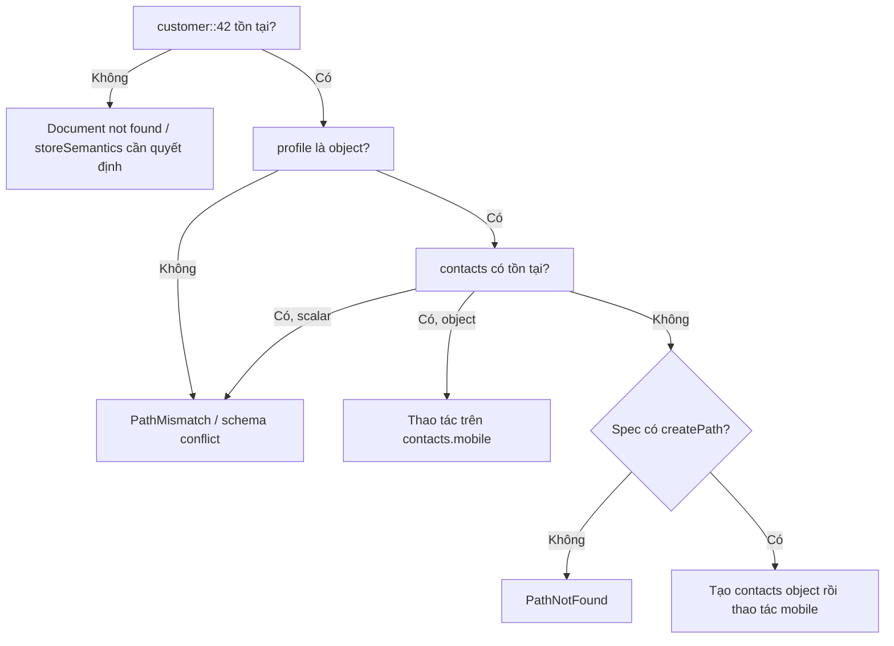
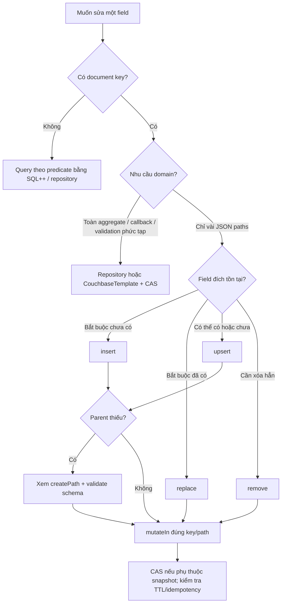

# Thêm, thay thế, xóa trường và tạo đường dẫn khi cần

## 1. Một thao tác nhỏ có thể thay đổi ý nghĩa của cả tài liệu

Trong module **SPRING_DATA_COUCHBASE**, ứng dụng xây dựng tầng truy cập Couchbase bằng Spring Data: ánh xạ document thành Java entity, dùng repository, `CouchbaseTemplate`, truy vấn SQL++, lựa chọn bucket/scope/collection, chỉ mục, TTL, CAS, giao dịch và API reactive.

Khi chỉ cần thêm số điện thoại, đổi ngôn ngữ hiển thị hoặc xóa một field không còn dùng, việc đọc toàn bộ JSON rồi ghi lại body có thể không cần thiết. Couchbase cung cấp **Sub-document KV API** để thay đổi đúng những JSON paths được chỉ định.

Nhưng các thao tác này **không hoán đổi cho nhau**:

- `insert(path, value)`: tạo field mới và báo lỗi nếu path đã tồn tại.
- `replace(path, value)`: thay field đã tồn tại và báo lỗi nếu path thiếu.
- `upsert(path, value)`: tạo nếu thiếu, thay nếu đã tồn tại.
- `remove(path)`: xóa field/path đã có, khiến nó trở thành **MISSING**, không phải JSON `null`.
- `createPath()`: tùy chọn trên một số mutation specs, cho phép tạo các object cha đang thiếu khi hợp lệ; không phải chế độ “sửa mọi JSON sai cấu trúc”.

Một lỗi tưởng nhỏ như dùng `upsert` thay `insert` có thể biến yêu cầu “thêm thông tin lần đầu” thành hành động ghi đè. Ngược lại, dùng `replace` thay `upsert` có thể khiến cập nhật optional field thất bại với tài liệu phiên bản cũ. Vì vậy phải chọn thao tác theo **hợp đồng dữ liệu**, không chỉ theo việc câu lệnh nào chạy thành công.

### Mục tiêu

Sau bài học, bạn có thể:

1. Phân biệt chính xác các điều kiện thành công/thất bại của `insert`, `replace`, `upsert`, `remove`.
2. Đọc và viết đường dẫn nested object, phát hiện parent path thiếu hoặc sai kiểu.
3. Sử dụng `createPath()` có chủ đích, không tạo cấu trúc sai vì typo hay migration chưa hoàn tất.
4. Phân biệt field **MISSING**, field bằng JSON `null` và field có giá trị hợp lệ.
5. Viết `mutateIn` nhiều specs nguyên tử trong một document, thêm CAS khi cần tránh ghi trên snapshot cũ.
6. Hiểu ranh giới với Spring Data `CouchbaseTemplate`, repository, `@Field` và custom converters.
7. Kiểm thử ảnh hưởng tới TTL, SQL++/index, concurrency, reactive flow và dữ liệu đa phiên bản.

## 2. JSON mẫu xuyên suốt

Giả sử bucket `shop`, scope `app`, collection `customers` chứa document key `customer::42`:

```json
{
  "_class": "customer-document",
  "schema_version": 2,
  "profile": {
    "display_name": "Lan",
    "email": "lan@example.test",
    "address": {
      "city": "Da Nang",
      "postal_code": "550000"
    }
  },
  "preferences": {
    "locale": "vi-VN",
    "notifications": true
  },
  "stats": {
    "visits": 12
  },
  "tags": ["member", "online"]
}
```

Một số yêu cầu khác nhau:

| Yêu cầu | JSON path | Operation hợp lý |
| --- | --- | --- |
| Thêm số điện thoại lần đầu, không cho ghi đè | `profile.phone` | `insert` |
| Đổi tên hiển thị đã có | `profile.display_name` | `replace` |
| Tạo hoặc đổi trường optional `timezone` | `preferences.timezone` | `upsert` |
| Xóa email theo chính sách được cho phép | `profile.email` | `remove` |
| Thêm `profile.contacts.mobile` khi object `contacts` chưa tồn tại | `profile.contacts.mobile` | `insert` hoặc `upsert` với `createPath()` |
| Đổi `profile.address` nguyên object | `profile.address` | `replace`, nhưng phải xét nguy cơ làm mất field con |
| Tạo/đổi ngôn ngữ khi dữ liệu V1 có thể thiếu `preferences` | `preferences.locale` | Cân nhắc `upsert(...).createPath()` **sau khi** xác nhận schema |

Document key `customer::42` nằm ngoài JSON body. `_class` là type hint minh họa; không nên cho người dùng tùy ý sửa field metadata này. CAS và TTL cũng là metadata của document, không phải những JSON paths do `MutateInSpec` tự tạo.

## 3. Cú pháp cơ bản của một mutation theo path

Couchbase Java SDK 3.x dùng `Collection.mutateIn(id, List<MutateInSpec>)`. Ví dụ:

```java
import java.util.List;

import com.couchbase.client.java.Cluster;
import com.couchbase.client.java.Collection;
import com.couchbase.client.java.kv.MutateInResult;
import com.couchbase.client.java.kv.MutateInSpec;

// cluster được quản lý bởi cấu hình ứng dụng, không tạo mỗi request.
Collection customers = cluster.bucket("shop")
    .scope("app")
    .collection("customers");

MutateInResult result = customers.mutateIn(
    "customer::42",
    List.of(
        MutateInSpec.replace(
            "profile.display_name", "Lan Nguyen")
    )
);

long casAfter = result.cas();
```

Với SDK:

- Đối số thứ nhất là **document ID** trong collection đã chọn.
- Mỗi `MutateInSpec` khai báo operation, JSON path, và value nếu operation cần.
- Các paths như `profile.display_name` phải khớp **tên field được lưu trong JSON**, không phải tên getter Java.
- `result.cas()` trả CAS của document sau mutation thành công.
- Một request có thể chứa nhiều specs và có tính nguyên tử ở phạm vi **một document**.

### 3.1. Đừng nhầm path với SQL++

`profile.address.city` chỉ định các key trong object lồng nhau. `tags[0]` chỉ phần tử đầu array. Một path không có điều kiện `WHERE` tùy ý như “sửa tags có name bằng X”; sub-document làm việc theo **key + đường dẫn**, không phải truy vấn tìm toàn collection.

Nếu không biết key và phải lọc theo email/thành phố, SQL++/repository query có thể phù hợp hơn. Nếu biết key và cần sửa vài field, sub-document là lựa chọn đáng cân nhắc.

## 4. Bảng quyết định: bốn operations cơ bản

Giả sử parent object của path đang có và đúng JSON type.

| Tình trạng field đích | `insert` | `replace` | `upsert` | `remove` |
| --- | --- | --- | --- | --- |
| Field chưa tồn tại | Tạo mới | Thất bại | Tạo mới | Thất bại |
| Field đã tồn tại | Thất bại | Ghi giá trị mới | Ghi giá trị mới | Xóa field |
| Field tồn tại và có giá trị JSON `null` | Thất bại do path đã có | Có thể thay `null` bằng value mới | Có thể thay bằng value mới | Xóa, thành MISSING |
| Parent object bị thiếu | Thường lỗi `PathNotFound` | Thất bại | Thường lỗi `PathNotFound` | Thất bại |
| Parent có kiểu sai, ví dụ string | Lỗi path/type mismatch | Lỗi path/type mismatch | Lỗi path/type mismatch | Lỗi path/type mismatch |
| Sau khi thao tác thành công | Field có value mới | Field có value mới | Field có value mới | Không còn field |

`createPath()` có thể thay đổi tình huống **parent chưa tồn tại** cho những specs hỗ trợ nó, nhưng không đổi semantics “đích đã tồn tại” của `insert` hay “đích phải tồn tại” của `replace`.

### 4.1. Quy tắc chọn nhanh

- **Không được ghi đè giá trị có sẵn:** chọn `insert`.
- **Không được tự tạo field khi schema bị thiếu:** chọn `replace`.
- **Cho phép cả tạo mới và chỉnh sửa:** chọn `upsert`.
- **Phải loại field khỏi JSON:** chọn `remove`.
- **Cần tạo object cha đang thiếu:** xem xét `createPath()`, nhưng phải xác minh contract.
- **Cần đổi nhiều field cùng một lúc:** dùng **một** `mutateIn` với nhiều specs, kết hợp CAS khi phụ thuộc dữ liệu đã đọc.

## 5. `insert`: chỉ thêm field khi chưa tồn tại

Ví dụ `profile` đã có, `phone` chưa có:

```java
customers.mutateIn(
    "customer::42",
    List.of(
        MutateInSpec.insert(
            "profile.phone", "+84-901-234-567")
    )
);
```

Sau khi thành công, body có thêm:

```json
{
  "profile": {
    "display_name": "Lan",
    "email": "lan@example.test",
    "phone": "+84-901-234-567"
  }
}
```

Các field khác trong `profile` vẫn được giữ nguyên; đoạn JSON trên rút gọn để minh họa, không phải toàn body mới.

### 5.1. Nếu field đã tồn tại thì sao?

Gọi lại:

```java
customers.mutateIn(
    "customer::42",
    List.of(
        MutateInSpec.insert(
            "profile.phone", "+84-999-999-999")
    )
);
```

Server sẽ từ chối vì path `profile.phone` đã tồn tại (ví dụ SDK báo `PathExistsException` hoặc lỗi mutation có cause tương ứng). Giá trị cũ không bị thay bằng số mới.

**Đây là một cơ chế kiểm tra tồn tại ở mức field**, không phải unique constraint chung cho mọi document trong collection. Nếu yêu cầu “một số điện thoại chỉ thuộc một khách hàng”, `insert` trên `profile.phone` **không đảm bảo** uniqueness xuyên documents.

### 5.2. Vì sao `insert` hữu ích hơn `upsert` trong một số nghiệp vụ?

Khi lưu token xác minh lần đầu hoặc một mã giao dịch đã được gắn trước đó, im lặng overwrite có thể làm mất dữ liệu. `insert` giúp phát hiện rằng giá trị đã có, buộc service quyết định:

- Giữ giá trị cũ?
- Báo conflict?
- So sánh idempotency key?
- Cho phép một luồng đổi giá trị riêng với authorization và audit?

Không bắt lỗi `PathExistsException` rồi lập tức upsert cùng field nếu mục tiêu của nghiệp vụ là “chỉ tạo lần đầu”.

### 5.3. `insert` không tạo document key mới theo mặc định

Một API tên `MutateInSpec.insert(...)` chỉ nói về **JSON path**. Nếu outer document `customer::404` không tồn tại, `customers.mutateIn("customer::404", List.of(insert(...)))` không mặc nhiên có hành vi như `customers.insert("customer::404", fullBody)`.

Tạo outer document là quyết định riêng qua `MutateInOptions.storeSemantics(...)` ở SDK hỗ trợ, hoặc tạo full entity/document hợp lệ bằng repository/SDK. Không tạo document thiếu các field bắt buộc chỉ vì một path insert đã có thể thực hiện.

## 6. `replace`: thay field đang tồn tại

Để đổi tên hiển thị của document hiện có:

```java
customers.mutateIn(
    "customer::42",
    List.of(
        MutateInSpec.replace(
            "profile.display_name", "Lan Nguyen")
    )
);
```

Nếu `profile.display_name` tồn tại, server thay value theo path. Nếu field thiếu, `replace` báo lỗi, không tự tạo nó.

### 6.1. Fail fast đối với schema bắt buộc

Nếu mọi document khách hàng V2 bắt buộc có `profile.display_name`, thất bại của `replace` có thể là tín hiệu tốt: bản ghi V1 hoặc producer khác đang ghi thiếu field.

Việc chuyển sang `upsert` chỉ để “chạy qua” có thể che khuất một lỗi schema cần migration. Với field bắt buộc, có thể chọn `replace` để phát hiện sai lệch và đưa record vào quy trình sửa dữ liệu.

### 6.2. Đổi một leaf khác với thay toàn object

Hai mutation này **khác nhau**:

```java
// Chỉ thay thành phố:
MutateInSpec.replace(
    "profile.address.city", "Ha Noi");
```

```java
// Thay toàn bộ address object:
MutateInSpec.replace(
    "profile.address",
    com.couchbase.client.java.json.JsonObject.create()
        .put("city", "Ha Noi"));
```

Với ví dụ thứ hai, object `profile.address` mới **không có `postal_code`**. Việc replace cả object sẽ làm mất field con đó nếu không đưa nó vào JSON mới.

Khi chỉ sửa một thuộc tính nhỏ, hãy chọn **leaf path**. Chỉ thay parent object khi nghiệp vụ thực sự muốn thay cả object, có dữ liệu đầy đủ và bảo vệ concurrent changes bằng CAS nếu cần.

### 6.3. `replace` path root là khả năng khác

SDK Javadoc cho phép một số operations dùng path rỗng `""` để thay full document body. Tuy nhiên, đây không còn là patch field con. Nếu mục tiêu chỉ là chỉnh `profile.display_name`, không sử dụng root replacement để tránh mất những field ngoài phạm vi. Bài này tập trung các JSON fields trong document.

## 7. `upsert`: thêm nếu thiếu, thay nếu có

Ví dụ `preferences.timezone` là field optional mới được bổ sung ở V2:

```java
customers.mutateIn(
    "customer::42",
    List.of(
        MutateInSpec.upsert(
            "preferences.timezone", "Asia/Ho_Chi_Minh")
    )
);
```

Nếu field chưa có, nó được tạo; nếu đã có, value được thay. Parent `preferences` cần tồn tại với kiểu object, trừ khi sử dụng cơ chế tạo parent đúng cách.

### 7.1. Tình huống phù hợp

- Optional field được cập nhật nhiều lần.
- Migration đã có chính sách xử lý việc field có hoặc chưa có.
- Một preference có giá trị mới mang tính nguồn sự thật.
- Một field cache/derived value được viết lại khi cần, miễn business chấp nhận.

### 7.2. Tình huống nên cân nhắc tránh

- Field phải chỉ được tạo lần đầu (dùng `insert`).
- Field bắt buộc phải tồn tại theo schema và việc thiếu là lỗi (dùng `replace`).
- Cần đảm bảo không ai sửa field từ lần đọc trước đến lần ghi hiện tại (dùng CAS).
- Giá trị liên quan đến trạng thái khác chưa được validate (phải kiểm tra domain invariant).
- Retry sau timeout có side effects bên ngoài (upsert cùng JSON value chưa đủ để bảo đảm exactly-once workflow).

### 7.3. Upsert path khác upsert document

`MutateInSpec.upsert("preferences.timezone", "...")` chỉ thay path. Trong khi:

```java
// Đây là full-document KV upsert, không phải sub-document patch.
customers.upsert("customer::42", fullJsonBody);
```

`fullJsonBody` là biến JSON body do ứng dụng chuẩn bị. Full `upsert` có thể thay toàn document và ghi đè những field ngoài phạm vi nếu body không đủ; sub-document `upsert` không có cùng semantics đó.

## 8. `remove`: xóa path khỏi body JSON

Khi ứng dụng được phép xóa địa chỉ email:

```java
customers.mutateIn(
    "customer::42",
    List.of(
        MutateInSpec.remove("profile.email")
    )
);
```

Sau thao tác, `profile.email` **không tồn tại** trong JSON. Việc xóa này khác với:

```java
customers.mutateIn(
    "customer::42",
    List.of(
        MutateInSpec.upsert(
            "profile.email", null)
    )
);
```

Đoạn thứ hai có ý định ghi JSON `null` tại path, **không xóa path**. Hãy kiểm thử serializer/null policy của phiên bản SDK để xác nhận JSON thực khi truyền Java `null`, thay vì suy từ kiểu tham số.

### 8.1. SQL++ phân biệt MISSING với NULL

Hai JSON:

```json
{"profile": {}}
```

```json
{"profile": {"email": null}}
```

khác nhau về truy vấn:

```sql
SELECT META(c).id AS customerId
FROM `shop`.`app`.`customers` AS c
WHERE c.profile.email IS MISSING;
```

chỉ tìm field thiếu, còn:

```sql
SELECT META(c).id AS customerId
FROM `shop`.`app`.`customers` AS c
WHERE c.profile.email IS NULL;
```

tìm field được lưu với JSON null. Đừng báo cáo hai nhóm như một, đặc biệt khi migration và kiểm tra dữ liệu bắt buộc.

### 8.2. Xóa field chưa tồn tại

`MutateInSpec.remove("profile.unknown")` thường thất bại khi path không tồn tại; không mặc nhiên “xóa idempotent” như SQL `DELETE IF EXISTS` trong một số hệ khác.

Nếu nghiệp vụ chỉ muốn đảm bảo field cuối cùng không tồn tại, có thể:

1. `lookupIn` với `exists` để quyết định có cần remove không.
2. Nếu cần tránh race, lấy CAS và `mutateIn` có điều kiện.
3. Xử lý `PathNotFoundException` như một kết quả nghiệp vụ được xác định rõ, **chỉ** khi đó phù hợp.
4. Đọc lại để đối chiếu khi có timeout hoặc concurrent writer.

Một lần `exists` trước rồi `remove` không tự bảo đảm atomic giữa hai requests nếu không có CAS; writer khác có thể thay đổi document ở giữa.

### 8.3. Xóa cả nested object có hậu quả lớn

`remove("profile.address")` loại cả `city`, `postal_code` và mọi field con. Nếu muốn xóa một field optional trong address, chỉ xóa `profile.address.postal_code`. Nếu dữ liệu còn được Spring Data entity yêu cầu, lần đọc sau có thể thất bại hoặc tạo object không hợp lệ.

Không cho client cung cấp arbitrary JSON path cho remove: nó có thể xóa `_class`, `schema_version`, `roles` hoặc thông tin kiểm toán.

## 9. Tại sao path cha bị thiếu làm mutation thất bại?

Giả sử document mới chưa có `profile.contacts`:

```json
{
  "profile": {
    "display_name": "Lan"
  }
}
```

Bạn muốn thêm `profile.contacts.mobile`.

```java
customers.mutateIn(
    "customer::42",
    List.of(
        MutateInSpec.insert(
            "profile.contacts.mobile", "+84-901-234-567")
    )
);
```

Path cuối `mobile` chưa tồn tại, nhưng **parent `profile.contacts` cũng chưa tồn tại**. Nếu không có tùy chọn tạo path, server không thể tự biết loại cấu trúc cần tạo và thường báo `PathNotFoundException` hoặc lỗi tương ứng.

Cần phân biệt:

- **Field đích thiếu**, parent có: `insert` có thể thành công.
- **Parent thiếu**, field đích thiếu: có thể cần `createPath()`.
- **Parent tồn tại nhưng là scalar sai kiểu**: không thể coi nó là object rồi đi tiếp.
- **Document key không tồn tại**: tạo parent paths không mặc nhiên tạo outer document.

### 9.1. Sơ đồ đường dẫn



Đừng bật `createPath()` để che dữ liệu bị sai kiểu. Nó cho phép tạo cấp cha **khi có thể**, không phải kiểu “force” chuyển đổi JSON.

## 10. `createPath()`: tạo object cha khi cần

Để cho phép thêm field nested khi parent chưa có, dùng `createPath()` trên spec hỗ trợ, ví dụ `insert`:

```java
customers.mutateIn(
    "customer::42",
    List.of(
        MutateInSpec.insert(
            "profile.contacts.mobile", "+84-901-234-567")
            .createPath()
    )
);
```

Hoặc với `upsert`:

```java
customers.mutateIn(
    "customer::42",
    List.of(
        MutateInSpec.upsert(
            "profile.contacts.mobile", "+84-901-234-567")
            .createPath()
    )
);
```

Nếu `profile` đã là object và `contacts` thiếu, server có thể tạo object `contacts` rồi thêm `mobile`:

```json
{
  "profile": {
    "display_name": "Lan",
    "contacts": {
      "mobile": "+84-901-234-567"
    }
  }
}
```

### 10.1. Tùy chọn này thuộc spec, không phải toàn request

Cách viết:

```java
List.of(
    MutateInSpec.insert("profile.contacts.mobile", value)
        .createPath(),
    MutateInSpec.replace("profile.display_name", newName)
)
```

chỉ bật tạo parent cho **spec insert**. Không suy rằng mọi spec trong cùng `mutateIn` sẽ tự tạo mọi parent; mỗi spec có điều kiện riêng.

### 10.2. Không phải mọi spec đều hỗ trợ `createPath()`

Theo Javadoc Java SDK, `MutateInSpec.insert(...)` và `MutateInSpec.upsert(...)` trả các type có fluent method `createPath()`. Một số array/counter operations cũng có khả năng tạo đường dẫn tùy loại/phiên bản. Không giả định `MutateInSpec.replace(...).createPath()` hoặc `MutateInSpec.remove(...).createPath()` luôn tồn tại và có ý nghĩa: `replace`/`remove` vốn yêu cầu path đang có.

Hãy kiểm tra **API của dependency đang sử dụng**, không suy method từ một ví dụ Java SDK khác phiên bản.

### 10.3. `createPath()` không giải quyết dữ liệu sai kiểu

Nếu body là:

```json
{
  "profile": {
    "contacts": "mobile-only"
  }
}
```

thì việc thêm `profile.contacts.mobile` muốn đối xử `contacts` như object, trong khi JSON đang lưu string. Đây là **schema conflict**. Không tự thay string bằng object mà bỏ dữ liệu cũ. Nên đánh dấu invalid/legacy data và migrate theo business contract.

### 10.4. `createPath()` không phải migration engine

Giả sử V1 lưu:

```json
{"phone": "+84-901-234-567"}
```

V2 muốn:

```json
{"profile": {"contacts": {"mobile": "+84-901-234-567"}}}
```

Gọi `upsert("profile.contacts.mobile", value).createPath()` tạo field mới **không tự xóa `phone` cũ**, không xác minh hai giá trị có khớp và không cập nhật `schema_version`. Nếu muốn bảo đảm migration V1 → V2, cần chuyển giá trị đúng nguồn, xóa field cũ và cập nhật metadata trong một mutation có CAS khi phù hợp.

## 11. Cẩn thận với typo khi tạo đường dẫn

Giả sử programmer gõ:

```java
MutateInSpec.upsert(
    "profile.contcats.mobile", "+84-901-234-567")
    .createPath()
```

`contcats` bị sai chính tả. Nếu parent `profile` hợp lệ, server có thể tạo cây JSON **sai mà không báo lỗi**:

```json
{
  "profile": {
    "contacts": {
      "mobile": "+84-999-888-777"
    },
    "contcats": {
      "mobile": "+84-901-234-567"
    }
  }
}
```

Lỗi này dễ bị bỏ sót vì `mutateIn` vẫn trả thành công.

Biện pháp:

1. Không nhận raw JSON paths tùy ý từ HTTP/API client.
2. Giữ path constants hoặc typed methods trong persistence adapter.
3. Viết integration test raw JSON sau mutation.
4. Kiểm tra không có field legacy/typo sau migration.
5. Đặt schema contract rõ và audit unknown fields khi có thể.
6. Nếu chỉ muốn cập nhật field bắt buộc đã có, chọn `replace` để fail fast thay vì `upsert(...).createPath()`.

## 12. Nested object và array path không giống nhau

Với JSON:

```json
{
  "profile": {
    "addresses": [
      {"city": "Da Nang", "kind": "HOME"},
      {"city": "Hue", "kind": "WORK"}
    ]
  }
}
```

Đường dẫn:

- `profile.addresses[0].city`: field `city` trong phần tử đầu tiên.
- `profile.addresses[1]`: object thứ hai.
- `profile.addresses`: toàn array.

Đối với update field đã tồn tại:

```java
customers.mutateIn(
    "customer::42",
    List.of(
        MutateInSpec.replace(
            "profile.addresses[0].city", "Ha Noi")
    )
);
```

Nhưng không dùng `insert("profile.addresses[100].city", value).createPath()` để mong tạo hàng chục phần tử array tự động. `insert` cho object field và array insertion có semantics khác. Với array, SDK cung cấp `arrayAppend`, `arrayPrepend`, `arrayInsert` và `arrayAddUnique` theo đúng path/index/shape.

### 12.1. Array index không phải ID nghiệp vụ

Nếu writer B chèn phần tử mới ở đầu array giữa lúc writer A đọc và ghi, `addresses[1]` có thể trỏ sang phần tử khác. Khi cập nhật một địa chỉ theo `address_id`, hãy đọc array và CAS, xác minh index vẫn đúng trước mutation; hoặc thiết kế keyed-object/document-per-address.

### 12.2. Ghi field trong phần tử mảng

Nếu phần tử array đã tồn tại và là object:

```java
customers.mutateIn(
    "customer::42",
    List.of(
        MutateInSpec.upsert(
            "profile.addresses[0].postal_code", "100000")
    )
);
```

Đây là thao tác thêm/đổi property `postal_code` **của object tại index 0**, không thêm phần tử array mới. Nó không đảm bảo object ấy vẫn là đúng địa chỉ “HOME” sau concurrent insert/remove. CAS có thể cần nếu path dựa trên vị trí đọc trước đó.

### 12.3. Không xóa theo index từ snapshot cũ

`remove("profile.addresses[1]")` có thể xóa một phần tử trong array, khiến index các phần tử sau dịch chuyển. Với thao tác “xóa địa chỉ WORK”, đừng cache `[1]` từ một lần đọc đã cũ và coi đó là business identity.

## 13. Field name đặc biệt và escaping

Một JSON key literal có thể chứa dấu chấm:

```json
{
  "settings": {
    "display.name": "Lan"
  }
}
```

Path `settings.display.name` thông thường trỏ vào object `settings.display` rồi field `name`; nó **không** đại diện cho literal key `"display.name"`.

Sub-document path hỗ trợ quoting bằng backtick theo path grammar. Ví dụ:

```text
settings.`display.name`
```

Trong Java, chuỗi path chứa các ký tự backtick thật:

```java
String path = "settings.`display.name`";
customers.mutateIn(
    "customer::42",
    List.of(
        MutateInSpec.replace(path, "Lan Nguyen")
    )
);
```

Quoting tên field khác với cách escape ký tự trong Java source và trong HTTP JSON. Nếu key chứa dấu backtick/backslash hoặc những ký tự đặc biệt khác, hãy tra path grammar chính thức và test bằng SDK version thực.

**Bảo mật:** không tự ghép một field name do client chọn vào path rồi cho phép `remove`/`upsert` trên document chứa roles, status, amount hoặc type hints.

## 14. Nhiều thay đổi trong một `mutateIn`: nguyên tử trên một document

Giả sử muốn đồng thời:

- Thêm `preferences.timezone` nếu chưa có.
- Đổi `preferences.locale` đang tồn tại.
- Xóa `profile.email` theo yêu cầu hợp lệ của khách hàng.

```java
MutateInResult changed = customers.mutateIn(
    "customer::42",
    List.of(
        MutateInSpec.insert(
            "preferences.timezone", "Asia/Ho_Chi_Minh"),
        MutateInSpec.replace(
            "preferences.locale", "en-US"),
        MutateInSpec.remove(
            "profile.email")
    )
);
```

Nếu cả request thành công, các thay đổi được áp dụng **cùng nhau** lên document `customer::42`. Nếu `preferences.timezone` đã tồn tại khiến `insert` thất bại, không có trạng thái “locale đã đổi nhưng email chưa xóa” do một số specs riêng lẻ của cùng request commit.

### 14.1. So sánh với ba requests riêng

```java
customers.mutateIn(
    id, List.of(MutateInSpec.insert(
        "preferences.timezone", "Asia/Ho_Chi_Minh")));
customers.mutateIn(
    id, List.of(MutateInSpec.replace(
        "preferences.locale", "en-US")));
customers.mutateIn(
    id, List.of(MutateInSpec.remove(
        "profile.email")));
```

Ba lần gọi trên là **ba mutations**. Nếu lần thứ ba thất bại, hai mutations đầu có thể đã commit. Đây là lựa chọn không phù hợp khi nghiệp vụ yêu cầu một hành động all-or-nothing trên cùng document.

### 14.2. Giới hạn số specs

Theo Sub-document API được Java SDK 3.x mô tả, một `mutateIn` có thể chứa tối đa **16 specs**. Đừng tự chia một request 20 specs thành hai requests rồi vẫn tuyên bố chúng atomic chung. Nếu cần sửa quá nhiều paths, xem lại schema hoặc chọn một chiến lược atomic phù hợp hơn.

### 14.3. Tránh thao tác xung đột giữa parent và child

Ví dụ:

```java
List.of(
    MutateInSpec.remove("profile.address"),
    MutateInSpec.replace(
        "profile.address.city", "Ha Noi")
)
```

Đây là các thao tác không nhất quán: spec sau phụ thuộc parent có thể đã bị xóa. Với mutation vừa xóa parent vừa sửa child trong cùng request, đừng chỉ dựa vào thứ tự để suy rằng server sẽ “phục hồi” object. Thiết kế update rõ ràng, tránh path overlap không cần thiết và xác nhận semantics bằng integration test.

## 15. Dữ liệu đã là `null` thì có được `insert` không?

Giả sử:

```json
{
  "profile": {
    "phone": null
  }
}
```

Field `phone` **tồn tại** trong JSON, dù giá trị là `null`. Vì vậy:

- `insert("profile.phone", "...")` sẽ không được xem như “field mới”; path đã tồn tại.
- `replace("profile.phone", "...")` có thể thay giá trị null bằng string.
- `upsert("profile.phone", "...")` cũng có thể cập nhật value.
- `remove("profile.phone")` sẽ xóa hẳn field khỏi JSON.

### 15.1. Lookup xác định field tồn tại

```java
import com.couchbase.client.java.kv.LookupInResult;
import com.couchbase.client.java.kv.LookupInSpec;

LookupInResult r = customers.lookupIn(
    "customer::42",
    List.of(
        LookupInSpec.exists("profile.phone")
    )
);

boolean hasPhoneField = r.exists(0);
```

Điều này trả lời câu hỏi **path có tồn tại không**, không phải “giá trị có phải số điện thoại hợp lệ hay không”. JSON null, string rỗng và số điện thoại sai định dạng vẫn cần validation riêng.

### 15.2. Kiểm kê NULL/MISSING bằng SQL++

Để phân biệt documents không có field với documents có JSON `null`, hãy tách hai phép đếm:

```sql
SELECT COUNT(1) AS missingCount
FROM `shop`.`app`.`customers` AS c
WHERE c.profile.phone IS MISSING;
```

```sql
SELECT COUNT(1) AS nullCount
FROM `shop`.`app`.`customers` AS c
WHERE c.profile.phone IS NULL;
```

Trước khi dùng trong production, hãy đảm bảo query có index phù hợp và kiểm tra tập dữ liệu mà index có thể bao phủ. Không đồng nhất `MISSING` với `NULL` chỉ vì cả hai có thể trở thành Java `null` ở một số đường mapping.

## 16. Vì sao tạo path thiếu không sửa được schema sai?

Giả sử document V1 lưu `profile.address` như một string:

```json
{
  "profile": {
    "address": "Da Nang"
  }
}
```

Phiên bản V2 muốn:

```json
{
  "profile": {
    "address": {
      "city": "Da Nang",
      "postal_code": "550000"
    }
  }
}
```

Lệnh:

```java
customers.mutateIn(
    id,
    List.of(
        MutateInSpec.upsert(
            "profile.address.city", "Ha Noi")
            .createPath()
    )
);
```

không nên được kỳ vọng tự chuyển string address sang object. Parent path `profile.address` đang tồn tại nhưng **sai JSON type**. Điều đó cần schema migration có chủ đích:

1. Xác định V1 string nào là địa chỉ hợp lệ.
2. Parse/chuẩn hóa với quy tắc rõ ràng.
3. Tạo object V2 đầy đủ (ví dụ thành phố, mã bưu chính nếu có).
4. Ghi có điều kiện CAS để bảo vệ concurrent writer.
5. Cập nhật schema version.
6. Đọc lại raw JSON và kiểm tra repository/SQL++.

Không dùng `upsert` và bỏ qua `PathMismatch` để coi migration thành công.

## 17. CAS: tránh ghi đè khi điều kiện phụ thuộc giá trị đã đọc

`insert`/`replace` tự kiểm tra sự tồn tại của path ở thời điểm mutation. Nhưng nghiệp vụ có thể cần điều kiện **mạnh hơn** như:

> Chỉ đổi email khi email hiện tại vẫn đúng giá trị khách hàng đã xác nhận.

`lookupIn` trả content và CAS của document:

```java
LookupInResult before = customers.lookupIn(
    "customer::42",
    List.of(
        LookupInSpec.get("profile.email")
    )
);

String oldEmail = before.contentAs(0, String.class);
long expectedCas = before.cas();

if (!"lan@example.test".equals(oldEmail)) {
    throw new IllegalStateException(
        "Email has changed");
}
```

Ghi có điều kiện theo CAS:

```java
import com.couchbase.client.java.kv.MutateInOptions;

customers.mutateIn(
    "customer::42",
    List.of(
        MutateInSpec.replace(
            "profile.email", "lan.new@example.test")
    ),
    MutateInOptions.mutateInOptions()
        .cas(expectedCas)
);
```

Nếu một writer khác sửa document giữa `lookupIn` và `mutateIn`, CAS mismatch sẽ khiến mutation bị từ chối. **CAS bảo vệ version của toàn document**, không chỉ field email. Một mutation vào `stats.visits` cũng có thể thay đổi CAS.

### 17.1. CAS không phải schema version

- `schema_version` là field Java/JSON do ứng dụng định nghĩa.
- CAS là token phiên bản mutation do Couchbase server quản lý.
- `MutateInResult.cas()` là CAS sau lần ghi thành công.
- Spring Data `@Version` có thể liên kết optimistic locking với CAS; SDK raw không tự lấy `@Version` từ entity.

### 17.2. Retry sau CAS conflict

Đừng gọi lại `replace` cùng giá trị và CAS mới mà bỏ qua kiểm tra state. Khi conflict:

1. Đọc lại những field nghiệp vụ cần thiết.
2. Xác minh điều kiện còn đúng không.
3. Quyết định ghi lại hay trả conflict.
4. Giới hạn retry/backoff để tránh vòng lặp vô hạn.
5. Đối chiếu side effects ngoài document nếu workflow có chúng.

Đặc biệt khi `remove` dựa trên xác nhận của user, một document đã đổi trong lúc chờ phải được đánh giá lại trước khi xóa.

## 18. Timeout: thành công hay thất bại có thể chưa rõ

Giả sử client gửi `upsert("preferences.timezone",...)`, server đã thực hiện nhưng response bị mất. Client nhận timeout, không chắc mutation đã commit hay chưa.

Một retry `upsert` cùng value có thể để lại JSON giống nhau, nhưng **không đồng nghĩa** ứng dụng đạt exactly-once workflow: CAS, audit, timestamp hoặc event bên ngoài vẫn có thể thay đổi. Với `insert`, retry có thể báo `PathExistsException` do lần đầu đã thành công; đừng mặc nhiên coi đó là lỗi mới.

Đối với `remove`, retry sau lần xóa thành công có thể báo path not found. Nếu service muốn semantics “đảm bảo field vắng mặt”, phải xác minh trạng thái cuối trước khi quyết định success; không báo lỗi chỉ dựa trên một exception thiếu ngữ cảnh.

### 18.1. Bảng idempotency

| Operation | Gửi lại cùng input | Cần lưu ý |
| --- | --- | --- |
| `insert` | Lần hai có thể lỗi vì field đã có | Đối chiếu field có đúng giá trị của request trước không. |
| `replace` | Có thể giữ cùng JSON value | Nhưng vẫn là mutation mới, CAS/audit/TTL có thể bị ảnh hưởng. |
| `upsert` | Có thể giữ cùng JSON value | Không tự đảm bảo side effects khác chỉ thực hiện một lần. |
| `remove` | Lần hai có thể lỗi path missing | Xác định yêu cầu “xóa một lần” hay “đảm bảo vắng mặt”. |
| `increment` | Có thể tăng hai lần | Không idempotent; cần operation ID/reconciliation. |
| `arrayAppend` | Có thể thêm hai phần tử | Không idempotent; cần dedup ở business layer. |

Khi timeout, không kết luận “server chắc chắn chưa ghi”. Cần readback, CAS hoặc operation ID theo mức quan trọng của nghiệp vụ. Không thực hiện retry vô hạn trong `catch (Exception)`.

## 19. CAS và nhiều specs: áp dụng nguyên tử cả nhóm

Bạn có thể vừa thêm số điện thoại, vừa cập nhật verified status và xóa field tạm trong một mutation:

```java
customers.mutateIn(
    "customer::42",
    List.of(
        MutateInSpec.insert(
            "profile.phone", "+84-901-234-567"),
        MutateInSpec.upsert(
            "profile.phone_verified", false),
        MutateInSpec.remove(
            "profile.legacy_phone")
    ),
    MutateInOptions.mutateInOptions()
        .cas(expectedCas)
);
```

**Điều kiện:** trong document test tương ứng, `profile.phone` chưa có, `profile.legacy_phone` đang tồn tại, parent paths hợp lệ. Nếu một spec vi phạm điều kiện, **toàn request thất bại** và không để lại trạng thái chỉ ghi phone mà chưa xóa legacy_phone.

Nếu CAS mismatch, không spec nào của request được commit. Nhưng CAS không tự kiểm tra format số điện thoại hoặc quyền sửa field: ứng dụng vẫn cần authorization/validation.

### 19.1. Điều gì xảy ra khi một spec lỗi?

Couchbase Sub-document `mutateIn` thực thi mutation atomic trên một document. Nếu một spec bị `PathExists`, `PathNotFound` hoặc `PathMismatch`, cả request mutation không commit một phần.

Test:

1. Ghi fixture ban đầu.
2. Gửi multi-spec với một `insert` trùng field.
3. Bắt exception.
4. Đọc lại tất cả fields bị nhắm tới.
5. Assert **không field nào đổi**.
6. Kiểm tra metadata/TTL theo test contract nếu có.

Đừng chỉ test exception mà không đọc lại body.

## 20. Outer document: `StoreSemantics` không giống `upsert` một field

Trong SDK 3.x, `MutateInOptions.storeSemantics(...)` định nghĩa có được tạo outer document hay không, tách biệt với từng mutation spec.

Ví dụ khái niệm tạo document mới:

```java
import com.couchbase.client.java.kv.StoreSemantics;

customers.mutateIn(
    "customer::new-100",
    List.of(
        MutateInSpec.insert(
            "profile.display_name", "Mai")
            .createPath()
    ),
    MutateInOptions.mutateInOptions()
        .storeSemantics(StoreSemantics.INSERT)
);
```

Ở đây:

- `StoreSemantics.INSERT` yêu cầu outer document chưa tồn tại.
- `MutateInSpec.insert` yêu cầu field đích chưa tồn tại.
- `createPath()` cho phép tạo parent JSON object theo khả năng SDK/server.
- Chúng là **ba quyết định khác nhau**.

Các giá trị khác như `StoreSemantics.UPSERT` hoặc `REPLACE` có ý nghĩa tương ứng ở **document level**. Nếu cần tạo một customer document với required fields, schema version và metadata Spring Data, thường nên dùng entity/repository hoặc full JSON body đã validate thay vì tạo document chỉ có display name.

Không sử dụng SDK mutation để sinh ra document không thỏa contract mà repository sau đó không đọc được.

## 21. Đăng ký và bảo toàn expiry/TTL

Expiry là metadata ở cấp document. Chỉnh `profile.email` bằng `mutateIn` không đồng nghĩa sửa một field JSON `expires_at` hay tự chọn chính sách TTL.

Nếu muốn giữ thời điểm hết hạn:

```java
customers.mutateIn(
    "customer::42",
    List.of(
        MutateInSpec.replace(
            "preferences.locale", "en-US")
    ),
    MutateInOptions.mutateInOptions()
        .preserveExpiry(true)
);
```

Nếu business muốn đặt expiry mới, có thể dùng `expiry(Duration)` theo phiên bản API:

```java
import java.time.Duration;

customers.mutateIn(
    "customer::42",
    List.of(
        MutateInSpec.upsert(
            "preferences.locale", "en-US")
    ),
    MutateInOptions.mutateInOptions()
        .expiry(Duration.ofMinutes(30))
);
```

**Không dùng cấu hình TTL ngắn trên customer profile dữ liệu lâu dài** chỉ vì copy ví dụ của session/cache. Trong test, xác nhận expiry thực tế bằng SDK metadata/API phù hợp; lưu ý bucket/collection max TTL và phiên bản server có thể tác động chính sách.

### 21.1. Durability

Một mutation có thể chọn durability khi cần:

```java
import com.couchbase.client.core.msg.kv.DurabilityLevel;

customers.mutateIn(
    "customer::42",
    List.of(
        MutateInSpec.replace(
            "preferences.locale", "en-US")
    ),
    MutateInOptions.mutateInOptions()
        .durability(DurabilityLevel.MAJORITY)
);
```

Durability khác atomicity và CAS:

- **Atomicity:** các specs trong cùng `mutateIn` commit hoặc không commit cùng nhau.
- **CAS:** request bị từ chối nếu document đã thay đổi so với expected version.
- **Durability:** mức đảm bảo lưu/replicate mutation trước khi xác nhận.
- **Query consistency:** khi SQL++/GSI nhìn thấy mutation.

Không tăng durability vô điều kiện khi workload không cần, vì nó có thể tăng latency và yêu cầu cluster topology thích hợp.

## 22. Spring Data `CouchbaseTemplate` có những thao tác gì?

Tùy **version Spring Data Couchbase**, `CouchbaseTemplate` có fluent subdocument mutation. Trong các dòng Spring Data Couchbase từ 5.1, reference guide mô tả `mutateInById` và bốn loại path operations:

- `withInsertPaths(...)`
- `withUpsertPaths(...)`
- `withReplacePaths(...)`
- `withRemovePaths(...)`

Ví dụ entity `CustomerDocument`:

```java
import org.springframework.data.annotation.Id;
import org.springframework.data.annotation.Version;
import org.springframework.data.couchbase.core.mapping.Document;
import org.springframework.data.couchbase.core.mapping.Field;

@Document
public class CustomerDocument {
    @Id
    private String id;

    @Field("profile")
    private Profile profile;

    @Version
    private Long version;

    // Constructor và getters/setters thuộc ứng dụng.
}
```

Template mutation:

```java
CustomerDocument patch = new CustomerDocument();
patch.setId("customer::42");
patch.setProfile(profileWithNewDisplayName);

couchbaseTemplate.mutateInById(CustomerDocument.class)
    .withReplacePaths("profile.displayName")
    .one(patch);
```

Đây là ví dụ cách dùng **property path** được Template mô tả; `profileWithNewDisplayName` là một biến Java domain đã được tạo/validate trước đó. Nếu entity lưu `displayName` thành `display_name` nhờ `@Field`, phải kiểm tra Spring Data mapping thực tế và tên JSON được ghi trong integration test, không tự khẳng định mọi custom converter đều hỗ trợ field-level patch theo cùng cách.

### 22.1. Ranh giới quan trọng: Template không phải SDK raw

- `mutateInById` là API Spring Data dựa trên entity/type và tùy version.
- `Collection.mutateIn` nhận document key và `MutateInSpec` raw.
- SDK path dùng **tên JSON thực** `profile.display_name`.
- Template path theo property mapping của entity version sử dụng.
- SDK raw không tự gọi `CouchbaseCustomConversions`, auditing callback, `@Version` hoặc domain methods của Spring Data.

Nếu Template không expose tùy chọn `createPath()` per spec trong version đang dùng, không tự bịa method `withCreatePath(...)`. Có thể dùng SDK và mapper rõ ràng, hoặc điều chỉnh schema/khởi tạo object qua entity path hợp lệ.

### 22.2. CAS ở Template

Tài liệu Template mô tả `withCasProvided()` khi cần gửi CAS lấy từ entity có `@Version`:

```java
patch.setVersion(previousCas);

couchbaseTemplate.mutateInById(CustomerDocument.class)
    .withReplacePaths("profile.displayName")
    .withCasProvided()
    .one(patch);
```

`previousCas` phải đến từ document được đọc trước đó. Khi dùng SDK raw, truyền CAS trong `MutateInOptions.cas(...)`; không chờ SDK tự lấy từ Java entity.

### 22.3. Reactive Template

Với `ReactiveCouchbaseTemplate` ở dòng có `mutateInById`:

```java
import reactor.core.publisher.Mono;

Mono<CustomerDocument> updated =
    reactiveCouchbaseTemplate
        .mutateInById(CustomerDocument.class)
        .withReplacePaths("profile.displayName")
        .one(patch);
```

Publisher chỉ thực hiện khi được subscribe. Không suy rằng `ReactiveCouchbaseTemplate` có toàn bộ `MutateInSpec` của SDK. Khi cần capability ngoài tập Template, dùng `Collection.reactive().mutateIn(...)` với JSON paths tường minh.

## 23. Custom conversions và type hints có thể làm path khác dự kiến

Giả sử Java entity có:

```java
@Field("display_name")
private String displayName;
```

Spring Data lưu field JSON là `display_name`. Raw SDK `MutateInSpec.replace("profile.displayName",...)` có thể thất bại hoặc tạo một field khác qua upsert, vì JSON không có property đó.

Hoặc Java `Money` được custom converter ghi thành string `"1999|USD"` thay vì object. Khi đó `MutateInSpec.replace("price.amountMinor",...)` không trỏ vào nested field hợp lệ.

### 23.1. Đường đọc/ghi phải thống nhất contract

Một ứng dụng hỗn hợp thường có:

1. Repository tạo full entity.
2. `CouchbaseTemplate` thực hiện một patch theo entity property path.
3. SDK `mutateIn` tạo nested path bằng `createPath`.
4. SQL++ đọc report theo JSON paths.
5. Một client Node.js/Go ghi document trực tiếp.

Cần công bố một **storage contract**: tên fields, JSON types, optional/required, null/missing, array shapes, schema version, type hints và expiry policy. Không chỉ kiểm tra Java round-trip.

### 23.2. Xóa `_class`/metadata tùy tiện có thể phá ánh xạ

Không cho phép người dùng xóa hoặc ghi đè `_class`/type alias, `schema_version` hay field discriminator mà domain/reader đang dựa vào. Sub-document API chỉ biết JSON path, không biết liệu field đó là metadata bắt buộc của Spring Data.

## 24. Schema migration: từ field phẳng sang nested path

Giả sử V1:

```json
{
  "displayName": "Lan",
  "phone": "+84-901-234-567",
  "schema_version": 1
}
```

V2:

```json
{
  "profile": {
    "display_name": "Lan",
    "contacts": {
      "mobile": "+84-901-234-567"
    }
  },
  "schema_version": 2
}
```

Migration cần nhiều quyết định:

- Có phải tất cả V1 đều có `phone` không?
- Nếu cả V1 field và V2 field đã tồn tại, nguồn nào authoritative?
- Nếu `profile` là string, xử lý thế nào?
- Nếu `phone` đang là null, có tạo `contacts.mobile` bằng null không?
- Có reader/writer cũ còn dùng V1 không?
- Có cần giữ field lịch sử cho rollback không?
- Có dùng CAS để tránh mất concurrent updates không?

### 24.1. Một mutation V1 → V2 khi dữ liệu đã được đọc và validate

Giả sử đã `lookupIn` để lấy `oldDisplayName`, `oldPhone` và `expectedCas`; document có `schema_version`, các V1 fields tồn tại, `profile` chưa có và các giá trị hợp lệ.

```java
customers.mutateIn(
    "customer::42",
    List.of(
        MutateInSpec.insert(
            "profile.display_name", oldDisplayName)
            .createPath(),
        MutateInSpec.insert(
            "profile.contacts.mobile", oldPhone)
            .createPath(),
        MutateInSpec.remove("displayName"),
        MutateInSpec.remove("phone"),
        MutateInSpec.replace("schema_version", 2)
    ),
    MutateInOptions.mutateInOptions()
        .cas(expectedCas)
);
```

Các specs ở đây được minh họa cho JSON V1 hợp lệ. Việc tạo nhiều parent paths trong **cùng** request phải được integration test trên server/SDK version đang dùng, đặc biệt với các paths có chung parent mới tạo. Không tự coi mọi thứ tự hay mọi schema V1 đều tương thích.

Nếu một V1 field thiếu, `remove` có thể làm toàn mutation thất bại. Nếu `profile` tồn tại sai kiểu, `createPath()` không thể tự migrate. Vì vậy phải phân loại fixtures trước, không áp cùng một multi-spec list lên mọi document thiếu kiểm soát.

### 24.2. Migration nên đọc lại document và query

Sau mỗi lô:

1. Đọc raw JSON theo ID để chắc V2 có đúng fields.
2. Xác minh V1 fields được xóa, không còn hai nguồn sự thật.
3. Đọc lại qua repository/`CouchbaseTemplate` để kiểm tra mapping.
4. Dùng SQL++ audit counts V1/V2, có index/query consistency phù hợp.
5. Kiểm tra CAS conflicts, TTL retention, lỗi serializer và số document chưa migrate.
6. Chỉ bỏ reader V1 sau khi mọi producer/consumer đã hỗ trợ V2 hoặc đã chuyển hết dữ liệu.

`schema_version` là field nghiệp vụ, không tự biến toàn collection thành V2; mỗi document được migrate riêng lẻ, nên giai đoạn mixed schema cần được thiết kế.

## 25. SQL++/GSI sau khi thêm, thay hoặc xóa field

Sub-document KV ghi trực tiếp body theo key; nó không dùng Global Secondary Index để **tìm** document. Nhưng khi field được index bị thay đổi, Couchbase sẽ duy trì index liên quan theo cơ chế của hệ thống.

Ví dụ query theo thành phố:

```sql
SELECT META(c).id AS customerId,
       c.profile.address.city
FROM `shop`.`app`.`customers` AS c
WHERE c.profile.address.city = "Ha Noi";
```

Index minh họa:

```sql
CREATE INDEX ix_customers_city
ON `shop`.`app`.`customers`(
    profile.address.city
);
```

Nếu `mutateIn` thêm `profile.address.city` bằng `createPath()`, query/index sẽ nhìn field JSON mới sau khi GSI cập nhật. Nếu xóa path, các predicate trên path đó có thể không khớp document nữa.

### 25.1. Read-after-write qua KV khác read-after-write qua SQL++

Một `lookupIn` theo key đọc body ở KV service; SQL++ query theo secondary index có thể chưa thấy mutation ngay nếu consistency không yêu cầu. Vì vậy, khi debug:

- KV `lookupIn` trả field mới → mutation ở KV có thể đã thành công.
- SQL++ chưa trả record → kiểm tra query consistency, index state, path và predicate.
- Query vừa dùng `profile.address.city` nhưng SDK ghi `profile.city` → đó là sai schema/path, không phải index lag.

Có thể sử dụng mức query scan consistency phù hợp, ví dụ `REQUEST_PLUS` khi yêu cầu của test là read-after-write, nhưng cần đánh giá latency của lựa chọn đó.

### 25.2. Xóa field có thể thay đổi index coverage

Một index đơn giản trên `profile.email` có thể có quy tắc riêng về entries của documents thiếu field, đặc biệt với leading key MISSING. Không giả định `remove` chỉ tác động payload mà không ảnh hưởng query coverage/selectivity. Test counts và `EXPLAIN` khi query nghiệp vụ dựa vào sự hiện diện/vắng mặt field.

## 26. Lỗi thường gặp của từng thao tác

| Triệu chứng | Nguyên nhân có thể | Cách xử lý |
| --- | --- | --- |
| `insert` lỗi dù muốn thêm field mới | Field đích đã có (kể cả JSON null) | Kiểm tra raw JSON; quyết định có được overwrite không. |
| `replace` lỗi khi update | Path thiếu hoặc parent khác schema | Nếu field bắt buộc, báo dữ liệu lỗi; không tự upsert bừa. |
| `upsert` lỗi trên nested path | Parent object chưa có | Xem `createPath()` nếu schema cho phép. |
| `createPath()` không giải quyết | Parent đang là scalar/array sai kiểu | Migration, không ép kiểu mất dữ liệu. |
| `remove` lỗi lần hai | Path đã bị xóa | Định nghĩa idempotency/readback policy. |
| `remove` làm entity đọc lỗi | Xóa required field/type hint | Khôi phục/migrate theo storage contract. |
| Upsert tạo thêm field typo | `createPath()` bật trên path sai | Whitelist constants và integration test. |
| Xóa địa chỉ làm mất nhiều fields | `remove("profile.address")` thay vì leaf | Xem phạm vi path trước mutation. |
| Thay city làm mất postal code | `replace` cả parent object | Chỉ thay `profile.address.city`. |
| Hai writers ghi chồng | Không dùng CAS khi logic dựa snapshot | `lookupIn` + CAS và retry có điều kiện. |
| Thêm field dù document ID chưa có? | Nhầm path insert với outer doc insert | Kiểm tra `StoreSemantics` hoặc full document creation. |
| SQL++ chưa thấy field vừa tạo | GSI consistency/index lag | KV lookup, query consistency, `EXPLAIN`. |
| Template và SDK sửa hai tên khác nhau | Java property path ≠ JSON field path | `@Field`, converter, raw JSON contract. |
| Reactive update “không chạy” | Publisher chưa được subscribe | Verify completion/error signal. |
| Timeout và retry gây duplicate | Chưa đánh giá outcome/idempotency | Readback, operation ID, CAS. |

Lỗi SDK có thể hiện dưới dạng `PathNotFoundException`, `PathExistsException`, `PathMismatchException` hoặc lỗi multi-mutation có context tùy phiên bản. Các lỗi document-level như not found, permission, timeout hoặc CAS mismatch cần được phân biệt với lỗi JSON path.

## 27. Một persistence adapter typed thay vì cho phép path tùy ý

Không nên thiết kế endpoint:

```java
// Anti-pattern: path từ client được đưa thẳng vào SDK.
customers.mutateIn(
    customerId,
    List.of(MutateInSpec.upsert(
        userSuppliedPath, userSuppliedValue).createPath())
);
```

Một client có thể sửa `roles`, `_class`, `schema_version`, `balance_minor` hoặc thông tin thuộc tenant khác nếu service không kiểm soát đủ.

Thiết kế tốt hơn:

```java
public interface CustomerProfilePatchPort {
    void addPhoneIfAbsent(
        String customerId, String phone);

    void changeDisplayName(
        String customerId, String newName);

    void removeEmail(
        String customerId);
}
```

Triển khai adapter dựa trên các path hằng số:

```java
import java.util.List;
import java.util.Objects;
import com.couchbase.client.java.Collection;
import com.couchbase.client.java.kv.MutateInSpec;

public final class CustomerProfilePatchStore {
    private static final String DISPLAY_NAME =
        "profile.display_name";
    private static final String PHONE =
        "profile.phone";
    private static final String EMAIL =
        "profile.email";

    private final Collection customers;

    public CustomerProfilePatchStore(Collection customers) {
        this.customers = Objects.requireNonNull(customers);
    }

    public void addPhoneIfAbsent(
            String id, String phone) {
        if (phone == null || phone.isBlank()) {
            throw new IllegalArgumentException(
                "Phone is required");
        }

        customers.mutateIn(
            id,
            List.of(MutateInSpec.insert(PHONE, phone))
        );
    }

    public void changeDisplayName(
            String id, String displayName) {
        if (displayName == null ||
            displayName.isBlank()) {
            throw new IllegalArgumentException(
                "Display name is required");
        }

        customers.mutateIn(
            id,
            List.of(MutateInSpec.replace(
                DISPLAY_NAME, displayName))
        );
    }

    public void removeEmail(String id) {
        customers.mutateIn(
            id,
            List.of(MutateInSpec.remove(EMAIL))
        );
    }
}
```

Mẫu minh họa path whitelist và validation cơ bản; ứng dụng thực phải thêm **authorization theo user/tenant**, xử lý CAS khi cần, audit, data retention/consent, phân loại lỗi và retry policy. Đừng coi một method `removeEmail` là đủ để đáp ứng mọi yêu cầu pháp lý về xóa dữ liệu khỏi index, backup hoặc hệ thống ngoài Couchbase.

## 28. Reactive API: cùng semantics, khác cách điều phối I/O

Couchbase SDK có `Collection.reactive().mutateIn(...)`, trả Project Reactor `Mono<MutateInResult>`:

```java
import reactor.core.publisher.Mono;

Mono<MutateInResult> mutation =
    customers.reactive().mutateIn(
        "customer::42",
        List.of(
            MutateInSpec.upsert(
                "preferences.timezone", "Asia/Ho_Chi_Minh")
        )
    );
```

Publisher chỉ thực thi khi được subscribe/verify theo lifecycle reactive. Nó không tự giải quyết concurrency hoặc mapping của Java domain.

### 28.1. Test bằng `StepVerifier`

```java
import reactor.test.StepVerifier;

StepVerifier.create(mutation)
    .assertNext(result -> {
        assert result.cas() != 0;
    })
    .verifyComplete();
```

Với negative test, `expectErrorSatisfies` cho phép kiểm tra loại lỗi. Sau khi mutation hoàn thành, đọc raw JSON để xác minh storage contract, không chỉ kiểm tra `Mono` hoàn thành.

### 28.2. Reactive không biến hai requests thành một mutation atomic

`customers.reactive().lookupIn(...).flatMap(before -> customers.reactive().mutateIn(...))` vẫn là **hai requests**. Nếu logic ghi phụ thuộc trạng thái đọc, truyền CAS từ `before.cas()`. Và nếu dùng hai `mutateIn` trên hai document keys trong `Mono.then`, đó không tự tạo distributed transaction.

## 29. Integration test: setup trên collection riêng

Dùng fixture key riêng, ví dụ `customer::subdoc::test-006`:

```java
import com.couchbase.client.java.json.JsonObject;

String testId = "customer::subdoc::test-006";

JsonObject initial = JsonObject.create()
    .put("profile", JsonObject.create()
        .put("display_name", "Lan")
        .put("email", "lan@example.test"))
    .put("preferences", JsonObject.create()
        .put("locale", "vi-VN"))
    .put("schema_version", 2);

customers.insert(testId, initial);
```

Key phải chưa tồn tại trước `insert`; dùng collection test cô lập hoặc key riêng từng test và cleanup theo quy trình. **Không chạy trực tiếp trên collection production**.

### 29.1. Test `insert` chỉ thêm field mới

```java
customers.mutateIn(
    testId,
    List.of(MutateInSpec.insert(
        "profile.phone", "+84-901-234-567"))
);

LookupInResult found = customers.lookupIn(
    testId,
    List.of(
        LookupInSpec.get("profile.phone"),
        LookupInSpec.get("profile.display_name"))
);

assert "+84-901-234-567".equals(
    found.contentAs(0, String.class));
assert "Lan".equals(
    found.contentAs(1, String.class));
```

Test âm: lặp lại `insert("profile.phone", "another")`, kỳ vọng lỗi path exists và phone cũ giữ nguyên.

### 29.2. Test `replace` không tạo field mới

```java
customers.mutateIn(
    testId,
    List.of(MutateInSpec.replace(
        "profile.display_name", "Lan Nguyen"))
);
```

Đọc lại `profile.display_name` bằng KV; xác nhận email/phone không đổi. Negative test với `replace("profile.age", 20)` khi `age` thiếu, assert lỗi.

### 29.3. Test `upsert` tạo hoặc thay optional field

```java
customers.mutateIn(
    testId,
    List.of(MutateInSpec.upsert(
        "preferences.timezone", "Asia/Ho_Chi_Minh"))
);

customers.mutateIn(
    testId,
    List.of(MutateInSpec.upsert(
        "preferences.timezone", "UTC"))
);
```

Sau hai mutations riêng, timezone cuối là `UTC` (nếu không có writer khác); test này chỉ minh họa upsert ở hai trạng thái, không phải atomicity giữa hai calls.

### 29.4. Test `remove` tạo MISSING chứ không phải NULL

```java
customers.mutateIn(
    testId,
    List.of(MutateInSpec.remove(
        "profile.email"))
);

LookupInResult result = customers.lookupIn(
    testId,
    List.of(
        LookupInSpec.exists("profile.email"))
);

assert !result.exists(0);
```

Đọc raw body `customers.get(testId).contentAsObject()` để xác minh key `email` không có. Lặp lại `remove` và kiểm tra policy xử lý `PathNotFound`.

### 29.5. Test `createPath()` với parent chưa có

```java
customers.mutateIn(
    testId,
    List.of(
        MutateInSpec.insert(
            "profile.contacts.mobile", "+84-901-234-567")
            .createPath()
    )
);

LookupInResult after = customers.lookupIn(
    testId,
    List.of(
        LookupInSpec.get("profile.contacts.mobile"))
);

assert "+84-901-234-567".equals(
    after.contentAs(0, String.class));
```

Test âm với `profile.contacts` là string trong một **fixture khác**; xác nhận không bị chuyển thành object tùy tiện.

### 29.6. Test nhiều specs và rollback

Tạo một fixture có `profile.email`, `preferences.locale`, và cố ý sử dụng `insert` trên `preferences.locale` (đã tồn tại):

```java
customers.mutateIn(
    testId,
    List.of(
        MutateInSpec.replace(
            "profile.display_name", "WouldChange"),
        MutateInSpec.insert(
            "preferences.locale", "en-US"),
        MutateInSpec.remove("profile.email")
    )
);
```

Kỳ vọng toàn request lỗi; sau khi bắt exception, xác nhận display name, locale và email vẫn là trạng thái **ngay trước ca test**. Không sử dụng một fixture đã xóa email ở `29.4` mà không reset nó rồi kỳ vọng email xuất hiện. Mỗi test phải được cô lập hoặc khởi tạo lại fixture.

### 29.7. Test CAS conflict với hai writers

1. Client A gọi `lookupIn`, lấy value và CAS.
2. Client B dùng `mutateIn` sửa `stats.visits` hoặc một field khác.
3. Client A thử `replace` email với CAS cũ.
4. Kỳ vọng CAS conflict.
5. Đọc lại và đánh giá lại yêu cầu trước khi retry.

CAS thuộc toàn document, nên writer B sửa bất kỳ field nào cũng có thể làm CAS của A stale.

## 30. Ma trận kiểm thử bắt buộc cho hợp đồng JSON

| Ca test | Trạng thái trước | Kết quả mong đợi |
| --- | --- | --- |
| Insert field chưa có | Parent object hợp lệ | Field được tạo. |
| Insert field đã có | Value string/number/object | Lỗi path exists, không overwrite. |
| Insert vào JSON null | Path có giá trị null | Lỗi vì path đã tồn tại. |
| Replace field có | Field hợp lệ | Value được thay, siblings giữ nguyên. |
| Replace field thiếu | Parent có, field không | Lỗi path not found. |
| Upsert field mới | Parent có | Field được tạo. |
| Upsert field cũ | Parent có | Field được thay. |
| Remove field có | Field hợp lệ | Path trở thành MISSING. |
| Remove field thiếu | Field không có | Lỗi, được xử lý theo policy. |
| createPath parent thiếu | Parent ancestors phù hợp | Tạo object cha và field đích. |
| createPath parent sai type | Parent là string/array không phù hợp | Lỗi schema, không mất value cũ. |
| createPath typo | Path sai chính tả | Test phát hiện extra field dù SDK có thể báo success. |
| Nested array element | Index tồn tại, phần tử object | Sửa đúng field nếu index còn ổn định. |
| Array index stale | Writer khác insert/remove | CAS conflict hoặc tái xác định index. |
| Multi-spec success | Mọi specs hợp lệ | Toàn bộ field được cập nhật cùng nhau. |
| Multi-spec failure | Một spec sai | Không commit một phần. |
| CAS stale | Document đổi từ lần đọc | Mutation bị từ chối. |
| Timeout | Có thể server đã commit | Readback, không retry mù. |
| TTL preserve | Document có expiry | Giữ expiry theo policy và SDK. |
| Durability | Có mức yêu cầu | Kết quả/latency phù hợp cluster. |
| Java mapping | `@Field`/converter khác tên Java | SDK path theo raw JSON, entity đọc được. |
| SQL++ index | Field được thêm/xóa | Query/EXPLAIN và consistency đúng. |
| Reactive | `Mono` success/error | Publisher được subscribe và verify. |
| Security | Client muốn xóa `roles`/`_class` | Bị chặn tại application layer. |

## 31. Quy trình chọn API trong một use case



Nhớ rằng sơ đồ chỉ là công cụ lựa chọn. Với field MISSING/NULL hoặc V1/V2 trộn, dữ liệu thực tế cần được kiểm tra trước khi quyết định operation. Khi update liên quan nhiều fields của cùng aggregate, có thể gộp specs trong một `mutateIn`; khi liên quan nhiều document keys, cân nhắc transactions hoặc kiến trúc nhất quán khác.

## 32. Bài thực hành

### Bài 1 — Insert và PathExists

Khởi tạo khách hàng không có `profile.phone`. Insert phone, đọc lại raw JSON, rồi insert cùng field lần nữa. Giải thích vì sao lần hai thất bại và vì sao dùng upsert để “sửa lỗi” là quyết định nghiệp vụ, không phải cách bắt exception mặc định.

### Bài 2 — Replace và optional field

Thử replace `profile.display_name` (bắt buộc) và `preferences.timezone` (optional chưa có). So sánh kết quả. Dùng upsert cho timezone; ghi rõ vì sao operation phù hợp khác nhau.

### Bài 3 — Remove so với null

Chuẩn bị ba fixtures: field email MISSING, email JSON null và email string hợp lệ. Thử remove; chạy SQL++ với `IS MISSING` và `IS NULL`, so sánh counts và giải thích vì sao setter Java null không tự chứng minh field đã bị xóa khỏi JSON.

### Bài 4 — Tạo nested path

Tạo fixture thiếu `profile.contacts`, dùng `insert(...).createPath()`. Thử cùng thao tác không có `createPath()` và trên fixture có `contacts` là scalar. Ghi nhận loại lỗi và JSON trước/sau.

### Bài 5 — Dò typo và bảo vệ path

Cố tình dùng `profile.contcats.mobile` với `createPath()`. Xem document đã có field không mong muốn. Thiết kế typed adapter chỉ nhận operation nghiệp vụ, không nhận raw path do client gửi.

### Bài 6 — CAS và concurrent writers

Client A đọc email + CAS, client B thay locale. Client A cố replace email với CAS cũ, xác minh bị từ chối. Tạo retry có đọc lại và validation, giải thích trade-off CAS thuộc toàn document.

### Bài 7 — Atomic multi-spec

Gộp insert timezone, replace display name, remove email trong một mutate-in. Tạo fixture với timezone đã tồn tại để khiến insert thất bại. Xác minh không có partial commit. Lặp lại thành công trên fixture hợp lệ.

### Bài 8 — Spring Data Template và SDK interoperability

Định nghĩa `CustomerDocument` với `@Field("display_name")`. Ghi bằng repository, update property qua `CouchbaseTemplate.mutateInById` trên version hỗ trợ, rồi thay raw JSON qua SDK. Đối chiếu path names, type hints, CAS và entity readback.

### Bài 9 — Schema evolution

V1 lưu `phone` ở root; V2 lưu `profile.contacts.mobile`. Viết migration có `createPath()`, `remove` root và `replace("schema_version",2)` trong một mutation CAS. Test trên V1 đầy đủ, V1 thiếu phone, parent sai kiểu, xung đột CAS và mixed schema.

### Bài 10 — Reactive và read-after-write

Dùng `customers.reactive().mutateIn` upsert timezone; `StepVerifier` xác nhận completion, sau đó `lookupIn` theo key. Chạy SQL++ query theo timezone với consistency phù hợp, giải thích vì sao GSI có thể chưa phản ánh mutation tức thì.

### Câu hỏi tự kiểm tra

1. Khác biệt cốt lõi giữa `insert`, `replace`, `upsert` và `remove` là gì?
2. `insert` có thể ghi đè field đang có không?
3. Field có JSON null có được coi là MISSING đối với insert không?
4. Khi nào `replace` giúp phát hiện schema drift?
5. `upsert` ở path level khác full-document `Collection.upsert` ở đâu?
6. Vì sao `remove` không tương đương với ghi JSON null?
7. Điều gì xảy ra khi `remove` một path chưa tồn tại?
8. Vì sao parent object thiếu có thể làm `insert` hoặc `upsert` thất bại?
9. `createPath()` có thể tạo gì và không thể tự sửa gì?
10. Tại sao bật `createPath()` vô điều kiện có thể sinh JSON sai?
11. Có phải mọi `MutateInSpec` đều có `createPath()` không?
12. Thay `profile.address` nguyên object có thể làm mất gì?
13. `replace("tags[0]",...)` khác `arrayInsert("tags[0]",...)` ở mục tiêu nào?
14. Vì sao array index không nên được coi là ID nghiệp vụ ổn định?
15. Nhiều specs trong một `mutateIn` có được commit từng phần khi một spec lỗi không?
16. Vì sao một CAS guard có thể conflict dù writer khác chỉ sửa stats?
17. CAS và `schema_version` khác nhau ra sao?
18. Vì sao retry `insert` sau timeout có thể báo path exists dù request đầu thành công?
19. `StoreSemantics.INSERT` khác `MutateInSpec.insert` ở cấp nào?
20. `preserveExpiry` và `expiry` phục vụ hai chính sách TTL nào?
21. Durability có tự làm SQL++ query thấy mutation ngay không?
22. Spring Data `@Field` có được raw SDK tự áp dụng không?
23. Vì sao phải kiểm tra custom conversion khi patch nested JSON path?
24. `CouchbaseTemplate.mutateInById` có độc lập version framework không?
25. Reactive `Mono` có bảo đảm I/O đã chạy trước khi subscribe không?
26. Nếu cần xóa field ở hai document keys, một mutate-in có đủ không?
27. Vì sao cần authorization theo path chứ không chỉ RBAC collection?
28. Những test nào phân biệt lỗi path với query/index consistency?
29. Một migration V1 → V2 có thể dùng những operations nào trong cùng request?
30. Khi nào nên ưu tiên repository full entity thay vì patch theo path?

## 33. Tài liệu tham khảo

- [Couchbase Java SDK — Sub-Document Operations](https://docs.couchbase.com/java-sdk/current/howtos/subdocument-operations.html): `insert`, `replace`, `upsert`, `remove`, `createPath`, atomicity và xử lý lỗi.
- [Couchbase Java SDK — MutateInSpec Javadoc](https://docs.couchbase.com/sdk-api/couchbase-java-client/com/couchbase/client/java/kv/MutateInSpec.html): chữ ký và điều kiện của từng mutation spec.
- [Couchbase Java SDK — Insert Javadoc](https://docs.couchbase.com/sdk-api/couchbase-java-client/com/couchbase/client/java/kv/Insert.html): `insert` và fluent `createPath()`.
- [Couchbase Java SDK — Upsert Javadoc](https://docs.couchbase.com/sdk-api/couchbase-java-client/com/couchbase/client/java/kv/Upsert.html): `upsert` và fluent `createPath()`.
- [Couchbase Java SDK — MutateInOptions Javadoc](https://docs.couchbase.com/sdk-api/couchbase-java-client/com/couchbase/client/java/kv/MutateInOptions.html): CAS, store semantics, expiry và durability.
- [Couchbase Java SDK — KV Operations](https://docs.couchbase.com/java-sdk/current/howtos/kv-operations.html): outer document operations và CAS.
- [Couchbase Java SDK — Concurrent Document Mutations](https://docs.couchbase.com/java-sdk/current/howtos/concurrent-document-mutations.html): optimistic concurrency và CAS.
- [Spring Data Couchbase — Template & Direct Operations](https://docs.spring.io/spring-data/couchbase/reference/couchbase/template.html): `mutateInById` và bốn mutation operations theo version.
- [Spring Data Couchbase — Modeling Entities](https://docs.spring.io/spring-data/couchbase/reference/couchbase/entity.html): `@Document`, `@Id`, `@Field`, `@Version`, type hints.
- [Spring Data Commons — Custom Conversions](https://docs.spring.io/spring-data/commons/reference/custom-conversions.html): ranh giới conversion của Spring Data với SDK raw values.
- [Couchbase Server — SQL++ Data Types](https://docs.couchbase.com/server/current/n1ql/n1ql-language-reference/datatypes.html): `MISSING`, `NULL` và JSON types.
- [Couchbase Server — CREATE INDEX](https://docs.couchbase.com/server/current/n1ql/n1ql-language-reference/createindex.html): index theo JSON path và tác động của field mới/xóa.

> **Kết luận:** Hãy chọn `insert` khi cần “chỉ thêm mới”, `replace` khi cần “chỉ thay field đã có”, `upsert` khi cho phép cả hai và `remove` khi phải xóa field khỏi JSON. `createPath()` chỉ là công cụ **tạo parent path còn thiếu trong trường hợp hợp lệ**, không phải phép sửa mọi schema. Với Spring Data Couchbase, cần đặt các thao tác đó trong **hợp đồng JSON, quyền nghiệp vụ, CAS, TTL, chiến lược migration và kiểm thử raw document** để tránh thay đổi nhỏ gây mất dữ liệu hoặc cập nhật nhầm.

