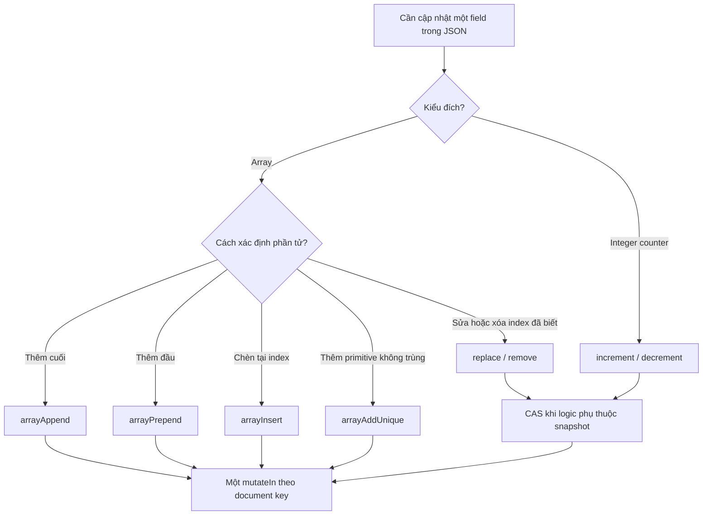

# Cập nhật mảng và bộ đếm trong tài liệu

## 1. Bài toán: sửa một phần JSON thay vì thay toàn bộ document

Trong **SPRING_DATA_COUCHBASE**, ứng dụng xây dựng tầng truy cập Couchbase với document mapping của Spring Data, repository, `CouchbaseTemplate`, SQL++, bucket/scope/collection, chỉ mục, TTL, CAS, giao dịch và lựa chọn API reactive. Một pattern rất thường gặp trong tầng dữ liệu là **cập nhật array hoặc counter bên trong JSON document**:

- Thêm nhãn `"featured"` vào danh sách `tags` của sản phẩm.
- Thêm một sự kiện vào `recent_events`.
- Chèn một phần tử vào vị trí xác định trong `photos`.
- Ghi nhận thêm một lượt xem bằng cách tăng `stats.views`.
- Giảm `stats.pending` khi một tác vụ hoàn tất.
- Cập nhật đồng thời bộ đếm và một số metadata trong cùng document.

Cách đọc cả document → sửa Java object → ghi cả document có thể hợp lý khi cần validate toàn aggregate. Tuy nhiên, nếu chỉ cần một thay đổi nhỏ, Couchbase **Sub-document KV API** cho phép thực hiện trực tiếp các thao tác trên JSON path bằng `Collection.mutateIn(...)`. Khi phù hợp, cách này giảm payload và tránh một số lỗi read–modify–write tại client.

Điều quan trọng là phải chọn **đúng ngữ nghĩa của phép toán**:

- `arrayAppend` và `arrayPrepend` thêm phần tử vào đầu/cuối mảng.
- `arrayInsert` thêm phần tử tại **index** cụ thể.
- `arrayAddUnique` kiểm tra giá trị đã tồn tại hay chưa, nhưng chỉ hỗ trợ một tập con kiểu JSON và **không bảo đảm thứ tự**.
- `replace` hoặc `remove` với path dạng `tags[0]` tác động phần tử ở **vị trí hiện tại**, không theo business ID.
- `increment` và `decrement` tính toán số nguyên trực tiếp tại server, có semantics khác với bộ đếm document KV độc lập.

Bài học tập trung vào tính đúng của **mảng và bộ đếm bên trong một document**, cùng các rủi ro về concurrent writers, CAS, idempotency, TTL, index và ranh giới Spring Data.

### Mục tiêu học tập

Sau bài này, bạn có thể:

1. Phân biệt array append/prepend/insert/add-unique và sửa/xóa phần tử.
2. Viết đúng chữ ký Java SDK 3.x, đặc biệt `List<?> values` của ba thao tác thêm/chèn array.
3. Hiểu sự khác nhau giữa **array index** và **định danh nghiệp vụ**.
4. Dùng `increment`/`decrement`, giải mã counter mới từ `MutateInResult` và xử lý field chưa tồn tại.
5. Phân biệt sub-document counter với full-document counter, giới hạn số nguyên và overflow/underflow.
6. Gộp array operation và counter operation trong một `mutateIn` nguyên tử.
7. Dùng CAS, marker/idempotency và retry có điều kiện khi logic phụ thuộc snapshot.
8. Áp dụng cùng nguyên tắc với Spring Data repository/template, reactive SDK, SQL++ array index và integration test.

## 2. Document ví dụ xuyên suốt

Giả sử bucket `shop`, scope `app`, collection `products` có document key `product::BOOK-01`:

```json
{
  "_class": "product-document",
  "schema_version": 2,
  "sku": "BOOK-01",
  "title": "Spring Data Couchbase Handbook",
  "tags": ["java", "spring"],
  "photos": [
    {"photo_id": "front", "url": "/images/front.jpg"},
    {"photo_id": "back", "url": "/images/back.jpg"}
  ],
  "stats": {
    "views": 41,
    "likes": 7,
    "pending_reviews": 2
  },
  "recent_events": [
    {
      "event_id": "evt-100",
      "type": "PUBLISHED",
      "at": "2026-11-20T00:00:00Z"
    }
  ],
  "preferences": {
    "supported_locales": ["vi-VN", "en-US"]
  }
}
```

Những path thường dùng:

| JSON path | Giá trị hiện tại | Kiểu JSON |
| --- | --- | --- |
| `tags` | `["java","spring"]` | array of strings |
| `tags[0]` | `"java"` | string |
| `photos` | Hai object | array of objects |
| `photos[1].photo_id` | `"back"` | string |
| `stats.views` | `41` | integer |
| `stats.likes` | `7` | integer |
| `stats.pending_reviews` | `2` | integer |
| `recent_events` | Một sự kiện | array of objects |
| `preferences.supported_locales` | Hai locale | array of strings |

Document key không phải JSON path. Một `mutateIn` chỉ nhắm đến **một key của một collection**; để sửa nhiều keys theo invariant mạnh, cần thiết kế transaction hoặc reconciliation riêng.

### 2.1. Sơ đồ chọn operation



Sơ đồ không thay thế quyết định nghiệp vụ: khi cần uniqueness theo `photo_id` hoặc giới hạn stock không âm, các phép toán của server không tự hiểu quy tắc đó.

## 3. Lấy SDK Collection đúng bucket/scope/collection

Các ví dụ sử dụng **Couchbase Java SDK 3.x** với một `Cluster` được cấu hình và quản lý bởi ứng dụng Spring; không hard-code credential hoặc tạo client mới trên mỗi request.

```java
import java.util.List;
import com.couchbase.client.java.Cluster;
import com.couchbase.client.java.Collection;
import com.couchbase.client.java.kv.MutateInSpec;
import com.couchbase.client.java.kv.MutateInResult;

Collection products = cluster
    .bucket("shop")
    .scope("app")
    .collection("products");

String id = "product::BOOK-01";
```

`Collection` ở đây là `com.couchbase.client.java.Collection`, khác `java.util.Collection`.

Trong ứng dụng sử dụng `CouchbaseRepository`, hãy xác nhận repository và SDK cùng trỏ `shop.app.products`. Tên key trùng nhưng khác scope hoặc collection sẽ chỉ đến document khác nhau hoặc gây `DocumentNotFound`.

### 3.1. Hình dạng request

```java
MutateInResult result = products.mutateIn(
    id,
    List.of(
        MutateInSpec.arrayAppend(
            "tags", List.of("featured"))
    )
);
```

Các thành phần:

- `id`: document key.
- `List.of(...)` ngoài: danh sách **specs** của `mutateIn`.
- `"tags"`: JSON path trỏ đến **array** đang lưu.
- `List.of("featured")` trong: danh sách **giá trị cần thêm vào array**.
- `result.cas()`: CAS document sau mutation thành công.

Hai lớp `List.of` có ý nghĩa khác nhau. Việc truyền thẳng `"featured"` thay cho danh sách values không khớp chữ ký `arrayAppend(String, List<?>)` trong Java SDK hiện hành.

## 4. `arrayAppend` — thêm vào cuối mảng

Muốn thêm `"featured"` vào `tags`:

```java
products.mutateIn(
    id,
    List.of(
        MutateInSpec.arrayAppend(
            "tags", List.of("featured"))
    )
);
```

Nếu `tags` trước đó là:

```json
["java", "spring"]
```

thì sau khi request thành công:

```json
["java", "spring", "featured"]
```

`arrayAppend` là phép toán **hiểu JSON array**, không phải nối raw bytes vào chuỗi văn bản như một số thao tác append full-document khác.

### 4.1. Thêm nhiều phần tử trong một spec

```java
products.mutateIn(
    id,
    List.of(
        MutateInSpec.arrayAppend(
            "tags", List.of("featured", "bestseller"))
    )
);
```

Danh sách bên trong mang hai values để thêm liên tiếp vào cuối mảng. Nếu muốn thêm **một phần tử kiểu JSON array** (nested array), cần truyền giá trị nested array như **một phần tử** trong danh sách và test serializer. Không tự đánh đồng Java `List` ở các cấp với số phần tử cuối cùng nếu đang làm việc với dữ liệu lồng nhau.

### 4.2. Append object vào array

`recent_events` là array of objects. Có thể thêm một sự kiện:

```java
import com.couchbase.client.java.json.JsonObject;

JsonObject event = JsonObject.create()
    .put("event_id", "evt-101")
    .put("type", "TAG_ADDED")
    .put("tag", "featured")
    .put("at", "2026-11-25T09:00:00Z");

products.mutateIn(
    id,
    List.of(
        MutateInSpec.arrayAppend(
            "recent_events", List.of(event))
    )
);
```

`JsonObject` là một JSON-compatible value do SDK hỗ trợ. Tuy nhiên, SDK không tự gọi Bean Validation, Spring Data auditing callback hoặc `CouchbaseCustomConversions` cho một domain object Java tùy ý.

### 4.3. Append không tự chống trùng

Hai request cùng append `"featured"` có thể dẫn đến:

```json
["java", "spring", "featured", "featured"]
```

Nếu yêu cầu là tập nhãn không trùng, cân nhắc `arrayAddUnique` **và giới hạn kiểu dữ liệu của nó**, hoặc thiết kế dedup riêng. Nếu cần append event có unique `event_id`, `arrayAppend` không tự kiểm tra ID trong object.

## 5. `arrayPrepend` — thêm vào đầu mảng

Muốn đặt một tag lên đầu mảng:

```java
products.mutateIn(
    id,
    List.of(
        MutateInSpec.arrayPrepend(
            "tags", List.of("recommended"))
    )
);
```

Ví dụ trước:

```json
["java", "spring"]
```

Ví dụ sau:

```json
["recommended", "java", "spring"]
```

`arrayPrepend` phù hợp khi thứ tự của array có ý nghĩa, ví dụ một danh sách ưu tiên/hiển thị. Tuy nhiên:

- Mọi index cũ bị dịch sang phải.
- Có thể tạo duplicates giống append.
- Không nên dùng để chèn vào event log không giới hạn nếu nghiệp vụ không có retention policy.
- Nếu một client khác dùng `tags[0]` dựa trên snapshot cũ, nó có thể sửa nhầm sau khi prepend.

## 6. `arrayInsert` — chèn tại vị trí chỉ định

`arrayInsert` yêu cầu **phần cuối path là array index**, ví dụ `tags[1]`. Nếu tags đang là `["java","spring"]`:

```java
products.mutateIn(
    id,
    List.of(
        MutateInSpec.arrayInsert(
            "tags[1]", List.of("database"))
    )
);
```

Sau khi thành công:

```json
["java", "database", "spring"]
```

Index bắt đầu từ **0**. Ở đây index 1 chỉ **vị trí chèn**, không phải thay phần tử `"spring"` hiện có.

### 6.1. Khác biệt giữa ba lệnh

| Mục tiêu | Spec | Path |
| --- | --- | --- |
| Thêm cuối `tags` | `arrayAppend("tags", List.of(value))` | Trỏ tới array |
| Thêm đầu `tags` | `arrayPrepend("tags", List.of(value))` | Trỏ tới array |
| Chèn vào vị trí 1 | `arrayInsert("tags[1]", List.of(value))` | Trỏ tới **array index** |

Dùng `arrayInsert("tags", ...)` không có vị trí index là sai semantics. Dùng `replace("tags[1]", value)` là **thay** phần tử hiện có, không chèn.

### 6.2. Index phải hợp lệ và array phải tồn tại

Nếu array chỉ có hai phần tử, `tags[100]` không trở thành vị trí hợp lệ để chèn sau 98 ô trống. Server báo lỗi index/path không hợp lệ. Ngay cả khi mảng có độ dài phù hợp, cần kiểm tra chèn tại cuối/biên trên server/SDK đang triển khai; đừng dùng index chưa kiểm chứng từ frontend.

**Điểm rất dễ nhầm:** theo Javadoc Java SDK hiện hành, `ArrayInsert.createPath()` bị deprecated và server **không hỗ trợ** tùy chọn tạo path cho `arrayInsert`. Gọi phương thức này có thể khiến `mutateIn` ném `CouchbaseException`. Nếu cần tạo parent/array trước, cân nhắc `arrayAppend`/`arrayPrepend` có `createPath()`, hoặc khởi tạo cấu trúc JSON hợp lệ qua mutation khác.

### 6.3. Chèn theo vị trí không đồng nghĩa chèn theo business ID

Để chèn ảnh trước ảnh có `photo_id="back"`, Sub-document path không cung cấp predicate kiểu `photos[?photo_id="back"]`. Bạn cần:

1. Đọc array hoặc đủ metadata để xác định index hiện tại.
2. Lấy CAS của document từ cùng snapshot.
3. Xác định vị trí của ảnh `"back"`.
4. Gửi `arrayInsert("photos[index]", ...)` với CAS.
5. Khi conflict, đọc lại và tính lại index.

Nếu workload thường xuyên cập nhật theo `photo_id`, cân nhắc keyed object/document-per-photo hoặc mô hình lưu thứ tự riêng.

## 7. `arrayAddUnique` — thêm phần tử theo semantics tập hợp có giới hạn

Khi tags phải chứa các giá trị primitive không trùng, Java SDK có:

```java
products.mutateIn(
    id,
    List.of(
        MutateInSpec.arrayAddUnique(
            "tags", "featured")
    )
);
```

Nếu `"featured"` đã có, SDK có thể ném `PathExistsException`; **không thêm phần tử thứ hai**. Đây là khác biệt quan trọng so với `arrayAppend`.

### 7.1. Những giới hạn phải nhớ

Theo tài liệu Java SDK:

- `arrayAddUnique` không hỗ trợ array chứa JSON **floats, objects hoặc arrays** theo semantics hiện hành; trong những trường hợp đó có thể nhận `PathMismatchException`.
- Cố thêm một value thuộc những kiểu không hỗ trợ có thể nhận `CannotInsertValueException`.
- **Vị trí của phần tử mới không được định nghĩa**; không coi array sau thao tác là có thứ tự.
- Quy tắc so sánh của server không phải unique constraint tùy biến theo field hoặc comparator của Java.

Ví dụ không dùng `arrayAddUnique("photos", JsonObject{...})` để mong deduplicate theo `photo_id`. Một object có `photo_id` trùng nhưng URL khác vẫn phải được xử lý theo contract nghiệp vụ riêng.

### 7.2. Kết quả khác nhau giữa duplicate và lỗi hệ thống

Khi gặp `PathExistsException` do tag đã có, một API `ensureTagPresent` có thể **chủ động** coi trạng thái cuối là đủ, sau khi xác minh nguyên nhân và điều kiện. Nhưng không được nuốt mọi exception:

- `PathMismatch` cho thấy array có kiểu không tương thích.
- `DocumentNotFound` cho thấy key chưa tồn tại.
- Timeout có thể là kết quả chưa xác định.
- Permission/Durability errors không tương đương "tag đã tồn tại".

Nếu cần idempotency ở cấp request, định nghĩa rõ trạng thái nào là thành công và kiểm tra readback khi cần.

## 8. Sửa hoặc xóa một phần tử mảng hiện có

Sub-document array ops không chỉ có append/prepend. Khi biết vị trí hiện tại:

```java
// Thay tag đầu tiên (không chèn):
products.mutateIn(
    id,
    List.of(
        MutateInSpec.replace("tags[0]", "jvm")
    )
);
```

Xóa phần tử ở vị trí 1:

```java
products.mutateIn(
    id,
    List.of(
        MutateInSpec.remove("tags[1]")
    )
);
```

Ví dụ `tags=["java","spring","couchbase"]`:

- `replace("tags[0]","jvm")` → `["jvm","spring","couchbase"]`.
- `remove("tags[1]")` → `["java","couchbase"]`.

**Remove làm dịch index** của các phần tử phía sau. Đây là rủi ro khi client giữ index cũ từ một lần đọc trước đó.

### 8.1. Sửa field bên trong một array of objects

```java
products.mutateIn(
    id,
    List.of(
        MutateInSpec.replace(
            "photos[1].url", "/images/back-new.jpg")
    )
);
```

Điều này có ý nghĩa “sửa `url` của phần tử **đang ở index 1**”, không có nghĩa “sửa ảnh có `photo_id='back'`”. Nếu writer khác chèn ảnh vào đầu, index 1 có thể là ảnh khác. CAS là cách phổ biến để bảo đảm index đã xác định từ snapshot không bị stale.

### 8.2. Mảng chỉ nên lưu các phần tử có vòng đời tương thích

Các loại dữ liệu hợp với array:

- Tags ngắn, số lượng bị chặn, thường đọc cả danh sách.
- Danh sách ảnh có thứ tự cho một sản phẩm.
- Một số sự kiện gần nhất với retention/giới hạn số lượng rõ.

Các loại dữ liệu cần xem xét lại:

- Audit log tăng trưởng vô hạn.
- Ledger tài chính.
- Danh sách event cần uniqueness theo nhiều fields.
- Phần tử có nhu cầu cập nhật độc lập rất cao.
- Dữ liệu cần query theo phần tử ở quy mô lớn nhưng chưa có index/UNNEST phù hợp.

Một document nóng với array rất dài vẫn có thể trở thành bottleneck dù mỗi request chỉ append ít bytes.

## 9. Khi array chưa tồn tại: `createPath()` và khởi tạo cấu trúc

Nếu document chưa có `preferences.supported_locales` nhưng cần thêm phần tử, một `arrayAppend` thông thường có thể báo `PathNotFound`.

Trong Java SDK 3.x, `arrayAppend` và `arrayPrepend` hỗ trợ `createPath()` cho trường hợp có thể tạo đường dẫn/array cần thiết:

```java
products.mutateIn(
    id,
    List.of(
        MutateInSpec.arrayAppend(
            "preferences.supported_locales", List.of("fr-FR"))
            .createPath()
    )
);
```

Tùy chọn này có thể tạo path chưa có khi schema cho phép, nhưng phải xử lý riêng:

- `preferences` thiếu hoàn toàn.
- `preferences` tồn tại và là object.
- `preferences` đang là string hoặc number.
- `supported_locales` có giá trị JSON null.
- `supported_locales` tồn tại nhưng là object thay vì array.
- Schema V1 ghi locale dưới tên `languages`.

`createPath()` **không được coi như công cụ chuyển đổi dữ liệu sai kiểu hoặc migration tự động**. Không bật nó cho một path có thể đánh sai chính tả rồi tạo field ngoài dự kiến.

### 9.1. Khởi tạo array rõ ràng

Một cách khác khi muốn quản lý schema tường minh:

```java
import com.couchbase.client.java.json.JsonArray;

products.mutateIn(
    id,
    List.of(
        MutateInSpec.insert(
            "metadata.tags", JsonArray.create())
            .createPath()
    )
);
```

Sau khi tạo array rỗng theo contract, thao tác array operations có thể dùng path đó. Hai requests khởi tạo và append **không tự atomic chung**; nếu cần tạo array và thêm phần tử cùng một mutation, dùng một spec hỗ trợ semantics đó và test trên server thực.

### 9.2. Không dùng `arrayInsert(...).createPath()`

Javadoc SDK hiện hành ghi rõ server không hỗ trợ `createPath` cho `ArrayInsert`. Dù method có thể xuất hiện trong type, nó deprecated và không dùng được như `arrayAppend(...).createPath()`. Đây là một ví dụ tại sao phải kiểm tra **khả năng server**, không chỉ thấy tên method trong IDE.

## 10. Root array document là trường hợp khác với nested array

Không phải mọi Couchbase document đều phải có root object. Một document có thể chứa root JSON array:

```json
["java", "spring"]
```

Để append vào root array, SDK hỗ trợ path rỗng `""` trong các operations phù hợp:

```java
import com.couchbase.client.java.json.JsonArray;

products.upsert("tags::BOOK-01", JsonArray.create());

products.mutateIn(
    "tags::BOOK-01",
    List.of(
        MutateInSpec.arrayAppend(
            "", List.of("featured"))
    )
);
```

Kết quả root body:

```json
["featured"]
```

Ví dụ này tạo **một document khác** `tags::BOOK-01`, không sửa field `tags` trong `product::BOOK-01`. Khi tách tags sang document riêng, bạn đánh đổi atomicity cùng sản phẩm và cần thiết kế query/consistency tương ứng.

Trên document root array, repository entity mapping Spring Data có thể không phù hợp nếu entity mong root object và type hint `_class`. Chỉ dùng mô hình root array khi đã thống nhất storage contract giữa mọi producer/consumer.

## 11. JSON value type và serializer ảnh hưởng array

`MutateInSpec.arrayAppend(String, List<?>)` nhận danh sách Java values được encode sang JSON. Các kiểu thường dùng:

```java
// Primitive string
MutateInSpec.arrayAppend("tags", List.of("featured"));

// Primitive integer
MutateInSpec.arrayAppend("stats.milestones", List.of(10, 20));

// JSON object
JsonObject photo = JsonObject.create()
    .put("photo_id", "side")
    .put("url", "/images/side.jpg");

MutateInSpec.arrayAppend("photos", List.of(photo));
```

Lưu ý ví dụ `stats.milestones` chỉ hợp lệ nếu path đó là array (hoặc được tạo theo policy), không phải number.

### 11.1. Domain object không tự qua Spring Data converters

Nếu entity Java chứa `SkuCode`, `Money`, `Instant` hoặc record tùy biến, raw SDK mutation **không tự gọi** `CouchbaseCustomConversions` của Spring Data để chuyển thành storage JSON.

Tốt hơn:

1. Xác định JSON representation (string, number, object).
2. Chuyển domain value bằng adapter/mapper đã kiểm chứng.
3. Gửi value JSON-compatible vào `MutateInSpec`.
4. Đọc raw JSON và entity qua repository trong integration test.
5. Kiểm tra type hints, `@Field` và schema version.

Không dùng một `List<JavaDomainObject>` rồi mặc định nó sẽ trở thành cùng JSON shape với entity `save`.

### 11.2. Nested arrays không giống “thêm nhiều values”

Khi muốn một array làm **một phần tử** của array khác, phải tạo đúng JSON nesting và test kết quả. `arrayAppend("matrix", List.of(innerArray))` có ý định thêm một phần tử giá trị array, trong khi `arrayAppend("matrix", List.of(1,2))` thêm hai phần tử số. Chọn kiểu `JsonArray` hoặc cấu trúc JSON-compatible phù hợp và kiểm chứng output raw body.

## 12. Đọc độ dài mảng bằng `LookupInSpec.count`

Để lấy số lượng tags mà không tải toàn bộ array:

```java
import com.couchbase.client.java.kv.LookupInResult;
import com.couchbase.client.java.kv.LookupInSpec;

LookupInResult result = products.lookupIn(
    id,
    List.of(
        LookupInSpec.count("tags"),
        LookupInSpec.get("stats.views")
    )
);

int tagCount = result.contentAs(0, Integer.class);
long views = result.contentAs(1, Long.class);
```

Ở đây:

- `count("tags")` đếm số phần tử array (không phải số lượng tags khác nhau nếu duplicates tồn tại).
- `result.contentAs(0,...)` là kết quả **spec đầu tiên**, không phải `tags[0]`.
- `get("stats.views")` đọc field number, không làm tăng nó.
- Các lookup specs trong một `lookupIn` được thực thi trên cùng phiên bản document, nhưng sau lookup vẫn có thể có writer khác cập nhật.

**Không dùng `count` rồi `arrayInsert("tags[count]",...)` để giả lập append** trong môi trường nhiều writer. Nếu chỉ cần thêm cuối, dùng trực tiếp `arrayAppend` để tránh race tính index.

## 13. `increment` — tăng numeric field tại server

Một cách dễ sai khi ghi lượt xem:

```java
// Anti-pattern: path đúng nhưng thiếu CAS/optimistic locking.
var doc = products.get(id).contentAsObject();
var stats = doc.getObject("stats");
long views = stats.getLong("views");
stats.put("views", views + 1);
products.replace(id, doc);
```

Đoạn code đọc đúng path `stats.views`, nhưng hai clients có thể cùng đọc giá trị cũ rồi cùng ghi đè document, dẫn tới **lost update**. Dùng CAS với full-document replace có thể phát hiện xung đột; với phép tăng đơn giản, sub-document increment giúp khỏi thực hiện vòng read–modify–write tại Java.

Sub-document counter giải quyết phép cộng tại server:

```java
MutateInResult result = products.mutateIn(
    id,
    List.of(
        MutateInSpec.increment(
            "stats.views", 1)
    )
);

long newViews = result.contentAs(0, Long.class);
long casAfter = result.cas();
```

Nếu `stats.views` ban đầu là `41` và chưa có writer khác, kết quả là `42`. Khi hai client gọi `increment` độc lập, server áp dụng các phép tăng mà không cần Java tự đọc rồi ghi lại number cũ.

### 13.1. Thứ tự chỉ số của kết quả

Nếu request có nhiều specs:

```java
MutateInResult result = products.mutateIn(
    id,
    List.of(
        MutateInSpec.arrayAppend(
            "tags", List.of("new")),
        MutateInSpec.increment(
            "stats.views", 1)
    )
);

long newViews = result.contentAs(1, Long.class);
```

Counter là **spec thứ hai**, vì thế đọc ở index `1`. `MutateInResult.contentAs` không đọc JSON array theo index; nó đọc output của spec tương ứng. `arrayAppend` thông thường không trả toàn bộ array mới như một lookup.

## 14. `decrement` — giảm numeric field tại server

Ví dụ giảm `pending_reviews` khi một review đã được duyệt:

```java
MutateInResult result = products.mutateIn(
    id,
    List.of(
        MutateInSpec.decrement(
            "stats.pending_reviews", 1)
    )
);

long pendingNow = result.contentAs(0, Long.class);
```

Nếu field ban đầu là `2`, sau một decrement thành công nó thành `1`.

### 14.1. Giảm counter không tự kiểm tra “không âm”

Nếu `stats.pending_reviews` bằng `0`, decrement `1` có thể cho giá trị âm vì sub-document counter là **signed integer**, không phải bộ đếm luôn bị chặn ở 0. Bảo vệ invariant `pending_reviews >= 0` cần:

- Đọc trạng thái hiện tại cùng CAS.
- Kiểm tra giá trị hiện tại và các điều kiện nghiệp vụ.
- Thực hiện mutation với CAS.
- Khi conflict, đọc lại và đánh giá lại.
- Hoặc chọn mô hình workflow/transaction khác nếu số đếm được duy trì từ nhiều documents.

Không dùng `decrement` như một phép thanh toán hay trừ tồn kho có kiểm soát mà không validate số dư/stock.

### 14.2. `decrement` nhận `delta` dương theo ý định giảm

`MutateInSpec.decrement("stats.pending_reviews", 1)` biểu thị **giảm 1**. Không truyền delta âm chỉ để “giảm âm thành tăng”, vì điều đó làm code khó đọc và có thể lệch API assumptions/validation. Khi muốn tăng thì dùng `increment`.

## 15. Counter field chưa tồn tại: cần phân biệt field và parent

Theo Java SDK Javadoc, khi numeric field không tồn tại, `increment` tạo nó với giá trị bằng `delta`; `decrement` tạo field với giá trị bằng `-delta`.

Giả sử `stats` đang là object nhưng thiếu `shares`:

```json
{"stats":{"views":41}}
```

Lệnh:

```java
products.mutateIn(
    id,
    List.of(
        MutateInSpec.increment(
            "stats.shares", 1)
    )
);
```

có thể tạo `stats.shares = 1` theo semantics sub-document counter. Nhưng nếu **parent `stats` cũng thiếu**, cần xét `createPath()`:

```java
products.mutateIn(
    id,
    List.of(
        MutateInSpec.increment(
            "stats.shares", 1)
            .createPath()
    )
);
```

`createPath()` cho phép tạo parent objects khi thiếu và hợp lệ. Nó **không** biến `stats` đang là string thành object đúng contract. Cần migration nếu JSON thực đang sai kiểu.

### 15.1. Không coi counter mới được tạo là một lỗi bị che giấu

Nếu domain yêu cầu mọi product V2 đều có `stats.views`, việc `increment` tự tạo field khi thiếu có thể khiến ứng dụng không phát hiện một document sai schema. Cân nhắc:

- Khởi tạo counter rõ ràng khi tạo entity.
- Kiểm tra `schema_version`/required fields ở migration.
- Viết integration test cho V1/V2.
- Giữ logic counter ở adapter chịu trách nhiệm data contract.
- Báo metric khi một counter bất ngờ chưa tồn tại thay vì chỉ silently create.

## 16. Numeric type, phạm vi và overflow/underflow

Sub-document counters không phải arithmetic cho mọi JSON number. Tài liệu Couchbase Java SDK mô tả:

- Giá trị counter phải tương thích **số nguyên signed 64-bit**.
- Counter sub-document nằm trong khoảng `-9223372036854775807` đến `9223372036854775807` theo tài liệu hiện hành.
- Nếu tăng/giảm vượt phạm vi, operation **báo lỗi** thay vì âm thầm tràn số.
- JSON string `"41"` và số JSON `41` là hai kiểu khác nhau; đừng tự giả định server convert string thành integer.
- JSON decimal/floating-point hoặc object ở path counter không được mặc định xử lý như integer counter hợp lệ.

Ví dụ lỗi type:

```json
{
  "stats": {
    "views": "41"
  }
}
```

`increment("stats.views",1)` trên dữ liệu này là một **schema/type mismatch** cần sửa producer hoặc migration. Không bắt exception rồi `upsert("stats.views",42)` nếu không biết chắc ý nghĩa giá trị lịch sử.

### 16.1. Kiểm thử biên

Viết tests cho:

- Counter bằng `0`.
- Counter âm nhưng vẫn trong miền hợp lệ.
- Counter gần giá trị lớn nhất.
- Counter gần giá trị nhỏ nhất.
- Counter chưa tồn tại.
- Parent path chưa tồn tại.
- Counter là JSON string, float, null hoặc object.
- Delta đủ lớn để gây overflow/underflow.

Dùng số nhỏ trong ví dụ nghiệp vụ, nhưng đừng bỏ qua overflow tests chỉ vì lượt xem bình thường ít khi đến giới hạn.

## 17. Khác biệt giữa Sub-document counter và full-document counter

Couchbase có **counter document KV** riêng, không giống một numeric field bên trong JSON.

| Tiêu chí | Sub-document counter | Full-document KV counter |
| --- | --- | --- |
| Vị trí | JSON field như `stats.views` | Document chứa giá trị counter riêng |
| API | `mutateIn` + `increment/decrement` | `Collection.binary().increment/decrement` hoặc API tương ứng theo SDK |
| JSON structure | Có thể nằm cạnh các fields khác | Counter document có representation riêng, không phải JSON object thông thường |
| Miền giá trị theo tài liệu | Signed integer, có thể âm | Unsigned 64-bit, không âm |
| Overflow/underflow | Báo lỗi khi vượt miền | Semantics counter KV khác, cần kiểm tra wrap/clamp theo tài liệu |
| Atomicity cùng field khác | Có thể gộp với array/field specs trong một `mutateIn` | Không tự atomic cùng document key khác |
| Truy vấn SQL++ trên field JSON | Có thể query `stats.views` nếu index phù hợp | Không giả định document counter binary là JSON entity |
| Phù hợp | Counter gắn chặt aggregate | Counter độc lập, có lifecycle/tần suất ghi riêng |

Full-document counter có thể dùng semantics unsigned 64-bit và các quy tắc wrap/underflow khác với sub-document counter. Không áp cùng business logic và range assumptions cho hai API.

### 17.1. Ví dụ anti-pattern khi mô hình hóa

Nếu hệ thống dùng `Collection.binary().increment("views::BOOK-01", ...)` rồi repository `findById("views::BOOK-01")` như một `ProductDocument` JSON, đường mapping không phù hợp. Hãy thiết kế adapter riêng cho counter document hoặc chọn `stats.views` bên trong product JSON tùy mục đích.

Một counter độc lập có thể giảm contention của document sản phẩm, nhưng mất atomicity khi muốn cập nhật `stats.views` và các fields khác trong một JSON body.

## 18. Gộp array và counter vào **một** mutation nguyên tử

Một use case: khi gắn tag mới cho sản phẩm, đồng thời tăng `stats.tag_updates` và ghi một event.

```java
JsonObject event = JsonObject.create()
    .put("event_id", "tag-op-101")
    .put("type", "TAG_ADDED")
    .put("tag", "featured");

MutateInResult result = products.mutateIn(
    id,
    List.of(
        MutateInSpec.arrayAppend(
            "tags", List.of("featured")),
        MutateInSpec.increment(
            "stats.tag_updates", 1),
        MutateInSpec.arrayAppend(
            "recent_events", List.of(event))
    )
);

long tagUpdates = result.contentAs(1, Long.class);
```

**Một `mutateIn` có nhiều specs là nguyên tử trên một document**: nếu `recent_events` sai kiểu và append thất bại, những thay đổi `tags` và counter **không được commit một phần** từ request đó.

Điều kiện trong ví dụ:

- `tags`, `recent_events` là arrays.
- Parent `stats` tồn tại.
- Counter `tag_updates` là số nguyên hoặc được phép khởi tạo.
- Giá trị `event` là JSON-compatible.
- Application đã xử lý authorization và quy tắc tránh duplicate.

### 18.1. Một request không tự bảo đảm dedup business

Nếu cùng command được gửi hai lần:

- `arrayAppend("tags",...)` có thể tạo tag trùng.
- `increment("stats.tag_updates",1)` tăng hai lần.
- `arrayAppend("recent_events",...)` thêm event trùng.

Atomicity bảo vệ **tập specs trong từng request**, không bảo đảm command được thực hiện exactly-once khi retry hoặc trùng event. Cần idempotency key/marker và CAS nếu workflow yêu cầu.

### 18.2. Giới hạn số specs

Theo tài liệu Sub-document, mỗi request chứa tối đa **16 specs**. Nếu phải sửa 20 array paths và counters, không chia làm hai requests rồi tuyên bố chúng atomic chung. Cân nhắc:

- Có thể gom một nested object update mà không làm mất fields khác không?
- Invariant có thực sự yêu cầu mọi field ở cùng document không?
- Có thể tách nghiệp vụ thành các bước idempotent với reconciliation không?
- Có cần full-document replace với CAS thay vì Sub-document multi-spec không?

## 19. Concurrency: phép server-side khác read–modify–write tại Java

### 19.1. Hai lượt tăng đồng thời

Giả sử `stats.views=41`.

```text
Client A: increment(stats.views, 1)
Client B: increment(stats.views, 1)
```

Server xử lý mỗi phép increment như một KV mutation. Nếu cả hai thành công, tổng số lượt tăng là 2, không bị mất update theo kiểu cả hai client cùng đọc 41 rồi ghi 42.

### 19.2. Nhưng array index có thể thay đổi

```text
Snapshot A: photos[0]="front", photos[1]="back"
Client B: arrayPrepend(photos, "hero")
Client A: replace(photos[1].url, "back-new.jpg")
```

Sau prepend, `photos[1]` có thể là ảnh `front`, không còn `back`. Phép replace vẫn atomic nhưng **trên phần tử sai** nếu A không bảo vệ snapshot bằng CAS.

### 19.3. CAS cần khi logic phụ thuộc trạng thái đã đọc

```java
LookupInResult snapshot = products.lookupIn(
    id,
    List.of(
        LookupInSpec.get("photos")
    )
);

long observedCas = snapshot.cas();
// Parse photos từ snapshot, tìm photo_id cần sửa
// và xác định index tại thời điểm đọc.
// Ví dụ đã xác minh ảnh back nằm ở index 1.

int targetIndex = 1;

products.mutateIn(
    id,
    List.of(
        MutateInSpec.replace(
            "photos[" + targetIndex + "].url",
            "/images/back-new.jpg")
    ),
    MutateInOptions.mutateInOptions()
        .cas(observedCas)
);
```

Đoạn code minh họa CAS; trong production **không hard-code index** mà phải parse và tìm `photo_id` từ snapshot. Nếu CAS mismatch, đọc lại photos, tìm lại ID và thử lại có giới hạn.

CAS là phiên bản của **toàn document**: một writer chỉ tăng `stats.views` cũng có thể làm CAS đổi. Đây là đánh đổi giữa đúng snapshot và contention trên document nóng.

## 20. Khi nào tránh CAS và khi nào bắt buộc kiểm tra điều kiện?

Không phải thao tác nào cũng cần đọc trước:

- `increment("stats.views",1)` độc lập: server-side arithmetic thường loại bỏ nhu cầu Java read → modify → write.
- `arrayAppend("recent_events", List.of(event))`: có thể append mà không biết length trước, nếu không cần uniqueness hay điều kiện domain.
- `arrayAddUnique("tags", "featured")`: server tự kiểm tra duplicate theo semantics được hỗ trợ, nhưng duplicate request vẫn cần error policy.

Nên dùng **lookup + CAS** khi:

- Decrement không được làm counter xuống dưới 0.
- Phải thay phần tử array theo business ID tìm được từ snapshot.
- Chỉ append khi status/permission/version đang phù hợp.
- Chỉ chuyển từ `PENDING` sang `PUBLISHED` một lần.
- Cần bảo đảm không ghi lên entity đã stale.

CAS không thay validation business, nhưng giúp ngăn concurrent update làm điều kiện đã kiểm tra trở nên sai trước lúc mutation.

## 21. Retry và idempotency với array/counter

Một `mutateIn` có thể đã commit trên server rồi client timeout trước khi nhận response. Khi đó client không thể suy rằng mutation thất bại.

| Operation | Retry cùng request có rủi ro nào? | Cách phòng |
| --- | --- | --- |
| `arrayAppend` | Thêm duplicate | Operation ID/readback/dedup. |
| `arrayPrepend` | Thêm duplicate, dịch index thêm lần nữa | Kiểm tra request đã áp dụng. |
| `arrayInsert` | Chèn hai lần hoặc sai vị trí sau mutation đầu | Không retry path/index cũ; CAS/readback. |
| `arrayAddUnique` | Lần hai có thể báo PathExists | Xác minh final state và loại lỗi trước khi coi là success. |
| `increment` | Tăng hai lần | Idempotency marker, reconciliation. |
| `decrement` | Giảm hai lần, có thể âm | Domain validation, idempotency marker. |
| `replace("tags[0]",x)` | Có thể thay sai phần tử nếu index đã dịch | CAS và tìm lại phần tử theo ID. |

### 21.1. Marker cho command

Ví dụ mỗi lượt ghi tag có `operationId="add-tag::BOOK-01::req-101"`. Có thể ghi `metadata.last_tag_operation_id` **trong cùng mutation** với tag/counter/event để hỗ trợ đối chiếu sau timeout.

Tuy nhiên, marker chỉ ghi "last" có thể bị operation sau ghi đè; nó không đủ làm kho idempotency vĩnh viễn. Nếu cần đảm bảo mỗi command chỉ tính một lần trên thời gian dài, thiết kế event log keyed by operation ID, CAS/conditional write hoặc transaction/outbox khi có nhiều documents.

### 21.2. Không nuốt mọi exception rồi retry mù

Ví dụ phản ví dụ:

```java
// Không dùng catch-all vô điều kiện kiểu này:
try {
    products.mutateIn(
        id,
        List.of(
            MutateInSpec.increment("stats.likes", 1)
        )
    );
} catch (RuntimeException ignored) {
    products.mutateIn(
        id,
        List.of(
            MutateInSpec.increment("stats.likes", 1)
        )
    );
}
```

Nếu response lần đầu bị mất nhưng server đã tăng, code có thể tăng hai lần. Cũng không được retry PathMismatch do schema hỏng hoặc permission failure.

## 22. Domain invariants: counter không phải phép tính số dư

Một counter trong `stats` thích hợp cho số lượt xem, số click, số lần truy cập hoặc số lượng task chưa xử lý **khi đã kiểm soát semantics**.

Không dùng `increment/decrement` làm thay thế mặc định cho:

- Trừ tồn kho khi stock không được âm và nhiều orders cùng bán.
- Chuyển tiền khi cần debit và credit trên **hai accounts**.
- Ghi ledger có reconciliation và audit bất biến.
- Tính số dư tiền tệ với `BigDecimal`/scale/currency.
- Phép tăng một lần cho hành động cần idempotency theo user.

Ví dụ muốn trừ `stock_available` chỉ khi `stock_available >= qty`, phép `decrement` trực tiếp không tự kiểm tra ngưỡng. Nếu một invariant trải qua stock document và order document, một `mutateIn` trên một key không thể đảm bảo atomic cho cả hai.

Dùng transaction/conditional logic, CAS, idempotency và event/ledger theo thiết kế nghiệp vụ. Lựa chọn tối ưu ở đây là **tính đúng**, không phải chỉ giảm payload.

## 23. TTL/expiry và durability của mutation

TTL là metadata của document, không phải JSON field trong `stats` hoặc `tags`. Một `mutateIn` có thể định nghĩa chính sách giữ hoặc đặt expiry.

### 23.1. Giữ expiry hiện có

```java
import com.couchbase.client.java.kv.MutateInOptions;

products.mutateIn(
    id,
    List.of(
        MutateInSpec.increment("stats.views", 1)
    ),
    MutateInOptions.mutateInOptions()
        .preserveExpiry(true)
);
```

### 23.2. Chủ động đặt expiry mới

```java
import java.time.Duration;

products.mutateIn(
    id,
    List.of(
        MutateInSpec.arrayAppend(
            "recent_events", List.of(event))
    ),
    MutateInOptions.mutateInOptions()
        .expiry(Duration.ofDays(7))
);
```

Đây chỉ là ví dụ kỹ thuật: **không tự đặt TTL 7 ngày cho toàn product document** nếu business yêu cầu sản phẩm tồn tại lâu dài. Với event retention, có thể cần lưu event riêng thay vì đặt expiry lên document sản phẩm.

Tùy chọn expiry/preserve expiry có thể phụ thuộc server/SDK version và bucket max TTL; phải xác minh hành vi thực tế trong integration test. Không đặt cả hai chính sách mâu thuẫn mà không hiểu API.

### 23.3. Durability

```java
import com.couchbase.client.core.msg.kv.DurabilityLevel;

products.mutateIn(
    id,
    List.of(
        MutateInSpec.arrayAppend(
            "tags", List.of("featured")),
        MutateInSpec.increment(
            "stats.tag_updates", 1)
    ),
    MutateInOptions.mutateInOptions()
        .durability(DurabilityLevel.MAJORITY)
);
```

Durability là mức cam kết lưu/replicate mutation, không phải bằng chứng SQL++ index đã cập nhật. Nó cũng không giải quyết duplicate event khi retry.

| Khái niệm | Câu hỏi trả lời |
| --- | --- |
| Atomicity | Các specs trong cùng `mutateIn` có commit cùng nhau trên một document? |
| CAS | Document có còn ở phiên bản đã đọc/kiểm tra không? |
| Durability | Mutation được ghi/replicate đến mức nào? |
| Idempotency | Retry command có tạo tác dụng kép không? |
| Query consistency | SQL++/GSI có nhìn thấy mutation mới tại lúc query không? |
| Transaction | Một invariant qua nhiều document keys được bảo vệ thế nào? |

## 24. Spring Data Couchbase: Template có hỗ trợ những gì?

`CouchbaseTemplate` và `ReactiveCouchbaseTemplate` không đồng nghĩa với Java SDK `Collection`. Phạm vi Sub-document của Template **phụ thuộc version** Spring Data Couchbase đã resolve.

Các version từ Spring Data Couchbase 5.1 cung cấp fluent `mutateInById(Class<T>)` cho các loại path mutation được tài liệu hóa, gồm:

- `withInsertPaths(...)`
- `withUpsertPaths(...)`
- `withReplacePaths(...)`
- `withRemovePaths(...)`

Các phép `arrayAppend`, `arrayPrepend`, `arrayInsert`, `arrayAddUnique`, `increment` và `decrement` thuộc Java SDK `MutateInSpec`; **không tự bịa** `withArrayAppendPaths` hay `withIncrementPaths` trên Template nếu Javadoc của version không có.

### 24.1. Ví dụ Template patch một field

```java
// Chỉ minh họa version có mutateInById.
// ProductDocument và patch được tạo/validate bởi ứng dụng.

couchbaseTemplate.mutateInById(ProductDocument.class)
    .withReplacePaths("title")
    .one(patch);
```

`patch` là entity có ID và field `title` hợp lệ. Đây là **property path theo mapping Spring Data**, khác raw JSON path `"stats.views"` truyền trực tiếp vào SDK.

### 24.2. SDK array/counter bypasses Spring Data mapping

```java
products.mutateIn(
    id,
    List.of(
        MutateInSpec.arrayAppend(
            "tags", List.of("featured")),
        MutateInSpec.increment(
            "stats.views", 1)
    )
);
```

SDK không tự gọi:

- `MappingCouchbaseConverter` và `CouchbaseCustomConversions`.
- `@Field`, `@TypeAlias` để tự đổi tên JSON path.
- Entity callbacks, auditing/validation hooks.
- `@Version` để tự lấy CAS từ entity Java.

Vì vậy nếu Java property `viewCount` được ánh xạ thành `stats.views`, phải dùng **đúng storage JSON path**. Nếu converter lưu một collection dưới dạng string hoặc object khác kỳ vọng, array mutation có thể PathMismatch.

### 24.3. Repository save có thể conflict sau SDK mutation

Một entity đã được repository đọc có CAS/`@Version` cũ. Khi SDK subdoc increment làm CAS document thay đổi, lần `save` entity stale có thể gặp optimistic locking conflict, nếu cấu hình locking đúng. Đây là cơ chế chống lost update đáng mong muốn.

Nếu repository ghi full body **không có CAS**, nó có thể ghi đè thay đổi array/counter vừa được SDK áp dụng. Test interoperability trước khi triển khai hai đường ghi trên cùng collection.

## 25. Reactive và asynchronous Sub-document operations

### 25.1. Reactive SDK với `Mono<MutateInResult>`

```java
import reactor.core.publisher.Mono;
import com.couchbase.client.java.kv.MutateInResult;

Mono<Long> viewsMono = products.reactive()
    .mutateIn(
        id,
        List.of(
            MutateInSpec.increment(
                "stats.views", 1)
        )
    )
    .map(result ->
        result.contentAs(0, Long.class)
    );
```

Publisher được thực thi khi subscribe. Không gọi blocking `products.mutateIn(...)` trong event-loop của WebFlux; dùng reactive SDK hoặc một thiết kế scheduler chính xác khi buộc phải bridge code blocking.

### 25.2. Reactive append

```java
Mono<MutateInResult> appendMono = products.reactive()
    .mutateIn(
        id,
        List.of(
            MutateInSpec.arrayAppend(
                "tags", List.of("reactive"))
        )
    );
```

Việc truyền `Mono` qua `flatMap` không tự tạo transaction với một mutation khác. Hai `Mono` dùng hai document keys vẫn là hai KV requests độc lập.

### 25.3. CompletableFuture

```java
import java.util.concurrent.CompletableFuture;

CompletableFuture<MutateInResult> future = products.async()
    .mutateIn(
        id,
        List.of(
            MutateInSpec.increment(
                "stats.likes", 1)
        )
    );

CompletableFuture<Long> updated = future.thenApply(
    result -> result.contentAs(0, Long.class)
);
```

Async/reactive thay đổi cách quan sát completion/error, **không thay đổi** JSON path semantics, CAS, overflow protection, array uniqueness hay atomicity.

### 25.4. Test với Reactor

```java
import reactor.test.StepVerifier;

StepVerifier.create(viewsMono)
    .assertNext(value -> {
        assert value >= 1L;
    })
    .verifyComplete();
```

Trong integration test cần assert **giá trị chính xác từ fixture** thay vì chỉ `>=1L`. Test thêm error signals khi path mismatch, CAS conflict hoặc counter overflow.

## 26. SQL++ trên arrays và counters, chỉ mục GSI

Sub-document operations là KV access theo key, **không cần GSI để tìm document**. Nhưng khi muốn tìm sản phẩm theo tags hoặc thống kê views bằng SQL++, phải dùng Query service và index phù hợp.

### 26.1. Tìm sản phẩm có tag `featured`

```sql
SELECT META(p).id AS productId,
       p.title,
       p.tags
FROM `shop`.`app`.`products` AS p
WHERE ANY tag IN p.tags
      SATISFIES tag = "featured"
      END;
```

Với workload trên mảng, có thể cân nhắc **array index**:

```sql
CREATE INDEX ix_products_tags
ON `shop`.`app`.`products` (
    DISTINCT ARRAY tag FOR tag IN tags END
);
```

Một index có thể có điều kiện/thiết kế khác tùy predicate, tính chọn lọc và schema. Chạy `EXPLAIN` để kiểm tra optimizer thực sự dùng index nào.

### 26.2. Đếm sản phẩm nhiều lượt xem

```sql
SELECT META(p).id AS productId,
       p.stats.views AS views
FROM `shop`.`app`.`products` AS p
WHERE p.stats.views >= 1000;
```

Index minh họa:

```sql
CREATE INDEX ix_products_views
ON `shop`.`app`.`products` (
    stats.views
);
```

`increment("stats.views",1)` làm body JSON thay đổi, vì vậy các index liên quan đến `stats.views` cũng cần được cập nhật theo cơ chế GSI. Sub-document payload nhỏ **không loại bỏ** index maintenance.

### 26.3. Read-after-write và query consistency

Một `lookupIn` theo ID đọc dữ liệu từ KV; query SQL++ qua secondary index có thể chưa thấy mutation ngay khi index chưa cập nhật đến mức consistency mong muốn.

Khi kiểm tra kết quả:

1. Gọi `lookupIn` trực tiếp theo `product::BOOK-01`.
2. Kiểm tra path JSON thật và kiểu giá trị.
3. Chạy SQL++ với mức scan consistency phù hợp nếu yêu cầu read-after-write.
4. Dùng `EXPLAIN` để đánh giá index plan.
5. Đừng kết luận counter/array mutation thất bại chỉ vì SQL++ query chưa trả record ngay.

## 27. Bẫy dữ liệu: array/set/counter đều có semantics riêng

| Triệu chứng | Nguyên nhân có thể | Hướng xử lý |
| --- | --- | --- |
| `arrayAppend` không compile | Truyền scalar thay `List<?>` | Dùng `List.of(value)`. |
| Append tạo tag trùng | Không kiểm uniqueness | `arrayAddUnique` khi kiểu phù hợp hoặc dedup domain. |
| `arrayAddUnique` báo PathMismatch | Mảng chứa floats/objects/arrays | Đổi model hoặc policy set riêng. |
| `arrayAddUnique` không giữ thứ tự | Vị trí phần tử mới không xác định | Không dùng cho ordered list. |
| `arrayInsert` sai index | Index ngoài range hoặc array thiếu | Kiểm tra index và schema. |
| `arrayInsert(...).createPath()` lỗi | Server không hỗ trợ createPath với ArrayInsert | Dùng append/prepend có createPath hoặc khởi tạo array. |
| `replace("photos[1]...")` đổi nhầm ảnh | Client giữ index cũ | Lookup + CAS + tìm lại photo_id. |
| `remove("tags[0]")` khiến index dịch | Array là ordered sequence | Không cache index như identity. |
| `increment` trả type mismatch | Field là string/float/object/null | Schema validation/migration. |
| Counter mới xuất hiện bất ngờ | Subdoc counter có thể tạo missing target | Khởi tạo/kiểm tra schema rõ ràng. |
| `decrement` thành số âm | Counter signed, không có business floor | Read + validate + CAS. |
| Counter overflow | Vượt miền signed 64-bit | Trả lỗi rõ, không im lặng wrap. |
| Retry làm tăng hai lần | Timeout ambiguous, operation non-idempotent | Marker/idempotency/readback. |
| Repository đọc thiếu field vừa update | SDK raw dùng sai JSON path hoặc converters | Contract tests với `@Field` và raw JSON. |
| SQL++ chưa thấy tag mới | GSI index consistency | KV lookup, scan consistency, `EXPLAIN`. |
| Document mất TTL hoặc hết hạn bất ngờ | Mutation expiry policy không rõ | Test `preserveExpiry`/`expiry`. |
| Lỗi permission trên collection | RBAC không đủ hoặc sai scope | Kiểm tra quyền và routing. |

Không bắt chung `RuntimeException` rồi retry mọi case. Path/schema errors khác CAS conflict, và CAS conflict khác timeout ambiguous.

## 28. Thiết kế một persistence adapter typed

Để ngăn client sửa JSON path tùy ý:

```java
public interface ProductEngagementPort {
    long recordView(String productId);

    void addTag(String productId, String tag);

    void insertPhotoBefore(
        String productId,
        String expectedPhotoId,
        String newPhotoId,
        String newUrl);
}
```

Service triển khai có thể:

- `recordView`: SDK `increment("stats.views",1)`.
- `addTag`: validation tag, chọn `arrayAddUnique` khi kiểu hỗ trợ.
- `insertPhotoBefore`: lookup photos + CAS + xác định index mới.
- Kiểm tra authorization theo tenant/product key.
- Ánh xạ exception SDK thành lỗi domain rõ ràng.
- Ghi metric cho retry, CAS conflicts, duplicate tag và schema mismatch.

### 28.1. Mẫu record view đơn giản

```java
import java.util.List;
import java.util.Objects;
import com.couchbase.client.java.Collection;
import com.couchbase.client.java.kv.MutateInResult;
import com.couchbase.client.java.kv.MutateInSpec;

public final class ProductEngagementStore
        implements ProductEngagementPort {

    private final Collection products;

    public ProductEngagementStore(Collection products) {
        this.products = Objects.requireNonNull(products);
    }

    @Override
    public long recordView(String productId) {
        MutateInResult result = products.mutateIn(
            productId,
            List.of(
                MutateInSpec.increment(
                    "stats.views", 1)
            )
        );
        return result.contentAs(0, Long.class);
    }

    @Override
    public void addTag(String productId, String tag) {
        if (tag == null || tag.isBlank()) {
            throw new IllegalArgumentException("Invalid tag");
        }
        products.mutateIn(
            productId,
            List.of(
                MutateInSpec.arrayAddUnique("tags", tag)
            )
        );
    }

    @Override
    public void insertPhotoBefore(
            String productId, String expectedPhotoId,
            String newPhotoId, String newUrl) {
        throw new UnsupportedOperationException(
            "Implement lookup + CAS + stable ID lookup");
    }
}
```

Phương thức cuối cố ý **không triển khai giả** một thao tác cập nhật index có thể gây ghi sai: khi dùng thật phải đọc current array, tìm ảnh theo `photo_id`, CAS, retry có giới hạn và authorization. Ví dụ là skeleton để làm rõ trách nhiệm adapter, không phải implementation production hoàn chỉnh.

## 29. Integration test: khởi tạo fixture tách biệt

Dùng collection test và key riêng `product::subdoc::test-007`:

```java
import com.couchbase.client.java.json.JsonArray;
import com.couchbase.client.java.json.JsonObject;

String testId = "product::subdoc::test-007";

JsonObject fixture = JsonObject.create()
    .put("tags", JsonArray.from("java", "spring"))
    .put("photos", JsonArray.from(
        JsonObject.create().put("photo_id", "front"),
        JsonObject.create().put("photo_id", "back")
    ))
    .put("stats", JsonObject.create()
        .put("views", 41)
        .put("likes", 7)
        .put("pending_reviews", 2))
    .put("recent_events", JsonArray.create())
    .put("schema_version", 2);

products.insert(testId, fixture);
```

`insert` đòi key chưa tồn tại. Với test suite, tạo ID duy nhất/test riêng và dọn dữ liệu cuối test. Không chạy trên collection production.

### 29.1. Test append và prepend

```java
products.mutateIn(
    testId,
    List.of(
        MutateInSpec.arrayAppend(
            "tags", List.of("featured"))
    )
);

products.mutateIn(
    testId,
    List.of(
        MutateInSpec.arrayPrepend(
            "tags", List.of("recommended"))
    )
);

LookupInResult after = products.lookupIn(
    testId,
    List.of(
        LookupInSpec.get("tags")
    )
);

JsonArray tags = after.contentAsArray(0);

// Với fixture độc lập, kỳ vọng:
// ["recommended", "java", "spring", "featured"]
```

Dùng assertions của JUnit để kiểm tra từng phần tử/độ dài, không chỉ so sánh reference `JsonArray` nếu equality semantics khác dự kiến. Nhớ rằng đây là **hai requests**, không có atomicity chung giữa append và prepend.

### 29.2. Test array insert và index dịch chuyển

Trên fixture mới:

```java
products.mutateIn(
    testId,
    List.of(
        MutateInSpec.arrayInsert(
            "tags[1]", List.of("database"))
    )
);
```

Đọc lại `tags` để xác minh `["java","database","spring"]`. Thử index ngoài phạm vi và `arrayInsert(...).createPath()` trong test âm nếu SDK version expose method deprecated, kỳ vọng server từ chối.

### 29.3. Test unique primitive

```java
products.mutateIn(
    testId,
    List.of(
        MutateInSpec.arrayAddUnique(
            "tags", "featured")
    )
);

// Gọi lại cùng value phải được kiểm tra là duplicate,
// không coi arrayAddUnique trả về thứ tự mới xác định.
```

Thêm negative fixtures có JSON float/object/array trong cùng array. Xác nhận PathMismatch/CannotInsertValue theo exception/cause được phiên bản SDK hiện tại trả về.

### 29.4. Test increment/decrement

```java
MutateInResult incremented = products.mutateIn(
    testId,
    List.of(
        MutateInSpec.increment("stats.views", 1),
        MutateInSpec.decrement(
            "stats.pending_reviews", 1)
    )
);

long viewsNow = incremented.contentAs(0, Long.class);
long pendingNow = incremented.contentAs(1, Long.class);

assert viewsNow == 42L;
assert pendingNow == 1L;
```

Dùng fixture **mới** cho test này; nếu các ca khác cũng tăng views thì giá trị kỳ vọng phải lấy từ setup độc lập hoặc reset fixture. Hai specs thuộc một mutation atomic trên cùng document.

### 29.5. Test atomic failure

Chuẩn bị fixture có `tags` là object thay vì array:

```json
{
  "tags": {"a":"java"},
  "stats": {"views":41}
}
```

Gửi:

```java
products.mutateIn(
    testId,
    List.of(
        MutateInSpec.increment("stats.views", 1),
        MutateInSpec.arrayAppend(
            "tags", List.of("featured"))
    )
);
```

Request dự kiến lỗi path mismatch; đọc lại `stats.views` và xác nhận vẫn `41`. Nếu test không assert readback, nó chưa chứng minh tính nguyên tử.

### 29.6. Test CAS stale khi index đã dịch

1. Client A đọc `photos` cùng CAS `A`.
2. Client B prepend ảnh mới vào `photos`, làm array index dịch.
3. Client A định sửa `photos[1].url` với CAS `A`.
4. Expect CAS conflict, không sửa nhầm ảnh.
5. Client A đọc lại, xác định lại index theo `photo_id` và đánh giá lại quy tắc rồi retry.

### 29.7. Test timeout/idempotency

Giả lập response bị mất sau `increment` hoặc `arrayAppend`. Kiểm tra application **không gửi lại ngay** khi chưa đối chiếu operation ID/giá trị lưu. Không cần phá kết nối production; có thể dùng failure injection/test double và kiểm tra state thực bằng KV.

## 30. Ma trận kiểm thử production-readiness

| Nhóm | Kịch bản | Kỳ vọng |
| --- | --- | --- |
| Append | Mảng string có sẵn | Thêm cuối đúng thứ tự. |
| Prepend | Mảng string có sẵn | Thêm đầu, index cũ dịch. |
| Insert | Index hợp lệ | Chèn đúng vị trí, không thay value cũ. |
| Insert invalid | Index ngoài range | Error, không sửa body. |
| Insert createPath | Gọi `arrayInsert.createPath` | API/server không hỗ trợ, error rõ. |
| Append createPath | Parent/array thiếu nhưng hợp lệ | Tạo theo semantics SDK version đã test. |
| Parent wrong type | Parent là string, đích là array | PathMismatch, không mất data. |
| Unique | Primitive string/int chưa có | Được thêm, không giả định vị trí. |
| Unique duplicate | Value đã có | PathExists hoặc equivalent. |
| Unique unsupported | Float/object/array | Error đúng semantics, không fallback mù. |
| Remove index | Xóa `tags[0]` | Mảng co lại, index dịch. |
| Replace index | Index tồn tại | Thay đúng phần tử snapshot hiện tại. |
| Missing counter | `stats.new_counter` thiếu | Tạo theo delta như SDK contract. |
| Missing parent | `stats` thiếu | Dùng `createPath` hoặc lỗi rõ. |
| Counter type | String/float/object | Error, không đoán kiểu. |
| Counter negative | Decrement từ 0 | Chính sách domain nhận ra số âm. |
| Counter overflow | Gần signed max/min | Lỗi, không wrap im lặng. |
| Multi-spec success | Array append + increment | Cả hai cập nhật cùng nhau. |
| Multi-spec failure | Một spec path mismatch | Không có commit một phần. |
| CAS | Document đổi sau lookup | Conflict, đọc lại. |
| Ambiguous timeout | Response mất sau mutation | Không double increment/append. |
| TTL | Preserve/set expiry | Theo policy retention. |
| Durability | Majority khi cluster hỗ trợ | Đúng SLA; chi phí đo được. |
| Spring mapping | SDK rồi repository đọc | Field names/type hints hợp đồng đúng. |
| SQL++ | Query theo array và counter | Index/consistency phù hợp. |
| Reactive | `Mono` success/error | Subscribe và verify. |
| Security | User cố sửa path ngoài whitelist | Application từ chối. |

## 31. Tối ưu hiệu năng và thiết kế dữ liệu

Sub-document có thể giảm băng thông so với truyền lại toàn JSON, nhưng hiệu quả thật phụ thuộc workload:

- Kích thước document và array.
- Tỷ lệ field thực sự cần sửa.
- Số KV requests; `lookupIn` + `mutateIn` là hai round trips, trừ khi workflow đã cần snapshot.
- Cạnh tranh CAS của document nóng.
- GSI maintenance trên `tags`/`stats.views`.
- Durability policy.
- Mức độ retry khi timeout/CAS conflict.
- Kích thước event array tăng dần.
- CPU/GC do Java deserialize full entity vs raw JSON spec.
- Mức p50/p95/p99 latency, throughput và bytes trên network.

### 31.1. Khi nào tách counter thành document riêng?

Nếu `stats.views` được tăng hàng ngàn lần/giây, mọi mutation có thể tăng contention/CAS của product document. Có thể cân nhắc:

- Một counter document riêng `views::BOOK-01`.
- Sharded counters/aggregation nếu workload đòi thông lượng rất cao.
- Event pipeline/analytics chuyên biệt thay vì cập nhật mỗi page view.
- Batching hoặc eventual consistency phù hợp.

Nhưng tách counter ra key khác nghĩa là **không còn atomicity chung** với product JSON trong một `mutateIn`. Quyết định cần dựa trên invariant nghiệp vụ và mức độ nhất quán chấp nhận được.

### 31.2. Khi nào không nên giữ event log dưới dạng array dài?

Với `recent_events`, đặt giới hạn số phần tử/retention. Nếu lịch sử cần audit lâu dài, thiết kế event documents riêng có ID ổn định và chính sách idempotency. Append-only array vô hạn có thể chạm document-size limit và làm truy vấn/backup/rebalance tốn tài nguyên.

## 32. Các bài thực hành

### Bài 1 — Append, prepend và insert có thứ tự

Tạo `tags=["java","spring"]`. Lần lượt append `"featured"`, prepend `"recommended"`, insert `"database"` tại index 2. Dùng `lookupIn` đọc lại sau mỗi bước; giải thích tại sao index đã thay đổi và khi nào ba thao tác nên nằm trong một mutation.

### Bài 2 — Kiểm tra giới hạn của `arrayAddUnique`

Với array primitive strings, gọi add-unique một tag mới và gọi lại cùng tag. Quan sát lỗi duplicate. Tạo array chứa object hoặc JSON float, thử thao tác và giải thích vì sao không nên dùng add-unique để enforce uniqueness theo `photo_id`.

### Bài 3 — Array index và CAS

Client A đọc photos có ảnh `back` ở index 1. Client B prepend ảnh mới. A thử sửa `photos[1].url` không CAS, rồi thử lại trên fixture riêng có CAS. Quan sát sự khác nhau và viết retry xác định lại index theo `photo_id`.

### Bài 4 — Missing array và `createPath()`

Tạo document thiếu `preferences.supported_locales`, thử `arrayAppend` không createPath rồi thử với createPath. Thay parent `preferences` thành scalar trong fixture khác để quan sát mismatch. Thử `arrayInsert(...).createPath()` và giải thích vì sao không được hỗ trợ.

### Bài 5 — Counter sign/overflow

Tạo `stats.views=41`, tăng 1; tạo `stats.pending_reviews=0`, giảm 1. Đối chiếu domain invariant `pending_reviews >= 0` và đề xuất CAS. Tạo test biên số nguyên signed 64-bit và xác minh overflow/underflow bị từ chối.

### Bài 6 — Missing counter và parent

Với `stats` tồn tại nhưng thiếu `shares`, increment shares. Với document khác không có `stats`, dùng `increment(...).createPath()`. Kiểm tra JSON raw và quyết định có nên cho phép tự tạo required fields trong schema V2 không.

### Bài 7 — Gộp array và counter atomic

Trong một `mutateIn`, append event và increment `stats.tag_updates`. Tạo fixture lỗi nơi `recent_events` không phải array; xác minh **không có** increment nào được commit. So sánh với hai `mutateIn` riêng biệt.

### Bài 8 — Retry/idempotency

Gán operation ID cho sự kiện add-tag. Mô phỏng response mất sau mutate. Viết logic kiểm tra marker, state và CAS trước retry; giải thích vì sao chỉ `arrayAddUnique` chưa bảo đảm exactly-once của increment/event append.

### Bài 9 — Spring Data interoperability

Ghi `ProductDocument` qua repository có `@Field` và `@Version`. Tăng `stats.views` bằng raw SDK, đọc entity lại và thử save entity stale. Quan sát optimistic locking và kiểm tra `CouchbaseCustomConversions` có được SDK gọi hay không.

### Bài 10 — SQL++ array index

Tạo `ix_products_tags`, chạy query `ANY tag IN p.tags ...` và `EXPLAIN`. Append tag qua KV, so sánh `lookupIn` trực tiếp với SQL++ theo scan consistency. Kiểm tra tác động index maintenance khi nhiều mutations.

### Bài 11 — Reactive implementation

Dùng `products.reactive().mutateIn` tăng counter và dùng `StepVerifier` kiểm tra kết quả. Thử lỗi PathMismatch trong pipeline, không gọi `block()` trên event-loop. So sánh với `CompletableFuture` của SDK async.

### Câu hỏi tự kiểm tra

1. Vì sao `arrayAppend` và `arrayPrepend` khác raw full-document byte append/prepend?
2. Chữ ký values của `arrayAppend/arrayPrepend/arrayInsert` trong Java SDK 3.x là gì?
3. `arrayInsert("tags[1]",...)` khác `replace("tags[1]",...)` thế nào?
4. Tại sao `arrayInsert` yêu cầu phần cuối path là array index?
5. `ArrayInsert.createPath()` có được server hỗ trợ không?
6. `arrayAddUnique` có bảo đảm vị trí phần tử mới không?
7. Những kiểu JSON nào khiến `arrayAddUnique` không được hỗ trợ theo tài liệu hiện hành?
8. Khi nào `arrayAddUnique` báo duplicate và xử lý thế nào cho idempotent API?
9. Vì sao không thể dùng `arrayAddUnique` enforce uniqueness theo `photo_id`?
10. Tại sao append tag cùng value hai lần có thể tạo duplicate?
11. Vì sao `remove("tags[0]")` ảnh hưởng index của các phần tử phía sau?
12. Một array index có phải ID ổn định của business object không?
13. Vì sao `lookupIn.count("tags")` không đếm số giá trị unique?
14. Vì sao không nên đọc count rồi chèn ở index count để mô phỏng append đồng thời?
15. `increment("stats.views",1)` trả kết quả mới qua API nào?
16. `MutateInResult.contentAs(1,Long.class)` đọc JSON array index hay spec index?
17. Counter target chưa có và parent chưa có có cùng semantics không?
18. Khi nào cần `increment(...).createPath()`?
19. `decrement` ở zero có tự chặn không cho âm không?
20. Giới hạn số nguyên của Sub-document counter khác full-document counter ra sao?
21. Server subdoc counter xử lý overflow/underflow như thế nào?
22. Vì sao counter không thích hợp làm primitive duy nhất cho trừ tiền/trừ tồn kho?
23. Một `mutateIn` gồm array append và counter increment có atomic trên document không?
24. Nếu một spec lỗi PathMismatch, spec increment trước đó có commit không?
25. CAS bảo vệ version của một path hay toàn document?
26. Khi nào không cần CAS cho server-side increment và khi nào cần CAS cho array index?
27. Timeout sau `increment` tạo rủi ro gì nếu client retry mù?
28. Vì sao `arrayAddUnique` có thể tránh duplicate tag nhưng không bảo vệ event/counter khác?
29. Tại sao raw SDK Sub-document không tự chạy Spring Data custom conversions?
30. Khi nào `CouchbaseTemplate` không phải API phù hợp cho array/counter operations?
31. Vì sao query SQL++ có thể chưa thấy tag mới dù KV mutation thành công?
32. Khi nào nên tách counter/document hoặc event log thành nhiều keys?
33. Reactive `Mono` có tự biến hai mutation khác keys thành transaction không?
34. Những test nào cần Couchbase Server thật để xác minh path/index/CAS/overflow?

## 33. Tài liệu tham khảo

- [Couchbase Java SDK — Sub-Document Operations](https://docs.couchbase.com/java-sdk/current/howtos/subdocument-operations.html): các thao tác array, unique set, counters, giới hạn, atomicity, createPath và concurrency.
- [Couchbase Java SDK — MutateInSpec API](https://docs.couchbase.com/sdk-api/couchbase-java-client/com/couchbase/client/java/kv/MutateInSpec.html): chữ ký `arrayAppend/arrayPrepend/arrayInsert/arrayAddUnique/increment/decrement`.
- [Couchbase Java SDK — ArrayInsert API](https://docs.couchbase.com/sdk-api/couchbase-java-client/com/couchbase/client/java/kv/ArrayInsert.html): cảnh báo `createPath()` deprecated/unsupported.
- [Couchbase Java SDK — Increment API](https://docs.couchbase.com/sdk-api/couchbase-java-client/com/couchbase/client/java/kv/Increment.html): counter numeric field và tạo path.
- [Couchbase Java SDK — MutateInResult API](https://docs.couchbase.com/sdk-api/couchbase-java-client/com/couchbase/client/java/kv/MutateInResult.html): giải mã giá trị counter sau mutation và CAS.
- [Couchbase Java SDK — KV Operations](https://docs.couchbase.com/java-sdk/current/howtos/kv-operations.html): khác biệt giữa KV access và Sub-document.
- [Couchbase Java SDK — Concurrent Document Mutations](https://docs.couchbase.com/java-sdk/current/howtos/concurrent-document-mutations.html): CAS và optimistic concurrency.
- [Couchbase Java SDK — Durability](https://docs.couchbase.com/java-sdk/current/howtos/durability.html): mức durable write và ảnh hưởng latency.
- [Spring Data Couchbase — Template & Direct Operations](https://docs.spring.io/spring-data/couchbase/reference/couchbase/template.html): `mutateInById` theo version.
- [Spring Data Couchbase — Modeling Entities](https://docs.spring.io/spring-data/couchbase/reference/couchbase/entity.html): `@Field`, `@Version` và contract JSON.
- [Couchbase Server — Indexing Arrays](https://docs.couchbase.com/server/current/n1ql/n1ql-language-reference/indexing-arrays.html): SQL++ `ANY` và array index.
- [Couchbase Server — CREATE INDEX](https://docs.couchbase.com/server/current/n1ql/n1ql-language-reference/createindex.html): GSI trên JSON paths.

> **Kết luận:** Để cập nhật **mảng**, chọn `arrayAppend`/`arrayPrepend`/`arrayInsert` theo thứ tự và vị trí, hoặc `arrayAddUnique` chỉ khi kiểu dữ liệu và yêu cầu không thứ tự phù hợp. Để cập nhật **bộ đếm**, dùng `increment`/`decrement` theo semantics số nguyên của Sub-document và kiểm soát overflow cùng invariant nghiệp vụ. Một `mutateIn` có thể gộp nhiều specs **nguyên tử trên một document**, nhưng CAS, idempotency, expiry, mapping Spring Data, SQL++ consistency và transaction nhiều documents vẫn cần được thiết kế riêng.

