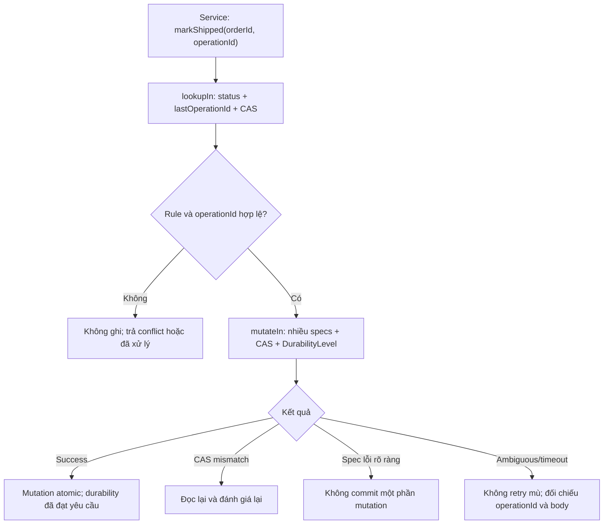

# Kết hợp CAS và yêu cầu độ bền với cập nhật từng phần

## 1. Từ cập nhật một JSON field đến bảo đảm đúng trong hệ phân tán

Trong module **SPRING_DATA_COUCHBASE**, tầng truy cập dữ liệu được xây dựng bằng Spring Data với document mapping, repository, `CouchbaseTemplate`, truy vấn SQL++, lựa chọn bucket/scope/collection, chỉ mục, TTL, CAS, giao dịch và reactive API. Couchbase Java SDK cung cấp `Collection.lookupIn` và `Collection.mutateIn` để đọc/sửa **một số JSON paths** mà không phải lấy và ghi lại toàn bộ document.

Một update nhỏ vẫn có thể gây hậu quả lớn. Ví dụ người vận hành chuyển đơn hàng từ `READY` sang `SHIPPED`, ghi mã vận đơn và sự kiện lịch sử. Cần trả lời đồng thời hai câu hỏi:

1. **Có đang sửa đúng phiên bản tài liệu đã kiểm tra không?** Đây là bài toán **CAS — Compare-And-Swap**.
2. **Sau khi được báo thành công, mutation đã được ghi/replicate đến mức nào?** Đây là bài toán **durability — độ bền ghi**.

Hai bảo đảm không thay thế nhau:

- CAS phát hiện document đã thay đổi kể từ lần đọc trước, từ đó ngăn một quyết định nghiệp vụ dựa trên snapshot cũ.
- Durability yêu cầu Couchbase Server đạt mức lưu/nhân bản xác định trước khi trả về thành công.
- Một `mutateIn` nhiều specs có **atomicity trên một document**, dù có hay không sử dụng CAS/durability.
- Một mutation dùng cả CAS và durability vẫn **không tự trở thành transaction giữa nhiều document keys**, không tự bảo đảm exactly-once khi retry và không buộc SQL++ GSI phải thấy dữ liệu ngay.

Bài học trình bày cách kết hợp đúng hai cơ chế trong Java SDK, đối chiếu với Spring Data, xử lý lỗi/timeout và thiết kế integration tests có thể thực thi trên môi trường Couchbase phù hợp.

### Kết quả cần đạt

Sau bài học, bạn có thể:

1. Lấy CAS từ `LookupInResult` và đưa vào `MutateInOptions.cas(...)`.
2. Phân biệt CAS opaque token với `schema_version`, timestamp và số phiên bản Java tự quản.
3. Chọn đúng `DurabilityLevel` theo yêu cầu replication/persistence và topology.
4. Đặt CAS **và** durability trong cùng một `mutateIn`, kể cả khi request có nhiều specs.
5. Hiểu lỗi CAS mismatch, durable write không khả thi, timeout mơ hồ và quy trình retry đúng.
6. Xử lý các thao tác không idempotent như `increment`, `arrayAppend`.
7. Không làm sai TTL/expiry khi patch JSON paths.
8. Phối hợp với `@Version`, `CouchbaseTemplate.mutateInById`, repository và API reactive.
9. Thiết kế kiểm thử concurrency, atomicity, failure injection, durability và query consistency.

## 2. Document mẫu và invariant của nghiệp vụ

Giả sử bucket `shop`, scope `sales`, collection `orders` lưu document key `order::1001`:

```json
{
  "_class": "order-document",
  "schema_version": 2,
  "customer_id": "customer::42",
  "shipping": {
    "status": "READY",
    "carrier": "VN-EXPRESS",
    "tracking_code": null,
    "last_operation_id": ""
  },
  "stats": {
    "status_transitions": 3,
    "views": 215
  },
  "history": [
    {
      "event_id": "evt::1001::ready",
      "type": "STATUS_CHANGED",
      "status": "READY",
      "at": "2026-11-20T10:00:00Z"
    }
  ]
}
```

Document key, CAS và expiry là metadata của Couchbase; CAS không xuất hiện trong body JSON mẫu. `schema_version` là một field do ứng dụng quy định, **khác** CAS của Couchbase.

Use case `markShipped` yêu cầu:

- Chỉ cho phép transition `READY → SHIPPED`.
- Mã tracking phải hợp lệ và actor có quyền.
- Cập nhật `shipping.status`, `tracking_code`, `last_operation_id`, tăng `status_transitions` và append `history` **cùng một mutation**.
- Nếu có writer khác sửa document trong lúc kiểm tra, không được ghi dựa trên snapshot cũ.
- Khi API báo thành công, mutation phải đạt mức độ bền đã chọn.

### 2.1. Tại sao cả hai yêu cầu đều cần thiết?

Nếu chỉ dùng CAS, server có thể báo thành công theo mức durability mặc định mà không chờ replica hoặc disk theo yêu cầu nghiệp vụ.

Nếu chỉ dùng durability, hai client có thể đều gửi những mutation được replicate bền vững nhưng không cùng tuân theo điều kiện `status` ban đầu. Bạn có thể lưu **rất bền** một thay đổi sai về trạng thái.

Nếu dùng nhiều requests thay vì một `mutateIn`, CAS và durability áp vào từng request riêng **không tạo atomicity chung** cho cả workflow.

## 3. Bốn khái niệm khác nhau

| Khái niệm | Câu hỏi chính | Phạm vi |
| --- | --- | --- |
| Atomicity | Nhiều JSON path specs có commit cùng nhau không? | **Một** `mutateIn` trên **một document**. |
| CAS | Document còn đúng version đã đọc không? | Compare-And-Swap trên **toàn document**. |
| Durability | Server đã replicate/persist mutation đến mức nào trước khi báo success? | Một mutation theo cấu hình durability/bucket. |
| Query consistency | Truy vấn SQL++ qua index có quan sát mutation vừa ghi chưa? | Query service/GSI; độc lập với CAS/durability. |

Hai thuộc tính khác thường bị lẫn vào là:

- **Idempotency:** retry một command có gây tác dụng kép không?
- **Transaction nhiều document:** nhiều document keys có được phối hợp commit/rollback không?

Không thể dùng `durability(MAJORITY)` thay CAS, dùng CAS thay idempotency, hoặc dùng `mutateIn` một key để thay thế transaction qua order và inventory.



## 4. Khởi tạo SDK Collection đúng nơi lưu trữ

Giả sử `Cluster` đã được cấu hình an toàn qua ứng dụng Spring và được dùng lại lâu dài.

```java
import java.util.List;
import java.time.Duration;

import com.couchbase.client.java.Cluster;
import com.couchbase.client.java.Collection;
import com.couchbase.client.java.json.JsonObject;
import com.couchbase.client.java.kv.LookupInSpec;
import com.couchbase.client.java.kv.LookupInResult;
import com.couchbase.client.java.kv.MutateInSpec;
import com.couchbase.client.java.kv.MutateInOptions;
import com.couchbase.client.java.kv.MutateInResult;
import com.couchbase.client.core.msg.kv.DurabilityLevel;

Collection orders = cluster.bucket("shop")
    .scope("sales")
    .collection("orders");

String orderId = "order::1001";
```

`Collection` ở đây là Couchbase SDK `com.couchbase.client.java.Collection`, không phải `java.util.Collection`. Collection routing phải thống nhất với `CouchbaseRepository` hoặc `CouchbaseTemplate` nếu cả hai cùng đọc/ghi entity này.

Một `Cluster` không nên được tạo rồi đóng lại cho mỗi HTTP request. Nếu dịch vụ nhiều tenant, việc chọn bucket/scope/collection phải theo chính sách phân quyền và routing được kiểm thử.

### 4.1. Method surface cốt lõi

```java
LookupInResult snapshot =
    orders.lookupIn(orderId, List.of(
        LookupInSpec.get("shipping.status")
    ));

MutateInResult changed = orders.mutateIn(
    orderId,
    List.of(MutateInSpec.replace(
        "shipping.status", "SHIPPED")),
    MutateInOptions.mutateInOptions()
        .cas(snapshot.cas())
        .durability(DurabilityLevel.MAJORITY)
);
```

Đoạn code trên cho thấy **CAS và durability nằm trong cùng `MutateInOptions`**. Trong nghiệp vụ thật, trước khi gửi mutation cần kiểm tra status từ snapshot và các điều kiện khác; chỉ lấy CAS mà không kiểm tra rule không làm logic tự đúng.

## 5. CAS là gì?

**CAS — Compare-And-Swap** là token phiên bản của một Couchbase document. Server gửi CAS kèm kết quả đọc hoặc ghi. Khi client đưa CAS cũ vào mutation, server chỉ cho mutation thành công nếu document vẫn mang version tương ứng.

Ví dụ:

1. Client A `lookupIn` document ở CAS `C1`.
2. Client B update `stats.views`, khiến CAS thành `C2`.
3. Client A gửi `mutateIn` với `.cas(C1)`.
4. Server phát hiện version khác và trả CAS mismatch, không commit specs của A.

Điều này ngăn A ghi dựa trên trạng thái trước khi B sửa.

### 5.1. CAS là opaque token

Java SDK biểu diễn CAS qua `long`, nhưng bạn **không được**:

- Tăng CAS bằng `cas + 1`.
- Dùng `cas > previousCas` để suy thứ tự nghiệp vụ.
- Đồng nhất CAS với timestamp, số revision, `schema_version` hoặc `@Version` ở một hệ khác.
- Dự đoán CAS tiếp theo.
- So sánh CAS của hai documents khác nhau như một đồng hồ logic toàn cục.

Chỉ dùng CAS như token trả về từ server và đưa lại chính token đó trong conditional mutation.

### 5.2. CAS là version của cả document

CAS **không phải một khóa riêng cho field `shipping.status`**. Bất cứ mutation thành công nào lên document, kể cả update `stats.views` hoặc một metadata operation có liên quan, đều có thể làm CAS thay đổi.

Điều này bảo vệ snapshot nhất quán, nhưng làm tăng conflict nếu bạn đưa cả counters tần suất cao và workflow quan trọng vào một document nóng.

## 6. Đọc giá trị và CAS bằng một `lookupIn`

Vì điều kiện nghiệp vụ dựa vào `shipping.status` và `last_operation_id`, đọc chúng trong một request:

```java
LookupInResult snapshot = orders.lookupIn(
    "order::1001",
    List.of(
        LookupInSpec.get("shipping.status"),
        LookupInSpec.get("shipping.last_operation_id"),
        LookupInSpec.get("shipping.tracking_code")
    )
);

String status =
    snapshot.contentAs(0, String.class);
String previousOperation =
    snapshot.contentAs(1, String.class);
String previousTracking =
    snapshot.contentAs(2, String.class);
long expectedCas = snapshot.cas();
```

Trong JSON mẫu, `last_operation_id` là string rỗng và `tracking_code` là JSON null. Tùy serializer, `contentAs(2,String.class)` trả Java null; test trường hợp này bằng dependency thực tế.

Các specs cùng `lookupIn` được thực hiện đối với **cùng phiên bản document**, không phải ba lần đọc từ ba thời điểm khác nhau. CAS của `snapshot` gắn với phiên bản đó.

### 6.1. Spec index và array index

`contentAs(1, String.class)` đọc **spec thứ hai** trong `List.of(...)`. Nó không phải path array `history[1]`. Nếu đổi thứ tự specs, phải đổi cách giải mã; dùng tên hằng cho index khi danh sách dài.

### 6.2. MISSING khác NULL

- `LookupInSpec.get("shipping.tracking_code")` đọc path đã tồn tại với JSON null.
- Nếu `shipping.tracking_code` **MISSING**, `get` có thể báo `PathNotFound` khi truy xuất kết quả.
- `LookupInSpec.exists(path)` giúp kiểm tra optional field mà không lấy value.
- Parent sai kiểu là một vấn đề khác với path missing.

Đừng bắt tất cả những lỗi này rồi tạo giá trị default, vì điều đó có thể che giấu schema drift.

## 7. CAS để bảo vệ chuyển trạng thái có điều kiện

Kiểm tra domain ở application layer trước khi ghi:

```java
if (!"READY".equals(status)) {
    throw new IllegalStateException(
        "Order status no longer allows shipping");
}

if (trackingCode == null || trackingCode.isBlank()) {
    throw new IllegalArgumentException(
        "Tracking code is required");
}
```

Biến `trackingCode` đại diện dữ liệu đã validate từ request nghiệp vụ. Cần thêm kiểm tra authorization của actor và operation ID, vì JSON mutation không tự hiểu ai được quyền thay `shipping.status`.

### 7.1. Vì sao kiểm tra trước vẫn chưa đủ?

Giữa `lookupIn` và `mutateIn`, một client khác có thể hủy đơn, đổi carrier hoặc ghi lại trạng thái. Đó là **time-of-check to time-of-use (TOCTOU)**.

Nếu chỉ gửi `MutateInSpec.replace(...)` mà không có CAS, mutation của bạn có thể thành công trên version mới, dù điều kiện `READY` không còn đúng. Dùng `.cas(snapshot.cas())` để bắt thay đổi.

## 8. Durability là gì và không phải gì?

Theo kiến trúc Couchbase, một mutation được xử lý tại active node phụ trách vBucket, và Couchbase Server chịu trách nhiệm replication/persistence theo topology.

Mức mặc định **không yêu cầu enhanced durability** cho phép response thành công theo acknowledgment của active node mà không chờ một mức replicate/persist bổ sung do ứng dụng yêu cầu.

Khi chỉ định `DurabilityLevel`, Couchbase Server thực hiện **Durable Write / SyncWrite** theo mức được yêu cầu. Một mutation durable được báo thành công sau khi điều kiện tương ứng đạt; mức bền hơn có thể tăng latency và hạn chế availability trong tình huống node/replica gặp sự cố.

**Không nên hiểu durability là:**

- Bảo đảm query SQL++ thấy mutation ngay qua GSI.
- Bảo đảm data vẫn tồn tại nếu bạn chủ động xóa document hoặc TTL đã hết.
- Bảo đảm một command chỉ chạy một lần khi retry.
- Bảo đảm business rule được kiểm tra trước khi ghi.
- Bảo đảm atomicity của các mutations trên nhiều document keys.

Một `mutateIn` nhiều specs đã atomic **trong một document**, kể cả khi không yêu cầu enhanced durability. Durability bổ sung cam kết về replication/persistence.

## 9. Các mức `DurabilityLevel` của Java SDK

Java SDK dùng enum `com.couchbase.client.core.msg.kv.DurabilityLevel`.

| Java enum | Điều kiện thành công | Diễn giải ngắn |
| --- | --- | --- |
| `NONE` | Không yêu cầu enhanced durability từ SDK request | Active node có thể xác nhận sau khi xử lý trong memory theo semantics mặc định. |
| `MAJORITY` | Mutation có mặt trong memory của **đa số** Data Service nodes liên quan đến vBucket | Chờ replication tới majority, chưa bắt buộc disk persistence. |
| `MAJORITY_AND_PERSIST_TO_ACTIVE` | Đạt majority memory **và** active node đã persist xuống disk | Tăng bảo đảm bền vững tại active node. |
| `PERSIST_TO_MAJORITY` | Mutation đã persist xuống disk trên **đa số** nodes liên quan | Mức đòi hỏi persistence mạnh hơn, thường tốn thời gian hơn. |

Diễn đạt "đa số" phụ thuộc **số bản sao được cấu hình cho bucket và topology của vBucket**, không phải tùy ý đếm tất cả node không lưu vBucket đó.

### 9.1. `MAJORITY` không đồng nghĩa persist-to-disk

```java
MutateInOptions options = MutateInOptions.mutateInOptions()
    .durability(DurabilityLevel.MAJORITY);
```

Đây là yêu cầu về memory replication trên majority. Nếu chính sách cần bằng chứng durable trên disk, phải chọn mức có `PERSIST` và xác minh storage engine/topology hỗ trợ.

### 9.2. `MAJORITY_AND_PERSIST_TO_ACTIVE`

```java
MutateInOptions options = MutateInOptions.mutateInOptions()
    .durability(
        DurabilityLevel.MAJORITY_AND_PERSIST_TO_ACTIVE);
```

Ngoài majority memory, active node phải persist mutation xuống disk. Yêu cầu mạnh hơn `MAJORITY` nhưng khác `PERSIST_TO_MAJORITY` về số node cần persist.

### 9.3. `PERSIST_TO_MAJORITY`

```java
MutateInOptions options = MutateInOptions.mutateInOptions()
    .durability(DurabilityLevel.PERSIST_TO_MAJORITY);
```

Mức này yêu cầu persist xuống disk tại majority. Nó có thể làm tăng latency mạnh ở một số workload; không tự bật cho mọi counter view chỉ để "an toàn nhất" nếu SLA không yêu cầu.

### 9.4. Bucket có minimum durability

Couchbase Server có thể cấu hình **minimum durability** cho bucket. Khi client và bucket cùng đặt durability, mức hiệu lực là mức **mạnh hơn** theo policy server. Việc bạn gọi `durability(NONE)` không nhất thiết làm giảm mức bắt buộc của bucket.

Trong runbook cần ghi rõ cả cấu hình SDK **và** cấu hình bucket; chỉ xem Java code chưa chắc phản ánh durability thực tế.

## 10. Topology, replica count và khả năng đáp ứng durability

Một lời gọi `durability(MAJORITY)` không thể tự sinh replica node.

Ví dụ khái niệm:

| Cấu hình bucket | Majority liên quan | Điều cần quan sát |
| --- | --- | --- |
| 0 replicas | 1 node | Có thể đạt majority với một node, nhưng không có dự phòng replica. |
| 1 replica | 2 nodes (active + replica) | Nếu một node chứa bản sao không sẵn sàng, durable write có thể không đạt yêu cầu. |
| 2 replicas | 2 trong 3 bản sao | Mức majority liên quan đến cả tập vBucket copies. |
| Bucket Ephemeral | Hỗ trợ `MAJORITY` theo server docs | Không chọn disk-persistence levels không phù hợp engine. |

Các con số trong bảng là minh họa theo bảng majority trong tài liệu Couchbase Server; khi triển khai thật phải kiểm tra phiên bản server, số replica hỗ trợ, tình trạng vBucket/failover và bucket type.

### 10.1. Chọn durability theo dữ liệu, không theo thói quen

- View/click thống kê chấp nhận một mức mất dữ liệu rất nhỏ khi sự cố: cân nhắc mặc định hoặc lựa chọn có chi phí thấp.
- Trạng thái order quan trọng: `MAJORITY` hoặc mức persistence cao hơn tùy yêu cầu vận hành.
- Record cần đáp ứng cam kết khôi phục sau failure ở disk: đánh giá `MAJORITY_AND_PERSIST_TO_ACTIVE` hoặc `PERSIST_TO_MAJORITY`.
- Ephemeral bucket: không áp tùy chọn disk persistence không được hỗ trợ.

Không phải recommendation cố định cho mọi hệ thống. Quyết định cần dựa trên RPO/RTO, SLA latency, topology và đặc tính nghiệp vụ.

## 11. Kết hợp CAS và durability trong **một** `mutateIn`

Đây là điểm trung tâm của bài.

```java
import com.couchbase.client.core.msg.kv.DurabilityLevel;

MutateInOptions options = MutateInOptions.mutateInOptions()
    .cas(expectedCas)
    .durability(DurabilityLevel.MAJORITY)
    .timeout(Duration.ofSeconds(5));

MutateInResult result = orders.mutateIn(
    orderId,
    List.of(
        MutateInSpec.replace(
            "shipping.status", "SHIPPED"),
        MutateInSpec.upsert(
            "shipping.tracking_code", trackingCode)
    ),
    options
);

long newCas = result.cas();
```

Từ ví dụ:

- CAS yêu cầu document còn phiên bản đã kiểm tra.
- Hai JSON path mutations thuộc **một request atomic**.
- Durability áp lên **cả mutation của document**, không phải riêng spec đầu tiên.
- `timeout(...)` giới hạn thời gian chờ của request theo SDK options, **không biến timeout thành bằng chứng mutation chưa xảy ra**.
- `newCas` là CAS **sau ghi** khi mutation được báo thành công.

### 11.1. Không phải hai thao tác ghi độc lập

Sai về đảm bảo atomic chung:

```java
// Hai requests khác nhau — không có atomicity chung:
orders.mutateIn(orderId, List.of(
    MutateInSpec.replace("shipping.status", "SHIPPED")
), options);

orders.mutateIn(orderId, List.of(
    MutateInSpec.upsert(
        "shipping.tracking_code", trackingCode)
), MutateInOptions.mutateInOptions()
    .durability(DurabilityLevel.MAJORITY));
```

Ngay cả khi hai requests đều dùng `durability(MAJORITY)`, vẫn có khoảng giữa hai lần ghi; request đầu có thể thành công trong khi request hai lỗi. Request thứ hai ở ví dụ **không truyền CAS**, vì CAS cũ của request đầu không còn hợp lệ sau mutation thành công; một bước ghi có điều kiện phải đọc/tái đánh giá trước khi dùng CAS mới. Không dựa vào hai calls này để bảo đảm workflow atomic.

### 11.2. Không gộp bằng cách tạo danh sách specs nhưng gọi từng cái

Một `List<MutateInSpec>` chưa đủ chứng minh tính nguyên tử nếu adapter tách từng spec thành những `mutateIn` khác nhau. Code review và integration test phải xác nhận **một lần gọi** chứa tất cả specs.

## 12. Ví dụ đầy đủ: chuyển đơn hàng sang SHIPPED

Chúng ta thêm event và counter vào mutation có CAS + durability.

### 12.1. Bước A — đọc snapshot

```java
LookupInResult snapshot = orders.lookupIn(
    orderId,
    List.of(
        LookupInSpec.get("shipping.status"),
        LookupInSpec.get("shipping.last_operation_id")
    )
);

String oldStatus = snapshot.contentAs(0, String.class);
String lastOperation =
    snapshot.contentAs(1, String.class);
long cas = snapshot.cas();
```

### 12.2. Bước B — xác thực điều kiện

```java
String operationId = "ship::1001::request-001";
String trackingCode = "VN123456";

if (operationId.equals(lastOperation)) {
    // Đã thấy marker của request trước.
    // Cần đối chiếu các fields/event theo policy trước
    // khi trả "đã hoàn tất", không tăng counter lần nữa.
    return;
}

if (!"READY".equals(oldStatus)) {
    throw new IllegalStateException(
        "Order is not in READY state");
}

if (trackingCode.isBlank()) {
    throw new IllegalArgumentException(
        "Invalid tracking code");
}
```

Đoạn trên là thân hàm minh họa, không phải method Java hoàn chỉnh. Authorization, tracking format, event ID và quan hệ giữa status/carrier vẫn phải được validate trong service domain.

### 12.3. Bước C — tạo event JSON

```java
JsonObject event = JsonObject.create()
    .put("event_id", operationId)
    .put("type", "SHIPPED")
    .put("tracking_code", trackingCode)
    .put("at", "2026-11-25T09:00:00Z");
```

### 12.4. Bước D — gửi **một** durable conditional mutation

```java
MutateInResult changed = orders.mutateIn(
    orderId,
    List.of(
        MutateInSpec.replace(
            "shipping.status", "SHIPPED"),
        MutateInSpec.upsert(
            "shipping.tracking_code", trackingCode),
        MutateInSpec.replace(
            "shipping.last_operation_id", operationId),
        MutateInSpec.increment(
            "stats.status_transitions", 1),
        MutateInSpec.arrayAppend(
            "history", List.of(event))
    ),
    MutateInOptions.mutateInOptions()
        .cas(cas)
        .durability(
            DurabilityLevel.MAJORITY_AND_PERSIST_TO_ACTIVE)
        .timeout(Duration.ofSeconds(10))
);

long afterCas = changed.cas();
long transitions = changed.contentAs(3, Long.class);
```

Chú ý **`contentAs(3, Long.class)`** đọc output của spec `increment` thứ tư. Đây là **spec index**, không phải chỉ số array `history[3]`.

### 12.5. Bản ghi mới có gì?

Khi request thành công:

- `shipping.status = "SHIPPED"`.
- `shipping.tracking_code = "VN123456"`.
- `shipping.last_operation_id` chứa operation ID.
- `stats.status_transitions` tăng đúng một lần **cho request đó**.
- `history` nhận thêm event.
- Toàn bộ thay đổi thuộc **một mutation atomic trên document key**.
- Server đã đáp ứng mức durability được yêu cầu (hoặc mức bucket minimum mạnh hơn nếu có).

Điều cuối cùng **chưa** được bảo đảm chỉ bằng mã trên: exactly-once cho command ở cấp toàn hệ thống, vì khi client mất response và retry, hoặc marker bị request khác ghi đè, logic phải xử lý riêng.

## 13. Ma trận kết quả của mutation có CAS và durability

| Tình huống | Có commit các specs không? | Hướng xử lý |
| --- | --- | --- |
| CAS trùng, specs hợp lệ, durability được đáp ứng | Có, atomic | Nhận `MutateInResult` và CAS mới; xử lý thành công. |
| CAS không trùng | Không thực hiện mutation dựa trên CAS cũ | Đọc lại snapshot, đánh giá lại rule. |
| Một spec sai path/type | Không commit một phần multi-spec mutation | Sửa schema/mapping hoặc dữ liệu đầu vào. |
| Không có quyền ghi collection | Không được phép mutation | Sửa authorization/RBAC, không retry vô hạn. |
| Durability không khả thi theo topology | Server không thể đáp ứng mức yêu cầu | Kiểm tra topology, bucket và lỗi; không tự hạ cấp âm thầm. |
| Network/timeout trong lúc durable write | Có thể **không xác định** đã commit hay chưa | Readback, operation ID, reconciliation; không retry mù. |
| Server đã commit, response thành công bị mất | Client có thể thấy timeout | Đối chiếu trạng thái trước khi gửi lại non-idempotent specs. |

Đừng viết code kiểu `catch (Exception) { retrySameMutation(); }`. Mỗi nhóm lỗi có chính sách khác nhau.

## 14. CAS mismatch: bảo vệ snapshot chứ không chặn mọi concurrent write

Hai client có thể append event độc lập mà không cần `lookupIn` trước. Couchbase cho phép các server-side operations riêng trên cùng document được thực hiện mà không nhất thiết gây lost update.

Nhưng khi quyết định ghi phụ thuộc một giá trị đã đọc, CAS có vai trò khác.

### 14.1. Kịch bản race

```text
A đọc shipping.status = READY, CAS = C1
B đổi status = CANCELLED, CAS trở thành C2
A gửi replace status = SHIPPED với CAS = C1
Server từ chối A (CAS mismatch)
```

Không có CAS, A có thể ghi `SHIPPED` sau B, dù trạng thái `CANCELLED` không cho phép transition đó.

### 14.2. Một thay đổi không liên quan cũng làm CAS đổi

```text
A đọc READY, CAS = C1
B increment stats.views -> CAS = C2
A gửi SHIPPED với CAS = C1
A nhận conflict, dù shipping.status vẫn READY
```

Điều này là **conflict ở cấp document**, không phải bug của server. A có thể đọc lại, xác minh status vẫn READY, rồi thử lại với CAS mới. Nhưng nếu view increments xảy ra liên tục, conflict rate sẽ tăng.

### 14.3. Tránh tăng contention không cần thiết

Nếu document order chứa một bộ đếm view cực nóng, cân nhắc:

- Tách `stats.views` ra document riêng nếu eventual consistency được chấp nhận.
- Ghi view events/batch aggregates thay vì mutation cho mọi view.
- Chỉ dùng CAS khi rule thực sự phụ thuộc snapshot.
- Giữ core order transitions trên document có ít write contention hơn.
- Đo CAS mismatch rate trước khi đổi schema.

Tách key làm mất atomicity chung giữa core order và view counter; cần chấp nhận hoặc thiết kế lại invariants.

## 15. CAS retry đúng cách

Khi CAS mismatch:

1. Đọc lại field và CAS trong một `lookupIn`.
2. Kiểm tra operation ID có được áp dụng chưa.
3. Xác minh trạng thái hiện tại còn cho phép transition không.
4. Nếu cần, dựng lại event, index/values và mutation specs theo snapshot mới.
5. Ghi lại với CAS mới; giới hạn số lần thử và backoff.
6. Trả conflict hoặc yêu cầu xử lý nghiệp vụ nếu state không còn phù hợp.

**Không** chỉ lấy một CAS mới rồi gửi lại **cùng quyết định nghiệp vụ cũ** mà không tái đánh giá.

### 15.1. Ví dụ retry có giới hạn bằng pseudocode

```text
for attempt in 1..MAX_ATTEMPTS:
    snapshot = lookupIn(status, last_operation_id)
    if last_operation_id == my_operation_id:
        verify persisted state, return already-applied
    if status != READY:
        return business-conflict

    try:
        mutateIn(specs, cas=snapshot.cas, durability=MAJORITY)
        return success
    catch CAS_MISMATCH:
        backoff_and_re-read

return concurrent-update-conflict
```

Pseudocode này **chỉ retry CAS mismatch rõ ràng**. Với timeout/ambiguous durability, xử lý riêng vì mutation có thể đã xảy ra. Nếu có side effect ngoài Couchbase, cần idempotency/transaction/outbox để bảo vệ nó.

### 15.2. CAS có phải khóa pessimistic không?

Không. CAS là **optimistic concurrency**: client đọc, đánh giá và thử ghi, server phát hiện version đã đổi. Couchbase còn có get-and-lock/explicit locking cho trường hợp khác, nhưng đây không phải cách mặc định để triển khai mọi update; locking có thể gây contention và ảnh hưởng latency.

## 16. Vì sao durability không giải quyết CAS conflict?

Hai mutation có durability cao vẫn có thể thực hiện **theo hai phiên bản khác nhau**.

```text
Client A: đọc READY ở C1
Client B: ghi CANCELLED với PERSIST_TO_MAJORITY -> thành công, CAS C2
Client A: ghi SHIPPED với PERSIST_TO_MAJORITY, không kèm CAS
```

Nếu A không kiểm tra CAS, mutation có thể được server tiếp nhận và persisted bền vững, nhưng domain state trở thành `SHIPPED` bất hợp lệ sau `CANCELLED`.

**Durability trả lời “đã lưu được đến mức nào”, không trả lời “có nên lưu thay đổi này không”.**

Kết hợp cả hai trong cùng request cho phép:

- CAS kiểm tra phiên bản.
- Các specs được cập nhật atomic trên document.
- Server chờ mức durability yêu cầu trước khi báo thành công.

## 17. Durable write đang chờ: một trạng thái vận hành khác

Với SyncWrite, server có thể giữ mutation ở trạng thái **pending** khi đang chờ replication/persistence. Trong giai đoạn pending, các clients khác không nên thấy mutation chưa đạt cam kết như một version đã commit thông thường; mutations cạnh tranh vào cùng key có thể gặp trạng thái **SYNC_WRITE_IN_PROGRESS** hoặc lỗi tương ứng mà SDK có thể retry theo chính sách.

Những hệ quả:

- Độ trễ tăng khi replica chậm hoặc disk bận.
- Request mới trên cùng hot key có thể bị trì hoãn hoặc nhận lỗi retryable.
- Một failover/rebalance trong lúc pending có thể khiến kết quả khó xác định.
- Tăng timeout tùy tiện không sửa được topology lỗi và chỉ làm client chờ lâu hơn.
- Monitoring cần phân biệt CAS conflict, durability impossible và write-in-progress.

Không đọc một request pending rồi suy rằng thành công đã được xác nhận; cũng không tự hạ xuống `NONE` khi muốn “giải phóng pending” mà không có phê duyệt về mức bảo đảm nghiệp vụ.

## 18. Timeout và ambiguous outcome: tình huống nguy hiểm nhất

Một mutation durable có thể gặp:

1. Client gửi CAS + multi-spec mutation.
2. Server áp dụng/replicate/persist theo protocol.
3. Response thành công trên đường truyền bị mất.
4. Client nhận timeout.

Từ góc nhìn client, **không thể chắc chắn** mutation chưa xảy ra chỉ vì không nhận response.

Couchbase Java SDK có phân loại timeout như `AmbiguousTimeoutException` và `UnambiguousTimeoutException`, cùng các lỗi liên quan durability như `DurabilityAmbiguousException` tùy tình huống/version. Cần kiểm tra loại lỗi/cause/error context thực trên dependency đang dùng; không giả định mọi timeout đều unambiguous.

### 18.1. Ba kết luận không được đánh đồng

| Thông tin có được | Kết luận hợp lý |
| --- | --- |
| API trả `MutateInResult` thành công | Server đã xác nhận mutation theo durability policy hiệu lực. |
| API trả CAS mismatch rõ ràng | Mutation của request với CAS đó bị từ chối; cần đọc lại. |
| API trả ambiguous timeout/durability error | Chưa biết chắc mutation đã commit hay chưa; phải đối chiếu. |

Timeout cũng có thể xảy ra trước khi request được xử lý. Điểm chính là **phân biệt được và chưa phân biệt được outcome**, không tự đoán.

### 18.2. Không retry mù `increment` và `arrayAppend`

Nếu mutation chứa:

```java
List.of(
    MutateInSpec.increment(
        "stats.status_transitions", 1),
    MutateInSpec.arrayAppend(
        "history", List.of(event))
)
```

và response bị mất, gửi lại có thể:

- Tăng counter hai lần.
- Thêm event trùng.
- Làm sai audit hoặc báo cáo.
- Gây tranh chấp với workflow kế tiếp.

Durability cao không tự làm hai specs trên idempotent.

## 19. Idempotency marker trong cùng document

Một chiến lược thường dùng là gắn `operationId` vào document **trong cùng mutation atomic** với các tác dụng phụ nội bộ:

```java
String operationId = "ship::1001::request-001";

orders.mutateIn(
    orderId,
    List.of(
        MutateInSpec.replace(
            "shipping.status", "SHIPPED"),
        MutateInSpec.replace(
            "shipping.last_operation_id", operationId),
        MutateInSpec.increment(
            "stats.status_transitions", 1),
        MutateInSpec.arrayAppend(
            "history", List.of(event))
    ),
    MutateInOptions.mutateInOptions()
        .cas(expectedCas)
        .durability(DurabilityLevel.MAJORITY)
);
```

Nhờ tính nguyên tử, khi marker được ghi bởi một request thành công, counter/history cùng request cũng được ghi.

### 19.1. Marker đơn lẻ chưa đủ cho exactly-once lâu dài

Nếu `last_operation_id` chỉ giữ command gần nhất, một command khác có thể ghi đè marker. Retry command cũ sau đó không còn thấy ID của mình, dễ gây tác dụng kép nếu business rule thiếu kiểm tra.

Nếu cần dedup mạnh:

- Dùng một cấu trúc marker/log lưu đủ phạm vi operation IDs, có giới hạn kích thước.
- Hoặc dùng event document có key = operation ID để thể hiện uniqueness.
- Khi marker và payload ở **hai documents**, cần transaction hoặc quy trình reconciliation, vì một `mutateIn` không atomic qua hai keys.
- Đảm bảo authorization, retention, schema version và audit.
- Đọc lại trạng thái để phân biệt "đã áp dụng", "chưa áp dụng" và "không thể xác định".

Không tuyên bố CAS + durability tự mang lại exactly-once cho HTTP request, message consumer hoặc thanh toán bên ngoài.

## 20. Đối chiếu kết quả sau ambiguous write

Một quy trình readback:

```java
LookupInResult verification = orders.lookupIn(
    orderId,
    List.of(
        LookupInSpec.get("shipping.status"),
        LookupInSpec.get("shipping.last_operation_id"),
        LookupInSpec.get("shipping.tracking_code")
    )
);

String state = verification.contentAs(0, String.class);
String marker = verification.contentAs(1, String.class);
String savedTracking =
    verification.contentAs(2, String.class);
```

Nếu marker khớp `operationId`, status/tracking đúng và contract ứng dụng xác nhận marker được ghi **cùng** counter/event, bạn có bằng chứng đáng kể rằng command đã được áp dụng. Nhưng để bảo đảm hoàn toàn, cần xét khả năng marker bị ghi đè, document version khác, failover và chính sách lưu event.

Nếu marker **không khớp**, không tự khẳng định command chưa từng được xử lý; một command khác có thể đã ghi đè marker. Quyết định tiếp theo phải theo logic nghiệp vụ/reconciliation.

### 20.1. Readback không thay thế durability

Đọc thấy JSON mới trên active node sau một timeout **không tự chứng minh** request trước đã đạt mức `PERSIST_TO_MAJORITY`. Có thể nhìn thấy trạng thái sau write khác hoặc một version chưa đáp ứng mọi điều kiện mà client chờ. Để phát biểu về durability SLA, cần kết quả server xác nhận hoặc quy trình xác minh được thiết kế với hiểu biết về server/protocol, không chỉ một `lookupIn` thấy field.

## 21. Phân loại lỗi khi kết hợp CAS và durability

| Nhóm lỗi | Ý nghĩa khái quát | Hướng xử lý |
| --- | --- | --- |
| `CasMismatchException` | Document version không trùng CAS mong đợi | Đọc lại toàn bộ điều kiện, retry có giới hạn. |
| `PathNotFoundException` | JSON path thiếu khi operation yêu cầu tồn tại | Kiểm tra schema/contract; không retry CAS mù. |
| `PathExistsException` | Insert vào field đã tồn tại | Xem business conflict hoặc idempotency state. |
| `PathMismatchException` | Parent/path sai JSON type | Migration hoặc sửa producer. |
| Durability impossible/unavailable | Không thể đạt durability level với topology/bucket | Kiểm tra cluster/replicas/engine, không tự silently downgrade. |
| Durability ambiguous | Server không xác nhận được outcome durable write | State verification, idempotency, reconciliation. |
| `AmbiguousTimeoutException` | Outcome có thể đã xảy ra | Không retry non-idempotent specs mù. |
| `UnambiguousTimeoutException` | SDK xác định request chưa tạo side effect trong trường hợp đó | Tùy policy có thể retry, nhưng cần kiểm tra ngữ cảnh. |
| SyncWrite in progress | Có mutation durable đang pending cùng key | Dùng retry/backoff có giới hạn, xem topology/latency. |
| Permission/authentication | Không đủ quyền trên collection | Sửa RBAC/authorization, không hạ durability. |
| Serializer/validation | Input không JSON-compatible hoặc domain invalid | Sửa contract, không retry hạ tầng. |

Tên exception chính xác và cách bao gói có thể thay đổi theo SDK/server version và dạng sync/async/reactive. Trong integration test, inspect cause/error context thay vì bắt một class bao trùm mọi lỗi.

### 21.1. Mẫu xử lý lỗi theo category

```text
CAS_MISMATCH:
    read latest document -> re-evaluate domain -> bounded retry

INVALID_PATH / INVALID_TYPE / PERMISSION:
    stop; report contract or authorization error

DURABILITY_IMPOSSIBLE:
    alert operations; do not silently use NONE

AMBIGUOUS_TIMEOUT / DURABILITY_AMBIGUOUS:
    readback + operation-id reconciliation
    retry only with a proven safe strategy

SUCCESS:
    expose result and new CAS
```

Đây là pseudocode kiến trúc, không phải chữ ký Java exception classifier. Hãy xây typed error translation ở adapter, đặc biệt khi raw SDK cùng tồn tại với Spring `DataAccessException`.

## 22. Deadline và timeout: đặt theo SLA, không đoán

```java
MutateInOptions options = MutateInOptions.mutateInOptions()
    .cas(expectedCas)
    .durability(DurabilityLevel.PERSIST_TO_MAJORITY)
    .timeout(Duration.ofSeconds(10));
```

Lưu ý:

- Yêu cầu disk persistence trên nhiều nodes thường cần thời gian hơn memory replication.
- Timeout quá ngắn có thể gây nhiều ambiguous outcomes, tăng reconciliation load.
- Timeout quá dài có thể làm request chain/HTTP latency vượt SLA.
- Server có timeout riêng để xử lý SyncWrite; client timeout và server timeout không luôn trùng nhau.
- Có thể dùng end-to-end deadline ở application nhưng không được suy rằng hủy `Mono`/future tức là server chưa xử lý mutation.

Thiết lập nên dựa trên benchmark thực tế: p95/p99 durable latency, topology, disk I/O, replica availability và tỷ lệ lỗi. Không có một giá trị cố định đúng cho mọi deployment.

## 23. TTL/expiry: một metadata khác không được bỏ qua

Khi patch một phần JSON có CAS/durability, expiry policy vẫn phải rõ. `MutateInOptions` hỗ trợ:

- `expiry(Duration)` hoặc `expiry(Instant)` để đặt expiry.
- `preserveExpiry(true)` để giữ expiry hiện có trên Couchbase Server hỗ trợ (theo Javadoc, từ Server 7.0).

### 23.1. Đặt cả CAS, durability và preserve expiry

```java
MutateInOptions options = MutateInOptions.mutateInOptions()
    .cas(expectedCas)
    .durability(DurabilityLevel.MAJORITY)
    .preserveExpiry(true)
    .timeout(Duration.ofSeconds(5));

orders.mutateIn(
    orderId,
    List.of(
        MutateInSpec.replace(
            "shipping.status", "SHIPPED")
    ),
    options
);
```

Trong kịch bản này, mục tiêu là **không thay đổi thời điểm expiry đang có**. Không mặc định API patch luôn bảo toàn expiry nếu không dùng tùy chọn tương ứng.

### 23.2. Đặt expiry mới là một chính sách khác

```java
orders.mutateIn(
    orderId,
    List.of(
        MutateInSpec.upsert(
            "shipping.tracking_code", trackingCode)
    ),
    MutateInOptions.mutateInOptions()
        .cas(expectedCas)
        .durability(DurabilityLevel.MAJORITY)
        .expiry(Duration.ofDays(30))
);
```

Đây chỉ là ví dụ cú pháp. **Không đặt TTL 30 ngày lên order dữ liệu cần lưu lâu dài** nếu retention policy không cho phép. Expiry của document có thể khiến cả order biến mất, không chỉ field tracking.

### 23.3. Durability không chống được expiry theo thiết kế

Dù mutation đạt `PERSIST_TO_MAJORITY`, document vẫn có thể hết TTL và bị xóa theo lifecycle đã cấu hình. Durability và retention giải quyết hai vấn đề độc lập.

## 24. Kết hợp với `CouchbaseTemplate` trong Spring Data

Trong Spring Data Couchbase version hỗ trợ `mutateInById` (tài liệu ghi từ dòng 5.1), Template hỗ trợ các path operations:

- `withInsertPaths`.
- `withUpsertPaths`.
- `withReplacePaths`.
- `withRemovePaths`.

Template có API `withCasProvided()` để cung cấp CAS lấy từ `@Version` khi mutation.

### 24.1. Entity có `@Version`

```java
import org.springframework.data.annotation.Id;
import org.springframework.data.annotation.Version;
import org.springframework.data.couchbase.core.mapping.Document;
import org.springframework.data.couchbase.core.mapping.Field;

@Document
public class OrderDocument {
    @Id
    private String id;

    @Field("shipping")
    private Shipping shipping;

    @Version
    private Long version;

    // Getters, setters, constructors và domain validation.
}
```

Entity ở đây là mô hình rút gọn; các field thực tế cần phản ánh contract của order và mapping `Shipping`. CAS trong entity `@Version` phải được lấy từ một lần đọc đã xảy ra, không tự điền số đoán.

### 24.2. Template mutation dùng CAS

```java
// patch có @Id và shipping.status đã được validate.
// patch.setVersion(casFromPreviouslyReadEntity);

couchbaseTemplate.mutateInById(OrderDocument.class)
    .withReplacePaths("shipping.status")
    .withCasProvided()
    .one(patch);
```

Theo Spring Data reference, Template Sub-document mutation **không tự gửi CAS mặc định**; `withCasProvided()` thể hiện ý định sử dụng version từ entity. Nếu version không có hoặc stale, behavior phải được test theo resolved dependencies.

### 24.3. Template durability

Spring Data fluent API hỗ trợ durability options, ví dụ `withDurability(DurabilityLevel.MAJORITY)` ở các operations/version tương ứng. Khi cần **kết hợp với CAS cho một Sub-document mutation**, xác minh fluent interface signature/Javadoc đúng Spring Data version trước khi chốt chain. Trong API được tài liệu hóa, `withCasProvided()` trả về nhóm fluent paths; vì vậy nên gọi `withDurability` **trước** `withReplacePaths` và `withCasProvided` để tránh lỗi compile-time do fluent return type.

Ví dụ về ý định kỹ thuật:

```java
// Kiểm tra compile-time với version đang dùng:
couchbaseTemplate.mutateInById(OrderDocument.class)
    .withDurability(DurabilityLevel.MAJORITY)
    .withReplacePaths("shipping.status")
    .withCasProvided()
    .one(patch);
```

Nếu fluent type/overloads trong dependency thực tế không cho phép chain đúng như ví dụ, hãy dùng method `withOptions(...)` khi được Javadoc cho phép, hoặc sử dụng SDK `Collection.mutateIn` với `MutateInOptions` tường minh. **Không chia thành hai separate mutations chỉ để áp CAS và durability** vì như vậy sẽ mất atomicity chung của việc update một workflow.

### 24.4. Ranh giới quan trọng với Java SDK

Raw `Collection.mutateIn`:

- Nhận **document key** và raw JSON path specs.
- Không tự đọc `@Version` của một entity Java.
- Không tự gọi Spring Data auditing callbacks, Bean Validation, domain methods.
- Không tự thực hiện `@Field` renaming/custom converters.
- Cần application cung cấp CAS và `DurabilityLevel` tường minh.

Template:

- Nhận entity type, property paths và entity values.
- Có thể tích hợp Spring Data mapping theo version/operation.
- Chỉ expose một tập Sub-document mutations trong tài liệu hiện hành.
- Không nên giả định có mọi SDK `arrayAppend`/`increment`/`lookupIn` fluent methods.

Khi mutation gồm `status` + `counter` + `history.append` và cần **một atomic request**, SDK là một lựa chọn rõ khi Template version chưa expose đầy đủ specs.

## 25. `@Version`, full entity save và raw SDK cùng viết một document

Giả sử:

1. Service A đọc `OrderDocument` qua repository ở CAS `C1`.
2. Service B dùng SDK `mutateIn` tăng `stats.views` với durability mạnh hơn, CAS thành `C2`.
3. Service A gọi `repository.save(orderAtC1)`.

Nếu optimistic locking qua `@Version` được cấu hình đúng, bước 3 có thể báo conflict vì entity cũ. Đây là **đặc điểm bảo vệ dữ liệu**, không phải lỗi cần nuốt rồi save lại mù.

Nếu entity version/locking không được sử dụng, full-document save có thể ghi đè các fields mà SDK đã chỉnh sau khi A đọc.

### 25.1. CAS không có quan hệ với độ bền của lần save khác

SDK mutation của B có `durability(PERSIST_TO_MAJORITY)` không tự áp policy đó cho lần repository save của A. Mỗi mutation dùng durability hiệu lực theo options/`@Document`/bucket minimum và đường API tương ứng.

Đừng mặc định toàn ứng dụng có cùng durability level chỉ vì một adapter dùng mức cao.

### 25.2. Document mapping là một hợp đồng lưu trữ

Nếu Java property `trackingCode` ánh xạ sang `tracking_code` bằng `@Field`, SDK path phải là `shipping.tracking_code` đúng storage JSON. Một CAS/durable update vào **sai JSON path** có thể lưu rất bền một field không được entity reader nhận diện.

Durability không phải validation của schema.

## 26. Async và reactive: bảo đảm giữ nguyên, signal thay đổi

Couchbase SDK có async `CompletableFuture` và reactive `Mono`. Các lựa chọn này thay đổi cách chờ/compose I/O, **không thay đổi CAS và durability semantics**.

### 26.1. `CompletableFuture`

```java
import java.util.concurrent.CompletableFuture;

CompletableFuture<MutateInResult> future =
    orders.async().mutateIn(
        orderId,
        List.of(
            MutateInSpec.replace(
                "shipping.status", "SHIPPED")
        ),
        MutateInOptions.mutateInOptions()
            .cas(expectedCas)
            .durability(DurabilityLevel.MAJORITY)
    );

CompletableFuture<Long> casFuture =
    future.thenApply(MutateInResult::cas);
```

Khi future hoàn thành exceptionally, có thể phải unwrap `CompletionException` để phân loại CAS mismatch/timeout/durability. Không dùng `exceptionally` trả success giả rồi quên đối chiếu mutation outcome.

### 26.2. Reactive SDK

```java
import reactor.core.publisher.Mono;

Mono<MutateInResult> mutation = orders.reactive()
    .mutateIn(
        orderId,
        List.of(
            MutateInSpec.replace(
                "shipping.status", "SHIPPED")
        ),
        MutateInOptions.mutateInOptions()
            .cas(expectedCas)
            .durability(DurabilityLevel.MAJORITY)
    );
```

Publisher cần được subscribe/verify để I/O diễn ra. `Mono` hoàn thành thành công là bằng chứng SDK nhận thành công theo durability policy; nếu publisher lỗi, phân loại outcome trước khi retry.

### 26.3. Reactive lookup rồi mutate với CAS

```java
Mono<MutateInResult> conditional = orders.reactive()
    .lookupIn(
        orderId,
        List.of(LookupInSpec.get("shipping.status"))
    )
    .flatMap(snapshot -> {
        String current =
            snapshot.contentAs(0, String.class);

        if (!"READY".equals(current)) {
            return Mono.error(
                new IllegalStateException(
                    "Invalid shipping transition"));
        }

        return orders.reactive().mutateIn(
            orderId,
            List.of(MutateInSpec.replace(
                "shipping.status", "SHIPPED")),
            MutateInOptions.mutateInOptions()
                .cas(snapshot.cas())
                .durability(DurabilityLevel.MAJORITY)
        );
    });
```

`flatMap` không loại bỏ race giữa hai operations; **CAS làm việc đó**. Nếu muốn appender event/counter cùng transition, đưa tất cả specs vào chính `mutateIn` bên trong `flatMap`.

### 26.4. Không dùng reactive retry vô điều kiện

`retry(3)` áp lên cả pipeline có thể khiến `increment`/`arrayAppend` chạy lặp sau ambiguous outcome. Chỉ retry nhóm lỗi và operations đã được chứng minh an toàn; với CAS mismatch cần đọc lại domain state, với ambiguous durability cần đối chiếu idempotency marker.

## 27. Multi-spec atomicity với durability

Một mutation có thể gồm nhiều thao tác:

```java
orders.mutateIn(
    orderId,
    List.of(
        MutateInSpec.replace(
            "shipping.status", "SHIPPED"),
        MutateInSpec.replace(
            "shipping.last_operation_id", operationId),
        MutateInSpec.increment(
            "stats.status_transitions", 1),
        MutateInSpec.arrayAppend(
            "history", List.of(event))
    ),
    MutateInOptions.mutateInOptions()
        .cas(expectedCas)
        .durability(DurabilityLevel.MAJORITY)
);
```

Nếu một spec lỗi `PathNotFound`/`PathMismatch`, **toàn `mutateIn` không commit**; không có chuyện server đã ghi counter còn status chưa ghi từ cùng request. Đó là atomicity Sub-document, không phải tác dụng riêng của durability.

Theo Java SDK docs, mỗi `lookupIn`/`mutateIn` có tối đa **16 specs**. Chia một yêu cầu hơn 16 specs thành hai calls sẽ phá atomicity chung, dù cả hai đều dùng CAS + durability riêng.

### 27.1. Phân biệt lỗi spec với ambiguous durability

- Spec sai đã bị server từ chối rõ ràng: không commit một phần.
- CAS mismatch rõ ràng: không commit thay đổi của request đó.
- Timeout/durability ambiguous: client chưa biết kết quả cuối; không thể gọi là "spec rollback" chỉ vì thấy exception.

Đây là điểm quan trọng khi viết error handling và log vận hành.

## 28. Không cần CAS trong mọi server-side operation

Nếu ứng dụng chỉ muốn tăng view counter độc lập:

```java
orders.mutateIn(
    orderId,
    List.of(
        MutateInSpec.increment(
            "stats.views", 1)
    ),
    MutateInOptions.mutateInOptions()
        .durability(DurabilityLevel.MAJORITY)
);
```

Một server-side increment có thể xử lý nhiều request mà không cần client đọc số cũ, giúp tránh lost update kiểu read–modify–write. Đặt CAS lên mỗi increment có thể tạo conflict không cần thiết.

Nhưng nếu điều kiện là “chỉ tăng views khi order.status=READY” hoặc “chỉ giảm stock khi còn đủ số lượng”, phải kiểm tra điều kiện và dùng CAS/transaction phù hợp. Durability của increment không tự kiểm tra những rule đó.

### 28.1. Hot key contention

Nếu mỗi view increment có durability mạnh, throughput/latency của document nóng có thể bị ảnh hưởng bởi pending SyncWrites. Chọn durability theo giá trị dữ liệu, không copy policy của chuyển trạng thái order sang counter thống kê.

## 29. CAS, durability và multi-document transactions

Một `mutateIn` chỉ sửa một document key. Nếu nghiệp vụ còn phải:

- Giảm tồn kho `inventory::BOOK-01`.
- Tạo shipment `shipment::1001`.
- Sửa payment `payment::1001`.
- Phát sự kiện cho dịch vụ ngoài Couchbase.

thì CAS + durability trên `order::1001` **không** làm các keys còn lại atomic.

### 29.1. Trường hợp cần transaction

Nếu một hành động chỉ hợp lệ khi nhiều documents cùng commit, đánh giá Couchbase distributed ACID transactions theo SDK/server version đang dùng. Transaction có cách xử lý commit, timeout và ambiguous result riêng; không đơn thuần ghép vài `mutateIn` vào một Java method.

### 29.2. Trường hợp dùng outbox/reconciliation

Khi external service không thể tham gia transaction:

1. Ghi order transition + marker/outbox state trong một atomic mutation khi mô hình cho phép.
2. Consumer đọc event, thực hiện side effect theo operation ID.
3. Dùng idempotency key ở downstream service.
4. Retry có giới hạn, reconciliation và monitoring.
5. Không báo "đã gửi hàng" chỉ vì JSON status đã đổi mà chưa có xác nhận nghiệp vụ từ carrier.

Durability bảo vệ record trên Couchbase theo cam kết, nhưng không bảo đảm email/HTTP callback đã được gửi chính xác một lần.

## 30. SQL++ và GSI consistency không phụ thuộc CAS/durability

Sau khi `mutateIn` đổi `shipping.status`, Query service có thể dùng Global Secondary Index (GSI) để tìm nhiều orders:

```sql
SELECT META(o).id AS orderId,
       o.shipping.status,
       o.shipping.tracking_code
FROM `shop`.`sales`.`orders` AS o
WHERE o.shipping.status = "SHIPPED";
```

Index minh họa:

```sql
CREATE INDEX ix_orders_shipping_status
ON `shop`.`sales`.`orders`(
    shipping.status,
    shipping.tracking_code
);
```

Một mutation đạt `PERSIST_TO_MAJORITY` không có nghĩa mọi GSI index replica đã lập tức cập nhật. Query consistency là quyết định riêng; nếu test cần read-after-write, dùng scan consistency thích hợp (ví dụ `REQUEST_PLUS`) với đánh đổi latency.

Debug theo thứ tự:

1. `lookupIn` trực tiếp theo key để xác minh body KV.
2. Xác nhận field name, type, schema version.
3. Kiểm tra GSI index state, predicate và query consistency.
4. Dùng `EXPLAIN` cho query plan.
5. Không gán lỗi indexing cho CAS/durability khi request đã thành công.

## 31. Logging, tracing và metrics khi vận hành

Một gateway xử lý CAS + durability cần quan sát cả tính đúng và hiệu năng.

| Metric/Log | Mục đích |
| --- | --- |
| `mutateIn` success/error count theo durability level | Biết workload sử dụng mức nào, tỷ lệ lỗi ra sao. |
| CAS mismatch rate | Phát hiện contention và retry lặp. |
| Ambiguous timeout/durability outcomes | Phát hiện nhu cầu reconciliation. |
| SyncWrite in progress/durability impossible | Tìm vấn đề topology/replica/disk. |
| p50/p95/p99 durable mutation latency | Đánh giá SLA và timeout phù hợp. |
| Operation ID / request correlation ID | Đối chiếu retry và duplicate commands. |
| Schema/path errors | Phát hiện dữ liệu V1/V2, type mismatch. |
| TTL anomalies | Đảm bảo retention đúng sau patch. |
| Query lag / index consistency | Tách lỗi GSI khỏi KV mutation. |
| Number of specs per request | Theo dõi sát giới hạn 16 specs. |
| Hot document conflicts | Quyết định tách counter/event khỏi aggregate. |

Không log toàn bộ customer data, tracking secrets hay raw JSON body nếu không cần. Log document key theo chính sách bảo mật, operation ID, danh sách paths đã whitelist, error category và timing. Khi chia nhiều tenants, bảo đảm log không lộ key/identifier nhạy cảm.

## 32. Bảo mật và kiểm tra domain không được bỏ qua

Một SDK call:

```java
orders.mutateIn(
    orderId,
    List.of(
        MutateInSpec.replace(
            userProvidedPath, userProvidedValue)
    ),
    options
);
```

sẽ rất nguy hiểm nếu controller cho client chọn bất kỳ path nào. CAS và durability **không hạn chế quyền chỉnh fields**: attacker có thể yêu cầu ghi rất bền một giá trị sai vào `total_minor`, `roles`, `_class` hoặc `shipping.status` nếu service không kiểm tra authorization.

Một adapter typed nên expose business methods như:

```java
public interface OrderShippingStore {
    void markShipped(
        String orderId,
        String trackingCode,
        String operationId
    );
}
```

Trong implementation:

- Authorize actor với order/tenant.
- Validate transition và tracking code.
- Whitelist JSON paths trong code.
- Đọc snapshot và CAS.
- Gửi một `mutateIn` với durability level theo policy.
- Phân loại CAS mismatch/ambiguous result.
- Đối chiếu operation ID cho retry.
- Ghi audit/metric được phép.

RBAC của Couchbase kiểm soát truy cập database; domain authorization cần thêm ở application để phân quyền theo field/workflow.

## 33. Kiểm thử tích hợp: setup và fixture

Để kiểm chứng CAS/durability, unit test chỉ mock `Collection` là chưa đủ. Cần một môi trường Couchbase phù hợp để quan sát CAS, durable write, TTL, errors và topology.

Fixture key `order::subdoc::test-008` trong collection test cô lập:

```java
import com.couchbase.client.java.json.JsonArray;
import com.couchbase.client.java.json.JsonObject;

String testId = "order::subdoc::test-008";

JsonObject original = JsonObject.create()
    .put("shipping", JsonObject.create()
        .put("status", "READY")
        .put("carrier", "VN-EXPRESS")
        .put("tracking_code", "")
        .put("last_operation_id", ""))
    .put("stats", JsonObject.create()
        .put("status_transitions", 3)
        .put("views", 215))
    .put("history", JsonArray.from(
        JsonObject.create()
            .put("event_id", "evt::ready")
            .put("status", "READY")))
    .put("schema_version", 2);

orders.insert(testId, original);
```

Đảm bảo key chưa tồn tại hoặc dùng key duy nhất cho mỗi test. Không dùng fixture/test này trên production; nếu bucket test có durability minimum hoặc topology khác production, kết quả durability cần được ghi nhận đúng.

## 34. Test thành công với CAS và `MAJORITY`

Đọc snapshot:

```java
LookupInResult before = orders.lookupIn(
    testId,
    List.of(
        LookupInSpec.get("shipping.status")
    )
);

String status = before.contentAs(0, String.class);
assert "READY".equals(status);
```

Mutation:

```java
MutateInResult changed = orders.mutateIn(
    testId,
    List.of(
        MutateInSpec.replace(
            "shipping.status", "SHIPPED"),
        MutateInSpec.replace(
            "shipping.last_operation_id", "test-op-001")
    ),
    MutateInOptions.mutateInOptions()
        .cas(before.cas())
        .durability(DurabilityLevel.MAJORITY)
);

long updatedCas = changed.cas();
assert updatedCas != 0L;
```

Đọc lại qua KV và assert status/marker đúng. Không dùng so sánh CAS dạng `updatedCas > before.cas()` vì CAS là token opaque, không có hợp đồng tăng đơn điệu theo cách ứng dụng có thể dựa vào.

### 34.1. Điều kiện để test chạy hợp lệ

- Cluster có topology đáp ứng `MAJORITY`.
- RBAC cho phép mutate.
- SDK/server tương thích và bucket minimum durability không gây ràng buộc mạnh hơn ngoài dự kiến.
- Test setup/cleanup cô lập.

Một test "durable write success" không chứng minh hành vi khi node chết hoặc disk failure; đó là các test fault injection riêng.

## 35. Test stale CAS: một writer khác sửa document

Trên fixture mới:

```java
LookupInResult a = orders.lookupIn(
    testId,
    List.of(LookupInSpec.get("shipping.status"))
);

orders.mutateIn(
    testId,
    List.of(
        MutateInSpec.increment("stats.views", 1)
    )
);

// A cố sửa trên CAS cũ:
orders.mutateIn(
    testId,
    List.of(
        MutateInSpec.replace(
            "shipping.status", "SHIPPED")
    ),
    MutateInOptions.mutateInOptions()
        .cas(a.cas())
        .durability(DurabilityLevel.MAJORITY)
);
```

Lệnh cuối dự kiến nhận CAS mismatch. Test bắt loại lỗi được SDK version trả về; đọc lại và xác nhận `shipping.status` vẫn đúng trạng thái trước mutation của A.

Lưu ý: `a.cas()` được lấy từ **trước** mutation tăng views; CAS mismatch có thể xảy ra dù status chưa đổi.

## 36. Test atomic failure với durability

Trên một fixture có `shipping.status` đã tồn tại, gửi hai specs trong một request:

```java
orders.mutateIn(
    testId,
    List.of(
        MutateInSpec.replace(
            "shipping.status", "SHIPPED"),
        MutateInSpec.insert(
            "shipping.status", "DUPLICATE")
    ),
    MutateInOptions.mutateInOptions()
        .durability(DurabilityLevel.MAJORITY)
);
```

`insert` vào path đã có sẽ lỗi. Sau khi bắt exception, đọc lại `shipping.status` và xác nhận request **không commit một phần**.

Durability không làm `replace` đầu tiên thành công riêng nếu spec sau thất bại. Đây là test về atomicity multi-spec, kết hợp với durability trong request.

## 37. Test các mức durability và topology

Một test matrix phải dựa vào bucket type và replica configuration:

| Trường hợp | Kỳ vọng |
| --- | --- |
| Bucket phù hợp, replicas sẵn sàng, `MAJORITY` | Mutation thành công khi majority đạt. |
| Bucket phù hợp, `MAJORITY_AND_PERSIST_TO_ACTIVE` | Success sau majority memory và active disk persistence. |
| Bucket phù hợp, `PERSIST_TO_MAJORITY` | Success sau majority disk persistence. |
| Ephemeral bucket với disk persistence level | Phát hiện unsupported/impossible theo server/version. |
| Replica/node cần thiết không sẵn sàng | Durable write có thể timeout/impossible/ambiguous tùy tình huống. |
| Bucket min durability mạnh hơn SDK request | Server áp dụng minimum policy mạnh hơn. |
| SyncWrite pending trên hot key | Thao tác khác có thể nhận in-progress/retryable error. |
| Failover/rebalance trong khi pending | Có thể tạo ambiguous outcome; cần reconciliation. |

Không phá cluster production để thực hiện failure injection. Dùng môi trường test có quyền quản trị, dữ liệu giả và kế hoạch phục hồi topology.

### 37.1. Latency benchmark có ý nghĩa gì?

Đo cùng workload giữa `NONE`, `MAJORITY` và persistence levels; phân biệt p50/p95/p99. Kết quả phụ thuộc disk, number of replicas, bucket type, transaction contention và kích thước payload. Không tuyên bố `PERSIST_TO_MAJORITY` luôn chậm một con số cố định.

## 38. Test ambiguous outcome và idempotency

Timeout thật khó tạo ổn định bằng unit test; có thể kết hợp fault injection ở test environment với một adapter test double mô phỏng "server đã commit nhưng client không nhận được response".

Trình tự:

1. Sinh operation ID duy nhất `test-op-001`.
2. Đọc status/marker + CAS.
3. Gửi mutation gồm status/marker/counter/event, CAS và durability.
4. Giả lập mất response sau khi server có thể đã commit.
5. Handler **không retry ngay**.
6. `lookupIn` kiểm tra marker, status và event ID theo contract.
7. Nếu đã áp dụng, không tăng counter/append lại.
8. Nếu không thể xác định, trả trạng thái cần reconciliation thay vì khẳng định thất bại.

### 38.1. Vì sao không test bằng retry trực tiếp?

`increment` và `arrayAppend` là các operation có side effect non-idempotent. Gọi hai lần trên cùng fixture không phải cách kiểm tra “server có tự dedup không” vì server không được giao operation ID uniqueness mặc định.

Bảo vệ idempotency phải nằm ở domain/application design, đôi khi cần transaction.

## 39. Reactive integration test

Sử dụng `reactor-test` khi dự án có dependency:

```java
import reactor.core.publisher.Mono;
import reactor.test.StepVerifier;

Mono<MutateInResult> mutation =
    orders.reactive().mutateIn(
        testId,
        List.of(
            MutateInSpec.replace(
                "shipping.status", "SHIPPED")
        ),
        MutateInOptions.mutateInOptions()
            .cas(expectedCas)
            .durability(DurabilityLevel.MAJORITY)
    );

StepVerifier.create(mutation)
    .assertNext(result -> {
        assert result.cas() != 0L;
    })
    .verifyComplete();
```

Đoạn test dùng lambda block vì Java `assert` là statement, không phải expression. Tổ chức method/test fixture bảo đảm `expectedCas` lấy từ snapshot hiện tại. Khi test lỗi, dùng `expectErrorSatisfies` để kiểm tra phân loại CAS/ambiguous, tránh swallow exception.

### 39.1. Không nhân đôi mutation do subscribe hai lần

Một `Mono` lạnh có thể khiến mutation được thực hiện theo từng subscription. Không tạo một publisher chứa `increment` rồi subscribe ở hai nơi và ngạc nhiên khi counter tăng hai lần. Chỉ compose/subscribe có chủ đích; với business commands, cần idempotency protection.

## 40. Ma trận kiểm thử tổng hợp

| Nhóm | Test | Kỳ vọng |
| --- | --- | --- |
| CAS | Snapshot mới, CAS khớp | Mutation thành công theo policy. |
| CAS | Snapshot stale | Không ghi, báo conflict. |
| CAS | Writer sửa field không liên quan | Vẫn có thể CAS mismatch toàn document. |
| CAS | Dùng `schema_version` thay CAS | Không coi như CAS hợp lệ. |
| Atomicity | Multi-spec hợp lệ | Mọi JSON paths đổi cùng nhau. |
| Atomicity | Một spec sai | Không có partial commit. |
| Durability | `MAJORITY` | Majority memory được đáp ứng. |
| Durability | `MAJORITY_AND_PERSIST_TO_ACTIVE` | Active disk persistence + majority memory. |
| Durability | `PERSIST_TO_MAJORITY` | Majority disk persistence. |
| Durability | Bucket minimum mạnh hơn request | Mức mạnh hơn được enforced. |
| Durability | Ephemeral + persistence level | Không âm thầm thành công ở mức không hỗ trợ. |
| Durability | Replica down | Lỗi/timeout phù hợp topology, không silently downgrade. |
| Durability | SyncWrite in progress | Có chiến lược retry/backoff có giới hạn. |
| Timeout | Response mất sau commit | Outcome được coi là ambiguous. |
| Idempotency | Retry cùng operation ID | Không double increment/append theo application policy. |
| Expiry | `preserveExpiry(true)` khi server hỗ trợ | TTL giữ theo policy. |
| Expiry | `expiry(Duration)` | TTL chủ động thay theo policy. |
| Spring Data | `@Version` + `withCasProvided()` | CAS được gửi theo contract framework. |
| Interop | SDK patch rồi repository save stale | Optimistic locking phát hiện nếu đã cấu hình. |
| Mapping | `@Field` đổi tên JSON | SDK path đúng storage name. |
| SQL++ | KV mutate durable, query ngay | Phân biệt GSI consistency. |
| Async | Future exceptional | Unwrap cause, không nuốt ambiguous result. |
| Reactive | Mono success/error | Subscribe và verify, không auto retry mù. |
| Security | Client chọn path nhạy cảm | Service từ chối trước mutation. |
| Multi-doc | Order + inventory | Không giả định một `mutateIn` atomic nhiều keys. |

## 41. Bài thực hành

### Bài 1 — Quan sát CAS từ `lookupIn`

Tạo document có `shipping.status="READY"`. Đọc hai paths trong một `lookupIn`, ghi lại CAS. Mutation một field khác và đọc lại CAS; giải thích vì sao không so sánh CAS như số thứ tự tăng dần.

### Bài 2 — CAS mismatch

Client A đọc snapshot, client B đổi status sang `CANCELLED`, client A thử update `SHIPPED` với CAS cũ. Xác minh A bị từ chối. Viết vòng retry phải kiểm tra lại domain state.

### Bài 3 — So sánh ba mức durability

Trên test cluster đáp ứng topology, gửi các mutations tương đương ở `MAJORITY`, `MAJORITY_AND_PERSIST_TO_ACTIVE`, `PERSIST_TO_MAJORITY`. Đo latency và quan sát khác biệt. Không suy một kết quả single-run thành SLA production.

### Bài 4 — CAS + durability trong một request

Viết một `mutateIn` sửa `shipping.status`, `tracking_code` và `last_operation_id`, dùng `.cas(expectedCas)` cùng `.durability(MAJORITY)`. Đọc lại raw JSON và CAS mới.

### Bài 5 — Atomicity khi một spec lỗi

Tạo multi-spec gồm `replace` và `insert` vào một field đã tồn tại. Gửi kèm durability. Bắt lỗi và assert tất cả fields vẫn nguyên; phân biệt lỗi spec với timeout ambiguous.

### Bài 6 — Ambiguous result và idempotency

Thêm event và increment counter trong một mutation, gắn operation ID. Giả lập response bị mất; xây handler đối chiếu marker/event ID trước retry. Giải thích khi nào marker `last_operation_id` không còn đủ.

### Bài 7 — TTL

Tạo document thử nghiệm có expiry, thực hiện CAS + `preserveExpiry(true)`. So sánh với test đặt `expiry(Duration)`. Kiểm tra server version trước khi dùng preserve expiry.

### Bài 8 — Replica availability

Trong test environment được phép, giảm availability của replica liên quan rồi thử durable write; ghi nhận timeout/impossible/ambiguous và policy service. Tuyệt đối không tự hạ cấp yêu cầu nghiệp vụ thành `NONE` khi gặp sự cố.

### Bài 9 — Spring Data Template

Định nghĩa entity có `@Version`, đọc qua repository lấy CAS, patch một field bằng `mutateInById` với `withCasProvided()`. Kiểm tra API durability của resolved Spring Data version; đối chiếu với raw SDK.

### Bài 10 — Raw SDK và entity stale

Đọc entity qua repository, dùng SDK patch với durability để đổi một field, sau đó thử save entity stale. Xác minh optimistic locking và nguy cơ lost update nếu không cấu hình `@Version`.

### Bài 11 — Reactive và lỗi

Triển khai `Mono` lookup → conditional mutate CAS + durability; dùng `StepVerifier`. Kiểm tra CAS mismatch và mô phỏng ambiguous result mà không gắn `retry(3)` vô điều kiện.

### Bài 12 — SQL++ consistency

Tạo GSI theo `shipping.status`, update trạng thái qua KV durable, rồi query ngay. So sánh readback KV với SQL++ ở những consistency settings khác nhau, dùng `EXPLAIN` đánh giá index.

### Câu hỏi tự kiểm tra

1. CAS và durability trả lời hai câu hỏi khác nhau nào?
2. Một `mutateIn` nhiều specs có atomic ngay cả khi `DurabilityLevel.NONE` không?
3. Vì sao CAS là opaque token và không nên tăng hoặc so sánh thứ tự?
4. CAS gắn với một JSON field hay toàn document?
5. `LookupInResult.cas()` được lấy ở thời điểm nào?
6. Vì sao cần đọc status và CAS cùng snapshot?
7. Nếu một writer chỉ increment views, CAS của shipping workflow có thể conflict không?
8. `MutateInOptions.cas(...)` được kiểm tra ở client hay server?
9. `MAJORITY` yêu cầu memory replication hay disk persistence?
10. `MAJORITY_AND_PERSIST_TO_ACTIVE` khác `PERSIST_TO_MAJORITY` ở đâu?
11. `DurabilityLevel.NONE` có bỏ qua bucket minimum durability không?
12. Vì sao replica count ảnh hưởng khả năng đáp ứng SyncWrite?
13. Có thể yêu cầu disk persistence level trên Ephemeral bucket không?
14. Nếu durable write đang pending, mutation khác cùng key có thể gặp điều gì?
15. Vì sao timeout không chứng minh request chưa commit?
16. `AmbiguousTimeoutException` khác `CasMismatchException` trong chiến lược retry ra sao?
17. Vì sao retry `increment`/`arrayAppend` có thể gây tác dụng kép?
18. Marker `last_operation_id` giúp gì và giới hạn của nó?
19. Cách phân biệt idempotency với durability?
20. Khi nào CAS mismatch là tín hiệu cần đọc lại domain state thay vì retry cùng specs?
21. CAS và `schema_version` khác nhau ra sao?
22. Durability có thay thế transaction nhiều document keys không?
23. Mức durability cao có buộc SQL++ GSI thấy mutation tức thì không?
24. `preserveExpiry(true)` yêu cầu Couchbase Server từ phiên bản nào theo Javadoc?
25. Vì sao một durable mutation vẫn có thể bị TTL xóa về sau?
26. `@Version` được dùng thế nào trong Spring Data repository?
27. `withCasProvided()` cần gì ở entity patch?
28. SDK raw có tự đọc CAS từ `@Version` hoặc gọi custom converters không?
29. Tại sao không được cho client tự chọn raw JSON path?
30. Khi nào nên dùng full entity save thay vì partial patch với CAS?
31. Một `Mono` với CAS/durability có tự bảo đảm exactly-once nếu subscribe hai lần không?
32. Mức nào giúp bảo vệ mục tiêu nghiệp vụ khi service ngoài Couchbase không thể tham gia transaction?
33. Cần quan sát những metrics gì để phát hiện durability bottleneck?
34. Một regression test nên kiểm tra điều gì sau multi-spec failure?
35. Vì sao không được silently downgrade durability khi node gặp sự cố?
36. Khi nào nên tách hot counter khỏi order document để giảm CAS conflicts?

## 42. Tài liệu tham khảo

- [Couchbase Java SDK — Sub-Document Operations](https://docs.couchbase.com/java-sdk/current/howtos/subdocument-operations.html): `lookupIn`, `mutateIn`, multi-spec atomicity, CAS và concurrency.
- [Couchbase Java SDK — Concurrent Document Mutations](https://docs.couchbase.com/java-sdk/current/howtos/concurrent-document-mutations.html): opaque CAS, optimistic locking và điều kiện cập nhật.
- [Couchbase Java SDK — Data Modelling, Durability, and Consistency](https://docs.couchbase.com/java-sdk/current/concept-docs/data-durability-acid-transactions.html): Durable Writes và các mức majority/persistence.
- [Couchbase Java SDK — KV Operations](https://docs.couchbase.com/java-sdk/current/howtos/kv-operations.html): CAS/durability áp trên KV mutations.
- [Couchbase Java SDK — MutateInOptions Javadoc](https://docs.couchbase.com/sdk-api/couchbase-java-client/com/couchbase/client/java/kv/MutateInOptions.html): `cas`, `durability`, `expiry`, `preserveExpiry`, `timeout`.
- [Couchbase JVM Core IO — DurabilityLevel Javadoc](https://docs.couchbase.com/sdk-api/couchbase-core-io/com/couchbase/client/core/msg/kv/DurabilityLevel.html): enum `NONE`, `MAJORITY`, `MAJORITY_AND_PERSIST_TO_ACTIVE`, `PERSIST_TO_MAJORITY`.
- [Couchbase Server — Durability](https://docs.couchbase.com/server/current/learn/data/durability.html): replica count, bucket minimum, SyncWrite lifecycle và ambiguous outcomes.
- [Couchbase Java SDK — Error Handling](https://docs.couchbase.com/java-sdk/current/howtos/error-handling.html): ambiguous/unambiguous timeout và exception classification.
- [Couchbase Java SDK — Durability & Failure](https://docs.couchbase.com/java-sdk/current/concept-docs/durability-replication-failure-considerations.html): failover, rebalance và ambiguity.
- [Spring Data Couchbase — Template & Direct Operations](https://docs.spring.io/spring-data/couchbase/reference/couchbase/template.html): `mutateInById` và `withCasProvided()`.
- [Spring Data Couchbase — Mapping Entities](https://docs.spring.io/spring-data/couchbase/reference/couchbase/entity.html): `@Version`, `@Field` và entity mapping.
- [Couchbase Server — SQL++ CREATE INDEX](https://docs.couchbase.com/server/current/n1ql/n1ql-language-reference/createindex.html): GSI, indexing và query visibility.
- [Couchbase Java SDK — Distributed Transactions](https://docs.couchbase.com/java-sdk/current/howtos/distributed-acid-transactions-from-the-sdk.html): giải pháp khi nhiều document keys cần atomicity.

> **Kết luận:** Với cập nhật từng phần, **CAS** bảo vệ quyết định dựa trên phiên bản document đã đọc; **durability** yêu cầu server xác nhận replication/persistence theo SLA. Hãy đưa cả hai vào **cùng `MutateInOptions` của một `mutateIn`**, kết hợp validation và atomic multi-spec khi nhiều fields thuộc một hành động nghiệp vụ. Khi gặp CAS mismatch, đọc lại và đánh giá lại; khi gặp ambiguous timeout, đối chiếu operation ID trước khi retry. Độ bền cao không thay thế idempotency, TTL policy, Spring Data mapping, query consistency hay transaction trên nhiều documents.

