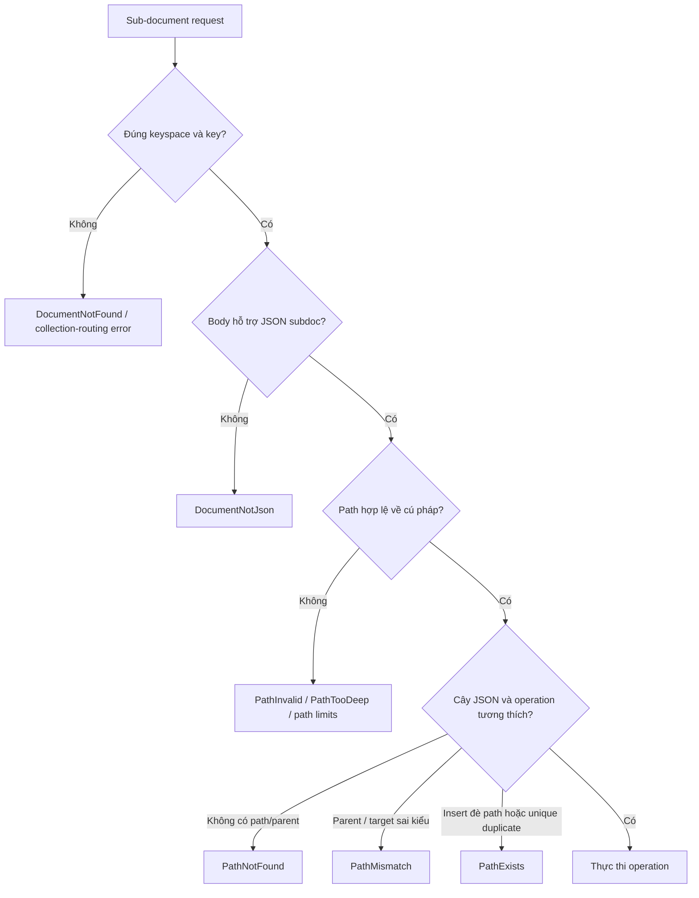
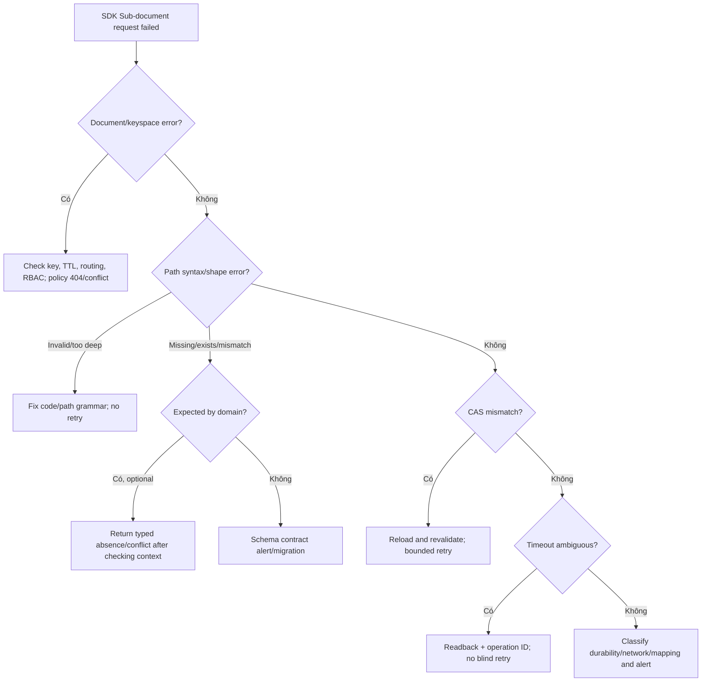

# Trường không tồn tại, sai kiểu và lỗi đường dẫn

## 1. Vì sao một JSON path nhỏ vẫn có thể làm hỏng luồng nghiệp vụ?

Trong module **SPRING_DATA_COUCHBASE**, ứng dụng xây dựng tầng truy cập Couchbase bằng Spring Data: document mapping, repository, `CouchbaseTemplate`, truy vấn SQL++, thiết kế bucket/scope/collection, chỉ mục, TTL, CAS, giao dịch và reactive API. Khi chỉ cần đọc hoặc sửa vài trường của JSON document, **Sub-document KV API** từ Couchbase Java SDK dùng `lookupIn` và `mutateIn` để tránh truyền toàn bộ body.

Nhưng thao tác theo đường dẫn đòi hỏi hiểu rất rõ **trạng thái và kiểu dữ liệu hiện hữu**. Cùng một request:

```java
MutateInSpec.upsert("profile.contact.phone", "+84-901-234-567")
```

có thể thành công trên một document, nhưng thất bại trên document khác vì:

- `profile.contact` chưa tồn tại;
- `profile.contact` là string thay vì object;
- ứng dụng viết sai `contact` thành `contcat`;
- document key không tồn tại;
- JSON body lưu một schema cũ;
- field ở JSON có tên khác vì `@Field` hoặc custom converter của Spring Data.

Đó là những **nguyên nhân khác nhau**, không thể xử lý bằng một lệnh catch-all rồi bật `createPath()` hoặc tự chuyển tất cả thành `upsert`.

> **Nguyên tắc:** Đọc được document không có nghĩa mọi path hợp lệ; path chưa tồn tại không đồng nghĩa JSON null; sai kiểu JSON không đồng nghĩa sai cú pháp đường dẫn; và lỗi của một spec trong `mutateIn` làm **toàn bộ mutation của document đó thất bại**.

### Mục tiêu học tập

Sau bài này, bạn có thể:

1. Phân biệt **document missing**, **path missing**, **JSON null**, **sai kiểu**, **đã tồn tại**, và **path invalid**.
2. Dùng `LookupInSpec.get`, `exists`, `count` và `LookupInResult` theo đúng cơ chế lỗi từng spec.
3. Giải thích `PathNotFoundException`, `PathExistsException`, `PathMismatchException`, `PathInvalidException` và các lỗi path quá sâu/quá dài.
4. Chọn `insert`, `replace`, `upsert`, `remove` và `createPath()` theo hợp đồng dữ liệu.
5. Biết khi nào cần sửa schema/migration thay vì retry hoặc tự tạo parent.
6. Xử lý multi-spec `mutateIn` nguyên tử, giữ nguyên JSON khi một spec thất bại.
7. Kết hợp CAS và error classification khi nhiều writers thao tác đồng thời.
8. Kiểm tra khác biệt tên property Java, JSON path, mapping converter và SQL++ `MISSING`/`NULL`.
9. Thiết kế typed adapter, logging/metrics, reactive error handling và integration tests.

## 2. Document mẫu: một key, nhiều tình huống khác nhau

Giả sử bucket `shop`, scope `app`, collection `customers` có key `customer::42`. Body JSON:

```json
{
  "_class": "customer-document",
  "schema_version": 2,
  "profile": {
    "display_name": "Lan Nguyen",
    "email": null,
    "contact": {
      "phone": "+84-901-234-567"
    },
    "address": {
      "city": "Da Nang",
      "postal_code": "550000"
    }
  },
  "preferences": {
    "locale": "vi-VN",
    "notifications": false
  },
  "stats": {
    "visits": 41
  },
  "tags": ["member", "online"],
  "orders": [
    {
      "order_id": "order::1",
      "status": "PAID"
    },
    {
      "order_id": "order::2",
      "status": "SHIPPED"
    }
  ],
  "settings": {
    "display.name": "Tên hiển thị"
  }
}
```

Lưu ý các trạng thái:

| Path | Trạng thái | Có thể hiểu sai thành |
| --- | --- | --- |
| `profile.display_name` | Tồn tại, kiểu string | Tên property Java có thể là `displayName`. |
| `profile.email` | Tồn tại, JSON `null` | Không phải MISSING. |
| `profile.contact.phone` | Tồn tại, string | Parent `profile.contact` là object. |
| `profile.contact.mobile` | **MISSING** | Không phải JSON null. |
| `profile.contacts.mobile` | **MISSING** vì parent `contacts` thiếu | Không được tự đồng nhất với field đích thiếu khi parent vẫn có. |
| `preferences.notifications` | Tồn tại, boolean `false` | Không phải field thiếu. |
| `stats.visits` | Tồn tại, number `41` | Không phải string `"41"`. |
| `tags` | Tồn tại, array | Không phải JSON object. |
| `orders[1].status` | Tồn tại, string | Index 1 có thể thay đổi khi array bị chèn/xóa. |
| Key literal `display.name` bên trong `settings` | Tồn tại, key có dấu chấm literal | Không phải nested `settings.display.name`. |

Key `customer::42` **không nằm trong body**. CAS, expiry/TTL và một số metadata khác cũng nằm ngoài JSON body; không nên truy cập chúng bằng một path tùy đoán.

### 2.1. Ba câu hỏi trước mọi Sub-document operation

1. **Outer document có tồn tại ở đúng bucket/scope/collection và key không?**
2. **JSON path có hợp lệ theo grammar và có tương thích với cây JSON thực không?**
3. **Operation đòi path tồn tại hay chưa tồn tại, và giá trị đang lưu có đúng kiểu không?**

Một câu trả lời `false` cho câu 1, 2 hoặc 3 sẽ dẫn đến loại lỗi và cách xử lý khác nhau.

## 3. Mô hình lỗi theo ba tầng



Sơ đồ mô tả các nhóm lỗi điển hình, **không phải** thứ tự kiểm tra nội bộ cố định của Couchbase Server. Một request có thể còn bị chặn bởi CAS mismatch, timeout, RBAC, durability hoặc serializer trước khi có kết quả JSON path.

### 3.1. Bảng chẩn đoán nhanh

| Nhóm lỗi | Ví dụ kích hoạt | Không nên xử lý bằng |
| --- | --- | --- |
| Document not found | Key `customer::404` không có | Tạo một field path rồi coi document hợp lệ. |
| `PathNotFound` | `get("profile.unknown")`; `replace` field thiếu; `upsert` khi parent thiếu | Retry vô hạn, đổ lỗi mạng. |
| `PathExists` | `insert("profile.display_name", ...)` khi field đã có | Upsert ghi đè bừa bãi nếu business chỉ cho insert một lần. |
| `PathMismatch` | `arrayAppend("profile", ...)` dù `profile` là object | `createPath()` để âm thầm đổi object thành array. |
| `PathInvalid` | `arrayInsert("tags", List.of("x"))` thiếu index đích | Sửa dữ liệu JSON khi lỗi thực ra thuộc cú pháp path. |
| `DocumentNotJson` | Sub-doc access vào document có body binary/không JSON | Thay path liên tục. |
| Too deep/too big | JSON path quá sâu/quá dài | Cố tăng retry count, bỏ qua hạn chế protocol. |
| Decoder error | `contentAsObject` trên field string | Coi là chắc chắn `PathMismatch` ở server. |
| CAS mismatch | Document đổi giữa lookup và mutate | Retry cùng business decision mà không đọc lại. |
| Ambiguous timeout | Server có thể đã ghi, response mất | Gửi lại `increment`/`arrayAppend` ngay. |

Lưu ý: tên chính xác của exception top-level/cause phụ thuộc phiên bản Java SDK và vị trí phát sinh. Bài sẽ minh họa cách phân loại **theo semantics**, không dựa vào chuỗi message.

## 4. Phân biệt **MISSING**, **NULL** và giá trị “rỗng”

Bốn JSON documents sau **không tương đương**:

```json
{"profile": {}}
```

```json
{"profile": {"email": null}}
```

```json
{"profile": {"email": ""}}
```

```json
{"profile": {"email": false}}
```

Theo thứ tự:

1. Không có key `email` → `MISSING`.
2. Có key `email`, value là JSON `null`.
3. Có key `email`, value là empty string.
4. Có key `email`, value boolean `false`.

Tương tự, `0`, `[]` và `{}` là các giá trị tồn tại thực sự. Không dùng Java `if (value == null)` để suy rằng JSON path bị MISSING: converter, nullable field và deserializer có thể hợp nhất một số trạng thái ở tầng ứng dụng.

### 4.1. Tác động tới thao tác ghi

| Field `profile.email` | `insert` | `replace` | `upsert` | `remove` |
| --- | --- | --- | --- | --- |
| MISSING, parent `profile` đã có | Có thể tạo mới | Thất bại | Có thể tạo mới | Thất bại |
| JSON null | Path **đã tồn tại**, insert thất bại | Thay được | Thay được | Xóa thành MISSING |
| Empty string | Path đã tồn tại | Thay được | Thay được | Xóa |
| Boolean false | Path đã tồn tại | Thay được về mặt JSON | Thay được về mặt JSON | Xóa |

Việc **thay được** về mặt KV không có nghĩa hợp đồng entity hoặc business cho phép. Ví dụ thay boolean bằng string có thể khiến Spring Data deserialize sai.

### 4.2. Vì sao không nên dùng `upsert` cho mọi trường hợp?

`upsert` cho phép cả tạo và ghi đè, nên có thể che một dữ liệu thiếu do migration hoặc producer lỗi. Nếu field bắt buộc của V2, `replace` giúp phát hiện bất thường. Nếu field phải được tạo **đúng một lần**, `insert` giúp phát hiện yêu cầu lặp hoặc race.

Đặt semantics API theo **mục đích nghiệp vụ**, không theo thao tác ít phát lỗi nhất.

## 5. `LookupInSpec.exists`: kiểm tra có path hay không

Khi chỉ cần biết field có tồn tại:

```java
import java.util.List;

import com.couchbase.client.java.Collection;
import com.couchbase.client.java.kv.LookupInSpec;
import com.couchbase.client.java.kv.LookupInResult;

LookupInResult result = customers.lookupIn(
    "customer::42",
    List.of(
        LookupInSpec.exists("profile.email"),
        LookupInSpec.exists("profile.contact.mobile"),
        LookupInSpec.exists("preferences.notifications")
    )
);

boolean hasEmail = result.exists(0);  // true: JSON null
boolean hasMobile = result.exists(1); // false: MISSING
boolean hasNotifications = result.exists(2); // true: false value
```

Trong `LookupInResult`, các index `0`, `1`, `2` là **vị trí specs trong request**, không phải chỉ số JSON array.

**Ý nghĩa:** `exists(0) == true` không bảo đảm `email` có string hợp lệ; nó chỉ xác nhận path có mặt. Từ kết quả của `exists` không thể suy ra value, JSON type hoặc email đã được xác minh.

### 5.1. Exists của path khác exists của document

```java
// SDK KV document existence:
boolean docExists =
    customers.exists("customer::42").exists();
```

khác với:

```java
// SDK Sub-document path existence:
boolean fieldExists = customers.lookupIn(
    "customer::42",
    List.of(LookupInSpec.exists("profile.email"))
).exists(0);
```

Câu đầu hỏi key có document không; câu sau hỏi field có trong một document **đã tìm thấy** hay không. Nếu outer document không tồn tại, `lookupIn` không trả một `LookupInResult` với mọi `exists=false`; bạn phải xử lý document-level error phù hợp.

## 6. `LookupInSpec.get` và lỗi truy cập path MISSING

Ví dụ đọc một field có thật:

```java
LookupInResult r = customers.lookupIn(
    "customer::42",
    List.of(
        LookupInSpec.get("profile.display_name")
    )
);

String name = r.contentAs(0, String.class);
```

Nếu yêu cầu:

```java
LookupInResult r = customers.lookupIn(
    "customer::42",
    List.of(
        LookupInSpec.get("profile.contact.mobile")
    )
);

String mobile = r.contentAs(0, String.class);
```

thì `mobile` không tồn tại trong fixture, nên `contentAs(...)` có thể ném `PathNotFoundException`. Tài liệu Java SDK minh họa lỗi này tại bước **đọc nội dung từ `LookupInResult`**; đừng mặc định mọi `lookupIn` có một path thiếu sẽ ném exception ngay khi gọi.

### 6.1. Dùng `exists` khi optional field được phép thiếu

```java
LookupInResult r = customers.lookupIn(
    "customer::42",
    List.of(
        LookupInSpec.exists("profile.contact.mobile")
    )
);

if (!r.exists(0)) {
    // Theo domain policy: không có mobile.
} else {
    // Nếu cần value, thực hiện get hoặc xây request đọc phù hợp.
}
```

`exists` tránh coi MISSING là lỗi đối với **field optional**. Tuy nhiên, nếu thực hiện `exists` trước rồi `get` ở request sau, có race: writer khác có thể thêm/xóa field ở giữa. Khi cần kiểm tra điều kiện rồi update theo snapshot, dùng CAS của kết quả đọc và xác minh lại khi conflict.

### 6.2. Không bắt `PathNotFound` rồi trả giá trị mặc định mù

Nếu `profile.contact.phone` là required field theo schema V2, việc bắt lỗi và trả `""` hoặc `"unknown"` có thể che data corruption. Một API đọc nên phân biệt:

- Không có document key.
- Có document nhưng field optional thiếu.
- Có document nhưng field required thiếu.
- Field tồn tại nhưng kiểu JSON sai.
- Field có JSON null hợp lệ hoặc không hợp lệ.

Chính sách fallback cần được quyết định ở domain service, không phải ở mọi generic DAO.

## 7. Nhiều lookup specs: một request, lỗi **độc lập theo spec**

Đây là khác biệt trọng yếu so với `mutateIn`:

- Các `LookupInSpec` trong một `lookupIn` được xử lý **trên cùng phiên bản document**.
- Một lookup spec thiếu path **không làm mất** các giá trị lookup khác đã thành công trong cùng response.
- Ở Java, khi lấy nội dung của spec lỗi qua `contentAs`, lỗi của spec đó có thể được ném.
- `LookupInResult.exists(index)` trả boolean theo trạng thái tồn tại của path/spec phù hợp.

Ví dụ:

```java
LookupInResult r = customers.lookupIn(
    "customer::42",
    List.of(
        LookupInSpec.get("profile.display_name"), // index 0: có
        LookupInSpec.get("profile.contact.mobile"), // index 1: MISSING
        LookupInSpec.exists("profile.email")       // index 2: true
    )
);

String name = r.contentAs(0, String.class);
boolean emailPathExists = r.exists(2);

// Chỉ đọc path thiếu trong khối try, không che kết quả khác.
try {
    r.contentAs(1, String.class);
} catch (com.couchbase.client.core.error.subdoc.PathNotFoundException ex) {
    // Optional mobile field chưa có.
}
```

Đoạn `catch` xuống dòng có thể bất tiện theo coding style, trong dự án thực tế nên import `PathNotFoundException` thay cho tên đầy đủ. Cần test behavior của SDK version đang dùng, vì code xử lý per-spec status là nơi dễ lẫn với top-level error.

### 7.1. Điểm tránh hiểu nhầm

“Các lookup specs độc lập” **không** có nghĩa ba reads xảy ra ở ba thời điểm khác nhau. Chúng dùng cùng version của document cho request đó. Nhưng sau khi response đến client, writer khác vẫn có thể thay document; `LookupInResult.cas()` có thể được dùng cho conditional mutate tiếp theo.

### 7.2. `LookupInSpec.count` không phải kiểm tra field string

```java
LookupInResult r = customers.lookupIn(
    "customer::42",
    List.of(
        LookupInSpec.count("tags")
    )
);

int count = r.contentAs(0, Integer.class);
```

`count` thích hợp để đếm phần tử của array/object theo semantics SDK. Nếu gọi `count` trên scalar/string thay vì container hợp lệ, request có thể nhận lỗi về kiểu/path tương ứng, không nên xử lý như mảng rỗng có count bằng 0.

## 8. `PathNotFound` có **nhiều ngữ cảnh** chứ không chỉ một

Ví dụ với fixture `customer::42`:

| Request | Lý do thiếu path |
| --- | --- |
| `get("profile.no_such_field")` | Đích lookup không tồn tại. |
| `replace("profile.contact.mobile", "...")` | Đích replace chưa được tạo. |
| `remove("profile.contact.mobile")` | Đích remove chưa tồn tại. |
| `upsert("profile.contacts.mobile", "...")` | Parent `profile.contacts` chưa tồn tại. |
| `insert("profile.contacts.mobile", "...")` | Parent thiếu dù leaf muốn insert là field mới. |
| `get("orders[999].status")` | Phần tử array ở index đó không tồn tại (lỗi cụ thể theo operation). |
| `lookupIn` trên key không có | **Khác**: document-level not found, không phải path-level. |

Cùng một `PathNotFound` có thể dẫn đến hai quyết định domain khác nhau:

- Optional field không tồn tại: có thể là trạng thái bình thường, chẳng hạn khách hàng chưa khai báo số điện thoại phụ.
- Required field không tồn tại: có thể là lỗi producer/schema, cần báo metric và migration.

### 8.1. Path đích thiếu, parent có

JSON:

```json
{"profile": {"contact": {}}}
```

`MutateInSpec.insert("profile.contact.phone", "123")` có thể thành công. `replace` và `remove` trên cùng field sẽ thất bại khi field chưa tồn tại.

### 8.2. Parent thiếu

JSON:

```json
{"profile": {}}
```

`insert("profile.contact.phone", "123")` và `upsert("profile.contact.phone", "123")` sẽ lỗi nếu `contact` chưa có và spec **không** bật tạo parent. Phải cân nhắc `createPath()` nếu schema cho phép tạo object `contact`.

### 8.3. Đừng tạo path “để chữa” document missing

`createPath()` xử lý **parent JSON path** trong document; nó không mặc định tạo document key mới. Outer document creation có `Collection.insert`/`upsert` hoặc `MutateInOptions.storeSemantics(...)` theo contract SDK riêng.

Không làm một khách hàng mới chỉ có `contact.phone` nếu domain yêu cầu ID, status, type hint, schema version và các field bắt buộc khác.

## 9. `createPath()` là lựa chọn có điều kiện, không phải thuốc chữa mọi lỗi

Java SDK hỗ trợ `createPath()` trên một số spec như `insert`, `upsert` và array/counter operations phù hợp.

Ví dụ tạo `profile.contacts.mobile` khi `contacts` thiếu:

```java
customers.mutateIn(
    "customer::42",
    List.of(
        MutateInSpec.upsert(
            "profile.contacts.mobile", "+84-902-222-333")
            .createPath()
    )
);
```

Server có thể tạo object `contacts` ở cấp cha phù hợp, rồi ghi `mobile`, nếu các ancestors khác tồn tại với kiểu hợp lệ.

### 9.1. Không biến scalar thành object bằng `createPath()`

Nếu JSON là:

```json
{
  "profile": {
    "contacts": "only-phone"
  }
}
```

thì `contacts` **đã tồn tại** nhưng là string. Lệnh `upsert("profile.contacts.mobile", value).createPath()` không thể giả định tự chuyển string sang object mà không làm mất dữ liệu. Đây là `PathMismatch`/schema conflict, cần migration rõ ràng.

### 9.2. Không để typo tạo nhánh JSON mới

```java
// "contcats" là typo thay vì "contacts".
MutateInSpec.upsert(
    "profile.contcats.mobile", "+84-901-111-111")
    .createPath();
```

Bật `createPath()` có thể khiến đường sai trở thành **một field mới hợp lệ** và request thành công. Đây là lỗi nguy hiểm hơn `PathNotFound` vì người phát triển không còn tín hiệu fail fast.

Cách phòng:

- Chỉ dùng JSON paths hằng số hoặc typed adapter, không nhận từ query parameter.
- Test raw JSON chính xác, không chỉ test repository round-trip.
- Kiểm tra unknown fields, key naming và schema version trong migration.
- Dùng `replace` cho required field nếu nó bắt buộc đã tồn tại.
- Không bật `createPath()` đại trà cho mọi update.

### 9.3. Không phải spec nào cũng hỗ trợ tạo path

`replace` và `remove` về bản chất yêu cầu path hiện có; không giả định chúng có `createPath()` giống `upsert`. `arrayInsert` có ràng buộc đặc biệt: Javadoc hiện hành cảnh báo server không hỗ trợ `createPath` cho `ArrayInsert` dù một phương thức deprecated có thể xuất hiện.

Xác minh chữ ký với Java SDK **đã resolve** trước khi dùng fluent call.

## 10. `PathExists`: path đã có hoặc giá trị unique bị trùng

Một field có JSON null vẫn **tồn tại**. Vì vậy:

```json
{"profile":{"email":null}}
```

và:

```java
customers.mutateIn(
    "customer::42",
    List.of(
        MutateInSpec.insert(
            "profile.email", "lan@example.test")
    )
);
```

có thể lỗi `PathExists`: path `email` đã có, dù value là null.

### 10.1. Phân biệt insert/upsert/replace

| Tình trạng path | `insert` | `upsert` | `replace` |
| --- | --- | --- | --- |
| Field MISSING, parent tồn tại | Tạo mới | Tạo mới | Lỗi |
| Field hiện có với null | Lỗi exists | Thay null | Thay null |
| Field hiện có string/int/object | Lỗi exists | Thay value | Thay value |
| Parent không tồn tại | Lỗi, trừ khi `createPath` phù hợp | Lỗi, trừ khi `createPath` phù hợp | Lỗi |
| Parent sai kiểu | Lỗi mismatch | Lỗi mismatch | Lỗi mismatch |

**Không** bắt `PathExists` rồi tự chuyển sang `upsert` trong mọi tình huống. Nếu business yêu cầu chỉ tạo một lần (verification token, một field liên kết), overwrite có thể là lỗi bảo mật hoặc dữ liệu.

### 10.2. `arrayAddUnique` có thể trả `PathExists`

```java
customers.mutateIn(
    "customer::42",
    List.of(
        MutateInSpec.arrayAddUnique(
            "tags", "member")
    )
);
```

`"member"` đã nằm trong `tags`, nên có thể nhận `PathExists` theo semantics add-unique. Đây là **duplicate value**, không có nghĩa một JSON object field `tags.member` đã tồn tại.

`arrayAddUnique` không phải unique constraint theo một property của object. Với các mảng JSON objects, floats/arrays và yêu cầu giữ thứ tự, API này còn có giới hạn cần kiểm tra; không dùng để enforce unique `order_id` trong array objects.

## 11. `PathMismatch`: cây JSON không phù hợp với đường dẫn

`PathMismatch` không phải vì string path chứa dấu chấm sai cách; đó là tình huống **path yêu cầu một kiểu container nhưng JSON thực có kiểu khác**, hoặc operation đòi number/array mà field không tương thích.

### 11.1. Object bị dùng như array

Fixture:

```json
{"profile":{"display_name":"Lan"}}
```

Lệnh:

```java
customers.mutateIn(
    "customer::42",
    List.of(
        MutateInSpec.arrayAppend(
            "profile", List.of("new"))
    )
);
```

sai vì `profile` là object, không phải array. `createPath()` không sửa được **parent đã tồn tại nhưng sai type**.

### 11.2. Array bị dùng như object

Fixture:

```json
{"tags":["member","online"]}
```

Path `tags.member` muốn truy cập field `member` trong một object, nhưng `tags` là array. Đây là mismatch (tài liệu Couchbase dùng tình huống tương tự để giải thích `PathMismatch`).

Để đọc phần tử của array, dùng bracket index: `tags[0]`. Để kiểm tra membership, có thể dùng `arrayAddUnique` theo semantics hoặc SQL++ `ANY` khi truy vấn theo giá trị; đừng viết path kiểu `tags.member`.

### 11.3. Scalar bị dùng như object

Fixture:

```json
{"profile":{"contact":"123"}}
```

`replace("profile.contact.phone","456")` không thể đi sâu vào một string như object. Điều cần sửa là **schema representation** hoặc path, không phải thêm retry.

### 11.4. Counter sai kiểu

Fixture:

```json
{"stats":{"visits":"41"}}
```

Lệnh `increment("stats.visits",1)` không được giả định tự parse string `"41"` thành integer. Đó là type conflict; cần tìm producer hoặc migration đưa field về number JSON thực.

### 11.5. JSON null có thể là một kiểu không tương thích với thao tác sâu

Nếu `profile.contact = null`, path `profile.contact.phone` đòi `contact` là object, trong khi value hiện tại là null. Không xử lý như parent MISSING để tự động tạo object. Phân biệt bằng raw JSON/readback và chính sách migration.

## 12. `PathInvalid`: path sai cú pháp hoặc sai mẫu mà operation yêu cầu

`PathInvalidException` thường liên quan **grammar hoặc shape của path đối với operation**, kể cả khi JSON body hoàn toàn hợp lệ.

Ví dụ array insert có path sai:

```java
// Sai: arrayInsert cần path kết thúc bằng một array index.
customers.mutateIn(
    "customer::42",
    List.of(
        MutateInSpec.arrayInsert(
            "tags", List.of("vip"))
    )
);
```

Dạng hợp lệ khi muốn chèn trước index 1 của một array đang có:

```java
customers.mutateIn(
    "customer::42",
    List.of(
        MutateInSpec.arrayInsert(
            "tags[1]", List.of("vip"))
    )
);
```

Ngược lại, `MutateInSpec.insert("profile.contact.phone", value)` nhắm **object field**, không phải thao tác chèn phần tử array. Nếu cần append/prepend, chọn API array phù hợp.

### 12.1. Index không hợp lệ khác grammar invalid

Dạng path `tags[999]` có thể đúng **cú pháp**, nhưng index nằm ngoài độ dài array. Lỗi thực tế có thể là path/index not found hoặc một subdoc status tương ứng tùy operation/SDK version. Không quy mọi index ngoài phạm vi thành `PathInvalid`.

### 12.2. Giới hạn path và độ sâu

Tài liệu Sub-document path hiện hành nêu những giới hạn cần quan tâm:

- Path dài tối đa khoảng **1.024 ký tự** theo document/protocol được mô tả.
- Độ sâu path khoảng **32 cấp**.
- JSON body quá sâu có thể gây `DocumentTooDeepException`.
- Tên field với ký tự đặc biệt phải dùng đúng cú pháp escape của path và JSON string.
- Không vượt giới hạn số specs (`16`) cho một request.

Cần kiểm tra thông số server/SDK cụ thể khi triển khai, không dùng path lồng rất sâu hoặc chuỗi field được xây tự do từ input untrusted.

### 12.3. Path root rỗng là trường hợp đặc biệt

Trong một số specs, `""` đại diện cho **root body** và không có nghĩa field name trống/missing. Đây là một khả năng của API phục vụ những thao tác riêng, không phải cách chữa `PathNotFound` của một leaf.

Đừng ghi `replace("", partialObject)` khi chỉ muốn update một field; điều đó có thể thay cả body và làm mất dữ liệu ngoài phạm vi.

## 13. Escaping: key chứa dấu chấm, ngoặc hoặc backtick

Trong JSON:

```json
{
  "settings": {
    "display.name": "Tên hiển thị",
    "theme[old]": true
  }
}
```

Các keys `display.name` và `theme[old]` là **literal object property names**. Path:

```text
settings.display.name
```

không trỏ vào key literal `display.name`. Dấu chấm bị hiểu là separator giữa hai cấp object.

Couchbase Sub-document path hỗ trợ quoting component bằng **backtick**, ví dụ:

```text
settings.`display.name`
settings.`theme[old]`
```

Ví dụ Java:

```java
String path = "settings.`display.name`";

LookupInResult r = customers.lookupIn(
    "customer::42",
    List.of(LookupInSpec.get(path))
);

String value = r.contentAs(0, String.class);
```

Ký tự backtick trong Java string không cần escape như dấu quote, nhưng nếu field có dấu quote, backslash hay backtick **bên trong key**, phải áp dụng đồng thời JSON-string escaping và path grammar. Trong path grammar, literal backtick còn có cơ chế double-backtick.

### 13.1. Lỗi do tên field đặc biệt dễ ngụy trang thành missing

Nếu code dùng `settings.display.name` thay vì path có backtick bao quanh key literal `display.name` trong `settings`, server có thể báo `PathNotFound` vì cây JSON không có `settings.display`. Document không thiếu field; **code dùng sai path**.

Đừng xem lỗi này là tín hiệu nên tạo `settings.display` bằng `createPath()`; làm như vậy sẽ tạo **field khác** với key literal vốn đã có.

### 13.2. Tránh ghép path từ input của người dùng

Không làm:

```java
String path = "profile." + userFieldName;

customers.mutateIn(
    customerId,
    List.of(
        MutateInSpec.upsert(path, userValue)
            .createPath()
    )
);
```

Client có thể chọn key sai, vượt quyền, tạo trường lạ hoặc nhắm tới `roles`/`schema_version`. Hãy dùng typed methods và whitelist paths theo domain.

## 14. `DocumentNotJson` và document-level errors

Sub-document API thao tác trên JSON body. Nếu một key lưu **binary document** hoặc non-JSON content, việc truy cập JSON path có thể nhận `DocumentNotJsonException`.

Đây không phải `PathNotFound`. Document **có thể tồn tại**, nhưng body không có cấu trúc JSON mà Sub-document engine có thể đọc.

Tương tự:

- `DocumentNotFoundException`: outer key không tồn tại.
- `CollectionNotFoundException` / scope-bucket errors: routing hoặc cấu hình sai.
- Permission/authentication error: user SDK không có quyền cần thiết.
- CAS mismatch: version đã đổi giữa lúc đọc và ghi.
- Timeout: có thể là lỗi hạ tầng hoặc outcome chưa xác định.
- Durability error: cấu hình/replica không đáp ứng yêu cầu ghi.

Không gọi `createPath()` để xử lý một binary document, và không “tạo mới” nếu key không có do service trỏ nhầm collection.

### 14.1. Kiểm tra keyspace trước khi sửa dữ liệu

Nếu `findById` từ repository trả một entity nhưng SDK `lookupIn` báo document missing, cần kiểm tra:

1. Bucket có giống nhau không?
2. Scope và collection có giống nhau không?
3. Key generator của entity có prefix/tenant ID không?
4. Môi trường dev/staging/prod có đang bị lẫn không?
5. Tài khoản SDK có quyền truy cập collection không?
6. TTL có khiến document hết hạn giữa các lượt đọc không?

Trước khi retry hoặc tự tạo document, xác minh routing contract.

## 15. Lỗi mã hóa/giải mã khác với JSON path mismatch trên server

Giả sử `profile.display_name` là string hợp lệ:

```java
LookupInResult r = customers.lookupIn(
    "customer::42",
    List.of(
        LookupInSpec.get("profile.display_name")
    )
);

String name = r.contentAs(0, String.class);
```

Lệnh đọc bằng một Java target type không tương thích:

```java
// Không phù hợp: JSON là string, không phải JSON object.
var asObject = r.contentAsObject(0);
```

có thể gây lỗi decoding/mapping ở client, không nhất thiết là `PathMismatchException` từ server. Server đã tìm thấy path và có thể đã trả raw JSON string thành công, nhưng application yêu cầu chuyển sang loại Java sai.

### 15.1. Ba mức cần phân biệt

| Mức | Ví dụ | Đối tượng cần sửa |
| --- | --- | --- |
| Server path traversal | `profile.contact.phone` khi `contact` là string | Schema/path. |
| Server operation/value validation | `arrayAppend` trên object; counter trên string | Operation/type contract. |
| Client decoding/mapping | `contentAsObject` trên JSON string | Target Java type/serializer. |

Spring Data converter cũng có thể thất bại khi entity field type không khớp JSON thực; lỗi đó thuộc **mapping pipeline**, dù nguyên nhân gốc có thể là một raw SDK mutation dùng sai path/type.

### 15.2. Không dùng kiểu Java như phép thử path tồn tại

`contentAs(0,String.class)` thất bại **không chứng minh** field missing. Đầu tiên xem lỗi là `PathNotFound`, `PathMismatch` hay decoding error, sau đó đọc raw JSON bằng SDK `contentAsBytes`/`contentAsObject` hoặc `get` theo policy để xác minh.

## 16. `mutateIn` nhiều specs: **một** lỗi có thể hủy cả mutation

Couchbase hỗ trợ nhiều `MutateInSpec` trong một request, tối đa **16 specs** theo tài liệu hiện hành. Chúng được áp dụng **nguyên tử trên cùng document**: nếu một spec không hợp lệ, các thay đổi khác không được commit một phần.

Ví dụ cố ý tạo lỗi:

```java
import com.couchbase.client.java.kv.MutateInSpec;

customers.mutateIn(
    "customer::42",
    List.of(
        MutateInSpec.replace(
            "profile.display_name", "WouldChange"),
        MutateInSpec.insert(
            "profile.email", "new@example.test"),
        MutateInSpec.increment(
            "stats.visits", 1)
    )
);
```

Trong fixture, `profile.email` **đã có JSON null**, nên `insert` không hợp lệ (path exists). Kết quả mong đợi:

- `profile.display_name` **không** thành `WouldChange`.
- `profile.email` vẫn JSON null.
- `stats.visits` vẫn giữ giá trị ban đầu.

Đây là bằng chứng của **atomic failure**; không chỉ assert có exception, phải **đọc lại raw JSON** để xác minh không có partial commit.

### 16.1. `lookupIn` multi-spec khác `mutateIn` multi-spec

| API | Một spec bị lỗi | Kết quả quan trọng |
| --- | --- | --- |
| `lookupIn` nhiều specs | Những lookup specs còn lại có thể có kết quả, cùng snapshot | Xử lý trạng thái **từng** spec. |
| `mutateIn` nhiều specs | **Không** commit một phần mutation | Nhận top-level failure/error context; đọc lại để xác minh. |
| Hai `mutateIn` gọi liên tiếp | Request 1 có thể thành công, request 2 lỗi | **Không** có atomicity chung giữa hai requests. |

Đừng hiểu “lookup path thiếu” là transaction read rollback; lookup không thay đổi dữ liệu. Cũng đừng hiểu “mutation atomic” là đảm bảo một workflow trải nhiều document keys.

## 17. Khi `mutateIn` báo `MultiMutationException`

Tài liệu Java SDK mô tả trường hợp một subdoc mutation spec thất bại có thể được báo qua lỗi **top-level** như `MultiMutationException`, thay vì chỉ một `PathNotFoundException`/`PathExistsException` đơn giản.

Điều đó có nghĩa:

- Không nên chỉ bắt riêng `PathExistsException` trong một multi-spec request rồi giả định đã bao phủ mọi tình huống.
- Cần xem SDK version, cause và `ErrorContext` để xác định loại failure.
- Biết **index spec đầu tiên thất bại** hữu ích khi debug, nhưng API expose chi tiết này có thể khác giữa SDK 2.x và 3.x.
- **Không dựa** vào Java SDK 2.x `firstFailureIndex()` mà không xác minh nó tồn tại trong dependency 3.x của dự án.
- Với lỗi validation/path được server xác nhận, không cần retry; với CAS conflict hoặc ambiguous timeout, cách xử lý khác hoàn toàn.

### 17.1. Đánh số specs tường minh

```java
List<MutateInSpec> specs = List.of(
    MutateInSpec.replace(
        "profile.display_name", "Lan New"),    // index 0
    MutateInSpec.remove(
        "profile.email"),                     // index 1
    MutateInSpec.increment(
        "stats.visits", 1)                    // index 2
);

customers.mutateIn("customer::42", specs);
```

Ghi log tên nghiệp vụ/whitelisted path theo spec index (không log dữ liệu nhạy cảm). Khi nhận error context, đối chiếu index với danh sách, không đoán vì thứ tự specs có thể thay đổi sau refactor.

### 17.2. Không parse thông điệp exception để điều khiển nghiệp vụ

```java
// Anti-pattern, không dùng:
if (ex.getMessage().contains("path not found")) {
    // tự tạo field rồi retry
}
```

Message, error context details và status strings có thể thay đổi giữa SDK/server. Phân loại theo **exception type/status được công bố** và mapping rõ trong adapter. Với lỗi chưa biết, fail closed và ghi telemetry, không tự ghi đè document.

## 18. CAS khi kiểm tra path trước rồi mới ghi

Một luồng tưởng hợp lý:

1. `lookupIn` xem `profile.contact.mobile` có tồn tại.
2. Nếu thiếu, `insert` field.
3. Nếu có, `replace` field.

Nhưng giữa bước 1 và 2, một writer khác có thể tạo field; giữa bước 1 và 3, một writer khác có thể xóa field. Kết quả là `PathExists`/`PathNotFound` hoặc application overwrite sai.

CAS bảo vệ snapshot:

```java
import com.couchbase.client.java.kv.MutateInOptions;

LookupInResult before = customers.lookupIn(
    "customer::42",
    List.of(
        LookupInSpec.exists("profile.contact.mobile")
    )
);

boolean present = before.exists(0);
long expectedCas = before.cas();

MutateInSpec spec = present
    ? MutateInSpec.replace(
        "profile.contact.mobile", "+84-902-222-333")
    : MutateInSpec.insert(
        "profile.contact.mobile", "+84-902-222-333");

customers.mutateIn(
    "customer::42",
    List.of(spec),
    MutateInOptions.mutateInOptions()
        .cas(expectedCas)
);
```

Nếu document thay đổi giữa lookup và mutate, server có thể trả `CasMismatchException`. Không đổi CAS một cách mù quáng; phải **đọc lại** và quyết định nghiệp vụ có còn cho phép operation không.

### 18.1. CAS thuộc toàn document

Writer khác chỉ tăng `stats.visits` cũng có thể đổi CAS, làm request update mobile bị conflict dù field contact chưa thay. Đây là trade-off của optimistic locking trên document.

Khi chỉ muốn thêm field nếu chưa có, một `insert` duy nhất vốn đã kiểm tra path exists **tại thời điểm server thực hiện**. Không luôn cần lookup + CAS cho một invariant chỉ là “không ghi đè field tồn tại”. CAS đặc biệt hữu ích khi điều kiện liên quan nhiều fields hoặc một snapshot đã được đọc để đánh giá nghiệp vụ.

### 18.2. Không giải thích CAS mismatch thành path not found

CAS mismatch có thể xảy ra khi JSON path vẫn hợp lệ và chưa bị sửa. Đây là **version conflict**, không phải lỗi path hay network. Retry phải re-read và re-validate; không tự thêm `createPath()` để tránh conflict.

## 19. Retry policy: lỗi xác định khác ambiguous timeout

| Loại lỗi | Retry giống hệt request? | Chính sách |
| --- | --- | --- |
| PathNotFound required field | **Không** | Sửa schema/migration hoặc báo contract violation. |
| PathExists do insert trùng | **Không** tự động | Nếu idempotent workflow, kiểm tra value/operation ID. |
| PathMismatch | **Không** | Sửa type/schema hoặc developer path. |
| PathInvalid | **Không** | Sửa path/operation logic. |
| DocumentNotJson | **Không** | Xác minh storage model và writer. |
| DocumentNotFound | Tùy nghiệp vụ | Có thể key sai, TTL hết hoặc document chưa tạo; không tự upsert. |
| CAS mismatch | Có thể, **sau readback** | Re-evaluate business rule, bounded retry. |
| Ambiguous timeout | Không retry mù | Đối chiếu state/operation ID; xử lý idempotency. |
| Durability unavailable | Không silently downgrade | Xem bucket topology/SLA. |
| Serializer/decoder failure | Không | Sửa target type/representation. |

`increment` và `arrayAppend` **không idempotent** khi gửi lại thành công hai lần. Một timeout có thể đến sau khi server commit mutation nhưng response bị mất; retry giống hệt request có thể tăng counter hai lần hoặc tạo duplicate event.

### 19.1. Đừng coi mọi PathExists là retry an toàn

Nếu một command `createPhoneNumber` được gửi lại và `insert` báo path exists, bạn chỉ có thể coi là “đã hoàn tất” khi **giá trị/operation ID thực tế** chứng minh đây là cùng command. Nếu path tồn tại với số điện thoại khác do actor khác ghi, đó là conflict cần xử lý.

## 20. Array paths: lỗi thường xảy ra ở cuối đường dẫn

Giả sử:

```json
{"tags":["member","online"]}
```

Các API khác nhau:

```java
// Sửa phần tử đã có:
MutateInSpec.replace("tags[0]", "vip");

// Xóa phần tử theo vị trí:
MutateInSpec.remove("tags[1]");

// Append vào array:
MutateInSpec.arrayAppend(
    "tags", List.of("featured"));

// Chèn trước phần tử tại index 1:
MutateInSpec.arrayInsert(
    "tags[1]", List.of("preferred"));
```

Lỗi điển hình:

- `arrayAppend("tags[0]", ...)`: path trỏ phần tử string, không phải array.
- `arrayInsert("tags", ...)`: path không kết thúc bằng array index.
- `replace("tags[99]", ...)`: index không tồn tại.
- `replace("tags[0].name", ...)`: phần tử là string, không phải object.
- `remove("tags[0]")`: hợp lệ nhưng làm phần tử sau **dịch index**.
- `arrayAddUnique` trên array có JSON objects/floats/arrays: kiểu không hỗ trợ theo SDK semantics, không phải unique constraint tùy biến.

### 20.1. Array index không phải định danh nghiệp vụ

Nếu `orders[1].status` hiện là đơn hàng `order::2`, client khác prepend order vào array thì `orders[1]` sẽ trỏ phần tử khác. Một `replace` vẫn có thể thành công trên **nhầm phần tử**, không cần trả PathNotFound hay PathMismatch.

Khi sửa theo `order_id`:

1. Đọc array cùng CAS.
2. Tìm index theo ID nghiệp vụ.
3. Gửi conditional mutate với CAS.
4. Nếu conflict, đọc và xác định index lại.
5. Hoặc thiết kế keyed object/document-per-item nếu pattern này phổ biến.

**Không phải mọi lỗi logic đều tạo exception từ SDK.** Đây là lý do contract test cần kiểm tra đúng identity, không chỉ success status.

## 21. Numeric path: lỗi kiểu và phạm vi của counter

Sub-document `increment`/`decrement` thao tác trên numeric field **kiểu số nguyên phù hợp**, khác việc Java lấy string rồi parse. Tài liệu Couchbase Java SDK hiện hành giới hạn subdoc counter trong miền signed 64-bit và báo lỗi khi overflow/underflow.

Ví dụ JSON hợp lệ:

```json
{"stats":{"visits":41}}
```

```java
customers.mutateIn(
    "customer::42",
    List.of(
        MutateInSpec.increment(
            "stats.visits", 1)
    )
);
```

JSON sai kiểu:

```json
{"stats":{"visits":"41"}}
```

`increment("stats.visits",1)` không được giả định tự parse string. Có thể gặp mismatch hoặc numeric error tùy SDK/server; đây là một **lỗi schema**, không phải transient error.

### 21.1. Counter thiếu path khác counter có parent thiếu

Theo Java SDK Sub-document counter semantics, một numeric field đích MISSING có thể được tạo với giá trị delta. Nếu parent `stats` không có, cần xét `createPath()` theo API hỗ trợ và schema contract.

Nếu document V2 bắt buộc có `stats.visits`, sự “tự tạo field” có thể che lỗi dữ liệu; nên test và báo metric khi required counter bất ngờ thiếu.

### 21.2. Overflow và invalid values

- Counter trên string/object/null không được xem là integer hợp lệ.
- Giá trị number quá lớn hoặc delta không hợp lệ có thể gây nhóm lỗi number/delta.
- Không dùng generic `catch(PathMismatch)` rồi ép value sang 0.
- Với tiền tệ/stock có giới hạn không âm, cần domain validation + CAS/transaction; một `decrement` không tự enforce lower bound nghiệp vụ.

## 22. Phân biệt lỗi path với SQL++ `MISSING`/`NULL`

SQL++ có các predicate dành cho trường thiếu và null:

```sql
SELECT META(c).id AS customerId
FROM `shop`.`app`.`customers` AS c
WHERE c.profile.email IS MISSING;
```

```sql
SELECT META(c).id AS customerId
FROM `shop`.`app`.`customers` AS c
WHERE c.profile.email IS NULL;
```

Truy vấn đầu tìm tài liệu **không có** path email. Truy vấn sau tìm tài liệu có JSON null. Java `Optional.empty()` hoặc một getter trả null **không** đủ chứng minh record thuộc nhóm nào.

### 22.1. Cần index và query consistency phù hợp

`lookupIn` theo ID dùng KV service; SQL++ trên collection qua Query service có thể dùng GSI và yêu cầu index phù hợp. Nếu vừa `mutateIn` tạo/xóa field, query ngay sau đó có thể chưa thấy mutation khi scan consistency chưa yêu cầu read-after-write.

Ví dụ index phục vụ email reporting:

```sql
CREATE INDEX ix_customers_email
ON `shop`.`app`.`customers`(
    profile.email
);
```

Thiết kế index cần xét leading key MISSING, predicate, số lượng rows, `EXPLAIN` và khả năng index coverage. Một query không thấy record **không chứng minh** mutation bị PathNotFound; hãy kiểm tra raw JSON theo key bằng KV trước, sau đó xem consistency/index plan.

### 22.2. Error taxonomy khác SQL++ syntax

Một query SQL++ bị syntax error không phải `PathInvalidException` của KV Sub-document. SQL++ có parser, path expression, query planner và lỗi riêng. Đừng gộp mọi lỗi có từ “path” hoặc “field” thành cùng một error code.

## 23. Spring Data `@Field` và raw JSON path: nguồn lỗi rất phổ biến

Entity Java:

```java
import org.springframework.data.annotation.Id;
import org.springframework.data.annotation.Version;
import org.springframework.data.couchbase.core.mapping.Document;
import org.springframework.data.couchbase.core.mapping.Field;

@Document
public class CustomerDocument {
    @Id
    private String id;

    @Field("profile")
    private Profile profile;

    @Version
    private Long version;

    // Constructor/getters/setters thuộc ứng dụng.
}

public class Profile {
    @Field("display_name")
    private String displayName;

    // Getters/setters thuộc ứng dụng.
}
```

Storage JSON:

```json
{
  "profile": {
    "display_name": "Lan"
  }
}
```

Với raw SDK, path đúng là:

```java
MutateInSpec.replace(
    "profile.display_name", "Lan Nguyen");
```

Nếu bạn gửi `profile.displayName`, `replace` có thể báo PathNotFound vì JSON không có field đó. Nếu dùng `upsert`, bạn có nguy cơ tạo **field thứ hai sai tên**, khiến entity reader vẫn đọc giá trị cũ.

### 23.1. Property path của Template không giống raw JSON path

Trong các phiên bản Spring Data Couchbase hỗ trợ `mutateInById` (từ dòng API 5.1 theo Javadoc), API Template nhận entity type/property paths:

```java
couchbaseTemplate.mutateInById(CustomerDocument.class)
    .withReplacePaths("profile.displayName")
    .one(patch);
```

`patch` là entity có ID và `profile.displayName` đã được validate. Hành vi mapping của nested paths/custom converters phải được kiểm chứng bằng **integration test trên JSON body** với version framework đang dùng.

Raw SDK không tự áp dụng `@Field` hoặc `CouchbaseCustomConversions`, còn Template không nhất thiết expose toàn bộ array/counter/lookup SDK APIs. Không tự suy có `couchbaseTemplate.lookupInById(...)` khi Javadoc không có.

### 23.2. Custom converter có thể đổi cả cấu trúc field

Nếu Java `Money` được converter lưu thành string `"1999|USD"` thay vì object `{"amount_minor":1999,"currency":"USD"}`, path `price.amount_minor` **không hợp lệ trong raw JSON thực**. Một `replace` có thể gặp PathMismatch hoặc PathNotFound tùy shape.

Khi DTO/domain JSON representation thay đổi, phải cập nhật:

- Repository mapping.
- Template property-path behavior.
- SDK raw JSON paths và serializers.
- SQL++ queries/indexes.
- Tests cho V1/V2 documents.

Không sửa bằng `createPath()` khi giá trị parent là một scalar đã encode theo converter.

## 24. `@Version`, CAS và lỗi đường dẫn trong cùng workflow

Spring Data entity có `@Version` có thể liên kết với CAS để phát hiện update stale. Raw SDK `mutateIn` không tự đọc `@Version` trên Java object: phải truyền `MutateInOptions.cas(expectedCas)` nếu logic cần điều kiện theo snapshot.

Với Template, tài liệu mô tả `withCasProvided()` để gửi CAS từ field `@Version`:

```java
couchbaseTemplate.mutateInById(CustomerDocument.class)
    .withReplacePaths("profile.displayName")
    .withCasProvided()
    .one(patch);
```

Mặc định Template mutation có thể không gửi CAS, tùy API contract. Nếu cần bảo vệ yêu cầu “field required vẫn tồn tại và document chưa đổi”, hãy chọn CAS rõ ràng.

### 24.1. Đừng quy CAS conflict thành schema error

Ví dụ A đã đọc document có `profile.contact.phone`, B xóa field rồi A gửi `replace` với CAS cũ. Error đầu tiên có thể là CAS mismatch hoặc path error tùy request/server semantics; ứng dụng phải đọc lại state khi conflict, không suy chắc phone luôn missing chỉ từ một loại exception.

Tuy nhiên, **sau khi CAS mismatch rõ ràng**, không nên gửi lại blind `upsert` vì có thể phá ý định người dùng B đã xóa phone.

## 25. Async `CompletableFuture` và reactive `Mono`: lỗi thường xuất hiện ở signal

Java SDK cung cấp các biến thể:

- Blocking `customers.lookupIn(...)` / `customers.mutateIn(...)`.
- Async `customers.async().lookupIn(...)` / `mutateIn(...)` trả `CompletableFuture`.
- Reactive `customers.reactive().lookupIn(...)` / `mutateIn(...)` trả Reactor `Mono`.

Semantics path errors không thay đổi, nhưng **vị trí/lớp bọc exception** có thể khác.

### 25.1. Async lookup

```java
import java.util.concurrent.CompletableFuture;

CompletableFuture<LookupInResult> future =
    customers.async().lookupIn(
        "customer::42",
        List.of(
            LookupInSpec.get("profile.display_name"),
            LookupInSpec.exists("profile.contact.mobile")
        )
    );

CompletableFuture<String> nameFuture =
    future.thenApply(
        r -> r.contentAs(0, String.class)
    );
```

Nếu `contentAs(0,...)` ném decoding/path exception trong callback, future có thể hoàn thành exceptionally. Khi gọi `join()`/`get()`, cần xem `CompletionException`/`ExecutionException` cause, không phân loại dựa trên wrapper đơn thuần.

### 25.2. Reactive lookup

```java
import reactor.core.publisher.Mono;

Mono<String> nameMono = customers.reactive()
    .lookupIn(
        "customer::42",
        List.of(
            LookupInSpec.get("profile.display_name")
        )
    )
    .map(r -> r.contentAs(0, String.class));
```

Một path missing/decoding failure có thể được chuyển thành `onError` signal. Không dùng `onErrorResume(ex -> Mono.just(""))` cho mọi lỗi: như vậy DocumentNotFound, permission, timeout và schema violation đều thành empty string “thành công”.

### 25.3. Reactive optional field được phép thiếu

```java
Mono<Boolean> mobilePresent =
    customers.reactive()
        .lookupIn(
            "customer::42",
            List.of(
                LookupInSpec.exists(
                    "profile.contact.mobile")
            )
        )
        .map(r -> r.exists(0));
```

Nếu document key không tồn tại, publisher vẫn có thể error; `exists(0)==false` chỉ diễn tả path missing trong một document có response hợp lệ. Không biến error của outer key thành `false` khi domain muốn phân biệt “khách hàng không có” và “chưa có mobile”.

### 25.4. Reactive multi-spec mutation failure

```java
Mono<?> mutation = customers.reactive()
    .mutateIn(
        "customer::42",
        List.of(
            MutateInSpec.replace(
                "profile.display_name", "Lan New"),
            MutateInSpec.insert(
                "profile.email", "new@example.test")
        )
    );
```

Nếu spec insert fail, publisher error thay vì success. Khi test, `StepVerifier` kiểm tra error và **đọc lại raw JSON** để chắc không có partial commit.

Không gắn `retry(3)` vô điều kiện vào mutation có `increment`/`arrayAppend`; timeout có thể mơ hồ về việc server đã commit.

## 26. Data migration: từ field phẳng sang nested field

Schema V1:

```json
{
  "phone": "+84-901-234-567",
  "displayName": "Lan",
  "schema_version": 1
}
```

Schema V2:

```json
{
  "profile": {
    "contact": {
      "phone": "+84-901-234-567"
    },
    "display_name": "Lan"
  },
  "schema_version": 2
}
```

Một `upsert("profile.contact.phone", oldPhone).createPath()` có thể tạo nested path V2 nhưng **không tự**:

- Xóa field `phone` V1.
- Thay `displayName` bằng `profile.display_name`.
- Kiểm tra giá trị V1 có null/sai kiểu không.
- Phát hiện V1 và V2 cùng tồn tại nhưng giá trị khác nhau.
- Đổi `schema_version`.
- Bảo vệ concurrent writer.

### 26.1. Migration multi-spec có CAS

Giả sử đã đọc và validate `oldPhone`, `oldDisplayName`, `expectedCas`; V1 fields và `schema_version` tồn tại, `profile` có thể tạo theo contract:

```java
customers.mutateIn(
    "customer::42",
    List.of(
        MutateInSpec.upsert(
            "profile.contact.phone", oldPhone)
            .createPath(),
        MutateInSpec.upsert(
            "profile.display_name", oldDisplayName)
            .createPath(),
        MutateInSpec.remove("phone"),
        MutateInSpec.remove("displayName"),
        MutateInSpec.replace("schema_version", 2)
    ),
    MutateInOptions.mutateInOptions()
        .cas(expectedCas)
);
```

**Cảnh báo:** Đây là ví dụ giả định cho V1 hợp lệ; việc tạo nhiều nested paths chung parent trong cùng mutation phải được test trên SDK/server thực tế. Nếu bất kỳ V1 field nào MISSING, `remove` có thể làm **toàn request thất bại**. Nếu parent `profile` là scalar, `createPath` không tự đổi kiểu. Vì vậy trước migration phải phân loại schemas và validate raw documents.

### 26.2. Phân biệt migration fail với lỗi client retry

Khi một document sai schema V1 cần xử lý riêng, **không retry nguyên multi-spec list hàng trăm lần**. Ghi nhận category (missing field, incompatible parent, conflict), đưa vào remediation queue hoặc script migration được kiểm chứng. Trong bài thực hành, chỉ dùng test collection.

## 27. Bảo mật: lỗi path không phải cơ chế authorization

Sub-document biết JSON path và quyền DB của SDK user, **không tự biết actor có quyền sửa field nào theo nghiệp vụ**.

Ví dụ endpoint nguy hiểm:

```java
// Không đưa vào production: path và value từ client.
customers.mutateIn(
    customerId,
    List.of(
        MutateInSpec.upsert(
            userSuppliedPath, userSuppliedValue)
            .createPath()
    )
);
```

Một client có thể nhắm `roles`, `schema_version`, `_class`, `balance_minor`, `tenant_id` hoặc field phân quyền. Ngay cả khi path tồn tại hợp lệ và mutation không báo lỗi, kết quả có thể sai nghiêm trọng.

### 27.1. Adapter typed theo intent

```java
public interface CustomerContactPort {
    boolean hasMobile(String customerId);

    void addMobileIfAbsent(
        String customerId, String mobile);

    void replaceMobile(
        String customerId, String mobile);
}
```

Implement bằng paths tường minh và domain validation. Không gửi raw JSON path do controller quyết định.

### 27.2. Đừng ghi dữ liệu nhạy cảm vào log

Khi debug path error, log:

- Correlation/operation ID.
- Bucket/scope/collection **đã chuẩn hóa**, document key theo policy.
- Tên path **đã whitelist**, không log raw untrusted expression.
- Error type/status, spec index, SDK version và schema version.
- CAS conflict/latency khi cần.

Không log phone/email/tracking token/balance raw values; chúng không cần thiết để phân loại PathNotFound vs PathMismatch.

## 28. Một adapter Java mẫu: optional lookup và insert có điều kiện

Ví dụ dưới đây thể hiện ranh giới rõ giữa optional missing và required field.

```java
import java.util.List;
import java.util.Objects;

import com.couchbase.client.java.Collection;
import com.couchbase.client.java.kv.LookupInResult;
import com.couchbase.client.java.kv.LookupInSpec;
import com.couchbase.client.java.kv.MutateInSpec;

public final class CustomerContactGateway {

    private static final String MOBILE =
        "profile.contact.mobile";

    private final Collection customers;

    public CustomerContactGateway(Collection customers) {
        this.customers = Objects.requireNonNull(customers);
    }

    public boolean hasMobile(String customerId) {
        LookupInResult result = customers.lookupIn(
            customerId,
            List.of(LookupInSpec.exists(MOBILE))
        );
        return result.exists(0);
    }

    public void addMobileIfAbsent(
            String customerId, String mobile) {

        if (mobile == null || mobile.isBlank()) {
            throw new IllegalArgumentException(
                "Mobile is required");
        }

        // insert là conditional-on-absence tại server.
        customers.mutateIn(
            customerId,
            List.of(
                MutateInSpec.insert(MOBILE, mobile)
            )
        );
    }

    public void replaceMobile(
            String customerId, String mobile) {

        if (mobile == null || mobile.isBlank()) {
            throw new IllegalArgumentException(
                "Mobile is required");
        }

        customers.mutateIn(
            customerId,
            List.of(
                MutateInSpec.replace(MOBILE, mobile)
            )
        );
    }
}
```

Mẫu trên chưa tự xử lý business authorization, rate limits, idempotency, CAS khi cập nhật dựa vào state khác, error translation hoặc retention. Nó làm rõ **ba hành vi khác nhau**: kiểm tra field, chỉ tạo khi chưa có, chỉ thay khi đã có.

### 28.1. Vì sao không gọi `hasMobile` trước `addMobileIfAbsent`?

Nếu chỉ cần invariant “không overwrite field đã tồn tại”, `insert` đơn lẻ là một điều kiện phía server, giảm round trip và tránh race giữa check và insert. Có thể gọi `hasMobile` để hiển thị UI, nhưng đừng coi giá trị boolean đó là authorization/locking cho mutation tiếp theo.

### 28.2. Vì sao không auto-upsert trong `replaceMobile`?

Nếu field được yêu cầu phải có mà đột nhiên MISSING, `replace` thất bại có ích cho phát hiện producer/schema lỗi. Auto-upsert có thể che sự thiếu hụt do V1 migration hoặc một writer đã xóa field có chủ đích.

## 29. Sơ đồ xử lý lỗi dành cho persistence gateway



Không chuyển mọi lỗi thành HTTP 404 hoặc HTTP 500. Ví dụ một missing optional field có thể không phải lỗi HTTP, một insert conflict có thể tương ứng business conflict, còn data corruption trên required field nên được quan sát riêng.

## 30. Integration test: fixture phải cô lập

Để kiểm tra các lỗi này, nên dùng Couchbase Server tương thích phiên bản SDK và một test collection riêng. Không chạy các trường hợp cố ý sai schema trên production.

Tạo fixture `customer::subdoc::test-009`:

```java
import com.couchbase.client.java.json.JsonObject;

String testId = "customer::subdoc::test-009";

JsonObject initial = JsonObject.fromJson(
    "{"
  + "  \"schema_version\": 2,"
  + "  \"profile\": {"
  + "    \"display_name\": \"Lan\","
  + "    \"email\": null,"
  + "    \"contact\": {\"phone\": \"123\"}"
  + "  },"
  + "  \"preferences\": {\"notifications\": false},"
  + "  \"stats\": {\"visits\": 41},"
  + "  \"tags\": [\"member\", \"online\"]"
  + "}"
);

customers.insert(testId, initial);
```

Trong test suite, dùng key duy nhất cho từng test hoặc reset fixture giữa các ca. `customers.insert` sẽ lỗi nếu test key đã tồn tại; cleanup phải được thực hiện theo môi trường test.

### 30.1. Test JSON null **vẫn tồn tại**

```java
LookupInResult r = customers.lookupIn(
    testId,
    List.of(
        LookupInSpec.exists("profile.email")
    )
);

assert r.exists(0);
```

Negative mutation:

```java
customers.mutateIn(
    testId,
    List.of(
        MutateInSpec.insert(
            "profile.email", "lan@example.test")
    )
);
```

Test cần bắt exception được SDK version trả về, sau đó đọc raw JSON và xác minh email vẫn JSON null. Không mong `insert` tự thay `null`.

### 30.2. Test MISSING optional field

```java
LookupInResult r = customers.lookupIn(
    testId,
    List.of(
        LookupInSpec.exists(
            "profile.contact.mobile")
    )
);

assert !r.exists(0);
```

Sau đó gọi `get` trên path missing và assert `contentAs` báo `PathNotFound` trong đường Java SDK sử dụng. Nên test cả lookup nhiều specs: field display name vẫn đọc được dù mobile missing.

### 30.3. Test `PathMismatch` với parent scalar

Ghi một fixture riêng:

```json
{
  "profile": {
    "contact": "123"
  }
}
```

Gửi `MutateInSpec.upsert("profile.contact.mobile","456").createPath()` và kiểm tra lỗi: `createPath` không chuyển string thành object. Readback phải chứng minh `contact` vẫn là string ban đầu.

### 30.4. Test `PathInvalid` với array insert

```java
customers.mutateIn(
    testId,
    List.of(
        MutateInSpec.arrayInsert(
            "tags", List.of("vip"))
    )
);
```

Path thiếu array index cuối. Assert lỗi thuộc nhóm invalid path theo SDK version và raw body không đổi. Test đối chứng dùng `tags[1]` và xác minh được chèn đúng vị trí.

### 30.5. Test atomic multi-spec failure

Trên fixture mới với `profile.email = null`:

```java
customers.mutateIn(
    testId,
    List.of(
        MutateInSpec.replace(
            "profile.display_name", "WouldChange"),
        MutateInSpec.insert(
            "profile.email", "new@example.test"),
        MutateInSpec.increment(
            "stats.visits", 1)
    )
);
```

Request dự kiến thất bại do `insert` đụng path tồn tại. Sau khi bắt exception:

- Display name vẫn `Lan`.
- Email vẫn JSON null.
- Visits vẫn `41`.

Chỉ assert exception là chưa đủ: cần **readback body** để chứng minh rollback atomic.

### 30.6. Test `createPath` chỉ tạo missing parent hợp lệ

Trên fixture có `profile` object nhưng thiếu `profile.contacts`:

```java
customers.mutateIn(
    testId,
    List.of(
        MutateInSpec.insert(
            "profile.contacts.mobile", "456")
            .createPath()
    )
);
```

Đọc lại xác minh object `contacts` được tạo, không làm thay đổi `profile.contact.phone` đang có. Test thêm typo `contcats` để chứng minh “success nhưng sai data contract” có thể xảy ra.

### 30.7. Test CAS stale và phân biệt với path error

1. A lookup tên và CAS.
2. B mutate field `stats.visits`.
3. A replace tên với CAS cũ.
4. Kỳ vọng CAS mismatch rõ ràng.
5. Kiểm tra A không ghi đè B và không tự chuyển thành upsert/createPath.
6. A đọc lại rồi cân nhắc retry theo domain rule.

### 30.8. Test SQL++ MISSING/NULL và indexing

Tạo ba fixtures riêng: email MISSING, email JSON null, email string. Dùng hai SQL++ queries `IS MISSING`/`IS NULL` với query consistency/index phù hợp. Đối chiếu với `lookupIn` theo ID; phân biệt GSI lag với KV path failure.

### 30.9. Test async/reactive error signals

```java
import reactor.test.StepVerifier;

var mono = customers.reactive().lookupIn(
    testId,
    List.of(
        LookupInSpec.get("profile.contact.mobile")
    )
).map(r -> r.contentAs(0, String.class));

StepVerifier.create(mono)
    .expectErrorSatisfies(ex -> {
        // Assert đúng category PathNotFound
        // theo exception chain của SDK đã resolve.
    })
    .verify();
```

Đây là test skeleton: phải thêm assertion thật vào callback trước khi coi test đạt, và không phụ thuộc riêng vào message string.

## 31. Ma trận kiểm thử tối thiểu

| Trường hợp | Input/fixture | Kỳ vọng |
| --- | --- | --- |
| Outer document missing | Key không tồn tại | Document-level not found; không trả exists=false như field missing. |
| Optional field missing | `profile.contact.mobile` thiếu | `exists=false`, `get` có lỗi tương ứng. |
| Required field missing | `profile.display_name` không có | Báo schema/contract violation. |
| JSON null | `profile.email=null` | Path exists; insert không overwrite. |
| Empty string | `profile.email=""` | Path exists và value rỗng. |
| Boolean false | `notifications=false` | Path exists, không coi false là missing. |
| Parent missing | `profile.contacts` không có | Upsert/insert lỗi nếu không tạo parent. |
| Parent createPath | Parent thiếu, ancestors hợp lệ | Tạo object cha và field đích. |
| Parent scalar | `contacts="123"` | Mismatch; createPath không ép kiểu. |
| Array treated as object | `tags.member` | Mismatch. |
| Object treated as array | `arrayAppend("profile",...)` | Mismatch. |
| Path syntax invalid | `arrayInsert("tags",...)` | Invalid path. |
| Out-of-range index | `tags[999]` | Path/index error, body không đổi. |
| Literal dotted field | Key `display.name` trong `settings` | Quoting đúng mới đọc được. |
| Path too deep/long | Hơn limits được hỗ trợ | Lỗi giới hạn; không retry mù. |
| Binary document | Non-JSON body | DocumentNotJson. |
| Insert duplicate | Field đã có | PathExists, không overwrite. |
| Add-unique duplicate | Tag primitive đã có | Duplicate error theo semantics. |
| Counter wrong type | String `"41"` | Type/numeric error, không ép về zero. |
| Counter overflow | Gần giới hạn signed | Báo lỗi; không wrap im lặng. |
| Lookup multi-spec | Một path thiếu, paths khác có | Kết quả lookup khác còn truy cập được. |
| Mutate multi-spec success | Nhiều valid specs | Atomic success. |
| Mutate multi-spec error | Một spec lỗi | Không partial commit. |
| CAS stale | Writer khác đổi document | Conflict; re-read. |
| Ambiguous timeout | Response mất sau mutate | Readback/idempotency, không blind retry. |
| SDK/Template mapping | `@Field` đổi tên JSON | Raw SDK dùng tên storage; Template test đúng mapping. |
| Schema V1/V2 | MISSING/NULL/parent scalar | Migration phân loại trước khi ghi. |
| SQL++ vs KV | Query chưa thấy mutation | Kiểm tra GSI consistency/index plan. |
| Security | Client chọn raw path nhạy cảm | Adapter từ chối trước SDK. |

## 32. Checklist xử lý sự cố production

Khi có log “sub-document path failed”, đừng vội sửa bằng `upsert`. Hỏi theo thứ tự:

1. **Operation và SDK version** nào? `get`, `exists`, `insert`, `replace`, `arrayInsert` hay counter?
2. **Bucket/scope/collection/key** có đúng route không?
3. **Document tồn tại** chưa, có hết TTL hoặc bị xóa không?
4. Body là **JSON hay binary**?
5. Path có **đúng syntax** và đúng operation cuối path không?
6. Cùng field name trong storage hay property Java? Có `@Field`/converter không?
7. Field **MISSING hay NULL**? Parent có không?
8. Parent là **object/array** hay scalar?
9. Array index có còn hợp lệ theo snapshot không?
10. Một spec trong multi-spec mutation lỗi, hay toàn request CAS/timeout/durability?
11. Có **error context/cause** để gắn spec index không? Có lộ dữ liệu nhạy cảm trong log không?
12. Retry có thể gây **double increment/array append** không?
13. CAS có stale? Cần đọc lại điều kiện nghiệp vụ nào?
14. Có schema V1/V2 cùng tồn tại không? Cần migration có kiểm soát?
15. SQL++ query không thấy dữ liệu do **GSI consistency** hay JSON path thực sai?
16. Có regression test cho đúng fixture và category lỗi chưa?

Đừng kết luận bài học đã giải quyết hết lỗi chỉ vì thêm `createPath()`. Những nguyên nhân khác nhau cần **chính sách khác nhau**.

## 33. Bài thực hành

### Bài 1 — MISSING, NULL, empty và false

Tạo bốn JSON fixtures lần lượt thiếu field, field null, empty string, boolean false. Dùng `LookupInSpec.exists` và `get`; ghi lại kết quả Java/SQL++ và giải thích vì sao không thể dùng getter trả null để phân loại đầy đủ.

### Bài 2 — Phân biệt outer document và field

Trên một key không tồn tại, gọi `Collection.exists` và `lookupIn`. Trên key tồn tại nhưng thiếu mobile, gọi `LookupInSpec.exists("profile.contact.mobile")`. Thiết kế API contract thể hiện hai tình huống khác nhau.

### Bài 3 — PathNotFound do parent thiếu

Tạo `profile={}` rồi thử `insert("profile.contact.phone","123")` không có `createPath`. Thử lại sau khi tạo parent hợp lệ. Giải thích khác biệt giữa leaf missing và parent missing.

### Bài 4 — Tạo parent an toàn

Bật `createPath()` cho nested field. Trên fixture khác, đặt parent là string và kiểm tra mismatch. Cố ý tạo typo path để thấy thành công sai schema; thiết kế path constants/adapter ngăn lỗi này.

### Bài 5 — Insert, replace, upsert, remove

Với field có/không có/null, chạy bốn operations trên fixtures độc lập. Lập truth table và giải thích khi nào lỗi PathExists/PathNotFound nên được coi là domain conflict.

### Bài 6 — PathMismatch với array

Tạo `tags=["member"]` rồi thử `tags.member`; tạo `profile={}` rồi gọi `arrayAppend("profile",...)`. Phân biệt mismatch với syntax invalid.

### Bài 7 — Escaping key có dấu chấm

Ghi JSON `{"settings":{"display.name":"x"}}`. Dùng path không quote rồi dùng path có backtick bao quanh key literal `display.name` (như ví dụ ở mục 13); đối chiếu raw body và kết quả lookup. Giải thích vì sao **không** nên dùng `createPath` để sửa lỗi quoting này.

### Bài 8 — Multi-spec atomic failure

Trong một `mutateIn`, gửi replace display name, insert email đã tồn tại và increment visits. Bắt lỗi, đọc lại toàn body và chứng minh không có partial commit.

### Bài 9 — CAS khi field thay đổi đồng thời

A đọc optional field + CAS, B xóa parent, A gửi patch với CAS cũ. Quan sát conflict; viết retry đọc lại và kiểm tra business state trước khi quyết định có tạo field nữa không.

### Bài 10 — Counter sai kiểu/overflow

Thử `increment` trên integer, string, JSON null và value gần giới hạn. Quan sát error types, cập nhật schema validation và business rules. Không dùng catch-all để ghi về zero.

### Bài 11 — Spring Data interoperability

Tạo entity có `@Field("display_name")` và `@Version`. Ghi bằng repository, sửa bằng raw SDK và đọc lại. Cố tình dùng sai raw JSON path `displayName`, phân biệt replace thất bại với upsert tạo field ngoài ý định.

### Bài 12 — Reactive error mapping

Dùng `customers.reactive().lookupIn` cho một optional path và một required path. Dùng `StepVerifier` kiểm tra result/error signals; không tự `onErrorResume` mọi lỗi thành empty string. Ghi rõ SDK version và loại exception wrapper.

### Bài 13 — SQL++ MISSING/NULL

Trong test collection, lưu ba fixtures email missing/null/value; tạo index phù hợp, chạy `IS MISSING`/`IS NULL`, kiểm tra `EXPLAIN` và scan consistency. So sánh với raw KV lookup.

### Bài 14 — Migration V1 → V2 có lỗi

Tạo các V1 fixtures: đầy đủ fields, thiếu phone, phone null, profile đã tồn tại sai kiểu, có cả V1/V2 khác nhau. Viết migration với CAS/multi-spec; lỗi phải được phân loại, không retry mù hoặc silently overwrite.

### Câu hỏi tự kiểm tra

1. Vì sao `PathNotFound` không đồng nghĩa DocumentNotFound?
2. JSON null có được coi là path tồn tại không?
3. `LookupInSpec.exists` trả lời điều gì và không trả lời điều gì?
4. Vì sao `get` trên missing field có thể ném lỗi khi gọi `contentAs`?
5. Khi lookup nhiều specs, spec thiếu path có làm mất kết quả lookup khác không?
6. Multi-spec lookup có được thực hiện trên cùng version document không?
7. Nếu một `mutateIn` có ba specs và spec hai lỗi, spec một có commit không?
8. `insert` và `upsert` khác gì khi field đã tồn tại?
9. Vì sao `replace` hữu ích để phát hiện field bắt buộc bị mất?
10. Khi nào `createPath()` xử lý được missing parent?
11. Vì sao `createPath()` không chuyển một string parent thành object?
12. Bật `createPath()` có thể làm typo nguy hiểm thế nào?
13. `PathMismatch` khác `PathInvalid` thế nào?
14. Vì sao `tags.member` không hợp lệ cho một JSON array `tags`?
15. `arrayInsert` yêu cầu dạng path nào?
16. Vì sao array index không phải business ID ổn định?
17. Key có dấu chấm literal trong tên nên được quote như thế nào?
18. `PathExists` do insert khác gì `PathExists` do `arrayAddUnique`?
19. Counter numeric field lưu string `"41"` có được tự tăng không?
20. Khi nào lỗi do client decoding khác với server path mismatch?
21. Vì sao error message string không nên làm cơ sở retry policy?
22. CAS bảo vệ một path hay toàn document?
23. Khi nào chỉ dùng `insert` mà không cần check `exists` trước?
24. Vì sao timeout sau `increment` không được retry mù?
25. `MutateInSpec.upsert` có tự tạo outer document key không?
26. `StoreSemantics` giải quyết phạm vi nào khác với `createPath`?
27. `@Field` ảnh hưởng tên path SDK như thế nào?
28. Vì sao custom converter có thể khiến nested path không còn tồn tại?
29. `@Version` của Spring Data có được raw SDK tự áp dụng không?
30. Vì sao SQL++ `IS MISSING` khác `IS NULL`?
31. KV lookup thành công nhưng SQL++ không thấy row ngay có thể do gì?
32. Vì sao không được expose raw path từ HTTP request?
33. Nếu một document binary, retry JSON path có giúp không?
34. Error context nên ghi những thông tin nào và tránh những thông tin nào?
35. Những test nào chứng minh atomicity của `mutateIn` khi có spec lỗi?
36. Trong migration V1/V2, khi nào phải dừng thay vì tự tạo path?
37. Async `CompletionException` khác nguyên nhân SDK gốc ra sao?
38. Reactive `Mono.onError` nên phân loại optional missing và schema error thế nào?

## 34. Tài liệu tham khảo

- [Couchbase Java SDK — Sub-Document Operations](https://docs.couchbase.com/java-sdk/current/howtos/subdocument-operations.html): path semantics, `get`, `exists`, mutation specs, tạo parent, atomicity và lỗi.
- [Couchbase Java SDK — LookupInSpec Javadoc](https://docs.couchbase.com/sdk-api/couchbase-java-client/com/couchbase/client/java/kv/LookupInSpec.html): `get`, `exists`, `count`.
- [Couchbase Java SDK — LookupInResult Javadoc](https://docs.couchbase.com/sdk-api/couchbase-java-client/com/couchbase/client/java/kv/LookupInResult.html): `contentAs`, `exists(index)`, `cas` và per-spec output.
- [Couchbase Java SDK — MutateInSpec Javadoc](https://docs.couchbase.com/sdk-api/couchbase-java-client/com/couchbase/client/java/kv/MutateInSpec.html): `insert`, `replace`, `upsert`, `remove`, array/counter operations.
- [Couchbase JVM Core IO — Subdocument Errors](https://docs.couchbase.com/sdk-api/couchbase-core-io/com/couchbase/client/core/error/subdoc/package-summary.html): `PathNotFoundException`, `PathExistsException`, `PathMismatchException`, `PathInvalidException` và các giới hạn.
- [Couchbase JVM Core IO — SubDocumentOpResponseStatus](https://docs.couchbase.com/sdk-api/couchbase-core-io/com/couchbase/client/core/msg/kv/SubDocumentOpResponseStatus.html): các response statuses KV Subdocument.
- [Couchbase Java SDK — Handling Errors](https://docs.couchbase.com/java-sdk/current/howtos/error-handling.html): ErrorContext và phân loại retry/timeout.
- [Couchbase Java SDK — Concurrent Document Mutations](https://docs.couchbase.com/java-sdk/current/howtos/concurrent-document-mutations.html): CAS và optimistic concurrency.
- [Spring Data Couchbase — Template & Direct Operations](https://docs.spring.io/spring-data/couchbase/reference/couchbase/template.html): `mutateInById`, fluent paths, CAS và exception translation.
- [Spring Data Couchbase — Modeling Entities](https://docs.spring.io/spring-data/couchbase/reference/couchbase/entity.html): `@Document`, `@Field`, `@Version` và type mapping.
- [Couchbase Server — SQL++ Operators](https://docs.couchbase.com/server/current/n1ql/n1ql-language-reference/comparisonops.html): `IS MISSING`, `IS NULL` và biểu thức.
- [Couchbase Server — CREATE INDEX](https://docs.couchbase.com/server/current/n1ql/n1ql-language-reference/createindex.html): GSI, index keys và các lựa chọn truy vấn.

> **Kết luận:** Khi truy cập Sub-document, hãy phân biệt thật rõ **MISSING, JSON null, path sai cú pháp, path không tồn tại, parent sai kiểu, và outer document không có**. `lookupIn` có thể trả các kết quả theo spec trên cùng snapshot, trong khi một `mutateIn` nhiều specs **không commit một phần** nếu spec thất bại. Chỉ dùng `createPath` khi schema cho phép, dùng CAS khi quyết định phụ thuộc snapshot, không retry mù lỗi xác định hay timeout ambiguous, và luôn kiểm chứng **raw JSON contract** khi Spring Data mapping, SQL++ và SDK cùng truy cập một collection.

