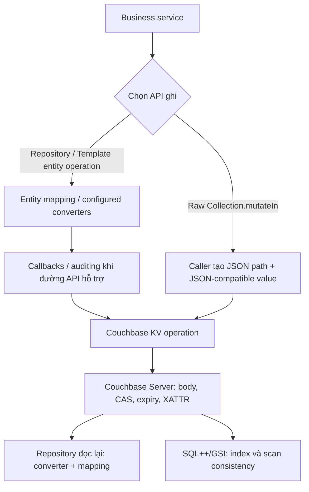

# Ảnh hưởng của cập nhật qua SDK đến ánh xạ, auditing và metadata

## 1. Đặt vấn đề: dữ liệu đúng trong Couchbase chưa chắc đúng trong Spring Data

Trong module **SPRING_DATA_COUCHBASE**, chúng ta xây dựng tầng truy cập Couchbase bằng **Spring Data**, từ document mapping, repository và `CouchbaseTemplate` đến truy vấn SQL++, thiết kế bucket/scope/collection, chỉ mục, TTL, CAS, giao dịch và API reactive.

Ở những bài Sub-document, Java SDK `Collection.lookupIn(...)` và `Collection.mutateIn(...)` giúp đọc hoặc cập nhật một phần JSON mà không cần truyền toàn bộ document. Nhưng khi một ứng dụng dùng **cả Spring Data và Java SDK trực tiếp**, cần đặt thêm câu hỏi:

- Java SDK có hiểu `@Field("display_name")`, `@TypeAlias` hoặc `CouchbaseCustomConversions` không?
- `@CreatedDate`, `@LastModifiedDate`, `@CreatedBy`, `@LastModifiedBy` có tự được cập nhật sau `mutateIn` không?
- Các entity callbacks và validation chạy ở thời điểm nào?
- `@Version`/CAS trên entity Java có được làm mới sau mutation qua SDK không?
- Điều gì xảy ra với `_class`, TTL/expiry, durability, XATTR, metadata của Couchbase?
- Một update JSON thành công có làm SQL++/GSI, repository reader và audit log lập tức nhất quán không?

Câu trả lời trung tâm là: **raw Couchbase Java SDK thao tác trực tiếp trên JSON và metadata của server, không tự đi qua Spring Data mapping, auditing và entity lifecycle.** Một mutation có thể thành công ở KV nhưng khiến các lớp khác nhìn thấy field tên sai, kiểu sai, thiếu dấu thời gian chỉnh sửa hoặc object Java có CAS cũ.

Bài viết này tập trung vào **các ranh giới giữa những tầng**, không chỉ cú pháp `MutateInSpec`.

### Mục tiêu học tập

Sau bài này, bạn có thể:

1. Vẽ được luồng ghi qua repository/Template và luồng raw Java SDK.
2. Phân biệt tên Java property với JSON field path, type hints và custom conversion.
3. Hiểu vì sao SDK mutation không tự kích hoạt auditing annotations hoặc entity callbacks.
4. Đưa audit fields vào **cùng một `mutateIn` nguyên tử** khi ứng dụng yêu cầu.
5. Phân biệt CAS, `@Version`, `schema_version` và metadata expiry/durability.
6. Phân biệt JSON body metadata `_class` với XATTR và virtual XATTR.
7. Thiết kế cập nhật nhất quán giữa SDK, Spring Data, SQL++ và reactive consumers.
8. Lập test matrix để xác minh JSON representation, audit, optimistic locking, TTL, query visibility và rollback.

## 2. Một document minh họa cho cả Spring Data và SDK

Giả sử bucket `shop`, scope `sales`, collection `orders` chứa key `order::1001`:

```json
{
  "_class": "order-document",
  "schema_version": 2,
  "customer_id": "customer::42",
  "shipping": {
    "status": "READY",
    "tracking_code": null,
    "carrier": "VN-EXPRESS"
  },
  "money": {
    "currency": "VND",
    "amount_minor": 150000
  },
  "created_at_ms": 1795104000000,
  "created_by": "checkout-service",
  "modified_at_ms": 1795104000000,
  "modified_by": "checkout-service",
  "last_operation_id": "",
  "history": [
    {
      "event_id": "order-created-1001",
      "status": "CREATED"
    }
  ]
}
```

Các nhóm dữ liệu trong ví dụ:

| Thành phần | Lưu ở đâu? | Ai chịu trách nhiệm? |
| --- | --- | --- |
| `order::1001` | Document key, ngoài body JSON | Ứng dụng và mapping `@Id`. |
| `_class` | JSON field được Spring Data dùng làm type hint theo cấu hình | Spring Data converter/mapping contract. |
| `schema_version` | JSON field do ứng dụng định nghĩa | Schema migration logic của ứng dụng. |
| `shipping.status` | JSON body | Domain layer và persistence adapter. |
| `created_at_ms`/`modified_at_ms` | JSON body | Spring Data auditing trong đường ghi phù hợp, hoặc SDK adapter tự ghi. |
| `created_by`/`modified_by` | JSON body | Spring Data auditing hoặc explicit actor tracking. |
| CAS | Metadata do Couchbase Server quản lý | SDK/server, Spring Data `@Version` mapping. |
| TTL/expiry | Document metadata | SDK options, `@Document`/policy, bucket settings. |
| Durability | Chính sách ghi/request + bucket minimum | SDK/Template policy và server. |
| XATTR | Không gian extended attributes riêng | Framework/SDK có quyền và thiết kế XATTR. |
| GSI | Index được Query service duy trì | Server, index definition và query consistency. |

**Lưu ý:** Các field `created_at_ms` và `modified_at_ms` được minh họa với số milliseconds từ epoch theo **storage contract riêng của ứng dụng**. Không phải mọi `Instant` hoặc `Date` trong Spring Data đều mặc định dùng biểu diễn này; phải kiểm chứng converter thực tế. `_class` cũng có thể lưu class name/alias khác nhau tùy cấu hình.

## 3. Luồng Spring Data và luồng Java SDK khác nhau ở đâu?



Sơ đồ mô tả **hai đường xử lý khác nhau**. Nó không có nghĩa *mọi* Template operation đều chạy toàn bộ callbacks của full-document `save`. Cần kiểm tra từng operation và version.

### 3.1. Repository/Template có ngữ cảnh entity

Khi dùng các API Spring Data vốn quản lý entity, framework có thể:

- Biết entity type và collection mapping.
- Ánh xạ tên property Java thành JSON keys thông qua `@Field`.
- Chuyển value types bằng `MappingCouchbaseConverter` và custom conversions.
- Đọc/ghi type hints, áp dụng optimistic locking qua `@Version`.
- Chạy auditing và entity lifecycle infrastructure **đối với những đường ghi được tài liệu hóa là hỗ trợ**.
- Chuyển một số exception sang hệ `DataAccessException` của Spring.

### 3.2. Raw Java SDK chỉ có key, specs và options

Ví dụ:

```java
Collection orders = cluster.bucket("shop")
    .scope("sales")
    .collection("orders");

orders.mutateIn(
    "order::1001",
    List.of(
        MutateInSpec.replace(
            "shipping.status", "SHIPPED")
    )
);
```

SDK nhìn thấy string `"shipping.status"` và value `"SHIPPED"`. Nó **không có thông tin** rằng ứng dụng Spring định nghĩa class `OrderDocument`, property `shippingStatus`, annotation auditing, domain method `ship()` hoặc converter tiền tệ.

### 3.3. Thử nghiệm quan trọng

Hãy cùng gọi một method ghi qua repository, một method ghi qua SDK rồi đọc lại bằng:

1. Raw SDK `Collection.get(...).contentAsObject()`.
2. Spring Data repository `findById(...)`.
3. SQL++ theo đúng JSON paths.

Chỉ khi **ba đường đọc** nhất quán theo storage contract, ta mới có cơ sở cho rằng các adapter tương thích.

## 4. Entity Spring Data mẫu có mapping và auditing

Đây là lớp rút gọn; constructor/getter/setter, validation và configuration thuộc dự án thực tế.

```java
import org.springframework.data.annotation.Id;
import org.springframework.data.annotation.Version;
import org.springframework.data.annotation.CreatedDate;
import org.springframework.data.annotation.CreatedBy;
import org.springframework.data.annotation.LastModifiedDate;
import org.springframework.data.annotation.LastModifiedBy;
import org.springframework.data.annotation.TypeAlias;
import org.springframework.data.couchbase.core.mapping.Document;
import org.springframework.data.couchbase.core.mapping.Field;

@Document
@TypeAlias("order-document")
public class OrderDocument {

    @Id
    private String id;

    @Version
    private Long version;

    @Field("schema_version")
    private int schemaVersion;

    @Field("customer_id")
    private String customerId;

    @Field("shipping")
    private Shipping shipping;

    @CreatedDate
    @Field("created_at_ms")
    private Long createdAtMs;

    @CreatedBy
    @Field("created_by")
    private String createdBy;

    @LastModifiedDate
    @Field("modified_at_ms")
    private Long modifiedAtMs;

    @LastModifiedBy
    @Field("modified_by")
    private String modifiedBy;

    @Field("last_operation_id")
    private String lastOperationId;

    // Các property tiền tệ/history khác và accessor theo ứng dụng.
}
```

Với nested class:

```java
public class Shipping {

    @Field("status")
    private String status;

    @Field("tracking_code")
    private String trackingCode;

    @Field("carrier")
    private String carrier;

    // Accessors / constructors
}
```

### 4.1. Vì sao chọn `Long` cho audit timestamp?

Spring Data Commons hỗ trợ các loại thời gian như `Instant` và các kiểu số như `Long` trong auditing. Ví dụ chọn `Long` để thiết kế lưu epoch-milliseconds trên JSON cho đơn giản, nhưng vẫn phải **integration-test** rằng auditing infrastructure của Spring Data Couchbase version đang dùng thực sự ghi đúng `created_at_ms`/`modified_at_ms` dạng number.

Nếu ứng dụng lưu ISO-8601 string, Unix seconds hoặc một custom converter `Instant -> String`, raw SDK phải dùng **cùng representation**. Không tự gửi `Instant.toString()` vào một field vốn được Spring Data ghi là number.

### 4.2. `@Version` không phải JSON field `version`

Với Spring Data Couchbase, field `@Version` liên kết tới **CAS metadata**. Khi repository/Template đọc entity, framework có thể đưa CAS hiện tại vào `version`. Không giả định JSON body phải có một field `"version"` tương ứng.

### 4.3. `@TypeAlias` và `_class`

Theo cấu hình converter, Spring Data lưu type hint trong JSON body, thông thường là `_class`. `@TypeAlias` giúp tên type ổn định hơn tên class đầy đủ khi được hỗ trợ trong mapping configuration.

**Raw SDK mutation không tự sinh type hint cho một document mới**, và cũng không tự validate rằng `_class` đang chứa alias hợp lệ. Cần giữ type discriminator theo storage contract.

## 5. Mapping property name với JSON path: rủi ro số một

Giả sử Java:

```java
@Field("tracking_code")
private String trackingCode;
```

Thì field lưu trong JSON là `tracking_code`, không phải `trackingCode`.

### 5.1. Ghi đúng với raw SDK

```java
orders.mutateIn(
    orderId,
    List.of(
        MutateInSpec.upsert(
            "shipping.tracking_code", "VN123456")
    )
);
```

### 5.2. Ghi sai nhưng có thể **vẫn thành công**

```java
orders.mutateIn(
    orderId,
    List.of(
        MutateInSpec.upsert(
            "shipping.trackingCode", "VN123456")
    )
);
```

Nếu `shipping` là object, raw SDK có thể tạo field `trackingCode` **mới**; lúc đó JSON có cả:

```json
{
  "shipping": {
    "tracking_code": null,
    "trackingCode": "VN123456"
  }
}
```

Một Spring Data reader dựa trên `@Field("tracking_code")` có thể vẫn nhìn `trackingCode` như dữ liệu lạ và trả Java property `trackingCode=null`.

### 5.3. Vì sao `replace` thường giúp phát hiện schema drift?

Nếu một field phải tồn tại và có đúng tên JSON, `replace("shipping.tracking_code",...)` sẽ báo lỗi khi thiếu. `upsert` dễ “sửa qua” bằng cách tạo field sai tên, nhất là khi kèm `createPath()`.

Nhưng không nên chỉ dùng `replace` vì muốn phát hiện lỗi nếu domain thực sự cho phép optional field chưa có. Chọn operation theo schema contract, rồi test đúng raw JSON.

## 6. Nested path, type hints và schema nhiều phiên bản

Trong một collection lâu năm, có thể tồn tại:

- V1 lưu `trackingCode` ở root.
- V2 lưu `shipping.tracking_code`.
- V3 lưu `shipping.tracking.code` trong một nested object.
- Một producer ngoài Java dùng thêm field `tracking_code_v2`.
- Một custom converter lưu cả object `shipping` thành string.

Raw SDK `mutateIn` không biết bản nào. Nếu gọi `upsert("shipping.tracking.code",...)` với `createPath()`, nó có thể tạo nhánh mới mà **không** xóa field cũ hoặc cập nhật `schema_version`.

### 6.1. Migration không phải side effect tự có

Migration đúng cần:

1. Đọc raw JSON và schema version.
2. Phân loại MISSING, NULL, parent sai type.
3. Xác định nguồn dữ liệu authoritative khi V1 và V2 cùng có mặt.
4. Chuyển value đúng representation.
5. Ghi field mới/xóa field cũ/cập nhật schema version **trong một `mutateIn` có CAS** khi cùng document.
6. Đọc lại raw body, repository entity và SQL++ query.

Không bật `createPath()` mù để biến mọi lỗi `PathNotFound` thành success.

## 7. Custom conversions: value Java chưa chắc là value JSON

Spring Data hỗ trợ `CouchbaseCustomConversions` và các bộ chuyển đổi tùy chỉnh. Ví dụ:

- Java `Money(150000,"VND")` được lưu thành object `{"amount_minor":150000,"currency":"VND"}`.
- Một ứng dụng khác có thể lưu `"VND:150000"` dạng string.
- Java `Instant` có thể dùng ISO string hoặc epoch tùy cấu hình.
- `Enum` có thể lưu code nghiệp vụ khác `name()`.
- Value object có thể được encode/encrypt trước khi lưu.

Raw SDK chỉ serialize những values nó nhận theo codec của SDK. Nó **không tự gọi Spring Data `@WritingConverter` và `@ReadingConverter`**.

### 7.1. Ví dụ converter biểu diễn tiền thành string

Giả sử actual storage contract là:

```json
{
  "money": "VND:150000"
}
```

Lệnh:

```java
MutateInSpec.replace(
    "money.amount_minor", 170000);
```

không hợp lệ vì `money` là scalar string, không phải object chứa `amount_minor`. `createPath()` cũng không nên tự biến parent string thành object, gây mất dữ liệu V1.

Phải chọn:

- Thay cả field `money` bằng representation string hợp lệ đã encode theo converter.
- Hoặc migrate toàn bộ schema sang object version mới, có CAS và test.
- Hoặc ưu tiên Spring Data entity path khi cần dùng converter pipeline.

### 7.2. Không tự encode domain object bừa

```java
// Không giả định JsonObject này giống Spring Data converter:
JsonObject raw = JsonObject.create()
    .put("amount", 150000)
    .put("currency", "VND");

orders.mutateIn(
    orderId,
    List.of(MutateInSpec.replace("money", raw))
);
```

Nếu application converter dùng `amount_minor`, JSON mới sai storage schema dù SDK mutation thành công. Việc gửi `java.time.Instant` hoặc `BigDecimal` theo default serializer của SDK cũng cần xác minh ý nghĩa, scale/timezone và độ chính xác.

### 7.3. Rủi ro với dữ liệu nhạy cảm

Nếu application bảo vệ một field qua custom encryption/conversion ở tầng Spring Data, raw SDK ghi plaintext có thể **bỏ qua** bước bảo vệ. Không mở rộng raw SDK patch đến field tiền tệ, token, secret hoặc PII khi chưa có adapter được kiểm thử với security/storage contract.

## 8. Auditing của Spring Data hoạt động ở tầng nào?

Spring Data auditing dùng annotation:

- `@CreatedDate`.
- `@CreatedBy`.
- `@LastModifiedDate`.
- `@LastModifiedBy`.

Nó cần cấu hình auditing phù hợp, ví dụ `@EnableCouchbaseAuditing`, `AuditorAware<T>` hoặc `ReactiveAuditorAware<T>` theo đường blocking/reactive. Tài liệu Spring Data Couchbase nhấn mạnh `@Version` có vai trò phân biệt create/update để auditing creation đúng.

Đây là **infrastructure Java/Spring**, không phải trigger chung của Couchbase Server mỗi khi bất cứ SDK nào thay một JSON path.

### 8.1. Ví dụ cấu hình auditing

```java
import java.util.Optional;

import org.springframework.context.annotation.Bean;
import org.springframework.context.annotation.Configuration;
import org.springframework.data.domain.AuditorAware;
import org.springframework.data.couchbase.config.EnableCouchbaseAuditing;

@Configuration
@EnableCouchbaseAuditing
class CouchbaseAuditConfiguration {

    @Bean
    AuditorAware<String> auditorAware() {
        // Production: lấy actor từ security context/tenant.
        // Fallback "system" chỉ khi business policy cho phép.
        return () -> Optional.of("order-service");
    }
}
```

Ví dụ minh họa một auditor cố định, **không phải production identity provider**. Đối với request có actor người dùng, phải trích xuất đúng principal, reject unauthenticated actions khi cần và không để một request user tự khai báo `modifiedBy` mà không kiểm chứng.

### 8.2. Vì sao Spring Data auditing không chạy với raw SDK?

```java
orders.mutateIn(
    orderId,
    List.of(
        MutateInSpec.replace(
            "shipping.status", "SHIPPED")
    )
);
```

Lệnh này không đi qua Spring Data auditing handler, do đó **không tự** sửa `modified_at_ms` hoặc `modified_by`. Server chỉ biết JSON mutation spec và metadata options mà SDK gửi.

Một entity Java đang ở memory cũng **không tự đổi `modifiedAtMs`** chỉ vì SDK raw đã sửa document cùng key.

## 9. Trạng thái audit sau một raw SDK patch

Trước mutation:

```json
{
  "shipping": {"status": "READY"},
  "modified_at_ms": 1795104000000,
  "modified_by": "checkout-service"
}
```

Sau khi chỉ gửi:

```java
MutateInSpec.replace(
    "shipping.status", "SHIPPED");
```

thì:

```json
{
  "shipping": {"status": "SHIPPED"},
  "modified_at_ms": 1795104000000,
  "modified_by": "checkout-service"
}
```

Timestamp và actor **vẫn là giá trị cũ** trừ khi có một cơ chế khác cập nhật chúng. Spring Data auditing annotation tự nó không phải database trigger.

### 9.1. Hậu quả thực tế

- Report “đơn hàng được sửa sau thời điểm X” có thể bỏ sót mutation.
- Cache invalidation dựa vào `modified_at_ms` không nhận diện update.
- Alert điều tra giao dịch có thể gán nhầm actor.
- Repository đọc status mới nhưng audit timestamp cũ.
- Pipeline CDC/eventing hoặc SQL++ query theo timestamp có thể không bắt được thay đổi.
- Phân tích incident mất khả năng liên kết thay đổi với operation ID.

CAS của server có thể đã đổi, nhưng CAS **không phải substitute** cho audit timestamp hoặc actor, vì nó không diễn tả "ai" và "vì sao".

## 10. Giải pháp: ghi audit fields **trong cùng `mutateIn`**

Nếu ứng dụng quyết định dùng raw SDK cho một workflow, service phải **explicitly supply**:

- Dữ liệu nghiệp vụ.
- `modified_at_ms` theo clock và representation đã thống nhất.
- `modified_by` từ actor được xác thực.
- `last_operation_id` để liên kết/retry.
- Event history nếu contract cần.

### 10.1. Lấy dữ liệu từ service layer

```java
import java.time.Clock;
import java.time.Instant;

Clock clock = Clock.systemUTC(); // Inject Clock trong production.

String actor = "shipping-service";
String operationId = "ship::1001::request-001";
String tracking = "VN123456";

long modifiedAtEpochMs =
    clock.instant().toEpochMilli();
```

Trong production:

- Inject `Clock` để test deterministically.
- Identity lấy từ authenticated context, không tin body JSON input tùy ý.
- Event ID là business idempotency key ổn định.
- Validate tracking, status transition và tenant authorization.
- Bảo đảm timestamp representation nhất quán với Spring Data converter.

### 10.2. Một request atomic với business fields và auditing

```java
import java.util.List;

import com.couchbase.client.java.Collection;
import com.couchbase.client.java.json.JsonObject;
import com.couchbase.client.java.kv.MutateInOptions;
import com.couchbase.client.java.kv.MutateInResult;
import com.couchbase.client.java.kv.MutateInSpec;
import com.couchbase.client.core.msg.kv.DurabilityLevel;

JsonObject event = JsonObject.create()
    .put("event_id", operationId)
    .put("status", "SHIPPED")
    .put("at_ms", modifiedAtEpochMs)
    .put("actor", actor);

MutateInResult result = orders.mutateIn(
    orderId,
    List.of(
        MutateInSpec.replace(
            "shipping.status", "SHIPPED"),
        MutateInSpec.upsert(
            "shipping.tracking_code", tracking),
        MutateInSpec.replace(
            "modified_at_ms", modifiedAtEpochMs),
        MutateInSpec.replace(
            "modified_by", actor),
        MutateInSpec.upsert(
            "last_operation_id", operationId),
        MutateInSpec.arrayAppend(
            "history", List.of(event))
    ),
    MutateInOptions.mutateInOptions()
        .cas(expectedCas)
        .durability(DurabilityLevel.MAJORITY)
        .preserveExpiry(true)
);

long updatedCas = result.cas();
```

Giả định:

- `expectedCas` lấy từ `lookupIn`/`get` đúng phiên bản.
- Tất cả required paths `shipping.status`, `modified_at_ms`, `modified_by` đã có.
- `history` là array; `shipping` là object.
- Actor và values đã validate; `modified_at_ms` là field JSON numeric theo storage contract.
- SDK/server hỗ trợ options đã chọn, bucket/collection có policy phù hợp.

Nếu một spec lỗi, **toàn mutation không commit một phần**. Vì vậy status mới, audit timestamp, actor và history được cập nhật cùng nhau hoặc không được cập nhật.

### 10.3. Không sửa `created_at_ms`/`created_by` khi chỉ update

Created fields thể hiện **lần tạo ban đầu**. Một raw `mutateIn` sửa status không nên viết lại creation timestamp hoặc creator, trừ khi business có quy trình sửa dữ liệu lịch sử được phê duyệt.

Khi **tạo document bằng raw SDK**, Spring Data cũng không tự điền created fields: adapter tạo mới phải khởi tạo JSON đầy đủ, type hint/mapping contract, created/modified audit fields và expiry/durability theo policy.

## 11. Dấu thời gian và actor: tính đúng quan trọng hơn cú pháp

### 11.1. Clock và timezone

Nếu dùng epoch milliseconds UTC, mọi producer phải thống nhất unit. Nhầm **seconds** với **milliseconds** có thể làm timestamp sai ba bậc độ lớn. Nếu dùng ISO-8601, yêu cầu timezone/offset và precision phải nhất quán.

```java
Instant now = clock.instant();
long millis = now.toEpochMilli();

// Nếu contract lưu ISO string thay vì number:
String iso = now.toString();
```

Không gửi cả `millis` và `iso` vào cùng một storage field không có schema version rõ.

### 11.2. Actor identity

`@LastModifiedBy` được Spring Data điền từ `AuditorAware` khi auditing pipeline chạy. Raw SDK adapter phải tự lấy actor:

- User ID đã xác thực.
- Service principal cho background jobs.
- Tenant/role context khi có quyền.
- Operation/correlation ID khi cần truy vết.

Không tin chuỗi `modified_by` do client gửi rồi ghi xuống document.

### 11.3. Audit history không thay thế immutable audit log

`modified_at_ms`/`modified_by` chỉ giữ **giá trị sửa gần nhất**, không phải lịch sử đầy đủ. Một JSON `history` array có thể hữu ích nhưng nếu cho phép ghi đè/xóa, nó không phải ledger bất biến.

Với yêu cầu kiểm toán mạnh, dùng append-only events, event document riêng, idempotency keys, retention và transaction/outbox khi cần. Đừng tuyên bố một field audit trong document là chứng cứ không thể sửa.

## 12. Auditing qua repository và Template: không suy rộng cho mọi API

Với repository `save(entity)` và các entity operations được Spring Data quản lý, framework có cơ chế auditing/callbacks được cấu hình.

`CouchbaseTemplate` có nhiều API, trong đó có fluent `mutateInById`. Tài liệu Template hiện hành mô tả Sub-document mutation hỗ trợ các nhóm:

- `withInsertPaths(...)`.
- `withUpsertPaths(...)`.
- `withReplacePaths(...)`.
- `withRemovePaths(...)`.

Ví dụ:

```java
couchbaseTemplate.mutateInById(OrderDocument.class)
    .withReplacePaths("shipping.status")
    .one(patch);
```

`patch` là entity mang ID và các property cần mutation. **Không khẳng định** các operation mutate-by-ID chạy đầy đủ lifecycle của `repository.save` hoặc tự làm mới auditing. Điều đó phải kiểm tra theo phiên bản framework, đường code và integration test.

### 12.1. Cùng tên "Template" không có nghĩa cùng pipeline

- `upsertById(...).one(entity)` có thể xử lý entity conversion/auditing khác `mutateInById(...).one(entity)`.
- `findById` trả entity được converter materialize.
- `mutateInById` patch một số property paths, không nhất thiết load toàn aggregate.
- `Collection.mutateIn` raw hoàn toàn đi thẳng vào SDK.

Nếu nghiệp vụ **bắt buộc** audit timestamp/actor cập nhật ngay, một cách chắc chắn là thiết kế request ghi audit fields explicit hoặc xác minh callback hỗ trợ với test, thay vì chỉ nhìn thấy annotation trên class.

### 12.2. Không chia một hành động thành hai KV mutations

Sai nếu yêu cầu atomicity của status + audit:

```java
// Request 1:
orders.mutateIn(orderId, List.of(
    MutateInSpec.replace(
        "shipping.status", "SHIPPED")
));

// Request 2:
orders.mutateIn(orderId, List.of(
    MutateInSpec.replace(
        "modified_at_ms", modifiedAtEpochMs)
));
```

Nếu request hai lỗi, status đã đổi còn audit timestamp cũ. Khi cả hai fields cùng một document, gộp vào **một `mutateIn`** như mục 10 để có atomicity.

### 12.3. Template không phải superset của Java SDK

Đừng tự suy có `withArrayAppendPaths`, `withIncrementPaths`, `withXattrPaths` hoặc `lookupInById` ở Spring Data version chưa tài liệu hóa. Khi cần SDK-only specs, dùng raw `Collection.mutateIn` kèm adapter chịu trách nhiệm mapping/audit.

## 13. Entity callbacks và lifecycle hooks

Spring Data Commons và Spring Data Couchbase có cơ chế events/callbacks phục vụ các công việc như:

- Chuẩn hóa field trước convert/save.
- Tạo derived fields.
- Kiểm tra một số invariants.
- Cập nhật audit metadata.
- Thực hiện hành vi tích hợp được cấu hình ở đường persistence phù hợp.

**Raw Java SDK không chạy trong Spring entity lifecycle.** Vì thế những quy tắc chỉ nằm trong callback sẽ không được áp khi service gọi thẳng `orders.mutateIn(...)`.

### 13.1. Ví dụ lỗi thực tế

Giả sử mỗi lần `OrderDocument` save, một callback chuẩn hóa `trackingCode` thành uppercase. Nếu raw SDK gửi `"vn123456"`, document có thể lưu lowercase. `CouchbaseRepository` đọc lại string đó mà không có dấu hiệu DB operation thất bại.

Một callback cập nhật `searchText`/`normalizedName` cũng tương tự: raw patch field gốc mà không cập nhật derived field sẽ làm lệch SQL++ full-text/search reporting.

### 13.2. Không coi callback là business transaction

Ngay cả khi callback chạy trên một đường ghi, nó không làm HTTP call, gửi message hoặc ghi document khác trở thành atomic chung với KV mutation. External effects phải có transaction/outbox hoặc workflow riêng.

### 13.3. Ba lựa chọn kiến trúc

1. **Giữ toàn bộ domain logic trong service:** callback chỉ làm kỹ thuật, cả repository và SDK adapter dùng chung validator/normalizer.
2. **Chỉ cho SDK patch một số fields độc lập:** các fields phụ thuộc callbacks phải đi qua entity path.
3. **Di chuyển derived/audit fields vào một `mutateIn`:** adapter chuyển đổi đúng JSON rồi gộp mọi spec cùng document.

Chọn rõ một chính sách; đừng để client nào đi qua callback còn client khác âm thầm bỏ qua.

## 14. Bean Validation không tự được SDK gọi

Entity có thể khai báo:

```java
@NotBlank
@Field("tracking_code")
private String trackingCode;
```

Và project có thể đăng ký validation listener/callback khi save entity. Raw SDK:

```java
MutateInSpec.upsert(
    "shipping.tracking_code", "");
```

không tự gọi Jakarta Bean Validation/JSR303 trên entity. Couchbase Server kiểm tra path/value JSON hợp lệ, **không biết** yêu cầu `@NotBlank` hoặc regex mã vận đơn của domain.

Để tránh invalid data:

- Validate actor và input ở service.
- Dùng typed command hoặc domain method.
- Chuyển giá trị qua mapper đúng contract.
- Test API boundaries (HTTP, message consumer, scheduled job).
- Chặn raw path/value từ user không đủ quyền.

## 15. `@Version` và CAS sau một SDK mutation

Couchbase CAS là **opaque server-generated token** gắn với phiên bản document. Spring Data ánh xạ CAS vào property được đánh dấu `@Version` trong entity.

Ví dụ:

```java
OrderDocument before = repository.findById(orderId)
    .orElseThrow();

// Trên entity này, before.version có CAS tại thời điểm đọc.
// Raw SDK bên dưới không làm before tự cập nhật:
MutateInResult mutation = orders.mutateIn(
    orderId,
    List.of(
        MutateInSpec.replace(
            "shipping.status", "SHIPPED")
    )
);

long newCas = mutation.cas();
```

Sau mutation:

- Server có CAS mới.
- `before` trong memory vẫn giữ version/các property từ lần đọc cũ.
- Repository `save(before)` với optimistic locking được cấu hình có thể gặp `OptimisticLockingFailureException`.
- Nếu không dùng CAS trong full save, có nguy cơ ghi đè raw SDK mutation từ snapshot cũ.

### 15.1. Không tự cộng CAS

`newCas` có kiểu `long` nhưng **không** được dùng như counter tăng đều hoặc timestamp. Đừng sửa `before.setVersion(before.getVersion()+1)`. Nếu cần entity mới, đọc lại từ server hoặc xử lý CAS mới theo API được tài liệu hóa.

### 15.2. Khi CAS là bắt buộc

Nếu logic là “chỉ chuyển `READY → SHIPPED`”, phải đọc status và CAS trong cùng snapshot, kiểm tra domain, rồi gửi multi-spec mutation có:

```java
MutateInOptions.mutateInOptions()
    .cas(expectedCas);
```

CAS chỉ bảo vệ **document version**, không tự biết status transition hợp lệ; application đã phải kiểm tra trước đó.

### 15.3. Hot document làm CAS conflict cao

Bộ đếm `stats.views` tăng liên tục cũng làm CAS đổi, khiến workflow auditing/shipping có thể conflict dù view count không liên quan. Có thể tách hot counter sang document khác nếu eventual consistency cho phép, nhưng khi đó không còn atomicity chung trong một `mutateIn`.

## 16. `@Version` có giúp tự động audit raw SDK patch không?

**Không.** `@Version` giúp optimistic concurrency trong các đường Spring Data thích hợp và cho biết CAS lúc đọc. Khi raw SDK mutation thành công, server tạo CAS mới nhưng:

- `@LastModifiedDate` không tự chạy.
- `@LastModifiedBy` không tự chạy.
- `@CreatedDate` không được điều chỉnh.
- Callback/validation không chạy.
- Entity Java cũ không nhận field/version mới qua phép màu.

Bản thân CAS không chứa thời gian hoặc identity đáng tin cậy cho audit.

## 17. Metadata nằm trong body, ngoài body và trong XATTR

Đây là một trong những phần dễ nhầm nhất:

| Loại | Ví dụ | Raw SDK đọc/ghi bằng gì? |
| --- | --- | --- |
| JSON body property | `shipping.status`, `_class`, `modified_at_ms` | `LookupInSpec.get`, `MutateInSpec.replace/upsert` theo JSON path. |
| Outer document key | `order::1001` | Tham số key của `Collection` KV methods. |
| CAS | Version token | `GetResult.cas()` / `LookupInResult.cas()` / `MutateInResult.cas()`. |
| Expiry/TTL | Thời điểm hết hạn document | KV options/metadata APIs, không phải JSON path `ttl` mặc định. |
| Durability | Mức replication/persistence | `MutateInOptions.durability(...)` và bucket minimum. |
| User XATTR | Metadata do library/framework quản lý | Subdoc spec với `.xattr()` khi có quyền. |
| Virtual XATTR | `$document` và các macro chỉ đọc | Subdoc lookup XATTR theo API được hỗ trợ. |
| Spring `@Version` | Field Java chứa CAS | Converter khi đọc/ghi entity, không phải body JSON version. |

Một field có tên `"expiry"` hoặc `"cas"` **trong JSON body** chỉ là dữ liệu ứng dụng, không tự thay metadata expiry/CAS của Couchbase.

### 17.1. `_class` không phải tự nhiên là XATTR

Trong mapping Spring Data Couchbase thông thường, `_class` là **type hint field trong JSON body**. Nó không đồng nghĩa với XATTR và không phải CAS metadata.

Nếu raw SDK gọi `MutateInSpec.remove("_class")`, framework có thể mất thông tin type mapping; nếu ghi sai alias, repository reader có thể không materialize subtype mong muốn. Không expose path này cho client.

## 18. XATTR: không gian metadata khác với JSON body

Couchbase **Extended Attributes (XATTR)** được xây trên Sub-document protocol, nhưng có không gian lưu/đọc tách biệt với JSON body thông thường. Tài liệu Couchbase mô tả chúng chủ yếu phục vụ library/framework metadata, không phải một chỗ để đưa mọi business field vào.

### 18.1. Một XATTR do application kiểm soát (minh họa)

```java
orders.mutateIn(
    orderId,
    List.of(
        MutateInSpec.upsert(
            "app_meta.last_operation_id", operationId)
            .xattr()
            .createPath()
    )
);
```

Dòng `.xattr()` thay đổi mục tiêu từ body JSON sang extended attribute. Yêu cầu quyền, tên namespace, giới hạn protocol và thứ tự specs phải được kiểm tra theo SDK/server version. Đừng copy-paste biến mọi audit field thành XATTR.

### 18.2. Một XATTR và một field body trong cùng mutation

Java SDK có thể gộp XATTR spec với body spec trong **một `mutateIn`** khi tuân thủ quy tắc Sub-document của server.

```java
orders.mutateIn(
    orderId,
    List.of(
        MutateInSpec.upsert(
            "app_meta.last_operation_id", operationId)
            .xattr()
            .createPath(),
        MutateInSpec.replace(
            "shipping.status", "SHIPPED")
    )
);
```

Trong trường hợp này, thứ tự/spec constraints của XATTR quan trọng. Dù atomic trên cùng key, một framework khác hoặc SQL++ consumer có thể không đọc XATTR như body property bình thường. Không dùng nó như cơ chế mặc định cho `@LastModifiedBy`.

### 18.3. Virtual XATTR: metadata được tạo khi đọc

SDK có `LookupInMacro.EXPIRY_TIME` để lấy expiry metadata qua XATTR lookup:

```java
import com.couchbase.client.java.kv.LookupInMacro;
import com.couchbase.client.java.kv.LookupInSpec;
import com.couchbase.client.java.kv.LookupInResult;

LookupInResult metadata = orders.lookupIn(
    orderId,
    List.of(
        LookupInSpec.get(
            LookupInMacro.EXPIRY_TIME).xattr()
    )
);
```

Giải mã value theo Javadoc/SDK version và lưu ý cách biểu diễn timestamp. Virtual XATTR khác **user-defined XATTR**: nó được server tổng hợp để đọc metadata, không phải field ứng dụng có thể ghi như JSON thông thường.

### 18.4. Không nhầm metadata visibility với security boundary

XATTR được truy cập qua API/permissions riêng, nhưng không vì thế mà nó tự thành kho bí mật an toàn hay đầy đủ audit compliance. Quản lý RBAC, namespace system/user, retention, backup và quyền service vẫn là yêu cầu riêng.

## 19. TTL/expiry khi raw SDK sửa một phần JSON

Spring Data Couchbase hỗ trợ expiry policy qua `@Document(expiry = ...)` hoặc `expiryExpression` ở những version phù hợp, và có thể đặt durability theo `@Document`.

Raw SDK `mutateIn` **không đọc `@Document(expiry=...)` trên Java entity**. Nó chỉ làm theo `MutateInOptions`/bucket policy/server semantics.

### 19.1. Muốn bảo toàn TTL

```java
orders.mutateIn(
    orderId,
    List.of(
        MutateInSpec.replace(
            "shipping.status", "SHIPPED")
    ),
    MutateInOptions.mutateInOptions()
        .preserveExpiry(true)
);
```

`preserveExpiry(true)` được hỗ trợ từ Couchbase Server 7.0 theo Java SDK documentation. Nếu dùng server cũ hoặc policy khác, phải kiểm tra behavior của dependency/server thay vì mặc định hỗ trợ.

### 19.2. Muốn đặt TTL mới

```java
import java.time.Duration;

orders.mutateIn(
    orderId,
    List.of(
        MutateInSpec.upsert(
            "shipping.tracking_code", tracking)
    ),
    MutateInOptions.mutateInOptions()
        .expiry(Duration.ofDays(7))
);
```

**Cảnh báo:** Đoạn trên là ví dụ API, **không phải khuyến nghị đặt expiry 7 ngày cho order lâu dài**. TTL áp dụng lên **toàn document**, không chỉ trường tracking vừa sửa. Nếu muốn event 7 ngày, cân nhắc lưu event thành document riêng hoặc retention schema khác.

### 19.3. Một path `"expires_at"` không đồng nghĩa TTL

```java
MutateInSpec.upsert(
    "expires_at", "2026-12-01T00:00:00Z");
```

là ghi một JSON body field. Nó **không tự cài đặt server expiry**. Nếu ứng dụng dùng cả field này lẫn TTL metadata, phải đồng bộ chúng rõ ràng và test khi clock/expiry policy thay đổi.

## 20. Durability: chính sách framework không tự áp lên raw SDK

Spring Data có thể cấu hình durability trên entity/Template, ví dụ `@Document(durabilityLevel = ...)` hoặc fluent `withDurability(...)` theo API.

Raw SDK mutation:

```java
orders.mutateIn(
    orderId,
    List.of(
        MutateInSpec.replace(
            "shipping.status", "SHIPPED")
    ),
    MutateInOptions.mutateInOptions()
        .durability(DurabilityLevel.MAJORITY)
);
```

Phải chỉ định `DurabilityLevel` theo policy, hoặc chấp nhận default/bucket minimum. Không vì repository của cùng entity có annotation durability mà tin raw SDK sẽ tự thấy annotation đó.

### 20.1. CAS, durability và expiry cùng là options của một mutation

```java
MutateInOptions options = MutateInOptions.mutateInOptions()
    .cas(expectedCas)
    .durability(DurabilityLevel.MAJORITY)
    .preserveExpiry(true);
```

Đây là ba bảo đảm **khác nhau**:

- CAS: tránh ghi dựa trên stale snapshot.
- Durability: yêu cầu replication/persistence ở mức phù hợp.
- Preserve expiry: giữ vòng đời document theo policy.

Một request thành công không có nghĩa SQL++ GSI index đã ngay lập tức nhìn thấy trạng thái mới.

## 21. Schema version là field ứng dụng, không phải CAS

`schema_version` có thể là số 2 trong JSON. Nó mô tả contract của dữ liệu:

```json
{"schema_version": 2}
```

Còn CAS là opaque token của server. `schema_version` **không tự thay đổi** khi raw SDK patch một field; CAS **có thể thay đổi** với mọi mutation thành công.

Khi migration V2 → V3, phải chủ động cập nhật `schema_version` trong cùng mutation (khi phù hợp) và bảo vệ CAS. Không dùng `@Version` để lưu schema version, hoặc dùng schema version để thay optimistic locking.

## 22. Query consistency và GSI sau raw SDK patch

Raw `mutateIn` theo document key không cần GSI để tìm record. Nhưng nếu index chứa field `shipping.status`, server phải duy trì index liên quan.

```sql
CREATE INDEX ix_orders_status
ON `shop`.`sales`.`orders`(
    shipping.status,
    modified_at_ms
);
```

```sql
SELECT META(o).id AS orderId,
       o.shipping.status,
       o.modified_at_ms,
       o.modified_by
FROM `shop`.`sales`.`orders` AS o
WHERE o.shipping.status = "SHIPPED";
```

Nếu raw SDK đã đổi `shipping.status` nhưng quên `modified_at_ms`:

- Query theo status mới có thể trả record.
- Query “modified recently” dựa trên timestamp có thể bỏ sót.
- Một index theo audit timestamp vẫn chứa giá trị cũ, vì body JSON **thực sự chưa được cập nhật**, không phải do indexing lag.

### 22.1. Phân biệt lỗi dữ liệu với GSI lag

Sau khi mutate:

1. Đọc raw JSON bằng KV `get`/`lookupIn`.
2. Xác minh JSON field names, values và audit fields.
3. Nếu KV đúng mà SQL++ chưa thấy, xem query scan consistency/index state.
4. Có thể dùng scan consistency `REQUEST_PLUS` khi cần read-after-write trong test, với chi phí latency.
5. Dùng `EXPLAIN` để xem plan và index coverage.

Durability hay CAS không tự thay thế query consistency.

## 23. Spring Data repository save sau raw SDK patch

Giả sử:

```java
OrderDocument snapshot =
    repository.findById(orderId).orElseThrow();

orders.mutateIn(
    orderId,
    List.of(
        MutateInSpec.replace(
            "shipping.status", "SHIPPED")
    )
);

// snapshot vẫn chứa status/version cũ ở memory.
repository.save(snapshot);
```

Nếu `@Version` hoạt động đúng, `repository.save(snapshot)` có thể bị từ chối do CAS stale. Đừng bắt `OptimisticLockingFailureException` rồi save lại với CAS mới nhưng body cũ: điều đó làm mất mutation của writer trước.

### 23.1. Retry đúng

- Đọc lại entity/JSON.
- Kiểm tra domain state và audit fields.
- Áp dụng lại quyết định nếu còn hợp lệ.
- Save với CAS/`@Version` mới.
- Dừng khi điều kiện nghiệp vụ đã thay đổi.

### 23.2. Hai đường ghi cần một contract chung

Đặc biệt kiểm thử khi:

- Repository tạo entity có `_class`/type alias.
- Raw SDK sửa nested field.
- Repository đọc lại, materialize subtype đúng.
- Repository save với CAS mới không mất audit fields.
- SQL++ query theo path vẫn khớp.
- TTL/durability policy không đổi ngoài ý muốn.

Đó là kiểm thử interoperability, không thể chỉ mock `Collection` trong unit test.

## 24. Raw SDK patch còn có thể bỏ qua derived fields

Giả sử entity có:

```json
{
  "profile": {"display_name": "Lan"},
  "search": {
    "display_name_folded": "lan"
  }
}
```

Trong đường `repository.save`, ứng dụng có thể dùng callback hoặc service để tạo `search.display_name_folded`. Nếu raw SDK thay `profile.display_name` thành `"Hà"` mà không thay field derived, query/search theo `display_name_folded` sẽ lỗi logic.

**Giải pháp:** xác định các field phụ thuộc cần được cập nhật cùng nhau, encode/normalize đúng cách và ghi trong một `mutateIn`:

```java
orders.mutateIn(
    id,
    List.of(
        MutateInSpec.replace(
            "profile.display_name", newName),
        MutateInSpec.replace(
            "search.display_name_folded", normalized)
    )
);
```

Đoạn chỉ minh họa design; các biến `id`, `newName`, `normalized` phải do service xây và validation. Không nhét logic normalization khác nhau vào nhiều adapter.

## 25. Audit riêng cho HTTP và background job

Một ứng dụng thường có ba luồng:

| Nguồn command | Auditor trong Spring Data | Auditor khi raw SDK |
| --- | --- | --- |
| HTTP user request | `AuditorAware` đọc authenticated principal | Service truyền actor đã xác thực. |
| Message consumer | Có thể đọc context/message identity khi cấu hình | Message handler xác định service principal + event ID. |
| Scheduled job | Auditor hệ thống theo policy | Explicit `"scheduler:<job>"` hoặc service identity. |

Đối với reactive pipeline, auditing của Spring Data có thể dùng `ReactiveAuditorAware` và Reactor context. Nhưng **raw reactive SDK `Collection.reactive().mutateIn` vẫn không tự gọi auditing**, ngay cả khi bên trong một `Mono` chạy trong Spring WebFlux.

### 25.1. Không làm giả actor của user

Nếu request không có authenticated principal, đừng ghi `modified_by="admin"` để tránh null. Chọn rõ:
- Reject hành động không được phép;
- Hoặc ghi service identity có thể audit;
- Hoặc ghi actor “unknown” theo policy được chấp thuận và phát cảnh báo.

## 26. Reactive SDK: đảm bảo audit ở đúng mutation

```java
import reactor.core.publisher.Mono;

Mono<MutateInResult> update =
    orders.reactive().mutateIn(
        orderId,
        List.of(
            MutateInSpec.replace(
                "shipping.status", "SHIPPED"),
            MutateInSpec.replace(
                "modified_at_ms", modifiedAtEpochMs),
            MutateInSpec.replace(
                "modified_by", actor)
        ),
        MutateInOptions.mutateInOptions()
            .cas(expectedCas)
            .durability(DurabilityLevel.MAJORITY)
    );
```

Một `Mono` thường bắt đầu I/O khi subscribe; code phải verify completion/errors. Nếu vừa gọi SDK raw vừa chạy Reactor context, **auditing annotations không tự chạy**.

### 26.1. Không tách audit update sang `then(...)` riêng

```java
Mono<Void> unsafe = orders.reactive()
    .mutateIn(
        orderId,
        List.of(
            MutateInSpec.replace(
                "shipping.status", "SHIPPED")
        )
    )
    .then(
        orders.reactive().mutateIn(
            orderId,
            List.of(
                MutateInSpec.replace(
                    "modified_by", actor)
            )
        )
    )
    .then();
```

Đây là **hai mutations độc lập**. Nếu lệnh thứ hai lỗi, status đã đổi nhưng audit chưa đổi. Gộp vào một request khi cần nguyên tử.

### 26.2. Không dùng `retry(3)` vô điều kiện

Nếu mutation còn chứa `increment`, `arrayAppend` hoặc external effects, một timeout mơ hồ có thể khiến retry tạo tác dụng kép. Dùng operation ID, CAS/readback và error classifier phù hợp.

## 27. Kết hợp Spring Data auditing và raw SDK: ba chiến lược

| Chiến lược | Cách làm | Ưu điểm | Rủi ro |
| --- | --- | --- | --- |
| Chỉ repository/Template entity path | Mọi update quan trọng đi qua Spring Data được kiểm chứng | Tái sử dụng mapping/auditing/callbacks | Có thể cần full entity read/save; CAS conflicts; Template chỉ hỗ trợ subset specs. |
| Raw SDK adapter với explicit audit | Một `mutateIn` ghi business + audit + operation ID | Payload nhỏ, atomic trên một document | Phải tự map JSON/actor/time/validation và test. |
| Hybrid theo loại field | Domain aggregate quan trọng dùng entity path, metrics/tags dùng SDK | Cân bằng hiệu năng với consistency | Dễ drift nếu không có storage contract chung. |

**Không có chiến lược đúng cho mọi module.** Quyết định dựa trên invariants, tần suất ghi, số fields, lifecycle hooks, mức độ quan trọng của audit và khả năng kiểm thử.

### 27.1. Policy gợi ý

- Fields liên quan tiền, quyền hoặc chuyển trạng thái: ưu tiên đường domain-validated với CAS, audit rõ.
- Fields độc lập như view count: SDK increment có thể phù hợp, nhưng định nghĩa chính sách audit riêng.
- Fields có custom converter phức tạp: tránh raw SDK patch trừ khi mapper đã chuẩn hóa.
- Schema migration: có version/CAS/readback, không trộn kiểu cũ/mới.
- Mọi path: whitelist, không nhận raw path từ client.

## 28. Bảng dấu hiệu drift và cách chẩn đoán

| Triệu chứng | Nguyên nhân thường gặp | Cách kiểm tra |
| --- | --- | --- |
| Repository đọc `trackingCode=null` dù SDK mutate success | SDK ghi `trackingCode` thay vì JSON `tracking_code` | Raw JSON và `@Field`. |
| Auditing time giữ nguyên | SDK không chạy `@LastModifiedDate` handler | Compare raw `modified_at_ms` before/after. |
| Auditing actor sai | Adapter tự ghi actor từ input hoặc dùng service identity sai | Security context và audit policy. |
| Repository save stale conflict | CAS đổi sau SDK mutation | Entity `@Version` vs SDK `result.cas()`. |
| Entity materialize sai subtype | `_class`/alias bị xóa/ghi sai | Raw type hint và mapping config. |
| Date/time đọc sai | SDK ghi ISO nhưng converter mong number | Kiểm tra raw type, timezone, unit. |
| Money mất precision | SDK gửi float/number ngoài contract | Converter, scale và decimal representation. |
| Derived search field cũ | Callback không chạy | Compare source + normalized fields. |
| Document hết TTL ngoài dự kiến | SDK expiry policy khác `@Document` | Check metadata expiry và options. |
| SDK ghi không đạt durability mong muốn | SDK không đọc `@Document(durability)` | Check options và bucket min durability. |
| SQL++ chưa thấy thay đổi | GSI chưa cập nhật hoặc consistency chưa đủ | KV read, index state, `EXPLAIN`. |
| SQL++ thấy status mới nhưng audit cũ | Body audit fields không được patch | Raw JSON, không đổ lỗi chỉ cho GSI. |
| XATTR không thấy trong JSON body | XATTR không gian riêng | Lookup with `.xattr()`. |
| `@Version` JSON không có field `version` | CAS là metadata | GetResult/LookupInResult.cas(). |
| History có duplicate event | Retry non-idempotent mutation sau timeout | Operation ID/readback/idempotency. |

## 29. Một adapter typed để giới hạn đường đi raw SDK

```java
public interface OrderShippingPort {
    long markShipped(
        String orderId,
        String trackingCode,
        String operationId,
        String actor,
        long expectedCas
    );
}
```

Implementation minh họa:

```java
import java.time.Clock;
import java.util.List;
import java.util.Objects;

import com.couchbase.client.java.Collection;
import com.couchbase.client.java.json.JsonObject;
import com.couchbase.client.java.kv.MutateInOptions;
import com.couchbase.client.java.kv.MutateInResult;
import com.couchbase.client.java.kv.MutateInSpec;
import com.couchbase.client.core.msg.kv.DurabilityLevel;

public final class OrderShippingGateway
        implements OrderShippingPort {

    private final Collection orders;
    private final Clock clock;

    public OrderShippingGateway(
            Collection orders, Clock clock) {
        this.orders = Objects.requireNonNull(orders);
        this.clock = Objects.requireNonNull(clock);
    }

    @Override
    public long markShipped(
            String orderId,
            String trackingCode,
            String operationId,
            String actor,
            long expectedCas) {

        if (trackingCode == null ||
            trackingCode.isBlank()) {
            throw new IllegalArgumentException(
                "Tracking code is required");
        }

        if (operationId == null ||
            operationId.isBlank()) {
            throw new IllegalArgumentException(
                "Operation ID is required");
        }

        if (actor == null || actor.isBlank()) {
            throw new IllegalArgumentException(
                "Trusted actor is required");
        }

        long nowMs = clock.millis();

        JsonObject event = JsonObject.create()
            .put("event_id", operationId)
            .put("type", "SHIPPED")
            .put("at_ms", nowMs)
            .put("actor", actor);

        MutateInResult r = orders.mutateIn(
            orderId,
            List.of(
                MutateInSpec.replace(
                    "shipping.status", "SHIPPED"),
                MutateInSpec.upsert(
                    "shipping.tracking_code",
                    trackingCode),
                MutateInSpec.replace(
                    "modified_at_ms", nowMs),
                MutateInSpec.replace(
                    "modified_by", actor),
                MutateInSpec.upsert(
                    "last_operation_id", operationId),
                MutateInSpec.arrayAppend(
                    "history", List.of(event))
            ),
            MutateInOptions.mutateInOptions()
                .cas(expectedCas)
                .durability(DurabilityLevel.MAJORITY)
                .preserveExpiry(true)
        );

        return r.cas();
    }
}
```

**Giới hạn của ví dụ:** không tự lấy expected CAS từ document, không kiểm tra status transition và chưa cài authorization/idempotency reconciliation. Service phải đọc snapshot, xác minh `status=READY`, actor có quyền, operation chưa được xử lý, rồi mới gọi gateway với CAS hiện tại. Không dùng implementation này như một API độc lập cho phép bất kỳ caller nào ghi `SHIPPED`.

### 29.1. Tại sao không cho truyền raw path?

API kiểu:

```java
patch(String key, String userPath, Object userValue);
```

có thể cho phép client sửa `_class`, `created_by`, `roles`, `price_minor`, `schema_version` hoặc chèn field lạ. Typed gateway chỉ cho phép các operations đã được review.

### 29.2. Không coi event ID là exactly-once tự động

Nếu request đầu đã commit nhưng response mất, retry có thể append event và cập nhật audit lần nữa. CAS và `last_operation_id` giúp đối chiếu, nhưng marker “last” có thể bị lệnh khác ghi đè. Với yêu cầu exactly-once dài hạn hoặc nhiều documents, cần ledger/idempotency store, transaction hoặc reconciliation theo business contract.

## 30. Testing: ba lớp phải kiểm tra

### 30.1. Unit tests cho mapping/adapter logic

Mock clock và actor source để kiểm tra:

- Phép chuẩn hóa string đúng.
- Timestamp unit/timezone đúng.
- Converter được gọi tường minh trong adapter khi cần.
- Không xây path ngoài whitelist.
- CAS/durability/expiry options được cấu hình đúng.
- Không gọi raw SDK khi authorization/validation lỗi.

Unit test không thể tự xác minh Couchbase JSON path traversal hay CAS server semantics.

### 30.2. Integration tests với Couchbase thật

Dùng test bucket/scope/collection cô lập, ví dụ `shop_test.sales.orders`. Khởi tạo fixture tương thích mapping với repository trước khi sửa bằng SDK.

### 30.3. Contract tests giữa nhiều đường truy cập

Quy trình quan trọng:

1. Repository lưu entity mới với auditing.
2. SDK `get` đọc raw JSON.
3. SDK patch đúng nested path và explicit audit fields.
4. Repository đọc lại entity.
5. SQL++ query kiểm tra index/path/consistency.
6. Thử repository save entity stale để kiểm tra optimistic locking.
7. Kiểm tra TTL và durability policy.
8. Kiểm tra type hints/schema version vẫn đúng.

Không chỉ assert `mutateIn` trả về success.

## 31. Fixture và chuẩn bị test

Sử dụng key `order::subdoc::test-010` trong collection test cô lập:

```java
import com.couchbase.client.java.json.JsonArray;
import com.couchbase.client.java.json.JsonObject;

String testId = "order::subdoc::test-010";

JsonObject fixture = JsonObject.create()
    .put("_class", "order-document")
    .put("schema_version", 2)
    .put("customer_id", "customer::42")
    .put("shipping", JsonObject.create()
        .put("status", "READY")
        .put("tracking_code", "")
        .put("carrier", "VN-EXPRESS"))
    .put("created_at_ms", 1795104000000L)
    .put("created_by", "checkout-service")
    .put("modified_at_ms", 1795104000000L)
    .put("modified_by", "checkout-service")
    .put("last_operation_id", "")
    .put("history", JsonArray.create());

orders.insert(testId, fixture);
```

**Quan trọng:** `_class="order-document"` chỉ hoạt động như type alias nếu chính mapping config của test có alias tương ứng. Để xác minh auditing end-to-end, nên tạo fixture **qua repository save** trong một test riêng, thay vì chỉ insert raw JSON. Chọn key độc lập từng test và cleanup để tránh các ca kiểm thử thay đổi trạng thái lẫn nhau.

## 32. Test SDK patch **không tự cập nhật** auditing

1. Ghi fixture có `modified_at_ms = T0` và `modified_by = "checkout-service"`.
2. Gửi chỉ một spec:

```java
orders.mutateIn(
    testId,
    List.of(
        MutateInSpec.replace(
            "shipping.status", "SHIPPED")
    )
);
```

3. Đọc raw body.
4. Assert status mới, `modified_at_ms == T0`, `modified_by` giữ nguyên.
5. Đọc entity nếu fixture/mapping hợp lệ.

Đây là test **cơ chế raw SDK bypass auditing**, không phải yêu cầu business mong muốn. Sau khi xác nhận, test tiếp adapter chuẩn có explicit auditing.

## 33. Test patch gồm cả audit và CAS

Khởi tạo fixture mới; lấy CAS:

```java
LookupInResult before = orders.lookupIn(
    testId,
    List.of(
        LookupInSpec.get("shipping.status")
    )
);

String state = before.contentAs(0, String.class);
long cas = before.cas();
assert "READY".equals(state);
```

Gửi mutation:

```java
long modifiedAt = 1795593600000L;

MutateInResult updated = orders.mutateIn(
    testId,
    List.of(
        MutateInSpec.replace(
            "shipping.status", "SHIPPED"),
        MutateInSpec.replace(
            "modified_at_ms", modifiedAt),
        MutateInSpec.replace(
            "modified_by", "shipping-service")
    ),
    MutateInOptions.mutateInOptions()
        .cas(cas)
);

long casAfter = updated.cas();
assert casAfter != 0L;
```

Đọc raw JSON và assert cả **ba fields được đổi**. Nếu entity timestamp mapping dùng `Long` epoch milliseconds, đọc repository kiểm tra tương thích. Không assert `casAfter > cas` vì CAS là opaque token, không phải sequence number có contract tăng dần.

## 34. Test atomic failure không để audit lệch

Trên fixture có `modified_at_ms`, gửi:

```java
orders.mutateIn(
    testId,
    List.of(
        MutateInSpec.replace(
            "shipping.status", "SHIPPED"),
        MutateInSpec.replace(
            "modified_at_ms", modifiedAt),
        MutateInSpec.insert(
            "modified_by", "bad-duplicate")
    )
);
```

`insert("modified_by",...)` sai vì field đã tồn tại. Cần catch exception tương ứng rồi readback:

- `shipping.status` vẫn là `READY`.
- `modified_at_ms` vẫn T0.
- `modified_by` vẫn giá trị cũ.

Đây là test atomicity quan trọng hơn việc chỉ assert API ném exception. Một `mutateIn` nhiều specs atomic trên **một document**, không tự bảo đảm các document ngoài cùng key.

## 35. Test mapping alias, converters và type hint

Tạo ba scenarios:

1. **Tên đúng:** SDK replace `shipping.tracking_code`, repository đọc ra `trackingCode` mới.
2. **Tên sai:** SDK upsert `shipping.trackingCode`, raw JSON có field mới nhưng repository vẫn đọc storage field cũ.
3. **Type hint sai:** trên fixture riêng, sửa `_class` thành alias không hợp lệ, kiểm tra reader/mapping error.

Nếu custom converter lưu `Money` dưới dạng string, thử raw SDK thay nested path `money.amount_minor` và xác nhận lỗi type/path. Không tự “chữa” bằng `createPath()`; test giúp phát hiện storage contract drift.

## 36. Test TTL, durability và XATTR

### 36.1. TTL

- Tạo test document có expiry.
- Mutate với `preserveExpiry(true)` ở server hỗ trợ.
- Xem virtual XATTR expiry hoặc API metadata phù hợp.
- Xác nhận TTL vẫn theo policy.
- Test riêng `expiry(Duration)` để biết khi nào TTL được đổi.
- Không dùng TTL ngắn trên real order data trong test production.

### 36.2. Durability

- Gửi raw SDK mutation với `DurabilityLevel.MAJORITY` khi topology cho phép.
- Kiểm tra operation thành công hoặc lỗi theo cluster.
- Đối chiếu policy entity/Template, **không** mặc định chúng được SDK raw tự dùng.
- Không hạ durability âm thầm khi replica không sẵn sàng.

### 36.3. XATTR

- Ghi một user XATTR test với `.xattr().createPath()`.
- Đọc lại bằng `LookupInSpec.get(...).xattr()`.
- Xác nhận XATTR không xuất hiện như JSON body field thông thường.
- Không dùng XATTR khi business chỉ cần standard JSON audit fields.

## 37. Test CAS stale sau SDK mutation

1. Repository đọc entity `E1` với version/CAS `C1`.
2. SDK raw `mutateIn` cập nhật status và audit fields; nhận CAS `C2`.
3. Repository `save(E1)` với optimistic locking phải phát hiện version stale.
4. Đọc lại entity; xác nhận status/audit mới không bị ghi đè.
5. Nếu cần retry, đọc lại domain state và apply command hợp lệ.

Nếu test vẫn overwrite thành công, kiểm tra `@Version` và đường save thực, không kết luận CAS vô dụng.

## 38. Test reactive và event callbacks

### 38.1. Raw reactive SDK

```java
import reactor.test.StepVerifier;

StepVerifier.create(
    orders.reactive().mutateIn(
        testId,
        List.of(
            MutateInSpec.replace(
                "shipping.status", "SHIPPED")
        )
    )
)
.assertNext(result -> {
    assert result.cas() != 0L;
})
.verifyComplete();
```

Sau đó đọc raw audit fields và assert **không tự đổi**. Không dùng `Mono.block()` trên event-loop.

### 38.2. Spring Data reactive entity path

Trong test riêng, dùng `ReactiveCouchbaseRepository.save(entity)` hoặc `ReactiveCouchbaseTemplate` phù hợp, với `ReactiveAuditorAware` đã cấu hình. Kiểm tra callback/auditing behavior qua raw JSON, không suy từ việc `Mono` hoàn thành.

Khi so sánh hai đường, ghi rõ SDK và Spring Data version, configuration, entity alias/converters, test fixture và actor context.

## 39. Ma trận kiểm thử production-readiness

| Trường hợp | API | Kỳ vọng |
| --- | --- | --- |
| Entity create + audit | Repository save | Created/modified fields theo auditing config. |
| Raw SDK patch chỉ status | `mutateIn` | Status đổi, audit fields **không tự đổi**. |
| Raw SDK patch business + audit | Một `mutateIn` | Các fields đổi atomic. |
| Một spec lỗi | Multi-spec `mutateIn` | Không commit một phần, audit không lệch. |
| Java property alias | `@Field` + SDK | SDK phải dùng tên JSON lưu trữ. |
| Converter custom | Entity vs raw SDK | Value JSON/type khớp storage contract. |
| Date epoch unit | `Long` audited field | Không lẫn seconds với milliseconds. |
| Timezone | `Instant` conversion | JSON representation/offset nhất quán. |
| Type hint | `_class`/`@TypeAlias` | Entity materialize đúng subtype. |
| Metadata ID | `@Id`/key | Key routing đúng, không coi ID là body field mặc định. |
| `@Version` | Repository read/save | CAS từ server, optimistic conflict đúng. |
| CAS after SDK | SDK mutate | Entity cũ stale; không tự sync in memory. |
| `schema_version` | JSON field | Không tự đổi khi CAS đổi. |
| Created fields | Raw update | Không overwrite creation metadata. |
| Last-modified fields | Raw update | Explicit set theo actor/clock. |
| Callback normalization | Repo vs SDK | SDK không tự chạy callback; derived fields đúng. |
| Bean Validation | Raw SDK | Service validation chạy trước mutation. |
| Expiry | `preserveExpiry`/`expiry` | Theo lifecycle policy, không dựa vào `@Document` tự động. |
| Durability | SDK options | Theo yêu cầu request/bucket minimum. |
| XATTR | `.xattr()` | Tách biệt body JSON, quyền và namespace đúng. |
| SQL++ | Query by status/audit | Index/scan consistency phù hợp. |
| Async/reactive | SDK variants | Error/complete signals đúng; không auto audit. |
| Ambiguous timeout | Non-idempotent specs | Reconciliation, không retry mù. |
| Security | User-supplied JSON paths | Whitelist/reject sensitive metadata fields. |
| Multi-document | Order + inventory | Không kỳ vọng một mutateIn atomic nhiều keys. |

## 40. Bài thực hành

### Bài 1 — Hai đường ghi, cùng một document

Tạo entity qua repository rồi đọc raw JSON. Sửa status qua SDK `mutateIn`, đọc lại entity. Liệt kê những gì framework đã làm ở đường repository nhưng SDK không làm.

### Bài 2 — `@Field` và tên raw JSON

Tạo property `trackingCode` với `@Field("tracking_code")`. Thử SDK `replace` đúng JSON path và `upsert` sai camelCase. Đối chiếu raw JSON và entity sau đọc để phát hiện field ngoài ý định.

### Bài 3 — Audit timestamp/actor

Bật `@EnableCouchbaseAuditing`, có `@Version` và `AuditorAware` phù hợp. Tạo entity qua repository, đọc auditing fields. Raw SDK patch business field; quan sát timestamp/actor không tự đổi. Viết một `mutateIn` ghi cả business và audit.

### Bài 4 — Epoch vs ISO conversion

Thiết kế `modified_at_ms` dưới dạng epoch milliseconds, kiểm tra Spring Data `Long`. Ở một fixture khác, lưu ISO string; xem reader/converter nào lỗi và so sánh timezone. Đừng tự migrate dữ liệu cũ không có version.

### Bài 5 — CAS interoperability

Repository đọc entity CAS `C1`, raw SDK patch nhận `C2`. Save entity cũ; kiểm tra optimistic locking. Viết retry theo quy trình load–validate–save thay vì tăng CAS thủ công.

### Bài 6 — Derived field callback

Thiết kế `display_name` và `search_name` được chuẩn hóa bởi service/callback. Chỉnh qua repository rồi SDK; kiểm tra derived field có lệch không. Cập nhật adapter để gộp cả hai field trong một mutation.

### Bài 7 — `_class` và `@TypeAlias`

Tạo subtype/alias được Spring Data mapping công nhận; đọc raw `_class`. Trên fixture test riêng, thử xóa/đổi alias; ghi nhận tác động đến entity materialization. Nêu lý do ngăn raw metadata path từ client.

### Bài 8 — TTL và `@Document(expiry)`

Tạo document với expiry được định nghĩa bởi Spring Data. Patch bằng raw SDK với `preserveExpiry(true)`, rồi một test khác đặt `expiry(Duration)`. Đối chiếu metadata và retention.

### Bài 9 — Durability và policy

Ghi cùng data qua Template có durability config và raw SDK có `MutateInOptions.durability(...)`. Phân biệt framework defaults với bucket minimum; đừng hạ policy chỉ vì cluster gặp lỗi.

### Bài 10 — XATTR

Tạo user XATTR trong test collection, đọc bằng `LookupInSpec.get(...).xattr()`, kiểm tra raw body không chứa field ấy. Phân biệt XATTR với `_class`, `schema_version` và CAS.

### Bài 11 — SQL++ audit drift

Tạo index theo status và modified timestamp. Raw SDK chỉ sửa status; query theo status mới nhưng timestamp cũ. Sửa adapter ghi audit trong cùng mutation; kiểm tra query consistency.

### Bài 12 — Reactive auditing

So sánh reactive repository entity save có `ReactiveAuditorAware` với raw `orders.reactive().mutateIn`. Dùng `StepVerifier` để quan sát completion, error và audit field readback.

### Bài 13 — Timeout/idempotency

Gộp status, audit, counter và event append vào một mutation CAS. Mô phỏng response mất sau commit. Xây reconciliation theo operation ID để không double increment/append và không ghi audit actor sai khi retry.

### Bài 14 — Migration mapping V1/V2

V1 lưu `modifiedAt` dạng ISO và `trackingCode` root; V2 lưu `modified_at_ms` number và `shipping.tracking_code`. Thiết kế migration theo schema version, CAS, multi-spec mutation và readback ba đường SDK/repository/SQL++.

### Câu hỏi tự kiểm tra

1. Vì sao raw SDK `mutateIn` không tự gọi Spring Data auditing?
2. Spring Data `@Field` khác JSON path raw SDK ra sao?
3. `trackingCode` và `tracking_code` có thể cùng tồn tại trong JSON không?
4. Vì sao `upsert` sai tên field có thể nguy hiểm hơn `replace` sai tên?
5. `MappingCouchbaseConverter` có tự được gọi khi dùng `Collection.mutateIn` không?
6. Một Java `Instant` có luôn được lưu thành ISO string không?
7. Vì sao tiền tệ `BigDecimal`/custom converter cần test representation?
8. SDK ghi plaintext vào field được Spring Data mã hóa ở converter có rủi ro gì?
9. `@CreatedDate` và `@LastModifiedDate` phục vụ hai mục tiêu nào?
10. `@CreatedBy` và `@LastModifiedBy` lấy actor từ đâu khi Spring auditing được bật?
11. Vì sao raw SDK update không tự chạy `@NotBlank`/Bean Validation?
12. Entity callback normalize có tự chạy khi raw SDK patch không?
13. Khi nào cần cập nhật derived field trong cùng mutation?
14. CAS của server khác `schema_version` ở điểm nào?
15. `@Version` có lưu thành body field `version` mặc định không?
16. Sau raw SDK mutation, entity đã load có tự cập nhật version không?
17. Vì sao full repository save có thể gặp optimistic locking failure sau SDK patch?
18. CAS mismatch có phải tín hiệu nên upsert lại ngay không?
19. Làm sao cập nhật status/modified timestamp/modified actor atomically?
20. Vì sao không nên sửa `created_at_ms` mỗi khi status thay đổi?
21. `_class` là body field hay XATTR trong Spring Data mapping thông thường?
22. XATTR có phải kho lưu audit business mặc định không?
23. Virtual XATTR khác user XATTR như thế nào?
24. Vì sao viết JSON field `expires_at` không tự đặt TTL Couchbase?
25. `@Document(expiry=...)` có tự ảnh hưởng raw SDK mutation không?
26. `preserveExpiry(true)` giúp giữ chính sách nào?
27. Durability ở Template có tự áp vào `MutateInOptions` của raw SDK không?
28. SQL++ query ngay sau mutation có thể thiếu row vì lý do nào?
29. Khi raw JSON đã có status mới nhưng audit timestamp cũ, có nên đổ lỗi chỉ cho GSI không?
30. Một `Mono` raw SDK trong Spring WebFlux có tự gọi `ReactiveAuditorAware` không?
31. Vì sao `then` giữa business mutation và audit mutation không atomic?
32. Retry `arrayAppend`/`increment` sau timeout có rủi ro nào?
33. Khi cần transaction nhiều documents, một `mutateIn` có đủ không?
34. Những field nào không nên cho HTTP client chọn raw JSON path?
35. Khi nào nên ưu tiên repository save hơn SDK patch?
36. Một integration contract test giữa SDK/Repository/SQL++ cần xác minh gì?
37. Làm thế nào dùng `Clock` giúp kiểm thử auditing deterministic?
38. Vì sao actor lấy từ client input không đáng tin cho audit?
39. Một lỗi converter có thể xuất hiện sau SDK mutation thành công như thế nào?
40. Có nên coi `modified_at_ms` là bằng chứng lịch sử bất biến không?

## 41. Tài liệu tham khảo

- [Spring Data Couchbase — Modeling Entities](https://docs.spring.io/spring-data/couchbase/reference/couchbase/entity.html): `@Document`, `@Field`, `@Version`, auditing, expiry, durability và custom converters.
- [Spring Data Couchbase — Template & Direct Operations](https://docs.spring.io/spring-data/couchbase/reference/couchbase/template.html): `mutateInById`, các path mutations, CAS, fluent API và SDK access.
- [Spring Data Commons — Auditing](https://docs.spring.io/spring-data/commons/reference/auditing.html): `@CreatedDate`, `@LastModifiedDate`, `@CreatedBy`, `@LastModifiedBy` và `AuditorAware`.
- [Spring Data Commons — Entity Callbacks](https://docs.spring.io/spring-data/commons/reference/entity-callbacks.html): lifecycle callbacks và ranh giới thực thi trên persistence operations.
- [Spring Data Commons — Custom Conversions](https://docs.spring.io/spring-data/commons/reference/custom-conversions.html): kiểu dữ liệu và custom converters.
- [Couchbase Java SDK — Sub-Document Operations](https://docs.couchbase.com/java-sdk/current/howtos/subdocument-operations.html): `lookupIn`, `mutateIn`, atomic multi-spec, XATTR và CAS.
- [Couchbase Java SDK — XATTR and Virtual XATTR](https://docs.couchbase.com/java-sdk/current/concept-docs/xattr.html): namespace metadata, `.xattr()` và virtual macros.
- [Couchbase Java SDK — MutateInOptions](https://docs.couchbase.com/sdk-api/couchbase-java-client/com/couchbase/client/java/kv/MutateInOptions.html): CAS, TTL, durability và preserve expiry.
- [Couchbase Java SDK — Concurrent Document Mutations](https://docs.couchbase.com/java-sdk/current/howtos/concurrent-document-mutations.html): optimistic concurrency và CAS.
- [Couchbase Java SDK — Durability](https://docs.couchbase.com/java-sdk/current/concept-docs/data-durability-acid-transactions.html): Durable Writes và mức bền.
- [Couchbase Server — CREATE INDEX](https://docs.couchbase.com/server/current/n1ql/n1ql-language-reference/createindex.html): GSI và indexing theo paths.
- [Couchbase Server — SQL++ UPDATE](https://docs.couchbase.com/server/current/n1ql/n1ql-language-reference/update.html): đối chiếu update theo query với KV Sub-document.

> **Kết luận:** Raw `Collection.mutateIn` là công cụ mạnh để sửa một phần JSON, nhưng nó **không tự chạy Spring Data mapping, custom conversions, auditing, Bean Validation và entity lifecycle callbacks**. Muốn dữ liệu đáng tin, cần thống nhất **JSON storage contract**, viết business và audit fields trong **cùng một mutation atomic** khi cần, kiểm soát `@Version`/CAS, TTL, durability, `_class`/XATTR và kiểm thử từ cả **SDK, repository và SQL++**. Một mutation được server báo thành công mới chỉ bảo đảm server nhận các JSON paths đã gửi; tính đúng nghiệp vụ và auditing vẫn là trách nhiệm của thiết kế ứng dụng.

