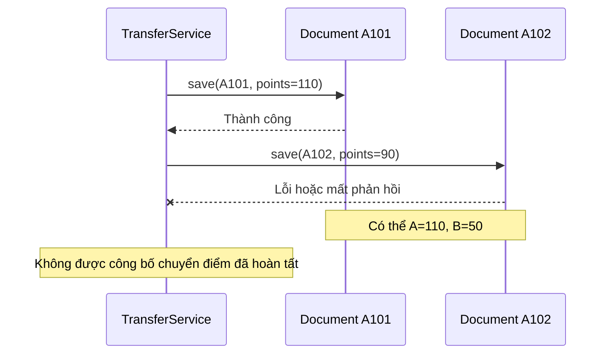
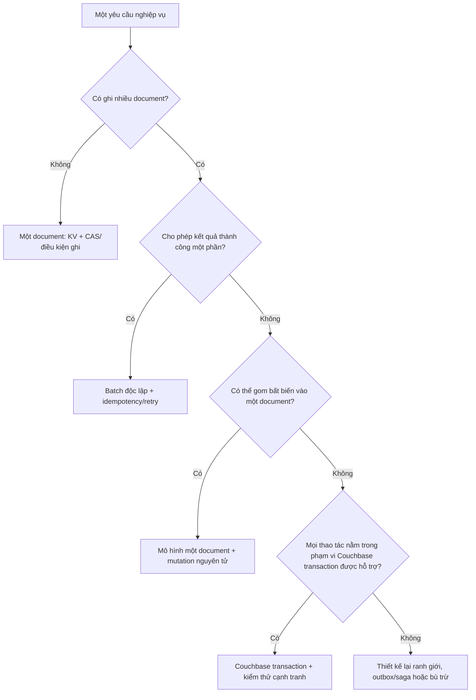

# Khi nào ràng buộc nghiệp vụ cần giao dịch nhiều tài liệu

Trong module **SPRING_DATA_COUCHBASE**, thao tác đọc, ghi hoặc xóa **một document** có thể được thực hiện qua `CouchbaseRepository`, `CouchbaseTemplate` hoặc Couchbase Java SDK. Khi nghiệp vụ thay đổi **nhiều document**, một câu hỏi xuất hiện: *Nếu chỉ một số thao tác thành công thì dữ liệu có còn hợp lệ hay không?*

Đó là câu hỏi để quyết định **có cần giao dịch nhiều tài liệu (multi-document transaction) hay không**. Một lần gọi `saveAll`, hai lần `save` liên tiếp hay một phương thức Java được đánh dấu `@Transactional` không tự bảo đảm toàn bộ thay đổi thuộc cùng một giao dịch Couchbase.

Bài học thuộc chương **Giao dịch** giải thích cách nhận diện **ràng buộc bất biến nghiệp vụ (business invariant)**, phân biệt những gì CAS trên một document có thể bảo vệ với những gì cần transaction, và cân nhắc khi nào nên thay transaction bằng mô hình một document, xử lý độc lập, eventual consistency hoặc quy trình bù trừ. Các ví dụ gắn với Spring Data Couchbase, document mapping, bucket/scope/collection, SQL++, chỉ mục, TTL, API reactive và các giới hạn vận hành thực tế.

## 1. Mục tiêu học tập

Sau bài học, bạn có thể:

- Viết rõ **bất biến nghiệp vụ** trước khi quyết định dùng transaction; nhận ra bất biến cần được bảo vệ trên **một document** hay **nhiều document**.
- Giải thích tại sao một chuỗi KV mutation, `repository.saveAll`, `deleteAllById` hoặc SQL++ thay đổi nhiều document không mặc nhiên cung cấp hợp đồng **all-or-nothing** cho cả nghiệp vụ.
- Phân biệt **atomicity**, **isolation**, **durability**, **CAS/optimistic locking**, **query scan consistency** và **idempotency**.
- Chọn tình huống phù hợp cho **Couchbase transactions**: chuyển điểm giữa hai tài khoản, tạo reservation cùng trừ tồn, duy trì document nghiệp vụ và document tra cứu liên quan.
- Hiểu những trường hợp **không cần transaction**: thao tác một document, các công việc độc lập chấp nhận kết quả từng phần, hoặc read model có thể cập nhật bất đồng bộ.
- Xây dựng luồng giao dịch nhiều document bằng Couchbase Java SDK, biết phải giữ toàn bộ thao tác thuộc **transaction context**.
- Phân loại lỗi xung đột, timeout, commit không rõ kết quả và retry an toàn; tránh tác động ngoài Couchbase bị lặp khi transaction callback được chạy lại.
- Thiết kế kiểm thử bất biến dưới đồng thời và sự cố, không chỉ kiểm tra đường chạy thành công.

## 2. Bắt đầu từ ràng buộc nghiệp vụ, không bắt đầu từ annotation

**Ràng buộc nghiệp vụ** là điều kiện dữ liệu phải đúng ở các trạng thái mà hệ thống tuyên bố là đã hoàn tất. Có ràng buộc chỉ liên quan một document, nhưng cũng có ràng buộc trải qua nhiều document.

Ví dụ hệ thống điểm thưởng có hai document:

```text
Bucket:      appdata
Scope:       loyalty
Collection:  accounts

Document key: account::tenant-a::A101
rewardPoints: 150

Document key: account::tenant-a::A102
rewardPoints: 50
```

Người dùng yêu cầu **chuyển 40 điểm** từ A101 sang A102. Bất biến cần giữ là:

\[P_{\text{A101}} \ge 0 \quad \text{và} \quad P_{\text{A101}} + P_{\text{A102}} = 200\]

Sau giao dịch thành công, trạng thái mong muốn:

```text
A101: 110
A102:  90
Tổng: 200
```

Nếu chỉ ghi A101 mà chưa ghi A102, tổng thành **160**. Trạng thái này **không hợp lệ nếu được công bố là một lần chuyển điểm đã hoàn tất**.

Đây là tình huống có **bất biến xuyên hai document**, vì hệ thống phải phối hợp cả việc trừ và cộng như một đơn vị. Chuyển điểm giữa hai customer không đơn thuần là “hai lời gọi `save`”; đó là **một hành động nghiệp vụ không được phép hoàn tất một nửa**.

### 2.1. Viết bất biến bằng một câu kiểm tra được

Thay vì nói “cần transaction vì thao tác có hai bước”, hãy mô tả rõ:

> Sau khi một lệnh chuyển điểm được xác nhận thành công, tổng điểm của hai tài khoản không đổi, tài khoản nguồn không âm và không có trường hợp chỉ một tài khoản được cập nhật.

Cách mô tả này có lợi vì:

1. Xác định được điều gì **không được phép xảy ra**.
2. Biết dữ liệu cần đọc để quyết định.
3. Biết dữ liệu cần thay đổi cùng nhau.
4. Biết cách viết integration test kiểm chứng.
5. Cho phép cân nhắc các giải pháp khác, không chỉ transaction.

### 2.2. Một mẫu câu để nhận diện transaction

Hãy hoàn thành câu sau cho use case của bạn:

```text
Nếu document A đã được thay đổi nhưng document B chưa được thay đổi,
thì __________________________ sẽ bị vi phạm.
```

Nếu phần trống là một **bất biến bắt buộc ngay khi commit**, transaction có thể cần thiết. Nếu phần trống chỉ là “màn hình B chậm cập nhật vài giây” và nghiệp vụ cho phép, eventual consistency có thể phù hợp hơn.

## 3. Điều gì sai khi ghi hai document độc lập?

Ví dụ hai entity Spring Data Couchbase đã được đọc:

```java
Account source = repository.findById(sourceKey).orElseThrow();
Account target = repository.findById(targetKey).orElseThrow();

source.setRewardPoints(source.getRewardPoints() - 40);
repository.save(source); // Có thể đã commit.

target.setRewardPoints(target.getRewardPoints() + 40);
repository.save(target); // Có thể ném exception.
```

Đoạn mã trên là **ví dụ phản diện**. Nếu thao tác thứ hai gặp timeout, lỗi quyền, lỗi CAS hoặc cluster có sự cố, mutation thứ nhất có thể đã được lưu. Exception không tự đảo ngược việc trừ điểm.



**Giới hạn quan trọng:** ngay cả khi cả hai mutation cuối cùng thành công, một tác vụ đọc khác có thể quan sát trạng thái ở giữa nếu không có cơ chế transaction/isolation phù hợp. Cần xem cả **atomic commit** lẫn **khả năng quan sát dữ liệu** của các actor liên quan.

### 3.1. `saveAll` không tự giải quyết vấn đề

```java
repository.saveAll(List.of(source, target));
```

Một lời gọi `saveAll` thuận tiện hơn trong code, nhưng không phải hợp đồng rằng **cả hai document cùng thành công hoặc cùng rollback**. Tương tự, `deleteAllById` nhận nhiều key cũng không tự tạo transaction.

Hãy phân biệt:

| Khái niệm | Ý nghĩa | Có bảo đảm cả hai document cùng commit? |
| --- | --- | --- |
| `save` trên một document | Một mutation theo key/entity | Không áp dụng cho document khác |
| `saveAll` trên nhiều entity | API xử lý một tập entity | **Không mặc nhiên** |
| `@Version`/CAS | Phát hiện bản cũ khi ghi **từng document** | **Không** |
| SQL++ `UPDATE`/`DELETE` trên nhiều hàng | Một statement truy vấn/thay đổi tập document | Không suy luận all-or-nothing cho cả workflow |
| Couchbase transaction dùng đúng context | Phối hợp các mutation được hỗ trợ trong phạm vi giao dịch | **Có**, theo bảo đảm và giới hạn của transaction API |
| Durability cho mỗi mutation | Mức xác nhận lưu trữ của mutation | **Không** biến một nhóm mutation thành transaction |

## 4. Atomicity, isolation, durability và consistency không giống nhau

Để xác định ràng buộc cần transaction, phải hiểu chính xác từng thuộc tính.

### 4.1. Atomicity: hoặc toàn bộ, hoặc không commit

Với một **transaction nhiều document** được thực hiện đúng API:

- Khi commit thành công, các mutation thuộc transaction được cam kết như một đơn vị.
- Khi transaction bị hủy trước commit, thay đổi của transaction không được xem là hoàn tất.
- Nếu client không nhận được xác nhận commit rõ ràng, **trạng thái kết quả có thể không chắc chắn từ góc nhìn client**; không tự kết luận đã rollback chỉ vì có timeout.

Atomicity là thuộc tính cốt lõi của trường hợp chuyển điểm A → B.

### 4.2. Isolation: tác vụ đồng thời nhìn thấy điều gì?

Một transaction còn cần chính sách cô lập khi nhiều actor đọc/ghi cùng dữ liệu. Điều quan trọng không chỉ là callback có đọc A và B, mà còn là các ghi đồng thời có thể xung đột hay không.

Không nên suy diễn rằng mọi Couchbase transaction cung cấp mọi bảo đảm của **serializable isolation** cho mọi kiểu truy vấn hoặc predicate. Hãy kiểm tra mức isolation và giới hạn của Couchbase Server/SDK đang dùng; với các bất biến theo số đếm hoặc điều kiện trên tập, đôi khi cần **một document giữ quota/guard** được ghi trong transaction để các request cạnh tranh cùng xung đột trên một điểm bảo vệ.

### 4.3. Durability: ghi được xác nhận bền vững tới mức nào?

Durability liên quan tới cách mutation được xác nhận trong cluster và khả năng duy trì khi lỗi nút. Nó **không** đồng nghĩa atomicity. Hai mutation KV mỗi mutation có durability cao vẫn có thể hoàn tất một phần nếu không dùng transaction.

### 4.4. Consistency: cả bất biến và mức mới của kết quả đọc

Trong thực tế, từ “consistency” được dùng theo hai nghĩa cần tách biệt:

- **Bất biến nghiệp vụ:** tổng điểm, số lượng hàng tồn, quan hệ giữa hai document phải đúng ở trạng thái commit.
- **Query scan consistency:** truy vấn SQL++ có thấy các mutation KV mới nhất trong secondary index hay chưa.

Mức `REQUEST_PLUS` giúp SQL++ chờ index theo ngữ nghĩa scan consistency; nó **không biến** chuỗi kiểm tra quota rồi ghi document thành một transaction. Ngược lại, có transaction đúng không có nghĩa mọi truy vấn độc lập ngoài transaction sẽ luôn có cùng chiến lược quan sát mới nhất nếu không đặt yêu cầu tương ứng.

## 5. Khi nào bắt buộc cân nhắc transaction nhiều document?

Một dấu hiệu mạnh là **thao tác chỉ có ý nghĩa khi các thay đổi liên quan được commit cùng nhau**.

| Tình huống nghiệp vụ | Các document phải thay đổi | Bất biến cần bảo vệ | Transaction có phù hợp? |
| --- | --- | --- | --- |
| Chuyển điểm A → B | Tài khoản nguồn, tài khoản đích | Không mất/nhân đôi điểm; nguồn không âm | **Có**, nếu hai tài khoản là nguồn sự thật |
| Giữ hàng cho đơn mới | Document tồn kho/quota và reservation/order | Không nhận reservation khi không còn tồn; không trừ tồn mà mất reservation | **Có**, khi đây là một đơn vị commit |
| Chuyển document sang archive | Document hiện tại và bản lưu archive | Không mất bản ghi hoặc tạo trạng thái không hợp lệ lúc commit | **Có** nếu cần move nguyên tử |
| Tạo thực thể và key tra cứu duy nhất | Document nghiệp vụ và guard/index document | Không có hai thực thể dùng cùng một mã/email nghiệp vụ | **Có hoặc thiết kế cùng một key**, tùy mô hình |
| Xóa tài khoản cùng trạng thái khóa liên quan | Document tài khoản và document trạng thái kiểm soát | Không để dữ liệu tham chiếu ở trạng thái vi phạm quy tắc | **Có** nếu ràng buộc phải giữ tức thời |
| Ghi order rồi cập nhật read model tìm kiếm | Order nguồn sự thật và projection để đọc | Projection có thể chậm vài giây | **Thường không bắt buộc**; outbox/eventual consistency có thể phù hợp |
| Cập nhật trạng thái 1.000 document độc lập | 1.000 key riêng | Từng phần tử được xử lý độc lập | **Thường không**; batch và retry riêng tốt hơn |
| Đọc hai document để dựng màn hình | Hai lần đọc | Không có thay đổi chung cần commit | **Không nhất thiết**; tùy yêu cầu snapshot |

Từ “bắt buộc” ở đây là **bắt buộc về bảo vệ bất biến**, không có nghĩa mọi bất biến xuyên hai document đều chỉ có một lời giải là transaction. Có thể thay đổi mô hình lưu trữ để bất biến nằm trong **một document**, hoặc thiết kế workflow chấp nhận trạng thái trung gian có kiểm soát.

## 6. Câu hỏi quyết định trước khi thêm transaction

Dùng cây quyết định sau khi thiết kế một use case:



Năm câu hỏi cần trả lời bằng văn bản:

1. **Bất biến là gì?** Ví dụ tổng điểm không đổi, tồn kho không âm, không hai tài khoản dùng cùng mã nghiệp vụ.
2. **Những document nào thuộc read set và write set?** Cần đọc gì để quyết định và sẽ sửa những key nào?
3. **Có khoảng thời gian nào được phép không nhất quán?** Nếu có, thời gian bao lâu và ai được nhìn thấy?
4. **Một thất bại ở bước thứ hai có được phép để nguyên bước thứ nhất?** Nếu không, phải có cơ chế nguyên tử hoặc khôi phục đảm bảo quy tắc.
5. **Các bước có nằm cùng một datastore/transaction context không?** Nếu có Kafka, email, PostgreSQL hoặc dịch vụ thanh toán, transaction Couchbase **không tự bao phủ** chúng.

## 7. Khi không cần transaction: một document đã đủ

Nếu các trường phải thay đổi cùng nhau nằm trong **một document**, Couchbase KV có thể thực hiện mutation của document đó như một đơn vị.

Ví dụ, customer có cả `rewardPoints` và `rewardTier`:

```json
{
  "tenantId": "tenant-a",
  "customerCode": "C102",
  "rewardPoints": 120,
  "rewardTier": "SILVER"
}
```

Một thao tác replace của document có thể cập nhật cả hai trường. Nếu có request cạnh tranh, Spring Data `@Version`/CAS hoặc KV CAS giúp phát hiện phiên bản cũ.

```java
Customer customer = repository.findById(customerKey)
        .orElseThrow();

customer.setRewardPoints(160);
customer.setRewardTier("GOLD");

repository.save(customer);
```

Ví dụ giả định entity có các getter/setter tương ứng. Mục đích là cho thấy **hai trường trong cùng một document** không tự yêu cầu transaction nhiều document.

### 7.1. Khi nào nên gom dữ liệu vào một document?

Ưu tiên xem xét khi:

- Hai trường luôn được đọc và ghi cùng nhau.
- Kích thước document và tần suất cập nhật vẫn phù hợp.
- Cần cập nhật nguyên tử nhiều thuộc tính trên **một key**.
- Có thể dùng CAS hoặc một thao tác sub-document/atomic counter được API hỗ trợ.

Tuy nhiên, gom mọi dữ liệu vào một document khổng lồ có thể gây **hot key**, tăng contention, payload và khó mở rộng. Thiết kế document là đánh đổi giữa tính nguyên tử cục bộ và quy mô truy cập.

### 7.2. CAS bảo vệ một document, không bảo vệ cả nhóm

`@Version` trong Spring Data Couchbase được sử dụng cho optimistic locking trên từng document khi API ghi hỗ trợ. Một phương thức:

```java
repository.saveAll(List.of(accountA, accountB));
```

dù hai entity đều có `@Version` vẫn **không tự rollback mutation đã hoàn tất của accountA khi accountB bị CAS conflict**. CAS hữu ích cho update an toàn của từng key; transaction phối hợp các mutation thành một đơn vị commit.

## 8. Khi không cần transaction: xử lý độc lập hoặc eventual consistency

Không phải mọi danh sách nhiều document đều phải được commit cùng nhau.

### 8.1. Các thay đổi độc lập

Ví dụ tác vụ gắn nhãn lại 5.000 customer độc lập. Nếu 4.980 thành công, 20 thất bại và có thể chạy lại, một batch có **checkpoint, trạng thái từng phần tử và retry idempotent** thường tiết kiệm hơn giữ một transaction rất lớn.

```text
Job ID: reclassify-2026-11
  C101 SUCCESS
  C102 SUCCESS
  C103 FAILED_RETRYABLE
  C104 UNKNOWN_RECONCILE
  ...
```

Một lỗi timeout có thể đồng nghĩa client **chưa biết kết quả**, không chứng minh mutation chưa commit. Cần đối chiếu key và trạng thái hiện tại trước khi retry các phép cộng/trừ không idempotent.

### 8.2. Read model hoặc dashboard được phép trễ

Giả sử mỗi lần tạo đơn hàng, ứng dụng cập nhật document `dashboard::daily-sales`. Nếu dashboard được phép trễ vài giây và order trong hệ thống là nguồn sự thật, có thể sử dụng event/outbox và cập nhật read model bất đồng bộ.

**Không cần transaction nhiều document chỉ để bảng dashboard luôn có số đếm mới nhất**, nếu yêu cầu sản phẩm cho phép eventual consistency và có cơ chế tái đồng bộ.

Nhưng nếu dashboard count được dùng **để thực thi hạn mức thanh toán hoặc quota bắt buộc**, nó không còn là read model đơn thuần; phải thiết kế ranh giới ghi/đọc phù hợp với bất biến.

## 9. Mô hình tài khoản điểm với Spring Data Couchbase

Giả sử hai tài khoản ở cùng collection `appdata.loyalty.accounts`. Document mẫu:

```json
{
  "tenantId": "tenant-a",
  "accountCode": "A101",
  "rewardPoints": 150,
  "status": "OPEN"
}
```

Entity dùng trong các thao tác repository thông thường:

```java
package com.example.loyalty;

import org.springframework.data.annotation.Id;
import org.springframework.data.annotation.Version;
import org.springframework.data.couchbase.core.mapping.Collection;
import org.springframework.data.couchbase.core.mapping.Document;
import org.springframework.data.couchbase.core.mapping.Field;
import org.springframework.data.couchbase.core.mapping.Scope;

@Document
@Scope("loyalty")
@Collection("accounts")
public class Account {

    @Id
    private String id;

    @Field
    private String tenantId;

    @Field
    private String accountCode;

    @Field
    private long rewardPoints;

    @Field
    private String status;

    @Version
    private Long version;

    public Account() {
    }

    public Account(String id, String tenantId,
                   String accountCode, long rewardPoints,
                   String status) {
        this.id = id;
        this.tenantId = tenantId;
        this.accountCode = accountCode;
        this.rewardPoints = rewardPoints;
        this.status = status;
    }

    public String getId() { return id; }
    public void setId(String id) { this.id = id; }

    public String getTenantId() { return tenantId; }
    public void setTenantId(String tenantId) {
        this.tenantId = tenantId;
    }

    public String getAccountCode() { return accountCode; }
    public void setAccountCode(String accountCode) {
        this.accountCode = accountCode;
    }

    public long getRewardPoints() { return rewardPoints; }
    public void setRewardPoints(long rewardPoints) {
        this.rewardPoints = rewardPoints;
    }

    public String getStatus() { return status; }
    public void setStatus(String status) { this.status = status; }

    public Long getVersion() { return version; }
    public void setVersion(Long version) { this.version = version; }
}
```

Repository:

```java
package com.example.loyalty;

import org.springframework.data.couchbase.repository.CouchbaseRepository;

public interface AccountRepository
        extends CouchbaseRepository<Account, String> {
}
```

Các phương thức `findById` và `save` hữu ích cho các thao tác độc lập. Tuy nhiên, **không** dùng hai lần `repository.save` thông thường cho việc chuyển điểm yêu cầu all-or-nothing nếu các lần gọi không được đặt trong một transaction được hỗ trợ.

Các annotation entity chọn scope/collection, **không tự tạo** keyspace. Ứng dụng cần kết nối bucket, scope, collection đúng và tài khoản có quyền đọc/ghi cần thiết.

## 10. Ví dụ giao dịch nhiều document qua Couchbase Java SDK

Couchbase Java SDK cung cấp **Transactions API** để thực thi các mutation được hỗ trợ bên trong một transaction context. Ví dụ chuyển điểm dưới đây cho thấy cách biểu đạt bất biến và dùng cùng transaction cho hai document.

### 10.1. Mã minh họa

```java
package com.example.loyalty;

import java.util.Objects;

import com.couchbase.client.java.Cluster;
import com.couchbase.client.java.Collection;
import com.couchbase.client.java.json.JsonObject;
import com.couchbase.client.java.transactions.TransactionGetResult;

public class LoyaltyTransfer {

    private final Cluster cluster;
    private final Collection accounts;

    public LoyaltyTransfer(Cluster cluster, Collection accounts) {
        this.cluster = cluster;
        this.accounts = accounts;
    }

    public void transfer(String authorizedTenantId,
                         String fromKey,
                         String toKey,
                         long amount) {

        if (amount <= 0) {
            throw new IllegalArgumentException(
                    "Số điểm phải lớn hơn 0");
        }
        if (Objects.equals(fromKey, toKey)) {
            throw new IllegalArgumentException(
                    "Không được chuyển cho cùng một tài khoản");
        }

        // authorizedTenantId phải xuất phát từ ngữ cảnh đã
        // xác thực và phân quyền; không tin tenant do client tự khai.
        cluster.transactions().run(ctx -> {
            TransactionGetResult from = ctx.get(accounts, fromKey);
            TransactionGetResult to = ctx.get(accounts, toKey);

            JsonObject fromJson = from.contentAsObject();
            JsonObject toJson = to.contentAsObject();

            if (!authorizedTenantId.equals(
                    fromJson.getString("tenantId"))
                    || !authorizedTenantId.equals(
                    toJson.getString("tenantId"))) {
                throw new IllegalStateException(
                        "Tài khoản không thuộc tenant được phép");
            }

            if (!"OPEN".equals(fromJson.getString("status"))
                    || !"OPEN".equals(toJson.getString("status"))) {
                throw new IllegalStateException(
                        "Tài khoản chưa sẵn sàng giao dịch");
            }

            Long sourcePoints = fromJson.getLong("rewardPoints");
            Long targetPoints = toJson.getLong("rewardPoints");
            if (sourcePoints == null || targetPoints == null) {
                throw new IllegalStateException(
                        "Document thiếu rewardPoints");
            }
            if (sourcePoints < amount) {
                throw new IllegalStateException(
                        "Số điểm không đủ");
            }

            // Ngăn tràn số ở phép cộng điểm.
            long newTarget = Math.addExact(targetPoints, amount);
            long newSource = sourcePoints - amount;

            ctx.replace(
                    from,
                    fromJson.put("rewardPoints", newSource));
            ctx.replace(
                    to,
                    toJson.put("rewardPoints", newTarget));
        });
    }
}
```

Ví dụ giả định `accounts` là đối tượng `Collection` SDK trỏ đúng `appdata.loyalty.accounts` và `cluster` đã được ứng dụng quản lý vòng đời. Hai key phải được xác minh đúng định dạng và đúng quyền người dùng trước khi thao tác.

**Điểm quyết định:** cả `ctx.get` và `ctx.replace` đều đi qua **cùng transaction context**. Nếu kiểm tra số điểm thất bại, callback ném exception trước commit; nếu transaction commit thành công, hai mutation thuộc cùng đơn vị giao dịch.

Các tên lớp/phương thức và option transaction có thể thay đổi giữa các phiên bản SDK. Khi áp dụng production, đối chiếu dependency và tài liệu API của phiên bản thực tế, nhất là transaction configuration, timeout và xử lý lỗi commit không rõ kết quả.

### 10.2. Vì sao ví dụ dùng SDK thay vì ép repository?

`CouchbaseRepository` và `CouchbaseTemplate` có lợi ích lớn trong entity mapping và CRUD thông thường. Nhưng không nên giả định rằng **gọi hai repository methods bên trong một Java lambda bất kỳ** sẽ tự tham gia Couchbase transaction.

Ví dụ SDK dùng rõ `ctx.get` và `ctx.replace` để biểu đạt một transaction. Khi dùng Spring Data Couchbase transaction integration, phải xác minh:

- Có transaction manager và integration đúng phiên bản không?
- `@Transactional` đang chọn **đúng transaction manager** không?
- Những Repository/Template operations có thật sự tham gia cùng transaction context không?
- Có truy vấn SQL++ hoặc SDK call nào nằm ngoài context không?
- Các yêu cầu về timeout, phiên bản Couchbase và keyspace có được hỗ trợ không?

**Chỉ thêm `@Transactional` là chưa đủ để tuyên bố có giao dịch Couchbase**, và càng không tạo giao dịch chung Couchbase + JPA/PostgreSQL.

### 10.3. SDK JSON và Spring Data entity mapping là hai tầng khác nhau

Ví dụ dùng `JsonObject` SDK trực tiếp; nó không tự đọc các annotation `@Document`/`@Field` hoặc converter của Spring Data. Vì vậy phải kiểm tra tên trường JSON, kiểu dữ liệu và version của document thực tế.

Nếu ứng dụng chủ yếu dùng entity mapping Spring Data nhưng có một thao tác transaction đặc biệt, hãy đặt logic SDK transaction trong **một persistence adapter/service riêng**, không rải `JsonObject` và chi tiết transaction vào mọi service nghiệp vụ.

## 11. Transaction callback, conflict và retry

Transaction không xóa bỏ cạnh tranh; nó cung cấp cơ chế phối hợp và phản ứng khi dữ liệu bị thay đổi đồng thời.

Hai request cùng chuyển điểm từ A101:

```text
T0: A101 = 100

Request X: đọc A101 = 100, muốn chuyển 70
Request Y: đọc A101 = 100, muốn chuyển 60

Nếu cả hai đều áp dụng độc lập, A101 có thể âm
hoặc dữ liệu nguồn/đích bị cập nhật mất cân đối.
```

Khi cùng cập nhật A101 qua transaction, các request có thể gặp conflict và một transaction phải retry/abort theo cơ chế được API hỗ trợ. Khi transaction được thử lại, điều kiện số điểm phải được **đánh giá lại trên trạng thái hợp lệ ở lần thử mới**.

### 11.1. Không đặt side effect bên ngoài trong callback có thể chạy lại

Không nên:

```java
cluster.transactions().run(ctx -> {
    // Những thao tác Couchbase transaction...
    emailService.sendTransferNotice(); // Không an toàn!
});
```

Callback có thể được SDK chạy lại khi gặp xung đột hoặc lỗi có thể retry theo chính sách. Email có thể gửi nhiều lần dù transaction chỉ commit một lần, hoặc gửi dù transaction cuối cùng thất bại.

Tương tự, tránh trong callback:

- Gọi cổng thanh toán.
- Gửi message tới broker không có cơ chế deduplication.
- Ghi side effect ra một database không tham gia transaction.
- Tăng một counter bên ngoài transaction.
- Phụ thuộc vào một lần gọi callback duy nhất để sinh ID/timestamp nghiệp vụ không có chính sách ổn định.

Cần dùng **outbox/event** được tạo có kiểm soát trong transaction (nếu nằm trong Couchbase và được hỗ trợ), hoặc thiết kế gửi sự kiện sau commit cùng idempotency, reconciliation thích hợp.

### 11.2. Trạng thái commit không rõ kết quả

Đặc biệt với lỗi mạng hoặc timeout ở giai đoạn commit, client có thể không phân biệt được:

- Transaction chưa commit.
- Transaction đã commit nhưng phản hồi xác nhận bị mất.
- Transaction đang ở trạng thái cần giải quyết/đối soát.

Vì thế, **không coi mọi exception là đã rollback** và không retry mù quáng một lệnh chuyển điểm.

Một phương án production là cấp `transferId` duy nhất theo yêu cầu nghiệp vụ, lưu dấu vết giao dịch/idempotency key được bảo vệ trong ranh giới nhất quán, rồi **đối chiếu theo transferId** nếu kết quả chưa rõ. Chỉ sau khi xác định lần chuyển trước không được áp dụng, hoặc đã áp dụng an toàn theo thiết kế idempotent, mới quyết định retry.

### 11.3. Transaction retry khác application retry

- **SDK transaction retry:** cơ chế thử lại nội bộ theo chính sách transaction và lỗi phù hợp.
- **Application retry:** service nhận lỗi, quyết định chạy lại use case.
- **User retry:** người dùng nhấn “Chuyển” lần nữa hoặc HTTP client gửi lại sau timeout.

Ba mức retry có thể cùng tồn tại. Nếu use case là **chuyển điểm**, cả ba mức phải thống nhất qua một **mã yêu cầu duy nhất** và quy tắc chống xử lý trùng.

## 12. Bất biến trên tập: quota, điều kiện đếm và write skew

Không phải ràng buộc nào cũng gắn với hai key cố định. Ví dụ tenant chỉ được có tối đa 100 reservation đang ACTIVE:

\[N_{\text{ACTIVE}}(\text{tenant-a}) \le 100\]

Mẫu dễ sai:

```java
long count = reservationRepository
        .countByTenantIdAndStatus("tenant-a", "ACTIVE");

if (count < 100) {
    reservationRepository.save(newReservation);
}
```

Hai request có thể cùng thấy `count = 99` rồi cùng thêm một document, khiến số lượng thành 101. Ngay cả khi dùng mức query scan consistency mạnh hơn, nó **không tự khóa khoảng trống giữa count và insert**.

### 12.1. Có transaction là đủ trong mọi trường hợp predicate không?

Không nên mặc định. Cần đánh giá mức isolation và cách phát hiện conflict đối với **predicate trên một tập document**. Nếu mỗi request chỉ thêm một reservation mới với key khác nhau, hai transaction có thể không ghi cùng một document. Tùy bảo đảm isolation thực tế, chỉ kiểm tra count rồi thêm bản ghi mới có thể chưa tạo được một **điểm cạnh tranh chung** để bảo vệ quota.

Một thiết kế mạnh hơn:

1. Tạo document `quota::tenant-a` chứa số slot đã dùng và hạn mức.
2. Mỗi lần tạo reservation phải **đọc và cập nhật quota document** cùng lúc với việc tạo reservation trong **một transaction**.
3. Các request cùng tenant sẽ tranh chấp cùng quota key, giúp phát hiện và xử lý cập nhật đồng thời.
4. Bảo đảm mọi đường tạo, hủy, hết hạn reservation đều cập nhật quota theo quy tắc nhất quán.

Nếu chỉ dùng CAS để tăng quota nhưng tạo reservation ở một mutation độc lập, có thể còn trạng thái “đã chiếm slot nhưng không có reservation” khi bước sau thất bại. Khi bất biến bắt buộc, cả hai phải nằm trong cùng transaction hoặc có một thiết kế khác đủ mạnh và có cơ chế phục hồi.

### 12.2. Unique field không đồng nghĩa unique key

Couchbase bảo đảm tính duy nhất của **document key trong collection**, nhưng không tự tạo unique constraint cho mọi trường JSON như `email`.

Nếu hai request cùng kiểm tra “email chưa tồn tại” bằng SQL++, rồi tạo hai customer có **hai key khác nhau**, phép kiểm tra ban đầu không bảo vệ uniqueness.

Một giải pháp là dùng document guard:

```text
customer::tenant-a::C102
unique-email::tenant-a::hash(normalized-email)
```

Trong transaction, insert-only guard và customer document như một đơn vị, hoặc thiết kế document key chính dựa trên định danh nghiệp vụ phù hợp. Khi xóa/đổi email, phải duy trì guard với cùng quy tắc nhất quán. Hash và chuẩn hóa email cần chính sách riêng; ví dụ chỉ minh họa ý tưởng, không phải cơ chế bảo mật tự động.

## 13. SQL++ trong transaction và ngoài transaction khác nhau

Spring Data Couchbase hỗ trợ truy vấn theo trường JSON bằng derived query, `@Query` hoặc Template. Những truy vấn này thường đi qua **SQL++ Query Service** và cần index.

Ví dụ đọc reservation ACTIVE:

```sql
SELECT META(r).id AS documentKey,
       r.tenantId,
       r.status
FROM `appdata`.`loyalty`.`reservations` AS r
WHERE r.tenantId = $tenantId
  AND r.status = "ACTIVE";
```

Một index minh họa:

```sql
CREATE INDEX ix_reservations_tenant_status
ON `appdata`.`loyalty`.`reservations`(
    tenantId,
    status
);
```

**Phân biệt rõ:**

- Query được gọi trực tiếp qua `cluster.query(...)` là một yêu cầu Query Service thông thường.
- Query được gọi qua API transaction như `ctx.query(...)` (khi được phiên bản SDK hỗ trợ) tham gia **transaction context** theo các tùy chọn và giới hạn của API đó.
- Một derived query repository thông thường **không tự động tham gia SDK transaction chỉ vì nó được gọi trong một callback Java**.
- Index scan consistency (`NOT_BOUNDED`, `REQUEST_PLUS` hoặc theo mutation state) không thay thế cơ chế transaction.

Nếu use case cần đọc theo điều kiện rồi ghi nhiều document, xác minh cách SQL++ tham gia transaction, quyền, index, timeout và mức isolation trước khi phụ thuộc vào kết quả. Khi invariant gắn với số lượng/tập hợp, nên cân nhắc **document guard** thay vì kỳ vọng một câu COUNT đơn lẻ tự bảo vệ toàn bộ predicate.

## 14. TTL, CAS, xóa và phạm vi keyspace

### 14.1. TTL có thể thay đổi tập document độc lập

Một document có expiration có thể hết hạn khi job đang chạy. Nếu mô hình tính quota dựa trên số reservation đang còn sống, TTL có thể làm số lượng giảm **mà không có request hủy rõ ràng**.

Khi duy trì quota/counter document, phải thiết kế cách xử lý expiration và reconciliation. Không mặc định rằng Couchbase tự cập nhật một counter document khác khi reservation hết hạn. Trường hợp TTL là công cụ dọn dẹp dữ liệu tạm, nhưng bất biến cần exact count, hãy cân nhắc lưu thêm trạng thái/hạn chót và quy trình hết hạn nhất quán.

### 14.2. CAS và transaction cùng tồn tại nhưng có vai trò khác

- CAS bảo vệ điều kiện ghi của **một document** theo version.
- Transaction điều phối các mutation được hỗ trợ **trên nhiều document**.
- Trong transaction, SDK có cơ chế phát hiện xung đột và retry riêng; không tự mang CAS đọc bên ngoài vào một callback và kỳ vọng nó tạo transaction.
- Nếu một document đã được cập nhật bởi tác vụ khác, transaction có thể cần retry/abort và nghiệp vụ phải đánh giá lại.

### 14.3. Xóa theo key và xóa theo điều kiện

`deleteById` tác động theo một document key; `deleteAllById` xử lý danh sách key và không tự all-or-nothing. SQL++ `DELETE ... WHERE` có thể ảnh hưởng nhiều document dựa trên index/điều kiện, nhưng không vì thế tự tạo transaction cho **cả use case**.

Nếu nghiệp vụ cần “archive document rồi xóa bản gốc” như một hành động không được hoàn tất một phần, hãy chọn transaction qua API hỗ trợ cả collection nguồn và đích, hoặc một quy trình bù trừ/idempotent với bất biến được định nghĩa rõ.

### 14.4. Bucket/scope/collection là một phần của phạm vi nghiệp vụ

Document key chỉ duy nhất trong **collection**. Hai key cùng chuỗi trong `appdata.loyalty.accounts` và `appdata.loyalty.archive` là hai document khác nhau.

Khi dùng transaction trên nhiều collection, kiểm tra khả năng hỗ trợ của server/SDK, cấu hình metadata transaction, quyền đọc–ghi và keyspace của từng thao tác. Không suy ra chỉ cần tên key giống nhau là transaction đang dùng đúng document.

## 15. So sánh ba hướng thiết kế cùng một ràng buộc

Giả sử cần cập nhật số chỗ trống và ghi reservation mới.

### Hướng A: hai mutation không có transaction

```text
1. Trừ inventory.available
2. Tạo reservation
```

Ưu điểm: đơn giản, ít overhead. Rủi ro: bước 1 commit, bước 2 lỗi → giữ chỗ bị mất mà reservation không tồn tại. **Không đạt bất biến mạnh** nếu không có cơ chế phục hồi nghiêm ngặt.

### Hướng B: gộp vào một document

```json
{
  "inventoryId": "P100",
  "available": 9,
  "reservations": [
    {"id": "R501", "status": "ACTIVE"}
  ]
}
```

Một mutation trên document duy nhất có thể cập nhật `available` và thêm reservation đồng thời. Ưu điểm: một key, atomicity đơn giản. Rủi ro: document tăng kích thước và trở thành hot key; đọc/ghi đặt chỗ có thể tranh chấp cao.

### Hướng C: transaction nhiều document

```text
Transaction:
  đọc inventory::P100
  kiểm tra available > 0
  cập nhật available - 1
  insert reservation::R501
Commit
```

Ưu điểm: giữ model tách document và bảo vệ bất biến cùng commit. Đánh đổi: cần transaction API, conflict handling, timeout, retry và kiểm thử tải.

**Chọn hướng dựa trên invariant, mô hình truy cập, contention và quy mô dữ liệu**, không chỉ vì “đang sử dụng Spring Data” hay muốn code ngắn.

## 16. Các giới hạn quan trọng khi dùng transaction

Transaction nhiều document không phải một công tắc để loại bỏ mọi rủi ro.

| Giới hạn | Điều cần hiểu |
| --- | --- |
| **Chi phí phối hợp** | Có thêm hoạt động đọc/ghi metadata và commit; không nên bọc mọi CRUD độc lập vào transaction |
| **Xung đột** | Nhiều transaction chạm cùng document có thể retry, abort hoặc tăng độ trễ |
| **Timeout** | Transaction quá dài dễ gặp lỗi và kết quả chưa rõ ở giai đoạn commit |
| **Query/index** | Query theo thuộc tính vẫn cần index; transaction không tự tạo index |
| **Tập đọc/ghi lớn** | Transaction trên quá nhiều document làm tăng tài nguyên và conflict |
| **Side effects** | Email, message broker và hệ thống ngoài không tự tham gia giao dịch Couchbase |
| **Cross-datastore** | Couchbase transaction không tự tạo ACID chung với PostgreSQL/JPA |
| **Kết quả không rõ** | Commit ambiguous yêu cầu đối soát/idempotency thay vì retry mù quáng |
| **DDL và vận hành** | Tạo bucket, scope, collection, index không phải một phần của transaction nghiệp vụ thông thường |
| **Version/khả năng hỗ trợ** | Cú pháp, tùy chọn và phạm vi API cần xác minh theo Couchbase Server/Java SDK/Spring Data version |

Nên thiết kế transaction **ngắn**, chỉ chứa các bước đọc/ghi cần bảo vệ invariant, hạn chế fan-out và tránh gọi dịch vụ chậm trong callback.

## 17. Reactive transactions: cách phối hợp khác, invariant vẫn vậy

Spring Data Couchbase có `ReactiveCouchbaseRepository` với các phương thức trả `Mono`/`Flux`. Couchbase Java SDK cũng cung cấp API transactions dạng reactive ở các phiên bản hỗ trợ.

Một lời gọi:

```java
Mono<Account> source =
        reactiveRepository.findById(sourceKey);

Mono<Account> target =
        reactiveRepository.findById(targetKey);
```

hoặc:

```java
Mono<Void> workflow = Mono.when(
        updateSource(),
        updateTarget());
```

**không tạo transaction nhiều document**. `Mono.when` chỉ phối hợp việc hoàn tất các publisher; nếu một publisher thất bại, mutation của publisher kia có thể đã thành công.

Nếu cần atomicity, sử dụng **reactive transaction API/context** được hỗ trợ, đặt các bước liên quan trong đúng phạm vi và xác minh cách retry/commit của phiên bản SDK. Không gọi `block()` tùy tiện trong reactive event loop; không chuyển từ imperative sang reactive với kỳ vọng tính nguyên tử tự xuất hiện.

Một quy trình reactive có side effect cần đặc biệt thận trọng khi `retryWhen`/resubscribe, bởi subscription lại có thể **thực thi mutation lần nữa** nếu không có idempotency.

## 18. Thiết kế kết quả API và đối soát

Một dịch vụ chuyển điểm có thể gặp ba trạng thái từ góc nhìn phía caller:

| Trạng thái | Ý nghĩa | Phản hồi/hành động |
| --- | --- | --- |
| `COMMITTED` | Transaction được xác nhận commit | Trả thành công và transferId |
| `REJECTED` | Điều kiện nghiệp vụ không thỏa, ví dụ số điểm không đủ | Trả lỗi nghiệp vụ; không retry tự động |
| `UNKNOWN` | Timeout/mất phản hồi, chưa kết luận commit | Trả trạng thái cần đối soát hoặc tra cứu qua transferId |

Các mã HTTP cụ thể tùy chính sách ứng dụng, nhưng **không được công bố giao dịch thành công khi chưa xác nhận** hoặc tự động phát lại một transfer có thể đã commit.

### 18.1. Idempotency key phải bảo vệ được ở thời điểm ghi

Một `transferId` do client tạo hoặc server cấp có thể được dùng làm key của document nghiệp vụ, ví dụ `transfer::tenant-a::T9001`. Khi xử lý yêu cầu, ứng dụng kiểm tra/ghi nhận transferId bằng một mutation insert-only hoặc transaction phù hợp.

Không chỉ dùng `existsById(transferId)` trước khi chuyển điểm: hai request có thể cùng thấy chưa có rồi cùng thực hiện. Hãy bảo vệ tính duy nhất **ngay khi ghi**, và để cùng một transferId được nhận diện là cùng một ý định nghiệp vụ trong các lần retry.

### 18.2. Audit và ledger

Đối với quy tắc tài chính hoặc điểm thưởng quan trọng, cân nhắc **ledger ghi nhận sự kiện chuyển điểm** bên cạnh số dư hiện tại. Ledger giúp kiểm toán, đối soát và phục hồi khi kết quả callback không rõ. Nếu ledger entry phải luôn tương ứng với hai thay đổi số dư, nó cũng nằm trong phạm vi transaction hoặc một thiết kế có bất biến phục hồi được chứng minh.

Transaction giải quyết atomic commit trong datastore, nhưng không thay thế yêu cầu audit, logging có kiểm soát và giám sát.

## 19. Kiểm thử bất biến dưới lỗi và concurrency

Một bài kiểm thử transaction tốt phải cố gắng chứng minh **trạng thái sai không thể được công bố như thành công**, thay vì chỉ kiểm tra method chạy hết mà không ném exception.

### 19.1. Kịch bản chuyển điểm

Chuẩn bị:

```text
A101 = 150
A102 = 50
Total = 200
```

Các tình huống:

1. **Thành công:** chuyển 40; kiểm tra A101 = 110, A102 = 90, tổng = 200.
2. **Không đủ điểm:** chuyển 160; callback từ chối, cả hai số dư giữ nguyên.
3. **Cùng key:** sourceKey = targetKey; yêu cầu bị từ chối trước transaction.
4. **Khác tenant:** một document không thuộc tenant đã được phép; không commit mutation.
5. **Document thiếu:** một key bị xóa trước khi transaction đọc; xử lý lỗi, không công bố chuyển thành công.
6. **Xung đột đồng thời:** hai transfer cùng đọc/cập nhật A101; chỉ những transfer hợp lệ sau retry mới được commit.
7. **Lỗi trước commit:** cố tình ném exception trong callback sau khi stage mutation thứ nhất; xác minh không có trạng thái hoàn tất một nửa được cam kết.
8. **Commit không rõ:** giả lập mất phản hồi ở giai đoạn commit; tra cứu trạng thái theo transferId thay vì lập tức chạy lại.
9. **Event bị gửi trùng:** kiểm tra consumer nhận cùng eventId hai lần vẫn không cộng/trừ điểm hai lần.
10. **Reactive resubscribe:** xác minh retry publisher không tạo transfer mới ngoài ý định.

### 19.2. Kiểm tra invariant bằng dữ liệu thực

```java
Account a = repository.findById(
        "account::tenant-a::A101").orElseThrow();

Account b = repository.findById(
        "account::tenant-a::A102").orElseThrow();

long total = Math.addExact(
        a.getRewardPoints(), b.getRewardPoints());

if (total != 200L) {
    throw new AssertionError(
            "Bất biến tổng điểm bị vi phạm");
}
```

Đây là kiểm tra hậu giao dịch **trong môi trường thử nghiệm cô lập**. Nếu có giao dịch khác đồng thời đang diễn ra, hai lần đọc repository độc lập không tự là snapshot thống nhất; cần sắp xếp test để kiểm tra sau khi tất cả tác vụ liên quan đã hoàn tất hoặc dùng cơ chế đọc nhất quán thích hợp. Không dùng phép đọc hai key độc lập làm bằng chứng cho isolation ở mọi thời điểm.

### 19.3. Kiểm thử năng lực vận hành

Ngoài tính đúng, đo:

- Latency p95/p99 của transaction khi tăng concurrency.
- Số lần retry/conflict/abort.
- Tỷ lệ timeout và commit ambiguous.
- Quy mô read set/write set của mỗi transaction.
- Lỗi quyền, thiếu index, keyspace sai và kết nối.
- Chi phí transaction so với giải pháp một document hoặc batch eventual.
- Khả năng phục hồi sau khi client hoặc nút mất kết nối.

Không có con số transaction throughput phù hợp cho mọi topology. Dùng dữ liệu, phiên bản Couchbase và tải đại diện để lựa chọn.

## 20. Bài thực hành có hướng dẫn

Thực hiện trên Couchbase thử nghiệm có bucket `appdata`, scope `loyalty`, collection `accounts`; tạo hai document account A101/A102 với điểm 150 và 50.

**Bài 1 — Phát hiện trạng thái hoàn tất một phần.** Viết service chuyển điểm bằng hai lần `repository.save`. Cố tình gây exception sau lần ghi thứ nhất trong môi trường cô lập. Ghi lại giá trị từng tài khoản và lý do bất biến không được bảo vệ.

**Bài 2 — Ghi rõ invariant.** Viết công thức tổng điểm phải không đổi và nguồn không âm. Xác định read set, write set, điều kiện từ chối và dữ liệu cần đối soát.

**Bài 3 — Transaction SDK.** Dùng transaction API ở mục 10 để chuyển 40 điểm. Đọc lại hai document sau khi commit thành công và xác minh kết quả 110/90.

**Bài 4 — Cạnh tranh.** Chạy đồng thời hai yêu cầu chuyển 100 điểm từ A101 trong các transaction riêng; ghi nhận request nào được commit hay từ chối sau đánh giá lại, không để điểm âm.

**Bài 5 — TTL/quota.** Thiết kế quota reservation theo tenant khi reservation có thể hết hạn TTL. Giải thích vì sao chỉ tăng/giảm một counter theo request tạo/hủy có thể bị lệch nếu expiration không được xử lý.

**Bài 6 — Unique email.** Đề xuất cách tạo customer và guard document theo email chuẩn hóa; mô phỏng hai request trùng email và chứng minh không tạo hai customer vi phạm quy tắc.

**Bài 7 — Outbox.** Phân tích nghiệp vụ “commit đơn hàng PostgreSQL rồi gửi cập nhật customer Couchbase”. Giải thích vì sao Couchbase transaction không bao trùm PostgreSQL, và đề xuất outbox/idempotency.

**Bài 8 — Reactive.** So sánh `Mono.when(updateA(), updateB())` với reactive transaction context, làm rõ cách xử lý error/rollback và retry.

Chỉ sử dụng dữ liệu có thể tạo lại. Không thử tiêm lỗi hoặc thực hiện giao dịch cạnh tranh trên collection vận hành thực tế.

## 21. Tự kiểm tra

1. Một use case ghi hai document nhưng hai thay đổi độc lập có bắt buộc cần transaction không? Vì sao?
2. Nếu chuyển 40 điểm bằng hai lần `save`, điều gì xảy ra nếu lần thứ hai lỗi sau khi lần thứ nhất đã commit?
3. `@Version`/CAS có tự rollback mutation của document khác không?
4. Vì sao `saveAll` và `deleteAllById` không được xem là transaction all-or-nothing?
5. Khi nào có thể thiết kế lại dữ liệu để chỉ phải cập nhật một document?
6. `REQUEST_PLUS` trong SQL++ có bảo đảm hai document cùng commit không?
7. Vì sao điều kiện `countByTenantIdAndStatus(...) < limit` không bảo vệ quota dưới hai request đồng thời?
8. Tại sao transaction nhiều document có thể cần một **quota guard document** cho bất biến theo tập?
9. Vì sao không nên gửi email từ transaction callback có khả năng được retry?
10. Lỗi timeout ở giai đoạn commit có chứng minh transaction chắc chắn đã rollback không?
11. Transaction Couchbase có tự commit cùng một JPA transaction ở PostgreSQL không?
12. Vì sao `Mono.when` không phải transaction?
13. Làm thế nào dùng transferId để tránh xử lý trùng một chuyển điểm khi client retry?
14. Khi nào batch có checkpoint và idempotency thích hợp hơn transaction?
15. Điều gì cần kiểm tra về SDK, transaction manager và keyspace trước khi đưa transaction vào production?

## 22. Ghi nhớ

**Ràng buộc nghiệp vụ cần giao dịch nhiều tài liệu khi trạng thái được công bố là hoàn tất chỉ hợp lệ nếu nhiều mutation được commit cùng nhau.** Hãy bắt đầu bằng cách viết invariant, xác định read/write set và tình huống thất bại; đừng bắt đầu bằng `@Transactional` hay `saveAll`.

Trong Spring Data Couchbase, **CAS** bảo vệ ghi đồng thời trên một document; **SQL++ index và scan consistency** quyết định khả năng tìm/quan sát dữ liệu theo query; **transaction context** mới phối hợp các mutation được hỗ trợ thành một đơn vị commit. Nếu có thể gom bất biến vào một document thì không nhất thiết phải dùng transaction nhiều document. Nếu nghiệp vụ chấp nhận nhất quán cuối cùng hoặc tác vụ độc lập, batch, outbox, saga và idempotency có thể phù hợp hơn.

Một thiết kế giao dịch tốt cũng phải giải quyết xung đột, callback retry, commit ambiguous, TTL, phạm vi bucket/scope/collection và side effect ngoài Couchbase. Chỉ công bố thành công khi có cơ sở xác nhận, và kiểm thử cả đường lỗi lẫn cạnh tranh trước khi đưa quy tắc nghiệp vụ vào vận hành.
